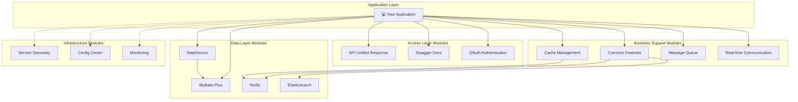

# Spring Support Parent Starter

[](https://www.oracle.com/java/)
[](https://spring.io/projects/spring-boot)
[](https://maven.apache.org/)
[](https://opensource.org/licenses/Apache-2.0)

## Project Introduction

**Spring Support Parent Starter** is an enterprise application support framework based on Spring Boot 3.x, providing a rich set of functional modules and components to help developers build enterprise-grade applications quickly. The framework adopts a modular design, introduce only what you need, covering database integration, caching, message queues, file storage, authentication/authorization, monitoring, and third-party service integration.

### Key Features

- 🚀 **Latest technology stack** - Spring Boot 3.x + Java 25 LTS
- 🧩 **Modular design** - Import on demand, avoid dependency redundancy
- 🏢 **Enterprise features** - Various components needed for production environments
- ⚙️ **Unified configuration management** - Consistent configuration style and management
- 📦 **Ready to use** - Pre-configured integration solutions, quick to get started
- 🔧 **Highly customizable** - Flexible configuration options to meet different needs
- 📚 **Complete documentation** - Detailed usage instructions and sample codes

## Architecture Design

### Module Layered Architecture



### Complete Module List

```
Spring Support Parent Starter
├── 🔧 Basic Features
│   ├── spring-support-common-starter          # Common features and utilities
│   ├── spring-support-datasource-starter      # DataSource configuration
│   └── spring-support-mybatis-starter         # MyBatis Plus integration
├── 🔐 Authentication
│   └── spring-support-oauth-client-starter    # OAuth client authentication
├── 💾 Cache & Storage
│   ├── spring-support-redis-starter           # Redis cache integration
│   ├── spring-support-filesystem-minio-starter # MinIO object storage
│   └── spring-support-filesystem-starter      # Unified file storage abstraction
├── 🛡️ Fault Tolerance & Stability
│   └── spring-support-strategy-starter        # Strategy & fallback
├── 📡 Message & Communication
│   ├── spring-support-queue-starter           # Message queue abstraction
│   ├── spring-support-queue-mqtt-starter      # MQTT message queue
│   ├── spring-support-queue-kafka-starter     # Kafka message queue
│   ├── spring-support-queue-rabbitmq-starter  # RabbitMQ message queue
│   ├── spring-support-queue-rocketmq-starter  # RocketMQ message queue
│   ├── spring-support-socket-starter          # Socket abstraction layer
│   ├── spring-support-socket-websocket-starter # WebSocket implementation
│   ├── spring-support-socket-io-starter       # Socket.IO implementation
│   ├── spring-support-socket-rsocket-starter  # RSocket implementation
│   ├── spring-support-socket-sse-starter      # SSE implementation
│   ├── spring-support-rpc-starter             # RPC remote call
│   ├── spring-support-sync-starter            # Sync services
│   └── spring-support-message-starter         # Message push
├── 🤖 AI / Deep Learning
│   └── spring-support-ai-starter              # Image detection, OCR, layout analysis, face features
├── 🛰️ APM Observation Modules
│   ├── spring-support-apm-starter           # APM core module (SPI + REST dual mode)
│   ├── spring-support-apm-skywalking-starter # SkyWalking APM extension
│   └── spring-support-apm-hotspot-starter   # Self-developed hotspot agent extension
├── 🔍 Search & Data Processing
│   └── spring-support-elasticsearch-starter   # Elasticsearch search engine
├── 🌐 Service Discovery & Config
│   ├── spring-support-discovery-starter       # Service discovery
│   └── spring-support-configcenter-starter    # Config center
├── 📊 Monitoring & Logging
│   ├── spring-support-report-client-starter   # Device report client
│   └── spring-support-report-client-arthas-starter # Arthas diagnostics
├── 📚 API Docs
│   └── spring-support-swagger-starter         # Swagger API documentation
├── 🛠️ Operations & Maintenance
│   ├── spring-support-shell-starter           # SSH Shell management
│   ├── spring-support-ssh-starter             # SSH service
│   ├── spring-support-job-starter             # Scheduled tasks
│   └── spring-support-proxy-starter           # Proxy management & embedded services
├── 🌐 API Gateway
│   └── spring-support-gateway-starter         # API gateway
└── 🔌 Third-party Integration
    ├── spring-support-tencent-starter         # Tencent cloud services
    └── spring-support-pay-client-starter      # Payment client
```

## Quick Start

### Requirements

- **Java**: 25 or higher
- **Maven**: 3.6+ or **Gradle**: 7.0+
- **Spring Boot**: 3.4.5

### Dependency

#### Maven

```xml
<dependency>
    <groupId>com.chua</groupId>
    <artifactId>spring-support-common-starter</artifactId>
    <version>4.0.0.32</version>
</dependency>

<!-- Add other modules as needed -->
<dependency>
    <groupId>com.chua</groupId>
    <artifactId>spring-support-circuit-breaker-starter</artifactId>
    <version>4.0.0.32</version>
</dependency>
```

#### Gradle

```
implementation 'com.chua:spring-support-common-starter:4.0.0.32'
implementation 'com.chua:spring-support-circuit-breaker-starter:4.0.0.32'
```

### Feature Toggles

**Important:** Starting from v4.0.0.32, all functional modules have an `enable` configuration switch, default value `false`.

**Principles:**

- ✅ All features are disabled by default to avoid unnecessary resource usage
- ✅ Explicitly set `enable: true` when a feature is needed
- ✅ Unified configuration prefix: `plugin.{module}.enable`

**Example:**

```yaml
# Common features
plugin:
  # API unified response
  api:
    enable: true # whether to enable API unified encapsulation, default false

  # Redis cache
  redis:
    server:
      enable: true # whether to enable Redis service, default false

  # MyBatis database
  mybatis:
    enable: true # whether to enable MyBatis Plus extension, default false

  # OAuth client
  oauth:
    client:
      enable: true # whether to enable OAuth client, default false

  # Circuit breaker and rate limiter
  circuit-breaker:
    enable: true # whether to enable circuit breaking and rate limiting
    circuit-breaker:
      failure-rate-threshold: 50.0 # failure rate threshold, opens the breaker when exceeded
      minimum-number-of-calls: 10 # minimum number of calls in the statistical window
    rate-limiter:
      limit-for-period: 100    # allowed requests per refresh period
      limit-refresh-period: 1s # rate limiting window size
      enable-management: true  # whether to expose management capabilities
```

### All Module Switches

| Module | Config Prefix | Default | Description |
|---|---|---|---|
| **Basic** |
| Actuator | `plugin.actuator.enable` | false | Monitor endpoints |
| API | `plugin.api.enable` | false | API unified config |
| API CORS | `plugin.api.cors.enable` | false | Cross-domain config |
| Cache | `plugin.cache.enable` | false | Cache management |
| Jackson | `plugin.jackson.enable` | false | JSON serialization |
| Log | `plugin.log.enable` | false | Log config |
| Async | `plugin.async.enable` | false | Async thread pools |
| Captcha | `plugin.captcha.enable` | false | Captcha |
| Create Table | `plugin.create-table.enable` | false | Auto create tables |
| IP | `plugin.ip.enable` | false | IP resolver |
| Message Converter | `plugin.message-converter.enable` | false | Message converter |
| Notice | `plugin.notice.enable` | false | Notice |
| Optional | `plugin.optional.enable` | false | Optional config |
| **Database** |
| MyBatis | `plugin.mybatis.enable` | false | MyBatis Plus |
| MyBatis Tenant | `plugin.tenant.enable` | false | Multi-tenant |
| DataSource Script | `plugin.datasource.script.enable` | true | DataSource scripts |
| Multi DataSource | `plugin.datasource.multi.enable` | false | Multi data source |
| Transaction | `plugin.transaction.enable` | false | Transaction mgmt |
| **Cache & Storage** |
| Redis | `plugin.redis.server.enable` | false | Redis service |
| Minio | `plugin.minio.enable` | false | Object storage |
| Elasticsearch | `plugin.elasticsearch.enable` | false | Search engine |
| **Authentication** |
| OAuth Client | `plugin.oauth.client.enable` | false | OAuth client |
| **Message & Communication** |
| Email | `plugin.email.enable` | false | Email sending |
| MQTT | `plugin.mqtt.enable` | false | MQTT messages |
| Socket.IO | `plugin.socketio.enable` | false | Socket.IO |
| SSE | `plugin.sse.enable` | false | Server-Sent Events |
| Socket | `plugin.socket.enable` | false | TCP/UDP Socket |
| RPC | `plugin.rpc.enable` | false | RPC remote call |
| **Service Governance** |
| Discovery | `plugin.discovery.enable` | false | Service discovery |
| Config Center | `plugin.config-center.enable` | false | Config center |
| Sync | `plugin.sync.enable` | false | Sync service |
| **Monitoring** |
| Prometheus | `plugin.prometheus.enable` | false | Prometheus monitoring |
| Report Client | `plugin.report.enable` | false | Report client |
| Arthas Client | `plugin.arthas.enable` | false | Arthas diagnostics |
| **Other** |
| Pay Client | `plugin.pay.enable` | false | Payment client |
| Swagger | `plugin.swagger.enable` | false | API docs |
| Proxy Management | `plugin.proxy.enable` | false | Proxy instance mgmt |
| Shell | `plugin.shell.enable` | false | Shell service |
| SSH | `plugin.ssh.enable` | false | SSH service |
| Tencent | `plugin.tencent.mini-app.enable` | false | Tencent cloud services |

### Simple Example

```
@RestController
@RequestMapping("/api/users")
public class UserController {

    @Autowired
    private UserService userService;

    @GetMapping("/{id}")
    @CircuitBreakerProtection(
        circuitBreaker = "userService",
        rateLimiter = "userService",
        fallbackMethod = "getUserFallback"
    )
    public User getUser(@PathVariable Long id) {
        return userService.findById(id);
    }

    @PostMapping
    @RateLimiter(
        name = "createUser",
        limitForPeriod = 10,
        dimension = RateLimiter.Dimension.IP,
        message = "Create user requests are too frequent"
    )
    public User createUser(@RequestBody User user) {
        return userService.save(user);
    }

    // Fallback method
    public User getUserFallback(Long id, Exception ex) {
        return User.builder()
                .id(id)
                .name("default user")
                .build();
    }
}
```

## Module Description

### Basic Features

#### spring-support-common-starter

**Common features and utilities module**

Provides commonly used basic features for enterprise app development:

- Unified response handling and exception handling
- Parameter validation and data conversion
- Cache support and management
- Captcha generation and verification
- Unified interface for file storage
- Data encryption and privacy protection
- Async tasks and thread pool management
- Common interceptors and filters

**Maven dependency:**

```xml
<dependency>
    <groupId>com.chua</groupId>
    <artifactId>spring-support-common-starter</artifactId>
    <version>4.0.0.32</version>
</dependency>
```

**Config example:**

```yaml
plugin:
  parameter:
    enable: true # enable unified response format
  cache:
    type: ["default", "redis"]
    redis:
      ttl: 600 # cache time (seconds)
```

#### spring-support-datasource-starter

**DataSource configuration and management module**

Provides multi-data source configuration and management:

- Dynamic switching between multiple data sources
- Connection pool management
- Database connection monitoring
- Enhanced transaction management

**Maven dependency:**

```xml
<dependency>
    <groupId>com.chua</groupId>
    <artifactId>spring-support-datasource-starter</artifactId>
    <version>4.0.0.32</version>
</dependency>
```

#### spring-support-mybatis-starter

**MyBatis Plus integration module**

Database operations enhanced based on MyBatis Plus:

- Automatic code generation
- Pagination plugin integration
- Optimistic locking support
- Logical deletion
- Auto-fill functionality

**Maven dependency:**

```xml
<dependency>
    <groupId>com.chua</groupId>
    <artifactId>spring-support-mybatis-starter</artifactId>
    <version>4.0.0.32</version>
</dependency>
```

### Fault Tolerance & Stability

#### spring-support-circuit-breaker-starter

**Circuit breaker, fallback and enhanced rate limiting module**

Complete fault tolerance solution based on Resilience4j:

- 🔥 **Circuit breaker** - Prevent cascading failures, fail fast
- 🔄 **Retry** - Automatically retry failed operations
- 🚦 **Enhanced rate limiting** - Multi-dimensional rate limiting (IP, user, API, global)
- 🏠 **Bulkhead isolation** - Resource isolation, prevent resource exhaustion
- ⏰ **Timeout control** - Prevent long waits
- 📊 **Dynamic management** - Web management interface, real-time monitoring and config

**Maven dependency:**

```xml
<dependency>
    <groupId>com.chua</groupId>
    <artifactId>spring-support-circuit-breaker-starter</artifactId>
    <version>4.0.0.32</version>
</dependency>
```

**Config example:**

```yaml
plugin:
  circuit-breaker:
    enable: true
    # Circuit breaker config
    circuit-breaker:
      failure-rate-threshold: 50.0
      minimum-number-of-calls: 10
      instances:
        userService:
          failure-rate-threshold: 30.0

    # Enhanced rate limiter config
    rate-limiter:
      limit-for-period: 100
      limit-refresh-period: 1s
      enable-management: true # enable management page
      rules:
        api-limit:
          name: "API rate limit"
          pattern: "/api/**"
          limit-for-period: 50
          dimension: API
        ip-limit:
          name: "IP rate limit"
          pattern: "/**"
          limit-for-period: 1000
          dimension: IP
```

**Usage:**

```
// Use combined annotation
@CircuitBreakerProtection(
    circuitBreaker = "userService",
    rateLimiter = "userService",
    fallbackMethod = "fallback"
)
public User getUser(Long id) { ... }

// Use dedicated rate limiter annotation
@RateLimiter(
    name = "searchUsers",
    limitForPeriod = 20,
    dimension = RateLimiter.Dimension.IP,
    message = "Search requests are too frequent"
)
public List<User> searchUsers(String keyword) { ... }
```

**Management page:** visit `http://localhost:8080/actuator/rate-limiter` to view the rate limiting management interface

### Cache & Storage

#### spring-support-redis-starter

**Redis cache integration module**

Provides complete Redis cache integration:

- Redis connection pool config
- Distributed lock implementation
- Cache annotation enhancement
- Serialization config
- Cluster support

**Maven dependency:**

```xml
<dependency>
    <groupId>com.chua</groupId>
    <artifactId>spring-support-redis-starter</artifactId>
    <version>4.0.0.32</version>
</dependency>
```

#### spring-support-minio-starter

**MinIO object storage module**

MinIO object storage integration:

- File upload/download
- Bucket management
- File preview and sharing
- Permission control

**Maven dependency:**

```xml
<dependency>
    <groupId>com.chua</groupId>
    <artifactId>spring-support-minio-starter</artifactId>
    <version>4.0.0.32</version>
</dependency>
```

### Message & Communication

#### spring-support-email-starter

**Email sending service module**

Enterprise email sending solution:

- Multiple email service providers
- Template emails
- Attachment support
- Send status tracking

**Maven dependency:**

```xml
<dependency>
    <groupId>com.chua</groupId>
    <artifactId>spring-support-email-starter</artifactId>
    <version>4.0.0.32</version>
</dependency>
```

#### spring-support-mqtt-starter

**MQTT message queue module**

MQTT protocol messaging integration:

- Publish/subscribe pattern
- QoS guarantees
- Connection management
- Message persistence

**Maven dependency:**

```xml
<dependency>
    <groupId>com.chua</groupId>
    <artifactId>spring-support-mqtt-starter</artifactId>
    <version>4.0.0.32</version>
</dependency>
```

### Search & Data Processing

#### spring-support-elasticsearch-starter

**Elasticsearch search engine module**

Elasticsearch integration and search:

- Full-text search
- Aggregate analysis
- Index management
- Query builder

**Maven dependency:**

```xml
<dependency>
    <groupId>com.chua</groupId>
    <artifactId>spring-support-elasticsearch-starter</artifactId>
    <version>4.0.0.32</version>
</dependency>
```

### Monitoring & Logging

#### spring-support-prometheus-starter

**Prometheus monitoring module**

Application performance monitoring and metrics collection:

- Custom metrics
- JVM monitoring
- HTTP request monitoring
- Database connection pool monitoring

**Maven dependency:**

```xml
<dependency>
    <groupId>com.chua</groupId>
    <artifactId>spring-support-prometheus-starter</artifactId>
    <version>4.0.0.32</version>
</dependency>
```

#### spring-support-loki-starter

**Loki log collection module**

Integrate Grafana Loki for log collection and analysis:

- Structured logs
- Log aggregation
- Real-time log streaming
- Log querying and filtering

**Maven dependency:**

```xml
<dependency>
    <groupId>com.chua</groupId>
    <artifactId>spring-support-loki-starter</artifactId>
    <version>4.0.0.32</version>
</dependency>
```

### Authentication & Security

#### spring-support-oauth-client-starter

**OAuth client authentication module**

OAuth 2.0 client integration:

- Multiple OAuth providers
- Token management
- User info retrieval
- Permission control

**Maven dependency:**

```xml
<dependency>
    <groupId>com.chua</groupId>
    <artifactId>spring-support-oauth-client-starter</artifactId>
    <version>4.0.0.32</version>
</dependency>
```

#### spring-support-token-starter

**Token authentication module**

Database-based token authentication:

- Token generation and verification
- IP whitelist control
- Token validity management
- User association authentication

**Maven dependency:**

```xml
<dependency>
    <groupId>com.chua</groupId>
    <artifactId>spring-support-token-starter</artifactId>
    <version>4.0.0.32</version>
</dependency>
```

### Service Discovery & Configuration

#### spring-support-discovery-starter

**Service discovery module**

Service discovery in microservice architectures:

- Service registration and discovery
- Health checks
- Load balancing
- Service routing

**Maven dependency:**

```xml
<dependency>
    <groupId>com.chua</groupId>
    <artifactId>spring-support-discovery-starter</artifactId>
    <version>4.0.0.32</version>
</dependency>
```

#### spring-support-configcenter-starter

**Configuration center module**

Distributed configuration management:

- Hot configuration updates
- Environment isolation
- Configuration versioning
- Configuration encryption

**Maven dependency:**

```xml
<dependency>
    <groupId>com.chua</groupId>
    <artifactId>spring-support-configcenter-starter</artifactId>
    <version>4.0.0.32</version>
</dependency>
```

### API Docs

#### spring-support-swagger-starter

**Swagger API documentation module**

Automatically generate API docs:

- OpenAPI 3.0 support
- Interactive documentation interface
- API testing
- Documentation customization

**Maven dependency:**

```xml
<dependency>
    <groupId>com.chua</groupId>
    <artifactId>spring-support-swagger-starter</artifactId>
    <version>4.0.0.32</version>
</dependency>
```

**Config example:**

```yaml
springdoc:
  api-docs:
    enabled: true
    path: /v3/api-docs
  swagger-ui:
    enabled: true
    path: /swagger-ui.html
```

### Database Extensions

#### spring-support-mybatis-tenant-starter

**MyBatis multi-tenant support module**

Multi-tenant data isolation for SaaS apps:

- Tenant data isolation
- Dynamic data source switching
- Tenant context management
- Data permission control

**Maven dependency:**

```xml
<dependency>
    <groupId>com.chua</groupId>
    <artifactId>spring-support-mybatis-tenant-starter</artifactId>
    <version>4.0.0.32</version>
</dependency>
```

### Third-party Integration

#### spring-support-tencent-starter

**Tencent cloud services integration**

Tencent cloud SDK integration:

- Cloud Object Storage (COS)
- SMS (短信服务)
- Face recognition
- Speech recognition

**Maven dependency:**

```xml
<dependency>
    <groupId>com.chua</groupId>
    <artifactId>spring-support-tencent-starter</artifactId>
    <version>4.0.0.32</version>
</dependency>
```

#### spring-support-pay-client-starter

**Payment client module**

Multi-payment platform integration:

- Alipay
- WeChat Pay
- UnionPay
- Payment callback handling

**Maven dependency:**

```xml
<dependency>
    <groupId>com.chua</groupId>
    <artifactId>spring-support-pay-client-starter</artifactId>
    <version>4.0.0.32</version>
</dependency>
```

#### spring-support-guacamole-starter

**Apache Guacamole remote desktop module**

Remote desktop access:

- VNC protocol
- RDP protocol
- SSH protocol
- Web-based remote access

**Maven dependency:**

```xml
<dependency>
    <groupId>com.chua</groupId>
    <artifactId>spring-support-guacamole-starter</artifactId>
    <version>4.0.0.32</version>
</dependency>
```

### Real-time Communication

#### spring-support-socketio-starter

**Socket.IO real-time communication module**

WebSocket real-time communication:

- Real-time message push
- Room management
- Event processing
- Connection management

**Maven dependency:**

```xml
<dependency>
    <groupId>com.chua</groupId>
    <artifactId>spring-support-socketio-starter</artifactId>
    <version>4.0.0.32</version>
</dependency>
```

#### spring-support-sse-starter

**Server-Sent Events module**

Server push events:

- Unidirectional data flow
- Auto reconnect
- Event type support
- Browser compatibility

**Maven dependency:**

```xml
<dependency>
    <groupId>com.chua</groupId>
    <artifactId>spring-support-sse-starter</artifactId>
    <version>4.0.0.32</version>
</dependency>
```

#### spring-support-rpc-starter

**RPC remote call module**

Remote procedure call support:

- Multi-protocol support
- Service discovery integration
- Load balancing
- Fault tolerance

**Maven dependency:**

```xml
<dependency>
    <groupId>com.chua</groupId>
    <artifactId>spring-support-rpc-starter</artifactId>
    <version>4.0.0.32</version>
</dependency>
```

## Version Compatibility

| Spring Support | Spring Boot | Java | Description |
|---|---|---|---|
| 4.0.0.32 | 3.4.5 | 25+ | Current version, recommended |
| 4.0.0.x | 3.2.x | 25+ | Stable version |

## Changelog

### v4.0.0.32 (2024-12-20)

#### New Features

- **Enhanced rate limiting**: Migrated from common module to circuit-breaker module, implemented with resilience4j
- **Multi-dimensional limiting**: Supports global, IP, user, API four limiting dimensions
- **Dynamic management page**: Provides web interface for real-time monitoring and management of rate limiters
- **SpEL expression support**: Rate limit keys support Spring Expression Language

#### Improvements

- **Module restructuring**: Optimized module interdependencies, improved maintainability
- **Unified configuration**: Unified config naming conventions across modules
- **Documentation**: Updated all module usage docs and examples

#### Fixes

- Fixed performance issues with rate limiting under high concurrency
- Optimized circuit breaker state transition logic

## Contributing

We welcome all kinds of contributions, including but not limited to:

1. **Submit Issue** - Report bugs or suggest new features
2. **Submit PR** - Fix bugs or implement new features
3. **Improve docs** - Improve documentation or add examples
4. **Share experience** - Share usage insights and best practices

### Development Process

1. Fork the repo
2. Create a feature branch (`git checkout -b feature/AmazingFeature`)
3. Commit changes (`git commit -m 'Add some AmazingFeature'`)
4. Push to branch (`git push origin feature/AmazingFeature`)
5. Create Pull Request

## License

This project uses the [Apache License 2.0](LICENSE) license.

## Contact

- **Author**: CH
- **Email**: [your-email@example.com]
- **Project**: [https://gitee.com/achtk/spring-support-parent-starter]

## Thanks

Thanks to these open-source projects:

- [Spring Boot](https://spring.io/projects/spring-boot)
- [Resilience4j](https://resilience4j.readme.io/)
- [MyBatis Plus](https://baomidou.com/)
- [Redis](https://redis.io/)
- [Elasticsearch](https://www.elastic.co/)

### Module Docs

> 💡 **Tip:** Click a module name for detailed docs and config instructions. For complete config examples, see [`application-example.yml`](application-example.yml) and [`application-example.properties`](application-example.properties).

- **[spring-support-common-starter](spring-support-common-starter/README.md)** - Common utilities module
- **[spring-support-swagger-starter](spring-support-swagger-starter/README.md)** - API docs module
- **[spring-support-gateway-starter](spring-support-gateway-starter/README.md)** - Gateway module
- **[spring-support-oauth-client-starter](spring-support-oauth-client-starter/README.md)** - OAuth client module
- **[spring-support-datasource-starter](spring-support-datasource-starter/README.md)** - DataSource module
- **[spring-support-mybatis-starter](spring-support-mybatis-starter/README.md)** - MyBatis module
- **[spring-support-redis-starter](spring-support-redis-starter/README.md)** - Redis module
- **[spring-support-elasticsearch-starter](spring-support-elasticsearch-starter/README.md)** - Elasticsearch module
- **[spring-support-filesystem-starter](spring-support-filesystem-starter/README.md)** - File system module
- **[spring-support-filesystem-minio-starter](spring-support-filesystem-minio-starter/README.md)** - MinIO storage module
- **[spring-support-queue-starter](spring-support-queue-starter/README.md)** - Message queue abstraction
- **[spring-support-queue-rabbitmq-starter](spring-support-queue-rabbitmq-starter/README.md)** - RabbitMQ
- **[spring-support-queue-kafka-starter](spring-support-queue-kafka-starter/README.md)** - Kafka
- **[spring-support-queue-rocketmq-starter](spring-support-queue-rocketmq-starter/README.md)** - RocketMQ
- **[spring-support-queue-mqtt-starter](spring-support-queue-mqtt-starter/README.md)** - MQTT
- **[spring-support-socket-starter](spring-support-socket-starter/README.md)** - Socket abstraction
- **[spring-support-socket-websocket-starter](spring-support-socket-websocket-starter/README.md)** - WebSocket
- **[spring-support-socket-io-starter](spring-support-socket-io-starter/README.md)** - Socket.IO
- **[spring-support-socket-rsocket-starter](spring-support-socket-rsocket-starter/README.md)** - RSocket
- **[spring-support-socket-sse-starter](spring-support-socket-sse-starter/README.md)** - SSE
- **[spring-support-discovery-starter](spring-support-discovery-starter/README.md)** - Service discovery
- **[spring-support-configcenter-starter](spring-support-configcenter-starter/README.md)** - Config center
- **[spring-support-rpc-starter](spring-support-rpc-starter/README.md)** - RPC
- **[spring-support-report-client-starter](spring-support-report-client-starter/README.md)** - Report module
- **[spring-support-report-client-arthas-starter](spring-support-report-client-arthas-starter/README.md)** - Arthas diagnostics
- **[spring-support-pay-client-starter](spring-support-pay-client-starter/README.md)** - Payment
- **[spring-support-tencent-starter](spring-support-tencent-starter/README.md)** - Tencent cloud
- **[spring-support-message-starter](spring-support-message-starter/README.md)** - Message notification
- **[spring-support-ai-starter](spring-support-ai-starter/README.md)** - AI integration
- **[spring-support-job-starter](spring-support-job-starter/README.md)** - Scheduled tasks
- **[spring-support-proxy-starter](spring-support-proxy-starter/README.md)** - Proxy management
- **[spring-support-shell-starter](spring-support-shell-starter/README.md)** - Shell command
- **[spring-support-ssh-starter](spring-support-ssh-starter/README.md)** - SSH service
- **[spring-support-sync-starter](spring-support-sync-starter/README.md)** - Data sync
- **[spring-support-strategy-starter](spring-support-strategy-starter/README.md)** - Strategy pattern
- **[spring-support-plugin-starter](spring-support-plugin-starter/README.md)** - Plugin system (PF4J compatible)
  - Complete plugin lifecycle management: `loadPlugin`, `startPlugin`, `stopPlugin`, `unloadPlugin`, `reloadPlugin`
  - Extension point mechanism: `ExtensionPoint` interface and `@Extension` annotation
  - Plugin isolation with `PluginClassLoader`
  - Hot loading with `DirectoryWatcher`
  - Spring Bean auto-registration
  - Controller mapping management
  - Windows file lock handling
  - DEVELOPMENT/PRODUCTION modes
  - Plugin context and bean naming isolation (`{pluginId}.{beanName}`)
  - Plugin uninstall resource cleanup

## GraalVM Native Image Support

This project (Spring Boot 4.1.0) provides basic support for GraalVM Native Image. Module-level `META-INF/native-image` reflection and resource metadata covers the following modules:

- `spring-support-common-starter`, `spring-support-ai-starter`, `spring-support-filesystem-starter`
- `spring-support-rpc-starter`, `spring-support-socket-io-starter`, `spring-support-sync-starter`

### Building Native Image

Execute in your **application module** (containing the `@SpringBootApplication` entry class):

```bash
# Build native executable (Linux/macOS/WSL)
mvn -Pnative native:compile

# Windows Native Image requires GraalVM for JDK 25, using Visual Studio build toolchain
# Ensure the `native-image` command is available and set the GRAALVM_HOME env var
```

### Extra Build Arguments

If your app uses FFM (`java.lang.foreign`) or loads native libraries via JNI, append native access permissions:

```bash
mvn -Pnative native:compile \
  -Dnative.buildtools.build-args="--enable-native-access=ALL-UNNAMED,--enable-url-protocols=http,https"
```

### JVM Runtime Compatibility

When running on GraalVM JDK (e.g. Corretto 25 / GraalVM for JDK 25), this project runs directly without modification. `graalvm` JDK is a fully compatible `openjdk` implementation.
