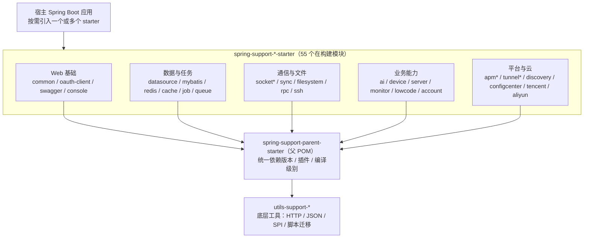
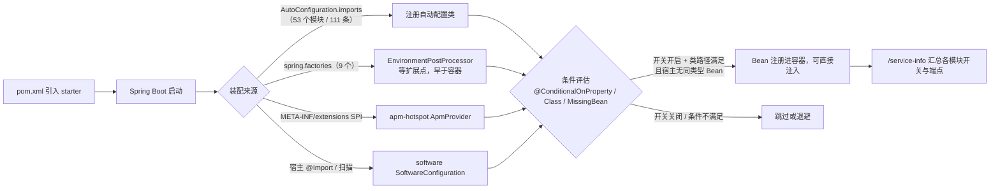

# Spring Support Parent Starter

[](https://www.oracle.com/java/)
[](https://spring.io/projects/spring-boot)
[](https://maven.apache.org/)
[](https://opensource.org/licenses/Apache-2.0)

`com.chua` 的 Spring Boot starter 集合：**55 个在构建模块**，覆盖 Web 公共层、数据源、缓存、队列、实时通信、文件、设备接入、AI、APM、隧道与云服务。

这份 README 是整套 starter 的**使用者总览**，回答四个问题：

1. 这套东西的分层结构是什么，模块怎么分类；
2. 依赖怎么加、自动装配怎么发生、开关在哪里；
3. 每个模块一句话定位是什么，配置前缀怎么反查；
4. 版本与兼容性口径是什么。

REST 接口清单、Bean 字段明细、表结构、验收记录不在这里，见各模块自己的 `README.md`。

> 版本：`4.0.0.51`；父 POM 继承 `spring-boot-starter-parent:4.1.2`，编译级别 Java 25。

**目录**

- [一、仓库定位与架构](#一仓库定位与架构)
- [二、模块全景（55 个）](#二模块全景55-个)
- [三、快速上手](#三快速上手)
- [四、装配机制](#四装配机制)
- [五、配置前缀索引](#五配置前缀索引)
- [六、常见问题](#六常见问题)
- [七、版本与兼容性](#七版本与兼容性)
- [八、Bean 能力矩阵（全局索引）](#八bean-能力矩阵全局索引)
- [九、使用场景](#九使用场景)
- [十、扩展点](#十扩展点)
- [附录 A：文件在线预览](#附录-a文件在线预览能力矩阵) · [附录 B：GraalVM](#附录-bgraalvm-native-image-支持)

## 一、仓库定位与架构

每个 `spring-support-*-starter` 是一套**独立、业务完整**的能力单元：宿主引入依赖，Spring Boot 自动装配后即可注入使用，不需要 `@Enable*` 之类的额外开关注解。

整体分层自上而下：



**构建口径（重要）**：

- 父 POM 的 `<modules>` 里实际构建 **55 个** `spring-support-*-starter`；
- `spring-support-bom` 在父 POM 中被注释，**暂不进 reactor**，因此依赖必须显式写版本号（见[快速上手](#三快速上手)）；
- `spring-support-httpman-starter` 目录存在但**不在 reactor 构建清单**里；`spring-support-payment-starter`（broken）、`spring-support-spider-starter`（已删）均已从构建中移除；
- `spring-api-support-*` 系列 artifact 由独立的 `spring-support-api-starter` 仓库构建，**不在本仓库 reactor 内**；如需本地联调，先在该仓库 `mvn install` 到本地仓库。

## 二、模块全景（55 个）

下表是 55 个在构建模块的一句话定位与最常注入的入口。完整 Bean 清单、HTTP 接口、配置字段见各模块 `README.md`（点击模块名跳转）。

| 分类 | 模块 | 定位 | 最常注入的 Bean / 入口 |
| --- | --- | --- | --- |
| 基础与数据 | [`spring-support-common-starter`](spring-support-common-starter/README.md) | 统一响应/异常/参数/验证码/线程池/服务信息等 Web 基础能力 | `ApiProperties`、`AuthService`、`CaptchaProvider`、`ThreadPoolTaskExecutor` |
| 基础与数据 | [`spring-support-cache-starter`](spring-support-cache-starter/README.md) | Caffeine + Redis 多级缓存与注解增强 | `CacheManager`、`CacheTemplate`、`KeyGenerator` |
| 基础与数据 | [`spring-support-redis-starter`](spring-support-redis-starter/README.md) | Redis 客户端、分布式锁、嵌入式 Redis | `RedissonClient`、`RedisTemplate`、`LockTemplate` |
| 基础与数据 | [`spring-support-datasource-starter`](spring-support-datasource-starter/README.md) | 动态多数据源、脚本迁移、H2/SQLite/Calcite/Sharding | `JdbcTemplate`、`TransactionTemplate`、`DataSource` |
| 基础与数据 | [`spring-support-datasource-hub-starter`](spring-support-datasource-hub-starter/README.md) | 数据源台账、探测与连接构建 | `DatasourceHubProperties`；服务组件扫描（`DatasourceServiceImpl` 等） |
| 基础与数据 | [`spring-support-mybatis-starter`](spring-support-mybatis-starter/README.md) | MyBatis-Plus 增强、分页、数据权限、慢 SQL | `MybatisPlusInterceptor`、`MybatisPlusProperties` |
| 任务与消息 | [`spring-support-job-starter`](spring-support-job-starter/README.md) | `@Job`/`@Scheduled` 调度，SCHEDULER/EXECUTOR/SINGLE 三模式 | `JobOperator`、`JobExecutor`、`JobHandlerFactory` |
| 任务与消息 | [`spring-support-queue-starter`](spring-support-queue-starter/README.md) | 队列抽象（Kafka/RabbitMQ/RocketMQ/MQTT/Local） | `MessageTemplate`（`localMessageTemplate`）、`DeadLetterTemplate` |
| 任务与消息 | [`spring-support-message-starter`](spring-support-message-starter/README.md) | 消息模板与多渠道发送 | `MessageService`（组件扫描）、`MessageTrackProperties` |
| 任务与消息 | [`spring-support-sync-starter`](spring-support-sync-starter/README.md) | `SyncProtocol` 双向同步（WebSocket/HTTP/RSocket/Socket.IO） | `SyncServer`、`SyncClient` |
| 任务与消息 | [`spring-support-taskdistribution-starter`](spring-support-taskdistribution-starter/README.md) | 任务分发框架：调度、执行、结果回收 | `TaskDistributionAutoConfiguration` 产出的执行器 |
| 通信与协议 | [`spring-support-socket-starter`](spring-support-socket-starter/README.md) | Socket 门面，按 `plugin.socket.protocol` 选 SSE/Socket.IO/RSocket | `SocketSessionTemplate`、`SocketLifecycle` |
| 通信与协议 | [`spring-support-socket-websocket-starter`](spring-support-socket-websocket-starter/README.md) | Spring 原生 WebSocket 端点与 P2P 房间信令 | `WebSocketSessionManager`、`ServletServerContainerFactoryBean` |
| 通信与协议 | [`spring-support-socket-io-starter`](spring-support-socket-io-starter/README.md) | Socket.IO 事件/房间/广播（走 socket 门面） | `SocketSessionTemplate`（协议 socketio） |
| 通信与协议 | [`spring-support-socket-sse-starter`](spring-support-socket-sse-starter/README.md) | SSE 事件总线与服务端推送 | `SseTemplate`、`SseEventBus` |
| 通信与协议 | [`spring-support-socket-rsocket-starter`](spring-support-socket-rsocket-starter/README.md) | RSocket 注解与会话（走 socket 门面） | `SocketSessionTemplate`（协议 rsocket） |
| 通信与协议 | [`spring-support-rpc-starter`](spring-support-rpc-starter/README.md) | RPC 服务暴露/引用（Dubbo 等 SPI） | 带 `@RpcService`/`@RpcResource` 的 Bean |
| 通信与协议 | [`spring-support-ssh-starter`](spring-support-ssh-starter/README.md) | 内嵌 SSH 服务端（命令/文件传输） | `SshServerService` |
| 文件与设备 | [`spring-support-filesystem-starter`](spring-support-filesystem-starter/README.md) | 多 Provider 对象存储 + 内嵌文件服务器 | `FileStorageTemplate`、`UploadTaskManager`、`FileServerManager` |
| 文件与设备 | [`spring-support-device-starter`](spring-support-device-starter/README.md) | 设备接入 SPI：海康/大华/宇视/GB28181/ONVIF | `DeviceProvider`、`DeviceSession`、`DeviceRealtimePublisher` |
| 文件与设备 | [`spring-support-software-starter`](spring-support-software-starter/README.md) | 软件目录/源/安装记录（需 `@Import` 生效） | `SoftwareConfiguration` 扫描出的 Service |
| 文件与设备 | [`spring-support-server-starter`](spring-support-server-starter/README.md) | 服务器资产、远程终端、发布与批量执行 | `ReleaseAiCapability`；其余服务组件扫描 |
| 文件与设备 | [`spring-support-docker-starter`](spring-support-docker-starter/README.md) | Docker 容器/镜像/网络/卷管理（经 SSH） | `com.chua.starter.docker` 包内的 Service（组件扫描） |
| 文件与设备 | [`spring-support-control-starter`](spring-support-control-starter/README.md) | WebRTC 远程控制信令与桌面采集 | `WebRtcServer` |
| 文件与设备 | [`spring-support-monitor-starter`](spring-support-monitor-starter/README.md) | 主机/应用监控台账、采集与告警 | `SeriesEngine`、`FileStorageTemplate`、`SseSocketSessionTemplate` |
| AI 与观测 | [`spring-support-ai-starter`](spring-support-ai-starter/README.md) | AI 对话/生成/协议/用量/缓存/网关安全 | `ChatClient`、`ChatClientRegistry`、`AgentRegistry`、`SysAiUsageService` |
| AI 与观测 | [`spring-support-ai-training-starter`](spring-support-ai-training-starter/README.md) | 训练数据上传、异步训练、超参数 | `TrainService`、`DataService` |
| AI 与观测 | [`spring-support-eduai-starter`](spring-support-eduai-starter/README.md) | 教育 AI：题库/组卷/批改管线 | `CacheManager`、`CredentialProvider` |
| AI 与观测 | [`spring-support-agent-starter`](spring-support-agent-starter/README.md) | 启动后向当前 JVM 自注入 Runtime Agent | `AgentAttachService` |
| AI 与观测 | [`spring-support-ueba-starter`](spring-support-ueba-starter/README.md) | UEBA 分析引擎装配 | `UebaEngine` |
| AI 与观测 | [`spring-support-datasearch-starter`](spring-support-datasearch-starter/README.md) | 天气/台风/汇率/节假日/IP 归属地服务化 | `WeatherDataService` 等五个 DataService |
| AI 与观测 | [`spring-support-apm-starter`](spring-support-apm-starter/README.md) | APM 门面：Provider 聚合 + 统一 REST/独立服务 | `ApmRegistry`、`ApmDispatcher`、`ApmRuntimeConfig` |
| AI 与观测 | [`spring-support-apm-skywalking-starter`](spring-support-apm-skywalking-starter/README.md) | SkyWalking Provider | `ApmProvider`（SPI `skywalking`） |
| AI 与观测 | [`spring-support-apm-hotspot-starter`](spring-support-apm-hotspot-starter/README.md) | 自研 hotspot Agent Provider（SPI extensions） | `ApmProvider`（SPI `hotspot`） |
| AI 与观测 | [`spring-support-hotsport-starter`](spring-support-hotsport-starter/README.md) | 热点观测台：REST + 内置前端 + Agent | `ApmQueryService`、`SlowCallFilter` |
| AI 与观测 | [`spring-support-report-client-starter`](spring-support-report-client-starter/README.md) | 设备硬件/系统信息定时上报 | `ThreadPoolTaskScheduler`、上报组件（依赖 `SyncClient`） |
| 平台与治理 | [`spring-support-discovery-starter`](spring-support-discovery-starter/README.md) | 服务注册与发现（多协议） | `DiscoveryListProperties`；发现实现由 utils SPI 提供 |
| 平台与治理 | [`spring-support-configcenter-starter`](spring-support-configcenter-starter/README.md) | 远程配置中心 + 热更新 | `ConfigCenter`、`ConfigValueBeanPostProcessor` |
| 平台与治理 | [`spring-support-console-starter`](spring-support-console-starter/README.md) | 运行期 FTL 控制台，覆盖 `@ApiFeature`/`@ApiGray` | `ConsoleSqliteStore`、`ConsoleOverrideProvider` |
| 平台与治理 | [`spring-support-osgi-starter`](spring-support-osgi-starter/README.md) | Apache Felix OSGi 运行时 | `SourceExtensionScheduler`、`GogoSshShellServer` |
| 平台与治理 | [`spring-support-bundle-starter`](spring-support-bundle-starter/README.md) | 按 Maven 坐标装卸 OSGi Bundle | `BundleManagerService` |
| 平台与治理 | [`spring-support-collect-starter`](spring-support-collect-starter/README.md) | 采集平台：流程、调度、Agent | `CollectFlowSchedulePort` 等 |
| 平台与治理 | [`spring-support-datasync-starter`](spring-support-datasync-starter/README.md) | 目录/数据库映射的数据同步 | `DataSyncServer`、`DataSyncMappingManager` |
| 平台与治理 | [`spring-support-lowcode-starter`](spring-support-lowcode-starter/README.md) | 低代码目录/表单/页面与版本发布 | `LowFormService`、`LowPageService`（组件扫描） |
| 平台与治理 | [`spring-support-account-starter`](spring-support-account-starter/README.md) | 账号、渠道、消息模板、临时邮箱 | `MessageTemplateService`、`MailboxService`（组件扫描） |
| 平台与治理 | [`spring-support-oauth-client-starter`](spring-support-oauth-client-starter/README.md) | OAuth 客户端认证与 Principal/权限 | 认证过滤器与 `AuthClientProperties` |
| 平台与治理 | [`spring-support-swagger-starter`](spring-support-swagger-starter/README.md) | OpenAPI 文档与导出 | `SpringDocConfigProperties`、Knife4j 页面 |
| 平台与治理 | [`spring-support-swagger2-starter`](spring-support-swagger2-starter/README.md) | Swagger 2.x 注解兼容 | 无独立 Bean，复用宿主 Swagger |
| 隧道与云服务 | [`spring-support-tunnel-starter`](spring-support-tunnel-starter/README.md) | 内网穿透统一入口（ngrok/cloudflared/tailscale） | `TunnelProvider`、隧道管理 Service |
| 隧道与云服务 | [`spring-support-tunnel-ngrok-starter`](spring-support-tunnel-ngrok-starter/README.md) | ngrok 隧道 Provider | `TunnelProvider`（ngrok） |
| 隧道与云服务 | [`spring-support-tunnel-cloudflared-starter`](spring-support-tunnel-cloudflared-starter/README.md) | Cloudflare Tunnel Provider | `CloudflaredTunnelProvider` |
| 隧道与云服务 | [`spring-support-tunnel-tailscale-starter`](spring-support-tunnel-tailscale-starter/README.md) | Tailscale Funnel Provider | `TunnelProvider`（tailscale） |
| 隧道与云服务 | [`spring-support-cdp-starter`](spring-support-cdp-starter/README.md) | Chrome DevTools Protocol 调试代理 | CDP 服务（`spring.cdp.*`） |
| 隧道与云服务 | [`spring-support-tencent-starter`](spring-support-tencent-starter/README.md) | 腾讯云/微信小程序/短信/存储 | `TencentWechatPayClientFactory` |
| 隧道与云服务 | [`spring-support-aliyun-starter`](spring-support-aliyun-starter/README.md) | 支付宝客户端 | `AlipayClient`、`AliyunAlipayClientFactory` |

## 三、快速上手

### 3.1 加依赖

没有启用 BOM 模块（父 POM 里 `spring-support-bom` 仍被注释），每个 starter 都要写版本号：

```xml
<dependency>
    <groupId>com.chua</groupId>
    <artifactId>spring-support-common-starter</artifactId>
    <version>4.0.0.51</version>
</dependency>
```

### 3.2 最小可运行组合

一个典型 Web 服务，通常从这几个开始：

```xml
<dependencies>
    <!-- Web 公共底座：统一响应/异常/参数校验/线程池/服务信息 -->
    <dependency>
        <groupId>com.chua</groupId>
        <artifactId>spring-support-common-starter</artifactId>
        <version>4.0.0.51</version>
    </dependency>
    <!-- 按需再加：数据源、缓存、任务、文件…… -->
</dependencies>
```

```yaml
plugin:
  api:
    enable: true          # 统一响应/异常/安全头等 Web 基础能力
  job:
    enable: true
    role: SINGLE          # 单机；集群改成 SCHEDULER/EXECUTOR
```

启动类不需要任何 `@Enable*`，引依赖即生效（开关默认关的模块除外，见 4.4）。

### 3.3 按需组合，不要全量引入

桌面/服务端应用通常按需加 `server-starter`、`filesystem-starter`、`datasource-starter` 等。**不要为了省事把全部 starter 一次引进来**——默认开关大多为关，但类路径上的自动配置仍会被加载和求值，排障成本会变高。

## 四、装配机制

### 4.1 自动装配发生在哪里

55 个在构建模块中，**53 个**带 `META-INF/spring/org.springframework.boot.autoconfigure.AutoConfiguration.imports` 文件，其中 **50 个共登记 111 条自动配置类**；`socket-io`、`socket-rsocket`、`swagger2` 三个文件里只有注释（Socket.IO/RSocket 的 Bean 由 `socket-starter` 门面统一管理，swagger2 只提供注解依赖）。例如：

```text
# spring-support-redis-starter
com.chua.starter.redis.support.RedisConfiguration
com.chua.starter.redis.support.CacheConfiguration
com.chua.starter.redis.support.LockTemplateConfiguration
```

### 4.2 例外生效方式

有三个模块不走标准 `imports` 路径，接入时必须知道：

| 模块 | 生效方式 |
| --- | --- |
| `spring-support-apm-hotspot-starter` | 没有 `imports`，走 `META-INF/extensions/com.chua.starter.apm.support.spi.ApmProvider` 的 SPI 扩展文件 |
| `spring-support-software-starter` | `SoftwareConfiguration` 带 `@AutoConfiguration`，但**未登记**到 `imports`；引入依赖后需宿主 `@Import(SoftwareConfiguration.class)`，或让组件扫描覆盖 `com.chua.starter.software.support` |
| `spring-support-taskdistribution-starter` | 已迁移到标准 `imports`（`TaskDistributionAutoConfiguration`）；其 `spring.factories` 现在只剩注释，仅用于承载未来可能的非自动装配工厂键 |

### 4.3 spring.factories 扩展点

仓库里另有 **9 个** `spring.factories`（common、datasource、swagger、oauth-client、configcenter、console、report-client、server、taskdistribution），它们**不是自动配置**，只注册 `EnvironmentPostProcessor`、`AdviceResolver`、`Protocol` 等扩展点（配置中心、数据源、Swagger、OAuth 的环境预处理都靠它，早于容器启动）。

### 4.4 开关：`enable` 与 `enabled` 并存

开关没有统一成一个拼写，这是现状，接入时以模块 README 里的"装配"一行为准。常用开关与默认值：

| 模块 | 开关 | 不配置时 |
| --- | --- | --- |
| redis | `plugin.redis.server.enable` | 开 |
| cache（Redis 二级） | `plugin.cache.enabled` | 关 |
| job | `plugin.job.enable` | 开 |
| queue | `plugin.queue.enable` | 关 |
| filesystem | `plugin.filesystem.enable` | 关 |
| socket | `plugin.socket.enable` | 关 |
| socket-websocket | `plugin.websocket.enable` | 关 |
| report-client | `plugin.report.client.enabled` | 关 |
| bundle | `plugin.bundle.enabled` | 关 |
| config-center | `plugin.config-center.enable` | 关 |
| oauth-client | `plugin.oauth.enable` | 开 |
| swagger | `plugin.swagger.enable` | 开 |
| tunnel | `plugin.tunnel.enable` | 开 |
| ngrok | `plugin.ngrok.enable` | 开 |
| control | `control.webrtc.enabled` | 开 |
| cdp | `spring.cdp.enabled` | 开（会启动本机 Chromium） |
| hotsport 请求采集 | `plugin.hotsport.request-record.enabled` | 开 |

规律：

- 默认开：`matchIfMissing = true`（redis、job、oauth、swagger、tunnel、control、hotsport 等）；
- 默认关：没写 `matchIfMissing`（queue、filesystem、socket、bundle、config-center 等），必须显式 `=true`；
- **条件通过 ≠ 功能启动**：`ssh`、`rpc` 等模块的配置类会在 `matchIfMissing=true` 时装配，但真正的监听/扫描还看字段本身（例如 `plugin.ssh.server.enabled` 默认 `false`，`SshServerService` 在 `afterPropertiesSet` 里才决定是否 `start()`）；
- `cdp` 的前缀是 `spring.cdp`，`httpman` 是 `httpman`，`control` 是 `control.webrtc`，都不在 `plugin.*` 下；
- 同一模块可能有多个子开关（datasource 的 H2/SQLite/Calcite/Sharding、ai 的 generate/usage/protocol），总开关关掉后子开关不再求值。

### 4.5 条件装配与覆盖

模块大量使用 `@ConditionalOnMissingBean`。这意味着**你自己声明的同类型 Bean 会优先**，自动配置退避。典型做法：

```java
@Configuration
public class MyOverrides {

    // 只要容器里已有 CacheManager，cache-starter 就不再建默认实现
    @Bean
    public CacheManager cacheManager() {
        return new CaffeineCacheManager();
    }
}
```

三种关闭/替换方式，优先级从高到低：

1. **关开关**：`plugin.<域>.enable=false` / `enabled=false`，最干净；
2. **排除自动配置**：`spring.autoconfigure.exclude=com.chua.starter.xxx.XxxAutoConfiguration`，适合某个类反复抢 Bean；
3. **同名覆盖**：Boot 默认禁止 Bean 覆盖，必须同时设 `spring.main.allow-bean-definition-overriding=true`，只建议在迁移期临时使用。

`@ConditionalOnClass` 决定"类路径有才装配"：例如 `spring-support-cache-starter` 的 Redis 缓存配置要求 classpath 有 spring-data-redis，`report-client` 要求容器里有 `SyncClient`。加依赖后没生效，先看这两类条件。

### 4.6 配置绑定规则

所有属性类都是标准 Spring Boot 绑定：

- **命名**：Java 字段 `openEmbedded` ↔ 配置 `open-embedded`（kebab-case），也接受 `openEmbedded`；YAML 推荐 kebab-case。
- **类型**：`Duration` 写 `30s`/`5m`；`DataSize` 写 `10MB`；枚举写大写常量（如 `plugin.job.role=SINGLE`）；`List<String>` 可用 YAML 列表或逗号分隔；`Map<String, XxxConfig>` 用 YAML 映射。
- **嵌套**：嵌套对象用点路径，如 `plugin.filesystem.storage-server.port`。
- **校验**：部分类带 `@Validated` / `@Min` / `@Max` / `@Pattern`；`ApiProperties`、`SocketProperties` 还带 `ignoreInvalidFields=true`，非法值会被忽略而不是启动失败。
- **未知字段**：默认忽略，不会报错；拼错前缀不会生效，也不会提示。

### 4.7 装配顺序

- 自动配置类之间用 `@AutoConfigureAfter`/`@AutoConfigureBefore` 与 `@AutoConfigureOrder` 定序（例如 SQL 监控排在最后、SQLite 引擎排在 H2 之后、SkyWalking 桥接排在 utils 的 SkyWalking 配置之后）。
- 数据源脚本用 `DataSourceScriptBeanPostProcessor`，保证建表脚本先于 `SqlSessionFactory`/`EntityManagerFactory` 执行。
- 配置中心、数据源、Swagger、OAuth 的环境变量在 `EnvironmentPostProcessor` 阶段就参与解析，早于 Bean 容器。

### 4.8 一条依赖的完整生效链路



### 4.9 排查装配问题

1. 启动加 `--debug`，看 `ConditionEvaluationReport` 里哪个 `@ConditionalOnProperty`/`@ConditionalOnClass` 没通过；
2. 有 Actuator 时看 `/actuator/conditions` 与 `/actuator/configprops`；
3. `common-starter` 的 `/service-info` 会汇总各模块注册的开关与端点；
4. 确认生效方式：`imports`、`spring.factories`、SPI extensions、还是需要手动 `@Import`（software）。

## 五、配置前缀索引

统计口径：55 个在构建模块的 `src/main/java` 下，含 `@ConfigurationProperties` 注解的文件共 **92 个**，对应 **90 个顶层注解类**——其中 2 个注解标在嵌套类上（`RequestFingerprintAutoConfiguration.FingerprintProps`、`ApiSecurityHeaderFilter.ApiSecurityHeaderProperties`），一并收录进下表；另有 3 个属于已下线的 httpman/payment，不再列出。字段明细在对应模块 README；这里用于反查前缀属于哪个类、哪个模块。

| 前缀 | 属性类 | 模块 | 字段数 |
| --- | --- | --- | --- |
| `control.webrtc` | `ControlProperties` | [`spring-support-control-starter`](spring-support-control-starter/README.md) | 8 |
| `plugin.actuator` | `ActuatorProperties` | [`spring-support-common-starter`](spring-support-common-starter/README.md) | 6 |
| `plugin.agent` | `AgentAttachProperties` | [`spring-support-agent-starter`](spring-support-agent-starter/README.md) | 4 |
| `plugin.ai.chat` | `AiChatProperties` | [`spring-support-ai-starter`](spring-support-ai-starter/README.md) | 13 |
| `plugin.ai.default-model` | `DefaultModelProperties` | [`spring-support-ai-starter`](spring-support-ai-starter/README.md) | 33 |
| `plugin.ai.generate` | `AiProperties` | [`spring-support-ai-starter`](spring-support-ai-starter/README.md) | 13 |
| `plugin.ai.rag` | `RagProperties` | [`spring-support-ai-starter`](spring-support-ai-starter/README.md) | 9 |
| `plugin.ai.training` | `TrainProperties` | [`spring-support-ai-training-starter`](spring-support-ai-training-starter/README.md) | 6 |
| `plugin.aliyun.alipay` | `AliyunAlipayProperties` | [`spring-support-aliyun-starter`](spring-support-aliyun-starter/README.md) | 16 |
| `plugin.api` | `ApiProperties` | [`spring-support-common-starter`](spring-support-common-starter/README.md) | 44 |
| `plugin.api.cors` | `ApiCorsProperties` | [`spring-support-common-starter`](spring-support-common-starter/README.md) | 4 |
| `plugin.api.security.header` | `ApiSecurityHeaderFilter` | [`spring-support-common-starter`](spring-support-common-starter/README.md) | 8 |
| `plugin.apm` | `ApmProperties` | [`spring-support-apm-starter`](spring-support-apm-starter/README.md) | 10 |
| `plugin.apm.skywalking` | `SkywalkingApmProperties` | [`spring-support-apm-skywalking-starter`](spring-support-apm-skywalking-starter/README.md) | 4 |
| `plugin.bundle` | `BundleProperties` | [`spring-support-bundle-starter`](spring-support-bundle-starter/README.md) | 5 |
| `plugin.cache` | `CacheProperties` | [`spring-support-cache-starter`](spring-support-cache-starter/README.md) | 29 |
| `plugin.captcha` | `CaptchaProperties` | [`spring-support-common-starter`](spring-support-common-starter/README.md) | 9 |
| `plugin.captcha.external` | `ExternalCaptchaConfiguration` | [`spring-support-common-starter`](spring-support-common-starter/README.md) | 6 |
| `plugin.cloudflared` | `CloudflaredProperties` | [`spring-support-tunnel-cloudflared-starter`](spring-support-tunnel-cloudflared-starter/README.md) | 12 |
| `plugin.collect` | `CollectProperties` | [`spring-support-collect-starter`](spring-support-collect-starter/README.md) | 9 |
| `plugin.config-center` | `ConfigCenterProperties` | [`spring-support-configcenter-starter`](spring-support-configcenter-starter/README.md) | 14 |
| `plugin.console` | `ConsoleProperties` | [`spring-support-console-starter`](spring-support-console-starter/README.md) | 4 |
| `plugin.datasource.calcite` | `CalciteDataSourceProperties` | [`spring-support-datasource-starter`](spring-support-datasource-starter/README.md) | 4 |
| `plugin.datasource.document` | `DocumentProperties` | [`spring-support-datasource-starter`](spring-support-datasource-starter/README.md) | 10 |
| `plugin.datasource.hub` | `DatasourceHubProperties` | [`spring-support-datasource-hub-starter`](spring-support-datasource-hub-starter/README.md) | 12 |
| `plugin.datasource.materialized` | `MaterializedRouteProperties` | [`spring-support-datasource-starter`](spring-support-datasource-starter/README.md) | 5 |
| `plugin.datasource.monitor` | `SqlMonitorProperties` | [`spring-support-datasource-starter`](spring-support-datasource-starter/README.md) | 8 |
| `plugin.datasource.script` | `DataSourceScriptProperties` | [`spring-support-datasource-starter`](spring-support-datasource-starter/README.md) | 28 |
| `plugin.datasource.sharding` | `ShardingDataSourceProperties` | [`spring-support-datasource-starter`](spring-support-datasource-starter/README.md) | 8 |
| `plugin.datasync` | `DatasyncProperties` | [`spring-support-datasync-starter`](spring-support-datasync-starter/README.md) | 8 |
| `plugin.dead-letter` | `DeadLetterProperties` | [`spring-support-queue-starter`](spring-support-queue-starter/README.md) | 8 |
| `plugin.device.timeseries` | `DeviceTimeSeriesProperties` | [`spring-support-device-starter`](spring-support-device-starter/README.md) | 12 |
| `plugin.discovery` | `DiscoveryListProperties` | [`spring-support-discovery-starter`](spring-support-discovery-starter/README.md) | 2 |
| `plugin.eduai` | `EduAiProperties` | [`spring-support-eduai-starter`](spring-support-eduai-starter/README.md) | 35 |
| `plugin.filesystem` | `FileStorageProperties` | [`spring-support-filesystem-starter`](spring-support-filesystem-starter/README.md) | 76 |
| `plugin.filesystem.storage-server` | `FileStorageServerProperties` | [`spring-support-filesystem-starter`](spring-support-filesystem-starter/README.md) | 29 |
| `plugin.filesystem.upload` | `FileStorageUploadProperties` | [`spring-support-filesystem-starter`](spring-support-filesystem-starter/README.md) | 9 |
| `plugin.h2` | `H2DataSourceProperties` | [`spring-support-datasource-starter`](spring-support-datasource-starter/README.md) | 7 |
| `plugin.hotsport` | `HotsportProperties` | [`spring-support-hotsport-starter`](spring-support-hotsport-starter/README.md) | 18 |
| `plugin.ip` | `IpProperties` | [`spring-support-common-starter`](spring-support-common-starter/README.md) | 3 |
| `plugin.jackson` | `JacksonProperties` | [`spring-support-common-starter`](spring-support-common-starter/README.md) | 2 |
| `plugin.job` | `JobProperties` | [`spring-support-job-starter`](spring-support-job-starter/README.md) | 38 |
| `plugin.log` | `LogProperties` | [`spring-support-common-starter`](spring-support-common-starter/README.md) | 3 |
| `plugin.log.portal` | `TracePortalProperties` | [`spring-support-common-starter`](spring-support-common-starter/README.md) | 6 |
| `plugin.lowcode` | `LowcodeProperties` | [`spring-support-lowcode-starter`](spring-support-lowcode-starter/README.md) | 1 |
| `plugin.message` | `MessageConverterProperties` | [`spring-support-common-starter`](spring-support-common-starter/README.md) | 4 |
| `plugin.message.track` | `MessageTrackProperties` | [`spring-support-message-starter`](spring-support-message-starter/README.md) | 2 |
| `plugin.monitor.agent` | `AgentDeployProperties` | [`spring-support-monitor-starter`](spring-support-monitor-starter/README.md) | 17 |
| `plugin.monitor.influx` | `MonitorInfluxProperties` | [`spring-support-monitor-starter`](spring-support-monitor-starter/README.md) | 3 |
| `plugin.monitor.ssh` | `MonitorSshProperties` | [`spring-support-monitor-starter`](spring-support-monitor-starter/README.md) | 3 |
| `plugin.monitor.timeseries` | `MonitorTimeseriesProperties` | [`spring-support-monitor-starter`](spring-support-monitor-starter/README.md) | 3 |
| `plugin.monitor.tshark` | `TsharkInstallProperties` | [`spring-support-monitor-starter`](spring-support-monitor-starter/README.md) | 12 |
| `plugin.monitor.tshark.retention` | `TsharkRetentionProperties` | [`spring-support-monitor-starter`](spring-support-monitor-starter/README.md) | 3 |
| `plugin.multi-datasource` | `MultiDataSourceProperties` | [`spring-support-datasource-starter`](spring-support-datasource-starter/README.md) | 2 |
| `plugin.multi-datasource` | `MultiDataSourceSettingProperties` | [`spring-support-datasource-starter`](spring-support-datasource-starter/README.md) | 4 |
| `plugin.multi-datasource.hikari` | `MultiHikariDataSourceProperties` | [`spring-support-datasource-starter`](spring-support-datasource-starter/README.md) | 2 |
| `plugin.mybatis` | `MybatisPlusProperties` | [`spring-support-mybatis-starter`](spring-support-mybatis-starter/README.md) | 14 |
| `plugin.mybatis.data.scope` | `MybatisPlusDataScopeProperties` | [`spring-support-mybatis-starter`](spring-support-mybatis-starter/README.md) | 5 |
| `plugin.mybatis.slow-sql` | `MybatisSlowSqlProperties` | [`spring-support-mybatis-starter`](spring-support-mybatis-starter/README.md) | 6 |
| `plugin.ngrok` | `NgrokProperties` | [`spring-support-tunnel-ngrok-starter`](spring-support-tunnel-ngrok-starter/README.md) | 22 |
| `plugin.nonce.sign` | `NonceSignProperties` | [`spring-support-common-starter`](spring-support-common-starter/README.md) | 1 |
| `plugin.notice` | `NoticeProperties` | [`spring-support-common-starter`](spring-support-common-starter/README.md) | 7 |
| `plugin.oauth` | `AuthClientProperties` | [`spring-support-oauth-client-starter`](spring-support-oauth-client-starter/README.md) | 77 |
| `plugin.optional` | `OptionalProperties` | [`spring-support-common-starter`](spring-support-common-starter/README.md) | 1 |
| `plugin.osgi` | `OsgiProperties` | [`spring-support-osgi-starter`](spring-support-osgi-starter/README.md) | 36 |
| `plugin.queue` | `QueueProperties` | [`spring-support-queue-starter`](spring-support-queue-starter/README.md) | 42 |
| `plugin.redis.server` | `RedisServerProperties` | [`spring-support-redis-starter`](spring-support-redis-starter/README.md) | 7 |
| `plugin.report.client` | `ReportProperties` | [`spring-support-report-client-starter`](spring-support-report-client-starter/README.md) | 16 |
| `plugin.rpc` | `RpcProperties` | [`spring-support-rpc-starter`](spring-support-rpc-starter/README.md) | 11 |
| `plugin.security.fingerprint` | `RequestFingerprintAutoConfiguration` | [`spring-support-common-starter`](spring-support-common-starter/README.md) | 15 |
| `plugin.server.support` | `ServerProperties` | [`spring-support-server-starter`](spring-support-server-starter/README.md) | 13 |
| `plugin.server.support.serial` | `SerialProperties` | [`spring-support-server-starter`](spring-support-server-starter/README.md) | 10 |
| `plugin.service-info` | `ServiceInfoProperties` | [`spring-support-common-starter`](spring-support-common-starter/README.md) | 7 |
| `plugin.socket` | `SocketProperties` | [`spring-support-socket-starter`](spring-support-socket-starter/README.md) | 32 |
| `plugin.sqlite` | `SqliteDataSourceProperties` | [`spring-support-datasource-starter`](spring-support-datasource-starter/README.md) | 4 |
| `plugin.ssh.server` | `SshServerProperties` | [`spring-support-ssh-starter`](spring-support-ssh-starter/README.md) | 25 |
| `plugin.swagger` | `Knife4jProperties` | [`spring-support-swagger-starter`](spring-support-swagger-starter/README.md) | 15 |
| `plugin.swagger.export` | `SwaggerExportProperties` | [`spring-support-swagger-starter`](spring-support-swagger-starter/README.md) | 6 |
| `plugin.sync` | `SyncProperties` | [`spring-support-sync-starter`](spring-support-sync-starter/README.md) | 49 |
| `plugin.sync.datasync` | `SyncDatasyncProperties` | [`spring-support-sync-starter`](spring-support-sync-starter/README.md) | 1 |
| `plugin.tailscale` | `TailscaleProperties` | [`spring-support-tunnel-tailscale-starter`](spring-support-tunnel-tailscale-starter/README.md) | 8 |
| `plugin.taskdistribution` | `TaskDistributionProperties` | [`spring-support-taskdistribution-starter`](spring-support-taskdistribution-starter/README.md) | 15 |
| `plugin.tencent.mini-app` | `TencentMiniAppProperties` | [`spring-support-tencent-starter`](spring-support-tencent-starter/README.md) | 4 |
| `plugin.tencent.open-platform` | `TencentWechatOpenPlatformProperties` | [`spring-support-tencent-starter`](spring-support-tencent-starter/README.md) | 5 |
| `plugin.tencent.wechat-pay` | `TencentWechatPayProperties` | [`spring-support-tencent-starter`](spring-support-tencent-starter/README.md) | 10 |
| `plugin.thread` | `AsyncThreadPoolProperties` | [`spring-support-common-starter`](spring-support-common-starter/README.md) | 8 |
| `plugin.transaction` | `TransactionProperties` | [`spring-support-datasource-starter`](spring-support-datasource-starter/README.md) | 6 |
| `plugin.tunnel` | `TunnelProperties` | [`spring-support-tunnel-starter`](spring-support-tunnel-starter/README.md) | 5 |
| `plugin.ueba` | `UebaProperties` | [`spring-support-ueba-starter`](spring-support-ueba-starter/README.md) | 5 |
| `plugin.websocket` | `WebSocketProperties` | [`spring-support-socket-websocket-starter`](spring-support-socket-websocket-starter/README.md) | 8 |
| `room` | `RoomProperties` | [`spring-support-socket-websocket-starter`](spring-support-socket-websocket-starter/README.md) | 10 |
| `spring.cdp` | `CdpProperties` | [`spring-support-cdp-starter`](spring-support-cdp-starter/README.md) | 16 |

## 六、常见问题

**Q1：依赖加了，但容器里没有对应的 Bean。**
按顺序查四件事：开关是否显式打开（4.4 的默认值表）；类路径条件是否满足（`@ConditionalOnClass`）；容器里是否已有同类型 Bean 导致退避（`@ConditionalOnMissingBean`）；该模块是否不走 `imports`（apm-hotspot、software，见 4.2）。加 `--debug` 能看到具体失败条件。

**Q2：两个 starter 都注册 `MybatisPlusInterceptor`，会不会冲突？**
会。`mybatis-starter`、`device-starter` 都提供分页拦截器，后者用 `@ConditionalOnMissingBean` 退避；如果宿主自己再声明一个，仍然可能重复分页。统一只保留一个 `MybatisPlusInterceptor`，其余模块的兜底 Bean 会自动让位。

**Q3：配置写了却不生效。**
先确认前缀拼写（`enable` 还是 `enabled`），再确认字段是 kebab-case；`List`/`Map`/`Duration` 的写法见 4.6。属性类带 `ignoreInvalidFields=true` 时，类型错误会被静默忽略，不会报错，这是最容易误判的一类。

**Q4：启动报 `BeanDefinitionOverrideException`。**
说明你声明了和 starter 同名的 Bean。改法优先级：删掉自己的同名 Bean，改用同类型覆盖（依赖 `@ConditionalOnMissingBean`）；确实要同名，再临时开 `spring.main.allow-bean-definition-overriding=true`。

**Q5：端口冲突。**
常见默认端口：`control-starter` 的 WebRTC 信令 10000、`ssh-starter` 2222、`redis-starter` 嵌入式 6379、`filesystem-starter` standalone 模式的文件服务端口。同机多实例时逐个改成独立端口，或把对应模块关掉。

**Q6：生产环境建议关掉什么。**
`cdp-starter`、`console-starter`、`swagger-starter` 的导出页、`swagger` 的调试页、`agent-starter` 的自注入（观测后台自己观测自己）、`filesystem` 的 `dir-list`。这些默认值不一定是关的（见 4.4），要显式配置。

**Q7：Boot 3 升 Boot 4 要注意什么。**
本仓库父 POM 已是 Boot 4.1.2，包名仍是 `jakarta.*`；`@AutoConfiguration` 与 `imports` 机制不变。升级主要影响三方依赖版本与 `spring.factories` 扩展点，按模块 README 的"与其它 starter 的关系"逐项核对。

## 七、版本与兼容性

| 项 | 口径 |
| --- | --- |
| 项目版本 | `4.0.0.51` |
| 父 POM | `spring-boot-starter-parent:4.1.2` |
| Java | 25（编译级别与 GraalVM 运行时均按 JDK 25） |
| 命名空间 | `jakarta.*` |
| BOM | `spring-support-bom` 被注释、暂不发布，依赖需显式写版本号 |
| 跨仓库 artifact | `spring-api-support-*` 由 `spring-support-api-starter` 仓库构建，联调前需先 `mvn install` |
| utils 底座 | `utils-support-*` 版本随 `utils.version=4.0.0.51` 对齐 |

- 从 Boot 3 升级到 Boot 4：`@AutoConfiguration`、`AutoConfiguration.imports` 机制不变，主要核对三方依赖与 `spring.factories` 扩展点（见 Q7）。
- 已下线模块：`spring-support-payment-starter`（broken，构建中注释）、`spring-support-spider-starter`（已删）、`spring-support-test-app`（已移除）、`spring-support-elasticsearch-starter`（已删）。不要在新项目里引用它们。
- GraalVM Native Image 支持见[附录 B](#附录-bgraalvm-native-image-支持)。

## 八、Bean 能力矩阵（全局索引）

跨模块的 Bean 索引：按「怎么拿到」分类，回答某类能力去哪个模块注入什么。完整 Bean 清单、字段与端点见各模块 README；配置属性类的前缀见[五、配置前缀索引](#五配置前缀索引)。

| 获取方式 | 代表 Bean / 入口 | 主要模块 |
| --- | --- | --- |
| 配置属性类（`@ConfigurationProperties`） | `ApiProperties`、`CacheProperties`、`JobProperties`、`QueueProperties`、`SocketProperties`、`FileStorageProperties`、`CdpProperties` | 几乎所有模块，全量索引见第五节 |
| 门面 / 模板（直接注入调用） | `MessageTemplate`、`DeadLetterTemplate`、`SocketSessionTemplate`、`SseTemplate`、`SyncServer`/`SyncClient`、`FileStorageTemplate`、`RedisTemplate`、`LockTemplate`、`JdbcTemplate`、`TransactionTemplate`、`DeviceRealtimePublisher` | queue、socket*、sync、filesystem、redis、datasource、device |
| 注册表 / 调度器 | `ChatClientRegistry`、`AgentRegistry`、`ApmRegistry`、`ApmDispatcher`、`JobOperator`、`JobExecutor`、`TaskDistributionAutoConfiguration` 产出的执行器 | ai、apm、job、taskdistribution |
| 服务 / 管理器 | `AuthService`、`MessageService`、`SshServerService`、`BundleManagerService`、`FileServerManager`、`UploadTaskManager`、`MessageTemplateService`、`MailboxService`、`ReleaseAiCapability` | common、message、ssh、bundle、filesystem、account、server |
| SPI / 扩展接口（见[十、扩展点](#十扩展点)） | `FreeChatClient`、`DeviceProvider`、`ApmProvider`、`TunnelProvider`、`CaptchaProvider`、`KeyGenerator` | ai/account、device、apm*、tunnel*、common、cache |
| 组件扫描 / 手动 `@Import` | `SoftwareConfiguration`（需宿主 `@Import`）；server、docker、lowcode、account、datasource-hub 的包内 Service | software、server、docker、lowcode、account、datasource-hub |

> 规律：`*Template` / `*Registry` / `*Manager` 多为自动装配的门面，直接注入即可；业务 Service 多走组件扫描，需保证扫描路径覆盖对应包；属性类只读配置，不要当业务 Bean 互相注入。

## 九、使用场景

按典型形态给出最小模块组合（依赖写法见[三、快速上手](#三快速上手)）；更细的组合与排他关系见各模块 README 的「与其它 starter 的关系」。

| 场景 | 推荐组合 | 要点 |
| --- | --- | --- |
| 标准 Web 后端 | common + datasource + mybatis + redis + cache + job + swagger + oauth-client | 统一响应/异常/线程池 + 数据访问 + 缓存 + 调度 + 文档 + 认证 |
| 账号与消息能力 | 基础组合 + account + oauth-client | 账号、渠道、消息模板、临时邮箱都在 account |
| AI 应用 / 模型网关 | ai + account + redis + cache | ai 负责对话/生成/路由/用量，渠道与凭据由 account 管，经 `FreeChatClient` SPI 打通 |
| 设备接入与监控 | device + monitor + socket-websocket + report-client | 设备 SPI 接海康/大华/宇视/GB28181/ONVIF，时序与告警走 monitor，实时推送走 WebSocket |
| 文件与对象存储 | filesystem（需要公网回调时加 tunnel-*） | 多 Provider 存储 + 内嵌文件服务器，外网访问配合隧道模块 |
| 数据集成 / 同步 | datasync + datasource + queue | 目录/数据库映射同步，队列做削峰与失败重放 |
| APM 观测 | apm + apm-skywalking（或 apm-hotspot）+ hotsport + agent | 门面聚合 Provider，hotsport 提供观测台，agent 做 JVM 自注入 |
| 内网穿透发布 | tunnel + tunnel-ngrok / tunnel-cloudflared / tunnel-tailscale | 统一入口按 Provider 切换隧道实现 |
| 低代码表单 | lowcode + datasource + account | 表单/页面/版本发布，数据落已配置数据源 |
| 插件化扩展 | osgi + bundle | Felix 运行时 + 按 Maven 坐标装卸 Bundle |
| 浏览器自动化 / 调试 | cdp | `spring.cdp.enabled=true` 启动本机 Chromium，暴露 9222 调试端口 |
| 远程桌面控制 | control | WebRTC 信令 + 桌面采集，注意 10000 端口 |

## 十、扩展点

仓库的扩展点分五类，按介入时机从早到晚排列：

1. **`spring.factories` 环境扩展**（9 个模块：common、datasource、swagger、oauth-client、configcenter、console、report-client、server、taskdistribution）——注册 `EnvironmentPostProcessor`、`AdviceResolver`、`Protocol` 等扩展点，早于容器启动，明细见 4.3。
2. **自动装配清单**（`AutoConfiguration.imports`）——53 个模块携带、50 个登记 111 条自动配置类；宿主可用 `spring.autoconfigure.exclude` 整类排除（见 4.5）。
3. **`META-INF/extensions` SPI**——目前 apm-hotspot 的 `ApmProvider` 走该通道（见 4.2）。
4. **业务 SPI 接口**——面向新增实现方，注册后由门面 / 注册表统一调度：
   - `FreeChatClient`：ai 的模型对话客户端 SPI，实现由 account 侧提供与注册，ai 只消费；
   - `DeviceProvider`：device 的厂商接入 SPI（海康/大华/宇视/GB28181/ONVIF）；
   - `ApmProvider`：apm 的采集实现 SPI（skywalking、hotspot）；
   - `TunnelProvider`：tunnel 的隧道实现 SPI（ngrok、cloudflared、tailscale）；
   - `CaptchaProvider` / `KeyGenerator`：common 验证码与 cache 键生成的可替换实现。
5. **Bean 覆盖与开关**——`@ConditionalOnMissingBean` 让宿主同类型 Bean 优先；关开关、排除自动配置、同名覆盖三种手段见 4.5。socket 门面另按 `plugin.socket.protocol` 在 SSE / Socket.IO / RSocket 实现间切换。

> 写自定义扩展时优先复用底层 `utils-support-*` 已有能力（HTTP / JSON / SPI / 脚本迁移）；同一能力出现两份实现视为缺陷。

## 附录 A：文件在线预览能力矩阵

预览链路分两段：**取字节**（文件服务 `/fs` 接口，`raw=true` 直出对象字节，不做解析）
和**渲染**（前端 `@file-viewer` 按文件名扩展名选渲染器）。只有客户端渲染失败时才退
服务端通道（`?format=pdf` 转换，或 `render=server` 返回的 HTML 预览页）。

### WPS Office 家族（按内容魔数改名）

WPS 存出来的文档没有同名渲染器，预览前先按**容器魔数**改名到真实家族：

| 后缀 | 名称 | 新版容器（ZIP / OOXML） | 老版容器（OLE2） |
|---|---|---|---|
| `.wps` / `.wpt` | WPS 文字 / 文字模板 | → `.docx` | → `.doc` |
| `.et` / `.ett` | WPS 表格 / 表格模板 | → `.xlsx` | → `.xls` |
| `.dps` / `.dpt` | WPS 演示 / 演示模板 | → `.pptx` | → `.ppt` |

改名只发生在交给渲染器的那份 `File` 上，列表、弹层标题、下载名仍是原后缀。
表格家族的 `.et` / `.ett` 还支持拖选单元格查看求和 / 平均值 / 中位数 / 标准差 / 去重统计。

### 能力矩阵（真实样本 + 浏览器实测）

| 格式 | 样本来源 | 结论 |
|---|---|---|
| `.wps`（OOXML 容器） | docx 改名 | ✅ 正文直渲 |
| `.wpt` | docx 改名 | ✅ 正文直渲，标题保留原后缀 |
| `.et` | 真实 xlsx（Apache POI `SampleSS.xlsx`） | ✅ 表格、单元格、选区统计条 |
| `.docx` / `.xlsx` / `.pdf` | 常规文档 | ✅ 历史回归通过 |
| `.arrow` / `.feather` | apache-arrow IPC，120 行 / 3 列 | ✅ 表头、列类型、分页（每页 50 行） |
| `.jsonl` / `.ndjson` | 3 行 JSON Lines | ✅ 文本面板直渲，标题保留原后缀 |
| `.ett` / `.dps` / `.dpt` | 真实 xlsx / pptx | ⚠️ **未完成验收**：被测实例在运行途中被其它会话清掉，非格式不支持 |

### 客户端直渲清单与文本白名单

- 客户端可直渲的扩展名：`pages/filesystem/src/utils/officeRenderer.ts` 的 `CLIENT_RENDERABLE_EXTS`
  （Office 家族、iWork、WordPerfect、Hangul、OFD、PDF、WPS 家族等）。
- 文本 / 代码类白名单：`pages/filesystem/src/utils/previewEntryRenderers.ts` 的 `TEXT_EXTENSIONS`，
  必须与 `@file-viewer/renderer-text` 的 `file-viewer.capability.json.formats` **逐项一致**（当前 47 项）；
  白名单外的后缀（`jsonl`、`ndjson`、`conf` 等）在交给渲染器前替换扩展名为 `.txt`。

> 两个容易误判的现场：① 本机 Office / WPS 另存的文件可能被防泄密软件**透明加密**，
> 预览会明确提示「已被透明加密」，换未加密副本即可；② 服务端兜底通道是否有 PDF 转换器
> 取决于部署环境，没有时只能退 iframe，此时用预览底部的「下载原文件」。

## 附录 B：GraalVM Native Image 支持

本项目（Spring Boot 4.1.2）已为 GraalVM Native Image 提供基础支持。模块级 `META-INF/native-image` 反射与资源元数据已覆盖以下模块：

- `spring-support-common-starter`、`spring-support-ai-starter`、`spring-support-filesystem-starter`
- `spring-support-rpc-starter`、`spring-support-socket-io-starter`、`spring-support-sync-starter`

### 构建原生镜像

在你的 **应用模块**（包含 `@SpringBootApplication` 入口类）中执行：

```bash
# 构建原生可执行文件（Linux/macOS/WSL）
mvn -Pnative native:compile

# Windows Native Image 需 GraalVM for JDK 25，并使用 Visual Studio 构建工具链
# 请确保 `native-image` 命令可用，并设置 GRAALVM_HOME 环境变量
```

### 额外构建参数

如应用使用了 FFM（`java.lang.foreign`）或 JNI 加载动态库，需追加原生访问权限：

```bash
mvn -Pnative native:compile \
  -Dnative.buildtools.build-args="--enable-native-access=ALL-UNNAMED,--enable-url-protocols=http,https"
```

### JVM 运行兼容性

在 GraalVM JDK（如 Corretto 25 / GraalVM for JDK 25）上运行时，本项目可直接使用，无需修改。`graalvm` JDK 是完全兼容的 `openjdk` 实现。
