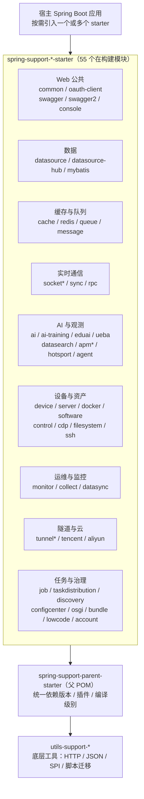
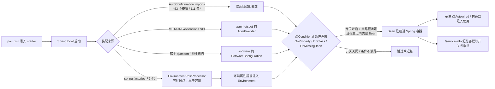

# Spring Support Parent Starter

[](https://www.oracle.com/java/)
[](https://spring.io/projects/spring-boot)
[](https://maven.apache.org/)
[](https://opensource.org/licenses/Apache-2.0)

`com.chua` 的 Spring Boot starter 集合：**55 个在构建模块**，覆盖 Web 公共层、数据源、缓存、队列、实时通信、文件、设备接入、AI、APM、隧道与云服务。

这份 README 是整套 starter 的**使用者总览**，回答四个问题：

1. 这套东西的分层结构是什么，模块怎么分类；
2. 依赖怎么加、自动装配怎么发生、开关在哪里；
3. 每个模块一句话定位是什么，配置前缀怎么反查；
4. 版本与兼容性口径是什么。

REST 接口清单、Bean 字段明细、表结构、验收记录不在这里，见各模块自己的 `README.md`（[三、模块详解目录](#三模块详解目录55-个)逐个给出链接）。

> 版本：`4.0.0.51`；父 POM 继承 `spring-boot-starter-parent:4.1.2`（`spring.boot.version=4.1.2`），编译级别 Java 25。

**目录**

- [一、仓库定位与总体架构](#一仓库定位与总体架构)
- [二、模块全景（55 个）](#二模块全景55-个)
- [三、模块详解目录（55 个）](#三模块详解目录55-个)
- [四、快速上手](#四快速上手)
- [五、依赖与装配机制](#五依赖与装配机制)
- [六、配置前缀索引](#六配置前缀索引)
- [七、常见问题](#七常见问题)
- [八、版本与兼容性](#八版本与兼容性)
- [九、使用场景](#九使用场景)
- [十、扩展点](#十扩展点)
- [附录 A：文件在线预览](#附录-a文件在线预览能力矩阵) · [附录 B：GraalVM](#附录-bgraalvm-native-image-支持)

## 一、仓库定位与总体架构

每个 `spring-support-*-starter` 是一套**独立、业务完整**的能力单元：宿主引入依赖，Spring Boot 自动装配后即可注入使用，不需要 `@Enable*` 之类的额外开关注解。整体分层自上而下：



**构建口径（重要，依据根 `pom.xml`）**：

- 父 POM 的 `<modules>` 里实际构建 **55 个** `spring-support-*-starter`（当前版本 `4.0.0.51`，`utils.version=4.0.0.51`）；
- `spring-support-bom` 在父 POM 中被注释，**暂不进 reactor**，因此依赖必须显式写版本号（见[四、快速上手](#四快速上手)）；
- 目录存在但**不在构建清单**：`spring-support-httpman-starter`、`spring-support-payment-starter`；`spring-support-email-starter`、`spring-support-test-app` 目录已不存在（仅历史 / pom 注释提及）；
- 已删除模块：`spring-support-spider-starter`、`spring-support-elasticsearch-starter`，不要在新项目里引用；
- `spring-api-support-*` 系列 artifact 由独立的 `spring-support-api-starter` 仓库构建，**不在本仓库 reactor 内**；如需本地联调，先在该仓库 `mvn install` 到本地仓库。

## 二、模块全景（55 个）

按业务域归组，给出每组的代表入口 / Bean。逐模块的一句话定位与文档链接见[三、模块详解目录](#三模块详解目录55-个)。

| 业务域 | 模块 | 代表入口 / Bean |
| --- | --- | --- |
| Web 公共 | common、oauth-client、swagger、swagger2、console | `ApiProperties`、`AuthService`、`CaptchaProvider`、认证过滤器、Knife4j 页面、`ConsoleOverrideProvider` |
| 数据 | datasource、datasource-hub、mybatis | `DataSource`、`JdbcTemplate`、`TransactionTemplate`、`MybatisPlusInterceptor`、`DatasourceHubProperties` |
| 缓存与队列 | cache、redis、queue、message | `CacheManager`、`CacheTemplate`、`RedissonClient`、`RedisTemplate`、`LockTemplate`、`MessageTemplate`、`DeadLetterTemplate` |
| 实时通信 | socket、socket-websocket、socket-io、socket-sse、socket-rsocket、sync、rpc | `SocketSessionTemplate`、`SseTemplate`、`SyncServer`/`SyncClient`、`@RpcService`/`@RpcResource` |
| 任务与治理 | job、taskdistribution、datasync、collect、discovery、configcenter、osgi、bundle、lowcode | `JobOperator`、`DataSyncServer`、`DiscoveryService`、`ConfigCenter`、`BundleManagerService`、`LowFormService` |
| AI | ai、ai-training、eduai、ueba、datasearch、agent | `ChatClientRegistry`、`AgentRegistry`、`SysAiUsageService`、`UebaEngine`、`AgentAttachService` |
| 可观测 | apm、apm-skywalking、apm-hotspot、hotsport、monitor | `ApmRegistry`、`ApmDispatcher`、`ApmQueryService`、`SseSocketSessionTemplate` |
| 设备与资产 | device、server、docker、software、control、cdp、filesystem、ssh | `DeviceProvider`、`DeviceSession`、`FileStorageTemplate`、`FileServerManager`、`SshServerService`、`WebRtcServer` |
| 隧道与云 | tunnel、tunnel-ngrok、tunnel-cloudflared、tunnel-tailscale、tencent、aliyun | `TunnelProvider`、`TencentWechatPayGateway`、`AliyunAlipayGateway`、`AlipayClient` |

## 三、模块详解目录（55 个）

55 个在构建模块的逐一目录，按父 POM `<modules>` 构建顺序排列；一句话定位取自各模块 README 开篇。

| 模块 | 一句话定位 | README |
| --- | --- | --- |
| spring-support-datasource-starter | 动态多数据源路由、`@DS` 切换、脚本初始化、SQL 监控、Calcite/Sharding/H2/SQLite | [README.md](spring-support-datasource-starter/README.md) |
| spring-support-common-starter | Web 公共底座：统一响应/加解密、灰度、功能开关、权限拦截、线程池、验证码、service-info | [README.md](spring-support-common-starter/README.md) |
| spring-support-account-starter | 账号与渠道域：统一账号、渠道管理、消息模板、收发信箱、发送日志、上游余额查询 | [README.md](spring-support-account-starter/README.md) |
| spring-support-collect-starter | 采集调度一体化平台：可视化流程编排 + 复用调度平台作业台账 | [README.md](spring-support-collect-starter/README.md) |
| spring-support-cache-starter | Caffeine + Redis 多级缓存：`@Cacheable` 增强、租户级缓存键、`CacheTemplate` | [README.md](spring-support-cache-starter/README.md) |
| spring-support-mybatis-starter | MyBatis-Plus 增强：分页/乐观锁/逻辑删除、`@DataScope` 数据权限、慢 SQL、XML 热重载 | [README.md](spring-support-mybatis-starter/README.md) |
| spring-support-oauth-client-starter | 单点登录客户端：令牌校验、白名单、权限判定、登录页、会话控制 | [README.md](spring-support-oauth-client-starter/README.md) |
| spring-support-console-starter | 运行期管理控制台：`@ApiFeature`/`@ApiGray` 覆盖与键值设置（FTL 页面 + SQLite 持久化） | [README.md](spring-support-console-starter/README.md) |
| spring-support-redis-starter | Redis 集成：Redisson、统一序列化模板、7 档 `CacheManager`、分布式锁、统一 KV 引擎 | [README.md](spring-support-redis-starter/README.md) |
| spring-support-filesystem-starter | 统一对象存储抽象（多 Provider）+ 内置 HTTP 文件服务器与任务化分片上传 | [README.md](spring-support-filesystem-starter/README.md) |
| spring-support-swagger-starter | springdoc + Knife4j 的 OpenAPI 3 文档聚合与启动期离线/在线导出 | [README.md](spring-support-swagger-starter/README.md) |
| spring-support-swagger2-starter | Swagger 2.x 注解兼容壳：仅提供 `io.swagger.annotations` 依赖，无运行时组件 | [README.md](spring-support-swagger2-starter/README.md) |
| spring-support-queue-starter | 消息队列抽象：`MessageTemplate`、`@QueueListener`、本地 EventBus 实现与死信队列 | [README.md](spring-support-queue-starter/README.md) |
| spring-support-socket-starter | Socket 通信抽象层：协议枚举、统一会话模型、SPI 发现与自动装配（无传输实现） | [README.md](spring-support-socket-starter/README.md) |
| spring-support-socket-websocket-starter | Spring 原生 WebSocket 实现：与应用同端口运行、P2P 房间信令 | [README.md](spring-support-socket-websocket-starter/README.md) |
| spring-support-socket-io-starter | Socket.IO 协议实现（netty-socketio）：独立端口、按 room 多实例，经 SPI 接入抽象层 | [README.md](spring-support-socket-io-starter/README.md) |
| spring-support-socket-rsocket-starter | `rsocket` 协议别名实现：用 WebSocket 文本通道承载 JSON 事件（非 RSocket 二进制协议） | [README.md](spring-support-socket-rsocket-starter/README.md) |
| spring-support-socket-sse-starter | SSE 服务端单向推送：`sse`/`sse-server` 双协议 + 独立事件总线（`SseTemplate`） | [README.md](spring-support-socket-sse-starter/README.md) |
| spring-support-rpc-starter | RPC 门面：`@RpcService`/`@RpcResource`，协议由 `plugin.rpc.type` 经 SPI 选择 | [README.md](spring-support-rpc-starter/README.md) |
| spring-support-sync-starter | 客户端/服务端双向同步通道：`SyncServer`/`SyncClient`，协议名经 `ServiceProvider` SPI 选择 | [README.md](spring-support-sync-starter/README.md) |
| spring-support-datasync-starter | DataSync 集成层：按 `plugin.datasync.*` 装配映射配置，交给 `DataSyncServer` cron 秒级调度 | [README.md](spring-support-datasync-starter/README.md) |
| spring-support-osgi-starter | Apache Felix OSGi 运行时：Gogo shell 远程管理、目录热部署、源码扩展点热重载、服务桥接 | [README.md](spring-support-osgi-starter/README.md) |
| spring-support-bundle-starter | OSGi Bundle 生命周期管理：按 Maven 坐标安装、原地升级、卸载与状态查询 | [README.md](spring-support-bundle-starter/README.md) |
| spring-support-discovery-starter | 服务发现：`ServiceDiscovery` SPI 多协议实现装配 + 统一查询门面 `DiscoveryService` | [README.md](spring-support-discovery-starter/README.md) |
| spring-support-configcenter-starter | 远程配置中心客户端（Nacos/Apollo/ZooKeeper/Redis）+ `@ConfigValue`/`@Value` 热更新 | [README.md](spring-support-configcenter-starter/README.md) |
| spring-support-datasearch-starter | 数据检索服务化：天气/定位/台风/汇率/节假日/IP 归属地的统一 `/v2/**` 契约 | [README.md](spring-support-datasearch-starter/README.md) |
| spring-support-tencent-starter | 腾讯（微信）能力：五种微信支付下单/查单/退款/通知验签 + 微信小程序登录 | [README.md](spring-support-tencent-starter/README.md) |
| spring-support-aliyun-starter | 支付宝开放平台集成：下单/查单/退款/单笔转账/通知验签 + 支付宝登录（仅支付宝） | [README.md](spring-support-aliyun-starter/README.md) |
| spring-support-ssh-starter | Apache SSHD 的 SSH 服务端：随应用启动可登录的 SSH/SFTP 服务端（默认关闭） | [README.md](spring-support-ssh-starter/README.md) |
| spring-support-job-starter | 自研分布式任务调度：`@Job` + `@Scheduled` 双扫描，SCHEDULER/EXECUTOR/SINGLE 三角色 | [README.md](spring-support-job-starter/README.md) |
| spring-support-tunnel-starter | 内网穿透统一入口：`TunnelProvider` SPI 折叠 ngrok/cloudflared/tailscale 差异 | [README.md](spring-support-tunnel-starter/README.md) |
| spring-support-tunnel-ngrok-starter | ngrok 官方 Agent SDK 实现：本机服务自动暴露公网 URL，无需独立 ngrok CLI | [README.md](spring-support-tunnel-ngrok-starter/README.md) |
| spring-support-tunnel-cloudflared-starter | Cloudflare Tunnel：管理外部 `cloudflared` 子进程，免账号 Quick Tunnel 开箱可用 | [README.md](spring-support-tunnel-cloudflared-starter/README.md) |
| spring-support-tunnel-tailscale-starter | Tailscale Funnel：基于 tailscale CLI 子进程把本机服务暴露为公网 HTTPS | [README.md](spring-support-tunnel-tailscale-starter/README.md) |
| spring-support-eduai-starter | 教育 AI：题库、AI 组卷/阅卷（SSE 进度）、知识库检索、错题库、考试与语文素养语料 | [README.md](spring-support-eduai-starter/README.md) |
| spring-support-device-starter | 设备接入 SPI：海康/大华/宇视/精讯畅通/GB28181/ONVIF 收敛为 `DeviceProvider` + 能力矩阵 | [README.md](spring-support-device-starter/README.md) |
| spring-support-datasource-hub-starter | 数据源中心：台账 CRUD、连通性探测、可复用 JDBC、Web 管理器、SSH 隧道与中间件管理面 | [README.md](spring-support-datasource-hub-starter/README.md) |
| spring-support-monitor-starter | 服务器与中间件监控一站式：资产台账 + 采集 + 时序 + 告警 + 抓包 + AI 诊断 | [README.md](spring-support-monitor-starter/README.md) |
| spring-support-server-starter | 服务器资产与远程运维：主机台账、远程终端、SFTP、工作台、发布管理、批量执行 | [README.md](spring-support-server-starter/README.md) |
| spring-support-docker-starter | Docker 管理台后端：容器/镜像/网络/卷/镜像库，经 SSH 执行 docker CLI，SSE 回显 | [README.md](spring-support-docker-starter/README.md) |
| spring-support-control-starter | WebRTC 远程控制：信令服务 + 桌面采集 + 键鼠注入，`/control/**` 辅助接口 | [README.md](spring-support-control-starter/README.md) |
| spring-support-cdp-starter | CDP 调试模块：内嵌 headless Chromium，REST + WebSocket 透传 + 全局 SSE 事件流 | [README.md](spring-support-cdp-starter/README.md) |
| spring-support-ai-starter | AI 能力装配：对话/Agent/RAG/OCR/文生图/文生视频/试卷/用量计价/协议网关 | [README.md](spring-support-ai-starter/README.md) |
| spring-support-ai-training-starter | AI 训练平台 REST 接入：ZIP 数据上传、异步训练调度、进度与超参数管理 | [README.md](spring-support-ai-training-starter/README.md) |
| spring-support-ueba-starter | UEBA 行为分析引擎装配：IP 异常流量检测 + 行为序列分析 + 风险融合 + 语义解释 | [README.md](spring-support-ueba-starter/README.md) |
| spring-support-message-starter | 统一消息推送：提供商/模板/日志三表驱动多渠道发送，渠道实现走 `MessagePush` SPI | [README.md](spring-support-message-starter/README.md) |
| spring-support-software-starter | 软件资产与安装管理：目录/源/安装记录 + 已装软件扫描与安装进度实时推送 | [README.md](spring-support-software-starter/README.md) |
| spring-support-taskdistribution-starter | 任务分发：派发、执行、结果回传、重试/超时与多节点负载均衡 | [README.md](spring-support-taskdistribution-starter/README.md) |
| spring-support-agent-starter | 向当前 JVM 自注入 Runtime Agent：字节码插桩 + APM 采集，零启动参数、零代码侵入 | [README.md](spring-support-agent-starter/README.md) |
| spring-support-hotsport-starter | APM 热点观测后台：传输/调用链/依赖图/JVM 观测数据 + 内置前端，可独立部署 | [README.md](spring-support-hotsport-starter/README.md) |
| spring-support-apm-starter | APM 基础门面：`ApmProvider` SPI 聚合为协议无关 REST，支持嵌入宿主/独立 HTTP 服务 | [README.md](spring-support-apm-starter/README.md) |
| spring-support-apm-skywalking-starter | SkyWalking 扩展：`ApmProvider`（SPI `skywalking`）+ `plugin.apm.skywalking.*` 配置桥接 | [README.md](spring-support-apm-skywalking-starter/README.md) |
| spring-support-apm-hotspot-starter | 自研 hotspot agent 扩展：进程内 Span 数据的 `ApmProvider`（SPI `hotspot`），无外部后端 | [README.md](spring-support-apm-hotspot-starter/README.md) |
| spring-support-lowcode-starter | 低代码表单管理：目录 → 表单/页面 → 版本发布，加依赖即生效的独立 starter | [README.md](spring-support-lowcode-starter/README.md) |

## 四、快速上手

### 4.1 加依赖与最小组合

没有启用 BOM 模块（父 POM 里 `spring-support-bom` 仍被注释），每个 starter 都要写版本号。一个典型 Web 服务通常这样开始：

```xml
<dependencies>
    <!-- Web 公共底座：统一响应/异常/参数校验/线程池/服务信息 -->
    <dependency>
        <groupId>com.chua</groupId>
        <artifactId>spring-support-common-starter</artifactId>
        <version>4.0.0.51</version>
    </dependency>
    <!-- 按需再加：数据源、缓存、任务、文件…… -->
</dependencies>
```

```yaml
plugin:
  api:
    uniform: true         # 统一响应（encode / decode 分开关见 plugin.api.encode.enable、plugin.api.decode.enable）
  job:
    enable: true
    role: SINGLE          # 单机；集群改成 SCHEDULER/EXECUTOR
```

启动类不需要任何 `@Enable*`，引依赖即生效（开关默认关的模块除外，见 5.4）。

### 4.2 按需组合，不要全量引入

桌面/服务端应用通常按需加 `server-starter`、`filesystem-starter`、`datasource-starter` 等。**不要为了省事把全部 starter 一次引进来**——默认开关大多为关，但类路径上的自动配置仍会被加载和求值，排障成本会变高。

## 五、依赖与装配机制

### 5.1 自动装配发生在哪里

55 个在构建模块中，**53 个**带 `META-INF/spring/org.springframework.boot.autoconfigure.AutoConfiguration.imports` 文件，其中 **50 个共登记 111 条**自动配置类（全仓库 `*.imports` 共 113 条，另 2 条属于未构建的 httpman / payment）；`socket-io`、`socket-rsocket`、`swagger2` 三个文件里只有注释（Socket.IO/RSocket 的 Bean 由 `socket-starter` 门面统一管理，swagger2 只提供注解依赖）。例如：

```text
# spring-support-redis-starter
com.chua.starter.redis.support.RedisConfiguration
com.chua.starter.redis.support.CacheConfiguration
com.chua.starter.redis.support.LockTemplateConfiguration
```

### 5.2 例外生效方式

有三个模块不走标准 `imports` 路径，接入时必须知道：

| 模块 | 生效方式 |
| --- | --- |
| `spring-support-apm-hotspot-starter` | 没有 `imports`，走 `META-INF/extensions/com.chua.starter.apm.support.spi.ApmProvider` 的 SPI 扩展文件 |
| `spring-support-software-starter` | `SoftwareConfiguration` 带 `@AutoConfiguration`，但**未登记**到 `imports`；引入依赖后需宿主 `@Import(SoftwareConfiguration.class)`，或让组件扫描覆盖 `com.chua.starter.software.support` |
| `spring-support-taskdistribution-starter` | 已迁移到标准 `imports`（`TaskDistributionAutoConfiguration`）；其 `spring.factories` 现在只剩注释 |

### 5.3 spring.factories 扩展点

仓库里另有 **8 个** `spring.factories`（common、datasource、swagger、oauth-client、configcenter、console、server、taskdistribution），它们**不是自动配置**，只注册 `EnvironmentPostProcessor`、`AdviceResolver`、`Protocol` 等扩展点（配置中心、数据源、Swagger、OAuth 的环境预处理都靠它，早于容器启动）。

### 5.4 开关：`enable` 与 `enabled` 并存

开关没有统一成一个拼写，这是现状，接入时以模块 README 里的“装配”一行为准。常用开关与默认值：

| 模块 | 开关 | 不配置时 |
| --- | --- | --- |
| redis | `plugin.redis.server.enable` | 开 |
| cache（Redis 二级） | `plugin.cache.enabled` | 关 |
| job | `plugin.job.enable` | 开 |
| queue | `plugin.queue.enable` | 关 |
| filesystem | `plugin.filesystem.enable` | 关 |
| socket | `plugin.socket.enable` | 关 |
| socket-websocket | `plugin.websocket.enable` | 关 |
| ssh 服务端 | `plugin.ssh.server.enabled` | 关 |
| bundle | `plugin.bundle.enabled` | 关 |
| config-center | `plugin.config-center.enable` | 关 |
| oauth-client | `plugin.oauth.enable` | 开 |
| swagger | `plugin.swagger.enable` | 开 |
| tunnel | `plugin.tunnel.enable` | 开 |
| control | `control.webrtc.enabled` | 开 |
| cdp | `spring.cdp.enabled` | 开（会启动本机 Chromium） |

规律：

- 默认开：`matchIfMissing = true`（redis、job、oauth、swagger、tunnel、control 等）；
- 默认关：没写 `matchIfMissing`（queue、filesystem、socket、bundle、config-center 等），必须显式 `=true`；
- **条件通过 ≠ 功能启动**：`ssh`、`rpc` 等模块的配置类会在 `matchIfMissing=true` 时装配，但真正的监听/扫描还看字段本身（例如 `plugin.ssh.server.enabled` 默认 `false`，`SshServerService` 在 `afterPropertiesSet` 里才决定是否 `start()`）；
- `cdp` 的前缀是 `spring.cdp`，`control` 是 `control.webrtc`，不在 `plugin.*` 下；
- 同一模块可能有多个子开关（datasource 的 H2/SQLite/Calcite/Sharding、ai 的 generate/usage/protocol），总开关关掉后子开关不再求值。

### 5.5 条件装配与覆盖

模块大量使用 `@ConditionalOnMissingBean`。这意味着**你自己声明的同类型 Bean 会优先**，自动配置退避。三种关闭/替换方式，优先级从高到低：

1. **关开关**：`plugin.<域>.enable=false` / `enabled=false`，最干净；
2. **排除自动配置**：`spring.autoconfigure.exclude=com.chua.starter.xxx.XxxAutoConfiguration`，适合某个类反复抢 Bean；
3. **同名覆盖**：Boot 默认禁止 Bean 覆盖，必须同时设 `spring.main.allow-bean-definition-overriding=true`，只建议在迁移期临时使用。

`@ConditionalOnClass` 决定“类路径有才装配”：例如 `spring-support-cache-starter` 的 Redis 缓存配置要求 classpath 有 spring-data-redis。加依赖后没生效，先看这两类条件。

### 5.6 配置绑定规则

- **命名**：Java 字段 `openEmbedded` ↔ 配置 `open-embedded`（kebab-case），也接受 `openEmbedded`；YAML 推荐 kebab-case。
- **类型**：`Duration` 写 `30s`/`5m`；`DataSize` 写 `10MB`；枚举写大写常量（如 `plugin.job.role=SINGLE`）；`List<String>` 可用 YAML 列表或逗号分隔；`Map<String, XxxConfig>` 用 YAML 映射。
- **嵌套**：嵌套对象用点路径，如 `plugin.filesystem.storage-server.port`。
- **校验**：部分类带 `@Validated` / `@Min` / `@Max`；`ApiProperties`、`SocketProperties` 还带 `ignoreInvalidFields=true`，非法值会被忽略而不是启动失败。
- **未知字段**：默认忽略，不会报错；拼错前缀不会生效，也不会提示。

### 5.7 装配顺序

- 自动配置类之间用 `@AutoConfigureAfter`/`@AutoConfigureBefore` 与 `@AutoConfigureOrder` 定序（例如 SQL 监控排在最后、SQLite 引擎排在 H2 之后、SkyWalking 桥接排在 utils 的 SkyWalking 配置之后）。
- 数据源脚本用 `DataSourceScriptBeanPostProcessor`，保证建表脚本先于 `SqlSessionFactory`/`EntityManagerFactory` 执行。
- 配置中心、数据源、Swagger、OAuth 的环境变量在 `EnvironmentPostProcessor` 阶段就参与解析，早于 Bean 容器。

### 5.8 一条依赖的完整生效链路



### 5.9 排查装配问题

1. 启动加 `--debug`，看 `ConditionEvaluationReport` 里哪个 `@ConditionalOnProperty`/`@ConditionalOnClass` 没通过；
2. 有 Actuator 时看 `/actuator/conditions` 与 `/actuator/configprops`；
3. `common-starter` 的 `/service-info` 会汇总各模块注册的开关与端点；
4. 确认生效方式：`imports`、`spring.factories`、SPI extensions、还是需要手动 `@Import`（software）。

## 六、配置前缀索引

统计口径：55 个在构建模块的 `src/main/java` 下，含 `@ConfigurationProperties` 注解的文件共 **92 个**，对应 **90 个顶层注解类**——其中 2 个注解标在嵌套类上（`RequestFingerprintAutoConfiguration.FingerprintProps`、`ApiSecurityHeaderFilter.ApiSecurityHeaderProperties`）；另有 3 个属于未构建的 httpman/payment，不计入。下表按模块归并前缀，用于反查；字段明细见各模块 README。

| 模块 | 配置前缀（`@ConfigurationProperties`） |
| --- | --- |
| common | `plugin.api`、`plugin.api.cors`、`plugin.api.security.header`、`plugin.actuator`、`plugin.captcha`、`plugin.captcha.external`、`plugin.ip`、`plugin.jackson`、`plugin.log`、`plugin.log.portal`、`plugin.message`、`plugin.nonce.sign`、`plugin.notice`、`plugin.optional`、`plugin.security.fingerprint`、`plugin.service-info`、`plugin.thread` |
| datasource | `plugin.datasource.calcite` / `.document` / `.materialized` / `.monitor` / `.script` / `.sharding`、`plugin.h2`、`plugin.sqlite`、`plugin.multi-datasource`（含 `.hikari`）、`plugin.transaction` |
| datasource-hub | `plugin.datasource.hub` |
| mybatis | `plugin.mybatis`、`plugin.mybatis.data.scope`、`plugin.mybatis.slow-sql` |
| cache | `plugin.cache` |
| redis | `plugin.redis.server` |
| job | `plugin.job` |
| queue | `plugin.queue`、`plugin.dead-letter` |
| message | `plugin.message.track` |
| sync | `plugin.sync`、`plugin.sync.datasync` |
| taskdistribution | `plugin.taskdistribution` |
| socket | `plugin.socket` |
| socket-websocket | `plugin.websocket`、`room` |
| rpc | `plugin.rpc` |
| ssh | `plugin.ssh.server` |
| filesystem | `plugin.filesystem`、`plugin.filesystem.storage-server`、`plugin.filesystem.upload` |
| device | `plugin.device.timeseries` |
| server | `plugin.server.support`、`plugin.server.support.serial` |
| control | `control.webrtc` |
| monitor | `plugin.monitor.agent` / `.influx` / `.ssh` / `.timeseries`、`plugin.monitor.tshark`（含 `.retention`） |
| ai | `plugin.ai.chat`、`plugin.ai.default-model`、`plugin.ai.generate`、`plugin.ai.rag` |
| ai-training | `plugin.ai.training` |
| eduai、agent、ueba、apm、apm-skywalking、hotsport | `plugin.eduai`、`plugin.agent`、`plugin.ueba`、`plugin.apm`、`plugin.apm.skywalking`、`plugin.hotsport` |
| discovery、configcenter、console、osgi、bundle、collect、datasync、lowcode | `plugin.discovery`、`plugin.config-center`、`plugin.console`、`plugin.osgi`、`plugin.bundle`、`plugin.collect`、`plugin.datasync`、`plugin.lowcode` |
| oauth-client、swagger、tunnel、tunnel-ngrok、tunnel-cloudflared、tunnel-tailscale、cdp、tencent、aliyun | `plugin.oauth`、`plugin.swagger`、`plugin.swagger.export`、`plugin.tunnel`、`plugin.ngrok`、`plugin.cloudflared`、`plugin.tailscale`、`spring.cdp`、`plugin.tencent.mini-app` / `.open-platform` / `.wechat-pay`、`plugin.aliyun.alipay` |

## 七、常见问题

**Q1：依赖加了，但容器里没有对应的 Bean。** 按顺序查：开关是否显式打开（5.4 默认值表）；类路径条件是否满足（`@ConditionalOnClass`）；是否已有同类型 Bean 导致退避（`@ConditionalOnMissingBean`）；模块是否不走 `imports`（apm-hotspot、software，见 5.2）。加 `--debug` 看具体失败条件。

**Q2：两个 starter 都注册 `MybatisPlusInterceptor`，会不会冲突？** 会。`mybatis-starter`、`device-starter` 都提供分页拦截器，后者用 `@ConditionalOnMissingBean` 退避；宿主自己再声明仍可能重复分页。统一只保留一个，其余兜底 Bean 自动让位。

**Q3：配置写了却不生效。** 先确认前缀拼写（`enable` 还是 `enabled`）与 kebab-case；`List`/`Map`/`Duration` 写法见 5.6。属性类带 `ignoreInvalidFields=true` 时类型错误被静默忽略，不报错，最容易误判。

**Q4：启动报 `BeanDefinitionOverrideException`。** 说明声明了和 starter 同名的 Bean。优先删掉同名 Bean 改同类型覆盖；确需同名，再临时开 `spring.main.allow-bean-definition-overriding=true`。

**Q5：端口冲突。** 常见默认端口：`control-starter` WebRTC 信令 10000、`ssh-starter` 2222、`redis-starter` 嵌入式 6379、`filesystem-starter` standalone 文件服务端口。同机多实例逐个改独立端口或关掉对应模块。

**Q6：生产环境建议关掉什么。** `cdp-starter`、`console-starter`、`swagger-starter` 的导出/调试页、`agent-starter` 的自注入、`filesystem` 的 `dir-list`。这些默认值不一定是关的（见 5.4），要显式配置。

**Q7：Boot 3 升 Boot 4 要注意什么。** 父 POM 已是 Boot 4.1.2，包名仍是 `jakarta.*`；`@AutoConfiguration` 与 `imports` 机制不变。主要核对三方依赖版本与 `spring.factories` 扩展点，按模块 README 的「与其它 starter 的关系」逐项核对。

## 八、版本与兼容性

| 项 | 口径 |
| --- | --- |
| 项目版本 | `4.0.0.51` |
| 父 POM | `spring-boot-starter-parent:4.1.2`（`spring.boot.version=4.1.2`） |
| Java | 25（编译级别与 GraalVM 运行时均按 JDK 25） |
| 命名空间 | `jakarta.*` |
| BOM | `spring-support-bom` 被注释、暂不发布，依赖需显式写版本号 |
| utils 底座 | `utils-support-*` 随 `utils.version=4.0.0.51` 对齐 |
| 跨仓库 artifact | `spring-api-support-*` 由 `spring-support-api-starter` 仓库构建，联调前先 `mvn install` |

- 从 Boot 3 升级到 Boot 4：`@AutoConfiguration`、`AutoConfiguration.imports` 机制不变，主要核对三方依赖与 `spring.factories` 扩展点（见 Q7）。
- 未参与构建 / 已下线：`spring-support-httpman-starter`、`spring-support-payment-starter`（目录保留，不进 reactor）；`spring-support-email-starter`、`spring-support-spider-starter`、`spring-support-elasticsearch-starter`、`spring-support-test-app` 已移除。不要在新项目里引用它们。
- GraalVM Native Image 支持见[附录 B](#附录-bgraalvm-native-image-支持)。

## 九、使用场景

按典型形态给出最小模块组合（依赖写法见[四、快速上手](#四快速上手)）；更细的组合与排他关系见各模块 README 的「与其它 starter 的关系」。

- **标准 Web 后端**：common + datasource + mybatis + redis + cache + job + swagger + oauth-client——统一响应/异常/线程池 + 数据访问 + 缓存 + 调度 + 文档 + 认证；
- **账号与消息能力**：基础组合 + account + oauth-client——账号、渠道、消息模板、临时邮箱都在 account；
- **AI 应用 / 模型网关**：ai + account + redis + cache——ai 负责对话/生成/路由/用量，渠道与凭据由 account 管，经 `ChatClient` SPI 打通（account 侧提供 `FreeChannelChatClient` 等免登录实现）；
- **设备接入与监控**：device + monitor + socket-websocket——设备 SPI 接海康/大华/宇视/GB28181/ONVIF，时序与告警走 monitor，实时推送走 WebSocket；
- **文件与对象存储**：filesystem（需要公网回调时加 tunnel-*）——多 Provider 存储 + 内嵌文件服务器；
- **数据集成 / 同步**：datasync + datasource + queue——目录/数据库映射同步，队列做削峰与失败重放；
- **APM 观测**：apm + apm-skywalking（或 apm-hotspot）+ hotsport + agent——门面聚合 Provider，hotsport 提供观测台，agent 做 JVM 自注入；
- **内网穿透发布**：tunnel + tunnel-ngrok / tunnel-cloudflared / tunnel-tailscale——统一入口按 Provider 切换隧道实现；
- **低代码表单**：lowcode + datasource + account；**插件化扩展**：osgi + bundle（按 Maven 坐标装卸 Bundle）；
- **浏览器自动化 / 远程控制**：cdp（`spring.cdp.enabled=true` 启动本机 Chromium）、control（WebRTC 信令 + 桌面采集，注意 10000 端口）。

## 十、扩展点

仓库的扩展点分五类，按介入时机从早到晚排列：

1. **`spring.factories` 环境扩展**（9 个模块）——注册 `EnvironmentPostProcessor`、`AdviceResolver`、`Protocol` 等扩展点，早于容器启动，见 5.3。
2. **自动装配清单**（`AutoConfiguration.imports`）——53 个模块携带、50 个登记 111 条自动配置类；宿主可用 `spring.autoconfigure.exclude` 整类排除（见 5.5）。
3. **`META-INF/extensions` SPI**——目前 apm-hotspot 的 `ApmProvider` 走该通道（见 5.2）。
4. **业务 SPI 接口**——面向新增实现方，注册后由门面 / 注册表统一调度：`ChatClient`（模型对话客户端 SPI，实现在 account 侧注册、ai 只消费；免登录渠道实现为 `FreeChannelChatClient`）、`DeviceProvider`（device 厂商接入）、`ApmProvider`（apm 采集实现：skywalking、hotspot）、`TunnelProvider`（tunnel 隧道实现：ngrok、cloudflared、tailscale）、`CaptchaProvider`（common 验证码）。
5. **Bean 覆盖与开关**——`@ConditionalOnMissingBean` 让宿主同类型 Bean 优先；关开关、排除自动配置、同名覆盖三种手段见 5.5。socket 门面另按 `plugin.socket.protocol` 在 SSE / Socket.IO / RSocket 实现间切换。

> 写自定义扩展时优先复用底层 `utils-support-*` 已有能力（HTTP / JSON / SPI / 脚本迁移）；同一能力出现两份实现视为缺陷。

## 附录 A：文件在线预览能力矩阵

预览链路分两段：**取字节**（文件服务 `/fs` 接口，`raw=true` 直出对象字节）和**渲染**（前端 `@file-viewer` 按扩展名选渲染器）；客户端渲染失败才退服务端通道（`?format=pdf` 转换或 `render=server` HTML 页）。WPS 家族文件没有同名渲染器，预览前按**容器魔数**改名到真实家族（只改交给渲染器的那份 `File`，下载名仍是原后缀）：`.wps`/`.wpt` → `.docx`/`.doc`，`.et`/`.ett` → `.xlsx`/`.xls`，`.dps`/`.dpt` → `.pptx`/`.ppt`。

实测结论（真实样本）：`.wps`/`.wpt`（OOXML 容器）正文直渲通过；`.et` 表格、单元格、选区统计通过；`.docx`/`.xlsx`/`.pdf` 历史回归通过；`.arrow`/`.feather` 表头、列类型、分页通过；`.jsonl`/`.ndjson` 文本面板直渲通过。两个易误判现场：① 本机 Office/WPS 另存的文件可能被防泄密软件**透明加密**，预览会明确提示；② 服务端兜底的 PDF 转换器取决于部署环境，没有时只能退 iframe + 「下载原文件」。

## 附录 B：GraalVM Native Image 支持

本项目（Spring Boot 4.1.2）已为 GraalVM Native Image 提供基础支持，模块级 `META-INF/native-image` 反射与资源元数据已覆盖 `spring-support-common-starter`、`spring-support-ai-starter`、`spring-support-filesystem-starter`、`spring-support-rpc-starter`、`spring-support-socket-io-starter`、`spring-support-sync-starter`。在**应用模块**（含 `@SpringBootApplication` 入口类）中执行：

```bash
mvn -Pnative native:compile
# Windows 需 GraalVM for JDK 25 + Visual Studio 构建工具链，确保 native-image 可用并设置 GRAALVM_HOME
# 使用 FFM（java.lang.foreign）或 JNI 加载动态库时，追加原生访问权限：
#   -Dnative.buildtools.build-args="--enable-native-access=ALL-UNNAMED,--enable-url-protocols=http,https"
```

在 GraalVM JDK（如 Corretto 25 / GraalVM for JDK 25）上运行时，本项目可直接使用，无需修改。

