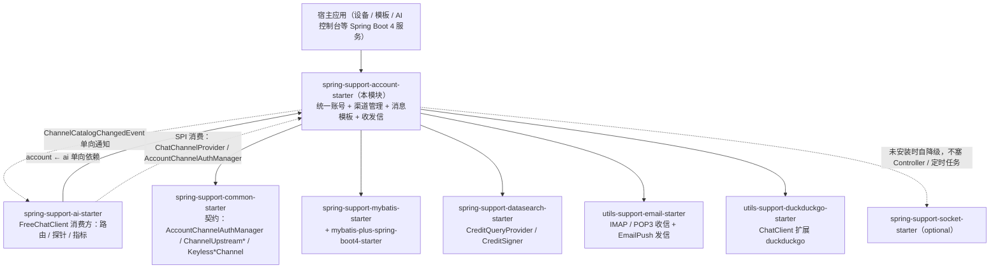
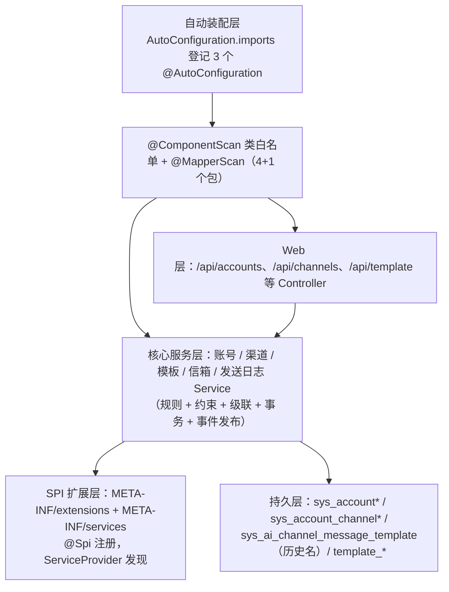
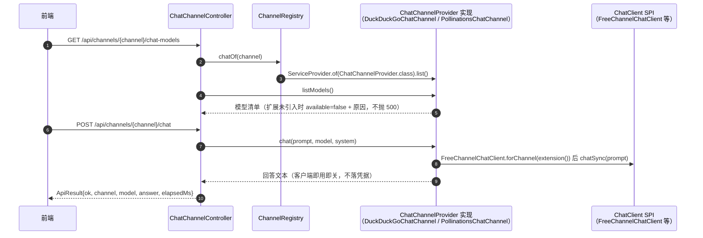

# spring-support-account-starter

账号与渠道域 starter：**统一账号**（密钥 / 邮箱 / 短信 / AppKey / Cookie 池）、**渠道管理**（登录态渠道 + 免登录对话 / 文生图 / 文生视频 / 图生 3D）、**消息模板**、**收发信箱**、**发送日志**与**上游余额查询**。在 spring-support 体系中，它是账号与渠道能力的唯一归属模块：宿主应用引入即获得完整能力（Controller / Service / Mapper / 建表脚本一并带入）；`spring-support-ai-starter` 只是这些能力的消费方，依赖方向唯一 `account ← ai`，渠道数据变更通过 `ChannelCatalogChangedEvent` 单向广播，本模块不反向依赖 AI。

> 基线：版本 `4.0.0.51`（继承父 POM `spring-support-parent-starter`），Spring Boot 4.x，Java 25，持久层走 `mybatis-plus-spring-boot4-starter`。

## 1. 架构图



模块内部分层（自动装配 → 核心服务 → SPI / 持久层）：



## 2. 核心流程图

免登录对话请求流程（`POST /api/channels/{channel}/chat`，`ChatChannelController`）：



## 3. 能力清单

| 能力域 | 关键类 | 入口 / 触发方式 |
| --- | --- | --- |
| 统一账号管理 | `AccountController`、`ManageAccountServiceImpl`、`AccountKindCatalog`、`AccountSecretCodec` | `/api/accounts`：列表 / kinds / 增删改查 / verify / 批量启停·校验·删除 / secret/collect |
| 密钥库 | `AccountSecretController`、`SysAccountSecretServiceImpl` | `/api/accounts/secrets`（Secret 只进不出，读接口只回 `hasSecret`） |
| 外部访问密钥 AppKey | `AccountAppKeyController`、`SysAccountAppKeyServiceImpl` | `/api/accounts/app-keys`（含 `rotate` 轮换） |
| Cookie 池 | `AccountCookieController`、`SysAccountCookieServiceImpl` | `/api/accounts/cookies`（内容加密落库、接口不回显） |
| 登录态渠道管理 | `ApiChannelAuthController`、`AccountChannelService`、`AccountChannelModelService`、`AccountChannelConnectionService`、`AccountChannelHealthService`、`ChannelConnectionSchemaMigrator` | `/api/channels`：start-login / poll / sse-login / refresh / checkin / credit / list-models / import-models / 模型开关 / providers / quotas / signin |
| 免登录渠道 | `ChatChannelController`、`ImageChannelController`、`VideoChannelController`、`Model3DChannelController`、`ChannelRegistry`、`FreeChannelChatClient`、`FreeChannelImageClient` | `/api/channels/{channel}/chat`、`/images`、`/videos`、`/3d-models` 及各 `*-channels`、`*-models` 清单接口 |
| 渠道模型缓存 | `AccountChannelCacheConfiguration`、`AccountChannelModelCache`、`ChannelModelCacheEvictor` | Spring 缓存 `@Cacheable`；`ChannelCatalogChangedEvent`（AFTER_COMMIT）触发失效 |
| 上游余额查询 | `AccountCreditConfigController`、`SysAccountCreditConfigServiceImpl`、`MagpieCreditQueryProvider`、13 个厂商 `*CreditQueryProvider` | `/api/accounts/credit-configs`（kinds / save / test） |
| 收 / 发信箱 | `MailboxController`、`MailboxService`、`EmailInboxProvider` 等收发实现 | `/api/accounts/{accountId}/mailbox`：overview / messages / seen / send |
| 临时邮箱 / 临时手机号 | `TempMailController`、`TempMailService`、`TempPhoneController`、`TempPhoneService` | `/api/accounts/temp-mail`、`/api/accounts/temp-phone`（claim / list / destroy） |
| 账号测试草稿 | `AccountMockDraftController` | `/api/accounts/mock-draft?kind=credit-card`（随机生成可回填表单的测试画像，不落库） |
| 消息模板（短信 / 邮件） | `MessageTemplateController`、`MessageTemplateService`、`SmsTemplateSyncController`、`SmsTemplateSyncService` | `/api/channels/templates`（list / save / render / variables）、`/api/accounts/{accountId}/sms/templates/sync` |
| 打印模板（hiprint） | `TemplateController`、`TemplateServiceImpl`、`SourceSyncerRegistry` | `/api/template`：分页 / 设计器 / 打印机 / sync 来源同步 |
| 发送日志 | `SendLogController`、`SendLogService` | `/api/accounts/send-logs`（分页查询 / `?before=` 清理） |
| 账号事件推送 | `AccountEventController`、`AccountEventSseService` | `/api/accounts/events`（GET / POST SSE） |
| 定时任务 | `SmsDirectoryPoller`、`MailNewMessagePoller`、`ChannelHealthLogCleaner`（Socket 推送协作方 `SocketNewMailPublisher` 本身不是定时任务） | `@Scheduled`，全部有开关门控（见第 5 节） |
| 自动装配 | `AccountAutoConfiguration`、`AccountChannelCacheConfiguration`、`TemplateAutoConfiguration` | `META-INF/spring/...AutoConfiguration.imports` |

建表脚本集中在 `src/main/resources/db/init/V8.0__init_all_account.sql`（16 张表，`CREATE TABLE IF NOT EXISTS` 幂等）与 `V8.0__initdata_all_account.sql`（种子数据），由宿主的 FlywayLike 机制按版本执行；`ChannelConnectionSchemaMigrator` 启动后为 `sys_account_channel_connection` 幂等补列与联合索引。

## 4. Bean 能力矩阵

本模块**没有类级 `@ConditionalOnProperty` 总开关**：3 个自动配置类登记在 `AutoConfiguration.imports`，引入即装配。装配手段 = `@ComponentScan` 类白名单 + `@MapperScan` + 少量 `@Bean`。

| Bean 名 | 类型 | 装配条件 | 可否覆盖 | 典型用途 |
| --- | --- | --- | --- | --- |
| `accountChannelModelCache` | `AccountChannelModelCache`（实现 `CacheResolver`） | 配置类 `@ConditionalOnClass(CacheResolver)`；刻意不设属性开关（`@Cacheable` 按名引用，关掉即调用失败） | 可覆盖，须保留同名与 `CacheResolver` 语义 | 渠道模型清单读写缓存 |
| `channelModelCacheEvictor` | `ChannelModelCacheEvictor` | 同上 | 可覆盖 | 监听 `ChannelCatalogChangedEvent` 清缓存 |
| `templateMybatisPlusInterceptor` | `MybatisPlusInterceptor` | `@ConditionalOnMissingBean(MybatisPlusInterceptor)` | 宿主已有即自动退避 | MyBatis-Plus 分页兜底 |
| `templateServiceInfoContributor` | `ServiceInfoContributor` | 无条件 | 可覆盖 | 向 `/service-info` 注册模板端点与开关 |
| `sourceSyncRunner` | `ApplicationRunner`（`SourceSyncerRegistry`，`@Component` 扫描） | 无条件；无同步器时只打日志 | 可覆盖 | 启动时全量来源同步（message / paper） |
| `channelConnectionSchemaMigrator` | `ChannelConnectionSchemaMigrator`（`ApplicationRunner`） | 无条件；DB 不可达时后台 30s 重试 | 可覆盖 | 启动期 JDBC 幂等补列 |
| 30+ 个 Controller / Service / Codec / Advice | 见第 3 节 | `AccountAutoConfiguration` `includeFilters` 类白名单（`useDefaultFilters=false`）；轮询器另有 `@ConditionalOnProperty` / `@ConditionalOnClass` 门控 | 可用同类型 `@Primary` 覆盖 | Service 构造注入；Controller 走 HTTP |
| 5 组 Mapper | `BaseMapper` 子接口 | `@MapperScan` 四个包 + `template.support.mapper` | 不建议覆盖 | 由对应 Service 构造注入 |

> ⚠️ 白名单口径：`AccountAutoConfiguration` 用 `FilterType.ASSIGNABLE_TYPE` 点名装配，新增业务类必须同步登记进 `includeFilters`，否则宿主启动报 `Parameter 0 ... could not be found`。已知例外：`ChannelHealthLogCleaner` 未列入白名单，宿主默认不会装配它（见第 9 节）。

## 5. 完整配置

本模块**没有 `@ConfigurationProperties` 配置类**（全模块扫描为 0），所有可调项都是散装的 `@Value` / `@Scheduled(fixedDelayString)` / `@ConditionalOnProperty` 键：

| 配置路径 | 类型 | 默认值 | 说明 |
| --- | --- | --- | --- |
| `account.security.secret-key` | String | 空 | Secret / AppKey / Cookie / 余额令牌的 AES-GCM 加密密钥（密文带 `enc:` 前缀）；未配置时明文落库并打启动告警，生产务必配置。见 `AccountSecretCodec` |
| `plugin.account.sms-directory.enable` | boolean | `false` | 短信目录轮询总开关；不开则 Bean 不注册 |
| `plugin.account.sms-directory.dir` | String | `./sms-inbox` | 短信 JSON 文件目录（命中后写内存暂存库并 SSE 广播 `new-sms`，文件归档 `done/` / `error/`） |
| `plugin.account.sms-directory.interval.ms` | long | `5000` | 短信目录轮询周期（毫秒） |
| `plugin.account.mail-notify.enable` | boolean | `false` | 新邮件轮询开关；还需 classpath 上有 `spring-support-socket-starter` |
| `plugin.account.mail-notify.interval.ms` | long | `60000` | 新邮件轮询周期（毫秒），经 Socket 与 SSE 双通道广播 `new-mail` |
| `plugin.account.channel-health-log.cleaner-enable` | boolean | `true`（`matchIfMissing=true`） | 渠道健康历史每日 03:30 清理开关（属性默认开；但该类未列入 `AccountAutoConfiguration` 白名单，宿主默认不装配，见第 4 / 9 节） |
| `plugin.account.channel-health-log.retention-days` | int | `7` | 健康历史保留天数（配置非法时兜底 7） |

最小配置示例（`application.yml`）：

```yaml
account:
  security:
    secret-key: "change-me-to-a-long-random-key"   # 不配则凭据明文落库
plugin:
  account:
    sms-directory:
      enable: true          # 需要短信目录轮询才打开
    mail-notify:
      enable: true          # 需要新邮件推送才打开（需 socket-starter）
    channel-health-log:
      cleaner-enable: true  # 默认即开，可显式关闭
```

## 6. 使用方式

Maven 坐标：

```xml
<dependency>
    <groupId>com.chua</groupId>
    <artifactId>spring-support-account-starter</artifactId>
    <version>4.0.0.51</version>
</dependency>
```

最小启用示例——引入坐标后零配置即获得全部 REST 能力，业务代码直接注入 Service：

```java
@SpringBootApplication
public class DemoApplication {
    public static void main(String[] args) {
        SpringApplication.run(DemoApplication.class, args);
    }
}

@Service
@RequiredArgsConstructor
public class ConsoleFacade {
    private final ManageAccountService accountService;    // 统一账号：CRUD / 校验 / 批量
    private final MailboxService mailboxService;          // 收发信箱编排
    private final MessageTemplateService templateService; // 短信/邮件模板与渲染
}
```

或直接调用 HTTP（免登录试对话）：

```bash
curl -X POST http://localhost:8080/api/channels/chat-duckduckgo/chat \
  -H 'Content-Type: application/json' \
  -d '{"prompt":"你好","model":"gpt-4o-mini"}'
```

可选 / 特殊依赖说明：

- `spring-support-socket-starter`：POM 中 `<optional>true</optional>`。宿主不装时 `MailNewMessagePoller` / `SocketNewMailPublisher` 因 `@ConditionalOnClass(SocketSessionTemplate)` 不装配，新邮件只走 SSE 通道，无任何报错。
- `utils-support-duckduckgo-starter`：免登录渠道的 ChatClient 扩展。渠道侧只按扩展名解析，缺失时优雅降级为「空模型 + 明确提示」（`available=false`），不需要可在宿主 POM 里排除。
- `lombok`、`jakarta.servlet-api` 为 `provided`，由宿主编译环境提供；其余依赖（common / mybatis / datasearch / email 等）随坐标必选带入，缺失会直接影响对应能力装配。

## 7. 使用场景

**适用**：

- 需要「统一账号中心」：密钥 / 邮箱 / 短信 / Cookie / AppKey 一处管理，设备、模板等模块按 `accountId` 引用。
- 需要渠道管理面：登录态渠道（绑定 / 轮询 / 刷新 / 签到 / 模型开关）+ 免登录渠道（对话 / 出图 / 出视频 / 3D）。
- 需要验证码 / 通知发送、临时邮箱 / 接码收信、发送日志审计。
- 需要上游余额 / 额度统一展示（网关额度卡 + 自建回落 + 页面可配的余额查询）。

**不适用 / 慎用**：

- 只想要模型路由、探针、指标、ONNX 物化——那是 `spring-support-ai-starter` 的职责，本模块不含。
- 不需要 Web / 数据库能力的纯工具库——本模块强依赖 Web 与 MyBatis-Plus，引入即带入 Controller 与建表脚本（R5：先确认宿主真的需要）。

**与相邻模块的取舍**：渠道表 / 渠道 CRUD / 模型开关用本模块（渠道管理整体归 account，仓库铁律）；按模型路由对话、探针、`sys_ai_provider_metric` 用 `ai-starter`（经 SPI 取用渠道能力）；「去哪查余额」的字段解析 / 签名在 `datasearch-starter`（本模块持有上游配置并提供统一出口）；免登录模型目录由 `common-starter` 的 `KeylessChatChannel` / `KeylessMediaChannel` 契约声明，不进 `sys_account_channel_model`。

## 8. 扩展点

本模块暴露的 SPI 通过 utilities 的 `@Spi` 注册 + `META-INF/extensions` 登记（余额实现走 `META-INF/services`）；Spring 环境下实现类可正常 `@Autowired` 宿主 Bean。调用方不要直接枚举 SPI，走门面 `ChannelRegistry`（渠道）与 `AccountKindCatalog`（账号种类）：

| SPI 接口 | 登记文件 | 本模块内置实现（`@Spi` 别名） |
| --- | --- | --- |
| `AccountKindProvider` | `META-INF/extensions/com.chua.starter.account.spi.AccountKindProvider` | `ApiKeyKindProvider`（api-key）、`EmailKindProvider`（email）、`SmsKindProvider`（sms）、`TempPhoneKindProvider`（temp-phone）、`PhoneKindProvider`（phone）、`TempCreditCardKindProvider`（credit-card） |
| `AccountInboxProvider` | `.../AccountInboxProvider` | `EmailInboxProvider`、`EmailPop3InboxProvider`、`TempMailInboxProvider`、`TempPhoneInboxProvider`、`PhoneInboxProvider` |
| `AccountVerifier` | `.../AccountVerifier` | `EmailAccountVerifier`（email-imap-verify） |
| `ChatChannelProvider` | `.../ChatChannelProvider` | `DuckDuckGoChatChannel`（chat-duckduckgo）、`PollinationsChatChannel`（chat-pollinations） |
| `ImageChannelProvider` | `.../ImageChannelProvider` | `DuckDuckGoImageChannel`、`PollinationsImageChannel` |
| `VideoChannelProvider` | `.../VideoChannelProvider` | `DoubaoVideoChannel`（video-doubao）、`QwenVideoChannel`（video-qwen） |
| `Model3DChannelProvider` | `.../Model3DChannelProvider` | `ForgeModel3DChannel`（model3d-forge）、`ThreeWsModel3DChannel` |
| `AccountChannelAuthManager` | `.../AccountChannelAuthManager` | `MagpieAccountChannelAuthManager`（magpie） |
| `ChannelUpstreamProvider` / `Codec` / `Admin`（common 契约） | `.../ChannelUpstreamProvider` 等 | `MagpieUpstreamProvider`、`MagpieProviderCodec`、`MagpieUpstreamAdmin`、`MagpieDbCreditProvider`（自建余额回落） |
| `KeylessChatChannel` / `KeylessMediaChannel`（common 契约） | `.../KeylessChatChannel` 等 | 上述免登录实现（供 ai 侧免登录目录读取） |
| `CreditQueryProvider`（datasearch SPI） | `META-INF/services/com.chua.starter.datasearch.credit.spi.CreditQueryProvider` | 13 个厂商实现（cline / eac / gemini / lobsterai / loomy / minimax / opencode / qoder / qoder-cn / raccoon / trae / workbuddy / zcode）+ `MagpieCreditQueryProvider` |
| `ChatClient` / `ImageClient`（utils AI SPI） | `META-INF/extensions/com.chua.common.support.ai.chat.ChatClient` 等 | `FreeChannelChatClient`、`FreeChannelImageClient`（别名 `free-channel`，免费渠道聚合路由层） |

自定义实现注册方式：实现 SPI 接口 → 类上加 `@Spi("唯一别名")` → 在对应 `META-INF/extensions/<接口全名>` 文件中登记一行实现类全名（`CreditQueryProvider` 登记 `META-INF/services`）。示例见仓库内 `spi/impl` 包各实现；`AccountKindProvider` 的字段 / 能力位契约见 `AccountField`、`AccountCapability`。

## 9. 常见问题

**Q1：引入了 starter，但某个 Bean / 接口 404，装配不生效？**
本模块自动装配没有类级开关，入口是 `AutoConfiguration.imports` 里的 3 个类；`AccountAutoConfiguration` 的 `@ComponentScan` 是类白名单（`useDefaultFilters=false` + `ASSIGNABLE_TYPE` 点名），白名单漏登记的类不会成为 Bean，宿主典型报错是启动期 `Parameter 0 ... could not be found`。已知例外：`ChannelHealthLogCleaner`（`@ConditionalOnProperty(plugin.account.channel-health-log.cleaner-enable, matchIfMissing=true)`）当前未列入白名单，宿主默认不装配；如需启用，请在宿主侧 `@ComponentScan` 补扫 `com.chua.starter.account.schedule`。

**Q2：本模块占用端口吗？定时任务默认会跑吗？**
不占用任何端口，所有能力随宿主服务端口暴露。定时任务默认全部不跑：`SmsDirectoryPoller` 与 `MailNewMessagePoller` 都要显式打开开关（且后者需 socket-starter）；`ChannelHealthLogCleaner` 的属性开关虽然缺省为开（`matchIfMissing=true`），但它未列入 `AccountAutoConfiguration` 的 `@ComponentScan` 白名单，宿主默认不装配，所以也不会跑（要跑见 Q1 的白名单 / 补扫方式）。启动后可用 `GET /service-info` 查看模块开关与端点汇总。

**Q3：与 Spring Boot 4 的兼容性？**
本模块用 `@AutoConfiguration` + `AutoConfiguration.imports` 注册，**没有 `spring.factories`**（Boot 3 起自动配置注册方式迁移，Boot 4 沿用 imports 文件）；持久层用 `mybatis-plus-spring-boot4-starter`，API 走 `jakarta.*`。宿主若还停留在 Boot 3 之前的版本，无法使用本模块。

**Q4：凭据安全怎么保证？`account.security.secret-key` 不配会怎样？**
不配时 Secret / Cookie / 令牌明文落库并打启动告警（兼容既有部署）；配置后经 `AccountSecretCodec`（AES-GCM）加密，密文带 `enc:` 前缀，读接口只回 `hasSecret` / `hasToken` 等布尔位。账号数据按 `owner` 归属隔离，跨用户写会被拒绝；渠道连接同理（`sys_account_channel_connection_user_id` 隔离 + 索引）。
