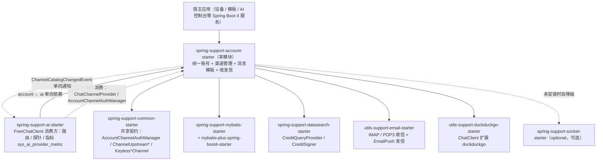
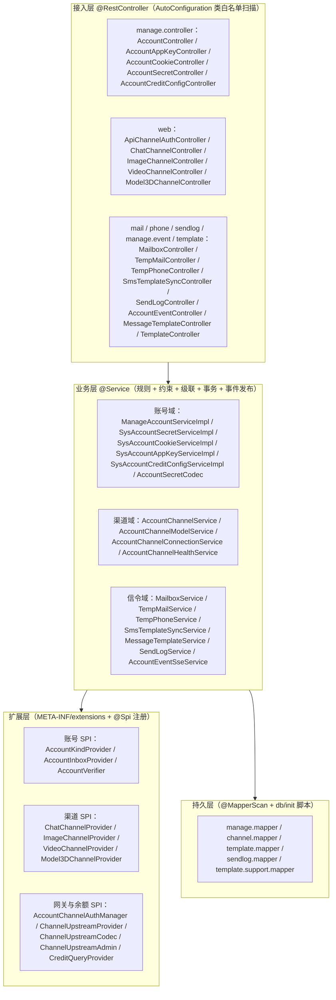
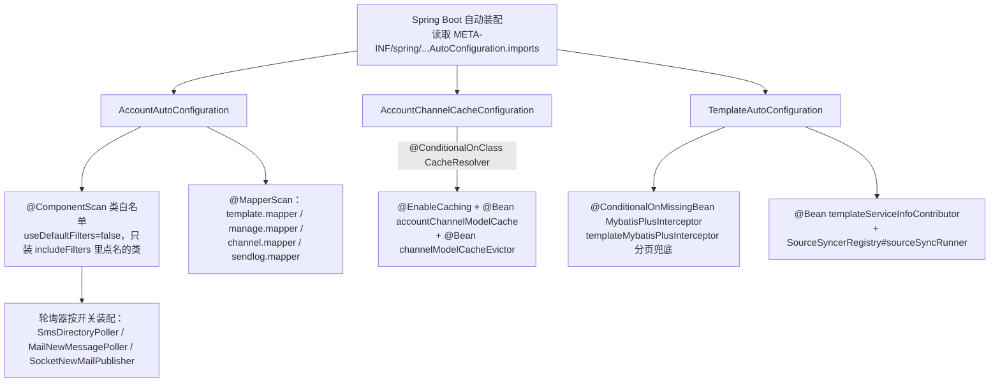
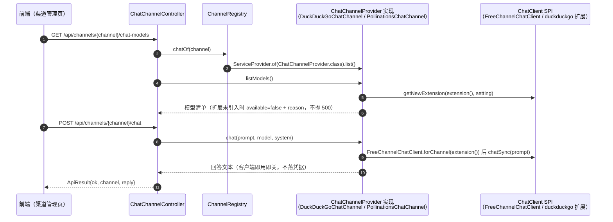
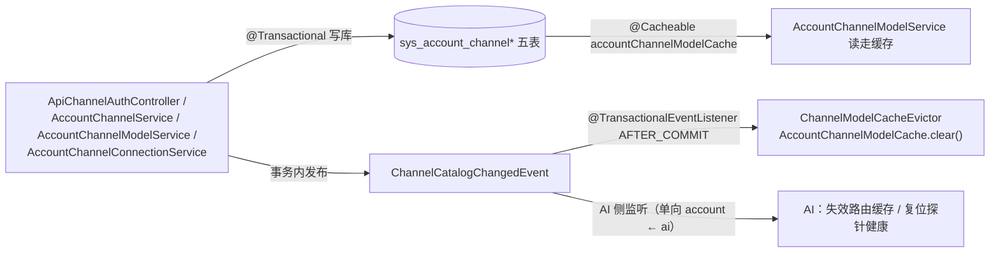

# spring-support-account-starter

账号与渠道域 starter：**统一账号**（密钥 / AppKey / Cookie 池 / 密钥库）、**渠道管理**（登录态绑定 + 免登录对话 / 文生图 / 文生视频 / 图生 3D）、**消息模板**（短信 / 邮件 + hiprint 打印模板）、**收发信箱**（邮箱 / 临时邮箱 / 临时手机号）、**发送日志**与**上游余额查询**。

按仓库铁律，**渠道管理整体归本模块**（表、实体、Mapper、CRUD、判重、级联、克隆、排序、归属隔离、凭据、模型开关、管理 API）；`spring-support-ai-starter` 只是这些能力的消费方（`account ← ai` 单向），通过 SPI 取用并监听 `ChannelCatalogChangedEvent`，本模块不反向依赖 AI。

> 基线：模块版本 `4.0.0.51`（继承父 POM `spring-support-parent-starter`），Spring Boot **4.1.2**，Java **25**，MyBatis-Plus 走 `mybatis-plus-spring-boot4-starter`。

---

## 1. 架构图

### 1.1 模块在体系中的位置



- 宿主引入本模块即获得全部能力（Controller / Service / Mapper / 建表脚本一并带入）。
- AI 模块依赖本模块拿渠道能力，只能走 SPI；渠道数据变更后本模块发布 `ChannelCatalogChangedEvent`，AI 侧自行失效路由缓存、复位探针，**依赖方向唯一：`account ← ai`**。
- `spring-support-socket-starter` 是 `<optional>true</optional>`：宿主没装时新邮件 Socket 推送自动缺席，不塞任何 Controller / 定时任务（R5）。

### 1.2 模块内部分层



---

## 2. 核心流程图

### 2.1 自动装配流程



### 2.2 免登录对话请求流程（`POST /api/channels/{channel}/chat`）



### 2.3 渠道目录变更事件流（数据流）



---

## 3. 能力清单

| 能力域 | 关键类 | 入口（HTTP / Bean） |
| --- | --- | --- |
| 统一账号管理 | `AccountController`、`ManageAccountServiceImpl`、`AccountKindCatalog`、`SysAccount` | `/api/accounts`（列表 / kinds / 增删改查 / 校验 / 批量 / 凭据收录） |
| 密钥库 | `AccountSecretController`、`SysAccountSecretServiceImpl`、`AccountSecretCodec` | `/api/accounts/secrets` |
| 外部访问密钥 AppKey | `AccountAppKeyController`、`SysAccountAppKeyServiceImpl` | `/api/accounts/app-keys`（含 `rotate` 轮换） |
| Cookie 池 | `AccountCookieController`、`SysAccountCookieServiceImpl` | `/api/accounts/cookies` |
| 渠道管理（登录态） | `ApiChannelAuthController`、`AccountChannelService`、`AccountChannelModelService`、`AccountChannelConnectionService`、`AccountChannelHealthService`、`ChannelConnectionSchemaMigrator` | `/api/channels`（绑定 / 轮询 / 刷新 / 签到 / 模型开关 / 上游管理） |
| 免登录渠道（对话 / 图 / 视频 / 3D） | `ChatChannelController`、`ImageChannelController`、`VideoChannelController`、`Model3DChannelController`、`ChannelRegistry`、`FreeChannelChatClient`、`FreeChannelImageClient` | `/api/channels/{channel}/chat` `/images` `/videos` `/3d-models` |
| 渠道模型缓存 | `AccountChannelCacheConfiguration`、`AccountChannelModelCache`、`ChannelModelCacheEvictor` | Spring 缓存（`@Cacheable`，读多写少） |
| 上游余额查询 | `AccountCreditConfigController`、`SysAccountCreditConfigServiceImpl`、`MagpieCreditQueryProvider`、12 个 `*CreditQueryProvider` | `/api/accounts/credit-configs` |
| 收 / 发信箱 | `MailboxController`、`MailboxService`、`EmailInboxProvider` / `EmailPop3InboxProvider` / `EmailAccountVerifier` | `/api/accounts/{accountId}/mailbox` |
| 临时邮箱 | `TempMailController`、`TempMailService`、`TempMailInboxProvider` | `/api/accounts/temp-mail` |
| 临时手机号 / 接码 | `TempPhoneController`、`TempPhoneService`、`TempPhoneKindProvider`、`PhoneKindProvider`、`TempPhoneInboxProvider`、`PhoneInboxProvider` | `/api/accounts/temp-phone` |
| 消息模板（短信 / 邮件） | `MessageTemplateController`、`MessageTemplateService`、`SmsTemplateSyncController`、`SmsTemplateSyncService` | `/api/channels/templates`、`/api/accounts/{accountId}/sms/templates/sync` |
| 打印模板（hiprint） | `TemplateController`、`TemplateServiceImpl`、`SourceSyncerRegistry`、`ProviderSourceRegistry` | `/api/template`（分页 / 设计器 / 打印机 / 来源同步） |
| 发送日志 | `SendLogController`、`SendLogService`、`SysAccountSendLog` | `/api/accounts/send-logs` |
| 账号事件推送 | `AccountEventController`、`AccountEventSseService` | `/api/accounts/events`（GET / POST SSE） |
| 定时任务 | `SmsDirectoryPoller`、`MailNewMessagePoller`、`SocketNewMailPublisher`、`ChannelHealthLogCleaner` | `@Scheduled`（全部有开关门控，见第 5 节） |
| 自动装配 | `AccountAutoConfiguration`、`AccountChannelCacheConfiguration`、`TemplateAutoConfiguration` | `AutoConfiguration.imports` |

### HTTP 接口明细

**`AccountController`（`/api/accounts`）** —— 统一账号管理：

| 方法 | 路径 | Java 方法 | 说明 |
| --- | --- | --- | --- |
| GET | `/api/accounts` | `list` | 账号列表（支持种类与关键词过滤）。 |
| GET | `/api/accounts/kinds` | `kinds` | 受支持账号种类（含 `label` / `icon` / `secretType` / `fields` / `capabilities` 元数据）。 |
| GET | `/api/accounts/{accountId}` | `get` | 账号详情。 |
| POST | `/api/accounts` | `create` | 新增账号。 |
| PUT | `/api/accounts/{accountId}` | `update` | 更新账号。 |
| DELETE | `/api/accounts/{accountId}` | `delete` | 删除账号（逻辑删除）。 |
| POST | `/api/accounts/{accountId}/verify` | `verify` | 校验账号凭据，返回 `{valid, status, message}`。 |
| POST | `/api/accounts/{accountId}/secret/collect` | `collectSecret` | 把账号内联凭据收录到密钥库（反哺），返回不含明文的密钥行。 |
| POST | `/api/accounts/batch/status` | `batchStatus` | 批量启用 / 停用（`?status=1/0` + 账号标识清单）。 |
| POST | `/api/accounts/batch/verify` | `batchVerify` | 批量校验凭据（账号健康巡检）。 |
| POST | `/api/accounts/batch/delete` | `batchDelete` | 批量逻辑删除。用 POST 而非带请求体的 DELETE：部分网关会丢请求体。 |

**`AccountAppKeyController`（`/api/accounts/app-keys`）** —— 外部访问密钥（设备 / 脚本 / 外部系统的访问凭据，与 AI 计费密钥无关）：

| 方法 | 路径 | Java 方法 | 说明 |
| --- | --- | --- | --- |
| GET | `/api/accounts/app-keys` | `list` | 密钥列表。 |
| POST | `/api/accounts/app-keys` | `create` | 新增密钥，返回一次性明文 Secret。 |
| PUT | `/api/accounts/app-keys/{appKeyId}` | `update` | 更新名称 / 状态 / 过期 / 白名单。 |
| POST | `/api/accounts/app-keys/{appKeyId}/rotate` | `rotate` | 轮换 Secret。 |
| DELETE | `/api/accounts/app-keys/{appKeyId}` | `delete` | 删除密钥。 |

**`AccountCookieController`（`/api/accounts/cookies`）** —— Cookie 池（内容加密落库、接口不回显）：

| 方法 | 路径 | Java 方法 | 说明 |
| --- | --- | --- | --- |
| GET | `/api/accounts/cookies` | `list` | Cookie 列表。 |
| GET | `/api/accounts/cookies/{cookieId}` | `get` | Cookie 详情。 |
| POST | `/api/accounts/cookies` | `create` | 新增 Cookie。 |
| PUT | `/api/accounts/cookies/{cookieId}` | `update` | 更新 Cookie。 |
| DELETE | `/api/accounts/cookies/{cookieId}` | `delete` | 删除 Cookie（逻辑删除）。 |

**`AccountSecretController`（`/api/accounts/secrets`）** —— 密钥库（Secret 只进不出，读接口只回 `hasSecret`）：

| 方法 | 路径 | Java 方法 | 说明 |
| --- | --- | --- | --- |
| GET | `/api/accounts/secrets` | `list` | 密钥列表。 |
| GET | `/api/accounts/secrets/{secretId}` | `get` | 密钥详情。 |
| POST | `/api/accounts/secrets` | `create` | 新增密钥。 |
| PUT | `/api/accounts/secrets/{secretId}` | `update` | 更新密钥。 |
| DELETE | `/api/accounts/secrets/{secretId}` | `delete` | 逻辑删除。 |

**`AccountCreditConfigController`（`/api/accounts/credit-configs`）** —— 上游余额查询配置（`sys_account_credit_config`，页面填写「去哪查、余额在哪个字段」，改配置不重新发版）：

| 方法 | 路径 | Java 方法 | 说明 |
| --- | --- | --- | --- |
| GET | `/api/accounts/credit-configs` | `list` | 全部配置（令牌已清空）。 |
| GET | `/api/accounts/credit-configs/kinds` | `kinds` | 可用查询实现标识（`CreditQueries.kinds()`，前端下拉直接用）。 |
| GET | `/api/accounts/credit-configs/{providerId}` | `get` | 单条配置。 |
| PUT | `/api/accounts/credit-configs/{providerId}` | `save` | 新增 / 覆盖（token 留空或掩码表示保留原值）。 |
| DELETE | `/api/accounts/credit-configs/{providerId}` | `delete` | 删除配置。 |
| POST | `/api/accounts/credit-configs/test` | `test` | 按表单内容试查一次（不落库）。 |

**`ApiChannelAuthController`（`/api/channels`）** —— 登录态渠道管理（对接前端「渠道管理」页，按渠道标识路由到 `AccountChannelAuthManager` SPI；provider 行以 `auth_scheme='oauth'` 标识，`providerId = channel:instance`）：

| 方法 | 路径 | Java 方法 | 说明 |
| --- | --- | --- | --- |
| GET | `/api/channels` | `listChannels` | 渠道列表。 |
| POST | `/api/channels/{channel}/start-login` | `startLogin` | 发起登录（设备码等）。 |
| POST | `/api/channels/{channel}/poll` | `pollChannel` | 轮询登录结果。 |
| POST | `/api/channels/{channel}/sse-login` | `sseLogin` | SSE 登录流（`text/event-stream`）。 |
| POST | `/api/channels/{channel}/refresh` | `refreshChannel` | 刷新凭据。 |
| POST | `/api/channels/{channel}/checkin` | `checkinChannel` | 签到。 |
| POST | `/api/channels/{channel}/credit` | `creditChannel` | 余额 / 额度查询。 |
| POST | `/api/channels/{channel}/tasks` | `tasksChannel` | 渠道任务列表。 |
| POST | `/api/channels/{channel}/tasks/claim` | `claimChannelTask` | 领取任务。 |
| POST | `/api/channels/{channel}/tasks/run` | `runChannelTasks` | 执行任务。 |
| POST | `/api/channels/{channel}/list-models` | `listModelsChannel` | 从上游拉取模型清单。 |
| POST | `/api/channels/{channel}/import-models` | `importModelsChannel` | 导入模型到 `sys_account_channel_model`。 |
| PUT | `/api/channels/{channel}/models/{model}/enabled` | `setModelEnabled` | 单模型开关。 |
| GET | `/api/channels/{channel}/models/config` | `channelModelConfig` | 渠道模型配置读取。 |
| PUT | `/api/channels/{channel}/models/enabled` | `setModelsEnabled` | 批量模型开关。 |
| POST | `/api/channels/{channel}/delete-connection` | `deleteConnection` | 删除连接。 |
| POST | `/api/channels/{channel}/rename-connection` | `renameConnection` | 重命名连接。 |
| POST | `/api/channels/{channel}/set-primary` | `setPrimaryConnection` | 设置主账号连接（`role=default`）。 |
| PUT | `/api/channels/{channel}/enabled` | `setChannelEnabled` | 渠道启用 / 停用。 |
| GET | `/api/channels/{channel}/status` | `statusChannel` | 渠道状态（含最近一次探针结论）。 |
| GET | `/api/channels/{channel}/providers` | `listUpstreamProviders` | 上游 provider 列表（`ChannelUpstreamAdmin`）。 |
| POST | `/api/channels/{channel}/providers` | `saveUpstreamProvider` | 保存上游 provider。 |
| POST | `/api/channels/{channel}/providers/delete` | `deleteUpstreamProvider` | 删除上游 provider。 |
| POST | `/api/channels/{channel}/providers/{action}` | `upstreamProviderAction` | 上游通用操作。 |
| GET | `/api/channels/{channel}/plugins` | `listUpstreamPlugins` | 上游插件列表。 |
| POST | `/api/channels/{channel}/plugins/{op}` | `upstreamPluginAction` | 插件操作。 |
| GET | `/api/channels/{channel}/quotas` | `upstreamQuotas` | 上游配额。 |
| POST | `/api/channels/{channel}/quotas/refresh` | `refreshUpstreamQuota` | 刷新配额。 |
| POST | `/api/channels/{channel}/signin` | `startUpstreamSignin` | 发起上游签到。 |
| POST | `/api/channels/{channel}/signin/prompt` | `upstreamSigninPrompt` | 签到提示信息。 |
| GET | `/api/channels/{channel}/signin/{id}` | `upstreamSigninStatus` | 签到状态。 |
| POST | `/api/channels/{channel}/signin/{id}/cancel` | `cancelUpstreamSignin` | 取消签到。 |

> 写库操作（绑定 / 刷新 / 开关 / 删除）走 `@Transactional` 或 `TransactionTemplate`，上游调用失败不产生半成品行；SSE 流程跑在独立线程池，用编程式事务保证 `persistCredentials` 的原子性。

**`ChatChannelController` / `ImageChannelController` / `VideoChannelController` / `Model3DChannelController`（`/api/channels`）** —— 免登录渠道：

| 方法 | 路径 | Java 方法 | 说明 |
| --- | --- | --- | --- |
| GET | `/api/channels/chat-channels` | `listChatChannels` | 全部免登录对话渠道元数据。 |
| GET | `/api/channels/{channel}/chat-models` | `models` | 对话渠道可用模型（扩展未引入时降级为 `available=false` + 原因）。 |
| POST | `/api/channels/{channel}/chat` | `chat` | 同步试对话，请求体 `{prompt, model?, system?, token?}`。 |
| GET | `/api/channels/image-channels` | `listImageChannels` | 全部文生图渠道元数据。 |
| GET | `/api/channels/{channel}/image-models` | `models` | 文生图可选模型。 |
| POST | `/api/channels/{channel}/images` | `generate` | 生成图片，请求体 `{prompt, ratio?, n?, width?, height?, model?, token?}`。 |
| GET | `/api/channels/video-channels` | `listVideoChannels` | 全部文生视频渠道元数据。 |
| GET | `/api/channels/{channel}/video-models` | `models` | 文生视频可选模型。 |
| POST | `/api/channels/{channel}/videos` | `generate` | 生成视频，请求体 `{prompt, ratio?, cameraMovement?, refImageKey?, timeoutSeconds?, model?, token?}`。 |
| GET | `/api/channels/3d-channels` | `listModel3DChannels` | 全部图生 3D 渠道元数据。 |
| GET | `/api/channels/{channel}/3d-models` | `models` | 3D 渠道可选模型 / 格式。 |
| POST | `/api/channels/{channel}/3d-models` | `generate` | 生成 3D 模型，请求体 `{refImageUrl, prompt?, format?, timeoutSeconds?, model?, endpoint?, token?}`。 |

**`MailboxController`（`/api/accounts/{accountId}/mailbox`）** —— 收 / 发信箱（挂在统一账号下，不跳外链）：

| 方法 | 路径 | Java 方法 | 说明 |
| --- | --- | --- | --- |
| GET | `/api/accounts/{accountId}/mailbox` | `overview` | 信箱概览（能否收 / 发信与可用文件夹）。 |
| GET | `/api/accounts/{accountId}/mailbox/messages` | `messages` | 某文件夹信件列表（不含正文）。 |
| GET | `/api/accounts/{accountId}/mailbox/messages/{messageId}` | `message` | 单封邮件详情。 |
| POST | `/api/accounts/{accountId}/mailbox/messages/{messageId}/seen` | `markSeen` | 设置已读 / 未读。 |
| POST | `/api/accounts/{accountId}/mailbox/messages/{messageId}/delete` | `delete` | 删除单封邮件（消息标识可能含特殊字符，故用 POST）。 |
| POST | `/api/accounts/{accountId}/mailbox/send` | `send` | 发信（邮件走 `EmailPush`，短信按厂商走 `alibaba-sms` / `tencent-sms` / `baidu-sms`）。 |

**`TempMailController`（`/api/accounts/temp-mail`）** / **`TempPhoneController`（`/api/accounts/temp-phone`）** —— 临时邮箱 / 临时手机号（都是账号资产的一种：复用 `sys_account`，靠种类与 `config` 标记，不新增表）：

| 方法 | 路径 | Java 方法 | 说明 |
| --- | --- | --- | --- |
| POST | `/api/accounts/temp-mail` | `claim` | 领取临时邮箱。 |
| GET | `/api/accounts/temp-mail` | `list` | 当前用户可见的临时邮箱。 |
| DELETE | `/api/accounts/temp-mail/{accountId}` | `destroy` | 销毁（远端账号 + 本地逻辑删除）。 |
| POST | `/api/accounts/temp-phone` | `claim` | 领取临时手机号（号码服务端生成，支持 `name`）。 |
| GET | `/api/accounts/temp-phone` | `list` | 当前用户可见的临时手机号。 |
| DELETE | `/api/accounts/temp-phone/{accountId}` | `destroy` | 销毁（本地逻辑删除）。 |

**`SmsTemplateSyncController`（`/api/accounts`）** / **`MessageTemplateController`（`/api/channels/templates`）** —— 消息模板：

| 方法 | 路径 | Java 方法 | 说明 |
| --- | --- | --- | --- |
| POST | `/api/accounts/{accountId}/sms/templates/sync` | `sync` | 按账号 vendor 解析 `MessagePush` SPI，同步云端审核通过模板（落 `kind=SMS`）。 |
| GET | `/api/channels/templates` | `list` | 模板列表（`?kind=SMS\|EMAIL`）。 |
| POST | `/api/channels/templates` | `save` | 新增或更新模板。 |
| DELETE | `/api/channels/templates/{templateId}` | `delete` | 删除模板。 |
| POST | `/api/channels/templates/{templateId}/default` | `setDefault` | 设为该种类默认模板。 |
| POST | `/api/channels/templates/render` | `render` | 渲染预览（`{{变量}}` 占位替换，回报缺失变量）。 |
| GET | `/api/channels/templates/variables` | `variables` | 模板内置变量清单。 |

**`TemplateController`（`/api/template`）** —— hiprint 打印模板库（对齐设备模块的分页口径）：

| 方法 | 路径 | Java 方法 | 说明 |
| --- | --- | --- | --- |
| GET | `/api/template/page` | `pageTemplates` | 分页查询模板。 |
| GET | `/api/template/list` | `listTemplates` | 模板列表（不分页）。 |
| GET | `/api/template/{id}` | `getTemplate` | 获取模板。 |
| GET | `/api/template/{id}/detail` | `templateDetail` | 模板详情（自定义模板给设计器产物；固定模板给三方模板 ID、归属账号、推送渠道与占位参数）。 |
| GET | `/api/template/{id}/designer` | `designerTemplate` | 获取模板设计器数据。 |
| POST | `/api/template/add` | `addTemplate` | 新增模板。 |
| PUT | `/api/template/{id}` | `updateTemplate` | 更新模板。 |
| DELETE | `/api/template/{id}` | `deleteTemplate` | 删除模板。 |
| GET | `/api/template/printer` | `printerList` | 打印机列表（应用侧 hiprint 连接地址与 Token）。 |
| GET | `/api/template/printer/discover` | `discoverPrinters` | 自发现打印机。 |
| POST | `/api/template/printer/default` | `setDefaultPrinter` | 设置默认打印机。 |
| DELETE | `/api/template/printer/{name}` | `removePrinter` | 删除打印机。 |
| POST | `/api/template/printer` | `setPrinter` | 设置打印机参数（地址 / 端口 / Token）。 |
| POST | `/api/template/sync` | `syncAllSources` | 来源同步：恢复所有来源（message / paper）到统一模板库。 |
| POST | `/api/template/sync/{source}` | `syncSource` | 来源同步：恢复指定来源。 |
| GET | `/api/template/sync/sources` | `syncSources` | 来源同步器信息（各来源已注册数与库中模板数）。 |

**`SendLogController`（`/api/accounts/send-logs`）** / **`AccountEventController`（`/api/accounts/events`）**：

| 方法 | 路径 | Java 方法 | 说明 |
| --- | --- | --- | --- |
| GET | `/api/accounts/send-logs` | `page` | 分页查询发送日志（种类 / 结果 / 账号 / 收件人 / 关键字 / 时间范围）。 |
| DELETE | `/api/accounts/send-logs` | `clear` | 清理指定时间之前的日志（`?before=...` 必填防误清）。 |
| GET | `/api/accounts/events` | `subscribeByGet` | 订阅账号事件流（兼容原生 EventSource）。 |
| POST | `/api/accounts/events` | `subscribeByPost` | 订阅账号事件流（前端 SSE 客户端默认方式，token 走请求头）。 |

### 数据表与脚本

| 脚本 | 建表 / 动作 | 表 |
| --- | --- | --- |
| `db/init/V8.0__init_all_account.sql`（本模块唯一建表入口；并入原 V2.x / V6.x 增量与原 V7.2 / V7.4 / V7.5 的建表，动态 DDL 全部内联为通用 SQL） | 16 张 | `template_info`、`template_printer`、`template_provider`、`template_log`、`sys_ai_channel_message_template`（沿用历史表名）、`sys_account`、`sys_account_app_key`、`sys_account_cookie`、`sys_account_secret`、`sys_account_credit_config`、`sys_account_channel`、`sys_account_channel_model`、`sys_account_channel_connection`、`sys_account_channel_health`、`sys_account_send_log`、`sys_account_channel_health_log` |
| `db/init/V8.0__initdata_all_account.sql`（前版 `V7.0__initdata_all_account.sql`） | 种子数据 | 内置消息模板等幂等 INSERT |

全部脚本 `CREATE TABLE IF NOT EXISTS` 幂等，可重复执行；`ChannelConnectionSchemaMigrator` 会在启动后为 `sys_account_channel_connection` 幂等补 `sys_account_channel_connection_user_id` 列与联合索引（DB 不可达时每 30 秒重试）。

---

## 4. Bean 能力矩阵

本模块 **没有类级 `@ConditionalOnProperty` 总开关**：三个自动配置类登记在 `AutoConfiguration.imports`，引入即装配。装配手段 = `@ComponentScan` 类白名单 + `@MapperScan` + 少量 `@Bean`。

| Bean 名 | 类型 | 来源 | 装配条件 | 可否覆盖 | 典型注入姿势 |
| --- | --- | --- | --- | --- | --- |
| `accountChannelModelCache` | `AccountChannelModelCache`（实现 `CacheResolver`） | `AccountChannelCacheConfiguration#accountChannelModelCache` | 配置类 `@ConditionalOnClass(CacheResolver)`；**刻意不设属性开关**（`@Cacheable` 按名引用它，关掉即启动后调用失败） | 可覆盖，但必须保留同名与 `CacheResolver` 语义 | 渠道模型清单读写缓存；一般不直接注入 |
| `channelModelCacheEvictor` | `ChannelModelCacheEvictor` | `AccountChannelCacheConfiguration#channelModelCacheEvictor` | 同上 | 可覆盖 | 监听 `ChannelCatalogChangedEvent`（AFTER_COMMIT）清缓存，无需手动注入 |
| `templateMybatisPlusInterceptor` | `MybatisPlusInterceptor` | `TemplateAutoConfiguration#templateMybatisPlusInterceptor` | `@ConditionalOnMissingBean(MybatisPlusInterceptor)` | 宿主已有同名 Bean 即自动退避 | MyBatis-Plus 分页兜底，模块独立运行也能返回 total |
| `templateServiceInfoContributor` | `ServiceInfoContributor` | `TemplateAutoConfiguration#templateServiceInfoContributor` | 无条件 | 可覆盖 | 向 `/service-info` 注册模板模块端点与开关 |
| `sourceSyncRunner` | `ApplicationRunner` | `SourceSyncerRegistry#sourceSyncRunner`（`@Component`，被 `TemplateAutoConfiguration` 扫描） | 无条件；无同步器时只打日志 | 可覆盖 | 启动时全量来源同步（message / paper） |
| `channelConnectionSchemaMigrator` | `ChannelConnectionSchemaMigrator`（`ApplicationRunner`） | `AccountAutoConfiguration` 白名单扫描 | 无条件；DB 不可达时后台 30s 重试 | 可覆盖 | 启动期 JDBC 幂等补列，无需注入 |
| 30+ 个 Controller / Service / Codec / Advice | 见第 3 节能力清单 | `AccountAutoConfiguration` `includeFilters` 白名单（`useDefaultFilters=false`） | 无条件（两个轮询器与 Socket 推送除外，见第 5 节） | 可用同类型 `@Primary` 覆盖 | Service 用构造注入；Controller 走 HTTP |
| 5 组 Mapper | `BaseMapper` 子接口（`ManageAccountMapper`、`SysAccountChannelMapper` 等） | `@MapperScan` 四个包 + `template.support.mapper` | 无条件 | 不建议覆盖 | 由对应 Service 构造注入 |

> ⚠️ 白名单口径：`AccountAutoConfiguration` 用 `FilterType.ASSIGNABLE_TYPE` 点名装配。**新增业务类必须同步登记进 `includeFilters`**，否则 Bean 不会存在（典型报错：宿主启动 `Parameter 0 ... could not be found`）。`ChannelHealthLogCleaner` 目前就未列入白名单，见第 9 节。

---

## 5. 完整配置

本模块 **没有 `@ConfigurationProperties` 配置类**（全模块 grep 为 0）。所有可调项都是散装的 `@Value` / `@Scheduled(fixedDelayString)` / `@ConditionalOnProperty` 键，逐项如下（除此之外没有任何隐藏配置，也没有端口 / 服务器配置——模块随宿主端口对外）：

| 配置键 | 类型 | 默认值 | 说明 | 生效位置 / 开关 |
| --- | --- | --- | --- | --- |
| `account.security.secret-key` | String | 空（`:` 后无值） | 账号 Secret / AppKey Secret / Cookie / 余额查询令牌的 AES-GCM 加密密钥；密文带 `enc:` 前缀。**未配置时明文落库并打启动告警**，生产务必配置 | `AccountSecretCodec` 构造注入，始终生效 |
| `plugin.account.sms-directory.enable` | boolean | `false` | 短信目录轮询总开关；不开则 Bean 不注册、任务不进宿主 | `@ConditionalOnProperty` 门控 `SmsDirectoryPoller` |
| `plugin.account.sms-directory.dir` | String | `./sms-inbox` | 短信 JSON 文件目录（命中临时手机号后写内存暂存库并经 SSE 广播 `new-sms`，文件归档 `done/` / `error/`） | `SmsDirectoryPoller` `@Value` |
| `plugin.account.sms-directory.interval.ms` | long | `5000` | 短信目录轮询周期（毫秒） | `@Scheduled(fixedDelayString)` |
| `plugin.account.mail-notify.enable` | boolean | `false` | 新邮件轮询开关；还需 classpath 上有 `spring-support-socket-starter` | `@ConditionalOnProperty` + `@ConditionalOnClass(SocketSessionTemplate)` 门控 `MailNewMessagePoller` |
| `plugin.account.mail-notify.interval.ms` | long | `60000` | 新邮件轮询周期（毫秒）；按账号 `notifyNew` 轮询，经 Socket 与 SSE 双通道广播 `new-mail` | `@Scheduled(fixedDelayString)` |
| `plugin.account.channel-health-log.cleaner-enable` | boolean | `true`（`matchIfMissing=true`，缺省即开） | 渠道健康历史每日清理开关；不需要健康趋势的宿主可显式关掉 | `@ConditionalOnProperty` 门控 `ChannelHealthLogCleaner`（每日 03:30 cron） |
| `plugin.account.channel-health-log.retention-days` | int | `7` | 健康历史保留天数（60s 探针间隔 ≈ 每连接每天 1440 行） | `ChannelHealthLogCleaner` `@Value`，配置值非法时兜底 7 |

最小配置示例（`application.yml`）：

```yaml
account:
  security:
    secret-key: "change-me-to-a-long-random-key"   # 不配则凭据明文落库
plugin:
  account:
    sms-directory:
      enable: true          # 需要短信目录轮询才打开
      dir: ./sms-inbox
      interval-ms: 5000
    mail-notify:
      enable: true          # 需要新邮件推送才打开（需 socket-starter）
      interval-ms: 60000
    channel-health-log:
      cleaner-enable: true  # 默认即开，可显式关闭
      retention-days: 7
```

---

## 6. 使用方式

### Maven 坐标

```xml
<dependency>
    <groupId>com.chua</groupId>
    <artifactId>spring-support-account-starter</artifactId>
    <version>4.0.0.51</version>
</dependency>
```

内部依赖（随坐标一并带入）：`spring-support-common-starter`（鉴权注解 / 契约 / JSON）、`spring-support-mybatis-starter` + `mybatis-plus-spring-boot4-starter`（审计基类与持久化）、`spring-support-datasearch-starter`（余额查询 SPI 契约）、`utils-support-duckduckgo-starter`（免登录对话 / 出图的 ChatClient 扩展）、`utils-support-email-starter`（IMAP/POP3 收信 + EmailPush 发信）、`swagger-annotations`、`spring-boot-starter-web`、`spring-boot-autoconfigure`。

### 最小可运行示例

```java
@SpringBootApplication
public class DemoApplication {
    public static void main(String[] args) {
        SpringApplication.run(DemoApplication.class, args);
    }
}
```

引入坐标后**零配置**即获得全部 REST 能力；启动日志会出现可检索锚点：

```text
[account] 账号与渠道模块已装配：渠道管理 /api/channels（渠道/模型/连接/健康）、
账号管理 /api/accounts、免登录对话 /api/channels/{channel}/chat、
文生图 /api/channels/{channel}/images、文生视频 /api/channels/{channel}/videos、
图生 3D /api/channels/{channel}/3d-models、消息模板 /api/channels/templates
```

在业务代码里直接注入 Service（全部是白名单扫描的真实 Bean）：

```java
@Service
@RequiredArgsConstructor
public class ConsoleFacade {

    private final ManageAccountService accountService;      // 统一账号：CRUD / 校验 / 批量
    private final MailboxService mailboxService;            // 收发信箱编排
    private final MessageTemplateService templateService;   // 短信/邮件模板与渲染

    public void sendVerifyCode(String accountId, String code) {
        // 按账号厂商解析 MessagePush SPI 发送，模板渲染缺失变量会回报
        // mailboxService.send(...) —— 详见 MailboxService#send
    }
}
```

或者直接调用 HTTP（免登录试对话）：

```bash
curl -X POST http://localhost:8080/api/channels/chat-duckduckgo/chat \
  -H 'Content-Type: application/json' \
  -d '{"prompt":"你好","model":"gpt-4o-mini"}'
```

### 可选依赖说明

- `spring-support-socket-starter`：POM 中 `<optional>true</optional>`。宿主不装时 `MailNewMessagePoller` / `SocketNewMailPublisher` 因 `@ConditionalOnClass(SocketSessionTemplate)` 不装配，新邮件只走 SSE 通道，无任何报错。
- `utils-support-duckduckgo-starter`：免登录渠道的 ChatClient 扩展。渠道侧只按扩展名解析，**缺失时优雅降级**为「空模型 + 明确提示」（`available=false`），宿主如不需要可在自己 POM 里排除。
- 建表脚本（`db/init/V8.0` 等）随模块自带，由仓库的 FlywayLike 机制按版本号执行，命中成功记录即跳过。

---

## 7. 使用场景

**适用**：

- 需要一个「统一账号中心」：密钥 / 邮箱 / 短信 / Cookie / AppKey 一处管理，设备、模板等模块按 `accountId` 引用。
- 需要渠道管理面：登录态渠道（绑定 / 轮询 / 刷新 / 签到 / 模型开关）+ 免登录渠道（对话 / 出图 / 出视频 / 3D）。
- 需要验证码 / 通知发送、临时邮箱 / 接码收信、发送日志审计。
- 需要上游余额 / 额度统一展示（网关额度卡 + 自建回落 + 页面可配的余额查询）。

**不适用**：

- 只想要模型路由、探针、指标、ONNX 物化——那是 `spring-support-ai-starter` 的职责，本模块不含。
- 不需要任何 Web / 数据库能力的纯工具库——本模块强依赖 Web 与 MyBatis-Plus，引入即带入 Controller 与建表脚本（R5：先确认宿主真的需要）。

**与相邻模块的取舍**：

| 需求 | 用谁 | 原因 |
| --- | --- | --- |
| 渠道表 / 渠道 CRUD / 模型开关 | **本模块** | 渠道管理整体归 account（仓库铁律），ai 不复制协议实现 |
| 按模型路由对话、探针、`sys_ai_provider_metric` | `ai-starter` | ai 是 `FreeChatClient` 的消费方；渠道能力经 SPI（`ChatChannelProvider`、`AccountChannelAuthManager`）取用 |
| 「去哪查余额」的字段解析 / 签名 | `datasearch-starter` | `CreditQueryProvider` 契约在 datasearch，本模块持有上游配置并提供统一出口 |
| 免登录模型目录 | `common-starter` 的 `KeylessChatChannel` / `KeylessMediaChannel` 契约 | 生成类免登录渠道模型不进 `sys_account_channel_model`，由契约声明，ai 侧目录读取 |

---

## 8. 扩展点

本模块暴露的 SPI 全部通过 utilities 的 `@Spi` 注册 + `META-INF/extensions`（余额实现走 `META-INF/services`）登记，Spring 环境下实现类可正常 `@Autowired` 宿主 Bean：

| SPI 接口 | 登记文件 | 本模块内置实现（`@Spi` 别名） |
| --- | --- | --- |
| `AccountKindProvider` | `META-INF/extensions/com.chua.starter.account.spi.AccountKindProvider` | `ApiKeyKindProvider`（api-key）、`EmailKindProvider`（email）、`SmsKindProvider`（sms）、`TempPhoneKindProvider`（temp-phone）、`PhoneKindProvider`（phone） |
| `AccountInboxProvider` | `.../AccountInboxProvider` | `EmailInboxProvider`（email-imap）、`EmailPop3InboxProvider`（email-pop3）、`TempMailInboxProvider`（temp-mail）、`TempPhoneInboxProvider`（temp-phone）、`PhoneInboxProvider`（phone） |
| `AccountVerifier` | `.../AccountVerifier` | `EmailAccountVerifier`（email-imap-verify） |
| `ChatChannelProvider` | `.../ChatChannelProvider` | `DuckDuckGoChatChannel`（chat-duckduckgo）、`PollinationsChatChannel`（chat-pollinations） |
| `ImageChannelProvider` | `.../ImageChannelProvider` | `DuckDuckGoImageChannel`（image-duckduckgo）、`PollinationsImageChannel`（image-pollinations） |
| `VideoChannelProvider` | `.../VideoChannelProvider` | `DoubaoVideoChannel`（video-doubao）、`QwenVideoChannel`（video-qwen） |
| `Model3DChannelProvider` | `.../Model3DChannelProvider` | `ForgeModel3DChannel`（model3d-forge） |
| `KeylessChatChannel` / `KeylessMediaChannel`（common 契约） | `.../com.chua.starter.common.support.channel.*` | 同上免登录实现（供 ai 侧免登录目录读取） |
| `AccountChannelAuthManager` | `.../AccountChannelAuthManager` | `MagpieAccountChannelAuthManager`（magpie） |
| `ChannelUpstreamProvider` | `.../ChannelUpstreamProvider` | `MagpieUpstreamProvider`（magpie）、`MagpieDbCreditProvider`（magpie-credit-db，读 `sys_account_credit_config` 的自建余额回落） |
| `ChannelUpstreamCodec` / `ChannelUpstreamAdmin` | `.../ChannelUpstreamCodec`、`.../ChannelUpstreamAdmin` | `MagpieProviderCodec`、`MagpieUpstreamAdmin`（magpie） |
| `CreditQueryProvider`（datasearch SPI） | `META-INF/services/com.chua.starter.datasearch.credit.spi.CreditQueryProvider` | 12 个厂商实现（cline / eac / gemini / lobsterai / loomy / minimax / opencode / qoder / qoder-cn / raccoon / trae / workbuddy / zcode）+ `MagpieCreditQueryProvider`（网关聚合口径） |
| `ChatClient` / `ImageClient`（utils AI SPI） | `META-INF/extensions/com.chua.common.support.ai.chat.ChatClient`、`...image.ImageClient` | `FreeChannelChatClient`、`FreeChannelImageClient`（别名 `free-channel`，免费渠道聚合路由层） |

调用方约定：**不要直接枚举 SPI**，走门面 `ChannelRegistry`（渠道）与 `AccountKindCatalog`（账号种类），去重键取实现自身的 `channel()` / `kind()`。

### 新增一种账号种类（`AccountKindProvider`）

实现该 SPI 并在 `META-INF/extensions` 登记，service 与 `/api/accounts/kinds` 自动生效，不改 core、不改前端表单：

```java
@Spi("object-storage")
public class ObjectStorageKindProvider implements AccountKindProvider {

    @Override
    public String kind() { return "OBJECT_STORAGE"; }   // 稳定落库值，落库后不可改名

    @Override
    public String label() { return "对象存储"; }

    @Override
    public String secretType() { return "api"; }         // 收录到密钥库时的归类

    @Override
    public List<AccountField> fields() {                 // 前端按此渲染表单
        return List.of(AccountField.required("name", "账号名称", null),
                AccountField.secret("secret", "SecretKey", "AccessKeySecret"));
    }

    @Override
    public Set<AccountCapability> capabilities() {
        return Set.of(AccountCapability.SECRET_LIBRARY);
    }
}
```

能力位只声明**真有实现**的：`VERIFY` 需要对应 `AccountVerifier`，`INBOX` 需要 `AccountInboxProvider`，未装实现不得标为支持。

以下留在 core，**不**开放给该 SPI：表结构与 `code` 唯一、`owner` 归属隔离、凭据加解密与掩码、事务与批量语义、HTTP 路径与信封——这些是安全与契约边界。`validate(account, plainSecret)` 收到的明文由编排层解密后传入，实现不得持久化或回显。

### 上游余额的自建回落（`ChannelUpstreamProvider#credit`）

网关读不到余额的上游（如 magpie 的 SiliconFlow 已下线 `/v1/user/info`），宿主可实现自己的余额源：

```java
@Spi("magpie-my-credit") // 别名必须唯一：同名实现会被 SPI 容器只保留一个
public class MyCreditProvider implements ChannelUpstreamProvider {

    @Override
    public String channel() {
        return MagpieSupport.CHANNEL; // 只对 magpie 渠道生效
    }

    @Override
    public boolean supports(String providerId) {
        return "siliconflow".equals(providerId); // 只接管这一家
    }

    @Override
    public Map<String, Object> credit(String providerId, String account, Map<String, Object> credentials) {
        // credentials 里只有网关连接信息（baseUrl / gatewayKey / pageKey），没有上游自己的 API Key
        return Map.of("remain", 12, "total", 100, "unit", "credit");
    }
}
```

- 返回 `null` 表示「不接管」，继续问下一个实现；抛异常也只当不接管，不影响页面。
- 顺序固定：网关有读数时不调用自建源；网关读不到（没有额度卡，或卡里既无窗口也无余额）才回落。
- 返回值按 `remain` / `total` / `unit` / `currency` / `packages` / `text` 渲染；`packages` 每项支持 `name`、`remain`、`size`、`unit`、`currency`、`display`、`expiresAt`。页面把来源标成「自建」。

### 余额查询配置（页面填，不用写代码）

多数上游不需要自定义实现：在 `sys_account_credit_config` 里填「去哪查、余额在哪个字段」即可（接口见第 3 节 `AccountCreditConfigController`）。

- `kind` 为空按通用表达式处理。内置实现（`GET /api/accounts/credit-configs/kinds` 返回）：`expression` 通用字段表达式、`new-api`、`billing`（one-api / new-api / voapi 系通用）、`sub2api`、`openai`、`host`（地址由预设按 provider id 拼装）。
- `host` 预设分两类：**Bearer 类**（`deepseek`、`moonshot`、`siliconflow`、`openrouter`、`novita-ai`、`requesty`、`llmgateway`、`deepinfra`、`together`、`stepfun`、`opencode-go` 等，地址与字段取自官方文档原文）与 **AK/SK 签名类**（`aliyun-bss`、`volc-billing`、`baidu-bce`、`qiniu`，HMAC 签名由 datasearch 的 `CreditSigner` 完成）。
- 火山系合并入口：`volcengine` / `doubao` / `volcengine-coding-plan` 合并为 `volcengine` 主条目，余额走 `volc-billing` 预设；编程套餐由 datasearch 的 `VolcenginePlanCreditQueryProvider`（kind=`volc-plan`）聚合。
- **不收录官方文档没写余额端点的厂商**（zhipu、zai、chutes、fireworks 等 20+ 家）：不猜地址、不标支持，需要时用通用「地址 + 字段表达式」配置。
- 表达式语法：`$ ¥ ￥ € £` 币种前缀；点路径，数字段是数组下标，`*` 通配展开；空格包围的 `* N` / `/ N` 做换算；`%` 后缀表示原值是比例、乘 100；`!` 前缀表示取 `100-值`；`;` 分多段。例：`$data.total_available / 500000`、`$remaining; $used`、`!usage.rolling.percent`。
- 令牌 / AK / SK 落库为 `enc:` 前缀密文，读接口只回 `hasToken` / `hasAccessKey` / `hasSecretKey`；编辑时留空或传掩码表示不修改。
- 取值顺序：网关（magpie 额度卡）有读数就不问自建源；网关读不到才走这张表。本模块的 `MagpieDbCreditProvider` 只在「该上游配了能查的配置」时接管（`supports` 判空），没配就继续问其它 `ChannelUpstreamProvider`。

---

## 9. 常见问题

**Q1：引入了 starter，但某个 Bean / 接口 404，装配不生效？**

- 本模块自动装配没有类级开关，入口是 `AutoConfiguration.imports` 里的三个类；`AccountAutoConfiguration` 的 `@ComponentScan` 是**类白名单**（`useDefaultFilters=false` + `ASSIGNABLE_TYPE` 点名）。白名单漏登记的类不会成为 Bean——宿主典型报错是启动期 `Parameter 0 ... could not be found`（历史上 `AccountChannelHealthService` 漏登记就导致过）。新增业务类务必同步登记。
- 已知例外：`ChannelHealthLogCleaner`（健康历史清理器，`@Component` + `@ConditionalOnProperty(plugin.account.channel-health-log.cleaner-enable, matchIfMissing=true)`）**当前未列入白名单**，宿主默认不会装配它；如需启用，请在宿主侧 `@ComponentScan` 补扫 `com.chua.starter.account.schedule` 或在本模块白名单登记后再升级。
- `AccountChannelCacheConfiguration` **刻意不提供开关**：`@Cacheable` 按 Bean 名引用 `accountChannelModelCache` 解析器，把配置关掉不是「退化成回表」而是调用时直接抛 `No CacheResolver found with name 'accountChannelModelCache'`。要么全开，要么不留开关。
- 模板分页插件：宿主已通过 `spring-support-mybatis-starter` 注册了 `MybatisPlusInterceptor` 时，`templateMybatisPlusInterceptor` 因 `@ConditionalOnMissingBean` 自动退避，不会重复注册。

**Q2：本模块占用端口吗？定时任务默认会跑吗？**

- 不占用任何端口，所有能力随宿主服务的端口暴露；模块自身也没有服务器配置项。
- 定时任务默认**全部不跑**：`SmsDirectoryPoller`（`plugin.account.sms-directory.enable=false`）与 `MailNewMessagePoller`（`plugin.account.mail-notify.enable=false`，且需 classpath 有 socket-starter）都要显式打开；唯一缺省即开的是 `ChannelHealthLogCleaner`（每日 03:30 清理健康历史，`cleaner-enable` 可关）。
- 启动后用 `GET /service-info` 查看模块开关与端点汇总（`templateServiceInfoContributor` 注册了 `/api/template/**` 的条目）。

**Q3：与 Spring Boot 4 / 4.1 的兼容性？**

- 本仓库已升级到 Spring Boot **4.1.2**（2026-11-19），父 POM `spring-boot-starter-parent:4.1.2`，Java 25；本模块用 `@AutoConfiguration` + `AutoConfiguration.imports` 注册，**没有 `spring.factories`**（Boot 3 起自动配置注册方式迁移，Boot 4 沿用 imports 文件）。
- 持久层用 `mybatis-plus-spring-boot4-starter`（Boot 4 专用线），API 走 `jakarta.*`（`jakarta.servlet-api` 为 provided）。
- 宿主若还停留在 Boot 3 之前的版本，无法使用本模块（依赖了 Boot 4 的自动配置与 MyBatis-Plus 4 线 starter）。

**Q4：凭据安全怎么保证？**

- Secret / AppKey Secret / Cookie / 余额令牌落库前经 `AccountSecretCodec`（AES-GCM，密钥 `account.security.secret-key`）加密，密文带 `enc:` 前缀；读接口只回 `hasSecret` / `hasToken` 等布尔位，明文只在编排层解密后传给 SPI 实现，且实现契约禁止持久化 / 回显 / 写日志。
- 账号数据按 `owner` 归属隔离：个人账号只对本人可见，`owner` 为空的部署级账号对所有登录用户可见；写接口带归属校验，跨用户写会被拒绝。渠道连接同理（`sys_account_channel_connection_user_id` 隔离 + 索引）。

**Q5：渠道能力为什么在账号模块，而不在 ai 模块？**

- 仓库铁律（`规则.md`）：渠道管理整体属于 `spring-support-account-starter`；ai 只是 `FreeChatClient` 的消费方。本模块的渠道写操作只发布 `ChannelCatalogChangedEvent`，AI 侧监听后处理自己的路由缓存与探针状态——**方向唯一 `account ← ai`**，本模块不引用任何 `com.chua.starter.ai.*` 类型。
