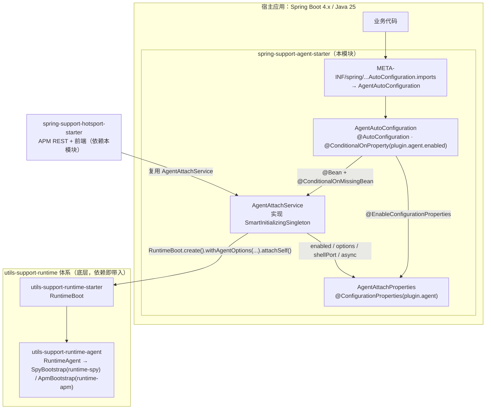
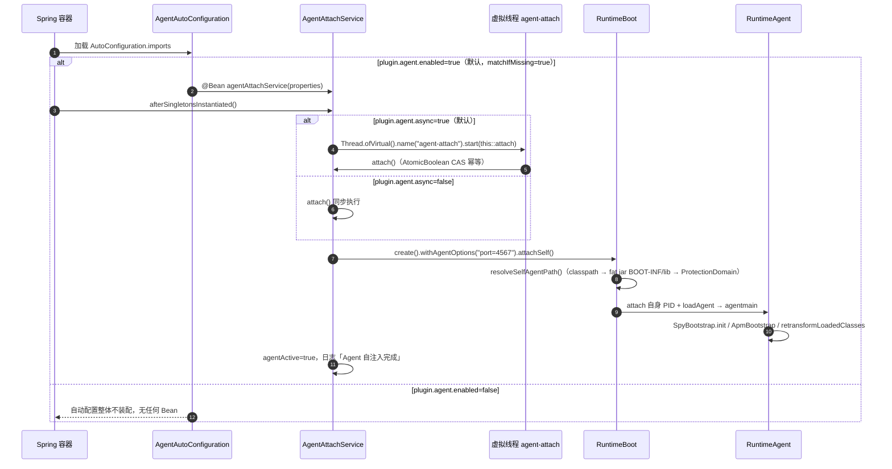

# spring-support-agent-starter

引入依赖即向**当前 JVM** 自注入 Runtime Agent（字节码插桩 + APM 采集）：Spring Boot 自动配置在全部单例初始化完成后调用 `RuntimeBoot#attachSelf()`，零启动参数、零代码侵入。在 spring-support 体系中，本模块是 runtime 观测体系的**引导层**——只负责把 agent jar attach 进当前 JVM；插桩与采集由 `utils-support-runtime-agent` 完成，REST 查询与前端由 `spring-support-hotsport-starter` 承接。

- 坐标：`com.chua:spring-support-agent-starter:4.0.0.51`（父 POM `spring-support-parent-starter:4.0.0.51`）
- 运行基线：Spring Boot 4.x / Java 25；自动配置注册于 `META-INF/spring/org.springframework.boot.autoconfigure.AutoConfiguration.imports`（本模块**无** `spring.factories`）
- 事实来源：模块 `pom.xml`、`AgentAutoConfiguration`、`AgentAttachProperties`、`AgentAttachService`，以及下游 `RuntimeBoot` / `RuntimeAgent`

## 1. 架构图



模块极小：一个 `config` 层（`AgentAutoConfiguration` + `AgentAttachProperties`）、一个 `service` 层（`AgentAttachService`），外加一个 imports 注册文件；无 Controller、无定时任务、无表迁移。

## 2. 核心流程图



注入失败走 fail-open：`doAttach()` 捕获 `Throwable`，仅 `log.warn` 并记录 `lastAttachError`，不阻断启动；`reattach()` 可重试，`setAgentEnabled(boolean)` 可运行时启停采集。

## 3. 能力清单

| 能力域 | 关键类 | 入口/触发方式 |
| --- | --- | --- |
| 自动装配 | `AgentAutoConfiguration` | `AutoConfiguration.imports` 注册；`#agentAttachService(AgentAttachProperties)` |
| 配置属性 | `AgentAttachProperties` | `@ConfigurationProperties(prefix = "plugin.agent")` |
| 启动后自注入 | `AgentAttachService` | `#afterSingletonsInstantiated()`（全部单例就绪后触发） |
| 异步注入 | `AgentAttachService` | 虚拟线程 `agent-attach`（`plugin.agent.async=true` 默认） |
| 幂等注入 | `AgentAttachService` | `#attach()`（`AtomicBoolean attachAttempted` CAS，只尝试一次） |
| 重试 / 重注入 | `AgentAttachService` | `#reattach()`（成功后不再重复执行） |
| 运行时启停采集 | `AgentAttachService` | `#setAgentEnabled(boolean)` |
| 注入状态查询 | `AgentAttachService` | `#isAgentActive()`、`#getStatus()` |
| jar 定位 / 插桩 / 采集 | `RuntimeBoot`、`RuntimeAgent`（下游模块） | `attachSelf()` → `agentmain(args, inst)` |

## 4. Bean 能力矩阵

| Bean 名 | 类型 | 装配条件 | 可否覆盖 | 典型用途 |
| --- | --- | --- | --- | --- |
| `agentAttachService` | `AgentAttachService` | 自动配置类级 `@ConditionalOnProperty(prefix="plugin.agent", name="enabled", havingValue="true", matchIfMissing=true)`；`@Bean` 方法上另有 `@ConditionalOnMissingBean` | 可以：宿主定义同类型 `AgentAttachService` Bean 即覆盖自动配置 | 注入后调 `reattach()` / `setAgentEnabled()` / `getStatus()` |
| `plugin.agent-com.chua.starter.agent.support.config.AgentAttachProperties` | `AgentAttachProperties` | `@EnableConfigurationProperties(AgentAttachProperties.class)`，随自动配置装配（同受 `plugin.agent.enabled` 门控） | 属性值可被任意高优先级配置源覆盖；Bean 本身一般无需覆盖 | 注入读取 `enabled / options / shellPort / async` 运行时取值 |

本模块仅注册这两个 Bean，宿主引入的唯一副作用是「单例就绪后自注入 agent」。`plugin.agent.enabled=false` 时 `AgentAutoConfiguration` 整体不装配，两个 Bean 都不存在；依赖 `AgentAttachService` 的下游模块需自行兜底——注意 hotsport 的 `AgentAttachFallbackConfiguration` 虽声明了禁用态兜底意图，但其 `disabledAgentAttachService` 方法当前未标注 `@Bean`，源码并不会注册兜底 Bean。

## 5. 完整配置

前缀 `plugin.agent`，绑定类 `com.chua.starter.agent.support.config.AgentAttachProperties`（共 4 个字段，无嵌套类、无其他配置项）。

| 配置路径 | 类型 | 默认值 | 说明 |
| --- | --- | --- | --- |
| `plugin.agent.enabled` | `boolean` | `true` | 总开关；`false` 时自动配置整体不装配（`matchIfMissing=true`：不配置等价于 `true`） |
| `plugin.agent.options` | `String` | `""`（空串） | 透传 agent 的参数，逗号分隔 `key=value`；非空时优先于 `shell-port` |
| `plugin.agent.shell-port` | `int` | `4567` | `options` 为空白时自动拼成 `port=<shell-port>` 传入 agent |
| `plugin.agent.async` | `boolean` | `true` | `true` 虚拟线程异步注入；`false` 在 `afterSingletonsInstantiated()` 中同步注入 |

```yaml
plugin:
  agent:
    enabled: true      # 总开关
    async: true        # 虚拟线程异步注入
    shell-port: 4567   # options 为空时的默认端口
    # options: port=4567,storage.type=sqlite   # 非空时优先于 shell-port
```

`options` 可透传 agent 侧全部参数（见 `RuntimeAgent`）：`plugins`、`enabled`、`port`、`storage.type`（inmemory/sqlite/noop）、`storage.retention.ms`（默认 7 天）、`storage.capacity`（默认 100000）、`storage.path`。POM 未引入 `spring-boot-configuration-processor`，IDE 无 `plugin.agent.*` 自动补全元数据，以本表和 `AgentAttachProperties` 源码为准。

## 6. 使用方式

```xml
<dependency>
    <groupId>com.chua</groupId>
    <artifactId>spring-support-agent-starter</artifactId>
    <version>4.0.0.51</version>
</dependency>
```

最小启用示例——引入依赖 + 正常启动类即可，无需 `-javaagent` 启动参数、无需任何代码：

```java
@SpringBootApplication
public class App {
    public static void main(String[] args) {
        SpringApplication.run(App.class, args);
    }
}
```

启动后日志：成功 `[AgentAttach] Agent 自注入完成，options=port=4567`；被禁用 `[AgentAttach] 自注入被配置禁用 (plugin.agent.enabled=false)`；失败 `[AgentAttach] Agent 自注入失败（运行时观测将不可用）: <原因>`（不影响启动）。

依赖说明（本模块 POM 无 `optional` 依赖；`spring-boot-starter` 与两个 runtime 依赖均在本模块 POM 直接声明，引入本模块即传递获得）：

| 依赖 | 是否必需 | 缺失影响 |
| --- | --- | --- |
| `org.springframework.boot:spring-boot-starter` | 必需（本模块声明） | 无自动配置与容器生命周期能力 |
| `com.chua:utils-support-runtime-starter:4.0.0.51` | 必需（本模块声明） | 缺少 `RuntimeBoot`，编译/启动失败 |
| `com.chua:utils-support-runtime-agent:4.0.0.51` | 必需（本模块声明） | 无 agent jar 可 attach，注入失败（fail-open 只告警） |
| `org.projectlombok:lombok` | 编译期（`provided`） | 仅影响本模块编译，宿主运行期不需要 |
| `org.springframework.boot:spring-boot-starter-web` | 可选（宿主自行声明） | 不引入则无法用 REST 暴露 `getStatus()` 等端点（见第 8 节） |

## 7. 使用场景

**适用**：

- Spring Boot 4.x 宿主要**零启动参数**获得字节码插桩 + APM 采集能力。
- 观测类 starter（如 hotsport）作为被观测目标的引导：由依赖带入自动注入，不靠运维手动挂 `-javaagent`。
- 要求「注入失败不阻断业务启动」的 fail-open 场景。

**不适用/慎用**：

- 非 Spring Boot 的纯 Java 进程（本模块靠 Boot 自动配置触发，普通进程请直接用 `RuntimeBoot`）；需要远程注入**其它** JVM 时也不适用，`attachSelf()` 只作用于当前 JVM。
- 受限环境（`-XX:+DisableAttachMechanism`、裁剪 JRE、禁止 self-attach 的容器）以及「注入失败即部署失败」的强一致场景（本模块刻意 fail-open，只 `log.warn`）。

**与相邻模块的取舍**：

| 需求 | 选型 | 说明 |
| --- | --- | --- |
| 只把 agent 注入当前 JVM | **本模块** | 最小引导层，无 REST、无存储 |
| APM 数据 REST 查询 + 前端页面 | `spring-support-hotsport-starter` | 依赖本模块完成注入，自身提供 `ApmController` / `ApmQueryService` 与本地 APM 引擎 |
| APM Provider SPI / 多后端（如 SkyWalking） | `spring-support-apm-starter` + 扩展模块 | `ApmProvider` SPI + 统一 REST，嵌入/独立双模式 |
| 非 Spring Boot 进程 / 完全控制注入链 | 直接用 `utils-support-runtime-starter` | 手写 `RuntimeBoot` 链，或 `attachAgent()` 注入其它 PID |

## 8. 扩展点

**无 Java SPI**：本模块没有 `META-INF/services`，也不定义扩展接口；agent jar 定位、插桩、采集的扩展都在下游 `utils-support-runtime-*` 体系完成。本模块的扩展方式是 Spring Bean 覆盖——`@ConditionalOnMissingBean` 让自动配置退避：

```java
@Configuration
public class MyAgentConfig {
    @Bean
    public AgentAttachService agentAttachService(AgentAttachProperties properties) {
        // 自定义子类 / 包装：改注入时机、接告警等
        return new AgentAttachService(properties);
    }
}
```

`AgentAttachService` 公有方法（注入后可直接调用）：

| 方法 | 作用 | 备注 |
| --- | --- | --- |
| `attach()` | 执行注入（幂等，只尝试一次） | 容器回调自动触发，一般无需手动调 |
| `reattach()` | 失败后 / 配置变更后重试注入 | `agentActive=true` 时跳过 |
| `setAgentEnabled(boolean)` | 运行时启停采集 | `false` 停后续注入与上报；`true` 触发 `reattach()`；不卸载已注入的 `Instrumentation` |
| `isAgentActive()` / `isAgentEnabled()` / `isEnabled()` | 注入是否成功 / 运行时开关 / 配置开关 | 三者含义不同，勿混用 |
| `getShellPort()` | 读取 `plugin.agent.shell-port` | 默认 4567 |
| `getStatus()` | 状态快照（`LinkedHashMap`，键序固定） | 键：`agentActive`、`agentEnabled`、`version`、`startedAt`、`lastHeartbeat`、`heartbeatLostMs`、`attachAttempts`、`lastAttachError` |

配合 `spring-boot-starter-web` 可暴露运维端点（示例）：

```java
@RestController
public class AgentStatusController {

    @Resource
    private AgentAttachService agentAttachService;

    @GetMapping("/ops/agent/status")
    public Map<String, Object> status() {
        return agentAttachService.getStatus();
    }

    @PostMapping("/ops/agent/reattach")
    public boolean reattach() {
        agentAttachService.reattach();
        return agentAttachService.isAgentActive();
    }

    @PostMapping("/ops/agent/enabled")
    public boolean switchEnabled(@RequestParam boolean enabled) {
        agentAttachService.setAgentEnabled(enabled);
        return agentAttachService.isAgentEnabled();
    }
}
```

需要注册自定义 APM handler 或自建 Shell 时，应使用 `RuntimeBoot` 的完整链式 API（`withAgent(Path)`、`withShellPort(int)`、`withApmCommand()`、`withHandler(Plugin)`、`startShell()`、`startApm()` 等），而不是扩展本模块；本模块只使用 `withAgentOptions(String) + attachSelf()`。

## 9. 常见问题

1. **引了依赖却没注入？** 按序排查：a) 启动日志有无 `[AgentAttach]` 前缀；b) `plugin.agent.enabled` 是否被设为 `false`（整体不装配）；c) 是否有同类型 `AgentAttachService` Bean 触发 `@ConditionalOnMissingBean` 退避；d) agent jar 是否真的在 classpath / fat jar 的 `BOOT-INF/lib/` 里——定位不到时 `RuntimeBoot` 会打「无法定位 Agent JAR，跳过自注入」。
2. **怎么彻底关闭？** `plugin.agent.enabled=false`，`AgentAutoConfiguration` 整体不装配，不再注入。注意：hotsport 的 `AgentAttachFallbackConfiguration` 当前并不会补禁用态 Bean（其 `disabledAgentAttachService` 未标注 `@Bean`），关闭后是否还有可用的 `AgentAttachService` 取决于下游自己注册的 Bean，以源码为准。
3. **端口怎么改？失败为什么应用还能启动？** 默认 4567，用 `plugin.agent.shell-port` 修改（仅当 `options` 为空时生效；`options` 非空时以其中 `port=` 为准）。Runtime Shell 无鉴权，`RuntimeBoot.BootConfig` 默认只绑 `127.0.0.1`，跨机访问需自行做网络隔离。注入失败是刻意的 fail-open：只 `log.warn` 并记录 `lastAttachError`，不阻断业务；需要重试时调 `reattach()`。
4. **Spring Boot 4 / JDK 25 兼容性与状态可信度？** 本模块基于 `@AutoConfiguration` + `AutoConfiguration.imports`（Boot 3+ 机制），没有也不需要 `spring.factories`；仓库当前基线 Spring Boot 4.1.2。JDK 25 下注意：agent 注入后会对已加载类 `retransformLoadedClasses`，部分环境可能使 JVM 直接退出，遇此需显式 `plugin.agent.enabled=false` 并自行兜底 `AgentAttachService` Bean。`getStatus()` 中 `version` 硬编码 `"4.0.0.42"`（与 POM 版本 4.0.0.51 不一致）、`lastHeartbeat` 取当前时间、`heartbeatLostMs` 恒为 `0`，均非 agent 真实心跳；可信字段是 `agentActive` / `agentEnabled` / `attachAttempts` / `lastAttachError` / `startedAt`。另：`async=true` 时「自注入完成」日志出现之前 `isAgentActive()` 仍为 `false`，依赖 agent 的探活应处理「未就绪」，不要直接判故障。
