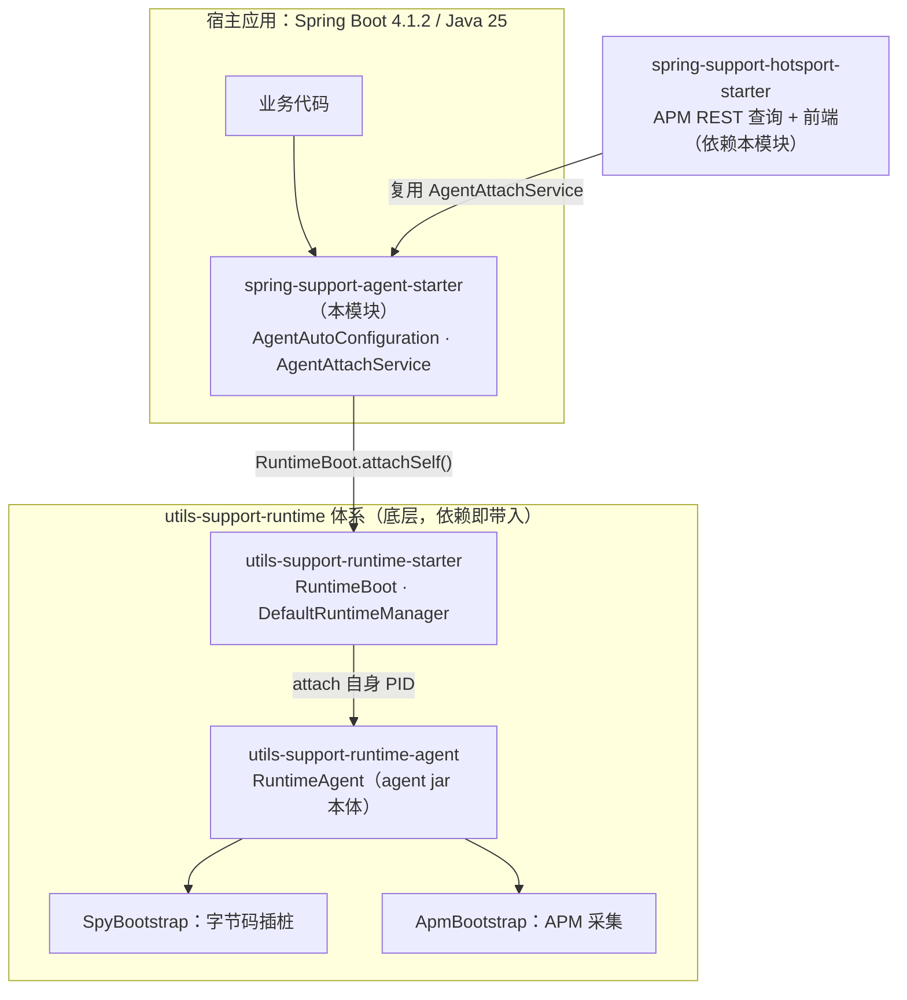
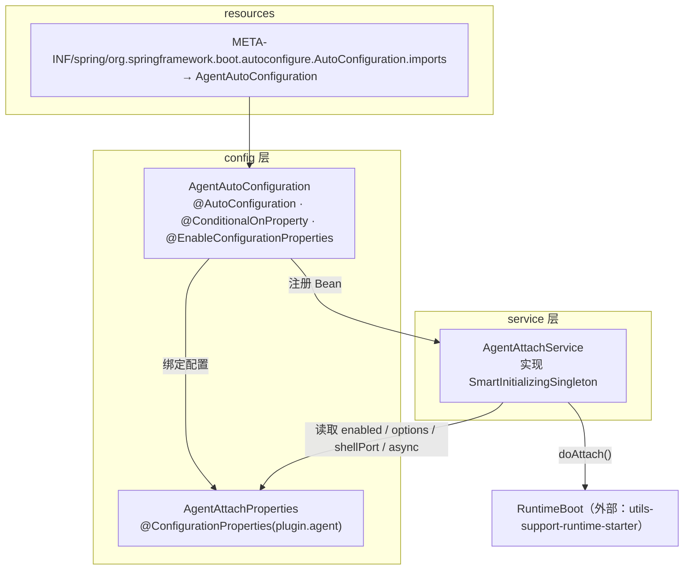
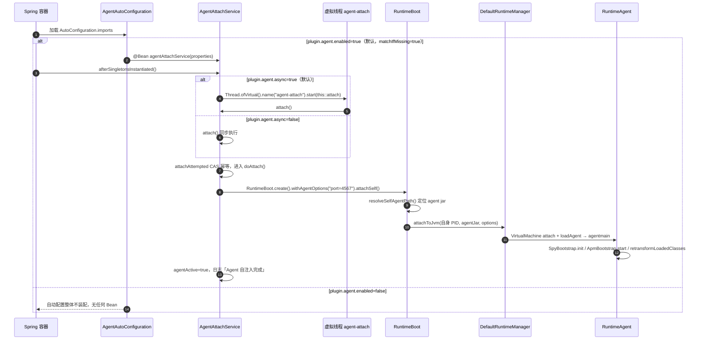
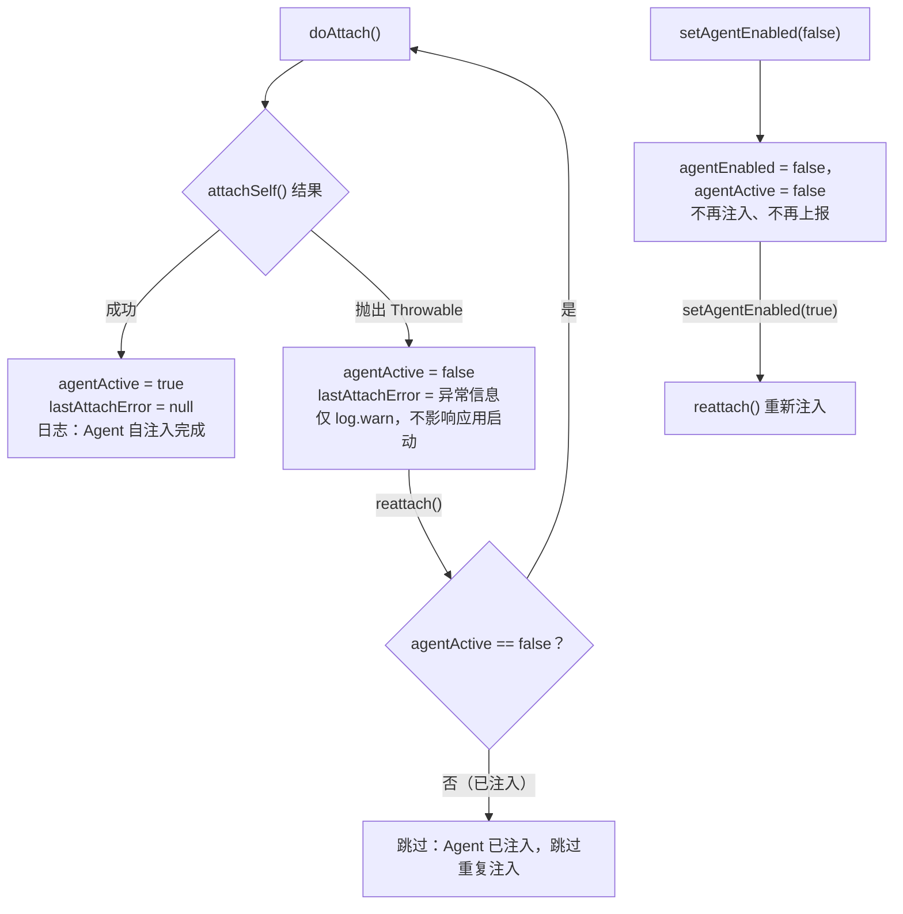

# spring-support-agent-starter

引入依赖即向**当前 JVM** 自注入 Runtime Agent（字节码插桩 + APM 采集）。
零启动参数、零代码侵入：Spring Boot 自动配置在全部单例初始化完成后调用 `RuntimeBoot#attachSelf()`。

- 坐标：`com.chua:spring-support-agent-starter:4.0.0.51`
- 运行基线：Spring Boot **4.1.2**（2026-11-19 升级）/ Java **25**
- 自动配置注册：`META-INF/spring/org.springframework.boot.autoconfigure.AutoConfiguration.imports`（本模块**无** `spring.factories`）
- 本文事实来源：模块 `pom.xml`、`AgentAutoConfiguration` / `AgentAttachProperties` / `AgentAttachService`、`utils-support-runtime-starter` 的 `RuntimeBoot`、`utils-support-runtime-agent` 的 `RuntimeAgent`

## 1. 架构图

### 1.1 模块在体系中的位置

本模块是 runtime 观测体系的**引导层**：只负责把 agent jar attach 进当前 JVM；
插桩与采集由 runtime-agent 内的 `SpyBootstrap` / `ApmBootstrap` 完成，REST 查询与前端由 `spring-support-hotsport-starter` 承接。



### 1.2 模块内部分层

模块极小：一个 `config` 层（自动配置 + 属性）、一个 `service` 层（自注入服务），外加一个 imports 注册文件。



## 2. 核心流程图

### 2.1 装配与自注入时序（默认路径 + 关闭路径）



### 2.2 失败降级与运行时重注入



## 3. 能力清单

| 能力域 | 关键类 | 入口 |
| --- | --- | --- |
| 自动装配 | `AgentAutoConfiguration` | `@AutoConfiguration`（经 `AutoConfiguration.imports` 注册）；`#agentAttachService(AgentAttachProperties)` |
| 配置属性 | `AgentAttachProperties` | `@ConfigurationProperties(prefix = "plugin.agent")` |
| 启动后自注入 | `AgentAttachService` | `#afterSingletonsInstantiated()`（`SmartInitializingSingleton`，全部单例就绪后触发） |
| 异步注入 | `AgentAttachService` | `Thread.ofVirtual().name("agent-attach")`（`plugin.agent.async=true` 默认） |
| 幂等注入 | `AgentAttachService` | `#attach()`（`AtomicBoolean attachAttempted` CAS，只尝试一次） |
| 失败重试 / 运行时重注入 | `AgentAttachService` | `#reattach()`（成功后不再重复执行） |
| 运行时启停采集 | `AgentAttachService` | `#setAgentEnabled(boolean)` |
| 注入状态查询 | `AgentAttachService` | `#isAgentActive()`、`#getStatus()` |
| agent jar 定位 | `RuntimeBoot`（utils-support-runtime-starter） | `attachSelf()` → `resolveSelfAgentPath()`：classpath 扫描 → fat jar `BOOT-INF/lib/` 提取 → `ProtectionDomain` 回退 |
| 字节码插桩 / APM 采集 | `RuntimeAgent` → `SpyBootstrap` / `ApmBootstrap`（utils-support-runtime-agent） | `agentmain(args, inst)` |

## 4. Bean 能力矩阵

| Bean 名 | 类型 | 装配条件 | 可否覆盖 | 典型注入姿势 |
| --- | --- | --- | --- | --- |
| `agentAttachService` | `AgentAttachService` | 自动配置类带 `@ConditionalOnProperty(prefix="plugin.agent", name="enabled", havingValue="true", matchIfMissing=true)`；`@Bean` 方法上另有 `@ConditionalOnMissingBean` | 可以：宿主定义同类型 `AgentAttachService` Bean 即覆盖自动配置 | `@Resource private AgentAttachService agentAttachService;` 或构造器注入 |
| `plugin.agent-com.chua.starter.agent.support.config.AgentAttachProperties` | `AgentAttachProperties` | `@EnableConfigurationProperties(AgentAttachProperties.class)`，随自动配置装配（同受 `plugin.agent.enabled` 门控） | 属性值可被任意高优先级配置源覆盖；Bean 本身一般无需覆盖 | 注入 `AgentAttachProperties` 读取运行时取值 |

说明：

- 本模块**只有这两个 Bean**：没有 Controller、没有定时任务、没有表迁移。宿主引入的唯一副作用就是「单例就绪后自注入 agent」。
- `plugin.agent.enabled=false` 时 `AgentAutoConfiguration` 整体不装配，两个 Bean 都不存在。依赖 `AgentAttachService` 的下游模块需自行兜底——hotsport 的 `AgentAttachFallbackConfiguration` 就是为此补一个「禁用态」实例，避免 `ApmQueryService` / `ApmController` 因缺 Bean 启动失败。

## 5. 完整配置

前缀 `plugin.agent`，绑定类 `com.chua.starter.agent.support.config.AgentAttachProperties`（共 4 个字段，无其他配置项）。

| 配置路径 | 类型 | 默认值 | 说明 | 生效开关 |
| --- | --- | --- | --- | --- |
| `plugin.agent.enabled` | `boolean` | `true` | 是否装配并自注入；`false` 时 `AgentAutoConfiguration` 整体不装配 | 本身即总开关（`matchIfMissing=true`：不配置等价于 `true`） |
| `plugin.agent.options` | `String` | `""`（空串） | 透传给 agent 的参数，逗号分隔 `key=value`（如 `port=4567,storage.type=sqlite`） | 仅在 `enabled=true` 时被消费 |
| `plugin.agent.shell-port` | `int` | `4567` | `options` 为空白时，自动拼成 `port=<shell-port>` 传入 agent | 仅在 `enabled=true` 且 `options` 为空时生效 |
| `plugin.agent.async` | `boolean` | `true` | `true`：虚拟线程异步注入，不阻塞启动；`false`：在 `afterSingletonsInstantiated()` 中同步注入 | 仅在 `enabled=true` 时被消费 |

```yaml
plugin:
  agent:
    enabled: true      # 总开关
    async: true        # 虚拟线程异步注入
    shell-port: 4567   # options 为空时的默认端口
    # options: port=4567,storage.type=sqlite   # 非空时优先于 shell-port
```

`options` 与 `shell-port` 的关系是「有则用之，无则拼之」（`AgentAttachService#doAttach()` 原文）：

```java
String options = properties.getOptions();
if (!StringUtils.hasText(options)) {
    options = "port=" + properties.getShellPort();
}
```

补充：

- `options` 可透传 agent 侧全部参数（见 `RuntimeAgent` javadoc）：`plugins`、`enabled`、`port`、`storage.type`（inmemory/sqlite/noop）、`storage.retention.ms`（默认 7 天）、`storage.capacity`（默认 100000）、`storage.path`；优先级：agent 参数 > 系统属性 `apm.storage.*` > 默认值。
- POM 未引入 `spring-boot-configuration-processor`，IDE 中没有 `plugin.agent.*` 的自动补全元数据，以本表和 `AgentAttachProperties` 源码为准。

## 6. 使用方式

### 6.1 Maven 坐标

```xml
<dependency>
    <groupId>com.chua</groupId>
    <artifactId>spring-support-agent-starter</artifactId>
    <version>4.0.0.51</version>
</dependency>
```

### 6.2 最小可运行示例

只需两步，无需 `-javaagent` 启动参数、无需任何代码：

```xml
<!-- 1. 引入依赖（见 6.1） -->
```

```java
// 2. 正常的 Spring Boot 启动类即可
@SpringBootApplication
public class App {
    public static void main(String[] args) {
        SpringApplication.run(App.class, args);
    }
}
```

启动成功后确认日志（真实日志文案）：

```text
[AgentAttach] Agent 自注入完成，options=port=4567
```

若被禁用：`[AgentAttach] 自注入被配置禁用 (plugin.agent.enabled=false)`；
若失败（不影响启动）：`[AgentAttach] Agent 自注入失败（运行时观测将不可用）: <原因>`。

### 6.3 可选依赖说明

| 依赖 | 是否必需 | 说明 |
| --- | --- | --- |
| `org.springframework.boot:spring-boot-starter` | 必需（本模块声明，传递带入） | 自动配置与容器生命周期 |
| `com.chua:utils-support-runtime-starter`（4.0.0.51） | 必需（传递带入，无需显式声明） | `RuntimeBoot`：`create()` / `withAgentOptions(String)` / `attachSelf()` |
| `com.chua:utils-support-runtime-agent`（4.0.0.51） | 必需（传递带入） | 被 attach 的 agent jar 本体 |
| `org.springframework.boot:spring-boot-starter-web` | 可选 | 仅当想用 REST 暴露状态 / 开关端点时引入（示例见 8.3） |
| `org.projectlombok:lombok` | 编译期（`provided`） | `@Slf4j`，运行期不需要 |

## 7. 使用场景

**适用**：

- Spring Boot 4.x 宿主想**零启动参数**获得字节码插桩 + APM 采集能力。
- 观测类 starter（如 hotsport）作为被观测目标的引导：由依赖带入自动注入，不靠运维手动挂 `-javaagent`。
- 要求「注入失败不阻断业务启动」的 fail-open 场景。

**不适用**：

- 非 Spring Boot 的纯 Java 进程：本模块靠 Boot 自动配置触发，普通进程请直接使用 `RuntimeBoot`。
- 需要远程注入**其它** JVM 或容器编排级批量注入：`attachSelf()` 只作用于当前 JVM。
- 受限环境：`-XX:+DisableAttachMechanism`、裁剪 JRE、禁止 self-attach 的容器。
- 要求「注入失败即部署失败」的强一致场景：本模块刻意 fail-open，只 `log.warn`。

**与相邻模块的取舍**：

| 需求 | 选型 | 说明 |
| --- | --- | --- |
| 只要把 agent 注入当前 JVM | **本模块** | 最小引导层，无 REST、无存储 |
| 要 APM 数据 REST 查询 + 前端页面 | `spring-support-hotsport-starter` | 它依赖本模块完成注入（hotsport pom 显式声明），自己提供 `ApmController` / `ApmQueryService` 与本地 APM 引擎 |
| 要 APM Provider SPI / 多后端（如 SkyWalking） | `spring-support-apm-starter` + 扩展模块 | `ApmProvider` SPI + 统一 REST，嵌入/独立双模式 |
| 非 Spring Boot 进程 / 完全控制注入链 | 直接用 `utils-support-runtime-starter` | 手写 `RuntimeBoot.create()...attachSelf()`，或用 `attachAgent()` 注入其它 PID |

## 8. 扩展点

### 8.1 SPI

**本模块不提供 Java SPI 扩展点**：没有 `META-INF/services` 文件，也没有自定义扩展接口。agent jar 定位、插桩、采集的扩展都在下游 `utils-support-runtime-*` 体系内完成。

### 8.2 Spring Bean 覆盖（本模块的扩展方式）

`@ConditionalOnMissingBean` 让自动配置退避，宿主可自定义同类型 Bean（例如把端口来源换成配置中心、加监控告警）：

```java
@Configuration
public class MyAgentConfig {

    @Bean
    public AgentAttachService agentAttachService(AgentAttachProperties properties) {
        // 自定义子类 / 包装：改注入时机、接告警等
        return new AgentAttachService(properties);
    }
}
```

### 8.3 运行时操作 API（`AgentAttachService` 公有方法）

| 方法 | 作用 | 备注 |
| --- | --- | --- |
| `attach()` | 执行注入（幂等，只尝试一次） | 容器回调自动触发，一般无需手动调 |
| `reattach()` | 失败后 / 配置变更后重试注入 | `agentActive=true` 时跳过 |
| `setAgentEnabled(boolean)` | 运行时启停采集 | `false`：停后续注入与上报；`true`：触发 `reattach()` |
| `isAgentActive()` | 注入是否成功 | 异步注入完成前可能仍为 `false` |
| `isAgentEnabled()` | 运行时是否允许采集 | 可被 `setAgentEnabled` 改变 |
| `isEnabled()` | 配置开关 `plugin.agent.enabled` 是否为 true | 与 `isAgentEnabled()` 含义不同 |
| `getShellPort()` | 读取 `plugin.agent.shell-port` | 默认 4567 |
| `getStatus()` | 状态快照（`LinkedHashMap`，键序固定） | 键：`agentActive`、`agentEnabled`、`version`、`startedAt`、`lastHeartbeat`、`heartbeatLostMs`、`attachAttempts`、`lastAttachError` |

配合 web 端点暴露（需要 `spring-boot-starter-web`）：

```java
@RestController
public class AgentStatusController {

    @Resource
    private AgentAttachService agentAttachService;

    @GetMapping("/ops/agent/status")
    public Map<String, Object> status() {
        return agentAttachService.getStatus();
    }

    @PostMapping("/ops/agent/reattach")
    public boolean reattach() {
        agentAttachService.reattach();
        return agentAttachService.isAgentActive();
    }

    @PostMapping("/ops/agent/enabled")
    public boolean switchEnabled(@RequestParam boolean enabled) {
        agentAttachService.setAgentEnabled(enabled);
        return agentAttachService.isAgentEnabled();
    }
}
```

### 8.4 下游链式能力（属于 `utils-support-runtime-starter`，非本模块）

`RuntimeBoot` 还提供 `withAgent(Path)`、`withShellPort(int)`、`withApmCommand()`、`withHandler(Plugin)`、`startShell()`、`startApm()` 等链式方法；本模块只使用 `withAgentOptions(String) + attachSelf()`。需要注册自定义 APM handler 或自建 Shell 时，应自行构造 `RuntimeBoot` 链，而不是扩展本模块。

## 9. 常见问题

1. **引了依赖却没注入？** 按序排查：a) 启动日志有无 `[AgentAttach]` 前缀；b) `plugin.agent.enabled` 是否被设为 `false`（整体不装配）；c) 是否有同类型 `AgentAttachService` Bean 触发 `@ConditionalOnMissingBean` 退避；d) agent jar 是否真的在 classpath / fat jar 的 `BOOT-INF/lib/` 里——定位不到时 `RuntimeBoot` 会打「无法定位 Agent JAR，跳过自注入」。
2. **怎么彻底关闭？** `plugin.agent.enabled=false`。在 hotsport 宿主里关闭后由 `AgentAttachFallbackConfiguration` 补禁用态 Bean：状态查询仍可用，只是不注入。
3. **端口怎么改？冲突怎么办？** 默认 4567。改端口用 `plugin.agent.shell-port`（仅当 `options` 为空时生效）；`options` 非空时以 `options` 里的 `port=` 为准。Runtime Shell 无鉴权，`RuntimeBoot.BootConfig` 默认只绑 `127.0.0.1`（`shellHost`），跨机访问需自行做网络隔离。
4. **日志里有「自注入失败」，应用却照常启动？** 刻意的 fail-open：`doAttach()` 捕获 `Throwable`，只 `log.warn` 并记录 `lastAttachError`，观测不可用不阻断业务。需要重试时调 `reattach()`。
5. **与 Spring Boot 4 / JDK 25 的兼容性？** 本模块基于 `@AutoConfiguration` + `AutoConfiguration.imports`（Boot 3+ 机制），仓库当前基线 Spring Boot 4.1.2；没有也不需要 `spring.factories`（旧机制 Boot 3 起已移除）。JDK 25 下注意：agent 注入后对已加载类做 `retransformLoadedClasses`，在部分环境会使 JVM 直接退出（hotsport 独立部署正是因此用 `enabled=false` 关掉「观测自己」）。
6. **`getStatus()` 能直接当监控用吗？** 不能全信：`version` 硬编码 `"4.0.0.42"`（与 POM 版本 4.0.0.51 不一致）；`lastHeartbeat` 取当前时间、`heartbeatLostMs` 恒为 `0`，都不是 agent 真实心跳。可信字段：`agentActive` / `agentEnabled` / `attachAttempts` / `lastAttachError` / `startedAt`。
7. **`async=true` 时为什么刚启动 `isAgentActive()` 是 `false`？** 注入在虚拟线程里异步执行，出现「自注入完成」日志之前状态仍是 `false`；依赖 agent 的探活应处理「未就绪」，不要直接判故障。
8. **`options` 能不能留空（不传任何参数）？** 不能：`options` 为空白时一定会被替换成 `port=<shell-port>`（默认 `port=4567`），没有「完全无参数」的 attach。
9. **`setAgentEnabled(false)` 会卸载已注入的插桩吗？** 不会。只关闭后续注入与状态上报，已注入的 `Instrumentation` 实例不强制卸载；再打开时走 `reattach()`。
10. **重复 attach 会怎样？** `RuntimeAgent` 用 `started` 标志幂等，重复 loadAgent 打「Runtime Agent 已启动，忽略重复加载」；`AgentAttachService#attach()` 侧也有 `AtomicBoolean` CAS 幂等保护。
