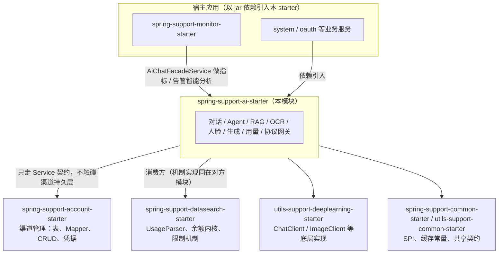
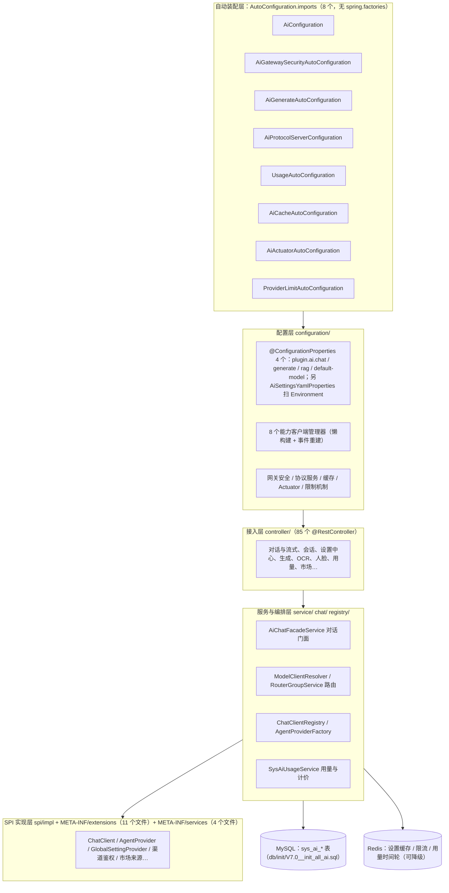
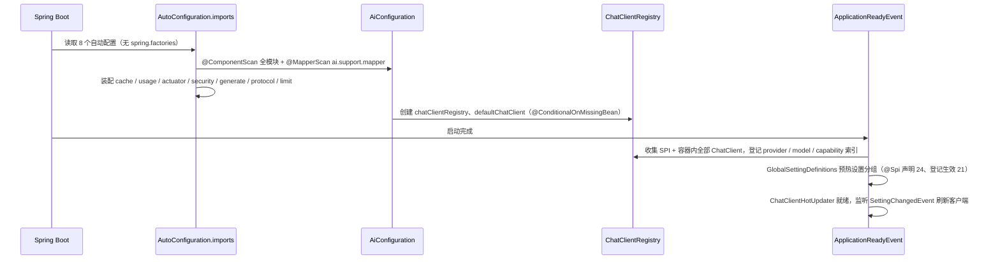
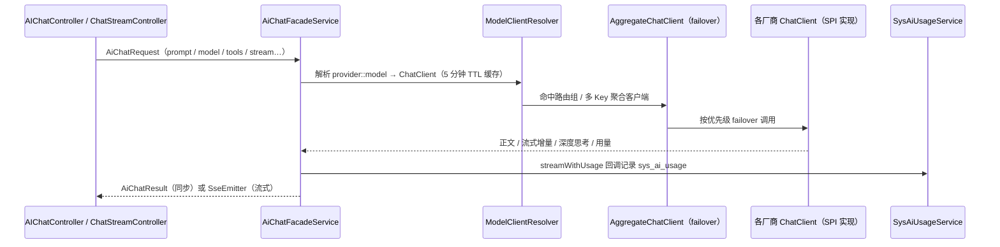
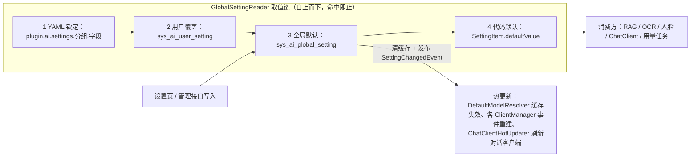

# spring-support-ai-starter

把 AI 能力以 Spring Boot Starter 形式装配进宿主：对话 / Agent / RAG / OCR / 版面 / 人脸 / 重识别 / 文生图 / 文生视频 / 试卷 / 用量计价 / 协议网关。配置来自「数据库（设置页）+ YAML」，各能力客户端按配置**懒构建并缓存**，配置变更通过事件热更新。

> 边界口径：**渠道管理整体属于 `spring-support-account-starter`**（渠道表、Mapper、CRUD、凭据、管理 API）。本模块是 `FreeChatClient` 的**消费方**：只通过 account 提供的 Service 契约（`AccountChannelService` 等）读取渠道数据做路由与鉴权，不 import 其 Mapper、不实现渠道业务规则；account 变更渠道后经 `ChannelCatalogChangedEvent` 单向通知，ai 只处理自己一侧的缓存失效与健康复位。
>
> 本 README 描述本 starter 的 **Spring 集成面**（自动装配、Bean、缓存、配置优先级、扩展点）。`AiChat` / `AiService` 等链式图像 API 属于底层 `utils-support-deeplearning-starter`，见该模块文档。

---

## 一、架构图

### 1.1 模块在整体架构中的位置



依赖方向唯一：`account ← ai`。把 account 的 jar 从本模块删掉，本模块不会残留任何渠道业务实现——路由取数全部经由其 Service 接口完成。

### 1.2 模块内部分层



---

## 二、核心流程图

### 2.1 启动装配流程



### 2.2 对话请求流程（同步 / SSE 流式）



### 2.3 配置读取与热更新流程



---

## 三、能力清单

| 能力域 | 内容 | 主要入口 |
|---|---|---|
| 对话 | 同步 / SSE 流式、多模态（imageUrls）、工具调用、技能、深度思考、多 Key failover、路由组 | `AiChatFacadeService`、`AIChatController`、`ChatStreamController` |
| Agent | 按设置选择引擎：`opencode-server`（默认，本机常驻 `opencode serve` + HTTP/SSE）与 `agentscope`；不可用自动降级并记录原因 | `AgentProviderFactory`、`AgentRegistry` |
| RAG / 知识库 | 全局 RAG 客户端（按用户装配）、知识库 / 知识图谱、网页正文采集 | `RagClientManager`、`RagController` |
| OCR / 版面 / 试卷 | PaddleOCRv6 检测 / 识别 / 方向矫正 / 超分管线；PP-DocLayout 版面；试卷识别 + 结构化 + 批改 | `OcrClientManager`、`LayoutClientManager`、`PaperClientManager` |
| 人脸 / 重识别 | 检测、特征、活体、质量、属性 / 表情 / 关键点、换脸检测、超分修复；ReID 管线与轨迹 | `FaceClientManager`、`ReidClientManager` |
| 图像 | 分类 TopK、目标检测、图像描述、超分、上色、以图搜图 | `ImageRecognitionClientManager`、`ColorizeClientManager` |
| 生成 | 文生图 / 文生视频任务（创建 / 查询 / 取消 / 删除），免费渠道经 common 契约声明 | `GenerateService`、`GenerateController` |
| 语音 | ASR 语音识别、TTS 合成（设置分组驱动） | 对应 controller 与 ClientManager |
| 用量运营 | token 用量记录、计价、日聚合、对账、告警、实时推送 | `SysAiUsageService`、`SysAiPricingService`、`UsageAggregationTask` |
| 协议网关 | OpenAI / Claude / Gemini 三协议兼容入口，前置 6 道安全过滤器 | `AiProtocolController`、网关过滤器链 |
| 技能 / 插件 / Agent 市场 | 7 个技能市场来源、5 个插件市场来源、内置 Agent 市场；离线技能来源 | `V2SkillController`、`PluginsController` 等 |
| 渠道接入 | 16 个渠道登录鉴权实现、5 个渠道任务实现；渠道数据经 account-starter 契约读取 | `AccountChannelAuthManager` SPI、`ModelClientResolver` |
| 设置中心 | 设置分组（源码 `@Spi` 声明 24 组、登记生效 21 组）、YAML 覆盖层、用户覆盖、全局默认四级取值 | `GlobalSettingReader`、`GlobalSettingDefinitionController` |
| 运维观测 | 4 个 Actuator 只读端点、缓存容错、服务信息贡献 | `ai-config` / `ai-models` / `ai-beans` / `ai-cache` |

规模参考：**8** 个自动配置、**85** 个 `@RestController`、**51** 个业务 Mapper（另含 `manage.mapper` 前端持久化）、**24** 个设置分组（登记生效 21 组）、**8** 个能力客户端管理器、**11** 个 SPI 扩展点文件 + **4** 个 JVM SPI 文件。

---

## 四、Bean 矩阵

### 4.1 自动装配（`AutoConfiguration.imports`，共 8 个）

| AutoConfiguration | 生效条件 | 注册的核心 Bean |
|---|---|---|
| `AiConfiguration` | 无条件 | `@ComponentScan("com.chua.starter.ai.support")` + `@MapperScan("com.chua.starter.ai.support.mapper")`；`yamlChatClient`、`defaultChatClient`、`chatClientRegistry`、`agentRegistry`、`aiDialogRecordService`、`aiServiceInfoContributor`；2 个 `ApplicationReadyEvent` 监听（登记 ChatClient、热更新刷新） |
| `AiGatewaySecurityAutoConfiguration` | 无条件 | `gatewayRateLimiter`（`@ConditionalOnMissingBean`）；6 个过滤器按 order 10→60：健康探针 → IP ACL → 包体大小 → QPM 限流 → 并发预算 → 首字节超时，各过滤器内部再读自己的 `security_*_enabled` |
| `AiGenerateAutoConfiguration` | `@ConditionalOnClass(ImageClient)` 且 `plugin.ai.generate.enabled=true`（默认 true） | 扫描 `controller`，装配文生图 / 文生视频接口 |
| `AiProtocolServerConfiguration` | `plugin.protocol.enable=true` | `aiProtocolServerFilters`：OpenAI / Claude / Gemini 协议端点；运行期还要求 `runtime.protocol_server_enabled=true`（读异常按关闭） |
| `UsageAutoConfiguration` | `@ConditionalOnClass(SysAiUsageMapper)` 且 `plugin.ai.usage.enabled=true`（默认 true） | `sysAiUsageService`、`sysAiPricingService`、`usageRecorderInterceptor`、`usageAggregationTask`（均 `@ConditionalOnMissingBean`）；开启 `@EnableScheduling` / `@EnableAsync` |
| `AiCacheAutoConfiguration` | `chua.ai.cache.enabled=true`（默认 true） | `aiCacheManager`（Caffeine 本地，容量 20000 / 30 分钟，**刻意不标 `@Primary`**）；Redis 管理器 `redis-cache--1`（永久）+ `redis-cache-600`（10 分钟，即时写） |
| `AiActuatorAutoConfiguration` | `chua.ai.actuator.enabled=true`（默认 true）且 classpath 有 Actuator `Endpoint` | `ai-config` / `ai-models` / `ai-beans` / `ai-cache` 四个只读端点 |
| `ProviderLimitAutoConfiguration` | 无条件 | 构造器把容器内 `ProviderLimitMechanism` 灌入 `ProviderLimitMechanisms` 注册表（顺序：Spring Bean → META-INF/services 扩展 → 内置兜底；同 kind 留一） |

> 组件扫描层还有三个支撑配置类：`RagAutoConfiguration`（`@ConditionalOnWebApplication(SERVLET)`，注册 RAG 属性与初始化器）、`CacheResilienceConfiguration`（缓存读写异常降级为 WARN，读回源 DB、写不受阻）、`AiTransactionConfiguration`（共享 `TransactionTemplate`，供无请求上下文的线程池走编程式事务）。

### 4.2 核心对话与路由 Bean

| Bean | 条件 | 作用 |
|---|---|---|
| `yamlChatClient` | `plugin.ai.chat.enabled=true` 且 `app-key` 非空（`@ConditionalOnExpression`） | 按 YAML 固定参数装配的对话客户端，先于默认客户端注册 |
| `defaultChatClient` | `@ConditionalOnMissingBean` | 把 SPI 发现 + 容器内 `ChatClient` 聚合为 `AggregateChatClient` failover（排除 `MemoryChatClient`）；容器已有 `ChatClient` 时不创建 |
| `chatClientRegistry` | `@ConditionalOnMissingBean` | provider / model / capability 三套索引 + 默认客户端 + 聚合客户端；`getByProvider` / `getByModel` / `getByCapability` / `getDefault` / `getAggregate` |
| `agentProviderFactory` | 组件扫描 | 按 `runtime.agent_impl` 创建 Agent；白名单 `opencode-server`（默认）/ `agentscope`，`opencode` 为历史别名；不可用时降级并带 60 秒冷却 |
| `agentRegistry` | `@ConditionalOnMissingBean` | Agent 模型登记与查询（无全局 `Agent` Bean，按会话从工厂取） |
| `AiChatFacadeService` | 组件扫描实现 | 统一对话门面：`call` / `callForResult` / `probeChatClient` / `stream` / `streamWithUsage`，含限流、用量计量、别名解析 |
| `aiDialogRecordService` | `@ConditionalOnMissingBean` | 对话记录落库 |
| `ModelClientResolver` | 组件扫描 | `provider::model` → `ChatClient` 解析 + 5 分钟 TTL 缓存；渠道数据经 `AccountChannelService` 等契约读取 |
| `aiServiceInfoContributor` | 组件扫描 | `/actuator/info` 暴露 AI 能力摘要 |

### 4.3 配置读取 Bean

| Bean | 条件 | 作用 |
|---|---|---|
| `GlobalSettingReader`（实现 `DefaultGlobalSettingReader`） | 组件扫描 | 四级取值链统一读取；`getStr` 走 Redis 缓存，`getStrDirect` 绕过缓存直连 DB（模型解析链路专用） |
| `SysAiGlobalSettingService` | 组件扫描 | `sys_ai_global_setting` 读写；写后清键并发布 `SettingChangedEvent` |
| `SysAiUserSettingService` | 组件扫描 | `sys_ai_user_setting` 用户覆盖层；读合并视图、写覆盖、清覆盖，带缓存失效 |
| `DefaultModelResolver` | 组件扫描 | 默认模型解析（`chat()` / `resolve(key)` / `resolveAll()`）；页面 DB 值优先于 `plugin.ai.default-model.*`，本地缓存 + 事件失效 |
| `AiSettingsYamlProperties` | 组件扫描 | 构造期扫描 Environment 中 `plugin.ai.settings.*` 原始属性名（不走 `@ConfigurationProperties`，避免嵌套 Map 静默绑空） |
| `GlobalSettingDefinitions` / `GlobalSettingInitializer` | 组件扫描 | 启动期预热设置分组定义（源码 `@Spi` 声明 24 个、登记生效 21 个），供 `/v2/global-setting-definitions` 与设置页下发 |

### 4.4 能力客户端管理器（均组件扫描，懒构建 + 事件重建）

| Bean | 管理内容 | 重建触发 |
|---|---|---|
| `OcrClientManager` | 检测 / 识别 / 方向矫正 / 文本矫正 / 超分管线；`recognize` / `recognizeDetail` | `OcrSettingsChangedEvent` |
| `FaceClientManager` | 人脸管线、特征、活体、质量、属性 / 表情 / 关键点 / 换脸、超分修复 | `FaceSettingsChangedEvent` |
| `ReidClientManager` | 重识别管线、轨迹、低阈值检测器 | 事件重建；按账号入口在 `ReidStores` |
| `ImageRecognitionClientManager` | 分类 TopK、目标检测、图像描述、超分 | fingerprint 变化即重建 |
| `ColorizeClientManager` | 图像上色 `ImageEnhancer` | fingerprint 变化即重建 |
| `LayoutClientManager` | 版面检测 `LayoutDetector` | fingerprint 变化即重建 |
| `PaperClientManager`（实现 `PaperClient`） | 试卷识别：版面 + OCR + LLM 结构化 | `PaperSettingsChangedEvent` / `OcrSettingsChangedEvent` |
| `RagClientManager`（实现 common 的 `RagClientProvider`） | 按用户装配 RAG 客户端；`current()` / `currentPipeline()` / `diagnostics()` | `RagSettingsChangedEvent` |

### 4.5 明确「无」的事项（避免误判）

- `aiCacheManager` **无 `@Primary`**：与宿主缓存管理器按名共存，`@Cacheable` 需显式指定 `cacheManager`。
- `ProviderLimitAutoConfiguration` **无条件注解**：构造器安装注册表，机制实现不在本模块。
- 容器里**没有可直接注入的全局 `Agent` Bean**：Agent 一律经 `AgentProviderFactory` 按会话创建。
- 本模块**不持有渠道表 Mapper**：渠道读写只经 account-starter 的 Service 契约。

---

## 五、完整配置

### 5.1 `@ConfigurationProperties`（4 个前缀）

| 前缀 | 绑定类 | 字段与默认值 |
|---|---|---|
| `plugin.ai.chat` | `AiChatProperties`（record） | `enabled=false`；`provider` / `base-url` / `app-key` / `app-secret` / `model` / `temperature` / `max-tokens` / `timeout-millis` / `auth-scheme` / `auth-header` / `auth-prefix` / `proxy` 均默认空 |
| `plugin.ai.generate` | `AiProperties` | `image`：`provider=openai`、`model=dall-e-3`、`width=1024`、`height=1024`、`api-key`、`base-url`；`video`：`provider=openai`、`model=sora`、`duration=5`、`api-key`、`base-url`。装配开关 `enabled` 不是 `AiProperties` 的绑定字段，由 `AiGenerateAutoConfiguration` 上的 `@ConditionalOnProperty(prefix="plugin.ai.generate", name="enabled", matchIfMissing=true)` 读取，未配置时默认生效 |
| `plugin.ai.rag` | `RagProperties` | `enabled=true`、`embedding-engine=memory`、`vector-storage=jvector`、`embedding-dimensions=1536`、`chunk-size=1000`、`chunk-overlap=200`、`default-top-k=5`、`default-similarity-threshold=0.7`、`upload-dir=./rag-uploads` |
| `plugin.ai.default-model` | `DefaultModelProperties` | 30+ 能力键：`chat`、`title-summary`、`visual-assistant`、`history-compression(-prompt)`、`translation(-prompt)`、`feature`、`rag-embedding`、`rerank`、`text-to-image`、`text-to-video`、`image-enhance/quality/classify/detect/segment/captioning`、`depth`、`ocr-detect/recognize/direction/super-resolution`、`layout`、`face-detect/recognize`、`liveness`、`face-quality`、`eye-detect`、`smile-detect`、`pedestrian`、`plate-detect/recognize` 等，默认空（页面值优先，yaml 兜底） |

### 5.2 开关与条件类 YAML

| key | 默认 | 生效点 |
|---|---|---|
| `plugin.ai.usage.enabled` | `true` | `UsageAutoConfiguration`（另需 `SysAiUsageMapper` 在 classpath） |
| `plugin.protocol.enable` | `false` | `AiProtocolServerConfiguration`（部署级开关，改了要重启；另需 `runtime.protocol_server_enabled=true`） |
| `plugin.ai.security.rate-limit-store` | `local` | `gatewayRateLimiter` 存储选 `local` / `redis`；无 `StringRedisTemplate` 回落 local，未知值按 local |
| `chua.ai.cache.enabled` | `true` | `AiCacheAutoConfiguration` |
| `chua.ai.actuator.enabled` | `true` | `AiActuatorAutoConfiguration`（另需 Actuator 在 classpath） |
| `plugin.ai.settings.<分组>.<字段>` | 无 | 部署级覆盖层：命中即优先于用户覆盖与数据库；显式空串=强制清空，键空挂=视同未配置；仅认 yaml / properties / `--` 命令行参数，不支持环境变量形式 |

### 5.3 数据库设置（`sys_ai_global_setting`，设置页保存，热更新）

分组由 `@Spi("<group>")` 的 `GlobalSettingProvider` 实现声明，共 **24** 组：`runtime`、`session`、`image`、`ocr`、`face`、`layout`、`image_search`、`rag`、`paper`、`marking`、`compose`、`bot`、`asr`、`tts`、`search`、`memory`、`generate`、`input`、`input_suggest`、`global`、`channel_probe`、`security`、`health`、`sim`。

常用运行期键：`runtime.agent_impl`（默认 `opencode-server`）、`runtime.protocol_server_enabled`（默认 true）、`onnx.external_directories` / `onnx.model_root`（本地模型目录）、各 `security_*_enabled` 网关开关。

### 5.4 配置优先级（从高到低）

| 层级 | 位置 | 说明 |
|---|---|---|
| 1. YAML 钦定 | `plugin.ai.settings.<group>.<field>` | 部署级覆盖，只读，重启生效 |
| 2. 用户覆盖 | `sys_ai_user_setting`（按 userId） | 设置页用户自己的值 |
| 3. 全局默认 | `sys_ai_global_setting` | 设置页保存的全局值，热更新 |
| 4. 代码默认 | `GlobalSettingProvider.SettingItem.defaultValue` | 各 `*GlobalSettingProvider` 声明 |

> 例外：`plugin.ai.default-model.*` 是「页面 > yaml」——它面向没有配置页面的宿主模块做兜底，与上面的覆盖层方向相反。

### 5.5 配置示例

```yaml
plugin:
  ai:
    chat:
      enabled: true
      provider: zhipu
      base-url: https://open.bigmodel.cn/api/paas/v4
      app-key: ${AI_CHAT_APP_KEY:}
      model: glm-4-flash
      temperature: 0.7
      max-tokens: 4096
      timeout-millis: 60000

    default-model:
      chat: gpt-4.1-mini
      ocr-detect: onnx:paddleocrv6-det
      ocr-recognize: onnx:paddleocrv6-rec
      layout: onnx:pp-doc-layout

    settings:            # 部署级钦定（优先于页面），改了要重启
      layout:
        layout-threshold: "0.42"
      ocr:
        recognizer-model: "onnx:paddleocrv6-rec"

    generate:
      enabled: true
    usage:
      enabled: true

  protocol:
    enable: true

chua:
  ai:
    cache:
      enabled: true
    actuator:
      enabled: true
```

---

## 六、使用方式

### 6.1 引入依赖

```xml
<dependency>
    <groupId>com.chua</groupId>
    <artifactId>spring-support-ai-starter</artifactId>
    <version>4.0.0.51</version>
</dependency>
```

运行时资源（非 Maven 依赖，缺失直接体现在行为上）：

| 依赖 | 用途 | 缺失时 |
|---|---|---|
| MySQL | `sys_ai_*` 配置 / 会话 / 用量 / 任务表（先执行 `src/main/resources/db/init/V7.0__init_all_ai.sql`） | 启动失败 |
| Redis | 设置缓存、用量时间轮、部分限流 | **可降级**：缓存读写失败只打 WARN（`CacheResilienceConfiguration`） |
| 本地模型目录 | ONNX 供应商按 `<模型目录>/<modelId>/model.onnx` 读取 | 对应能力报「未配置」 |
| Actuator | `ai-*` 只读端点（optional 依赖） | 端点不注册，不影响对话 |

### 6.2 宿主集成三步

1. 准备 MySQL（跑初始化 SQL）与 Redis（可降级），引入依赖——自动装配即生效，无需 `@Enable*`。
2. 至少配一个可用对话客户端：YAML `plugin.ai.chat.*`，或页面 / 渠道配置（二选一即可）。
3. 注入 `AiChatFacadeService` 发起一次对话；用 `/actuator/ai-models` 验证模型生效，`/v2/global-setting-definitions` 返回非空即 SPI 发现正常。

### 6.3 独立启动

主类 `AiStarterApplication`（`@SpringBootApplication` + 全模块扫描 + 双包 Mapper 扫描），固定端口 **8787**（配合 ai 前端）。本地自测加 `--spring.profiles.active=local`（连本机 MySQL / Redis，配置在 `ai-starter.yml` 末尾 local 段）。

> 构建为内部 starter 时默认跳过 fat-jar repackage；需要可执行包时传 `-Dspring-boot.repackage.skip=false`，产物为 `*-exec.jar`。
> **`ai-starter.yml` 不能改名成 `application.yml`**：它是示例配置模板，仅由主类经 `spring.config.import` 导入；改名会以类路径首匹配整份顶掉宿主配置。

### 6.4 代码调用

```java
// 同步强类型调用（推荐）
@Autowired
private AiChatFacadeService chatFacade;

AiChatRequest req = new AiChatRequest();          // Lombok @Data，setter 式
req.setPrompt("把这段需求拆成任务清单");
req.setSystemPrompt("你是资深架构师");
req.setModel("gpt-4.1-mini");
req.setTemperature(0.3);

AiChatResult result = chatFacade.callForResult(req);
if (result.success()) {
    System.out.println(result.text() + " / " + result.usage());
} else {
    System.out.println(result.errorMessage());
}

// 通用 Map 入口：chatFacade.call(req)；不发网络请求的探测：chatFacade.probeChatClient("gpt-4.1-mini")

// 流式（SSE）：需要真实用量、轨迹、工具调用时用 streamWithUsage
SseEmitter emitter = chatFacade.streamWithUsage(
        req,
        chunk -> { /* 增量正文 */ },
        (reply, usage) -> { /* 完成：完整回复 + 真实用量 */ },
        err -> { /* 全链路失败 */ },
        thinking -> { /* 深度思考增量 */ });

// 视觉 / OCR
@Autowired private OcrClientManager ocr;
List<OcrResult> blocks = ocr.recognizeDetail(imageBytes);

// 默认模型（页面 > yaml）
@Autowired private DefaultModelResolver modelResolver;
String chatModel = modelResolver.chat();
String ocrModel  = modelResolver.resolve("ocr");
```

### 6.5 Actuator 只读端点

| 端点 | 路径 | 内容 |
|---|---|---|
| `ai-config` | `/actuator/ai-config` | 登记生效分组（当前 21 个，`@Spi` 声明 24 个）的生效值：`value / defaultValue / source(YAML\|DB\|DEFAULT) / masked / adminOnly`；凭据字段统一 `***` |
| `ai-models` | `/actuator/ai-models` | 各能力最终生效模型（页面 > `plugin.ai.default-model.*`），只列已配置项 |
| `ai-beans` | `/actuator/ai-beans` | 对话客户端 / 聚合 / provider、Agent 引擎解析与降级、人脸 / 重识别 / RAG 摘要、OCR 模型选择 |
| `ai-cache` | `/actuator/ai-cache` | `aiCacheManager` 各缓存条目数 / 命中率 / 淘汰数；Redis 管理器只列 Bean 名 |

```bash
curl -s localhost:8787/actuator/ai-models
# {"chat":"gpt-4.1-mini","configuredCount":4,"models":[...]}

curl -s localhost:8787/actuator/ai-config
# {"groupCount":21,"groups":{...}}
```

```yaml
management:
  endpoints:
    web:
      exposure:
        include: health,info,ai-config,ai-models,ai-beans,ai-cache
```

端点只读、不改配置；`AiConfigEndpoint` 不依赖登录上下文，可在运维排障时直接 curl。对外暴露前请确认 exposure 范围。

---

## 七、使用场景

| 场景 | 做法 |
|---|---|
| 业务宿主嵌入 AI 能力 | monitor / system / oauth 等以 jar 引入；monitor 用 `AiChatFacadeService` 做主机指标 / 告警 / Redis 智能分析（`/ms/monitor/ai/*`） |
| 独立 AI 中台服务 | 用 `AiStarterApplication` 独立跑在 8787，承载 ai 前端（会话、设置中心、模型管理、用量看板） |
| 知识库问答 | RAG 分组配 embedding / 向量库（jvector 或 memory），上传文档建库，`RagClientManager` 按用户装配管线 |
| 文档结构化 | OCR 管线 + 版面分析 + 试卷结构化 / 批改（paper / marking / compose 分组） |
| 视觉智能 | 人脸库比对、活体、ReID 轨迹、图像分类检测、上色、以图搜图；模型走 ONNX 本地目录或云端渠道 |
| 内容生成 | 文生图 / 文生视频任务接口；免费生成类渠道经 common 的 keyless 契约声明，无需入库 |
| 多协议模型网关 | `plugin.protocol.enable=true` 暴露 OpenAI / Claude / Gemini 兼容端点，前置限流 / IP ACL / 超时过滤器，配 AppKey 计量 |
| 用量运营 | `UsageRecorderInterceptor` 自动记录 token 用量，定时聚合成日报，结合计价与告警做成本管控 |
| Agent 工作台 | `runtime.agent_impl=opencode-server` 接 MCP / 技能 / 规划工具链；引擎不可用自动降级 `agentscope` |

---

## 八、扩展点

扩展点统一放在 `META-INF/extensions/`（chua SPI，格式为 `名称=实现类全限定名` 或一行一个类名）与 `META-INF/services/`（JVM SPI）。

| 扩展点接口 | 本模块现有登记 | 生效点 |
|---|---|---|
| `com.chua.common.support.ai.chat.ChatClient` | `custom=OpenAiChatClient`、`workbuddy`、`magpie` 共 3 个 | `ApplicationReadyEvent` 时登记进 `ChatClientRegistry`，`defaultChatClient` 自动聚合 failover |
| `com.chua.common.support.ai.agent.AgentProvider` | `DefaultAgentProvider` | `AgentProviderFactory` 按 `runtime.agent_impl` 选择 |
| `com.chua.common.support.ai.rag.GlobalSettingProvider` | 源码 `@Spi` 分组实现 24 个；登记文件 23 行，其中 `ReidGlobalSettingProvider`、`ProtocolServerGlobalSettingProvider` 2 行为失效登记（源码已删除），`SecurityGlobalSettingProvider`、`HealthGlobalSettingProvider`、`SimGlobalSettingProvider` 已实现但未登记 | `GlobalSettingDefinitions` 启动预热；`/v2/global-setting-definitions` 与设置页自动出现新分组 |
| `com.chua.starter.common.support.channel.AccountChannelAuthManager` | 16 个渠道实现（cline / qoder / qoder-cn / trae / gemini / minimax / zcode / raccoon / loomy / lobsterai / opencode / kilo / eac / workbuddy / scnet / qwen） | 渠道登录 / 凭据鉴权流程 |
| `com.chua.starter.common.support.channel.ChannelTaskProvider` | 5 个（lobsterai / qoder / qoder-cn / trae / workbuddy） | 渠道日常任务执行 |
| `com.chua.starter.common.support.channel.ChannelCreditProvider` | 本模块未登记（实现登记在渠道归属模块） | 渠道「积分 / 余额」读数；契约：`credit(credentials)` **只读、永不抛异常**，失败写 `error` 字段 |
| `com.chua.deeplearning.support.engine.ModelRegistrar` | `OnnxModelRegistrar` | ONNX 模型物化登记 |
| `com.chua.common.support.vector.VectorStorageProvider` | `jvector`、`memory` | RAG 向量存储实现选择（`plugin.ai.rag.vector-storage`） |
| `com.chua.starter.ai.support.agent.telemetry.AgentRequestStorage` | `NoopAgentRequestStorage` | Agent 请求遥测存储（可替换为落库实现） |
| `...manage.api.market.SkillMarketSourceProvider` | 7 个（ClawHub / LoopHub / SkillHub / SkillHubMcp / McpWorld / ClawHubPlugins / SkillHubPackages） | 技能市场目录来源 |
| `...manage.api.market.AgentMarketSourceProvider` | `BuiltinAgentMarketSourceProvider` | Agent 市场目录来源 |
| `com.chua.starter.ai.support.spi.PluginMarketSourceProvider` | 5 个（OpenVsx / VscodeMarketplace / Github / ClawHub / SkillHub） | 插件市场目录来源 |
| `com.chua.starter.ai.support.spi.SkillOfflineProvider`（services） | `FileSystemSkillOfflineProvider` | 离线技能包加载 |
| `com.chua.starter.ai.support.market.SkillMarketProvider`（services） | `DingdSkillMarketProvider` | 技能市场对接 |
| `UsageParser` / `ModelMetricsProvider` / `UsagePricingReconciler`（datasearch 契约） | 由 `spring-support-datasearch-starter` 提供 | 用量解析、模型指标、计价对账 |
| `ProviderLimitMechanism`（datasearch 契约） | 机制实现同在 datasearch；本模块经 `ProviderLimitAutoConfiguration` 灌入注册表 | 供应商限流 / 并发机制安装 |

**示例一：新增对话客户端**

```java
@Spi("my-llm")
public class MyChatClient implements ChatClient {

    private final ChatClientSetting setting;

    public MyChatClient(ChatClientSetting setting) {   // SPI 按 (name, setting) 实例化
        this.setting = setting;
    }

    /** 唯一抽象方法：返回正文；其余能力均有 default 实现 */
    @Override
    public String chatSync(String prompt) {
        return callMyGateway(setting.getBaseUrl(), setting.getApiKey(), prompt);
    }
}
```

登记到 `META-INF/extensions/com.chua.common.support.ai.chat.ChatClient`：

```text
my-llm=com.example.ai.MyChatClient
```

之后 YAML 写 `plugin.ai.chat.provider: my-llm`，或页面把渠道 provider 配成 `my-llm`（`ChatClient.create` 找不到实现但给了 `base-url` 时，按 OpenAI 兼容协议兜底）。

**示例二：新增设置分组**

```java
@Spi("my_group")
public class MyGlobalSettingProvider implements GlobalSettingProvider {

    @Override public String group() { return "my_group"; }
    @Override public String groupName() { return "我的分组"; }
    @Override public List<SettingItem> getItems() {
        // 字段名 / 默认值 / 值类型(STRING|NUMBER|BOOLEAN) / 描述 / 排序
        return List.of(new SettingItem("my_model", "", "STRING", "默认模型", 10));
    }
}
```

登记后启动预热即收录，`/actuator/ai-config` 的 `groupCount` 与 `groups` 自动多出该组。

---

## 九、常见问题

1. **启动失败提示缺表 / 缺库？** MySQL 是硬依赖：`AiConfiguration` 无条件做 Mapper 扫描并注册大量 `sys_ai_*` 服务，没有库起不来。先执行 `db/init/V7.0__init_all_ai.sql`。
2. **Redis 没起会怎样？** 可降级：`CacheResilienceConfiguration` 把缓存读写异常降为 WARN，读回源 DB、写库不受影响。代价是多实例不共享失效，设置改动可能延迟生效。
3. **`plugin.ai.chat` 配了却不生效？** 该前缀默认 `enabled=false`；且 `app-key` 为空时同样不创建 `yamlChatClient`（避免「显示可用、调用必 401」）。
4. **YAML 与页面配置是什么关系？** 两层：`plugin.ai.chat.*` 只影响 `yamlChatClient`；页面 / 库里的渠道配置走 `ModelClientResolver`。设置类分组默认「YAML 钦定 > 用户 > 全局 > 代码默认」，而 `default-model` 是「页面 > yaml 兜底」。
5. **直接改数据库为什么配置没变？** 设置缓存键为 `sys:ai:global-setting:<group>:<field>`，只有走接口 / 页面保存才会清键并发事件。模型解析链路用 `getStrDirect` 绕过缓存，所以模型改动「立刻生效」，其它分组不会。
6. **协议端点开了却 404？** 要两级开关同时为真：`plugin.protocol.enable=true`（YAML，重启生效）**且** `runtime.protocol_server_enabled=true`（设置表，读异常按关闭）。过滤器在启动时装配，运行期改 `protocol_server_enabled` 不会摘掉已注册端点。
7. **Agent 引擎为什么变成了 agentscope？** 默认 `opencode-server`；opencode 可执行文件缺失（且自动下载关闭 / 失败）、server 启动或健康检查失败时降级到 `agentscope`，能力边界不同（工具链、MCP、规划受影响）。判定带 60 秒冷却，降级原因可在设置接口与管理台看到。
8. **`/v2/global-setting-definitions` 返回空？** SPI 发现失败，多见于 `-cp` 热补丁启动（`META-INF/extensions` 没进 classpath）。请用 `-jar` 启动，并检查启动日志里的「预热未发现任何分组定义」。
9. **OCR / 人脸报「未配置」？** ONNX 供应商按 `<模型目录>/<modelId>/model.onnx` 读取本地模型，缺文件只报「未配置」，不会回退云端。目录经页面绑定到 `onnx.external_directories` / `onnx.model_root`，yaml `ai.onnx.*` 仅作库侧兜底。
10. **人脸 / OCR 在老系统上不可用？** OpenCV 原生库要求 glibc 2.27+（4.8/4.9 需 2.29），CentOS 7（glibc 2.17）加载必失败，调版本无解；此时模型清单返回空、检测接口返回失败信封而非 500。详见 `utils-support-deeplearning-starter/README.md` 的 glibc 对照表。
11. **内置技能 / 角色怎么加？** 它们是资源文件：技能在 `src/main/resources/skills-builtin/*`、角色在 `characters-builtin/*`，新增后要重新打包；或走对应 SPI 的在线 / 离线来源。
12. **渠道管理接口在本模块吗？** 不在。渠道表、CRUD、判重、级联、凭据与管理 API 整体属于 `spring-support-account-starter`；本模块只经其 Service 契约读取渠道数据做路由 / 鉴权，并通过 `ChannelCatalogChangedEvent` 感知变更。
13. **渠道余额 / 积分清单在哪维护？** 读数内核与厂商端点登记在 `spring-support-datasearch-starter` 与 account 侧（`CreditQueryProvider` / `ChannelCreditProvider`），收录口径、火山系合并入口、逐家覆盖情况见 `spring-support-account-starter/README.md` 的「余额查询配置」。
14. **多级缓存宿主里缓存管理器会冲突吗？** 不会：`aiCacheManager` 按名共存，刻意不标 `@Primary`；使用处显式指定 `cacheManager = REDIS_CACHE_ALWAYS`（Bean 名 `redis-cache--1`）等。
