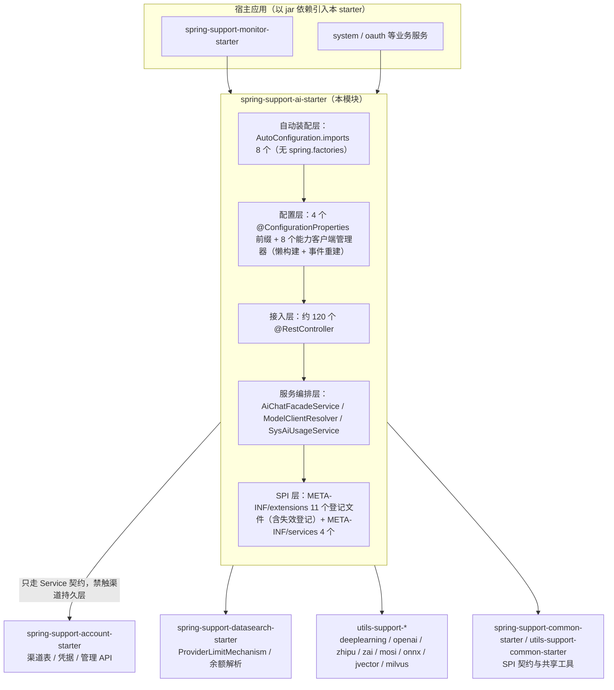
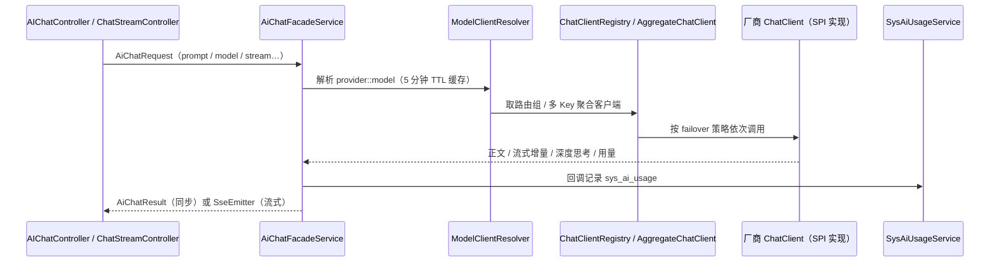

# spring-support-ai-starter

把 AI 能力以 Spring Boot Starter 形式装配进宿主：对话（同步 / SSE 流式）、Agent 编排、RAG 知识库、OCR / 版面 / 试卷、人脸 / 重识别、图像识别与上色、文生图 / 文生视频、用量计价、多协议网关、设置中心。在 spring-support 体系中是**业务能力层 starter**：向下消费 `utils-support-*` 底层库与 `spring-support-account-starter` 的渠道契约，向上被 monitor / system / oauth 等宿主以 jar 依赖引入，也可用 `AiStarterApplication` 独立启动为 AI 中台服务。

> 边界口径：渠道管理（渠道表、Mapper、CRUD、凭据、管理 API）整体属于 `spring-support-account-starter`。本模块只通过其 Service 契约读取渠道数据做路由与鉴权，不 import 其 Mapper、不实现渠道业务规则；渠道变更经 `ChannelCatalogChangedEvent` 单向通知。

## 1. 架构图



依赖方向唯一：`account ← ai`。把 account 的 jar 从本模块删掉，本模块不会残留任何渠道业务实现。

## 2. 核心流程图

对话请求处理流程（同步与流式共用一条链路）：



## 3. 能力清单

| 能力域 | 关键类 | 入口 / 触发方式 |
|---|---|---|
| 对话与流式 | `AiChatFacadeService`、`AIChatController`、`ChatStreamController` | HTTP `/ai/**`；同步 `callForResult` / 流式 `streamWithUsage` |
| Agent 编排 | `AgentProviderFactory`、`AgentRegistry`、`AgentManager` | 按 `runtime.agent_impl` 经 `Agent.create(...)` 选 `Agent` SPI 运行时（`opencode-server` 默认 / `agentscope`），不可用自动降级 |
| RAG / 知识库 | `RagClientManager`、`RagController`、`KnowledgeGraphController` | `plugin.ai.rag.*` 配置 + 设置分组 `rag` 驱动，按用户装配管线 |
| OCR / 版面 / 试卷 | `OcrClientManager`、`LayoutClientManager`、`PaperClientManager` | REST 接口 + 设置分组 `ocr` / `layout` / `paper` 热更新 |
| 人脸 / 重识别 | `FaceClientManager`、`ReidClientManager` | REST 接口 + 设置分组 `face` 驱动 |
| 图像识别 / 上色 | `ImageRecognitionClientManager`、`ColorizeClientManager` | REST 接口 + 设置分组 `image` 驱动 |
| 内容生成 | `GenerateService`、`GenerateController` | 文生图 / 文生视频任务创建 / 查询 / 取消；`AiGenerateAutoConfiguration` 装配 |
| 用量与计价 | `SysAiUsageService`、`SysAiPricingService`、`UsageRecorderInterceptor`、`UsageAggregationTask` | 拦截器自动记录 token 用量，定时聚合日报 |
| 协议网关 | `AiProtocolController`、`AiProtocolServerConfiguration` | `plugin.protocol.enable=true` + `runtime.protocol_server_enabled=true` 双开关 |
| 网关安全 | `AiGatewaySecurityAutoConfiguration`、`GatewayRateLimiter` | 6 个过滤器按 order 10→60 挂入 Servlet 链，各读 `security_*_enabled` |
| 设置中心 | `GlobalSettingReader`、`SysAiGlobalSettingService`、`DefaultModelResolver` | `sys_ai_global_setting` + YAML 覆盖层 `plugin.ai.settings.*`，事件热更新 |
| 运维观测 | `AiActuatorAutoConfiguration`（4 个端点 Bean） | `/actuator/ai-config`、`ai-models`、`ai-beans`、`ai-cache`，只读 |
| 渠道接入 | `AccountChannelAuthManager` SPI 16 个实现、`ModelClientResolver` | 渠道登录 / 凭据鉴权；渠道数据经 account-starter 契约读取 |

## 4. Bean 能力矩阵

| Bean 名 | 类型 | 装配条件（含默认值） | 可否覆盖 | 典型用途 |
|---|---|---|---|---|
| `yamlChatClient` | `ChatClient` | `plugin.ai.chat.enabled=true` 且 `plugin.ai.chat.app-key` 非空（`@ConditionalOnProperty` + `@ConditionalOnExpression`；`enabled` 默认 false） | 条件不满足即不注册 | 按 YAML 固定参数的对话客户端，先于聚合客户端注册 |
| `defaultChatClient` | `AggregateChatClient` | `@ConditionalOnMissingBean`（容器已有 `ChatClient` 则跳过） | 可覆盖 | SPI + 容器内 `ChatClient` 聚合为 failover（剔除 `MemoryChatClient`） |
| `chatClientRegistry` | `ChatClientRegistry` | `@ConditionalOnMissingBean` | 可覆盖 | provider / model / capability 三套索引与默认客户端 |
| `agentRegistry` | `AgentRegistry` | 无条件 | 不可（无条件注册） | Agent 登记与主 Agent 初始化 |
| `aiDialogRecordService` | `AIDialogRecordService` | `@ConditionalOnMissingBean`，默认内存实现 | 可覆盖 | 对话记录落库 / 内存暂存 |
| `aiServiceInfoContributor` | `ServiceInfoContributor` | 无条件 | 不可 | `/actuator/info` 暴露 AI 能力摘要 |
| `gatewayRateLimiter` | `GatewayRateLimiter` | `AiGatewaySecurityAutoConfiguration` 无条件 + `@ConditionalOnMissingBean(GatewayRateLimiter)`；存储由 `plugin.ai.security.rate-limit-store` 选 `local`（默认）/ `redis` | 可覆盖 | QPM / IP / 路径维度限流 |
| `sysAiUsageService` 等 4 个 | 用量服务 / 拦截器 / 定时任务 | `plugin.ai.usage.enabled=true`（默认 true）且 `SysAiUsageMapper` 在 classpath；均 `@ConditionalOnMissingBean` | 可覆盖 | 用量记录、计价、日聚合 |
| `aiCacheManager` | `CacheManager`（Caffeine） | `chua.ai.cache.enabled=true`（默认 true）且 `CacheManager` 在 classpath；**刻意不标 `@Primary`** | 整配置可关，Bean 本身无条件 | 本地缓存（容量 20000 / 30 分钟），按名引用 |
| `redis-cache--1` / `redis-cache-600` | `RedisCacheManager` | 同上 + `RedisConnectionFactory` 在 classpath | 不可 | 永久 / 10 分钟 Redis 缓存（即时写） |
| `aiConfigEndpoint` 等 4 个 | Actuator `Endpoint` | `chua.ai.actuator.enabled=true`（默认 true）且 Actuator `Endpoint` 类在 classpath；均 `@ConditionalOnMissingBean` | 可覆盖 | `/actuator/ai-*` 只读端点 |
| `aiProtocolServerFilters` | `List<AiProtocolServerFilter>` | `plugin.protocol.enable=true`（默认 false）且 `runtime.protocol_server_enabled=true`（读异常按关闭） | 不可 | OpenAI / Claude / Gemini 兼容端点过滤器 |
| `globalSettingInitializer` | `GlobalSettingInitializer` | `RagAutoConfiguration` 的 `@ConditionalOnWebApplication(SERVLET)` + `@ConditionalOnMissingBean` | 可覆盖 | 启动期预热设置分组定义 |
| `PaperPipelineProperties` | 试卷管线参数（普通 `@Data` 类） | 宿主可自行 `@Bean` 提供；未提供时由 AI 模块给默认值 | 可覆盖 | 试卷识别 / 批改链路的超时、重试、策略参数 |

> 自动装配入口：`META-INF/spring/org.springframework.boot.autoconfigure.AutoConfiguration.imports` 共登记 8 个类（模块内无 `spring.factories`）——`AiConfiguration`、`AiGatewaySecurityAutoConfiguration`、`AiGenerateAutoConfiguration`、`AiProtocolServerConfiguration`、`UsageAutoConfiguration`、`AiCacheAutoConfiguration`、`AiActuatorAutoConfiguration`、`ProviderLimitAutoConfiguration`。

> 另有组件扫描的支撑配置类：`RagAutoConfiguration`、`CacheResilienceConfiguration`（缓存读写异常降级 WARN）、`AiTransactionConfiguration`（共享 `TransactionTemplate`）、`AiWebMvcConverterConfiguration`、`AiAsyncConfiguration`、`AiCacheKeyGeneratorAliasConfiguration`。

## 5. 完整配置

### 5.1 `plugin.ai.chat`（`AiChatProperties`，record 绑定）

| 配置路径 | 类型 | 默认值 | 说明 |
|---|---|---|---|
| `plugin.ai.chat.enabled` | boolean | `false` | 是否装配 YAML 对话客户端 |
| `plugin.ai.chat.provider` | String | 空 | 厂商标识（openai / zhipu / glm / zai / siliconflow…）；空时按 OpenAI 兼容兜底 |
| `plugin.ai.chat.base-url` | String | 空 | API 基地址；空时用实现类内置默认地址 |
| `plugin.ai.chat.app-key` | String | 空 | 访问密钥；空则不创建客户端 |
| `plugin.ai.chat.app-secret` | String | 空 | 部分厂商需要的 secret |
| `plugin.ai.chat.model` | String | 空 | 模型名 |
| `plugin.ai.chat.temperature` | Double | 空 | 采样温度 |
| `plugin.ai.chat.max-tokens` | Integer | 空 | 单次最大生成 token 数 |
| `plugin.ai.chat.timeout-millis` | Long | 空 | 超时（毫秒） |
| `plugin.ai.chat.auth-scheme` / `auth-header` / `auth-prefix` | String | 空 | 自定义鉴权方案 / 头名 / 前缀 |
| `plugin.ai.chat.proxy` | String | 空 | 代理地址 |

### 5.2 `plugin.ai.generate`（`AiProperties`，含嵌套类）

| 配置路径 | 类型 | 默认值 | 说明 |
|---|---|---|---|
| `plugin.ai.generate.enabled` | boolean | `true`（`matchIfMissing`） | 生成模块开关；由 `AiGenerateAutoConfiguration` 读取，不是 `AiProperties` 绑定字段 |
| `plugin.ai.generate.image.provider` | String | `openai` | 图片生成提供者 |
| `plugin.ai.generate.image.api-key` / `base-url` | String | 空 | 图片生成凭据与地址 |
| `plugin.ai.generate.image.model` | String | `dall-e-3` | 默认图片模型 |
| `plugin.ai.generate.image.width` / `height` | int | `1024` / `1024` | 默认尺寸 |
| `plugin.ai.generate.video.provider` | String | `openai` | 视频生成提供者 |
| `plugin.ai.generate.video.api-key` / `base-url` | String | 空 | 视频生成凭据与地址 |
| `plugin.ai.generate.video.model` | String | `sora` | 默认视频模型 |
| `plugin.ai.generate.video.duration` | Integer | `5` | 默认时长（秒） |

### 5.3 `plugin.ai.rag`（`RagProperties`）

| 配置路径 | 类型 | 默认值 | 说明 |
|---|---|---|---|
| `plugin.ai.rag.enabled` | boolean | `true` | 是否启用 RAG |
| `plugin.ai.rag.embedding-engine` | String | `memory` | 向量化引擎（memory / openai / siliconflow…） |
| `plugin.ai.rag.vector-storage` | String | `jvector` | 向量存储（jvector / milvus / memory）；缺 native 依赖时自动降级内存 |
| `plugin.ai.rag.embedding-dimensions` | int | `1536` | 向量维度 |
| `plugin.ai.rag.chunk-size` / `chunk-overlap` | int | `1000` / `200` | 文本切片大小 / 重叠（字符） |
| `plugin.ai.rag.default-top-k` | int | `5` | 默认召回 Top-K |
| `plugin.ai.rag.default-similarity-threshold` | double | `0.7` | 默认相似度阈值 |
| `plugin.ai.rag.upload-dir` | String | `./rag-uploads` | 上传目录 |

### 5.4 `plugin.ai.default-model`（`DefaultModelProperties`）与开关类

| 配置路径 | 类型 | 默认值 | 说明 |
|---|---|---|---|
| `plugin.ai.default-model.*` | String | 空 | 33 个能力键：`chat`、`title-summary`、`visual-assistant`、`history-compression(-prompt)`、`translation(-prompt)`、`feature`、`rag-embedding`、`rerank`、`text-to-image`、`text-to-video`、`image-enhance/quality/classify/detect/segment/captioning`、`depth`、`ocr-detect/recognize/direction/super-resolution`、`layout`、`face-detect/recognize`、`liveness`、`face-quality`、`eye-detect`、`smile-detect`、`pedestrian`、`plate-detect/recognize`。优先级：页面（DB）> yaml 兜底 |
| `plugin.ai.usage.enabled` | boolean | `true` | 用量模块开关（另需 `SysAiUsageMapper` 在 classpath） |
| `plugin.protocol.enable` | boolean | `false` | 协议网关部署级开关，改了要重启 |
| `plugin.ai.security.rate-limit-store` | String | `local` | 限流存储 `local` / `redis`；无 Redis 模板回落 local |
| `chua.ai.cache.enabled` | boolean | `true` | AI 缓存自动配置开关 |
| `chua.ai.actuator.enabled` | boolean | `true` | AI Actuator 端点开关（另需 Actuator 在 classpath） |
| `plugin.ai.settings.<分组>.<字段>` | String | 无 | 部署级钦定覆盖层（`AiSettingsYamlProperties` 扫 Environment，非 `@ConfigurationProperties`）：命中即优先于用户覆盖与数据库；显式空串=强制清空，键空挂=视同未配置；只认 yaml / properties / `--` 命令行参数 |
| `plugin.oauth.enable` | boolean | `true` | oauth 客户端总开关（与 oauth-client 的 `AuthClientConfiguration` 同键）；关闭后本模块 `OwnerAccountController` 一并跳过装配 |
| `ai.usage.database.enabled` | boolean | `false` | `sys_ai_usage` 用量行 SPI 提供者（`SysAiUsageRowProvider`）开关，另需 `DataSource` 在 classpath |

> 数据库设置 `sys_ai_global_setting`：分组由 `GlobalSettingProvider` 的 `@Spi` 实现声明，源码共 **25** 组（`runtime`、`session`、`image`、`ocr`、`face`、`layout`、`rag`、`paper`、`marking`、`compose`、`bot`、`asr`、`tts`、`search`、`memory`、`generate`、`input`、`input_suggest`、`global`、`channel_probe`、`detect`、`image_search`、`security`、`health`、`sim`）；`META-INF/extensions` 登记 24 行，其中 2 行（`ReidGlobalSettingProvider`、`ProtocolServerGlobalSettingProvider`）指向已删除类属失效登记，实际生效 **22** 组；`security` / `health` / `sim` 三组已实现未登记。取值链：YAML 钦定 > 用户覆盖（`sys_ai_user_setting`）> 全局默认（`sys_ai_global_setting`）> 代码默认。

### 5.5 逐项配置示例（按功能分组）

> 每组给出「含义 → 默认值 → YAML 示例」；可空字段留空即走默认。示例中 `${ENV_VAR:}` 均为环境变量占位，密钥不要写死在仓库配置里。

#### （1）对话客户端 `plugin.ai.chat`

含义：用 YAML 声明一个固定参数的对话客户端（Bean 名 `yamlChatClient`），便于按环境替换厂商与网关。
默认值：`enabled` 默认 `false`，其余字段均可空（空值走实现类内置默认）。

```yaml
plugin:
  ai:
    chat:
      enabled: true                                  # 默认 false；true 且 app-key 非空才装配客户端
      provider: zhipu                                # openai / zhipu / glm / zai / siliconflow…；空按 OpenAI 兼容兜底
      base-url: https://open.bigmodel.cn/api/paas/v4 # 空=厂商内置官方地址
      app-key: ${AI_CHAT_APP_KEY:}                   # 访问密钥，空则不创建客户端
      app-secret: ${AI_CHAT_APP_SECRET:}             # 部分厂商需要的 secret
      model: glm-4-flash                             # 模型名
      temperature: 0.7                               # 采样温度
      max-tokens: 4096                               # 单次最大生成 token 数
      timeout-millis: 60000                          # 调用超时（毫秒）
      auth-scheme: ""                                # 自定义鉴权方案
      auth-header: ""                                # 自定义鉴权头名
      auth-prefix: "Bearer "                         # 鉴权头前缀
      proxy: ""                                      # 代理地址
```

#### （2）内容生成 `plugin.ai.generate`

含义：文生图 / 文生视频任务的默认提供者、凭据与出参尺寸 / 时长。
默认值：`enabled`（装配开关，非 `AiProperties` 绑定字段）默认 `true`；`image.provider` / `video.provider` 默认 `openai`，`image.model` 默认 `dall-e-3`，`video.model` 默认 `sora`，`image.width` / `image.height` 默认 `1024`，`video.duration` 默认 `5`；凭据与地址默认未配置。

```yaml
plugin:
  ai:
    generate:
      enabled: true                # 生成模块装配开关（AiGenerateAutoConfiguration）
      image:
        provider: openai
        api-key: ${IMAGE_API_KEY:}
        base-url: ""               # 可空
        model: dall-e-3
        width: 1024
        height: 1024
      video:
        provider: openai
        api-key: ${VIDEO_API_KEY:}
        base-url: ""               # 可空
        model: sora
        duration: 5                # 秒
```

#### （3）RAG 知识库 `plugin.ai.rag`

含义：RAG 管线的引擎、向量存储、切片与召回默认值；运行期还会被设置分组 `rag` 的用户 / 部署配置接管。
默认值：全部有代码默认（见注释）。

```yaml
plugin:
  ai:
    rag:
      enabled: true                       # 默认 true
      embedding-engine: memory            # 向量化引擎：memory / openai / siliconflow…，默认 memory
      vector-storage: jvector             # 向量存储：jvector / milvus / memory；默认 jvector，缺 native 依赖自动降级内存
      embedding-dimensions: 1536          # 向量维度，默认 1536
      chunk-size: 1000                    # 文本切片大小（字符），默认 1000
      chunk-overlap: 200                  # 文本切片重叠（字符），默认 200
      default-top-k: 5                    # 默认召回 Top-K，默认 5
      default-similarity-threshold: 0.7   # 默认相似度阈值，默认 0.7
      upload-dir: ./rag-uploads           # 上传目录，默认 ./rag-uploads
```

#### （4）默认模型 `plugin.ai.default-model`

含义：给 33 个能力键配「页面（DB）未配置时的 yaml 兜底模型」；优先级 页面（DB）> yaml。值格式为 `模型名` 或 `providerId:modelName`。
默认值：全部未配置（null）。

```yaml
plugin:
  ai:
    default-model:
      chat: zhipu:glm-4-flash                 # 对话
      title-summary: zhipu:glm-4-flash        # 标题总结
      history-compression: zhipu:glm-4-flash  # 历史压缩
      translation: zhipu:glm-4-flash          # 翻译
      rag-embedding: bge-large-zh             # RAG 嵌入
      rerank: bge-reranker-base               # 重排序
      text-to-image: dall-e-3                 # 文生图
      text-to-video: sora                     # 文生视频
      ocr-recognize: onnx:paddleocrv6-rec     # OCR 识别
      # 其余能力键（visual-assistant / feature / image-* / ocr-* / layout / face-*
      # / liveness / eye-detect / smile-detect / pedestrian / plate-* / depth…）同形
```

#### （5）设置覆盖层 `plugin.ai.settings.<分组>.<字段>`

含义：部署级钦定覆盖，命中即优先于「用户覆盖」与「数据库默认」；改 yaml 重启即生效，同名键在设置页的修改不生效。组 / 字段与 `sys_ai_global_setting` 同名。
默认值：无（键值对形式）。键空挂（有键无值）= 未配置；显式空串 = 强制清空。

```yaml
plugin:
  ai:
    settings:
      layout:
        layout-threshold: "0.42"               # 等价于库字段 layout_threshold
        layout-model: "onnx:pp-doc-layout"     # 等价于库字段 layout_model
      ocr:
        recognizer-model: "onnx:paddleocrv6-rec"
```

#### （6）开关类

含义：各自动装配模块的总开关与运行模式。
默认值：`plugin.ai.usage.enabled` / `chua.ai.cache.enabled` / `chua.ai.actuator.enabled` / `plugin.oauth.enable` 默认开启；`plugin.protocol.enable` / `ai.usage.database.enabled` 默认关闭。

```yaml
plugin:
  ai:
    usage:
      enabled: true              # 用量模块，默认 true（另需 SysAiUsageMapper 在 classpath）
    security:
      rate-limit-store: local    # 限流存储 local（默认）/ redis；无 Redis 模板回落 local
  protocol:
    enable: false                # 协议网关部署级开关，默认 false；另需设置表 runtime.protocol_server_enabled=true
oauth:
  enable: true                   # oauth 客户端总开关，默认 true

chua:
  ai:
    cache:
      enabled: true              # AI 缓存自动配置，默认 true
    actuator:
      enabled: true              # /actuator/ai-* 只读端点，默认 true（另需 actuator 在 classpath）

ai:
  usage:
    database:
      enabled: false             # sys_ai_usage 用量行 SPI 提供者，默认 false
```

### 5.6 完整 YAML 示例（生产参考）

一份可直接改环境变量后使用的骨架配置；按需裁剪，未列出的键全部走默认值：

```yaml
plugin:
  ai:
    chat:                        # 对话客户端（渠道数据走 account-starter 时可不配）
      enabled: true
      provider: zhipu
      base-url: https://open.bigmodel.cn/api/paas/v4
      app-key: ${AI_CHAT_APP_KEY:change-me}
      model: glm-4-flash
      timeout-millis: 60000
    generate:                    # 文生图 / 文生视频
      enabled: true
      image:
        provider: openai
        api-key: ${IMAGE_API_KEY:change-me}
        model: dall-e-3
      video:
        provider: openai
        api-key: ${VIDEO_API_KEY:change-me}
        model: sora
        duration: 5
    rag:                         # 知识库
      enabled: true
      embedding-engine: memory
      vector-storage: jvector
      default-top-k: 5
      upload-dir: /data/rag-uploads
    default-model:               # 页面未配置时的兜底模型
      chat: zhipu:glm-4-flash
      rag-embedding: bge-large-zh
    usage:
      enabled: true              # 用量记录与日聚合
    security:
      rate-limit-store: redis    # 多实例部署用 redis；单机可省略（默认 local）
  protocol:
    enable: false                # 多协议网关；开启还需设置表 runtime.protocol_server_enabled=true

chua:
  ai:
    cache:
      enabled: true              # AI 缓存（本地 Caffeine + Redis）
    actuator:
      enabled: true              # /actuator/ai-* 观测端点
```

## 6. 使用方式

```xml
<dependency>
    <groupId>com.chua</groupId>
    <artifactId>spring-support-ai-starter</artifactId>
    <version>4.0.0.51</version>
</dependency>
```

最小启用示例（配一个可用对话客户端即可，其余能力按需触发）：

```yaml
plugin:
  ai:
    chat:
      enabled: true
      provider: zhipu
      base-url: https://open.bigmodel.cn/api/paas/v4
      app-key: ${AI_CHAT_APP_KEY:}
      model: glm-4-flash
    usage:
      enabled: true
```

```java
@Autowired
private AiChatFacadeService chatFacade;

AiChatRequest req = new AiChatRequest();
req.setPrompt("把这段需求拆成任务清单");
req.setModel("glm-4-flash");
AiChatResult result = chatFacade.callForResult(req);
```

可选依赖与运行时前提：

| 依赖 / 资源 | 缺失时行为 |
|---|---|
| `spring-boot-starter-actuator`（optional） | 不引入则 `ai-*` 端点不装配，对话主链路不受影响 |
| `spring-api-support-common-system-starter`（optional） | 余额低量告警静默跳过，不影响余额查询主链路 |
| MySQL（`sys_ai_*` 表） | **硬前提**：`AiConfiguration` 无条件 Mapper 扫描，缺库启动失败；表由 `db/init/V7.5__init_all_ai.sql` 初始化 |
| Redis | **可降级**：`CacheResilienceConfiguration` 把缓存读写异常降为 WARN，读回源 DB |
| ONNX 模型权重（`utils-support-models-onnx-*`） | 刻意不引入，由应用按需声明；缺模型时对应能力报「未配置」 |

> 独立启动：主类 `AiStarterApplication`，固定端口 **8787**；本地自测加 `--spring.profiles.active=local`。`ai-starter.yml` 是示例配置模板，**不能改名成 `application.yml`**（会以类路径首匹配顶掉宿主配置）。构建为内部 starter 时默认跳过 fat-jar repackage，需要可执行包时传 `-Dspring-boot.repackage.skip=false`，产物为 `*-exec.jar`。

## 7. 使用场景

适用：

- 业务宿主嵌入 AI 能力：monitor / system / oauth 等以 jar 引入，注入 `AiChatFacadeService` 即得对话 / 流式 / 工具调用。
- 独立 AI 中台：用 `AiStarterApplication` 跑在 8787，承载会话、设置中心、模型管理、用量看板。
- 知识库与文档结构化：RAG 建库问答；OCR + 版面 + 试卷识别 / 批改。
- 多协议模型网关与用量运营：暴露 OpenAI / Claude / Gemini 兼容端点，配合限流、计价、日聚合做成本管控。

不适用 / 慎用：

- 只需链式图像 API（`AiChat` / `AiService`）时，直接用底层 `utils-support-deeplearning-starter`，不必引入本 starter 的 Web 与持久层。
- 没有 MySQL 的轻量环境慎用：本模块无条件扫描 `sys_ai_*` Mapper，缺库起不来。

与相邻模块取舍：渠道管理（表 / CRUD / 凭据 / 管理 API）在 `spring-support-account-starter`，本模块只消费；厂商限流机制与余额解析在 `spring-support-datasearch-starter`；`swagger-annotations` 仅用于接口文档注解，不引入 swagger UI。

## 8. 扩展点

扩展点登记在 `META-INF/extensions/`（chua SPI，`名称=实现类全限定名` 或一行一个类名）与 `META-INF/services/`（JVM SPI）；新增 `@Spi` 实现且未标 `@AutoSpi` 时必须手工追加登记行，否则编译绿但启动静默不注册。

| 扩展点接口 | 本模块现有登记 | 生效点 |
|---|---|---|
| `com.chua.common.support.ai.chat.ChatClient` | 3 个：`custom=OpenAiChatClient`、`workbuddy`、`magpie` | 就绪事件登记进 `ChatClientRegistry`，聚合 failover |
| `com.chua.common.support.ai.agent.AgentProvider` | 无有效实现（该行登记 `com.chua.starter.ai.support.agent.DefaultAgentProvider`，类已删除，属失效登记） | 引擎选择实际走 `Agent` SPI：`AgentProviderFactory` 调 `Agent.create(runtime.agent_impl)` |
| `com.chua.common.support.ai.rag.GlobalSettingProvider` | 24 行登记（22 生效 + 2 失效），源码 25 组 | 启动预热设置分组，设置页自动出现新分组 |
| `com.chua.starter.common.support.channel.AccountChannelAuthManager` | 16 个渠道实现（cline / qoder / qoder-cn / trae / gemini / minimax / zcode / raccoon / loomy / lobsterai / opencode / kilo / eac / workbuddy / scnet / qwen） | 渠道登录 / 凭据鉴权 |
| `com.chua.starter.common.support.channel.ChannelTaskProvider` | 5 个（lobsterai / qoder / qoder-cn / trae / workbuddy） | 渠道日常任务执行 |
| `com.chua.deeplearning.support.engine.ModelRegistrar` | `OnnxModelRegistrar` | ONNX 模型物化登记 |
| `com.chua.common.support.vector.VectorStorageProvider` | `jvector`、`memory` | RAG 向量存储实现选择 |
| `com.chua.starter.ai.support.agent.telemetry.AgentRequestStorage` | 无有效实现（接口与 `NoopAgentRequestStorage` 均已不存在，属失效登记） | Agent 请求遥测扩展点已下线，登记不生效 |
| `...manage.api.market.SkillMarketSourceProvider` | 7 个（ClawHub / LoopHub / SkillHub / SkillHubMcp / McpWorld / ClawHubPlugins / SkillHubPackages） | 技能市场目录来源 |
| `...manage.api.market.AgentMarketSourceProvider` | `BuiltinAgentMarketSourceProvider` | Agent 市场目录来源 |
| `com.chua.starter.ai.support.spi.PluginMarketSourceProvider` | 5 个（OpenVsx / VscodeMarketplace / Github / ClawHub / SkillHub） | 插件市场目录来源 |
| `com.chua.starter.ai.support.spi.SkillOfflineProvider`（services） | `FileSystemSkillOfflineProvider` | 离线技能包加载 |
| `com.chua.starter.ai.support.market.SkillMarketProvider`（services） | `DingdSkillMarketProvider` | 技能市场对接 |
| `ProviderLimitMechanism`（datasearch 契约） | 机制实现在 datasearch；本模块经 `ProviderLimitAutoConfiguration` 灌入注册表 | 供应商限流 / 并发机制安装 |

新增对话客户端示例：实现 `ChatClient`（唯二必须：构造器接 `ChatClientSetting`、`chatSync` 返回正文），在 `META-INF/extensions/com.chua.common.support.ai.chat.ChatClient` 追加一行 `my-llm=实现类全限定名`，之后 `plugin.ai.chat.provider: my-llm` 或页面把渠道 provider 配成 `my-llm` 即生效。

## 9. 常见问题

1. **设置分组 / SPI 扩展不生效？** 先查 `META-INF/extensions/<接口全限定名>` 是否登记了实现类（纯 `@Spi` 不会自动生成索引）；再用 `-jar` 启动——`-cp` 热补丁启动常把 `META-INF/extensions` 落在 classpath 外，SPI 发现为空。登记了已删除的类（如 `ReidGlobalSettingProvider`）属失效登记，不影响其它分组。
2. **`plugin.ai.chat` 配了却不生效？** 该前缀默认 `enabled=false`，且 `app-key` 为空时同样不创建 `yamlChatClient`（避免「显示可用、调用必 401」）。两条件都满足才装配，缺密钥时启动日志会打 WARN。
3. **协议端点开了却 404？** 要两级开关同时为真：`plugin.protocol.enable=true`（YAML，重启生效）**且** `runtime.protocol_server_enabled=true`（设置表）。过滤器在启动时装配，运行期改设置不会摘掉已注册端点。
4. **Spring Boot 4 / 依赖兼容注意什么？** 本模块按 Boot 4 适配：MyBatis 用 `mybatis-plus-spring-boot4-starter`；`r2dbc-spi` 锁定 0.9.1（防 BOM 升到 1.0.x 移除 `ConnectionFactoryOptions`）；Spring Data Redis 4.x 缓存写需 `immediateWrites(true)`（否则失效不下发 DEL，改配置读到旧值）。Redis 连不上可降级运行，代价是多实例不共享缓存失效。

## 10. 生产注意事项

- **MySQL 是硬前提**：`AiConfiguration` 无条件扫描 `sys_ai_*` Mapper，缺库启动失败；表结构由 `db/init/V7.5__init_all_ai.sql` 幂等初始化，不要手工导库。
- **Redis 可降级、多实例必配**：缓存读写异常会降级 WARN 并回源 DB（单实例可带病运行）；多实例必须共享 Redis，否则配置热更新的缓存失效不下发，会读到旧值。
- **密钥一律占位注入**：`app-key` / `api-key` 用 `${ENV_VAR:}` 形式从环境变量注入，仓库里只留 `change-me` 类占位符；密钥写进配置文件等于写进 git 历史。
- **`plugin.ai.chat` 是双条件装配**：`enabled=true` 且 `app-key` 非空才创建 `yamlChatClient`；只开开关不给密钥不会起客户端（避免「显示可用、调用必 401」）。
- **协议网关是双开关**：`plugin.protocol.enable=true`（yaml，重启生效）+ 设置表 `runtime.protocol_server_enabled=true` 同时满足；过滤器在启动期装配，运行期改设置不会摘除已注册端点。
- **`plugin.ai.settings.*` 优先级最高**：yaml 钦定键会压住设置页与用户覆盖；升级或交接时先盘点 yaml 里残留的钦定键，避免「设置页改了不生效」的排查弯路。
- **`ai-starter.yml` 不要改名成 `application.yml`**：类路径首匹配会顶掉宿主配置；独立启动固定 8787 端口，构建可执行包用 `-Dspring-boot.repackage.skip=false`。
- **ONNX 模型权重按需引入**：`utils-support-models-onnx-*` 刻意不传递依赖；缺模型的能力报「未配置」，不影响其它能力启动。
- **`aiCacheManager` 未标 `@Primary`**：注入缓存请按名引用（`@Qualifier("aiCacheManager")`），避免与宿主缓存管理器产生歧义。
- **Actuator 端点只读**：`/actuator/ai-config`、`/actuator/ai-models`、`/actuator/ai-beans`、`/actuator/ai-cache` 仅用于观测，不要接自动化写操作。
