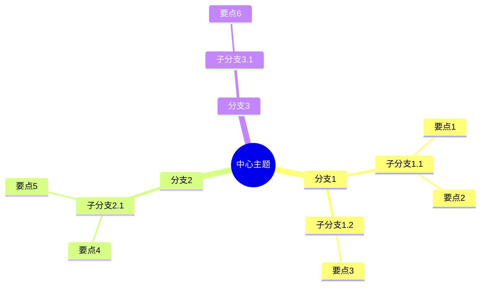

# 思维导图

## Markdown 大纲格式

```markdown
# 中心主题

## 分支1
### 子分支1.1
- 要点1
- 要点2

### 子分支1.2
- 要点3

## 分支2
### 子分支2.1
- 要点4
- 要点5

## 分支3
### 子分支3.1
- 要点6
```

## Mermaid 思维导图



## 应用场景

- **项目规划**：拆解任务
- **知识梳理**：整理学习笔记
- **会议讨论**：记录要点
- **问题分析**：拆解问题
