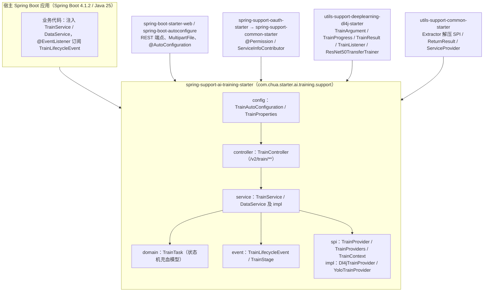
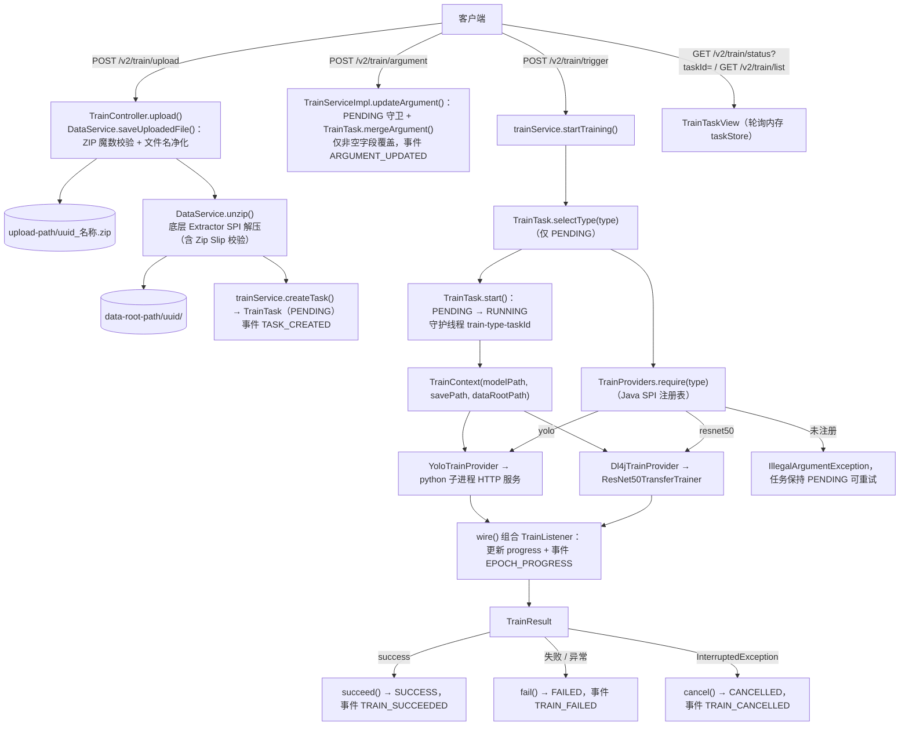

# spring-support-ai-training-starter

AI 训练平台的 REST 接入模块：ZIP 训练数据上传与解压、异步训练调度、进度与超参数管理。训练引擎不写死，按 `type` 经 Java SPI 分发——`resnet50` 走 DL4J 迁移学习，`yolo` 走本机 Python 子进程。
在 spring-support 体系中，它是 ai 域「训练」侧的独立 starter：与面向推理/对话的 `spring-support-ai-starter` 互不依赖，训练契约（`TrainArgument`/`TrainProgress`/`TrainResult`/`TrainListener`）由底层 `utils-support-deeplearning-dl4j-starter` 提供，本模块只做 REST 编排与 SPI 分发。

## 1. 架构图



- 自动装配入口：`META-INF/spring/org.springframework.boot.autoconfigure.AutoConfiguration.imports` → `com.chua.starter.ai.training.support.config.TrainAutoConfiguration`；本模块没有 `spring.factories`。
- 训练进度不走任何推送通道（Socket/SSE 等），统一经 `TrainLifecycleEvent`（Spring 事件）外发，由宿主自行桥接。
- 任务态只存内存（`TrainServiceImpl` 的 `ConcurrentHashMap`），无持久化。

## 2. 核心流程图



## 3. 能力清单

| 能力域 | 关键类 | 入口 / 触发方式 |
| --- | --- | --- |
| 训练数据上传（ZIP 魔数校验 + 文件名净化 + 落盘） | `DataService` / `DataServiceImpl` | `POST /v2/train/upload`（`MultipartFile file`） |
| ZIP 解压（底层 `Extractor` SPI，含 Zip Slip 前置校验） | `DataServiceImpl#unzip` | `ExtractorFactory.getExtractor(...).extract(...)` |
| 训练任务状态机（PENDING → RUNNING → SUCCESS / FAILED / CANCELLED） | `TrainTask` | `TrainTask.create(...)`、`start()`、`succeed()`、`fail()`、`cancel()` |
| 异步训练调度（守护线程 + 引擎回调接线） | `TrainService` / `TrainServiceImpl` | `TrainService#startTraining(taskId, type)` |
| 训练引擎分发（Java SPI 注册表） | `TrainProvider` / `TrainProviders` / `TrainContext` | `TrainProviders#require(type)` |
| DL4J 迁移学习引擎（`type=resnet50`，默认） | `Dl4jTrainProvider` | `ResNet50TransferTrainer#train(...)` |
| YOLO 引擎（`type=yolo`，Python 子进程 + HTTP 轮询） | `YoloTrainProvider` | `META-INF/services` 注册 + classpath `python/yolo_train_service.py` |
| 超参数部分更新（仅 PENDING 可改，非空字段覆盖） | `TrainArgumentRequest`、`TrainServiceImpl#updateArgument`、`TrainTask#mergeArgument` | `POST /v2/train/argument` |
| 进度查询 / 任务列表 | `TrainTaskView`、`TrainTaskView.TrainProgressView` | `GET /v2/train/status`、`GET /v2/train/list` |
| 生命周期事件广播（7 个阶段） | `TrainLifecycleEvent`、`TrainStage` | `ApplicationEventPublisher#publishEvent` |

REST 端点一览（均标注 `@Permission("admin")`，响应统一包装为 `ReturnResult<T>`）：

| 方法 | 路径 | 请求体 / 参数 | 响应 data |
| --- | --- | --- | --- |
| POST | `/v2/train/upload` | `multipart/form-data`，字段名 `file`（仅 ZIP） | `TrainUploadView(taskId, fileName, dataPath)` |
| POST | `/v2/train/trigger` | `TrainTriggerRequest{taskId, resumeModelPath?, type?}` | 无 |
| GET | `/v2/train/status` | `?taskId=` | `TrainTaskView` |
| GET | `/v2/train/list` | 无 | `List<TrainTaskView>` |
| POST | `/v2/train/argument` | `TrainArgumentRequest{taskId, epoch?, batchSize?, nClasses?, learningRate?, lrMomentum?, trainPercent?, resumeModelPath?}` | 无 |

## 4. Bean 能力矩阵

| Bean 名 | 类型 | 装配条件（含默认值） | 可否覆盖 | 典型用途 |
| --- | --- | --- | --- | --- |
| `dataService` | `DataService`（实现 `DataServiceImpl`） | `TrainAutoConfiguration` 激活（`plugin.ai.training.enabled=true`，缺省视为 true）+ `@ConditionalOnMissingBean` | 可覆盖：宿主自定义同类型 Bean 后自动配置让位 | 构造器注入，上传/解压训练数据 |
| `trainService` | `TrainService`（实现 `TrainServiceImpl`） | 同上 + `@ConditionalOnMissingBean` | 可覆盖（例如替换内存任务存储） | 构造器注入，建任务/启动训练/查状态 |
| `trainController` | `TrainController` | 同上 + `@ConditionalOnMissingBean`（宿主组件扫描已注册时让位） | 可覆盖 | 一般经 HTTP 调用；需要时也可注入 |
| `trainServiceInfoContributor` | `ServiceInfoContributor`（lambda，登记 `ai-training` 标志与 `[上传限制: {max-size}MB]`） | 仅要求 `TrainAutoConfiguration` 激活；**无** `@ConditionalOnMissingBean` | 不可按覆盖语义替换（宿主再定义会同类型共存两个 Bean） | 由服务信息体系统一收集，一般不直接注入 |
| `plugin.ai.training-com.chua.starter.ai.training.support.config.TrainProperties` | `TrainProperties`（`@ConfigurationProperties`） | 随 `TrainAutoConfiguration` 经 `@EnableConfigurationProperties` 注册 | 可定义同名 Bean 覆盖，一般无需 | 注入读取 `plugin.ai.training.*` 配置 |

说明：`TrainServiceImpl` / `DataServiceImpl` 虽带 `@Service` 注解，但自动配置不依赖宿主组件扫描——默认注册走 `TrainAutoConfiguration` 的 `@Bean` 方法；若宿主恰好扫描到这些类，`@ConditionalOnMissingBean` 会自动让位，不会重复注册。

## 5. 完整配置

前缀 `plugin.ai.training`，绑定类 `com.chua.starter.ai.training.support.config.TrainProperties`（`@EnableConfigurationProperties` 注册，配合 `spring-boot-configuration-processor` 生成元数据）。

| 配置路径 | 类型 | 默认值 | 说明 |
| --- | --- | --- | --- |
| `plugin.ai.training.enabled` | `boolean` | `true` | 总开关，控制 `TrainAutoConfiguration` 整体装配（`matchIfMissing = true`） |
| `plugin.ai.training.max-size` | `int`（MB） | `3000` | 上传大小上限的**展示值**，不拦截上传；真实上限取决于宿主 `spring.servlet.multipart.max-file-size` / `max-request-size` |
| `plugin.ai.training.model-path` | `String` | `{base}/resnet50_dl4j_inference.v3.zip` | 冷启动预训练模型路径（ZIP 或目录），`resnet50` 引擎经 `TrainContext.modelPath` 使用 |
| `plugin.ai.training.data-root-path` | `String` | `{base}/image_root/` | 数据解压根目录（每次解压在其下建 UUID 子目录） |
| `plugin.ai.training.save-path` | `String` | `{base}/modelv2/` | 新训练模型保存目录；yolo 场景作为 `/start` 的 `project` 参数 |
| `plugin.ai.training.upload-path` | `String` | `{base}/` | 上传文件落盘目录（保存时自动创建） |

`{base}` 由 `TrainProperties#defaultBaseDir()` 按 `os.name` 推导（非配置项）：Windows 为 `C:\aias\file`，其他平台为 `~/.aias/file`。

最小 YAML 示例：

```yaml
plugin:
  ai:
    training:
      enabled: true
      model-path: D:/aias/models/resnet50_dl4j_inference.v3.zip
      data-root-path: D:/aias/data/image_root/
      save-path: D:/aias/models/modelv2/
      upload-path: D:/aias/data/upload/
```

### 5.1 逐项配置示例

开关与上传展示：

| 配置项 | 含义 | 默认值 |
| --- | --- | --- |
| `enabled` | 总开关，`false` 时整个训练模块不装配（`matchIfMissing = true`，缺省视为开启） | `true` |
| `max-size` | 上传大小上限的**展示值**（MB），仅用于服务信息面板，不拦截上传；真实上限取决于宿主 `spring.servlet.multipart.*` | `3000` |

```yaml
plugin:
  ai:
    training:
      enabled: true      # 置 false 整体关闭训练模块
      max-size: 3000     # 仅展示用；真实上传上限见 spring.servlet.multipart.*
```

目录与模型路径（`{base}` = Windows `C:\aias\file`，其他平台 `~/.aias/file`）：

| 配置项 | 含义 | 默认值 |
| --- | --- | --- |
| `model-path` | `resnet50` 冷启动预训练模型（ZIP 或目录），必须真实存在，否则训练启动失败 | `{base}/resnet50_dl4j_inference.v3.zip` |
| `data-root-path` | 数据解压根目录，每次解压在其下建 UUID 子目录 | `{base}/image_root/` |
| `save-path` | 新训练模型保存目录；yolo 场景兼作 Python 子进程 `/start` 的 `project` 参数 | `{base}/modelv2/` |
| `upload-path` | 上传 ZIP 落盘目录，保存时自动创建 | `{base}/` |

```yaml
plugin:
  ai:
    training:
      model-path: D:/aias/models/resnet50_dl4j_inference.v3.zip
      data-root-path: D:/aias/data/image_root/
      save-path: D:/aias/models/modelv2/
      upload-path: D:/aias/data/upload/
```

### 5.2 完整 application.yml 示例

生产环境建议同时收紧宿主 multipart 上限，并把本模块目录显式指到独立数据盘：

```yaml
spring:
  servlet:
    multipart:
      max-file-size: 2GB        # 真实上传拦截上限（本模块 max-size 仅展示）
      max-request-size: 2GB

plugin:
  ai:
    training:
      enabled: true
      max-size: 3000
      model-path: D:/aias/models/resnet50_dl4j_inference.v3.zip
      data-root-path: D:/aias/data/image_root/
      save-path: D:/aias/models/modelv2/
      upload-path: D:/aias/data/upload/
```

注意：yolo 的 Python 路径与外部脚本不是 YAML 配置项，须以 JVM 系统属性传入（见下表），例如
`-Dplugin.ai.training.yolo.python=D:/tools/python311/python.exe -Dplugin.ai.training.yolo.script=D:/aias/scripts/yolo_train_service.py`。

另有 `YoloTrainProvider` 读取的两个 **JVM 系统属性**（非 `@ConfigurationProperties` 项，需 `-D` 传入）：

| 系统属性 | 默认行为 | 说明 |
| --- | --- | --- |
| `plugin.ai.training.yolo.python` | Windows 用 `python`，其他平台用 `python3` | Python 可执行文件 |
| `plugin.ai.training.yolo.script` | 使用 classpath 的 `python/yolo_train_service.py`（落盘临时目录后启动） | 外部训练脚本路径（文件真实存在才生效） |

## 6. 使用方式

Maven 坐标（版本由父 POM `com.chua:spring-support-parent-starter:4.0.0.51` 管理，`utils.version` 同为 `4.0.0.51`）：

```xml
<dependency>
    <groupId>com.chua</groupId>
    <artifactId>spring-support-ai-training-starter</artifactId>
    <version>4.0.0.51</version>
</dependency>
```

| 依赖 | Scope | 作用 |
| --- | --- | --- |
| `com.chua:utils-support-deeplearning-dl4j-starter` | compile | 训练契约与 `ResNet50TransferTrainer`（含 DL4J 本地库，体积较大） |
| `com.chua:utils-support-common-starter` | compile | `Extractor` 解压 SPI、`ReturnResult`、`ServiceProvider` |
| `org.springframework.boot:spring-boot-starter-web` | compile | REST 端点与 `MultipartFile` |
| `org.springframework.boot:spring-boot-autoconfigure` | compile | `@AutoConfiguration` / `@ConditionalOn*` |
| `com.chua:spring-support-oauth-starter` | compile | 传递引入 `spring-support-common-starter` 的 `@Permission` 鉴权注解与 `ServiceInfoContributor`（注解本身定义在 common，不在本依赖内） |
| `io.swagger.core.v3:swagger-annotations` | compile | `@Tag` / `@Operation` / `@Schema` |
| `org.projectlombok:lombok` | `provided` | 编译期生成样板代码；缺失则本模块源码无法编译（对依赖方无运行时影响） |
| `jakarta.servlet:jakarta.servlet-api` | `provided` | Servlet 规范，由宿主 Web 容器提供 |
| `org.springframework.boot:spring-boot-configuration-processor` | `optional` | 仅生成配置元数据；不传递给依赖方，运行时不需要 |

可选/Provided 依赖缺了会怎样：`lombok`、`jakarta.servlet-api` 缺失只影响本模块源码编译，不影响依赖方运行；`configuration-processor` 缺失只少配置提示元数据；`swagger-annotations` 缺失仅影响 OpenAPI 文档注解展示，不影响接口运行；`oauth-client-starter` 为普通依赖会随坐标带入，其 `@Permission` 是否实际拦截取决于宿主是否装配了对应鉴权体系。

最小启用步骤：引入依赖 → 确认目录可写（`upload-path` 自动创建；`data-root-path` / `save-path` 需进程可写；`model-path` 指向的预训练模型必须真实存在，否则 `resnet50` 冷启动失败）→ 启动后按 `taskId` 串联：

```text
POST /v2/train/upload        multipart/form-data，字段名 file（仅 ZIP）
POST /v2/train/argument      {"taskId":"<id>","epoch":50,"batchSize":16}
POST /v2/train/trigger       {"taskId":"<id>","type":"resnet50"}
GET  /v2/train/status?taskId=<id>
GET  /v2/train/list
```

Java 侧直接注入服务（超参数对象 `TrainArgument` 由底层 DL4J starter 提供，用 `TrainArgument.builder()...build()` 组装）：

```java
@Service
@RequiredArgsConstructor
public class MyTrainingJob {
    private final DataService dataService;      // 由 TrainAutoConfiguration 注册
    private final TrainService trainService;    // 由 TrainAutoConfiguration 注册

    public String submit(byte[] zipBytes, String fileName) throws Exception {
        // 1) 落盘 + 解压（内部校验 ZIP 魔数 PK\x03\x04）
        String savedPath = dataService.saveUploadedFile(zipBytes, fileName);
        String dataPath = dataService.unzip(savedPath);
        // 2) 建任务（PENDING）→ 3) 覆盖超参数（部分更新语义）
        TrainTask task = trainService.createTask(fileName, dataPath);
        trainService.updateArgument(task.getId(), TrainArgument.builder()
                .epoch(50).batchSize(16).nClasses(5).learningRate(0.001).trainPercent(80)
                .build());
        // 4) 异步启动；type 为空/空白时回退 resnet50
        trainService.startTraining(task.getId(), "resnet50");
        return task.getId();
    }
}
```

用 Spring 事件跟随训练过程（`TrainLifecycleEvent#getSource()` 即 taskId；`TrainStage` 全部取值：`TASK_CREATED`、`ARGUMENT_UPDATED`、`TRAIN_STARTED`、`EPOCH_PROGRESS`、`TRAIN_SUCCEEDED`、`TRAIN_FAILED`、`TRAIN_CANCELLED`）：

```java
@Component
public class TrainWatcher {
    @EventListener(TrainLifecycleEvent.class)
    public void onTrain(TrainLifecycleEvent event) {
        switch (event.getStage()) {
            case TRAIN_STARTED -> System.out.println("开始: " + event.getTaskId());
            case EPOCH_PROGRESS -> System.out.println("进度: " + event.getProgress().getProgress());
            case TRAIN_SUCCEEDED -> System.out.println("成功: " + event.getMessage());
            case TRAIN_FAILED, TRAIN_CANCELLED -> System.out.println("结束: " + event.getMessage());
            default -> { }
        }
    }
}
```

## 7. 使用场景

**适用：**

- Spring Boot 单体服务需要内嵌「图像分类（ResNet50 迁移学习）/ 目标检测（YOLO）」训练能力；
- 小批量、单机训练：上传 ZIP 数据集 → 异步训练 → 轮询进度的闭环；
- 需要以 Java SPI 方式接入自有训练后端（按 `type` 路由）。

**不适用 / 慎用：**

- 多实例 / 集群部署：任务存于 `TrainServiceImpl` 的内存 `ConcurrentHashMap`，不共享、进程重启即失；
- 需要任务持久化、断点续跑、主动取消端点的生产级训练平台（无 cancel 端点，每任务一个裸守护线程，无池化与并发上限）。

**与相邻模块的取舍：**

| 模块 | 关系 | 取舍 |
| --- | --- | --- |
| `spring-support-ai-starter` | 同属 ai 域，互不依赖 | ai-starter 面向推理/对话（`FreeChatClient`、路由、指标）；本模块面向训练 |
| `utils-support-deeplearning-dl4j-starter` | 本模块依赖它 | 训练引擎与超参模型在底层；只要引擎不要 REST 时可直接用底层 starter |
| `spring-support-filesystem-starter` | 无依赖 | 本模块直接落本地磁盘目录（`upload-path` 等），不走统一文件存储抽象；需要对象存储时自行扩展 `DataService` |
| `spring-support-socket-*`（websocket / sse 等） | 无依赖 | 训练进度可经 `TrainLifecycleEvent` 自行桥接到任意推送通道 |
| `spring-support-oauth-starter` | 依赖 | 仅取 `@Permission` 与 `ServiceInfoContributor`；宿主无鉴权实现时注解不拦截 |

## 8. 扩展点

- **训练引擎 SPI：`TrainProvider`**（核心扩展点，`com.chua.starter.ai.training.support.spi.TrainProvider`）。三个方法：`String type()`（路由键，如 `resnet50` / `yolo`）、`String engine()`（引擎标识，仅日志/监控展示）、`TrainResult train(TrainArgument, TrainContext, TrainListener)`（`ctx` 为平台解析好的 `TrainContext(modelPath, savePath, dataRootPath)`，`listener` 可为 `TrainListener.NOOP`）。注册方式为标准 Java SPI：新建 `src/main/resources/META-INF/services/com.chua.starter.ai.training.support.spi.TrainProvider`，每行一个实现全限定名（本模块自带 `Dl4jTrainProvider`、`YoloTrainProvider` 两行）。登记后 `POST /v2/train/trigger` 传 `{"taskId":"<id>","type":"<你的type>"}` 即可；类型未注册时 `TrainProviders#require` 抛 `IllegalArgumentException` 并列出已接入清单，任务保持 PENDING 可修正重试。
- **生命周期事件：`TrainLifecycleEvent` / `TrainStage`**。平台在 7 个阶段经 `ApplicationEventPublisher` 广播事件，`source` 即 taskId，附带 `progress` / `message` / `cause`；宿主用 `@EventListener(TrainLifecycleEvent.class)` 即插即拔。注意监听器抛出的 `RuntimeException` 会被吞掉（仅 `log.warn`），不会中断训练。
- **Bean 覆盖**：`dataService` / `trainService` / `trainController` 均为 `@ConditionalOnMissingBean`，宿主可定义同类型 Bean 替换默认实现（例如自定义任务存储）；`trainServiceInfoContributor` 无该条件，不可按覆盖语义替换。
- **领域对象复用**：`TrainTask` 公开 `create` / `start` / `selectType` / `succeed` / `fail` / `cancel` / `mergeArgument` / `createListener`，可复用其状态机做自定义编排；注意 `start` / `selectType` 为 PENDING-only（非 PENDING 抛 `IllegalStateException`），`mergeArgument` 仅覆盖非空字段。

## 9. 常见问题

**Q1：装配不生效？** 依次排查：是否被 `plugin.ai.training.enabled=false` 关闭（缺省 true）；本模块经 `AutoConfiguration.imports` 装配，与宿主 `@ComponentScan` 包路径无关，`TrainServiceImpl` / `DataServiceImpl` 上的 `@Service` 不会单独生效；宿主已定义同类型 Bean 时自动配置让位（`@ConditionalOnMissingBean`）；确认引入的是 4.0.0.51 体系版本且带传递依赖。

**Q2：端口与开关？** yolo 子进程的 HTTP 端口是随机协商的：python 脚本绑定空闲端口后把 `PORT=xxx` 打到 stdout 首行，Java 侧读取（等待上限 60 秒），无需也无法用配置固定；训练轮询硬超时 6 小时。宿主 REST 端口就是宿主自己的 `server.port`，本模块不新增监听端口。`plugin.ai.training.max-size` 只用于服务信息展示，不拦截上传；`plugin.ai.training.yolo.python` / `plugin.ai.training.yolo.script` 是 JVM 系统属性（`-D` 传入），不是 YAML 配置项，外部脚本路径必须真实存在，否则回退 classpath 脚本。

**Q3：与 Spring Boot 4 的兼容性？** 基线为 Spring Boot 4.1.2（父 POM `spring-boot-starter-parent:4.1.2`）+ Java 25；注册方式为 `@AutoConfiguration` + `META-INF/spring/org.springframework.boot.autoconfigure.AutoConfiguration.imports`（无 `spring.factories`）；Servlet 栈为 `jakarta.*`；`@Permission`、`ServiceInfoContributor` 来自 `spring-support-common-starter`，DL4J 契约由 `utils-support-deeplearning-dl4j-starter` 提供。

**Q4：常见报错与已知限制？** `文件内容不是有效的 ZIP 格式`：魔数校验失败（仅接受 `PK\x03\x04` / 空包 `\x05\x06` / 分卷 `\x07\x08`）；`仅支持 ZIP 格式文件`：文件名后缀非 `.zip`；`未接入 type=xxx 的训练引擎（已接入: resnet50, yolo）`：type 拼写错误或未注册 SPI，任务保持 PENDING；`任务状态为 RUNNING，不可修改超参数（仅 PENDING 可修改）` / `不可启动（仅 PENDING 可启动）`：状态机守卫；`YOLO 训练需要 Ultralytics 布局数据集（images/ + labels/ + data.yaml）...`：解压目录（含子目录，深度 ≤3）内未找到 `data.yaml`，且 yolo 依赖本机可执行 Python 与 `ultralytics`。已知限制：任务只在内存，进程重启后 `GET /v2/train/status` 返回 `任务不存在`；没有取消端点，`TrainTask#cancel()` 仅在训练线程收到 `InterruptedException` 时触发；`resnet50` 依赖 `model-path` 真实存在，模块不做提前校验；事件监听异常被吞，不会中断训练也不会通知调用方。

## 10. 生产注意事项

- **真实上传上限要落在宿主侧**：`plugin.ai.training.max-size` 只用于服务信息展示，不拦截上传；生产环境应通过 `spring.servlet.multipart.max-file-size` / `max-request-size` 设置真实上限，并确认 `upload-path` / `data-root-path` / `save-path` 所在磁盘余量充足（解压后的明文数据体积可能远超 ZIP 本身）。
- **任务态只在内存**：`TrainServiceImpl` 用 `ConcurrentHashMap` 保存任务，进程重启/发布后任务与进度全部丢失，`GET /v2/train/status` 返回 `任务不存在`；需要可追溯时应在宿主侧订阅 `TrainLifecycleEvent` 自行落库，不要假设任务可恢复。
- **无取消端点、无线程池**：每个训练任务一个裸守护线程（线程名 `train-type-taskId`），没有并发上限与主动取消端点；`TrainTask#cancel()` 仅在训练线程收到 `InterruptedException` 时触发。生产上应通过入口限流/排队避免大量任务并发启动；yolo 训练轮询硬超时 6 小时。
- **`resnet50` 依赖 `model-path` 真实存在**：模块不做提前校验，路径失效会在训练启动时才失败；迁移/升级部署时把预训练模型文件与目录一并迁移。
- **yolo 依赖本机 Python 环境**：需要本机可执行 Python（Windows `python`，其他平台 `python3`，可用 `-Dplugin.ai.training.yolo.python` 覆盖）及 `ultralytics` 依赖；子进程 HTTP 端口随机协商（脚本把 `PORT=xxx` 打到 stdout 首行，Java 侧等待上限 60 秒），无需也无法用配置固定；容器化部署需保证镜像内具备 Python 运行时。
- **鉴权取决于宿主装配**：训练端点均标注 `@Permission("admin")`，但注解是否实际拦截取决于宿主是否装配了对应鉴权体系；公网暴露前务必确认鉴权链路真实生效。
- **事件监听异常被吞**：`TrainLifecycleEvent` 监听器抛出的 `RuntimeException` 仅 `log.warn`，不会中断训练也不会通知调用方；监控/告警逻辑不要依赖异常传播，需在监听器内部自行兜底。
- **目录权限与默认路径**：`upload-path` 保存时自动创建，`data-root-path` / `save-path` 需进程可写；Windows 默认落在 `C:\aias\file`，Linux/Mac 默认落在 `~/.aias/file`，生产建议显式配置到独立数据盘并纳入备份/清理策略。
