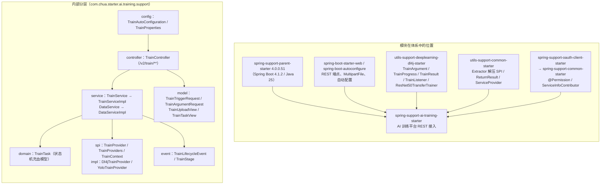
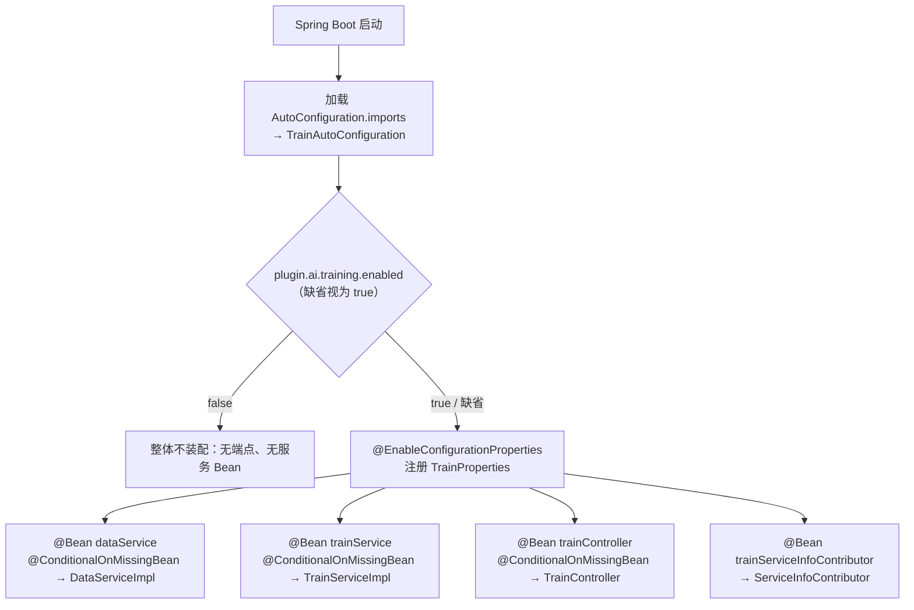
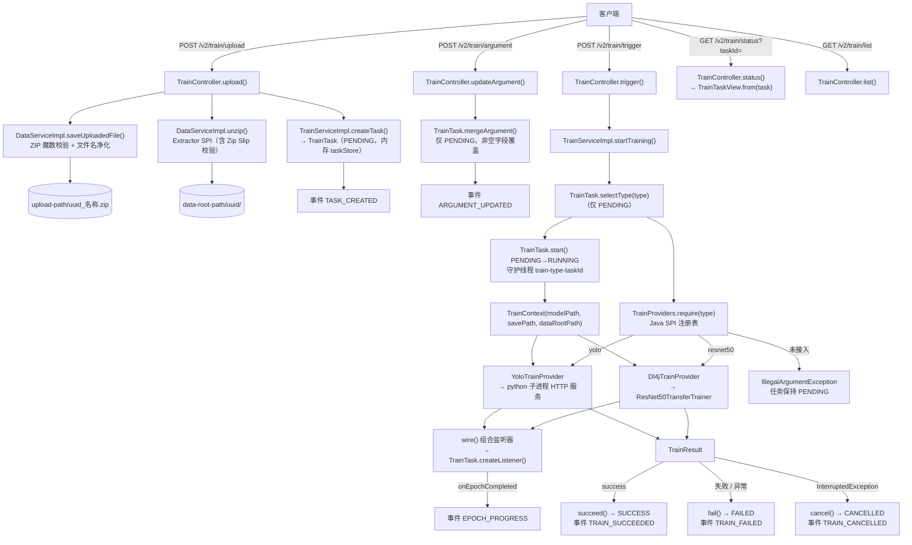
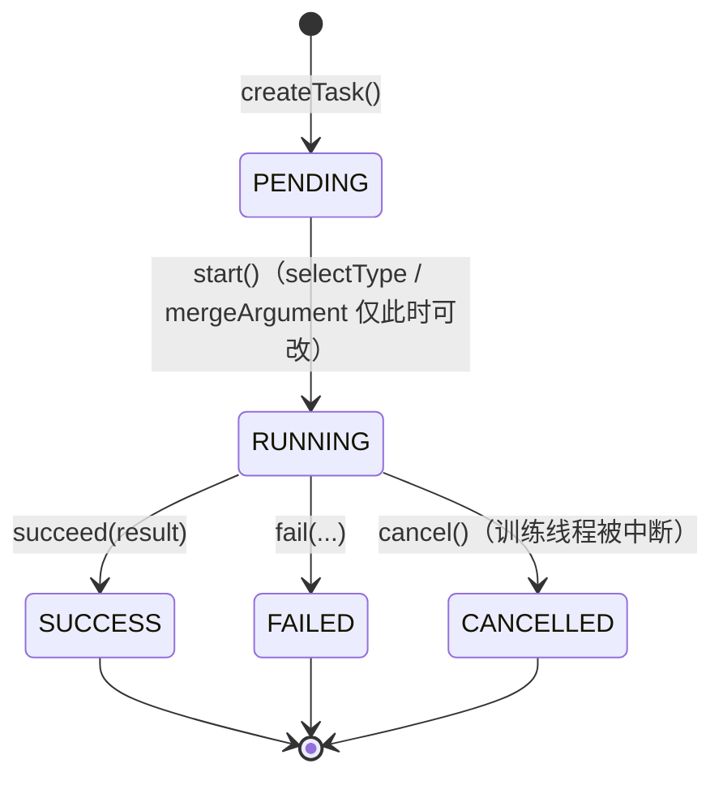

# spring-support-ai-training-starter

AI 训练平台的 REST 接入模块：ZIP 训练数据上传与解压、异步训练调度、进度与超参数管理。
训练引擎不写死，按 `type` 经 Java SPI 分发——`resnet50` 走 DL4J 迁移学习，`yolo` 走本机 Python 子进程。

## 1. 架构图



- 自动配置入口：`META-INF/spring/org.springframework.boot.autoconfigure.AutoConfiguration.imports` → `com.chua.starter.ai.training.support.config.TrainAutoConfiguration`（本模块**没有** `spring.factories`）。
- 引擎契约（`TrainArgument` / `TrainProgress` / `TrainResult` / `TrainListener`）由底层 `utils-support-deeplearning-dl4j-starter` 提供，本模块只做 REST 编排与 SPI 分发。
- 训练进度不走任何推送通道（Socket/SSE 等），统一经 `TrainLifecycleEvent`（Spring 事件）外发，由宿主自行桥接。

## 2. 核心流程图

### 2.1 装配流程



### 2.2 训练请求处理与数据流



### 2.3 任务状态机（TrainTask）



## 3. 能力清单

| 能力域 | 关键类 | 入口 |
| --- | --- | --- |
| 训练数据上传（ZIP 魔数校验 + 文件名净化 + 落盘） | `DataService` / `DataServiceImpl` | `POST /v2/train/upload`（`MultipartFile file`） |
| ZIP 解压（底层 Extractor SPI，含 Zip Slip 前置校验） | `DataServiceImpl#unzip` | `ExtractorFactory.getExtractor(...).extract(...)` |
| 训练任务创建与状态机（PENDING → RUNNING → SUCCESS / FAILED / CANCELLED） | `TrainTask` | `TrainTask.create(...)`、`start()`、`succeed()`、`fail()`、`cancel()` |
| 异步训练调度（守护线程 + 引擎回调接线） | `TrainService` / `TrainServiceImpl` | `TrainService#startTraining(String taskId, String type)` |
| 训练引擎分发（Java SPI 注册表） | `TrainProvider` / `TrainProviders` / `TrainContext` | `TrainProviders#require(String type)` |
| DL4J 迁移学习引擎（`type=resnet50`，默认） | `Dl4jTrainProvider` | `ResNet50TransferTrainer#train(...)` |
| YOLO 引擎（`type=yolo`，Python 子进程 + HTTP 轮询） | `YoloTrainProvider` | `META-INF/services/...TrainProvider`、`python/yolo_train_service.py` |
| 进度查询 / 任务列表 | `TrainTaskView`、`TrainTaskView.TrainProgressView` | `GET /v2/train/status`、`GET /v2/train/list` |
| 超参数部分更新（仅 PENDING 可改） | `TrainArgumentRequest`、`TrainTask#mergeArgument` | `POST /v2/train/argument` |
| 生命周期事件广播（7 个阶段） | `TrainLifecycleEvent`、`TrainStage` | `ApplicationEventPublisher#publishEvent` |
| 服务信息登记（`ai-training` 标志位） | `TrainAutoConfiguration#trainServiceInfoContributor` | `ServiceInfoContributor` |

REST 端点一览（全部标注 `@Permission("admin")`，响应统一包装为 `ReturnResult<T>`）：

| 方法 | 路径 | 请求体 / 参数 | 响应 data |
| --- | --- | --- | --- |
| POST | `/v2/train/upload` | `multipart/form-data`，字段名 `file`（仅 ZIP） | `TrainUploadView(taskId, fileName, dataPath)` |
| POST | `/v2/train/trigger` | `TrainTriggerRequest{taskId, resumeModelPath?, type?}` | 无 |
| GET | `/v2/train/status` | `?taskId=` | `TrainTaskView` |
| GET | `/v2/train/list` | 无 | `List<TrainTaskView>` |
| POST | `/v2/train/argument` | `TrainArgumentRequest{taskId, epoch?, batchSize?, nClasses?, learningRate?, lrMomentum?, trainPercent?, resumeModelPath?}` | 无 |

## 4. Bean 能力矩阵

| Bean 名 | 类型 | 装配条件 | 可否覆盖 | 典型注入姿势 |
| --- | --- | --- | --- | --- |
| `dataService` | `DataService`（实现 `DataServiceImpl`） | `TrainAutoConfiguration` 激活（`plugin.ai.training.enabled=true`，缺省 true）+ `@ConditionalOnMissingBean` | 可覆盖：宿主自定义同类型 Bean 后自动配置让位 | 构造器注入 `private final DataService dataService;` |
| `trainService` | `TrainService`（实现 `TrainServiceImpl`） | 同上 + `@ConditionalOnMissingBean` | 可覆盖（例如把内存任务存储换成自定义实现） | 构造器注入 `private final TrainService trainService;` |
| `trainController` | `TrainController` | 同上 + `@ConditionalOnMissingBean`（宿主组件扫描已注册时不重复） | 可覆盖 | 一般经 HTTP 调用；需要时也可注入 |
| `trainServiceInfoContributor` | `ServiceInfoContributor`（lambda，登记 `ai-training` 标志） | 仅要求 `TrainAutoConfiguration` 激活；**无** `@ConditionalOnMissingBean` | 不可按同类型覆盖语义覆盖（宿主再定义会同名类型共存两个 Bean） | 由服务信息体系统一收集，一般不直接注入 |

说明：

- `TrainServiceImpl` / `DataServiceImpl` 虽带 `@Service` 注解，但自动配置类不参与宿主组件扫描，实际注册走 `TrainAutoConfiguration` 的 `@Bean` 方法。
- `TrainProperties` 经 `@EnableConfigurationProperties` 注册，Bean 名为 `plugin.ai.training-com.chua.starter.ai.training.support.config.TrainProperties`。

## 5. 完整配置

前缀 `plugin.ai.training`，绑定类 `com.chua.starter.ai.training.support.config.TrainProperties`
（`@EnableConfigurationProperties(TrainProperties.class)`，配合 `spring-boot-configuration-processor` 生成元数据）。

| 配置 key | 类型 | 默认值 | 说明 | 生效开关 |
| --- | --- | --- | --- | --- |
| `plugin.ai.training.enabled` | `boolean` | `true` | 总开关，控制 `TrainAutoConfiguration` 整体装配（`matchIfMissing = true`） | 装配 |
| `plugin.ai.training.max-size` | `int`（MB） | `3000` | 上传大小上限的**展示值**，当前不拦截上传；真实上限取决于宿主 `spring.servlet.multipart.max-file-size` / `max-request-size` | 仅被 `trainServiceInfoContributor` 读取展示 |
| `plugin.ai.training.model-path` | `String` | `{base}/resnet50_dl4j_inference.v3.zip` | 冷启动预训练模型路径（ZIP 或目录） | `resnet50` 引擎冷启动（经 `TrainContext.modelPath` 传入） |
| `plugin.ai.training.data-root-path` | `String` | `{base}/image_root/` | 数据解压根目录（每次解压在其下建 UUID 子目录） | `DataServiceImpl#unzip` 落盘 |
| `plugin.ai.training.save-path` | `String` | `{base}/modelv2/` | 新训练模型保存目录 | `TrainContext.savePath`；yolo 场景作为 `/start` 的 `project` 参数 |
| `plugin.ai.training.upload-path` | `String` | `{base}/` | 上传文件落盘目录（保存时自动创建） | `DataServiceImpl#saveUploadedFile` |

`{base}` 由 `TrainProperties#defaultBaseDir()` 按 `os.name` 推导（非配置项）：Windows 为 `C:\aias\file`，其他平台为 `~/.aias/file`。

YAML 示例：

```yaml
plugin:
  ai:
    training:
      enabled: true
      model-path: D:/aias/models/resnet50_dl4j_inference.v3.zip
      data-root-path: D:/aias/data/image_root/
      save-path: D:/aias/models/modelv2/
      upload-path: D:/aias/data/upload/
```

此外 `YoloTrainProvider` 读取两个 **JVM 系统属性**（不是 `@ConfigurationProperties` 项，需用 `-D` 传入）：

| 系统属性 | 默认行为 | 说明 |
| --- | --- | --- |
| `plugin.ai.training.yolo.python` | Windows 用 `python`，其他平台用 `python3` | Python 可执行文件 |
| `plugin.ai.training.yolo.script` | 使用 classpath 上的 `python/yolo_train_service.py`（落盘到临时目录后启动） | 外部训练脚本路径（文件真实存在才生效） |

## 6. 使用方式

### 6.1 Maven 坐标

```xml
<dependency>
    <groupId>com.chua</groupId>
    <artifactId>spring-support-ai-training-starter</artifactId>
    <version>4.0.0.51</version>
</dependency>
```

依赖说明（版本均由父 POM `com.chua:spring-support-parent-starter:4.0.0.51` 管理）：

| 依赖 | 版本 | 作用 |
| --- | --- | --- |
| `com.chua:utils-support-deeplearning-dl4j-starter` | `${utils.version}` = `4.0.0.51` | `TrainArgument` / `TrainProgress` / `TrainResult` / `TrainListener` / `ResNet50TransferTrainer`（含 DL4J 本地库，体积较大） |
| `com.chua:utils-support-common-starter` | `${utils.version}` = `4.0.0.51` | `Extractor` 解压 SPI、`ReturnResult`、`ServiceProvider` |
| `org.springframework.boot:spring-boot-starter-web` | 由父 POM 管理（4.1.2） | REST 端点与 `MultipartFile` |
| `org.springframework.boot:spring-boot-autoconfigure` | 由父 POM 管理 | `@AutoConfiguration` / `@ConditionalOnProperty` |
| `com.chua:spring-support-oauth-client-starter` | `4.0.0.51`（同父版本） | 提供 `@Permission` 鉴权注解（传递引入 `spring-support-common-starter` 的 `Permission` / `ServiceInfoContributor`） |
| `io.swagger.core.v3:swagger-annotations` | 由父 POM 管理 | `@Tag` / `@Operation` / `@Schema` |
| `jakarta.servlet:jakarta.servlet-api` | `provided`，仅编译期 | Servlet 规范 |
| `org.projectlombok:lombok` | `provided` | 日志与样板代码 |
| `org.springframework.boot:spring-boot-configuration-processor` | `optional` | 生成配置元数据 |

### 6.2 最小可运行示例

第一步，引入依赖（见 6.1）。第二步，确认目录可写：`upload-path` 保存时会自动创建；`data-root-path` / `save-path` 需进程可写；`model-path` 指向的预训练模型必须真实存在（`resnet50` 冷启动才会成功）。第三步，启动宿主应用后按 `taskId` 串联三步：

```text
POST /v2/train/upload        Content-Type: multipart/form-data    字段名: file（仅 ZIP）
POST /v2/train/argument      Content-Type: application/json       {"taskId":"<id>","epoch":50,"batchSize":16}
POST /v2/train/trigger       Content-Type: application/json       {"taskId":"<id>","type":"resnet50"}
GET  /v2/train/status?taskId=<id>
GET  /v2/train/list
```

Java 侧直接注入服务，按步骤调用（本模块自身没有链式 API：`TrainService` / `DataService` 都是普通方法；超参数对象 `TrainArgument` 由上游 DL4J starter 提供，用 `TrainArgument.builder()...build()` 组装）：

```java
@Service
@RequiredArgsConstructor
public class MyTrainingJob {

    private final DataService dataService;      // 由 TrainAutoConfiguration 注册
    private final TrainService trainService;    // 由 TrainAutoConfiguration 注册

    public String submit(byte[] zipBytes, String fileName) throws Exception {
        // 1) 落盘 + 解压（内部校验 ZIP 魔数 PK\x03\x04）
        String savedPath = dataService.saveUploadedFile(zipBytes, fileName);
        String dataPath = dataService.unzip(savedPath);

        // 2) 建任务（PENDING）
        TrainTask task = trainService.createTask(fileName, dataPath);

        // 3) 覆盖超参数（部分更新语义：只覆盖非空字段）
        trainService.updateArgument(task.getId(), TrainArgument.builder()
                .epoch(50)
                .batchSize(16)
                .nClasses(5)
                .learningRate(0.001)
                .trainPercent(80)
                .build());

        // 4) 异步启动；type 为空/空白时回退 resnet50
        trainService.startTraining(task.getId(), "resnet50");
        return task.getId();
    }
}
```

用 Spring 事件跟随训练过程（`TrainLifecycleEvent#getSource()` 即 taskId；`TrainStage` 全部取值：`TASK_CREATED`、`ARGUMENT_UPDATED`、`TRAIN_STARTED`、`EPOCH_PROGRESS`、`TRAIN_SUCCEEDED`、`TRAIN_FAILED`、`TRAIN_CANCELLED`）：

```java
@Component
public class TrainWatcher {

    @EventListener(TrainLifecycleEvent.class)
    public void onTrain(TrainLifecycleEvent event) {
        switch (event.getStage()) {
            case TRAIN_STARTED -> System.out.println("开始: " + event.getTaskId());
            case EPOCH_PROGRESS -> System.out.println("进度: " + event.getProgress().getProgress());
            case TRAIN_SUCCEEDED -> System.out.println("成功: " + event.getMessage());
            case TRAIN_FAILED, TRAIN_CANCELLED -> System.out.println("结束: " + event.getMessage());
            default -> { }
        }
    }
}
```

## 7. 使用场景

**适用：**

- Spring Boot 单体服务需要内嵌「图像分类（ResNet50 迁移学习）/ 目标检测（YOLO）」训练能力；
- 小批量、单机训练：上传 ZIP 数据集 → 异步训练 → 轮询进度的闭环；
- 需要以 Java SPI 方式接入自有训练后端（type 路由）。

**不适用：**

- 多实例 / 集群部署：任务存于 `TrainServiceImpl` 的内存 `ConcurrentHashMap`，不共享、进程重启即失；
- 需要任务持久化、断点续跑、主动取消接口的生产级训练平台（无 cancel 端点）；
- 大规模分布式训练 / GPU 编排（每任务一个裸守护线程，无池化与并发上限）。

**与相邻模块的取舍：**

| 模块 | 关系 | 取舍 |
| --- | --- | --- |
| `spring-support-ai-starter` | 同属 ai 域，互不依赖 | ai-starter 面向推理/对话（`FreeChatClient`、路由、指标）；本模块面向训练。需要"训练"用本模块，需要"对话/推理接入"用 ai-starter |
| `utils-support-deeplearning-dl4j-starter` | 本模块依赖它 | 训练引擎与超参模型在底层；只要训练引擎不要 REST 时，可直接用底层 starter |
| `spring-support-oauth-client-starter` / `spring-support-common-starter` | 依赖 / 传递依赖 | 仅取 `@Permission` 与 `ServiceInfoContributor`；宿主无鉴权实现时注解不拦截 |
| `spring-support-filesystem-starter` | 无依赖 | 本模块直接落本地磁盘目录（`upload-path` 等），不走统一文件存储抽象；需要对象存储时自行扩展 `DataService` |
| `spring-support-socket-*` 等 | 无依赖 | 训练进度可通过 `TrainLifecycleEvent` 自行桥接到任意推送通道 |

当前父 POM 中没有其它模块声明依赖 `spring-support-ai-training-starter`（以代码为准）。

## 8. 扩展点

### 8.1 训练引擎 SPI：`TrainProvider`（核心扩展点）

`com.chua.starter.ai.training.support.spi.TrainProvider`，三个方法：

- `String type()`：训练类型标识，与接口传入的 `type` 对齐（如 `resnet50` / `yolo`），是路由键；
- `String engine()`：承载引擎标识（如 `dl4j` / `python-http`），仅用于日志与监控展示；
- `TrainResult train(TrainArgument argument, TrainContext ctx, TrainListener listener) throws Exception`：执行训练；`ctx` 是平台解析好的 `TrainContext(modelPath, savePath, dataRootPath)`，`listener` 可为 `TrainListener.NOOP`。

登记方式：标准 Java SPI，新建 `src/main/resources/META-INF/services/com.chua.starter.ai.training.support.spi.TrainProvider`，每行一个实现全限定名（本模块自带文件即 `...impl.Dl4jTrainProvider`、`...impl.YoloTrainProvider` 两行）：

```text
com.example.training.MyOnnxTrainProvider
```

生效：`POST /v2/train/trigger` 传 `{"taskId":"<id>","type":"<你的type>"}` 即可。类型未登记时 `TrainProviders#require` 抛 `IllegalArgumentException` 并列出已接入清单，任务保持 PENDING 可修正重试。

### 8.2 生命周期事件：`TrainLifecycleEvent` / `TrainStage`

平台在每个 `TrainStage`（7 个阶段）经 `ApplicationEventPublisher` 广播事件；`source` 即 taskId，附带 `progress` / `message` / `cause`。宿主用 `@EventListener(TrainLifecycleEvent.class)` 即插即拔；注意监听器抛出的 `RuntimeException` 会被吞掉（仅 `log.warn`），不会中断训练。

### 8.3 Bean 覆盖

`dataService` / `trainService` / `trainController` 均为 `@ConditionalOnMissingBean`，宿主可定义同类型 Bean 替换默认实现（例如自定义任务存储）。`trainServiceInfoContributor` 无该条件，不可按覆盖语义替换。

### 8.4 领域对象复用

`TrainTask` 公开 `create` / `start` / `selectType` / `succeed` / `fail` / `cancel` / `mergeArgument` / `createListener`，可复用其状态机做自定义编排；注意 `start` / `selectType` 为 PENDING-only（非 PENDING 抛 `IllegalStateException`），`mergeArgument` 仅覆盖非空字段。

## 9. 常见问题

**Q1：装配不生效？**

- 检查是否被 `plugin.ai.training.enabled=false` 关闭（缺省 true）；
- 本模块经 `AutoConfiguration.imports` 装配，与宿主 `@ComponentScan` 包路径无关；`TrainServiceImpl` / `DataServiceImpl` 上的 `@Service` 注解不会单独生效，实际注册走 `TrainAutoConfiguration` 的 `@Bean` 方法；
- 宿主已定义同类型 Bean 时自动配置让位（`@ConditionalOnMissingBean`）；
- 确认引入的是 `4.0.0.51` 体系版本，且带传递依赖。

**Q2：端口与开关？**

- yolo 子进程的 HTTP 端口是**随机协商**的：python 脚本绑定空闲端口后把 `PORT=xxx` 打到 stdout 首行，Java 侧读取（等待上限 60 秒）；无需也无法用配置固定；训练轮询硬超时 6 小时；
- 宿主 REST 端口就是宿主自己的 `server.port`，本模块不新增监听端口；
- `plugin.ai.training.max-size` 只用于服务信息展示，不拦截上传；真实上限看 `spring.servlet.multipart.max-file-size` / `max-request-size`；
- `plugin.ai.training.yolo.python` / `plugin.ai.training.yolo.script` 是 JVM 系统属性（`-D` 传入），不是 yaml 配置项；外部脚本路径必须真实存在，否则回退 classpath 脚本。

**Q3：与 Spring Boot 4 的兼容性？**

- 基线：Spring Boot 4.1.2（父 POM `spring-boot-starter-parent:4.1.2`）+ Java 25；
- 注册方式为 `@AutoConfiguration` + `META-INF/spring/org.springframework.boot.autoconfigure.AutoConfiguration.imports`（无 `spring.factories`）；
- Servlet 栈为 `jakarta.*`；`@Permission`、`ServiceInfoContributor` 来自 `spring-support-common-starter`；DL4J 契约由 `utils-support-deeplearning-dl4j-starter` 提供。

**Q4：常见报错与已知限制？**

- `文件内容不是有效的 ZIP 格式`：魔数校验失败（仅接受 `PK\x03\x04` / 空包 `\x05\x06` / 分卷 `\x07\x08`）；
- `仅支持 ZIP 格式文件`：文件名后缀非 `.zip`（`isZipFile` 按扩展名判断）；
- `未接入 type=xxx 的训练引擎（已接入: resnet50, yolo）`：type 拼写错误或未注册 SPI；任务保持 PENDING；
- `任务状态为 RUNNING，不可修改超参数（仅 PENDING 可修改）` / `不可启动（仅 PENDING 可启动）`：状态机守卫；
- `YOLO 训练需要 Ultralytics 布局数据集（images/ + labels/ + data.yaml）...`：解压目录（含子目录，深度 ≤3）内未找到 `data.yaml`；yolo 依赖本机可执行 Python 与 `ultralytics`；
- `resnet50` 依赖 `model-path` 指向的预训练模型真实存在，模块不做提前校验，失败发生在引擎内部；
- 任务只在内存：进程重启后 `GET /v2/train/status` 会返回 `任务不存在`；多实例间进度不共享；
- 没有取消端点：`TrainTask#cancel()` 仅在训练线程收到 `InterruptedException` 时触发，长训练只能等其自然结束；
- 事件监听异常被吞：`TrainServiceImpl#publishEvent` 捕获 `RuntimeException` 后仅 `log.warn`，不会中断训练，也不会通知调用方；
- `TrainTaskView.from` 假定 `progress` 非空：`TrainTask.create` 会初始化 `TrainProgress`；若宿主自行构造 `TrainTask` 替代实现，需保证 `getProgress()` 不为 `null`。
