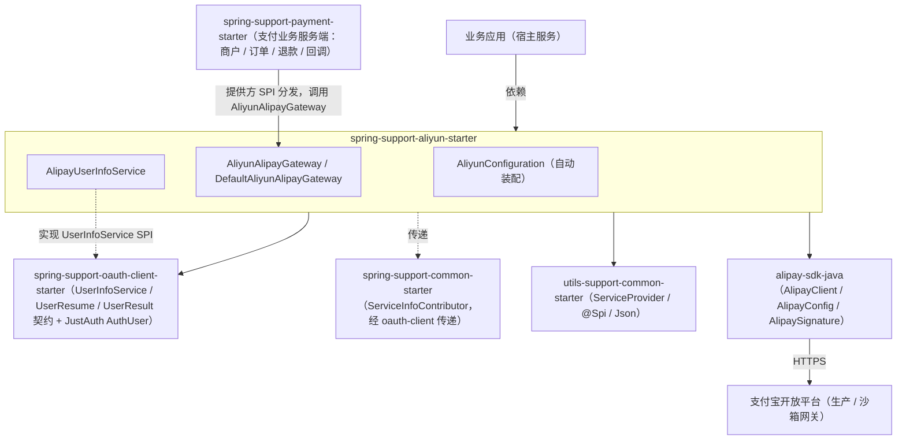
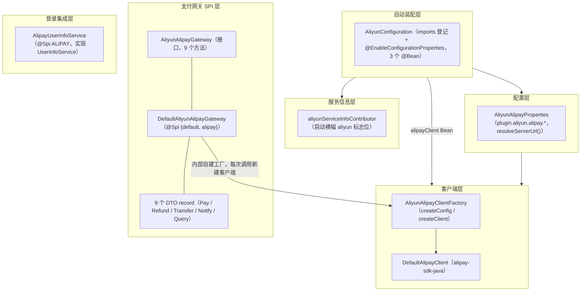
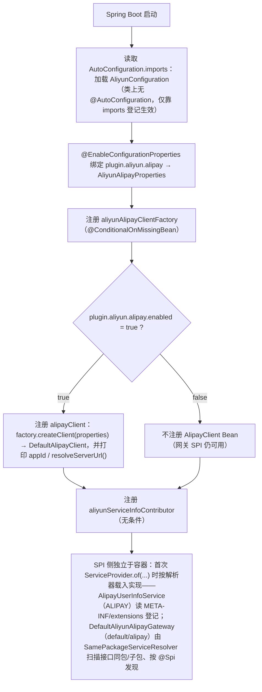
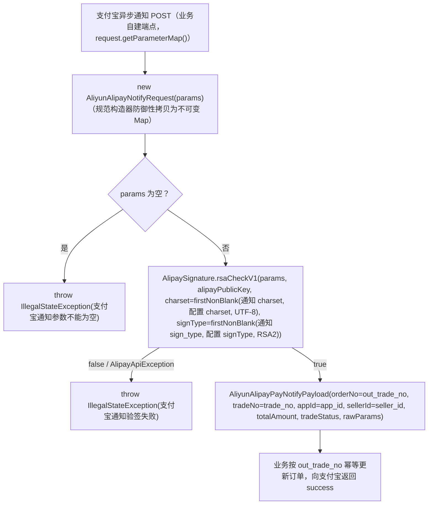

# spring-support-aliyun-starter

支付宝开放平台集成 Starter：把「电脑网站 / 手机网站 / APP 下单、查单、关单、退款、退款查询、单笔转账、异步通知验签」收敛成一个 `AliyunAlipayGateway` SPI，同时把支付宝登录注册成 oauth-client 的 `UserInfoService` 实现（`@Spi("ALIPAY")`）。

- Maven 坐标：`com.chua:spring-support-aliyun-starter:4.0.0.51`
- 配置前缀：`plugin.aliyun.alipay`（配置类 `AliyunAlipayProperties`）
- 自动装配入口：`META-INF/spring/org.springframework.boot.autoconfigure.AutoConfiguration.imports`，仅注册 `AliyunConfiguration` 一个类（**本模块无 `spring.factories`**）
- 总开关：`plugin.aliyun.alipay.enabled`，默认 `false`（只控制 `AlipayClient` Bean；网关 SPI 不受它限制）
- 范围：**只做支付宝**。本模块没有阿里云 OSS / SMS / 对象存储等实现，类名与构件名里的 `Aliyun` 只是历史命名。

---

## 1. 架构图

### 1.1 模块在体系中的位置



要点：

- 本模块在 `spring-support-parent-starter` 聚合下，与 `spring-support-tencent-starter` 是**同构平行模块**（支付网关 SPI + 登录实现），互不依赖，可只引其一。
- `spring-support-payment-starter` 是支付业务服务端，它**不直接实现支付宝协议**，而是通过提供方 SPI（`AliyunAlipayGateway`）把真实网关调用分发到本模块。
- 支付宝登录实现 `AlipayUserInfoService` 通过 `META-INF/extensions` 登记到 oauth-client 的 SPI 注册表，与 Spring 装配无关。

### 1.2 模块内部分层



---

## 2. 核心流程图

### 2.1 装配流程（启动期）



### 2.2 支付下单流程（运行期，以 `pagePay` 为例）

```mermaid
flowchart TD
    BIZ["业务代码"] --> GET["ServiceProvider.of(AliyunAlipayGateway.class).getExtension(\"alipay\")"]
    GET --> CALL["gateway.pagePay(properties, request)"]
    CALL --> BIZC["buildPayBizContent：out_trade_no / total_amount(2 位 HALF_UP) / subject / body / product_code / buyer_id(可选)"]
    BIZC --> JSON["Json.toJson(bizContent) 作 biz_content"]
    JSON --> CLIENT["client(properties)：内部 clientFactory.createClient(properties) → new DefaultAlipayClient(AlipayConfig)（每次调用新建）"]
    CLIENT --> REQ["AlipayTradePagePayRequest：setNotifyUrl / setReturnUrl（均取请求级字段）/ setBizContent"]
    REQ --> EXEC["client.pageExecute(request) → AlipayTradePagePayResponse"]
    EXEC --> WRAP["AliyunAlipayPayResponse(success=body 非空, body, tradeNo, firstNonBlank(subMsg, msg), rawResponse=body)"]
    EXEC -->|"AlipayApiException"| ERR["throw IllegalStateException(发起支付宝电脑网站支付失败)"]
```

### 2.3 异步通知验签流程（运行期）



---

## 3. 能力清单

| 能力域 | 关键类 | 入口 |
|---|---|---|
| 自动装配 | `AliyunConfiguration` | `META-INF/spring/...AutoConfiguration.imports` |
| 配置 | `AliyunAlipayProperties`（前缀 `plugin.aliyun.alipay`） | `@EnableConfigurationProperties` |
| 客户端工厂 | `AliyunAlipayClientFactory#createClient`、`#createConfig` | `@Bean aliyunAlipayClientFactory` + 代码直接 `new`（默认网关内部自建） |
| 支付网关 SPI | `AliyunAlipayGateway`（9 个方法） | `ServiceProvider.of(AliyunAlipayGateway.class).getExtension("alipay")` |
| 默认实现 | `DefaultAliyunAlipayGateway`（`@Spi({"default","alipay"})`） | 扩展名 `default` / `alipay` |
| 电脑网站支付 | `pagePay` → `alipay.trade.page.pay` | 返回表单 HTML（在 `body`） |
| 手机网站支付 | `wapPay` → `alipay.trade.wap.pay` | 返回表单 HTML（在 `body`） |
| APP 支付 | `appPay` → `alipay.trade.app.pay` | 返回 orderString（在 `body`） |
| 交易查询 / 关闭 | `queryOrder` / `closeOrder` → `alipay.trade.query` / `alipay.trade.close` | `closeOrder` 返回 `boolean` |
| 退款 | `refund` / `queryRefund` → `alipay.trade.refund` / `alipay.trade.fastpay.refund.query` | 金额按 2 位 `HALF_UP` 序列化 |
| 单笔转账 | `transfer` → `alipay.fund.trans.uni.transfer`（`TRANS_ACCOUNT_NO_PWD` / `DIRECT_TRANSFER`，收款方 `ALIPAY_LOGON_ID`） | 无转账查单 / 撤销 |
| 通知验签 | `verifyAndParsePayNotify` → `AlipaySignature.rsaCheckV1` | 失败抛 `IllegalStateException` |
| 下单 DTO | `AliyunAlipayPayRequest`、`AliyunAlipayPayResponse` | 页面 / WAP / APP 三态共用 |
| 查单 / 退款 / 转账 DTO | `AliyunAlipayTradeQueryResponse`、`AliyunAlipayRefundRequest/Response`、`AliyunAlipayTransferRequest/Response` | 全为 `record` |
| 通知 DTO | `AliyunAlipayNotifyRequest`（不可变参数包装）、`AliyunAlipayPayNotifyPayload` | 验签入参 / 出参 |
| 登录集成 | `AlipayUserInfoService`（`@Spi("ALIPAY")`） | `META-INF/extensions/...UserInfoService` |
| 服务信息 | `aliyunServiceInfoContributor` | 启动横幅 `aliyun` 标志位 |

合计 15 个源码类（1 装配 + 1 配置 + 1 工厂 + 1 网关接口 + 1 默认实现 + 1 登录实现 + 9 DTO）。

`AliyunAlipayGateway` 方法签名约定：

- 所有方法**第一个参数都是 `AliyunAlipayProperties`**，网关本身无状态、不持有配置。
- `notifyUrl` / `returnUrl` 只认 `AliyunAlipayPayRequest` 的请求级字段，配置里的同名项不生效。
- `AliyunAlipayPayResponse` 组件固定为 `success` / `body` / `tradeNo` / `message` / `rawResponse`：表单 HTML 与 orderString 都在 `body`，调用 SDK 前先判 `success`。
- `verifyAndParsePayNotify` 以异常表达失败（参数为空 / 验签失败 / 验签异常三种），**不返回 null**，调用方必须捕获并按支付宝要求返回 `failure`。

`AlipayUserInfoService#checkLogin(principal, credential, address, ext)`：

- `principal` = 支付宝用户 ID，为空直接返回带错误信息的 `UserResume`；`loginType` 固定 `ALIPAY`。
- `ext` 是 `me.zhyd.oauth.model.AuthUser` 时补 `username` / `nickName` / `email`（email 写入 `ext`），否则 `username` 退化为用户 ID。
- `credential` 非空时当作手机号写入 `resume.phone`。
- `upgrade(UserResult)` 恒返回 `null`（未实现资料刷新）。

---

## 4. Bean 能力矩阵

下表逐项来自 `AliyunConfiguration` 的 `@Bean` 方法与注解。本模块只有 **3 个 Spring Bean**；支付网关与登录实现走 SPI，不是 Bean。

| Bean 名 | 类型 | 装配条件 | 可否覆盖 | 典型注入姿势 |
|---|---|---|---|---|
| `aliyunAlipayClientFactory` | `AliyunAlipayClientFactory` | `@Bean` + `@ConditionalOnMissingBean`（无其它条件，始终注册） | 可，声明同类型 Bean 即自动让位 | 一般**无需注入**：`DefaultAliyunAlipayGateway` 用的是自己 `new` 的工厂，不消费此 Bean；宿主复用工厂逻辑时可 `@Autowired` |
| `alipayClient` | `AlipayClient`（实际 `DefaultAlipayClient`） | `@Bean` + `@ConditionalOnProperty(prefix="plugin.aliyun.alipay", name="enabled", havingValue="true")`；**没有 `@ConditionalOnMissingBean`** | 可自定义，但 `enabled=true` 时本 Bean 仍会注册，同类型会**并存**而非让位 | `@Autowired AlipayClient`（仅 `enabled=true` 时存在）；宿主另有同类型 Bean 时需 `@Primary` / `@Qualifier` 消歧 |
| `aliyunServiceInfoContributor` | `ServiceInfoContributor`（lambda，注册 `aliyun` 标志位） | `@Bean`，无条件创建 | 可，同名 Bean 覆盖即可 | 启动信息横幅内部消费，业务一般不注入 |

补充说明：

- **网关与登录实现不是 Spring Bean**，但发现途径不同：`AlipayUserInfoService` 经 `META-INF/extensions` 登记到 `ServiceProvider` SPI 注册表；`DefaultAliyunAlipayGateway` 未做文件登记，由 `ServiceProvider` 的 `SamePackageServiceResolver` 按 `@Spi({"default","alipay"})` 在接口 `AliyunAlipayGateway` 的同包/子包扫描发现。两者都不能 `@Autowired`，需要时自己包一层 `@Bean` 或按扩展名取用。
- `AliyunConfiguration` 类上只有 `@Slf4j` 与 `@EnableConfigurationProperties`，未标注 `@AutoConfiguration` / `@Configuration`；因登记在 `AutoConfiguration.imports` 中，仍会被 Boot 当作自动配置类加载，`@Bean` 方法正常注册。
- `AliyunAlipayProperties` 不是以 Bean 方法形式注册，而是由 `@EnableConfigurationProperties` 绑定，可直接 `@Autowired` 注入使用。
- 9 个 DTO 均为 `record`，纯数据载体，不参与装配。

---

## 5. 完整配置

配置类：`AliyunAlipayProperties`，前缀 `plugin.aliyun.alipay`（`ignoreInvalidFields = true`）。所有字段与默认值逐项来自源码。

| 路径 | 类型 | 默认值 | 说明 | 生效开关 |
|---|---|---|---|---|
| `plugin.aliyun.alipay.enabled` | `boolean` | `false` | **唯一生效的总开关**：为 `true` 才注册 `alipayClient` Bean；网关 SPI 不受它限制 | 本身即开关 |
| `plugin.aliyun.alipay.enable` | `boolean` | `false` | 历史兼容字段，**无任何代码读取，配置不生效** | 不生效 |
| `plugin.aliyun.alipay.sandbox` | `boolean` | `false` | `true` 且未配 `server-url` 时使用沙箱网关 `https://openapi-sandbox.dl.alipaydev.com/gateway.do` | 两条消费路径均生效（见下） |
| `plugin.aliyun.alipay.server-url` | `String` | 空 | 显式网关地址，优先级高于 `sandbox`；为空时按 `sandbox` 取生产 `https://openapi.alipay.com/gateway.do` 或沙箱地址（`resolveServerUrl()`） | 同上 |
| `plugin.aliyun.alipay.app-id` | `String` | 空 | 支付宝应用 APPID | 同上 |
| `plugin.aliyun.alipay.private-key` | `String` | 空 | 应用私钥 | 同上 |
| `plugin.aliyun.alipay.alipay-public-key` | `String` | 空 | 支付宝公钥，响应验签与异步通知验签（`AlipaySignature.rsaCheckV1`）都用它 | 同上 |
| `plugin.aliyun.alipay.notify-url` | `String` | 空 | **声明项：网关不读取**，实际通知地址以 `AliyunAlipayPayRequest.notifyUrl` 请求级字段为准 | 不生效 |
| `plugin.aliyun.alipay.return-url` | `String` | 空 | **声明项：网关不读取**，以请求级 `returnUrl` 为准 | 不生效 |
| `plugin.aliyun.alipay.format` | `String` | `json` | 报文格式（写入 `AlipayConfig`） | 同上 |
| `plugin.aliyun.alipay.charset` | `String` | `UTF-8` | 字符集；通知验签时作为 `charset` 兜底值 | 同上 |
| `plugin.aliyun.alipay.sign-type` | `String` | `RSA2` | 签名类型；通知验签时作为 `sign_type` 兜底值 | 同上 |
| `plugin.aliyun.alipay.connect-timeout` | `Integer` | `10000` | 连接超时（毫秒），`null` 时不设置 | 同上 |
| `plugin.aliyun.alipay.read-timeout` | `Integer` | `30000` | 读超时（毫秒），`null` 时不设置 | 同上 |
| `plugin.aliyun.alipay.max-idle-connections` | `Integer` | `5` | 连接池最大空闲连接数，`null` 时不设置 | 同上 |
| `plugin.aliyun.alipay.keep-alive-duration` | `Long` | `300000` | 连接保活时长（毫秒），`null` 时不设置 | 同上 |

「生效开关」的两条消费路径：

1. **`alipayClient` Bean**（`enabled=true` 时创建一次）：全部字段经 `AliyunAlipayClientFactory#createConfig` 写入 `AlipayConfig`。
2. **网关 SPI 每次调用**（`DefaultAliyunAlipayGateway#client`，不受 `enabled` 影响）：同样经工厂按当前 `properties` 新建客户端，因此 `enabled=false` 时改配置对网关调用依然有效。

### 5.1 完整配置示例

```yaml
plugin:
  aliyun:
    alipay:
      enabled: true          # 总开关：注册 AlipayClient Bean
      sandbox: true          # 沙箱联调；生产改 false 或配 server-url
      app-id: 2021000000000000
      private-key: ${ALIPAY_PRIVATE_KEY}
      alipay-public-key: ${ALIPAY_PUBLIC_KEY}
      # server-url: https://openapi.alipay.com/gateway.do   # 显式网关，优先于 sandbox
      # notify-url: ...      # 声明项，网关不读取，请用请求级字段
      # return-url: ...      # 同上
      format: json
      charset: UTF-8
      sign-type: RSA2
      connect-timeout: 10000
      read-timeout: 30000
      max-idle-connections: 5
      keep-alive-duration: 300000
```

---

## 6. 使用方式

### 6.1 Maven 坐标

```xml
<dependency>
    <groupId>com.chua</groupId>
    <artifactId>spring-support-aliyun-starter</artifactId>
    <version>4.0.0.51</version>
</dependency>
```

### 6.2 依赖说明

| 依赖 | 作用 | 引入方式 |
|---|---|---|
| `com.alipay.sdk:alipay-sdk-java` | 支付宝官方 SDK（`AlipayClient` / `AlipayConfig` / `AlipaySignature`） | 必需（传递引入），版本由父 pom `alipay.sdk.version` 管理（当前 `4.40.1026.ALL`） |
| `com.chua:spring-support-oauth-client-starter` | `UserInfoService` / `UserResume` / `UserResult` 登录契约 + JustAuth `AuthUser` | 必需（传递引入） |
| `com.chua:spring-support-common-starter` | `ServiceInfoContributor`（服务横幅） | 传递引入（经 oauth-client-starter） |
| `com.chua:utils-support-common-starter` | `ServiceProvider` SPI 注册表、`@Spi` 注解、`Json` 序列化门面 | 必需（传递引入） |
| `spring-boot-autoconfigure` | `@ConditionalOnProperty`、`@EnableConfigurationProperties` | 必需（传递引入） |
| `com.fasterxml.jackson.core:jackson-databind` | JSON 基础设施（模块内 `biz_content` 组装统一走 utils 的 `Json` 门面） | 必需（传递引入） |
| `org.slf4j:slf4j-api` | 装配日志 | 必需（传递引入） |
| `lombok` | `@Data`（配置类） | `provided`，编译期 |

模块**无建表脚本、无 Controller、无定时任务**，不需要数据库。

### 6.3 最小可运行示例

**第一步**：引入依赖（见 6.1）。

**第二步**：配置应用凭据（`sandbox: true` 可直接跑沙箱）：

```yaml
plugin:
  aliyun:
    alipay:
      enabled: true
      sandbox: true
      app-id: 2021000000000000
      private-key: ${ALIPAY_PRIVATE_KEY}
      alipay-public-key: ${ALIPAY_PUBLIC_KEY}
```

**第三步**：取网关并下单。网关通过 `ServiceProvider` 按扩展名获取，**不是 Spring Bean**：

```java
AliyunAlipayGateway gateway = ServiceProvider.of(AliyunAlipayGateway.class).getExtension("alipay");
```

**电脑网站支付 + 异步通知验签**（完整最小示例）：

```java
@Service
public class AlipayPayService {

    private final AliyunAlipayProperties properties;
    private final AliyunAlipayGateway gateway =
            ServiceProvider.of(AliyunAlipayGateway.class).getExtension("alipay");

    public AlipayPayService(AliyunAlipayProperties properties) {
        this.properties = properties;
    }

    /** 返回可直接写回浏览器的表单 HTML */
    public String pagePay(String orderNo, BigDecimal amount) {
        AliyunAlipayPayResponse resp = gateway.pagePay(properties,
                new AliyunAlipayPayRequest(
                        orderNo, amount, "订单 " + orderNo, null,
                        "https://example.com/pay/notify",   // 请求级 notify_url
                        "https://example.com/pay/return",   // 请求级 return_url
                        "FAST_INSTANT_TRADE_PAY", null));   // productCode, payerOpenId
        if (!resp.success()) {
            throw new IllegalStateException(resp.message());
        }
        return resp.body();
    }

    /** 异步通知：参数来自 request.getParameterMap()，验签失败会抛 IllegalStateException */
    @PostMapping("/pay/notify")
    public String notify(@RequestParam Map<String, String> params) {
        try {
            AliyunAlipayPayNotifyPayload payload =
                    gateway.verifyAndParsePayNotify(properties, new AliyunAlipayNotifyRequest(params));
            // payload 内是已验签的通知内容，按 out_trade_no 幂等更新订单
            return "success";
        } catch (IllegalStateException e) {
            return "failure";
        }
    }
}
```

其它能力的调用形态（同为「配置 + DTO」步骤式入参）：

```java
// 查单 / 关单
AliyunAlipayTradeQueryResponse q = gateway.queryOrder(properties, orderNo);
boolean closed = gateway.closeOrder(properties, orderNo);

// 退款 / 退款查询
AliyunAlipayRefundResponse r = gateway.refund(properties,
        new AliyunAlipayRefundRequest(orderNo, refundNo, refundAmount, "退款原因"));

// 单笔转账到支付宝账户（手机号 / 邮箱）
AliyunAlipayTransferResponse t = gateway.transfer(properties,
        new AliyunAlipayTransferRequest(outBizNo, "138****8000", "张三", amount, "佣金"));

// APP 支付：resp.body() 即 orderString，交给客户端 SDK；WAP 支付：body 即表单 HTML
```

需要把网关注入成 Bean 时，自己包一层（网关无状态，可复用）：

```java
@Configuration
public class AlipayGatewayConfig {
    @Bean
    public AliyunAlipayGateway alipayGateway() {
        return ServiceProvider.of(AliyunAlipayGateway.class).getExtension("alipay");
    }
}
```

---

## 7. 使用场景

### 7.1 适用

- Spring Boot 应用需要支付宝**收单**能力：电脑网站 / 手机网站 / APP 下单、查单、关单、退款、退款查询。
- 需要单笔转账到支付宝账户（`alipay.fund.trans.uni.transfer`）。
- 已有 oauth-client 登录体系，想接入**支付宝登录**（`@Spi("ALIPAY")` 自动被发现）。
- 希望支付实现以 **SPI 可替换**（例如切换自建签名通道或沙箱专用实现）。
- 只想要一个「薄网关」：不要订单表、对账任务、回调端点等重资产，业务侧自己掌控状态机。

### 7.2 不适用

- 需要阿里云 **OSS / SMS / 其它阿里云产品**：本模块不含，需另接官方 SDK。
- 需要开箱即用的**支付业务**（商户管理、支付订单表、退款单、钱包、对账、运营台、通知回调端点）：用 `spring-support-payment-starter`，它内部经 SPI 消费本模块的网关。
- 需要转账**结果查询 / 撤销**：本模块只有 `transfer`，没有对应查单接口。
- 高并发且对连接复用敏感：默认网关每次调用新建 `AlipayClient`，需要池化时自行替换实现（见第 8 节）。

### 7.3 与相邻模块的取舍

- **vs `spring-support-payment-starter`**：payment-starter 是支付**业务服务端**（商户 / 渠道配置 / 订单 / 退款 / 钱包 / 通知回调 / 运营台），它通过提供方 SPI 把网关调用分发到本模块。只要「能调支付宝 API」→ 引本模块；要「完整支付业务与资金流程」→ 引 payment-starter（其仍会经 SPI 用到本模块的 `DefaultAliyunAlipayGateway`）。
- **vs `spring-support-tencent-starter`**：两者同构（支付网关 SPI + 登录 `UserInfoService`），互不依赖，可只引其一，也可并存；支付宝选本模块，微信选 tencent-starter。
- **上游**：`spring-support-oauth-client-starter`（登录契约 + JustAuth）、`utils-support-common-starter`（SPI 注册表与 `Json`）、`spring-support-common-starter`（`ServiceInfoContributor`，传递引入）。本模块不依赖任何持久层模块，无表、无 Mapper。

---

## 8. 扩展点

本模块的扩展机制是**自研 SPI**（`ServiceProvider` + `META-INF/extensions` 目录，非 JDK `ServiceLoader` 的 `META-INF/services`），外加标准的 Spring Bean 覆盖：

| 扩展点 | 方式 | 生效条件 |
|---|---|---|
| 替换 / 新增支付网关实现 | ① 实现 `AliyunAlipayGateway` 的 9 个方法，类上标 `@Spi("custom")`；② 在 `META-INF/extensions/com.chua.starter.aliyun.support.payment.AliyunAlipayGateway` 文件中登记实现类全名（一行一个） | 调用方改用 `getExtension("custom")`；`@Spi` 值重复登记会**覆盖**，登记后不再命中 `default` |
| 新增登录类型 | 实现 `com.chua.starter.oauth.client.support.user.UserInfoService`，标 `@Spi("<登录类型>")`，登记到 `META-INF/extensions/...UserInfoService` | oauth-client 侧按扩展名取用；本模块已登记 `ALIPAY` |
| 自定义客户端工厂 | `aliyunAlipayClientFactory` 带 `@ConditionalOnMissingBean`，声明同类型 Bean 即让位 | 注意：`DefaultAliyunAlipayGateway` 内部自建工厂、**不消费容器里的工厂 Bean**；要影响网关行为需替换网关实现 |
| 自定义 `AlipayClient` | `enabled=true` 时宿主可自行声明 `AlipayClient` Bean | 本模块 `alipayClient` **无** `@ConditionalOnMissingBean`，会与之并存，按类型注入需 `@Primary` / `@Qualifier` |
| 网关方法级定制 | 实现 9 个方法，不支持的直接 `throw new UnsupportedOperationException(...)` | 同 SPI 登记 |

SPI 扩展示例（实现 → 登记 → 生效）：

```java
@Spi("custom")
public class CustomAliyunAlipayGateway implements AliyunAlipayGateway {
    @Override
    public AliyunAlipayPayResponse pagePay(AliyunAlipayProperties properties,
                                           AliyunAlipayPayRequest request) {
        // 自定义实现（例如复用缓存的 AlipayClient）
        throw new UnsupportedOperationException("自定义网关暂不支持 pagePay");
    }
    // 其余 8 个方法同理
}
```

在 `src/main/resources/META-INF/extensions/com.chua.starter.aliyun.support.payment.AliyunAlipayGateway` 中写入：

```text
com.example.pay.CustomAliyunAlipayGateway
```

---

## 9. 常见问题

**Q1：引入依赖后没有 `AlipayClient` Bean？**
`plugin.aliyun.alipay.enabled` 默认 `false`，必须显式设为 `true`。注意 `enable`（不带 d）是死配置，写了也不会装配任何东西。另外网关 SPI（`getExtension("alipay")`）**不受 `enabled` 控制**，`enabled=false` 时照样能发请求，只是容器里没有 `AlipayClient` 可注入。

**Q2：`AliyunAlipayGateway` 能 `@Autowired` 吗？**
不能。它是 SPI 实现（`ServiceProvider` 注册表管理），不是 Spring Bean。要么像 6.3 那样自己包一层 `@Bean`，要么在构造时取一次复用（网关无状态）。`AlipayUserInfoService` 同理，由 oauth-client 侧按 SPI 发现。

**Q3：配置里的 `notify-url` / `return-url` 为什么不生效？**
`DefaultAliyunAlipayGateway` 只读 `AliyunAlipayPayRequest` 的请求级字段，配置项是声明性质的。把通知地址放进每个下单请求即可；同时通知端点本身也要业务自建（本模块无 Controller）。

**Q4：验签失败是返回 `null` 还是抛异常？**
以实现为准：**抛 `IllegalStateException`**（三种消息：参数为空 / 验签失败 / 验签异常）。`AliyunAlipayGateway#verifyAndParsePayNotify` 接口注释里「验签失败返回 null」的描述已过时。调用方必须 `try/catch` 并按支付宝要求返回 `failure`，否则支付宝会重试通知。

**Q5：宿主自己已经定义了 `AlipayClient` Bean，会冲突吗？**
`alipayClient` 这个 Bean 只有 `@ConditionalOnProperty`，**没有** `@ConditionalOnMissingBean`，所以 `enabled=true` 时会与宿主的 Bean **并存**（Bean 名不同），按类型注入会报 `NoUniqueBeanDefinitionException`，需用 `@Primary` 或 `@Qualifier` 消歧；或者把本模块 `enabled` 保持 `false`、只走网关 SPI。

**Q6：高并发下性能如何？**
`DefaultAliyunAlipayGateway#client` 每次调用都 `clientFactory.createClient(properties)` 新建 `DefaultAlipayClient`，没有连接复用。需要池化时：把 `AlipayClient` 做成 Bean 并写一个自己的 `AliyunAlipayGateway` 实现（按第 8 节登记为 `@Spi("custom")`），在实现里复用客户端。

**Q7：与 Spring Boot 4.1.2 的兼容性？**
本仓库基线为 Spring Boot 4.1.2（2026-11-19 升级）。本模块用 Boot 2.7+ 的 `AutoConfiguration.imports` 机制注册（**无 `spring.factories`**，Boot 4 已不再读取该机制）；无 Controller、无定时任务、无表迁移，宿主副作用仅限第 4 节的 3 个 Bean 与 SPI 登记。`alipay-sdk-java` 与 Boot 无直接耦合，升级 Boot 无需额外适配。

**Q8：沙箱环境怎么跑？**
`plugin.aliyun.alipay.sandbox: true` 且不配 `server-url` 时，网关地址解析为 `https://openapi-sandbox.dl.alipaydev.com/gateway.do`，APPID 与密钥用支付宝沙箱应用的一套。显式配置了 `server-url` 时 `sandbox` 不生效（`resolveServerUrl()` 中显式地址优先）。
