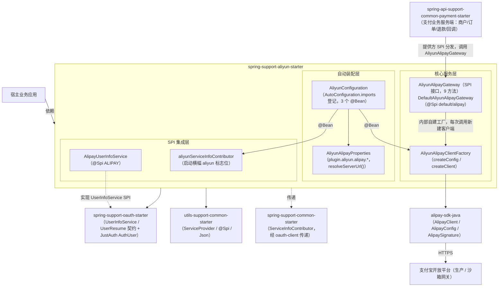

# spring-support-aliyun-starter

支付宝开放平台集成 Starter：把「电脑网站 / 手机网站 / APP 下单、查单、关单、退款、退款查询、单笔转账、异步通知验签」收敛为一个 `AliyunAlipayGateway` SPI，并把支付宝登录注册为 oauth-client 的 `UserInfoService` 实现（`@Spi("ALIPAY")`）。在 spring-support 体系中，它是 `spring-api-support-common-payment-starter` 支付业务的底层网关提供方，与 `spring-support-tencent-starter`（微信侧）同构平行；**只做支付宝**，不含阿里云 OSS / SMS 等其它产品（类名与构件名里的 `Aliyun` 是历史命名）。

- Maven 坐标：`com.chua:spring-support-aliyun-starter:4.0.0.51`
- 配置前缀：`plugin.aliyun.alipay`（配置类 `AliyunAlipayProperties`）
- 自动装配入口：`META-INF/spring/org.springframework.boot.autoconfigure.AutoConfiguration.imports` → `AliyunConfiguration`（**本模块无 `spring.factories`**）
- 总开关：`plugin.aliyun.alipay.enabled`，默认 `false`，仅控制 `AlipayClient` Bean；网关 SPI 不受它限制

## 1. 架构图



- 与 `spring-support-tencent-starter` 互不依赖、可只引其一；`spring-api-support-common-payment-starter` 不直接实现支付宝协议，经 SPI 把网关调用分发到本模块。
- 模块内依赖方向：自动装配 → 配置/工厂 → 网关 SPI；网关与登录实现走自研 SPI（`ServiceProvider` + `@Spi`），不是 Spring Bean。

## 2. 核心流程图

以最能代表本模块的**支付下单流程**（`pagePay`）为例；退款、查单、转账为同一「配置 + DTO」管线。

```mermaid
flowchart TD
    BIZ["业务代码"] --> GET["ServiceProvider.of(AliyunAlipayGateway.class).getExtension(\"alipay\")"]
    GET --> CALL["gateway.pagePay(properties, request)"]
    CALL --> BIZC["buildPayBizContent：out_trade_no / total_amount（2 位 HALF_UP）/<br/>subject / body / product_code / buyer_id（payerOpenId 非空才带）"]
    BIZC --> JSON["Json.toJson(bizContent) 作为 biz_content"]
    JSON --> CLIENT["client(properties)：clientFactory.createClient(properties)<br/>→ 每次调用新建 DefaultAlipayClient(AlipayConfig)"]
    CLIENT --> REQ["AlipayTradePagePayRequest：setNotifyUrl / setReturnUrl（均取请求级字段）/ setBizContent"]
    REQ --> EXEC["client.pageExecute(request) → AlipayTradePagePayResponse"]
    EXEC --> WRAP["AliyunAlipayPayResponse(success=body 非空, body=表单 HTML,<br/>tradeNo, message=firstNonBlank(subMsg,msg), rawResponse)"]
    EXEC -->|"AlipayApiException"| ERR["throw IllegalStateException(发起支付宝电脑网站支付失败)"]
```

异步通知验签走 `verifyAndParsePayNotify`：`AlipaySignature.rsaCheckV1(params, alipayPublicKey, charset, signType)`，`charset` / `sign_type` 先取通知参数、再退回配置默认值；验签失败**抛 `IllegalStateException`**。

## 3. 能力清单

| 能力域 | 关键类 | 入口/触发方式 |
|---|---|---|
| 自动装配 | `AliyunConfiguration` | `META-INF/spring/...AutoConfiguration.imports` |
| 配置绑定 | `AliyunAlipayProperties`（前缀 `plugin.aliyun.alipay`） | `@EnableConfigurationProperties` |
| 客户端工厂 | `AliyunAlipayClientFactory#createClient` / `#createConfig` | `@Bean aliyunAlipayClientFactory`；默认网关内部自建、不消费该 Bean |
| 支付网关 SPI | `AliyunAlipayGateway`（9 个方法） | `ServiceProvider.of(AliyunAlipayGateway.class).getExtension("alipay")` |
| 电脑网站支付 | `pagePay` → `alipay.trade.page.pay` | 返回表单 HTML（在 `body`） |
| 手机网站支付 | `wapPay` → `alipay.trade.wap.pay` | 返回表单 HTML（在 `body`） |
| APP 支付 | `appPay` → `alipay.trade.app.pay`（`sdkExecute`，不设 returnUrl） | 返回 orderString（在 `body`） |
| 交易查询 / 关闭 | `queryOrder` / `closeOrder` → `alipay.trade.query` / `alipay.trade.close` | `closeOrder` 返回 `boolean` |
| 退款 / 退款查询 | `refund` / `queryRefund` → `alipay.trade.refund` / `alipay.trade.fastpay.refund.query` | 金额按 2 位 `HALF_UP` 序列化 |
| 单笔转账 | `transfer` → `alipay.fund.trans.uni.transfer`（`TRANS_ACCOUNT_NO_PWD` / `DIRECT_TRANSFER`，收款方 `ALIPAY_LOGON_ID`） | 无转账查单 / 撤销接口 |
| 通知验签 | `verifyAndParsePayNotify` → `AlipaySignature.rsaCheckV1` | 失败抛 `IllegalStateException`，不返回 null |
| 通知 DTO | `AliyunAlipayNotifyRequest`（构造器防御性拷贝为不可变 Map）、`AliyunAlipayPayNotifyPayload` | 验签入参 / 出参 |
| 登录集成 | `AlipayUserInfoService`（`@Spi("ALIPAY")`，实现 `UserInfoService`） | `META-INF/extensions/...UserInfoService` 登记 |
| 服务信息 | `aliyunServiceInfoContributor` | 启动信息横幅 `aliyun` 标志位 |

合计 15 个源码类：1 装配 + 1 配置 + 1 工厂 + 1 网关接口 + 1 默认实现 + 1 登录实现 + 9 个 DTO（全为 `record`）。

`AliyunAlipayGateway` 方法约定：所有方法第一个参数都是 `AliyunAlipayProperties`，网关无状态、不持有配置；`notifyUrl` / `returnUrl` 只认 `AliyunAlipayPayRequest` 的请求级字段；`AliyunAlipayPayResponse` 组件固定为 `success` / `body` / `tradeNo` / `message` / `rawResponse`，调用 SDK 前先判 `success`。

## 4. Bean 能力矩阵

本模块只注册 **3 个 Spring Bean**（均出自 `AliyunConfiguration`）；支付网关与登录实现走 SPI，不是 Bean。

| Bean 名 | 类型 | 装配条件（含默认值） | 可否覆盖 | 典型用途 |
|---|---|---|---|---|
| `aliyunAlipayClientFactory` | `AliyunAlipayClientFactory` | `@Bean` + `@ConditionalOnMissingBean`，无其它条件，始终注册 | 可：声明同类型 Bean 即让位 | 宿主复用「properties → AlipayConfig → AlipayClient」逻辑；默认网关不用它 |
| `alipayClient` | `AlipayClient`（实际 `DefaultAlipayClient`） | `@Bean` + `@ConditionalOnProperty(prefix="plugin.aliyun.alipay", name="enabled", havingValue="true")`，默认 `enabled=false` 时不注册；**无 `@ConditionalOnMissingBean`** | 可自定义，但 `enabled=true` 时本 Bean 仍注册，同类型**并存**而非让位 | `@Autowired AlipayClient` 自行调用 SDK；多实现时需 `@Primary` / `@Qualifier` 消歧 |
| `aliyunServiceInfoContributor` | `ServiceInfoContributor`（lambda，登记 `aliyun` 标志位） | `@Bean`，无条件创建 | 可：同名 Bean 覆盖即可 | 启动信息横幅内部消费 |

补充：

- `AliyunConfiguration` 类上只有 `@Slf4j` 与 `@EnableConfigurationProperties`，未标 `@AutoConfiguration` / `@Configuration`；因登记在 `AutoConfiguration.imports` 中仍被 Boot 当自动配置类加载，`@Bean` 方法正常生效。
- `AliyunAlipayProperties` 由 `@EnableConfigurationProperties` 绑定，可直接 `@Autowired` 注入。
- `DefaultAliyunAlipayGateway` 未做文件登记，由 `ServiceProvider` 的 `SamePackageServiceResolver` 按接口同包/子包扫描 `@Spi({"default","alipay"})` 发现；`AlipayUserInfoService` 则经 `META-INF/extensions` 文件登记。两者都不能 `@Autowired`。

## 5. 完整配置

配置类 `AliyunAlipayProperties`，前缀 `plugin.aliyun.alipay`（`ignoreInvalidFields = true`）。逐字段来自源码，无嵌套类：

| 配置路径 | 类型 | 默认值 | 说明 |
|---|---|---|---|
| `plugin.aliyun.alipay.enabled` | `boolean` | `false` | **唯一生效的总开关**：为 `true` 才注册 `alipayClient` Bean；网关 SPI 不受它限制 |
| `plugin.aliyun.alipay.enable` | `boolean` | `false` | 历史兼容字段，**无任何代码读取，配置不生效** |
| `plugin.aliyun.alipay.sandbox` | `boolean` | `false` | `true` 且未配 `server-url` 时用沙箱网关 `https://openapi-sandbox.dl.alipaydev.com/gateway.do` |
| `plugin.aliyun.alipay.server-url` | `String` | 空 | 显式网关地址，优先级高于 `sandbox`；为空时按 `sandbox` 取生产 `https://openapi.alipay.com/gateway.do` 或沙箱地址（`resolveServerUrl()`） |
| `plugin.aliyun.alipay.app-id` | `String` | 空 | 支付宝应用 APPID |
| `plugin.aliyun.alipay.private-key` | `String` | 空 | 应用私钥 |
| `plugin.aliyun.alipay.alipay-public-key` | `String` | 空 | 支付宝公钥，响应验签与异步通知验签（`AlipaySignature.rsaCheckV1`）共用 |
| `plugin.aliyun.alipay.notify-url` | `String` | 空 | **声明项：网关不读取**，实际通知地址以 `AliyunAlipayPayRequest.notifyUrl` 请求级字段为准 |
| `plugin.aliyun.alipay.return-url` | `String` | 空 | **声明项：网关不读取**，以请求级 `returnUrl` 为准 |
| `plugin.aliyun.alipay.format` | `String` | `json` | 报文格式，写入 `AlipayConfig` |
| `plugin.aliyun.alipay.charset` | `String` | `UTF-8` | 字符集；通知验签 `charset` 兜底值 |
| `plugin.aliyun.alipay.sign-type` | `String` | `RSA2` | 签名类型；通知验签 `sign_type` 兜底值 |
| `plugin.aliyun.alipay.connect-timeout` | `Integer` | `10000` | 连接超时（毫秒），`null` 时不设置 |
| `plugin.aliyun.alipay.read-timeout` | `Integer` | `30000` | 读超时（毫秒），`null` 时不设置 |
| `plugin.aliyun.alipay.max-idle-connections` | `Integer` | `5` | 连接池最大空闲连接数，`null` 时不设置 |
| `plugin.aliyun.alipay.keep-alive-duration` | `Long` | `300000` | 连接保活时长（毫秒），`null` 时不设置 |

配置有两条消费路径：① `enabled=true` 时装配 `alipayClient` Bean，除 `enabled` / `enable` / `sandbox` / `notify-url` / `return-url` 外的字段经 `AliyunAlipayClientFactory#createConfig` 写入 `AlipayConfig`（`server-url` 先走 `resolveServerUrl()` 做沙箱/生产兜底）；② 网关 SPI 每次调用（不受 `enabled` 影响）同样经工厂按当前 `properties` 新建客户端，因此 `enabled=false` 时改配置对网关调用依然有效。

```yaml
plugin:
  aliyun:
    alipay:
      enabled: true          # 总开关：注册 AlipayClient Bean
      sandbox: true          # 沙箱联调；生产改 false 或配 server-url
      app-id: 2021000000000000
      private-key: ${ALIPAY_PRIVATE_KEY}
      alipay-public-key: ${ALIPAY_PUBLIC_KEY}
      # server-url: https://openapi.alipay.com/gateway.do   # 显式网关，优先于 sandbox
      # notify-url / return-url 为声明项，请改用请求级字段
```

### 5.1 逐项配置示例（按功能分组）

每组给出「字段说明 + 默认值」与对应 YAML 片段；所有键均可省略，省略即取默认值。

**① 开关与环境**

| 配置项 | 说明 | 默认值 |
|---|---|---|
| `enabled` | 总开关：`true` 才注册 `AlipayClient` Bean；网关 SPI 不受它限制 | `false` |
| `enable` | 历史兼容字段，无任何代码读取，**配置不生效** | `false` |
| `sandbox` | 沙箱联调开关；仅当 `server-url` 为空时决定生产/沙箱网关 | `false` |
| `server-url` | 显式网关地址，优先级高于 `sandbox`；为空时按 `sandbox` 兜底 | 空（生产网关） |

```yaml
plugin:
  aliyun:
    alipay:
      enabled: true        # 总开关（默认 false）
      # enable: false      # 死配置，写了也不生效
      sandbox: true        # 沙箱联调；生产改 false
      # server-url: https://openapi.alipay.com/gateway.do   # 显式网关，优先于 sandbox
```

**② 应用与密钥**

| 配置项 | 说明 | 默认值 |
|---|---|---|
| `app-id` | 支付宝开放平台应用 APPID | 空 |
| `private-key` | 应用私钥（请求签名用） | 空 |
| `alipay-public-key` | 支付宝公钥（响应验签 + 异步通知验签共用） | 空 |

```yaml
plugin:
  aliyun:
    alipay:
      app-id: your-app-id
      private-key: ${ALIPAY_PRIVATE_KEY}
      alipay-public-key: ${ALIPAY_PUBLIC_KEY}
```

**③ 回调地址（声明项）**

| 配置项 | 说明 | 默认值 |
|---|---|---|
| `notify-url` | **声明项，网关不读取**：实际通知地址以 `AliyunAlipayPayRequest.notifyUrl` 请求级字段为准 | 空 |
| `return-url` | **声明项，网关不读取**：实际跳转地址以请求级 `returnUrl` 为准（App 支付不设 returnUrl） | 空 |

```yaml
plugin:
  aliyun:
    alipay:
      # 两项仅作声明，发单时请传请求级字段
      # notify-url: https://example.com/pay/notify
      # return-url: https://example.com/pay/return
```

**④ 报文与签名**

| 配置项 | 说明 | 默认值 |
|---|---|---|
| `format` | 报文格式，写入 `AlipayConfig` | `json` |
| `charset` | 字符集；异步通知验签 `charset` 的兜底值（优先级：通知参数 &gt; 配置 &gt; UTF-8） | `UTF-8` |
| `sign-type` | 签名类型；异步通知验签 `sign_type` 的兜底值（优先级：通知参数 &gt; 配置 &gt; RSA2） | `RSA2` |

```yaml
plugin:
  aliyun:
    alipay:
      format: json
      charset: UTF-8
      sign-type: RSA2
```

**⑤ 连接池与超时**

均为「非 `null` 才写入 `AlipayConfig`」；配置为 `null` 时不设置，回落支付宝 SDK 默认值。

| 配置项 | 说明 | 默认值 |
|---|---|---|
| `connect-timeout` | 连接超时（毫秒） | `10000` |
| `read-timeout` | 读超时（毫秒） | `30000` |
| `max-idle-connections` | 连接池最大空闲连接数 | `5` |
| `keep-alive-duration` | 连接保活时长（毫秒） | `300000` |

```yaml
plugin:
  aliyun:
    alipay:
      connect-timeout: 10000
      read-timeout: 30000
      max-idle-connections: 5
      keep-alive-duration: 300000
```

### 5.2 完整 YAML 使用示例

生产环境建议密钥走环境变量或配置中心，不要把明文私钥提交进仓库：

```yaml
plugin:
  aliyun:
    alipay:
      enabled: true                                     # 注册 AlipayClient Bean（网关 SPI 不依赖它）
      sandbox: false                                    # 生产环境；联调改 true
      server-url: https://openapi.alipay.com/gateway.do # 也可省略，按 sandbox 自动选择
      app-id: ${ALIPAY_APP_ID}
      private-key: ${ALIPAY_PRIVATE_KEY}                # 应用私钥，务必走环境变量/配置中心
      alipay-public-key: ${ALIPAY_PUBLIC_KEY}           # 支付宝公钥（不是应用公钥）
      format: json
      charset: UTF-8
      sign-type: RSA2
      connect-timeout: 10000
      read-timeout: 30000
      max-idle-connections: 5
      keep-alive-duration: 300000
      # notify-url / return-url 为声明项，网关不读取；发单时传请求级字段
```

配套 Java 用法（网关是 SPI，不是 Spring Bean）：

```java
AliyunAlipayGateway gateway =
        ServiceProvider.of(AliyunAlipayGateway.class).getExtension("alipay");

AliyunAlipayPayResponse resp = gateway.pagePay(properties,
        new AliyunAlipayPayRequest(outTradeNo, amount, subject, null,
                "https://example.com/pay/notify",   // 请求级 notify_url（生效）
                "https://example.com/pay/return",   // 请求级 return_url（生效）
                "FAST_INSTANT_TRADE_PAY", null));
```

### 5.3 生产注意事项

- **密钥安全**：`private-key` 是应用私钥，务必经环境变量 / 配置中心注入，禁止明文提交到代码仓库；`alipay-public-key` 填**支付宝公钥**（不是自己的应用公钥），否则验签必然失败。
- **沙箱 → 生产**：上线前把 `sandbox` 改为 `false`（或显式配置生产 `server-url`）；沙箱与生产的 APPID、密钥、网关互不通用。
- **开关语义**：`enabled` 只控制 `AlipayClient` Bean 的装配；网关 SPI（`getExtension("alipay")`）不受它限制，`enabled=false` 时网关调用依然可用。`enable`（不带 d）是死配置。
- **回调地址**：`notify-url` / `return-url` 配置项是声明项，网关只认 `AliyunAlipayPayRequest` 的请求级字段；异步通知端点需业务自建，验签失败会抛 `IllegalStateException`，需按支付宝要求返回 `failure`。
- **连接复用**：默认网关每次调用新建 `AlipayClient`，`connect-timeout` / `read-timeout` / 连接池参数作用于每次新建的客户端；高并发下需要连接复用时，按第 8 节自定义网关实现并登记 `@Spi("custom")`。
- **超时兜底**：四个连接/超时字段配成 `null` 时不写入 `AlipayConfig`，回落支付宝 SDK 默认值。
- **金额精度**：下单 / 退款 / 转账金额由网关按 `BigDecimal` 2 位小数 `HALF_UP` 序列化，业务侧无需自行格式化。

## 6. 使用方式

```xml
<dependency>
    <groupId>com.chua</groupId>
    <artifactId>spring-support-aliyun-starter</artifactId>
    <version>4.0.0.51</version>
</dependency>
```

依赖说明（pom 中**没有 optional 依赖**，以下全部随 Maven 传递引入，宿主无需额外声明）：

| 依赖 | 作用 | 缺失后果 |
|---|---|---|
| `com.alipay.sdk:alipay-sdk-java` | 支付宝官方 SDK（版本由父 pom `alipay.sdk.version`=4.40.1067.ALL 管理） | 排除后编译可过，首次装配/调用抛 `NoClassDefFoundError` 或 `IllegalStateException("创建支付宝客户端失败")` |
| `com.chua:spring-support-oauth-starter` | `UserInfoService` 等登录契约 + JustAuth `AuthUser` | 源码直接 import，排除则**编译失败** |
| `com.chua:utils-support-common-starter` | `ServiceProvider` SPI 注册表、`@Spi`、`Json` 门面 | 源码直接 import，排除则**编译失败** |
| `com.chua:spring-support-common-starter` | `ServiceInfoContributor`（服务横幅） | 经 oauth-client 传递；缺失仅横幅功能受损 |
| `spring-boot-autoconfigure` / `jackson-databind` / `slf4j-api` | 条件装配 / JSON 基础设施 / 日志 | Starter 生态必备，正常都在 |
| `org.projectlombok:lombok` | `@Data`（配置类） | `provided`，仅编译期；运行期不需要 |

最小启用示例（网关按扩展名取用，**不是 Spring Bean**）：

```yaml
plugin:
  aliyun:
    alipay:
      enabled: true      # 只影响 AlipayClient Bean；网关 SPI 不需要它
      sandbox: true
      app-id: 2021000000000000
      private-key: ${ALIPAY_PRIVATE_KEY}
      alipay-public-key: ${ALIPAY_PUBLIC_KEY}
```

```java
AliyunAlipayGateway gateway =
        ServiceProvider.of(AliyunAlipayGateway.class).getExtension("alipay");

// 电脑网站支付：resp.body() 即可直接写回浏览器的表单 HTML
AliyunAlipayPayResponse resp = gateway.pagePay(properties,
        new AliyunAlipayPayRequest(orderNo, amount, "订单 " + orderNo, null,
                "https://example.com/pay/notify",   // 请求级 notify_url
                "https://example.com/pay/return",   // 请求级 return_url
                "FAST_INSTANT_TRADE_PAY", null));   // productCode, payerOpenId

// 异步通知：params 来自 request.getParameterMap()，验签失败抛 IllegalStateException
AliyunAlipayPayNotifyPayload payload =
        gateway.verifyAndParsePayNotify(properties, new AliyunAlipayNotifyRequest(params));

// 其它：queryOrder / closeOrder / refund / queryRefund / transfer / wapPay / appPay 同理
```

需要把网关注入成 Bean 时自己包一层：`@Bean public AliyunAlipayGateway alipayGateway() { return ServiceProvider.of(AliyunAlipayGateway.class).getExtension("alipay"); }`。模块**无建表脚本、无 Controller、无定时任务**，不需要数据库。

## 7. 使用场景

**适用：**

- Spring Boot 应用需要支付宝**收单**能力：电脑网站 / 手机网站 / APP 下单、查单、关单、退款、退款查询。
- 需要单笔转账到支付宝账户（`alipay.fund.trans.uni.transfer`）。
- 已有 oauth-client 登录体系，想接入**支付宝登录**（`@Spi("ALIPAY")` 自动被发现）。
- 只要「薄网关」：不要订单表、对账任务、回调端点等重资产，业务侧自己掌控状态机。

**不适用 / 慎用：**

- 需要阿里云 **OSS / SMS / 其它阿里云产品**：本模块不含，需另接官方 SDK。
- 需要开箱即用的**支付业务**（商户管理、订单表、钱包、对账、运营台、回调端点）：用 `spring-api-support-common-payment-starter`。
- 需要转账**结果查询 / 撤销**，或高并发下对连接复用敏感（默认网关每次调用新建 `AlipayClient`）：需自行扩展实现。

**与相邻模块的取舍：** vs `spring-api-support-common-payment-starter`——它是支付**业务服务端**，经提供方 SPI 把网关调用分发到本模块；只要「能调支付宝 API」引本模块，要「完整支付业务与资金流程」引 payment-starter。vs `spring-support-tencent-starter`——同构平行（微信版），互不依赖、可并存；支付宝选本模块，微信选 tencent-starter。上游为 `spring-support-oauth-starter` 与 `utils-support-common-starter`；本模块自身无表、无 Mapper，pom 未直接声明持久层依赖（持久层/缓存/文档等 starter 由 `oauth-client` 传递引入，不属于本模块业务）。

## 8. 扩展点

本模块的扩展机制是**自研 SPI**（`ServiceProvider` + `META-INF/extensions` 目录，非 JDK `ServiceLoader` 的 `META-INF/services`），外加标准 Spring Bean 覆盖：

| 扩展点 | 方式 | 生效条件 |
|---|---|---|
| 替换 / 新增支付网关实现 | 实现 `AliyunAlipayGateway` 9 个方法，类上标 `@Spi("custom")`；跨包实现需在 `META-INF/extensions/com.chua.starter.aliyun.support.payment.AliyunAlipayGateway` 登记实现类全名（一行一个） | 调用方改用 `getExtension("custom")`；`@Spi` 值重复登记会覆盖，登记后不再命中 `default` |
| 新增登录类型 | 实现 `com.chua.starter.oauth.client.support.user.UserInfoService`，标 `@Spi("<登录类型>")` 并登记到对应 extensions 文件 | oauth-client 侧按扩展名取用；本模块已登记 `ALIPAY` |
| 自定义客户端工厂 | 声明同类型 `AliyunAlipayClientFactory` Bean（`@ConditionalOnMissingBean` 自动让位） | 注意：`DefaultAliyunAlipayGateway` 内部自建工厂、不消费容器里的工厂 Bean；要影响网关行为需替换网关实现 |
| 自定义 `AlipayClient` | `enabled=true` 时宿主可自行声明 `AlipayClient` Bean | 本模块 `alipayClient` **无** `@ConditionalOnMissingBean`，会与之并存，按类型注入需 `@Primary` / `@Qualifier` |
| 网关方法级定制 | 实现 9 个方法，不支持的直接 `throw new UnsupportedOperationException(...)` | 同 SPI 登记 |

SPI 扩展示例：

```java
@Spi("custom")
public class CustomAliyunAlipayGateway implements AliyunAlipayGateway {
    @Override
    public AliyunAlipayPayResponse pagePay(AliyunAlipayProperties properties,
                                           AliyunAlipayPayRequest request) {
        // 自定义实现（例如复用缓存的 AlipayClient）
        throw new UnsupportedOperationException("自定义网关暂不支持 pagePay");
    }
    // 其余 8 个方法同理
}
```

## 9. 常见问题

**Q1：引入依赖后没有 `AlipayClient` Bean（装配不生效）？**
`plugin.aliyun.alipay.enabled` 默认 `false`，必须显式设为 `true`；注意 `enable`（不带 d）是死配置，写了也不会装配任何东西。本模块走 `AutoConfiguration.imports` 机制（**无 `spring.factories`**），Boot 4 已不读取后者，若自行降级引导需确认 imports 文件在 classpath。另外网关 SPI（`getExtension("alipay")`）**不受 `enabled` 控制**，`enabled=false` 时照样能发请求，只是容器里没有 `AlipayClient` 可注入。

**Q2：`AliyunAlipayGateway` 能 `@Autowired` 吗？**
不能。它由 `ServiceProvider` SPI 注册表管理，不是 Spring Bean。要么自己包一层 `@Bean`，要么构造时取一次复用（网关无状态）。`AlipayUserInfoService` 同理，由 oauth-client 侧按 SPI 发现。

**Q3：配置里的 `notify-url` / `return-url` 为什么不生效？验签失败返回什么？**
`DefaultAliyunAlipayGateway` 只读 `AliyunAlipayPayRequest` 的请求级字段，配置项是声明性质的；通知端点也要业务自建（本模块无 Controller）。验签失败**抛 `IllegalStateException`**（参数为空 / 验签失败 / 验签异常三种消息），不返回 null——接口注释里「验签失败返回 null」的描述已过时。调用方必须 `try/catch` 并按支付宝要求返回 `failure`，否则支付宝会重试通知。

**Q4：宿主已有 `AlipayClient` Bean 会冲突吗？与 Spring Boot 4 兼容性如何？**
本模块 `alipayClient` 只有 `@ConditionalOnProperty`，**没有** `@ConditionalOnMissingBean`，`enabled=true` 时会与宿主 Bean **并存**，按类型注入报 `NoUniqueBeanDefinitionException`，需 `@Primary` / `@Qualifier` 消歧，或保持 `enabled=false` 只走网关 SPI。Boot 兼容：仓库基线 Spring Boot 4.1.2，本模块用 Boot 2.7+ 的 imports 机制注册，无 Controller / 定时任务 / 表迁移，宿主副作用仅限 3 个 Bean 与 SPI 登记；`alipay-sdk-java` 与 Boot 无直接耦合，升级 Boot 无需额外适配。高并发提示：默认网关每次调用新建 `AlipayClient`，需要池化时按第 8 节实现自己的网关并登记为 `@Spi("custom")`。
