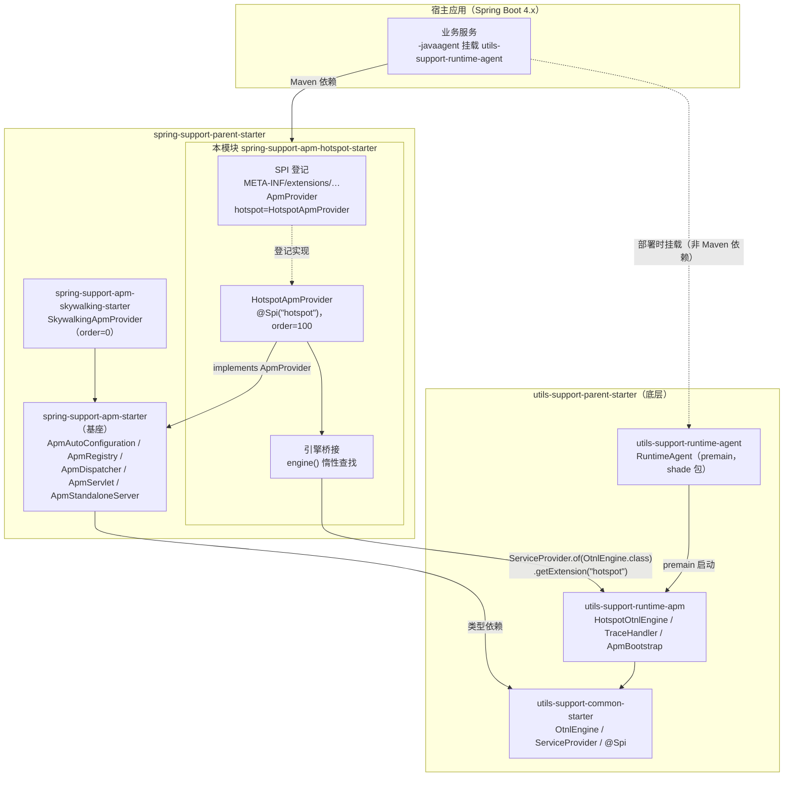
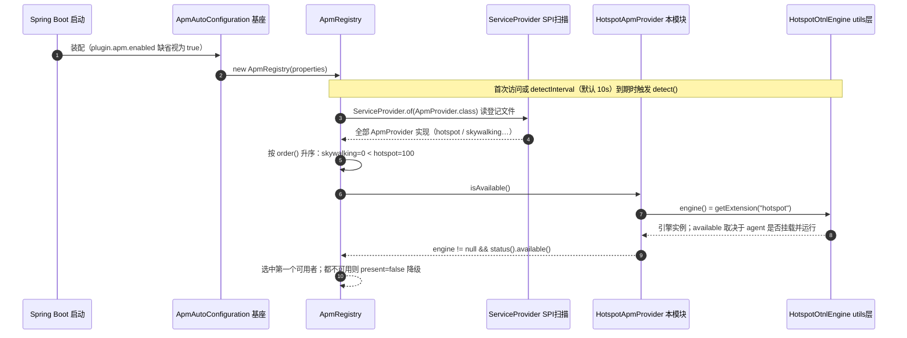

# spring-support-apm-hotspot-starter

`spring-support-apm-starter` 的「自研 hotspot agent」扩展模块：实现 `ApmProvider` SPI（名称 `hotspot`，`order=100`），把 `utils-support-runtime-apm` 提供的 `HotspotOtnlEngine` 桥接给上层统一路由。在 spring-support 体系中，它是 APM 家族里**零外部依赖的兜底实现**——数据全部来自进程内字节码插桩产生的 Span，不接任何外部后端、不建表、不注册 Spring Bean；基座模块负责自动装配与统一 REST 接口，本模块只负责「被探测、被选中、交出引擎」。

## 1. 架构图



说明：本模块**没有自动装配层**——`META-INF` 下只有 SPI 登记文件，无 `spring.factories`、无 `META-INF/spring/*.imports`。自动装配发生在基座模块的 `ApmAutoConfiguration`；本模块经 `ApmRegistry` 的 SPI 扫描被发现，模块内部分层是「SPI 登记 → Provider 适配 → 引擎桥接」。

## 2. 核心流程图

选「装配与探测流程」：本模块的全部价值在于启动后被 `ApmRegistry` 探测并选中。



## 3. 能力清单

| 能力域 | 关键类 | 入口/触发方式 |
| --- | --- | --- |
| APM 提供者适配（SPI） | `HotspotApmProvider`（`@Spi("hotspot")`） | `META-INF/extensions/com.chua.starter.apm.support.spi.ApmProvider` |
| 引擎桥接（惰性查找） | `HotspotApmProvider#engine()` | `ServiceProvider.of(OtnlEngine.class).getExtension("hotspot")`，失败记 debug 日志并返回 null |
| 优先级声明 | `HotspotApmProvider#order()` = `100` | `ApmRegistry` 探测时按 order 升序；SkyWalking 为 `0` |
| 可用性判定 | 继承 `ApmProvider#isAvailable()` | `engine() != null && engine.status().available()` |
| 状态上报 / 运行模式 | 继承 `ApmProvider#status()` / `#mode()` | `GET {plugin.apm.path}/status`；可用时 mode=`agent` |
| 服务目录 / 实例 / 端点 / 链路 / 健康度 | `HotspotOtnlEngine#services/instances/endpoints/traces/health` | `GET {path}/services`、`/instances`、`/endpoints`、`/traces`、`/overview` |
| 能力清单 | `HotspotOtnlEngine#capabilities()` | `GET {path}/capabilities`，仅 4 项：`services`/`instances`/`endpoints`/`traces` |
| 采集数据面 | `TraceHandler`（utils 层） | agent `premain` 中由 `ApmBootstrap` 启动，字节码插桩产生 Span |
| agent 入口（间接） | `RuntimeAgent#premain` / `#agentmain` | `utils-support-runtime-agent` 的 `Premain-Class` / `Agent-Class` |

## 4. Bean 能力矩阵

**本模块不注册任何 Spring Bean**：模块内没有 `@Configuration` / `@AutoConfiguration`，`META-INF` 下没有 `spring.factories` 与 `META-INF/spring/org.springframework.boot.autoconfigure.AutoConfiguration.imports`。`HotspotApmProvider` 由 utils 层 `ServiceProvider` 按 SPI 登记文件实例化，不进入 Spring 容器——因此也没有「可覆盖 Bean」一说。

引入本模块后实际生效的 Bean 来自基座 `spring-support-apm-starter` 的 `ApmAutoConfiguration`（随传递依赖自动带入宿主）：

| Bean 名 | 类型 | 装配条件（含默认值） | 可否覆盖 | 典型用途 |
| --- | --- | --- | --- | --- |
| `apmRegistry` | `ApmRegistry` | 类级 `@ConditionalOnProperty(prefix="plugin.apm", name="enabled", havingValue="true", matchIfMissing=true)` + `@ConditionalOnMissingBean`；`destroyMethod="close"` | 可 | 探测/选择引擎，`describe()` 供 `/status` |
| `apmRuntimeConfig` | `ApmRuntimeConfig` | 同类级条件 + `@ConditionalOnMissingBean`；装配时 `restore()` 回放落盘设置 | 可 | `/config` 读写入口 |
| `apmDispatcher` | `ApmDispatcher` | 同类级条件 + `@ConditionalOnMissingBean`；可选注入 `ApmOperLogSink` | 可 | 统一路由 `dispatch(ApmRequest)` |
| `apmServletRegistration` | `ServletRegistrationBean<ApmServlet>` | `@ConditionalOnClass(name="jakarta.servlet.Servlet")` + `@ConditionalOnProperty(..., name="mode", havingValue="embedded", matchIfMissing=true)`；无 `@ConditionalOnMissingBean` | 否（与 standalone 二选一） | 以 `plugin.apm.path + "/*"` 注册 Servlet |
| `apmStandaloneServer` | `ApmStandaloneServer` | `@ConditionalOnProperty(..., name="mode", havingValue="standalone")` + `@ConditionalOnMissingBean`；`destroyMethod="stop"` | 可 | standalone 模式自起 HTTP 服务 |
| `apmServiceInfoContributor` | `ServiceInfoContributor` | `@ConditionalOnMissingBean(name="apmServiceInfoContributor")` + `@ConditionalOnProperty(..., name="register-service-info", havingValue="true", matchIfMissing=true)` | 可 | 向服务信息面板登记 APM 状态 |

## 5. 完整配置

本模块**没有 `@ConfigurationProperties`**，不读取任何配置键；它响应基座 `ApmProperties`（前缀 `plugin.apm`）。逐字段如下：

| 配置路径 | 类型 | 默认值 | 说明 |
| --- | --- | --- | --- |
| `plugin.apm.enabled` | `boolean` | `true` | 是否启用 APM 模块；`false` 时 `describe()` 直接降级 |
| `plugin.apm.type` | `String` | `""`（空） | 引擎类型（`skywalking`/`hotspot`…），留空按 order 自动探测 |
| `plugin.apm.mode` | `String` | `embedded` | `embedded`（随宿主 Servlet 容器）/ `standalone`（独立 HTTP 服务） |
| `plugin.apm.path` | `String` | `/api/apm/v1` | 统一 REST 前缀（嵌入=Servlet 映射，独立=Server 路由） |
| `plugin.apm.host` | `String` | `0.0.0.0` | standalone 监听地址 |
| `plugin.apm.port` | `int` | `12801` | standalone 监听端口 |
| `plugin.apm.server-type` | `String` | `jdk` | standalone 底层 Server SPI 类型 |
| `plugin.apm.detect-interval` | `long` | `10000` | 探测结果缓存毫秒数 |
| `plugin.apm.settings-file` | `String` | `config/apm-settings.properties` | 运行期可改配置落盘文件 |
| `plugin.apm.register-service-info` | `boolean` | `true` | 是否登记到服务信息面板 |

agent 侧参数（utils 层读取，决定本引擎有无数据；本模块不读取这些键，仅经 `TraceHandler` / `ApmBootstrap` 间接受影响）：

| key | 默认值 | 说明 |
| --- | --- | --- |
| `trace.enabled` | `true` | `TraceHandler` 是否启用 |
| `apm.storage.type` | `inmemory` | 存储实现：`noop`/`inmemory`/`sqlite`/`jdbc`/`otlp` |
| `apm.storage.retention.ms` | `604800000`（7 天） | 数据保留时长 |
| `apm.storage.capacity` | `100000` | 存储容量上限 |

注意区分：`TraceHandler` 进程内 Span 列表另有硬上限 `MAX_SPANS = 10000`（超出按插入顺序淘汰最旧），与 `apm.storage.capacity` 是两回事。

**运行期可改项：无。** `HotspotApmProvider` 未覆盖 `runtimeSettings()` / `applyRuntimeSettings(Map)`（保持默认空表/空实现），`POST /config` 携带引擎级键会被 `ApmRuntimeConfig` 拒绝；`mode`/`path`/`port` 属重启项，同样不可热改。

## 6. 使用方式

Maven 坐标：

```xml
<dependency>
    <groupId>com.chua</groupId>
    <artifactId>spring-support-apm-hotspot-starter</artifactId>
    <version>4.0.0.51</version>
</dependency>
```

最小启用示例：

1. 加依赖（如上，会传递引入 `spring-support-apm-starter` 与 `utils-support-runtime-apm`）。
2. 以 `-javaagent` 挂载 agent（不挂则本实现在注册表里永远 `available=false`）：

```bash
java -javaagent:/path/to/utils-support-runtime-agent.jar -jar your-app.jar
```

3. 启动后验证：

```bash
curl http://127.0.0.1:8080/api/apm/v1/status
# 选中本引擎时：name=hotspot, mode=agent,
# capabilities=[services, instances, endpoints, traces]
```

可选依赖说明（本模块无 `optional` 依赖，下列 Maven 依赖均随坐标传递进宿主）：

| 依赖 | 作用域 | 缺失影响 |
| --- | --- | --- |
| `spring-support-apm-starter` | 编译（传递） | 必然存在；若强行排除则缺 `ApmProvider` 契约与全部装配，模块无法工作 |
| `utils-support-runtime-apm` | 编译（传递） | 必然存在；若缺失则 `engine()` 查不到引擎返回 null，`available=false` |
| `utils-support-common-starter` | 编译（传递） | 必然存在；`OtnlEngine`/`ServiceProvider`/`@Spi` 契约所在 |
| `lombok` | `provided` | 仅编译期需要，运行期无影响 |
| `utils-support-runtime-agent` | **非 Maven 依赖（部署件）** | 不以 `-javaagent` 挂载则永远 `available=false`，接口返回降级信息 |

## 7. 使用场景

**适用**：

- 单机/单进程 Java 服务的快速可观测：不部署 SkyWalking OAP、ES 等外部后端，挂一个 agent jar 即可查看服务、端点、链路。
- 开发/测试环境兜底：`order=100` 让「没装商业 APM」的服务也有基础观测页。
- 排查单进程内「哪些端点慢、哪些方法报错」：内存 Span 聚合出调用数、平均/分位耗时、错误率。

**不适用/慎用**：

- 分布式链路追踪：`services()` 固定返回当前进程 1 个服务，无法把多台机器的调用串起来（topology 能力未声明）。
- 长期留存与指标/告警/日志/剖析：Span 在内存上限 10000、进程重启即清空；`metrics`/`alarms`/`logs`/`profiles` 等能力未声明，请求会得到「引擎 hotspot 不支持 xxx」的失败结果。

**与相邻模块的取舍**：

| 相邻模块 | 取舍 |
| --- | --- |
| `spring-support-apm-starter` | 必装基座：装配、注册表、统一接口都在它那里；本模块只往 SPI 里贡献一个 `hotspot` 实现。只装基座不装任何 provider 时，接口可用但 `present=false`。 |
| `spring-support-apm-skywalking-starter` | 同为 `ApmProvider`，`order=0` 优先；两者并存且都可用时默认选 SkyWalking。要 topology/metrics/alarms/logs/profiles 选 SkyWalking；本模块是零外部依赖的兜底。 |
| `opentelemetry` 引擎 | `ApmProvider`/`ApmProperties` 的注释中预留了该类型名，但仓库当前没有对应模块；需要时按第 8 节的 SPI 样板自建。 |

## 8. 扩展点

1. **本模块本身就是 `ApmProvider` SPI 的实现样板**。新增一种 APM 只需：新建 `spring-support-apm-xx-starter`，实现 `com.chua.starter.apm.support.spi.ApmProvider`（必须实现 `name()` / `engine()`，按需覆盖默认方法），并在 `src/main/resources/META-INF/extensions/com.chua.starter.apm.support.spi.ApmProvider` 中登记 `名称=实现类全限定名`。
2. **`ApmProvider` 可覆盖的默认方法**：`order()`（越小越优先，默认 100）；`isAvailable()` / `status()` / `mode()`（可用性、状态与运行模式）；`runtimeSettings()` / `applyRuntimeSettings(Map)`（声明并应用可运行期热改的引擎参数；hotspot 刻意不覆盖——参数来自 `-javaagent`，不可热改）；`close()`（默认释放底层引擎）。
3. **utils 层 `OtnlEngine` SPI**（`com.chua.common.support.apm.OtnlEngine`，登记文件 `META-INF/extensions/com.chua.common.support.apm.OtnlEngine`）：要给 hotspot 增加数据能力（如补 `metrics`），应扩展 `HotspotOtnlEngine` 并同步 `capabilities()`，而不是改本模块。
4. **utils 层 `Plugin` 体系**：`ApmBootstrap#addHandler(Plugin)` 可注册自定义处理器；`TraceHandler` 本身实现了 `Plugin` 与 `RuntimeSpy.Interceptor`，采集范围由 agent 侧参数与插桩规则决定。
5. **本模块没有的扩展点**：无 `META-INF/services/*`、无 `META-INF/spring/*`、无 Spring Bean、无 `@ConfigurationProperties`、无自有 REST 端点（接口全部由基座模块装配）。

## 9. 常见问题

**Q1：引入依赖后 `/status` 仍返回 `present=false`？**

依次检查：① `plugin.apm.enabled` 是否被设为 `false`（`describe()` 会直接降级）；② 是否以 `-javaagent` 挂载了 `utils-support-runtime-agent.jar`——`candidates[].message` 会给出确切原因（「未检测到 hotspot agent…」或「agent 已挂载但未启动（TraceHandler 未运行）」）；③ `plugin.apm.type` 是否误填（填了未引入的名字会告警）；④ 是否与 SkyWalking 并存——`order=0` 的 SkyWalking 优先于 `order=100` 的本模块，两者都可用时选 SkyWalking。

**Q2：APM 接口端口是多少？**

嵌入模式（默认）没有独立端口——`ApmServlet` 注册在宿主 Servlet 容器里，路径为 `plugin.apm.path + "/*"`（默认 `/api/apm/v1/*`）。仅 `plugin.apm.mode=standalone` 时使用 `plugin.apm.host` / `plugin.apm.port`（默认 `0.0.0.0:12801`）。`mode`/`path`/`port` 属重启项，`POST /config` 改它们会被直接拒绝。

**Q3：与 Spring Boot 4 兼容吗？**

兼容。父 POM `spring-support-parent-starter` 继承 `spring-boot-starter-parent`（4.x）；自动配置走 `META-INF/spring/org.springframework.boot.autoconfigure.AutoConfiguration.imports`（登记在基座模块，为 `ApmAutoConfiguration`），不使用 `spring.factories`；Servlet 体系基于 `jakarta.servlet`。

**Q4：为什么 `metrics`/`topology` 等接口报「引擎 hotspot 不支持 xxx」，`POST /config` 报「当前引擎不支持这些设置项」？**

`HotspotOtnlEngine#capabilities()` 只声明 `services`/`instances`/`endpoints`/`traces` 四项，`ApmDispatcher` 对未声明能力直接返回失败（不是空数据）；本引擎 `runtimeSettings()` 为空表，没有可热改参数，`applyEngineSettings` 找不到声明支持这些键的 Provider 时即抛该异常。需要这些能力请使用 `spring-support-apm-skywalking-starter`，或按第 8 节扩展 utils 层引擎。
