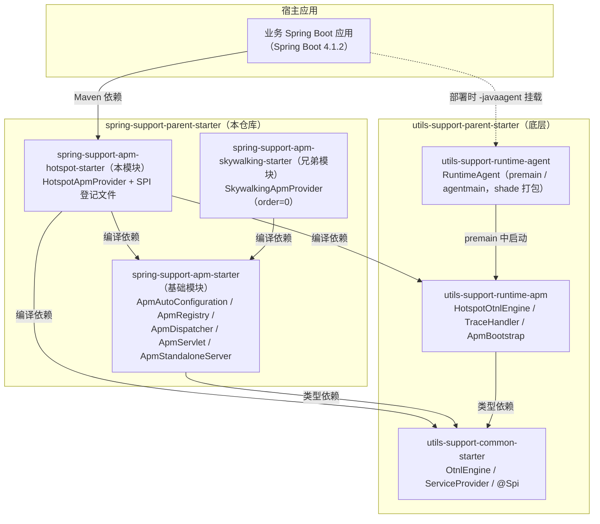
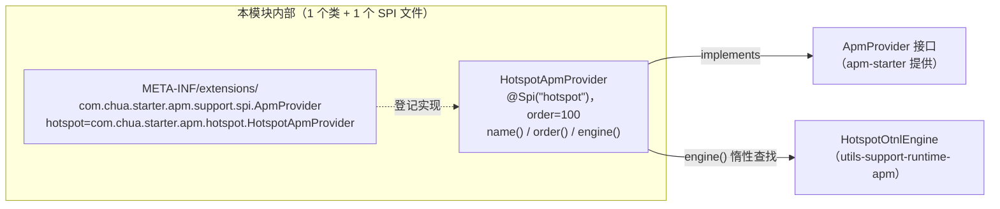
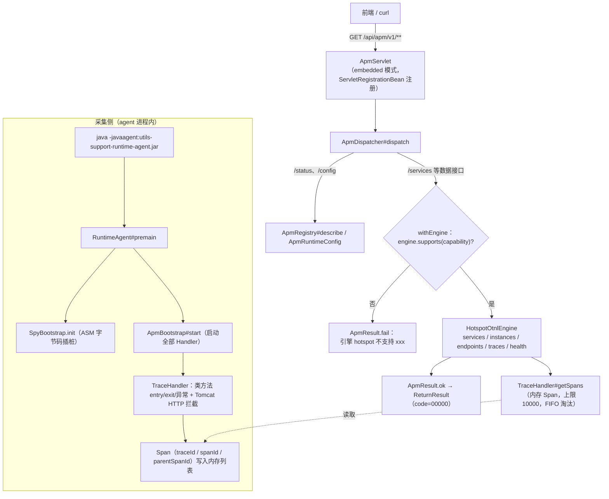

# spring-support-apm-hotspot-starter

`spring-support-apm-starter` 的「自研 hotspot agent」扩展模块：实现 `ApmProvider`（SPI 名 `hotspot`，`order=100`），把 `utils-support-runtime-apm` 提供的 `HotspotOtnlEngine` 交给上层统一路由。

- 数据全部来自**进程内**：`TraceHandler` 字节码插桩产生的 Span，不需要任何外部后端、不需要数据库。
- 未以 `-javaagent` 挂载 agent 时 `isAvailable()` 为 `false`，`ApmRegistry` 会自动跳过它。
- 本模块只有 **1 个类 + 1 个 SPI 登记文件**：没有任何 Spring 自动配置类、不注册任何 Bean、不定义任何 `@ConfigurationProperties`。
- 当前版本：`4.0.0.51`（跟随父 POM `spring-support-parent-starter`，基于 Spring Boot `4.1.2`）。

## 1. 架构图

### 1.1 模块在体系中的位置



### 1.2 模块内部分层



## 2. 核心流程图

### 2.1 装配与探测流程

```mermaid
sequenceDiagram
    autonumber
    participant Boot as Spring Boot 启动
    participant AC as ApmAutoConfiguration（apm-starter）
    participant Reg as ApmRegistry
    participant SPI as ServiceProvider（SPI 扫描）
    participant HP as HotspotApmProvider（本模块）
    participant HE as HotspotOtnlEngine（utils 层）

    Boot->>AC: 装配（plugin.apm.enabled 缺省匹配 true）
    AC->>Reg: new ApmRegistry(properties)
    AC->>AC: apmRuntimeConfig / apmDispatcher / apmServletRegistration
    Note over Reg,HE: 首次访问或 detectInterval（默认 10s）到期时触发 detect()
    Reg->>SPI: ServiceProvider.of(ApmProvider.class).forEach(...)
    SPI-->>Reg: 读 META-INF/extensions 得到全部 ApmProvider
    Reg->>Reg: 按 order() 升序排序（skywalking=0 &lt; hotspot=100）
    Reg->>HP: isAvailable()
    HP->>HE: engine() = getExtension("hotspot")
    HE-->>HP: 引擎实例（未挂 agent 时 status 不可用）
    HP-->>Reg: available = engine != null && status().available()
    Reg-->>Reg: 选中第一个可用者；都不可用则降级（present=false）
```

### 2.2 请求处理与数据流



## 3. 能力清单

| 能力域 | 关键类 | 入口 |
| --- | --- | --- |
| APM 提供者适配（SPI） | `com.chua.starter.apm.hotspot.HotspotApmProvider`（`@Spi("hotspot")`） | `META-INF/extensions/com.chua.starter.apm.support.spi.ApmProvider` |
| 引擎桥接（惰性查找） | `HotspotApmProvider#engine()` | `ServiceProvider.of(OtnlEngine.class).getExtension("hotspot")` |
| 优先级声明 | `HotspotApmProvider#order()` = `100` | `ApmRegistry#detect()` 按 `order` 升序；SkyWalking 为 `0` |
| 可用性判定 | 继承 `ApmProvider#isAvailable()` 默认实现 | `engine() != null && engine.status().available()` |
| 状态上报 | 继承 `ApmProvider#status()` → `HotspotOtnlEngine#status()` | `GET {plugin.apm.path}/status` 的 `candidates[].message` |
| 运行模式 | 继承 `ApmProvider#mode()` 默认实现 | 引擎可用时 `agent`，否则 `none` |
| 服务目录 | `HotspotOtnlEngine#services(OtnlQuery)` | `GET {path}/services`（返回当前进程 1 个服务，内存 Span 聚合） |
| 服务实例 | `HotspotOtnlEngine#instances(...)` | `GET {path}/instances?service=`（属性含 `host` / `pid` / `agent=hotspot`） |
| 端点分析 | `HotspotOtnlEngine#endpoints(...)` | `GET {path}/endpoints?service=&keyword=`（按端点聚合，调用数倒序） |
| 链路查询 | `HotspotOtnlEngine#traces(OtnlQuery)` / `#trace(traceId)` | `GET {path}/traces`、`GET {path}/trace/{traceId}` |
| 健康度 | `HotspotOtnlEngine#health(OtnlQuery)` | `GET {path}/overview` |
| 能力清单上报 | `HotspotOtnlEngine#capabilities()` | `GET {path}/capabilities`（仅 4 项，见下） |
| 采集数据面 | `com.chua.runtime.apm.handler.TraceHandler`（utils 层） | agent `premain` 中由 `ApmBootstrap` 启动 |
| agent 入口（间接） | `com.chua.runtime.agent.RuntimeAgent#premain` / `#agentmain` | `utils-support-runtime-agent` 的 `Premain-Class` / `Agent-Class` |

`HotspotOtnlEngine#capabilities()` 只声明 4 项（`OtnlEngine` 默认共 10 项）：

| 能力常量 | 值 | 对应接口 | 说明 |
| --- | --- | --- | --- |
| `OtnlEngine.CAP_SERVICES` | `services` | `GET /services` | 当前进程这 1 个服务（调用数 / 端点数 / 平均与分位耗时 / 错误率） |
| `OtnlEngine.CAP_INSTANCES` | `instances` | `GET /instances?service=` | 当前实例，属性含 `host` / `pid` / `agent=hotspot` |
| `OtnlEngine.CAP_ENDPOINTS` | `endpoints` | `GET /endpoints?service=&keyword=` | 按端点名聚合，按调用数倒序 |
| `OtnlEngine.CAP_TRACES` | `traces` | `GET /traces`、`GET /trace/{traceId}` | 内存 Span 按 traceId 分组后的链路与明细 |

未声明的是 `topology` / `metrics` / `runtime` / `alarms` / `alerts` / `logs` / `profiles`。请求这些能力时，`ApmDispatcher#withEngine` 先检查 `engine.supports(capability)`，不满足直接返回失败结果：`引擎 hotspot 不支持 xxx`（不是空数据）。

## 4. Bean 能力矩阵

**本模块自身不注册任何 Spring Bean**：没有 `@Configuration` / `@AutoConfiguration`，没有 `META-INF/spring/org.springframework.boot.autoconfigure.AutoConfiguration.imports`，也没有 `spring.factories`。`HotspotApmProvider` 由 utils 层 `ServiceProvider` SPI 容器按登记文件实例化，不进 Spring 容器。

引入本模块后，实际生效的是基础模块 `spring-support-apm-starter` 的 `ApmAutoConfiguration` 装配出的以下 Bean（随传递依赖自动带入宿主）：

| Bean 名 | 类型 | 装配条件 | 可否覆盖 | 典型注入姿势 |
| --- | --- | --- | --- | --- |
| `apmRegistry` | `ApmRegistry` | 类级 `@ConditionalOnProperty(prefix="plugin.apm", name="enabled", havingValue="true", matchIfMissing=true)` + `@ConditionalOnMissingBean`；`destroyMethod="close"` | 可：定义同类型 `@Bean` 即替换 | 构造器注入 `ApmRegistry`；一般经 `ApmDispatcher` 间接使用 |
| `apmRuntimeConfig` | `ApmRuntimeConfig` | 同上类级条件 + `@ConditionalOnMissingBean` | 可 | 注入后读 `view()` / 写 `update(params)`（`/config` 的背后） |
| `apmDispatcher` | `ApmDispatcher` | 同上类级条件 + `@ConditionalOnMissingBean` | 可 | 构造器注入，调 `dispatch(ApmRequest)` |
| `apmServletRegistration` | `ServletRegistrationBean<ApmServlet>` | `@ConditionalOnClass(name="jakarta.servlet.Servlet")` + `@ConditionalOnProperty(..., name="mode", havingValue="embedded", matchIfMissing=true)` | 否（与 standalone 二选一） | 一般不直接注入；由容器按 `plugin.apm.path + "/*"` 注册 Servlet |
| `apmStandaloneServer` | `ApmStandaloneServer` | `@ConditionalOnProperty(..., name="mode", havingValue="standalone")` + `@ConditionalOnMissingBean`；`destroyMethod="stop"` | 可 | 一般不直接注入；standalone 模式下自起 HTTP 服务 |
| `apmServiceInfoContributor` | `ServiceInfoContributor` | `@ConditionalOnMissingBean(name="apmServiceInfoContributor")` + `@ConditionalOnProperty(..., name="register-service-info", havingValue="true", matchIfMissing=true)` | 可 | 由服务信息面板（`ServiceInfoRegistry`）聚合展示，不直接注入 |

## 5. 完整配置

**本模块没有 `@ConfigurationProperties`**：不定义配置前缀、不读取任何 key（pom 亦未引入 `spring-boot-configuration-processor`）。它只响应基础模块 `spring-support-apm-starter` 的 `ApmProperties`（前缀 `plugin.apm`）：

| 路径 | 类型 | 默认值 | 说明 | 生效开关 / 位置 |
| --- | --- | --- | --- | --- |
| `plugin.apm.enabled` | `boolean` | `true` | 是否启用 APM 模块；`false` 时 `describe()` 直接降级 | `ApmAutoConfiguration` 类级条件、`ApmRegistry#describe` |
| `plugin.apm.type` | `String` | `""`（空） | 引擎类型（`skywalking` / `opentelemetry` / `hotspot`）；留空按 `order` 自动探测 | `ApmRegistry#detect` |
| `plugin.apm.mode` | `String` | `embedded` | `embedded`（随宿主 Servlet 容器）/ `standalone`（独立 HTTP 服务） | `apmServletRegistration` / `apmStandaloneServer` |
| `plugin.apm.path` | `String` | `/api/apm/v1` | 统一 REST 前缀（嵌入=Servlet 映射，独立=Server 路由） | 同上 |
| `plugin.apm.host` | `String` | `0.0.0.0` | 独立模式监听地址 | standalone 模式 |
| `plugin.apm.port` | `int` | `12801` | 独立模式监听端口 | standalone 模式 |
| `plugin.apm.server-type` | `String` | `jdk` | 独立模式底层 Server SPI 类型（`jdk` / `netty` …） | `ApmStandaloneServer` |
| `plugin.apm.detect-interval` | `long` | `10000` | 探测结果缓存毫秒数（下限 1000，避免轮询打穿探活） | `ApmRegistry#ensureDetected` |
| `plugin.apm.settings-file` | `String` | `config/apm-settings.properties` | 运行期可改配置落盘文件（只存可热改键） | `ApmSettingsStore` / `ApmRuntimeConfig#restore` |
| `plugin.apm.register-service-info` | `boolean` | `true` | 是否登记到服务信息面板 | `apmServiceInfoContributor` |

**agent 侧参数**（utils 层，决定本引擎有没有数据；本模块不读取这些 key，仅经 `TraceHandler` / `ApmBootstrap` 间接受影响）：

| key | 默认值 | 说明 |
| --- | --- | --- |
| `trace.enabled` | `true` | `TraceHandler` 是否启用 |
| `trace.http.enabled` | `true` | 是否注册 Tomcat HTTP 请求追踪 |
| `trace.classes` | 空 | 额外插桩的类列表（逗号分隔） |
| `apm.storage.type` | `inmemory` | Span 存储实现（`inmemory` / `sqlite` / `noop`） |
| `apm.storage.retention.ms` | 7 天 | 数据保留时长 |
| `apm.storage.capacity` | `100000` | 存储容量上限 |

**运行期可改项：无**。`HotspotApmProvider` 未覆盖 `runtimeSettings()` / `applyRuntimeSettings(Map)`（默认空表 / 空实现），因此 `GET /config` 的 `engine.settings` 为空表；`POST /config` 若带引擎级键（如 `oapUrl`），`ApmRuntimeConfig#applyEngineSettings` 会抛 `当前引擎不支持这些设置项: [...]`。`mode` / `path` / `port` 属重启项，`POST /config` 改它们会被直接拒绝。

## 6. 使用方式

### 6.1 Maven 坐标

```xml
<!-- 通常只需这一个：它会传递 spring-support-apm-starter 与 utils-support-runtime-apm -->
<dependency>
    <groupId>com.chua</groupId>
    <artifactId>spring-support-apm-hotspot-starter</artifactId>
    <version>4.0.0.51</version>
</dependency>
```

依赖传递说明：

| 依赖 | 版本 | 作用 | 作用域 |
| --- | --- | --- | --- |
| `spring-support-apm-starter` | `4.0.0.51`（`${project.version}`） | `ApmProvider` SPI、`ApmRegistry` / `ApmDispatcher`、全部 REST 装配 | 编译（传递引入） |
| `utils-support-runtime-apm` | `4.0.0.51`（`${utils.version}`） | `HotspotOtnlEngine` + `TraceHandler` 等处理器 + `ApmBootstrap` | 编译 |
| `utils-support-common-starter` | `4.0.0.51`（`${utils.version}`） | `OtnlEngine` / `ServiceProvider` / `@Spi` 契约 | 编译 |
| `lombok` | 父 POM 管理 | `@Slf4j` | `provided` |

注意：真正提供采集能力的插件包是 `utils-support-runtime-agent`（`Premain-Class` / `Agent-Class` 均为 `com.chua.runtime.agent.RuntimeAgent`，shade 打包），部署时要挂的是它，而不是本 starter 的 jar。

### 6.2 最小可运行示例

**第 1 步**：加依赖（见上）。

**第 2 步**：以 `-javaagent` 挂载 agent（不挂则本实现在注册表里永远 `available=false`）：

```bash
java -javaagent:/path/to/utils-support-runtime-agent.jar \
     -jar your-app.jar
```

**第 3 步**：启动后确认状态：

```bash
curl http://127.0.0.1:8080/api/apm/v1/status
```

`/status` 返回 `ApmDescriptor`（外层为 `ReturnResult`，成功码 `00000`）。选中本引擎时关键字段：

```json
{
  "code": "00000",
  "data": {
    "present": true,
    "enabled": true,
    "name": "hotspot",
    "version": "1.0.0",
    "mode": "agent",
    "endpoint": "local",
    "capabilities": ["services", "instances", "endpoints", "traces"],
    "candidates": [{ "name": "hotspot", "available": true, "mode": "agent" }]
  }
}
```

若 `available=false`，`candidates[].message` 会给出确切原因（两种可能见第 9 节）。

### 6.3 代码调用示例

```java
// 方式 A：直接使用 Provider（本模块无链式 API）
HotspotApmProvider provider = new HotspotApmProvider();
String name = provider.name();          // "hotspot"
int order = provider.order();           // 100
OtnlEngine engine = provider.engine();  // 惰性创建并缓存；utils 包缺失或 SPI 未登记时返回 null
if (provider.isAvailable()) {
    OtnlStatus status = provider.status();   // available / version=1.0.0 / endpoint=local / mode=agent
    Map<String, String> settings = provider.runtimeSettings(); // 空表 Map.of()
}
provider.close();                       // 默认实现调 engine.close()；hotspot 引擎不持资源

// 方式 B：走统一接口（由 apm-starter 的 ApmDispatcher 路由，只用到四项能力）
dispatcher.dispatch(ApmRequest.get("/api/apm/v1/services", Map.of()));
dispatcher.dispatch(ApmRequest.get("/api/apm/v1/instances",
        Map.of("service", "your-service")));
dispatcher.dispatch(ApmRequest.get("/api/apm/v1/endpoints",
        Map.of("service", "your-service", "keyword", "/api/order")));
dispatcher.dispatch(ApmRequest.get("/api/apm/v1/traces",
        Map.of("minutes", "30", "pageSize", "20")));
dispatcher.dispatch(ApmRequest.get("/api/apm/v1/trace/" + traceId, Map.of()));
```

命令行验证（不写代码）：

```bash
curl "http://127.0.0.1:8080/api/apm/v1/capabilities"
# data: {"engine":"hotspot","capabilities":["services","instances","endpoints","traces"]}
```

## 7. 使用场景

**适用**：

- 单机 / 单进程 Java 服务的快速可观测：不想部署 SkyWalking OAP、ES 等外部后端，挂一个 agent jar 就能看服务、端点、链路。
- 开发 / 测试环境兜底：没有商业 APM 时，`order=100` 的本模块让「没装 APM」的服务也有基础观测页。
- 排查单进程内「哪些端点慢、哪些方法报错」：内存 Span 聚合出调用数 / 平均耗时 / p95 / p99 / 错误率。

**不适用**：

- 分布式链路追踪：`services()` 固定返回当前进程 1 个服务，无法把多台机器的调用串起来（`topology` 直接返回空）。
- 指标时序、告警、日志、性能剖析：这 4 类能力未声明，对应接口返回 `引擎 hotspot 不支持 xxx`。
- 长期数据留存与分析：Span 只在内存（上限 10000，FIFO 淘汰），进程重启即清空，无跨进程聚合。

**与相邻模块的取舍**：

| 相邻模块 | 取舍 |
| --- | --- |
| `spring-support-apm-starter` | 必装的「底座」：装配、注册表、统一接口都在它那里；本模块只是往 SPI 里贡献一个 `hotspot` 实现。只装底座不装任何 provider 时，接口可用但 `present=false`。 |
| `spring-support-apm-skywalking-starter` | 同为 `ApmProvider`，`order=0` 优先。两者并存且都可用时默认选 SkyWalking；本模块是「没装商业 APM 时的兜底」。要 topology / metrics / alarms / logs / profiles 能力，选 SkyWalking。 |
| `opentelemetry` 引擎 | `ApmProvider` / `ApmProperties` 的注释中预留了该类型名，但仓库当前没有 `apm-opentelemetry-starter` 模块；需要时按第 8 节的 SPI 样板自建。 |

## 8. 扩展点

1. **本模块本身就是 `ApmProvider` SPI 的实现样板**。新增一种 APM 只需：新建 `spring-support-apm-xx-starter`，实现 `ApmProvider`（至少 `name()` / `engine()`，按需覆盖 `order()` 等默认方法），并在 `src/main/resources/META-INF/extensions/com.chua.starter.apm.support.spi.ApmProvider` 中登记 `名称=实现类`。
2. **`ApmProvider` 可覆盖的默认方法**（`com.chua.starter.apm.support.spi.ApmProvider`）：
   - `order()`：优先级，越小越优先（默认 100）；
   - `isAvailable()` / `status()` / `mode()`：可用性、状态与运行模式；
   - `runtimeSettings()` / `applyRuntimeSettings(Map)`：声明并应用「可运行期热改」的引擎参数（hotspot 刻意不覆盖——参数来自 `-javaagent`，不可热改）；
   - `close()`：释放引擎资源（默认调 `engine.close()`）。
3. **utils 层 `OtnlEngine` SPI**（`com.chua.common.support.apm.OtnlEngine`，登记文件 `META-INF/extensions/com.chua.common.support.apm.OtnlEngine`）：要给 hotspot 增加数据能力（如补 `metrics`），应扩展 `HotspotOtnlEngine` 并同步 `capabilities()`，而不是改本模块。
4. **utils 层 `Plugin` 体系**：`ApmBootstrap#addHandler(Plugin)` 可注册自定义处理器；`TraceHandler` 本身实现了 `Plugin` 与 `RuntimeSpy.Interceptor`，采集范围由 agent 侧 `trace.*` 参数与 `RuntimeSpy` 插桩规则决定。
5. **本模块没有的扩展点**：无 `META-INF/services/*`、无 `META-INF/spring/*`、无 Spring Bean、无 `@ConfigurationProperties`、无自有 REST 端点（接口全部由 `spring-support-apm-starter` 装配）。

## 9. 常见问题

**Q1：引入了依赖，但 `/status` 仍返回 `present=false`？**

依次检查：

1. `plugin.apm.enabled` 是否被设为 `false`（`describe()` 会直接降级，原因显示 `APM 模块已关闭（plugin.apm.enabled=false）`）；
2. 是否以 `-javaagent` 挂载了 `utils-support-runtime-agent.jar`——未挂载时 `candidates[].message` 为 `未检测到 hotspot agent（utils-support-runtime-apm 未以 -javaagent 方式挂载）`；agent 挂了但 `TraceHandler` 未运行时为 `hotspot agent 已挂载但未启动（TraceHandler 未运行）`；
3. `plugin.apm.type` 是否误填（填了未引入的名字会告警「指定引擎 xxx 未引入，请检查依赖坐标」）；
4. 同机是否并存 SkyWalking：`order=0` 的 SkyWalking 优先于 `order=100` 的本模块，两者都可用时选 SkyWalking。

**Q2：APM 接口端口是多少？**

嵌入模式（默认）没有独立端口——`ApmServlet` 注册在宿主 Servlet 容器里，路径为 `plugin.apm.path + "/*"`（默认 `/api/apm/v1/*`）。只有 `plugin.apm.mode=standalone` 时才使用 `plugin.apm.host` / `plugin.apm.port`（默认 `0.0.0.0:12801`）。`mode` / `path` / `port` 属重启项：`POST /config` 改它们会被拒绝（「不支持热改，改了必须重启」）。

**Q3：与 Spring Boot 4 兼容吗？**

兼容。本仓库父 POM 继承 `spring-boot-starter-parent:4.1.2`（2026-11-19 升级）。自动配置走 `META-INF/spring/org.springframework.boot.autoconfigure.AutoConfiguration.imports`（在 apm-starter 中，登记的是 `ApmAutoConfiguration`），不使用 `spring.factories`；Servlet 体系基于 `jakarta.servlet`。

**Q4：为什么 `POST /config` 报「当前引擎不支持这些设置项」？**

本引擎没有可热改参数：`runtimeSettings()` 返回空表，`applyEngineSettings` 找不到任何声明支持这些键的 Provider 时抛该异常。要改采集行为，只能调整 agent 侧参数（`trace.*` / `apm.storage.*`）或重启进程。

**Q5：为什么 `metrics` / `topology` / `alarms` / `logs` / `profiles` 接口报「引擎 hotspot 不支持 xxx」？**

`HotspotOtnlEngine#capabilities()` 只声明 `services` / `instances` / `endpoints` / `traces` 四项。`ApmDispatcher#withEngine` 对未声明能力直接返回失败（不是空数据）。需要这些能力请使用 `spring-support-apm-skywalking-starter`。

**Q6：重启后链路数据为什么没了？**

Span 保存在 `TraceHandler` 的内存列表里，上限 `MAX_SPANS = 10000`，超出按插入顺序淘汰最旧的（`spans.remove(0)`）；agent 的默认存储实现也是 `inmemory`。进程重启即清空，没有落库、没有跨进程聚合。

**Q7：用 attach 方式挂 agent 后，早期请求没有数据？**

`RuntimeAgent#premain` 会对已加载类补做 `retransformLoadedClasses`，但 attach 之前已完成的调用不会被回放。要覆盖全量，请在 JVM 启动时以 `-javaagent` 挂载。

**Q8：`/status` 里的 `version` 是模块版本吗？**

不是。它来自 `TraceHandler#version()`（常量 `1.0.0`），不是 Maven 版本 `4.0.0.51`。
