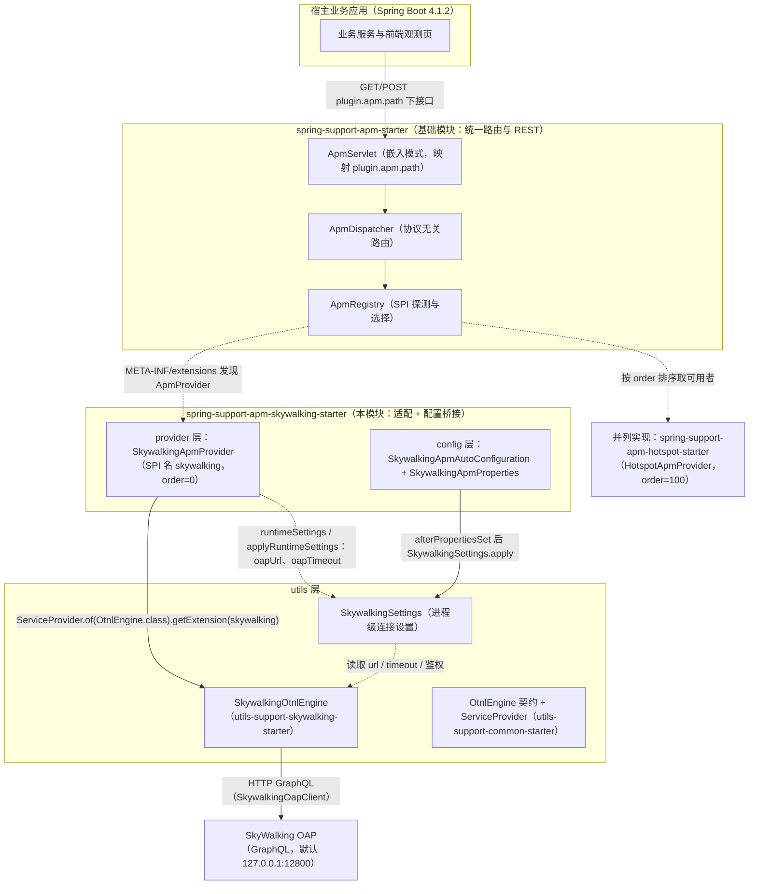
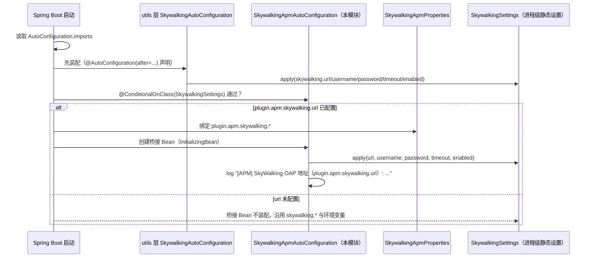
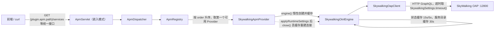

# spring-support-apm-skywalking-starter

`spring-support-apm-starter` 的 SkyWalking 扩展：实现 `ApmProvider`（SPI 名 `skywalking`，`order=0`），把 utils 层 `utils-support-skywalking-starter` 提供的 `SkywalkingOtnlEngine`（SPI 名同样是 `skywalking`）交给上层统一路由；同时把 `plugin.apm.skywalking.*` 桥接到进程级 `SkywalkingSettings`。

- 本模块**只做「适配 + 配置桥接」**：OAP 的 GraphQL 查询全部在 `utils-support-skywalking-starter` 的 `SkywalkingOtnlEngine` 里。
- 所有 REST 接口来自 `spring-support-apm-starter`，本模块不声明任何 Controller / Servlet。
- 当前版本：`4.0.0.51`（跟随父 POM `spring-support-parent-starter`）；基于 Spring Boot `4.1.2`、Java `25` 构建。

## 1. 架构图

### 1.1 模块在体系中的位置



### 1.2 内部分层

| 层 | 类 / 资源 | 职责 |
| --- | --- | --- |
| 自动配置层 | `com.chua.starter.apm.skywalking.config.SkywalkingApmAutoConfiguration` | `url` 非空时把 `plugin.apm.skywalking.*` 覆盖到 `SkywalkingSettings` |
| 配置层 | `com.chua.starter.apm.skywalking.config.SkywalkingApmProperties` | 承载 `plugin.apm.skywalking.*` 四个字段 |
| 适配层 | `com.chua.starter.apm.skywalking.SkywalkingApmProvider` | 声明 `skywalking` 引擎、惰性取引擎、暴露/应用可热改项 |
| SPI 登记 | `META-INF/extensions/com.chua.starter.apm.support.spi.ApmProvider` | `skywalking=com.chua.starter.apm.skywalking.SkywalkingApmProvider` |
| 自动配置登记 | `META-INF/spring/org.springframework.boot.autoconfigure.AutoConfiguration.imports` | 仅一行：`SkywalkingApmAutoConfiguration`（本模块没有 `spring.factories`） |
| 数据面（间接） | `com.chua.skywalking.support.engine.SkywalkingOtnlEngine`（utils 层） | OAP GraphQL 查询、状态/服务目录缓存、版本适配 |

## 2. 核心流程图

### 2.1 装配流程（配置桥接）



### 2.2 请求处理 / 数据流



要点：`ApmRegistry#detect()` 用 `ServiceProvider.of(ApmProvider.class)` 扫描全部实现并按 `order` 升序排序；`SkywalkingApmProvider#engine()` 双检锁惰性取 utils 层引擎，失败返回 `null`（只打 debug 日志），注册表随之把本实现视为不可用。

## 3. 能力清单

| 能力域 | 关键类 | 入口 |
| --- | --- | --- |
| SPI 实现（引擎声明） | `com.chua.starter.apm.skywalking.SkywalkingApmProvider` | `META-INF/extensions/com.chua.starter.apm.support.spi.ApmProvider` |
| 引擎适配 | `SkywalkingApmProvider#engine()` | `ServiceProvider.of(OtnlEngine.class).getExtension("skywalking")` |
| 优先级声明 | `SkywalkingApmProvider#order()` = `0` | `ApmRegistry#detect()` 按 `order` 升序排序 |
| 可热改项声明 | `SkywalkingApmProvider#runtimeSettings()` | 键 `oapUrl` / `oapTimeout`，`GET {path}/config` 的 `engine.settings` 展示 |
| 可热改项应用 | `SkywalkingApmProvider#applyRuntimeSettings(Map)` | `POST {path}/config` 带 `oapUrl` / `oapTimeout` 时调用 |
| 配置桥接 | `SkywalkingApmAutoConfiguration`（`InitializingBean#afterPropertiesSet`） | `plugin.apm.skywalking.url` 非空时装配 |
| 配置属性 | `SkywalkingApmProperties`（`@ConfigurationProperties(prefix = "plugin.apm.skywalking")`） | `url` / `username` / `password` / `timeout` |
| 进程级设置（utils 层） | `com.chua.skywalking.support.client.SkywalkingSettings` | `apply(...)` / `url()` / `username()` / `password()` / `timeout()` / `enabled()` |
| 自动配置登记 | `SkywalkingApmAutoConfiguration` | `META-INF/spring/org.springframework.boot.autoconfigure.AutoConfiguration.imports` |
| 引擎 SPI 登记（间接） | `com.chua.skywalking.support.engine.SkywalkingOtnlEngine` | utils 包的 `META-INF/extensions/com.chua.common.support.apm.OtnlEngine` |

`SkywalkingApmProvider` 上的两个公开常量就是运行期键名：

| 常量 | 值 | 含义 |
| --- | --- | --- |
| `SkywalkingApmProvider.KEY_OAP_URL` | `"oapUrl"` | OAP 地址，如 `http://127.0.0.1:12800` |
| `SkywalkingApmProvider.KEY_OAP_TIMEOUT` | `"oapTimeout"` | 单次查询超时（毫秒） |

### 3.1 引擎能力（`SkywalkingOtnlEngine#capabilities()` 原样上抛）

经本模块接入时，统一接口声明支持以下全部能力：

| 能力常量（`OtnlEngine`） | 值 | 对应接口（相对 `plugin.apm.path`，默认 `/api/apm/v1`） |
| --- | --- | --- |
| `CAP_SERVICES` | `services` | `GET /services` |
| `CAP_INSTANCES` | `instances` | `GET /instances?service=` |
| `CAP_ENDPOINTS` | `endpoints` | `GET /endpoints?service=` |
| `CAP_TRACES` | `traces` | `GET /traces`、`GET /trace/{traceId}` |
| `CAP_TOPOLOGY` | `topology` | `GET /topology`、`/topology/multi`、`/infra-3d` |
| `CAP_METRICS` | `metrics` | `GET /metrics`、`/metric-definitions`、`/metrics-batch` |
| `CAP_RUNTIME` | `runtime` | JVM/运行时指标（随指标通道取数） |
| `CAP_ALARMS` | `alarms` | `GET /alarms` |
| `CAP_ALERTS` | `alerts` | `GET /alerts`（`/alarms` 的别名） |
| `CAP_LOGS` | `logs` | `GET /logs` |
| `CAP_PROFILES` | `profiles` | `GET /profiles`、`/profiles/{taskId}/segments`、`/profiles/{taskId}/analysis` |

### 3.2 状态探测与缓存（常量在 utils 层 `SkywalkingOtnlEngine` 中）

| 常量 | 值 | 含义 |
| --- | --- | --- |
| `STATUS_OK_TTL` | `15000` 毫秒 | 探活成功后的状态缓存时长 |
| `STATUS_FAIL_TTL` | `5000` 毫秒 | 探活失败后的状态缓存时长 |
| `SERVICE_CACHE_TTL` | `30000` 毫秒 | 服务目录缓存时长 |

因此 `GET {path}/status` 不会每次都打 OAP：实际请求频率同时受本地状态缓存（上表）与 `plugin.apm.detect-interval`（默认 `10000` 毫秒）约束。`skywalking.enabled=false` 时，`status()` 直接返回不可用，消息为 `SkyWalking 已通过配置关闭（skywalking.enabled=false）`。

## 4. Bean 能力矩阵

本模块**刻意只有 1 个自动配置类 + 1 个属性类**，没有 `@Bean` 方法、没有 Controller / Servlet / 定时任务；引擎与 Provider 都不是 Spring Bean，而是 SPI 实例。

| Bean 名 | 类型 | 装配条件 | 可否覆盖 | 典型注入姿势 |
| --- | --- | --- | --- | --- |
| `com.chua.starter.apm.skywalking.config.SkywalkingApmAutoConfiguration` | 自动配置类，实现 `InitializingBean` | `@ConditionalOnClass(SkywalkingSettings.class)` 且 `@ConditionalOnProperty(prefix="plugin.apm.skywalking", name="url")`（即必须配置 `url`） | 可通过 `spring.autoconfigure.exclude` / `@SpringBootApplication(exclude=...)` 整体排除；类内无 `@Bean`，不存在按 Bean 替换的覆盖 | 通常不注入：它在启动时自行执行 `afterPropertiesSet()` 完成桥接 |
| `plugin.apm.skywalking-com.chua.starter.apm.skywalking.config.SkywalkingApmProperties`（`@EnableConfigurationProperties` 注册，Bean 名按 Spring 规则为「前缀-全限定类名」） | `SkywalkingApmProperties` | 随桥接类启用（同上两个条件） | 属性值可随时通过 `application.yml` / `-Dplugin.apm.skywalking.*` 覆盖；Bean 本身不做替换 | 构造器注入到 `SkywalkingApmAutoConfiguration` |

**不是 Bean 的关键实例（SPI 创建，勿用 `@Autowired` 获取）：**

| 实例 | 创建方式 | 管理者 |
| --- | --- | --- |
| `SkywalkingApmProvider` | `ServiceProvider` 读 `META-INF/extensions/com.chua.starter.apm.support.spi.ApmProvider` 反射实例化 | `spring-support-apm-starter` 的 `ApmRegistry`（候选列表、按 `order` 选择、`close()` 释放） |
| `SkywalkingOtnlEngine`（utils 层） | `ServiceProvider.of(OtnlEngine.class).getExtension("skywalking")`，由 `SkywalkingApmProvider#engine()` 惰性创建并缓存 | Provider 持有；`applyRuntimeSettings` 后调 `close()` 丢缓存，同一实例可复用 |

**来自基础模块 `spring-support-apm-starter` 的相关 Bean**（本模块依赖它，宿主因此获得）：`apmRegistry`（`@ConditionalOnMissingBean`，`destroyMethod="close"`）、`apmRuntimeConfig`（装配时执行 `restore()` 回放设置文件）、`apmDispatcher`（`@ConditionalOnMissingBean`，可选注入 `ApmOperLogSink`）、`apmServletRegistration`（嵌入模式，`@ConditionalOnClass(name="jakarta.servlet.Servlet")` + `plugin.apm.mode=embedded`（缺省匹配））、`apmStandaloneServer`（`plugin.apm.mode=standalone` 时）、`apmServiceInfoContributor`（`plugin.apm.register-service-info=true`（缺省匹配））。整个 APM 装配的外层开关是 `plugin.apm.enabled`（缺省 `true`）。

## 5. 完整配置

### 5.1 本模块 `SkywalkingApmProperties`（`@ConfigurationProperties(prefix = "plugin.apm.skywalking")`）全字段

| 路径 | 类型 | 默认值 | 说明 | 生效开关 |
| --- | --- | --- | --- | --- |
| `plugin.apm.skywalking.url` | `String` | `""`（空） | OAP 地址，如 `http://127.0.0.1:12800`；留空表示沿用 `skywalking.url` | **非空才装配整个桥接 Bean**；写入时经 `SkywalkingSettings#normalize`（去尾部 `/`、剥 `/graphql` 后缀） |
| `plugin.apm.skywalking.username` | `String` | `""`（空） | OAP Basic 鉴权用户名 | 桥接生效时写入进程级设置；注意 `apply` 对非 null 值无条件赋值，空串也会覆盖（见 9.5） |
| `plugin.apm.skywalking.password` | `String` | `""`（空） | OAP Basic 鉴权密码 | 同上 |
| `plugin.apm.skywalking.timeout` | `long` | `0` | 单次查询超时（毫秒） | 桥接生效且 `>0` 时覆盖；`<=0` 表示沿用 utils 层 `skywalking.timeout`（默认 `5000`） |

### 5.2 桥接 Bean 的生效开关（来自注解，不是配置项）

| 条件 | 来源 | 效果 |
| --- | --- | --- |
| `@ConditionalOnClass(SkywalkingSettings.class)` | `SkywalkingApmAutoConfiguration` | 必须能加载 utils 层设置类 |
| `@ConditionalOnProperty(prefix = "plugin.apm.skywalking", name = "url")` | 同上 | **必须配置 `url`**，否则整个桥接类不装配（只配 `timeout`/`username` 不触发） |
| `@AutoConfiguration(after = SkywalkingAutoConfiguration.class)` | 同上 | 在 utils 层自动配置之后执行，同名项以 `plugin.apm.skywalking.*` 为准 |
| `plugin.apm.enabled=true`（缺省匹配） | 基础模块 `ApmAutoConfiguration` | 总开关：`false` 时整个 APM 模块关闭，`/status` 返回 `present=false` |

### 5.3 运行期可热改项（`SkywalkingApmProvider#runtimeSettings()` 声明）

| key | 说明 | 非法值行为 |
| --- | --- | --- |
| `oapUrl` | 新 OAP 地址 | 不以 `http://` / `https://` 开头（`UrlUtils#isHttpUrl`，大小写不敏感）→ `IllegalArgumentException` |
| `oapTimeout` | 新超时毫秒数 | 非整数或 `<=0` → `IllegalArgumentException` |

> 部署侧还可以用 `-Dskywalking.url`、`-Dplugin.apm.skywalking.url`、环境变量 `SW_OAP_ADDRESS` 提供地址；`spring-support-apm-starter` 的 `ApmRuntimeConfig#restore()` 发现这些来源存在时，会忽略设置文件里保存的 `oapUrl`。鉴权也可用环境变量 `SW_OAP_USERNAME` / `SW_OAP_PASSWORD`（utils 层 `SkywalkingSettings` 读取）。

### 5.4 相关但定义在其它模块的前缀（交叉引用，便于排障）

`skywalking.*`（utils 层 `SkywalkingProperties`，`SkywalkingAutoConfiguration` 装配）：

| 路径 | 类型 | 默认值 | 说明 |
| --- | --- | --- | --- |
| `skywalking.enabled` | `boolean` | `true` | 是否启用 SkyWalking 数据源；`false` 时 `status()` 报「已通过配置关闭」 |
| `skywalking.url` | `String` | `http://127.0.0.1:12800` | OAP 地址 |
| `skywalking.username` / `skywalking.password` | `String` | `""` | OAP Basic 鉴权 |
| `skywalking.timeout` | `long` | `5000` | 单次查询超时（毫秒） |

`plugin.apm.*`（基础模块 `ApmProperties`）：

| 路径 | 类型 | 默认值 | 说明 |
| --- | --- | --- | --- |
| `plugin.apm.enabled` | `boolean` | `true` | APM 模块总开关 |
| `plugin.apm.type` | `String` | `""` | 引擎名（`skywalking` / `hotspot`）；留空自动探测 |
| `plugin.apm.mode` | `String` | `embedded` | `embedded`（Servlet）或 `standalone`（独立 HTTP 服务） |
| `plugin.apm.path` | `String` | `/api/apm/v1` | 统一 REST 前缀 |
| `plugin.apm.host` / `plugin.apm.port` | `String` / `int` | `0.0.0.0` / `12801` | 独立模式监听地址/端口 |
| `plugin.apm.serverType` | `String` | `jdk` | 独立模式底层 Server SPI 类型 |
| `plugin.apm.detect-interval` | `long` | `10000` | 探测结果缓存毫秒（最小 `1000`） |
| `plugin.apm.settings-file` | `String` | `config/apm-settings.properties` | 可热改项落盘文件 |
| `plugin.apm.register-service-info` | `boolean` | `true` | 是否登记到服务信息面板 |

优先级：`plugin.apm.skywalking.*` 覆盖 `skywalking.*`（`@AutoConfiguration(after = SkywalkingAutoConfiguration.class)` 保证顺序）；系统属性/环境变量在 `SkywalkingSettings` 静态初始化时生效，最终以 `apply(...)` 写入的值为准。

## 6. 使用方式

### 6.1 Maven 坐标

```xml
<!-- 通常只需这一个：它会传递 spring-support-apm-starter 与 utils-support-skywalking-starter -->
<dependency>
    <groupId>com.chua</groupId>
    <artifactId>spring-support-apm-skywalking-starter</artifactId>
    <version>4.0.0.51</version>
</dependency>
```

| 依赖 | 版本 | 作用 | 作用域 |
| --- | --- | --- | --- |
| `spring-support-apm-starter` | `4.0.0.51`（`${project.version}`） | `ApmProvider` SPI、`ApmRegistry`、`ApmDispatcher`、全部 REST 接口 | 编译 |
| `utils-support-skywalking-starter` | `4.0.0.51`（`${utils.version}`） | `SkywalkingOtnlEngine`（OAP GraphQL 数据面）、`SkywalkingSettings`、`SkywalkingAutoConfiguration` | 编译 |
| `utils-support-common-starter` | 由父 POM 管理（`${utils.version}`） | `OtnlEngine` 契约 / `ServiceProvider` / `@Spi` | 编译 |
| `spring-boot-configuration-processor` | 父 POM（Spring Boot `4.1.2`）管理 | 生成 `plugin.apm.skywalking.*` 配置元数据 | `provided` |
| `lombok` | 父 POM 管理 | `@Slf4j` / `@Getter` / `@Setter` | `provided` |

### 6.2 最小可运行示例

**第 1 步：加依赖**（见上，它已传递基础模块与 utils 层，无需重复引入）。

**第 2 步：配置 OAP 地址**

```yaml
plugin:
  apm:
    enabled: true
    type: skywalking          # 可留空：自动探测时本实现 order=0，优先被选中
    skywalking:
      url: http://127.0.0.1:12800
      timeout: 5000
```

**第 3 步：启动后验证**

```bash
curl http://127.0.0.1:8080/api/apm/v1/status
```

`data.candidates` 里应出现 `"name":"skywalking"`；`data.present=true` 且 `data.mode` 为 `remote` 时说明已连上 OAP。再查 `GET /api/apm/v1/config`，`engine.settings` 应回显当前 `oapUrl` / `oapTimeout`。

```bash
curl http://127.0.0.1:8080/api/apm/v1/capabilities
# {"code":"00000","ok":true,"data":{"engine":"skywalking","capabilities":["services","instances",...]}}
```

### 6.3 编程式调用（可选）

```java
// 方式 A：直接使用 Provider（本模块无链式 API、无 Builder）
SkywalkingApmProvider provider = new SkywalkingApmProvider();
String name = provider.name();            // "skywalking"
int order = provider.order();             // 0
OtnlEngine engine = provider.engine();    // 惰性取 utils 层引擎；SPI 缺失时返回 null
if (engine != null && provider.isAvailable()) {
    engine.services(OtnlQuery.empty());
}
provider.applyRuntimeSettings(Map.of("oapUrl", "http://10.0.0.5:12800", "oapTimeout", "8000"));
provider.close();                          // 释放底层引擎缓存与连接

// 方式 B：走统一入口（推荐，与前端行为一致）
ApmResult status  = dispatcher.dispatch(ApmRequest.get("/api/apm/v1/status", Map.of()));
ApmResult updated = dispatcher.dispatch(new ApmRequest("POST", "/api/apm/v1/config",
        Map.of("oapUrl", "http://10.0.0.5:12800")));
```

### 6.4 可选依赖说明

- 本模块无 `optional` 依赖、无额外第三方 SDK：SkyWalking 访问走自研 `SkywalkingOapClient`（HTTP + Jackson），不需要官方 agent。
- `spring-boot-configuration-processor` 与 `lombok` 均为 `provided`，只参与编译，不进入运行期依赖。
- 嵌入模式（默认）的 Servlet 出口依赖宿主的 `jakarta.servlet.Servlet`（Spring Boot Web 应用自带）；`plugin.apm.mode=standalone` 时不需要 Servlet 容器。

## 7. 使用场景

### 7.1 适用

- 生产环境已部署 Apache SkyWalking（OAP + agent），希望用统一 REST 接口/观测台读取服务、链路、拓扑、指标、告警、日志与性能剖析。
- 同一台机器可能并存多种 APM（如同时挂了 SkyWalking agent 与自研 hotspot agent），需要按优先级自动选择：本实现 `order=0`，优先于 `hotspot`（`order=100`）。
- 需要运行期热改 OAP 地址/超时（`POST /config`），且改完立即丢弃旧连接与状态缓存。
- 需要「APM 视角」的配置命名空间（`plugin.apm.skywalking.*`），与平台其它 `plugin.apm.*` 开关放在一起管理。

### 7.2 不适用

- 没有外部 OAP、只想要进程内无后端的插桩 → 用 `spring-support-apm-hotspot-starter`（数据来自进程内 `utils-support-runtime-apm`，需 `-javaagent` 挂载，未挂载时自动不可用）。
- 只想收集本进程 tracing 上报到 SkyWalking，不需要查询接口 → 只装官方 agent 即可，本模块是「查询侧」适配。
- 未引入本模块时，基础模块 `spring-support-apm-starter` 照常装配，`/status` 返回 `present=false` 与原因（如「当前服务器未引入任何 APM 实现模块」），不会报错。

### 7.3 与相邻模块的取舍

| 关系 | artifactId | 取舍说明 |
| --- | --- | --- |
| 依赖（基础） | `spring-support-apm-starter`（`4.0.0.51`） | 借用 `ApmProvider` SPI、`ApmRegistry`、`ApmDispatcher` 与全部 REST 接口；业务侧只依赖基础模块 + 本模块，不直接依赖 SkyWalking SDK |
| 依赖（数据面） | `utils-support-skywalking-starter`（`4.0.0.51`） | OAP GraphQL 查询、版本适配（9.x/10.x/11.x）、状态缓存都在这里；本模块不含任何 HTTP 客户端逻辑 |
| 依赖（契约） | `utils-support-common-starter` | `OtnlEngine` 契约与 `ServiceProvider` |
| 并列实现 | `spring-support-apm-hotspot-starter` | 另一个 `ApmProvider`（`order=100`）；同机并存时默认选 skywalking，`plugin.apm.type` 可显式指定 |
| 配置优先级 | utils 层 `skywalking.*` | `plugin.apm.skywalking.*` 覆盖 `skywalking.*`；两份都可用，APM 相关运维配置建议收在 `plugin.apm` 命名空间 |

## 8. 扩展点

### 8.1 本模块暴露的扩展点

本模块**不新增 SPI 或自定义接口**：它本身是 `ApmProvider` SPI 的一个实现（`META-INF/extensions` 登记之外，没有 `META-INF/services`，也没有其它扩展接口）。可复用的是它示范的扩展方式：

| 扩展点 | 定义位置 | 本模块的用法 |
| --- | --- | --- |
| `ApmProvider#runtimeSettings()` / `#applyRuntimeSettings(Map)` | `spring-support-apm-starter` 的 `ApmProvider` 接口（default 方法） | 声明并应用 `oapUrl` / `oapTimeout`；鉴权信息刻意不进热改项 |
| `ApmProvider#order()` | 同上 | 返回 `0`，使 skywalking 在自动探测中优先 |
| `OtnlEngine` SPI | `utils-support-common-starter` | 数据面由 utils 层 `SkywalkingOtnlEngine` 实现，本模块通过 `ServiceProvider` 取用 |

### 8.2 如何照此新增一种 APM 引擎

1. 新建 `spring-support-apm-xx-starter`，实现 `ApmProvider`：`name()` 返回引擎名、`order()` 给出优先级、`engine()` 通过 `ServiceProvider.of(OtnlEngine.class).getExtension(...)` 取数据面引擎；需要热改参数时再覆盖 `runtimeSettings()` / `applyRuntimeSettings(Map)`。
2. 在 `META-INF/extensions/com.chua.starter.apm.support.spi.ApmProvider` 中登记：`名称=实现类`。
3. 数据面实现 `OtnlEngine`（或在 utils 层复用已有实现），并在 `META-INF/extensions/com.chua.common.support.apm.OtnlEngine` 登记。上层 `ApmRegistry` / `ApmDispatcher` / 设置页无需任何改动即可识别新引擎。

### 8.3 宿主侧可选扩展

- `ApmDispatcher#setOperLogSink(ApmOperLogSink)`：宿主提供写操作留痕落点时，`ApmAutoConfiguration` 会自动装配（`ObjectProvider` 可选注入），`POST /config` 等写操作会被记录；不提供则照常工作。

## 9. 常见问题

**9.1 引入了依赖，但 `/status` 的 `candidates` 里没有 `skywalking`**
问题不在配置，而在依赖：`spring-support-apm-skywalking-starter` 缺失或被打包裁剪（`META-INF/extensions/com.chua.starter.apm.support.spi.ApmProvider` 不在 jar 里）。确认依赖坐标与打包方式。

**9.2 有 `skywalking` 候选但 `available=false`，`message` 是 `SkyWalking OAP 不可达: ...`**
实现已加载，问题在后端连通性或地址。核对 `GET /config` 回显的 `engine.settings.oapUrl` 与实际 OAP 是否一致；注意地址有三种来源（`plugin.apm.skywalking.url` → `-Dskywalking.url` → `SW_OAP_ADDRESS` → 默认 `http://127.0.0.1:12800`），Spring 侧 `apply` 写入的值最终生效。排障可开 `logging.level.com.chua.starter.apm=DEBUG`（引擎获取失败只打 debug）。

**9.3 启动日志里没有 `[APM] SkyWalking OAP 地址（plugin.apm.skywalking.url）: ...`**
桥接类没装配：`plugin.apm.skywalking.url` 没配（`@ConditionalOnProperty` 只认 `url`，只配 `timeout`/`username` 不触发）。此时那些值被忽略，需要改超时又不写 `url` 时，直接配 utils 层的 `skywalking.timeout`。

**9.4 界面改了 `oapUrl`，重启后又变回去**
`ApmRuntimeConfig#restore()` 回放设置文件时，若发现 `-Dskywalking.url`、`-Dplugin.apm.skywalking.url` 或环境变量 `SW_OAP_ADDRESS` 任一存在，会忽略文件里保存的 `oapUrl`（部署侧优先）。要么去掉启动参数，要么接受部署值。

**9.5 配了 `url` 但没配 `username`/`password`，鉴权信息丢了**
`SkywalkingSettings#apply` 对非 null 的 `username`/`password` 无条件赋值，而本模块属性默认值是空串；桥接生效时会把进程内鉴权置为空串，**不会**回落到 `skywalking.username`/`skywalking.password`。需要鉴权请在 `plugin.apm.skywalking` 下显式填写（或用环境变量 `SW_OAP_USERNAME`/`SW_OAP_PASSWORD`）。鉴权信息不参与热改：`runtimeSettings()` 只暴露 `oapUrl`/`oapTimeout`，界面不回显口令。

**9.6 `POST /config` 保存失败，提示非法值**
`oapTimeout` 必须是正整数毫秒（非整数或 `<=0` 抛 `IllegalArgumentException`）；`oapUrl` 必须以 `http://` / `https://` 开头（大小写不敏感）。失败会包成 `ok=false` 的结果返回，不会部分生效（`apply` 前已校验）。

**9.7 端口怎么区分？**
`12800` 是 SkyWalking OAP 的 GraphQL/HTTP 端口（本模块作为客户端去连它）；`12801` 是 `plugin.apm.mode=standalone` 时本体系独立观测服务的默认监听端口（`plugin.apm.port`）。嵌入模式（默认）则随宿主应用的端口暴露 `plugin.apm.path`（默认 `/api/apm/v1`）下的接口。

**9.8 开关之间的关系？**
`plugin.apm.enabled=false`：整个 APM 模块关闭，`/status` 返回 `present=false`、原因 `APM 模块已关闭（plugin.apm.enabled=false）`，但 `/status`、`/config` 接口本身仍可访问（关闭后要能重新打开）；`-Dplugin.apm.enabled.locked=true` 可禁止界面再打开。`skywalking.enabled=false`：只关闭 SkyWalking 数据源，`status()` 返回「SkyWalking 已通过配置关闭（skywalking.enabled=false）」。`plugin.apm.type` 写错（如 `skywalkin`）会在保存时被 `validateType` 拒绝并列出可选值。

**9.9 轮询 `/status` 会把 OAP 打穿吗？**
不会：引擎侧状态缓存成功 `15s` / 失败 `5s`、服务目录缓存 `30s`，注册表侧探测结果缓存 `plugin.apm.detect-interval`（默认 `10s`，最小 `1s`）。

**9.10 与 Spring Boot 4 的兼容性**
本模块随父 POM `spring-support-parent-starter` `4.0.0.51` 构建，父 POM 继承 `spring-boot-starter-parent` `4.1.2`（Java 25）。自动配置走 Boot 3+/4 的 `META-INF/spring/org.springframework.boot.autoconfigure.AutoConfiguration.imports`（本模块没有也不需要 `spring.factories`）；嵌入模式依赖 `jakarta.servlet` 命名空间。升级 Boot 4 后无需额外适配；若宿主仍是 `javax.servlet` 的旧容器，嵌入模式不会装配 Servlet（可改用 `standalone` 模式）。
