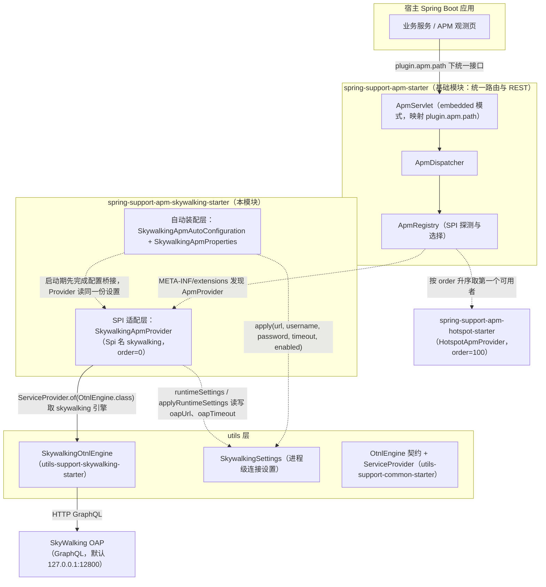
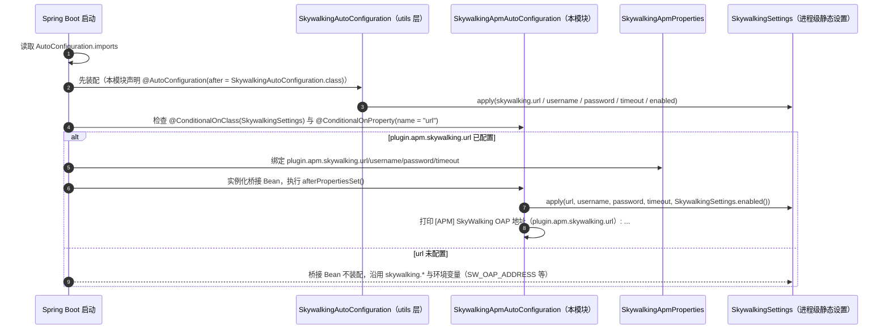

# spring-support-apm-skywalking-starter

Apache SkyWalking 的 APM 扩展模块：把 utils 层 `utils-support-skywalking-starter` 的 `SkywalkingOtnlEngine`（OAP GraphQL 数据面）适配成 `spring-support-apm-starter` 的 `ApmProvider` SPI（名 `skywalking`，`order=0`），并把 `plugin.apm.skywalking.*` 配置桥接进进程级 `SkywalkingSettings`。在 spring-support 体系中，它是 APM「查询侧」的 SkyWalking 实现：统一 REST 接口、路由与探测全部由基础模块 `spring-support-apm-starter` 提供，本模块只做「适配 + 配置桥接」——不声明任何 Controller/Servlet，也不含 HTTP 客户端逻辑。

## 1. 架构图



依赖方向：宿主 → 本模块 → 基础模块 + utils 层；本模块与 `spring-support-apm-hotspot-starter` 是并列的 `ApmProvider` 实现，互不依赖。

## 2. 核心流程图

本模块的核心动作发生在启动期（配置桥接），选「自动装配流程」：



请求期路径（本模块不参与路由）：`ApmServlet → ApmDispatcher → ApmRegistry`（按 `order` 升序取第一个可用 Provider）→ `SkywalkingApmProvider#engine()`（双检锁惰性取 utils 引擎并缓存；SPI 缺失返回 `null`，该实现即视为不可用）→ `SkywalkingOtnlEngine` 查询 OAP。`applyRuntimeSettings` 后会 `close()` 丢掉状态缓存与连接，同一引擎实例按新地址重建。

## 3. 能力清单

| 能力域 | 关键类 | 入口/触发方式 |
| --- | --- | --- |
| `ApmProvider` SPI 实现 | `com.chua.starter.apm.skywalking.SkywalkingApmProvider`（`@Spi("skywalking")`，`order()=0`） | `META-INF/extensions/com.chua.starter.apm.support.spi.ApmProvider` 登记，`ApmRegistry#detect()` 经 `ServiceProvider` 发现并按 `order` 升序排序 |
| 数据面引擎接入 | `SkywalkingApmProvider#engine()` | `ServiceProvider.of(OtnlEngine.class).getExtension("skywalking")`，双检锁惰性创建并缓存；获取失败返回 `null`（仅 debug 日志） |
| 运行期可改项声明 | `SkywalkingApmProvider#runtimeSettings()` | 返回 `oapUrl` / `oapTimeout` 当前值，经基础模块 `GET {plugin.apm.path}/config` 展示 |
| 运行期可改项应用 | `SkywalkingApmProvider#applyRuntimeSettings(Map)` | `POST {plugin.apm.path}/config` 携带 `oapUrl` / `oapTimeout` 时触发；校验通过后写入 `SkywalkingSettings` 并重置引擎缓存 |
| 配置桥接 | `com.chua.starter.apm.skywalking.config.SkywalkingApmAutoConfiguration` | 显式配置 `plugin.apm.skywalking.url` 时自动装配（键不存在则不装配；写成空串仍会装配，但 `apply` 跳过空地址），`afterPropertiesSet()` 写入进程级设置 |
| 配置属性承载 | `com.chua.starter.apm.skywalking.config.SkywalkingApmProperties` | `@ConfigurationProperties(prefix = "plugin.apm.skywalking")` |
| 数据面（间接复用） | `com.chua.skywalking.support.engine.SkywalkingOtnlEngine`（utils 层） | OAP GraphQL 查询、状态/服务目录缓存、OAP 版本适配 |

热改键名常量：`SkywalkingApmProvider.KEY_OAP_URL = "oapUrl"`、`SkywalkingApmProvider.KEY_OAP_TIMEOUT = "oapTimeout"`（单次查询超时，毫秒）。鉴权信息刻意不进热改项，避免界面回显明文口令。

## 4. Bean 能力矩阵

本模块刻意保持极简：**1 个自动配置类 + 1 个属性类**，无 `@Bean` 方法、无 Controller/Servlet/定时任务；Provider 与引擎都是 SPI 实例，不是 Spring Bean。

| Bean 名 | 类型 | 装配条件（含默认值） | 可否覆盖 | 典型用途 |
| --- | --- | --- | --- | --- |
| `com.chua.starter.apm.skywalking.config.SkywalkingApmAutoConfiguration` | 自动配置类，实现 `InitializingBean` | `@ConditionalOnClass(SkywalkingSettings.class)` 且 `@ConditionalOnProperty(prefix = "plugin.apm.skywalking", name = "url")`（未设 `matchIfMissing`：必须显式配置 `url` 才装配） | 类内无 `@Bean`、无 `@ConditionalOnMissingBean`；只能用 `spring.autoconfigure.exclude` 或 `@SpringBootApplication(exclude = ...)` 整体排除 | 启动时把 `plugin.apm.skywalking.*` 桥接进 `SkywalkingSettings` |
| `plugin.apm.skywalking-com.chua.starter.apm.skywalking.config.SkywalkingApmProperties`（`@EnableConfigurationProperties` 注册，Bean 名按 Spring 规则为「前缀-全限定类名」） | `SkywalkingApmProperties` | 随桥接类启用（同上两个条件） | 属性值可随时用 `application.yml` / `-Dplugin.apm.skywalking.*` 覆盖；Bean 本身不做替换 | 构造器注入桥接类，承载 4 个连接参数 |

**不是 Bean 的关键实例（SPI 创建，勿用 `@Autowired` 获取）：** `SkywalkingApmProvider` 由 `ApmRegistry` 从 `META-INF/extensions` 反射实例化并管理（候选列表、按 `order` 选择、`close()` 释放）；`SkywalkingOtnlEngine` 由 Provider 的 `engine()` 惰性创建并持有，`applyRuntimeSettings` 后 `close()` 丢缓存、实例可复用。

基础模块 `spring-support-apm-starter` 带入的 Bean（`apmRegistry`、`apmDispatcher`、`apmServletRegistration` 等，外层开关 `plugin.apm.enabled`，默认 `true`）见其自身文档，不在本模块矩阵内。

## 5. 完整配置

本模块唯一配置类 `SkywalkingApmProperties`（无嵌套类），前缀 `plugin.apm.skywalking`，逐字段如下：

| 配置路径 | 类型 | 默认值 | 说明 |
| --- | --- | --- | --- |
| `plugin.apm.skywalking.url` | `String` | `""`（空） | OAP 地址，如 `http://127.0.0.1:12800`；留空表示沿用 `skywalking.url`；写入时经 `SkywalkingSettings#normalize`（去尾部 `/`、剥 `/graphql` 后缀）。**只有显式配置该键（值不为 `false`）才装配整个桥接 Bean**；写成空串仍会装配，但不会改写地址 |
| `plugin.apm.skywalking.username` | `String` | `""`（空） | OAP Basic 鉴权用户名；桥接生效时随 `apply` 覆盖进程级值（非 null 即覆盖，空串也会覆盖，见第 9 节） |
| `plugin.apm.skywalking.password` | `String` | `""`（空） | OAP Basic 鉴权密码；同上 |
| `plugin.apm.skywalking.timeout` | `long` | `0` | 单次查询超时（毫秒）；`>0` 才覆盖，`<=0` 表示沿用 utils 层 `skywalking.timeout`（默认 `5000`） |

相关但定义在其它模块的前缀（交叉引用，便于排障）：

- `skywalking.*`（utils 层 `SkywalkingProperties`）：`enabled=true`、`url=http://127.0.0.1:12800`、`username=""`、`password=""`、`timeout=5000`。
- `plugin.apm.*`（基础模块 `ApmProperties`）：`enabled=true`、`type=""`（留空自动探测）、`mode=embedded`、`path=/api/apm/v1`、`host=0.0.0.0`、`port=12801`、`serverType=jdk`、`detectInterval=10000`、`settingsFile=config/apm-settings.properties`、`registerServiceInfo=true`。

优先级：`plugin.apm.skywalking.*` 覆盖 `skywalking.*`（`@AutoConfiguration(after = SkywalkingAutoConfiguration.class)` 保证执行顺序）；系统属性 `-Dskywalking.url` 与环境变量 `SW_OAP_ADDRESS` / `SW_OAP_USERNAME` / `SW_OAP_PASSWORD` 在 `SkywalkingSettings` 静态初始化时兜底，Spring 侧 `apply` 写入的值最终生效。

### 5.1 逐项配置示例

按功能分组给出每个配置项的含义、默认值与 YAML 示例；默认值均与 `SkywalkingApmProperties` 的字段初始化代码一致。

#### 连接地址

**`plugin.apm.skywalking.url`**

- 含义：SkyWalking OAP 的 GraphQL 服务地址。写入进程级设置时会规范化：去掉尾部 `/`、剥离 `/graphql` 后缀（如 `http://127.0.0.1:12800/graphql` 会被存为 `http://127.0.0.1:12800`）。
- 默认值：`""`（空串）。留空表示不改写地址，沿用 utils 层 `skywalking.url`（最终回落 `http://127.0.0.1:12800`）。
- 特别注意：只有显式配置本键，整个桥接 Bean（`SkywalkingApmAutoConfiguration`）才会装配；键不存在时本模块不参与配置。

```yaml
plugin:
  apm:
    skywalking:
      url: http://skywalking-oap:12800
```

#### 鉴权

**`plugin.apm.skywalking.username`**

- 含义：OAP 开启 Basic 鉴权时的用户名。
- 默认值：`""`（空串）。未配置 `url`（桥接不装配）时，留空即沿用 `skywalking.username`；桥接一旦生效，本值非 null 即覆盖进程级用户名——空串也会覆盖，**不会**回落到 `skywalking.username`。
- 生产建议：OAP 开启鉴权时务必显式填写，或改用环境变量 `SW_OAP_USERNAME`。

```yaml
plugin:
  apm:
    skywalking:
      username: your-username
```

**`plugin.apm.skywalking.password`**

- 含义：OAP Basic 鉴权密码。
- 默认值：`""`（空串）。覆盖行为与 `username` 相同：桥接生效时空串也会覆盖进程级密码，不会回落到 `skywalking.password`。
- 生产建议：不要把真实口令提交进仓库；用环境变量 `SW_OAP_PASSWORD`、启动参数或配置中心注入。

```yaml
plugin:
  apm:
    skywalking:
      password: change-me
```

#### 超时

**`plugin.apm.skywalking.timeout`**

- 含义：单次 OAP 查询的超时时间（毫秒）。
- 默认值：`0`。`<=0` 时 `SkywalkingSettings#apply` 不覆盖，沿用 utils 层 `skywalking.timeout`（默认 `5000` 毫秒）；只有 `>0` 才会覆盖进程级超时。

```yaml
plugin:
  apm:
    skywalking:
      timeout: 5000
```

### 5.2 完整配置示例

生产环境推荐写法（密码经环境变量注入，YAML 中只留占位符）：

```yaml
plugin:
  apm:
    enabled: true                        # APM 模块总开关
    type: skywalking                     # 可留空：自动探测时本实现 order=0，优先被选中
    mode: embedded                       # 嵌入模式：接口随宿主端口暴露（{plugin.apm.path}/**）
    path: /api/apm/v1                    # 统一 REST 前缀
    skywalking:
      url: http://skywalking-oap:12800   # 必填：键不存在则桥接 Bean 不装配
      username: your-username            # OAP 开启 Basic 鉴权时填写
      password: ${SW_OAP_PASSWORD:change-me}
      timeout: 5000                      # 单次查询超时（毫秒）

# 兜底前缀（utils 层）：本模块未覆盖的键按此生效，可不配
skywalking:
  enabled: true
  url: http://127.0.0.1:12800
  timeout: 5000
```

### 5.3 生产注意事项

1. **`url` 是桥接开关**：只配 `username`/`password`/`timeout` 而不配 `url`，桥接 Bean 不装配，这些值全部被忽略（见 9.3 节）。
2. **鉴权覆盖陷阱**：桥接生效后，`username`/`password` 的空串也会覆盖进程级值，不会回落到 `skywalking.*`。OAP 开启鉴权的生产环境必须在 `plugin.apm.skywalking` 下显式填写，或使用环境变量 `SW_OAP_USERNAME` / `SW_OAP_PASSWORD`，避免启动后鉴权被清空导致 OAP 返回 401。
3. **口令管理**：密码属于部署机密，建议经环境变量、启动参数或配置中心注入；运行期热改接口（`POST {plugin.apm.path}/config`）刻意不接受鉴权项，避免界面回显明文口令。
4. **地址写法**：Spring 配置里建议写全 `http://host:port`；尾部 `/` 与 `/graphql` 后缀会被自动剥掉。环境变量 `SW_OAP_ADDRESS` 允许省略协议头（自动补 `http://`），但 `plugin.apm.skywalking.url` 不要省略协议头。
5. **超时规划**：跨机房或 OAP 负载高时适当调大 `timeout`；超时只影响单次查询，不会中断进程，按 OAP 实际负载与网络时延调整即可。
6. **多引擎并存**：与 `spring-support-apm-hotspot-starter` 并存时本实现 `order=0` 优先；需要固定引擎时显式配 `plugin.apm.type: skywalking`，避免自动探测受另一实现可用性影响。
7. **暴露面**：嵌入模式下 APM 接口随宿主端口暴露在 `plugin.apm.path` 下，生产环境建议经网关收敛并做访问控制；`plugin.apm.enabled=false` 可整体关闭 APM 模块。

## 6. 使用方式

### 6.1 Maven 坐标

```xml
<dependency>
    <groupId>com.chua</groupId>
    <artifactId>spring-support-apm-skywalking-starter</artifactId>
    <version>4.0.0.51</version>
</dependency>
```

它会传递 `spring-support-apm-starter`（SPI、注册表、路由、全部 REST 接口）、`utils-support-skywalking-starter`（OAP 数据面）与 `utils-support-common-starter`（`OtnlEngine` 契约），无需重复引入。

### 6.2 最小启用示例

```yaml
plugin:
  apm:
    enabled: true
    type: skywalking          # 可留空：自动探测时本实现 order=0，优先被选中
    skywalking:
      url: http://127.0.0.1:12800   # 必填：键不存在则桥接 Bean 不装配
      timeout: 5000
```

启动后验证：`GET {plugin.apm.path}/status`（默认 `/api/apm/v1/status`），`data.candidates` 应含 `"name":"skywalking"`，`data.present=true` 表示存在可用实现；`GET /config` 的 `engine.settings` 应回显当前 `oapUrl` / `oapTimeout`。编程式调用（可选）：`new SkywalkingApmProvider()` 后调 `engine()` / `applyRuntimeSettings(Map.of("oapUrl", "http://10.0.0.5:12800"))`；本模块无链式 API、无 Builder。

### 6.3 可选依赖说明

- 本模块**无 `optional` 依赖**、无第三方 SkyWalking SDK：OAP 访问走 utils 层自研 `SkywalkingOapClient`（HTTP + Jackson），不需要官方 agent。
- `spring-boot-configuration-processor` 与 `lombok` 为 `provided`，只参与编译，不进入运行期依赖。
- 若运行期缺 `utils-support-skywalking-starter`：`@ConditionalOnClass(SkywalkingSettings)` 不满足 → 桥接 Bean 不装配；同时 `OtnlEngine` SPI 查不到实现 → `engine()` 返回 `null`，本 Provider 永远不可用（`/status` 中 `available=false`）。
- 嵌入模式（默认）的 Servlet 出口依赖宿主的 `jakarta.servlet.Servlet`（Spring Boot Web 应用自带）；`plugin.apm.mode=standalone` 时不需要 Servlet 容器。

## 7. 使用场景

### 7.1 适用

- 生产环境已部署 Apache SkyWalking（OAP + agent），希望用统一 REST 接口/观测台读取服务、链路、拓扑、指标、告警、日志与性能剖析。
- 同一台机器并存多种 APM（如同时挂 SkyWalking agent 与自研 hotspot agent），需要按优先级自动选择：本实现 `order=0`，优先于 hotspot（`order=100`）。
- 需要运行期热改 OAP 地址/超时（`POST /config`），且改完立即丢弃旧连接与状态缓存。
- 希望 APM 相关运维配置收在 `plugin.apm` 命名空间（`plugin.apm.skywalking.*`），与平台其它 APM 开关放在一起管理。

### 7.2 不适用/慎用

- 没有外部 OAP、只想要进程内无后端的插桩 → 用 `spring-support-apm-hotspot-starter`（数据来自进程内，需 `-javaagent` 挂载，未挂载时自动不可用）。
- 只想收集本进程 tracing 上报到 SkyWalking、不需要查询接口 → 只装官方 agent 即可，本模块是「查询侧」适配。

### 7.3 与相邻模块的取舍

| 关系 | 模块 | 取舍 |
| --- | --- | --- |
| 依赖（基础） | `spring-support-apm-starter` | `ApmProvider` SPI、`ApmRegistry`、`ApmDispatcher`、全部 REST 接口都在基础模块；本模块只补 skywalking 实现 |
| 依赖（数据面） | `utils-support-skywalking-starter` | OAP GraphQL 查询、缓存、版本适配都在 utils 层；本模块零 HTTP 逻辑 |
| 并列实现 | `spring-support-apm-hotspot-starter` | `order=100`；同机并存时默认选 skywalking，`plugin.apm.type` 可显式指定 |
| 配置命名空间 | utils 层 `skywalking.*` | `plugin.apm.skywalking.*` 优先级更高；两份都可用，APM 运维配置建议收在 `plugin.apm` 下 |

## 8. 扩展点

本模块**不新增 SPI、接口或抽象类**：它本身是 `ApmProvider` 的一个实现（除 `META-INF/extensions` 登记外，没有 `META-INF/services`，也没有其它扩展接口）。可复用的是它示范的扩展方式：

| 扩展点 | 定义位置 | 本模块的用法 |
| --- | --- | --- |
| `ApmProvider#runtimeSettings()` / `#applyRuntimeSettings(Map)` | `spring-support-apm-starter` 的 `ApmProvider` 接口（default 方法） | 声明并应用 `oapUrl` / `oapTimeout`；鉴权信息不进热改项 |
| `ApmProvider#order()` | 同上 | 返回 `0`，使 skywalking 在自动探测中优先 |
| `OtnlEngine` SPI | `utils-support-common-starter` | 数据面由 utils 层 `SkywalkingOtnlEngine` 实现，本模块经 `ServiceProvider` 取用 |

照此新增一种 APM 引擎：1) 新建 `spring-support-apm-xx-starter`，实现 `ApmProvider`（`name()` / `order()` / `engine()`，需要热改参数时覆盖 `runtimeSettings()` / `applyRuntimeSettings(Map)`）；2) 在 `META-INF/extensions/com.chua.starter.apm.support.spi.ApmProvider` 登记 `名称=实现类`；3) 数据面实现 `OtnlEngine`（优先在 utils 层复用/扩展）并在对应 extensions 文件登记。上层 `ApmRegistry` / `ApmDispatcher` / 设置页无需任何改动即可识别新引擎。

## 9. 常见问题

**9.1 引入了依赖，但 `/status` 的 `candidates` 里没有 `skywalking`**
问题在依赖而非配置：`spring-support-apm-skywalking-starter` 缺失或被打包裁剪（`META-INF/extensions/com.chua.starter.apm.support.spi.ApmProvider` 不在 jar 里）。确认坐标与打包方式。

**9.2 有 `skywalking` 候选但 `available=false`（提示 OAP 不可达）**
实现已加载，问题在连通性或地址。核对 `GET /config` 回显的 `engine.settings.oapUrl` 与实际 OAP；地址来源优先级为 `plugin.apm.skywalking.url` → `-Dskywalking.url` → 环境变量 `SW_OAP_ADDRESS` → 默认 `http://127.0.0.1:12800`，Spring 侧 `apply` 写入的值最终生效。排障可开 `logging.level.com.chua.starter.apm=DEBUG`（`engine()` 获取失败只打 debug）。

**9.3 启动日志里没有 `[APM] SkyWalking OAP 地址（plugin.apm.skywalking.url）: ...`**
桥接类没装配：`@ConditionalOnProperty` 只认 `plugin.apm.skywalking.url`，只配 `timeout`/`username` 不触发；此时这些值被全部忽略（只想改超时又不写 `url` 时，直接配 utils 层 `skywalking.timeout`）。另注意鉴权覆盖：`SkywalkingSettings#apply` 对非 null 的 `username`/`password` 无条件赋值，而本模块属性默认值是空串——桥接一旦生效就会把进程内鉴权置为空串，**不会**回落到 `skywalking.username`/`skywalking.password`；需要鉴权请在 `plugin.apm.skywalking` 下显式填写（或用环境变量 `SW_OAP_USERNAME`/`SW_OAP_PASSWORD`）。

**9.4 与兄弟模块冲突、开关属性与 Spring Boot 4 兼容**
与 hotspot 并存不冲突：`ApmRegistry` 按 `order` 升序取第一个可用者，`plugin.apm.type` 可显式指定引擎。开关分两层：`plugin.apm.enabled=false` 关闭整个 APM 模块（`/status` 返回 `present=false`）；`skywalking.enabled=false` 只关闭 SkyWalking 数据源。Boot 4 兼容：自动配置走 `META-INF/spring/org.springframework.boot.autoconfigure.AutoConfiguration.imports`（本模块没有也不需要 `spring.factories`），嵌入模式依赖 `jakarta.servlet` 命名空间；本模块随父 POM `4.0.0.51`（`spring-boot-starter-parent` `4.1.2`，Java `25`）构建，升级 Boot 4 无需额外适配；若宿主仍是 `javax.servlet` 旧容器，嵌入模式不会装配 Servlet，可改用 `standalone` 模式。
