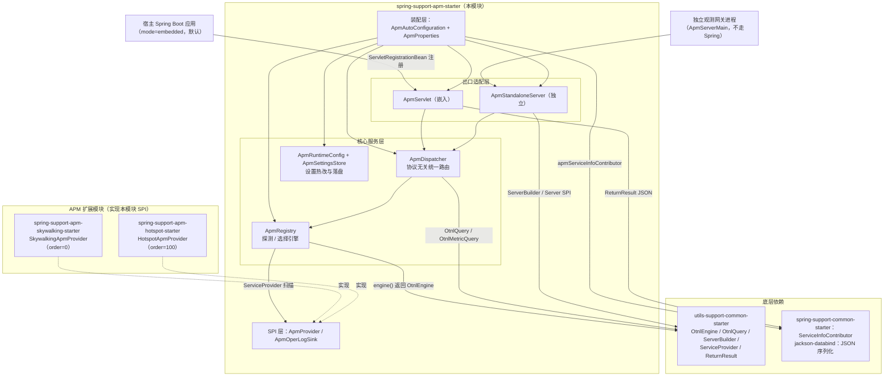
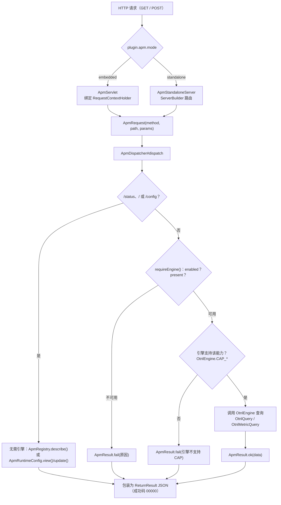

# spring-support-apm-starter

APM 基础模块：定义 `ApmProvider` SPI，把任意 APM 数据面（utils 层统一的 `OtnlEngine`）聚合成一套**协议无关**的 REST 接口，并支持「嵌入宿主 Servlet」与「独立 HTTP 服务」两种启动方式。在 spring-support 体系中，它是可观测能力的**统一查询面**：自身不含任何具体 APM 实现，业务侧只依赖本模块与 `OtnlEngine` 契约，不直接依赖任何 APM SDK，新增一种 APM 等于新增一个扩展模块。没有可用引擎时模块照常装配，`/status` 返回 `present=false` 与原因，前端据此渲染「本服务器未接入 APM」的降级页。当前版本 `4.0.0.51`（跟随父 POM `spring-support-parent-starter`），基于 Spring Boot `4.1.2`、Java `25`。

## 1. 架构图



依赖方向：扩展模块 → 本模块 → utils / common 层。核心链路：`ApmProvider 实现 → ApmRegistry（选择）→ ApmDispatcher（路由）→ ApmServlet / ApmStandaloneServer（出口）`。

## 2. 核心流程图



要点：探测结果由 `ApmRegistry` 按 `plugin.apm.detect-interval`（下限 1000ms）缓存；`/metrics-batch` 单次最多 `MAX_BATCH_SERIES = 24` 条曲线；`POST /config` 执行后经 `ApmOperLogSink`（DataSource 存在时自动装配默认实现）留痕，并写入 `ApmSettingsStore`（临时文件 + 原子 move）。

## 3. 能力清单

| 能力域 | 关键类 | 入口 / 触发方式 |
| --- | --- | --- |
| SPI 定义 | `com.chua.starter.apm.support.spi.ApmProvider` | 由各 `spring-support-apm-xx-starter` 实现 |
| 引擎探测与选择 | `ApmRegistry`（`detect` / `provider` / `engine` / `candidates` / `describe`） | 首次访问状态或 `plugin.apm.detect-interval` 到期自动探测 |
| 统一路由 | `ApmDispatcher#dispatch(ApmRequest)` | `{plugin.apm.path}/**`，默认 `/api/apm/v1/**` |
| 嵌入模式 | `ApmServlet` + `ServletRegistrationBean` | `ApmAutoConfiguration#apmServletRegistration`，映射 `path + "/*"` |
| 独立模式 | `ApmStandaloneServer`（内部用 utils 层 `ServerBuilder`） | `plugin.apm.mode=standalone` |
| 独立进程入口 | `ApmServerMain#main(String[])` | `java -cp ... com.chua.starter.apm.support.ApmServerMain` |
| 运行期设置 | `ApmRuntimeConfig`（`view` / `update` / `restore`） | `GET /config`、`POST /config` |
| 设置落盘 | `ApmSettingsStore`（`load` / `save` / `file`） | `plugin.apm.settings-file` 指向的 properties 文件 |
| 状态描述模型 | `ApmDescriptor`、`ApmDescriptor.ApmCandidate` | `GET /status` |
| 请求 / 结果模型 | `ApmRequest`（`get` / `param`）、`ApmResult`（`ok` / `fail`） | 两种模式共用，逐请求构造 |
| 写操作留痕 | `ApmOperLogSink#record(ApmRequest, ApmResult, long)` | 仅 `POST /config` 分支回调 |
| 服务信息面板 | `ApmAutoConfiguration#apmServiceInfoContributor` | `ServiceInfoContributor` Bean，登记 APM 状态与入口 |
| 自动配置 | `ApmAutoConfiguration` | `META-INF/spring/org.springframework.boot.autoconfigure.AutoConfiguration.imports` |

### 统一接口清单

路径相对 `plugin.apm.path`（默认 `/api/apm/v1`），只接受 `GET` / `POST`，其它方法直接失败；能力常量均为 `OtnlEngine` 的 `CAP_*`。

| 方法 | 路径 | 说明 | 关键参数 | 能力判断 |
| --- | --- | --- | --- | --- |
| GET | `/status`（或 `/`） | 是否存在/启用了 APM，返回 `ApmDescriptor` | 无 | 无（永远可用） |
| GET | `/capabilities` | 当前引擎支持的能力清单 | 无 | 需引擎可用 |
| GET | `/overview` | 健康度 + 描述 | `minutes` / `startTime` / `endTime` / `service` | 需引擎可用 |
| GET | `/services` | 服务目录 | 时间窗口 / `service` | `CAP_SERVICES` |
| GET | `/instances` | 服务实例 | `service`（必填） | `CAP_INSTANCES` |
| GET | `/endpoints` | 端点 | `service`（必填）、`keyword` | `CAP_ENDPOINTS` |
| GET | `/traces` | 链路列表 | `service` / `state` / `pageNum` / `pageSize` / `orderByDuration` | `CAP_TRACES` |
| GET | `/trace/{traceId}` | 链路详情（含 Span） | 路径参数 `traceId` | `CAP_TRACES` |
| GET | `/topology` | 服务拓扑 | `service`（空表示全局） | `CAP_TOPOLOGY` |
| GET | `/topology/multi` | 多服务合并拓扑 | `services=a,b`（必填，逗号分隔） | `CAP_TOPOLOGY` |
| GET | `/metrics` | 指标时序 | `name`（必填）、`scope` / `service` / `instance` / `endpoint` / `step` | `CAP_METRICS` |
| GET | `/metric-definitions` | 指标定义（下拉框） | `scope`（缺省 `SERVICE`） | 需引擎可用 |
| GET | `/alarms` | 告警 | `keyword` / 时间窗口 | `CAP_ALARMS` |
| GET | `/alerts` | 告警（`/alarms` 的别名） | 同上 | `CAP_ALERTS` |
| GET | `/logs` | 日志 | `service` / `keyword` | `CAP_LOGS` |
| GET | `/profiles` | 性能剖析任务列表 | `service` / `endpoint` | `CAP_PROFILES` |
| GET | `/profiles/{taskId}/segments`、`/profiles/{taskId}/analysis` | 剖析采样片段 / 剖析结果（线程栈树） | 路径参数 `taskId` | `CAP_PROFILES` |
| GET | `/metrics-batch` | 批量指标（多实体对比，上限 24 条曲线） | `names=a,b`（必填）、`services=a,b`、`scope` | `CAP_METRICS` |
| GET | `/infra-3d` | 全局拓扑 + 分层信息（3D 基础设施图） | `minutes` | `CAP_TOPOLOGY` |
| GET | `/config` | APM 设置视图 | 无 | 无 |
| POST | `/config` | 保存设置（热改并落盘） | `enabled` / `type` / `detectInterval` / 引擎项（如 `oapUrl`）/ `action=detect` | 无 |

查询条件由 `ApmDispatcher` 统一解析：`minutes` 默认 `30`，`pageNum` 默认 `1`，`pageSize` 默认 `20`，`step` 缺省 `MINUTE`，`scope` 缺省 `OtnlScope.SERVICE`，`state` 缺省 `OtnlTraceState.ALL`。

## 4. Bean 能力矩阵

全部 Bean 由 `ApmAutoConfiguration` 声明；该类受类级 `@ConditionalOnProperty(prefix = "plugin.apm", name = "enabled", havingValue = "true", matchIfMissing = true)` 控制，即 `plugin.apm.enabled=false` 时整个模块不装配。

| Bean 名 | 类型 | 装配条件（除类级开关外） | 可否覆盖 | 典型用途 |
| --- | --- | --- | --- | --- |
| `apmRegistry` | `ApmRegistry` | `@ConditionalOnMissingBean`（`destroyMethod = "close"`） | 可：自定义同类型 Bean | 引擎探测与选择：`describe()` / `provider()` / `detect()` |
| `apmRuntimeConfig` | `ApmRuntimeConfig` | `@ConditionalOnMissingBean`；装配时执行 `restore()` 套用落盘设置 | 可：自定义同类型 Bean | 设置热改：`view()` / `update(Map)` |
| `apmDispatcher` | `ApmDispatcher` | `@ConditionalOnMissingBean`；可选注入 `ObjectProvider<ApmOperLogSink>` | 可：自定义同类型 Bean | 协议无关统一入口：`dispatch(ApmRequest)` |
| `apmServletRegistration` | `ServletRegistrationBean<ApmServlet>` | `@ConditionalOnClass(name = "jakarta.servlet.Servlet")` + `plugin.apm.mode=embedded`（缺省视为 embedded）；**没有** `@ConditionalOnMissingBean` | 不可按名覆盖：只能通过 `mode` / `path` 配置调整或关闭 | 容器按 `path/*` 自动注册 Servlet（`loadOnStartup=1`、支持异步） |
| `apmStandaloneServer` | `ApmStandaloneServer` | `@ConditionalOnMissingBean` + `plugin.apm.mode=standalone`（须显式指定）；装配时 `start()`，`destroyMethod = "stop"` | 可：自定义同类型 Bean | 独立 HTTP 服务生命周期：`isRunning()` / `url()` / `stop()` |
| `apmServiceInfoContributor` | `ServiceInfoContributor` | `@ConditionalOnMissingBean(name = "apmServiceInfoContributor")` + `plugin.apm.register-service-info=true`（缺省 true） | 可：按 Bean 名覆盖 | 向服务信息面板登记 APM 状态与入口 |

补充：两个出口 Bean 需要容器提供 `ObjectMapper`（本模块强制依赖 `jackson-databind`，Spring Boot 的 Jackson 自动配置会提供）；本模块没有 `@RestController`（接口由 `ApmServlet` / `ApmStandaloneServer` 提供，不走 Spring MVC），也没有 Mapper、数据表与定时任务。

## 5. 完整配置

配置类仅 `ApmProperties`（`@ConfigurationProperties(prefix = "plugin.apm")`，经 `@EnableConfigurationProperties` 装配，无嵌套类）。

| 配置路径 | 类型 | 默认值 | 说明 |
| --- | --- | --- | --- |
| `plugin.apm.enabled` | `boolean` | `true` | 模块总开关；`false` 时整个自动配置不装配；可热改（接受 `true/false/1/0/on/off`） |
| `plugin.apm.type` | `String` | `""`（空） | 引擎名（`skywalking` / `opentelemetry` / `hotspot`）；空 = 按 `ApmProvider#order()` 自动探测取第一个可用者；可热改 |
| `plugin.apm.mode` | `String` | `embedded` | `embedded` = 注册 `ApmServlet` 随宿主启动；`standalone` = 单起 HTTP 服务；需重启 |
| `plugin.apm.path` | `String` | `/api/apm/v1` | 统一 REST 前缀（嵌入 = Servlet 映射，独立 = Server 路由），装配时规范化（以 `/` 开头、去尾部 `/`）；需重启 |
| `plugin.apm.host` | `String` | `0.0.0.0` | 独立模式监听地址（`ApmServerMain` 缺省是 `127.0.0.1`）；仅 standalone；需重启 |
| `plugin.apm.port` | `int` | `12801` | 独立模式监听端口；仅 standalone；需重启 |
| `plugin.apm.server-type` | `String` | `jdk` | 独立模式底层 `Server` SPI 类型（utils 层 `ServerBuilder#type`）；需重启 |
| `plugin.apm.detect-interval` | `long` | `10000` | 探测结果缓存毫秒数，实际 TTL = `Math.max(1000, detectInterval)`；可热改（下限 1000） |
| `plugin.apm.settings-file` | `String` | `config/apm-settings.properties` | 运行期可改设置落盘位置（UTF-8 properties，临时文件 + 原子 move）；相对路径按进程工作目录解析；需重启 |
| `plugin.apm.register-service-info` | `boolean` | `true` | 是否登记到统一服务信息面板（`ServiceInfoRegistry`） |

### 逐项配置示例

按功能分组，逐项给出含义、默认值与 YAML 示例（均可直接粘贴到 `application.yml`）。

#### 总开关与引擎选择（支持运行期热改）

- `plugin.apm.enabled`：模块总开关，`false` 时整个自动配置不装配。默认 `true`。

```yaml
plugin:
  apm:
    enabled: true
```

- `plugin.apm.type`：引擎名（`skywalking` / `opentelemetry` / `hotspot`），留空按 `ApmProvider#order()` 自动探测取第一个可用者。默认 `""`（空）。

```yaml
plugin:
  apm:
    type: skywalking
```

- `plugin.apm.detect-interval`：探测结果缓存毫秒数，实际 TTL = `Math.max(1000, detectInterval)`；热改时低于 1000 会被拒绝。默认 `10000`。

```yaml
plugin:
  apm:
    detect-interval: 10000
```

#### 启动方式与访问入口（改后需重启）

- `plugin.apm.mode`：`embedded` = 注册 `ApmServlet` 随宿主启动；`standalone` = 独立 HTTP 服务。默认 `embedded`。

```yaml
plugin:
  apm:
    mode: embedded
```

- `plugin.apm.path`：统一 REST 前缀，装配时规范化（以 `/` 开头、去尾部 `/`）。默认 `/api/apm/v1`。

```yaml
plugin:
  apm:
    path: /api/apm/v1
```

- `plugin.apm.host`：独立模式监听地址。默认 `0.0.0.0`（独立进程入口 `ApmServerMain` 命令行缺省是 `127.0.0.1`）。

```yaml
plugin:
  apm:
    host: 0.0.0.0
```

- `plugin.apm.port`：独立模式监听端口，嵌入模式不使用（接口随宿主端口暴露）。默认 `12801`。

```yaml
plugin:
  apm:
    port: 12801
```

- `plugin.apm.server-type`：独立模式底层 `Server` SPI 类型（utils 层 `ServerBuilder#type`）。默认 `jdk`。

```yaml
plugin:
  apm:
    server-type: jdk
```

#### 设置落盘与服务信息面板

- `plugin.apm.settings-file`：运行期可改设置（UTF-8 properties，临时文件 + 原子 move）的落盘位置，相对路径按进程工作目录解析，留空回落默认值。默认 `config/apm-settings.properties`。

```yaml
plugin:
  apm:
    settings-file: config/apm-settings.properties
```

- `plugin.apm.register-service-info`：是否登记到统一服务信息面板（`ServiceInfoRegistry`）。默认 `true`。

```yaml
plugin:
  apm:
    register-service-info: true
```

### 完整 YAML 示例

嵌入模式（最常见，随宿主服务一起启动）：

```yaml
plugin:
  apm:
    enabled: true                                 # 模块总开关
    type: skywalking                              # 引擎名；留空自动探测
    mode: embedded                                # 随宿主 Servlet 启动
    path: /api/apm/v1                             # 统一 REST 前缀
    detect-interval: 10000                        # 探测缓存毫秒数（下限 1000）
    settings-file: config/apm-settings.properties # 热改设置落盘文件
    register-service-info: true                   # 登记到服务信息面板
```

独立观测网关（单独进程，或用 `ApmServerMain` 启动）：

```yaml
plugin:
  apm:
    enabled: true
    type: skywalking
    mode: standalone                              # 独立 HTTP 服务
    host: 0.0.0.0                                 # 监听地址
    port: 12801                                   # 监听端口
    server-type: jdk                              # 底层 Server SPI 类型
    path: /api/apm/v1
    detect-interval: 10000
    settings-file: config/apm-settings.properties
    register-service-info: true
```

部署侧系统属性（不是 `ApmProperties` 字段）：`-Dplugin.apm.enabled.locked=true` 锁定界面开关；`-Dplugin.apm.type=xxx` 固定引擎（设置文件里的 `type` 被忽略）；`-Dskywalking.url` / `-Dplugin.apm.skywalking.url` / 环境变量 `SW_OAP_ADDRESS` 固定 OAP 地址（设置文件里的 `oapUrl` 不再覆盖）。

热改边界（`ApmRuntimeConfig`）：可热改键为 `enabled`、`type`、`detectInterval` 与引擎自声明项（如 `oapUrl`），`POST /config` 立即生效并落盘、改完自动重新探测；`mode`、`path`、`port`、`serverType`、`host`、`settingsFile` 属于 `RESTART_KEYS`，携带保存会抛「不支持热改」，必须改启动参数并重启。

### 生产注意事项

- **访问控制**：嵌入模式接口是独立 `Servlet`，不经过 Spring MVC 的鉴权拦截器、`@ControllerAdvice` 与 `@SysLog` 切面；对外暴露时请在网关或服务器层做访问控制；写操作留痕由 DataSource 条件下装配的默认 `ApmOperLogSink` 完成。
- **重启项不要热改**：`mode`、`path`、`host`、`port`、`server-type`、`settings-file` 改了必须重启；`POST /config` 携带这些键会直接报「不支持热改」。
- **探测频率**：`detect-interval` 不要低于 1000ms，否则等于每次请求都探活，可能把 OAP 打穿；热改低于该值会被拒绝。
- **监听面**：独立模式 `host=0.0.0.0` 监听所有网卡，注意与网络隔离策略配合；嵌入模式接口路径为 `path + "/*"`，随宿主端口暴露。
- **设置文件权限**：`settings-file` 所在目录需要写权限；写入失败时设置仅本次运行内生效（`POST /config` 响应 `persisted=false`），进程重启后丢失。
- **部署侧固定口径优先**：`-Dplugin.apm.enabled.locked=true` 锁定界面开关；`-Dplugin.apm.type=xxx` 固定引擎后设置文件里的 `type` 被忽略；`-Dskywalking.url` / `-Dplugin.apm.skywalking.url` / 环境变量 `SW_OAP_ADDRESS` 指定 OAP 地址时优先级高于设置文件里的 `oapUrl`。
- **无引擎兜底**：未引入任何扩展模块时模块照常装配，但除 `/status`、`/config` 外的接口都会返回失败；用 `/status` 的 `present` 与 `candidates` 区分「没装」与「装了连不上」。

## 6. 使用方式

```xml
<dependency>
    <groupId>com.chua</groupId>
    <artifactId>spring-support-apm-starter</artifactId>
    <version>4.0.0.51</version>
</dependency>
<!-- 至少再引入一个提供数据面的扩展模块，否则只有 /status 与 /config 有意义 -->
<dependency>
    <groupId>com.chua</groupId>
    <artifactId>spring-support-apm-skywalking-starter</artifactId>
    <version>4.0.0.51</version>
</dependency>
```

最小启用示例（嵌入模式，`application.yml`）：

```yaml
plugin:
  apm:
    enabled: true
    type: skywalking     # 留空则按 order 自动探测
    mode: embedded       # 独立观测网关改为 standalone
    path: /api/apm/v1
```

启动后先访问 `GET {path}/status`：`data.present=true` 表示选中了可用引擎，`data.candidates` 列出全部已探测引擎（含不可用原因），便于区分「装了但连不上」与「压根没装」。也可以直接注入 `ApmDispatcher`，用 `ApmRequest.get(path, params)` 构造请求后 `dispatch` 得到 `ApmResult`。

依赖说明：

| 依赖 | 作用 | 缺了会怎样 |
| --- | --- | --- |
| `spring-support-common-starter` | `ServiceInfoContributor` / `ServiceInfoRegistry` / 操作日志时间解析 | 强制依赖，缺了无法编译 |
| `spring-support-datasource-starter` / `spring-support-mybatis-starter`（`provided`） | 操作日志 Mapper 与分页 | 宿主提供 DataSource 时才装配日志 Bean；standalone 无 DB 可启动 |
| `spring-support-swagger-starter`（`provided`） | 操作日志 Controller/VO 注解 | 库模块编译期使用 |
| `utils-support-spring-starter` | `RequestUtils` 读取操作人与客户端 IP | 默认写操作落点使用 |
| `utils-support-common-starter` | `OtnlEngine` / `OtnlQuery` / `ServerBuilder` / `ServiceProvider` / `ReturnResult` | 强制依赖，缺了无法编译 |
| `jackson-databind` | 两种出口的 JSON 序列化（`ObjectMapper`） | 强制依赖，版本由 Spring Boot BOM 托管 |
| `spring-boot-starter-web`（`optional`） | 嵌入模式所需 `jakarta.servlet` API 与 `spring-web` | 独立模式 / 非 Web 宿主可不引入；缺了且 `mode=embedded` 时 `apmServletRegistration` 因 `@ConditionalOnClass` 不装配，接口无出口 |
| `spring-boot-configuration-processor` / `lombok`（`provided`） | 配置元数据 / 注解处理器 | 仅编译期需要，运行期不需要 |
| `spring-support-apm-skywalking-starter` / `spring-support-apm-hotspot-starter` | 提供 `ApmProvider` 实现与真实数据面 | 都不引入时模块照常装配，但除 `/status`、`/config` 外全部接口返回失败 |

## 7. 使用场景

适用：

- **多 APM 共存 / 可替换**：同一套前端观测页，底层在 SkyWalking、Hotspot（未来 OpenTelemetry）之间切换，业务代码零改动。
- **Spring Boot Servlet 宿主嵌入**：想要随应用一起启动的观测接口（默认模式，不占 `@RequestMapping`，不参与 DispatcherServlet 异常链）。
- **独立观测网关**：观测能力单独部署成进程（`mode=standalone` 或 `ApmServerMain`），与业务进程解耦；宿主不是 Spring Web 也能用。
- **需要降级语义与运行期调参**：`/status` 的 `ApmDescriptor` + `candidates` 区分「没接 APM / 装了连不上 / 模块关闭」；`POST /config` 不重启切换引擎、改 OAP 地址并落盘。

不适用 / 慎用：

- **采集 / 埋点**：本模块是 APM 的查询面，不产数据；探针 / agent 由扩展模块与 APM 自身负责。
- **需要纳入 Spring MVC 体系的接口**：嵌入模式是独立 Servlet，`@ControllerAdvice`、鉴权拦截器、`@SysLog` 切面都拦不到它；模块在 DataSource 存在时自动装配默认写操作留痕，无 DB 的 standalone 不装配日志 Bean。

与相邻模块的取舍：

| 需求 | 选择 | 原因 |
| --- | --- | --- |
| 接入 SkyWalking 数据面 | `spring-support-apm-skywalking-starter` | 实现本模块 `ApmProvider`，`order=0` 优先 |
| 无商业 APM 时的进程内兜底 | `spring-support-apm-hotspot-starter` | 进程内 hotspot 引擎，参数来自 `-javaagent`，`order=100` |
| 写操作留痕 | `DefaultApmOperLogSink` + `ApmOperLogService` | DataSource 存在时自动落 `ms_apm_oper_log`，URL `/ms/monitor/apm/oper-log` 保持不变 |
| 服务信息面板展示 | 复用 `spring-support-common-starter` 的 `ServiceInfoContributor` 机制 | `apmServiceInfoContributor` 自动登记状态与入口 |
| 独立 HTTP 底座 | utils 层 `ServerBuilder`（`Server` SPI） | 不为独立模式引入新的 HTTP 服务器依赖 |

## 8. 扩展点

主扩展点是 SPI 接口 `com.chua.starter.apm.support.spi.ApmProvider`（`extends AutoCloseable`）。本模块内置实现 0 个，全部实现在扩展模块（现有：`skywalking` → `SkywalkingApmProvider`、`hotspot` → `HotspotApmProvider`）。

| 方法 | 是否必须实现 | 默认行为 | 说明 |
| --- | --- | --- | --- |
| `name()` | 必须 | — | 提供者名称，与 `plugin.apm.type` 对应 |
| `engine()` | 必须 | — | 返回底层 `OtnlEngine`；环境不具备时返回 `null` |
| `order()` | 可选 | `100` | 优先级，越小越优先 |
| `isAvailable()` / `status()` | 可选 | 引擎可用性判断；引擎为 null 时返回不可用状态，否则透传引擎状态 | 是否真的具备该 APM；状态含版本、后端地址、失败原因 |
| `runtimeSettings()` / `applyRuntimeSettings(Map)` | 可选 | `Map.of()` / 空实现 | 声明并应用可运行期修改的配置项（如 `oapUrl`），设置页据此渲染 |
| `mode()` | 可选 | 取 `status().mode()`，null 时 `"none"` | 运行模式：`agent` / `remote` / `none` |
| `close()` | 可选 | 关闭底层引擎 | 由 `apmRegistry` 的 `destroyMethod="close"` 级联调用 |

登记方式（内容格式 `名称=实现类`；两条 SPI 都要有实现被登记）：

1. 本扩展模块的 `src/main/resources/META-INF/extensions/com.chua.starter.apm.support.spi.ApmProvider`，如 `skywalking=com.chua.starter.apm.skywalking.SkywalkingApmProvider`。
2. 引擎本体的 `META-INF/extensions/com.chua.common.support.apm.OtnlEngine`，登记在 utils 层的引擎模块里（如 `utils-support-skywalking-starter`、`utils-support-runtime-apm`），本模块只消费。

生效机制：`ApmRegistry#detect()` 通过 `ServiceProvider.of(ApmProvider.class).forEach(...)` 扫描全部登记项，按 `order()` 升序；`plugin.apm.type` 为空时取第一个 `isAvailable()` 为真者，非空时只认同名提供者。

次要扩展点：`ApmOperLogSink`（`@FunctionalInterface`，`void record(ApmRequest, ApmResult, long costMs)`）。`ApmOperLogConfiguration` 在 DataSource 存在时注册默认实现 `DefaultApmOperLogSink`，宿主可用同类型 Bean 覆盖；只在写操作（`POST /config`）后回调，实现抛出的异常会被吞掉并降级为日志。日志表由 `db/init/V1.1__init_apm_oper_log.sql` 创建。

自定义入口：`ApmRegistry`、`ApmDispatcher`、`ApmStandaloneServer`、`ApmRuntimeConfig`、`ApmSettingsStore` 都是普通类（公共构造器），可脱离 Spring 手工组装；除 `apmServletRegistration` 外，其余 Bean 均可用自定义同类型 Bean 覆盖（`@ConditionalOnMissingBean`）。

## 9. 常见问题

- **加了依赖但 `/status` 返回 `present=false`？** 看 `data.message` 与 `data.candidates`：候选为空 = 没引入任何扩展模块；候选里有记录但 `available=false` = 装了但连不上（看 `message`）。若整个模块的 Bean 都没装配，检查 `plugin.apm.enabled` 是否为 `false`——它是类级 `@ConditionalOnProperty`，一票否决全部 Bean（不配置即视为开启）。
- **改 `mode` / `path` / `port` / `serverType` 为什么不生效？** 它们在 `ApmRuntimeConfig#RESTART_KEYS` 里，`POST /config` 携带会直接报「不支持热改」，必须改启动参数并重启；12801 端口只有 `mode=standalone` 时才由 `ApmStandaloneServer` 监听，嵌入模式接口随宿主端口暴露。
- **Spring Boot 4 兼容性？** 自动配置只注册在 `META-INF/spring/org.springframework.boot.autoconfigure.AutoConfiguration.imports`（内容：`ApmAutoConfiguration` 与按 DataSource 条件装配的 `ApmOperLogConfiguration`），本模块**没有** `spring.factories`；Servlet 使用 `jakarta.servlet.*` 命名空间，Boot 3 之前的 `javax.servlet` 宿主不兼容；按 Spring Boot `4.1.2` + Java `25` 开发。
- **嵌入模式接口 404 或想替换默认实现？** 404 先确认三点：`mode=embedded`（或缺省）、宿主是 Servlet Web 应用（类路径有 `jakarta.servlet.Servlet`，即引入了 `spring-boot-starter-web`）、访问路径在 `plugin.apm.path + "/*"` 之下。替换实现时注意：除 `apmServletRegistration` 外，其余 Bean 都有 `@ConditionalOnMissingBean`，自定义同类型（或同名）Bean 即可覆盖。


