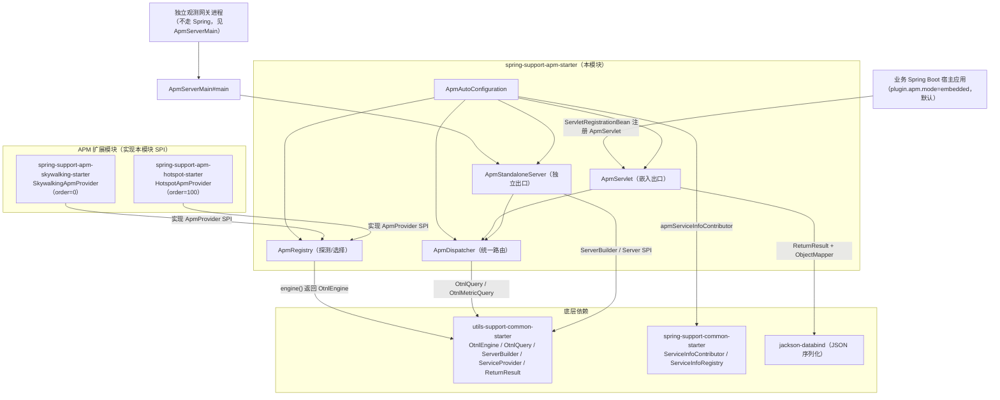
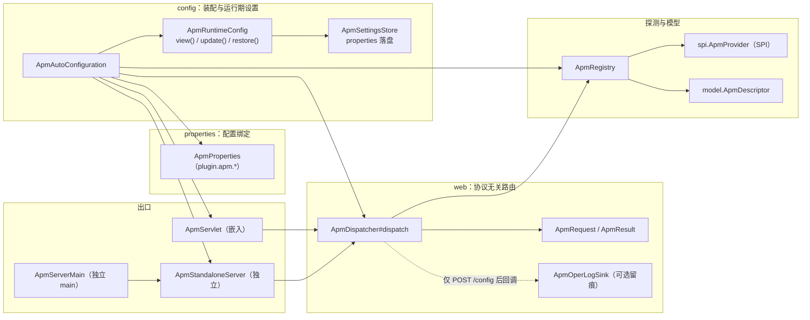
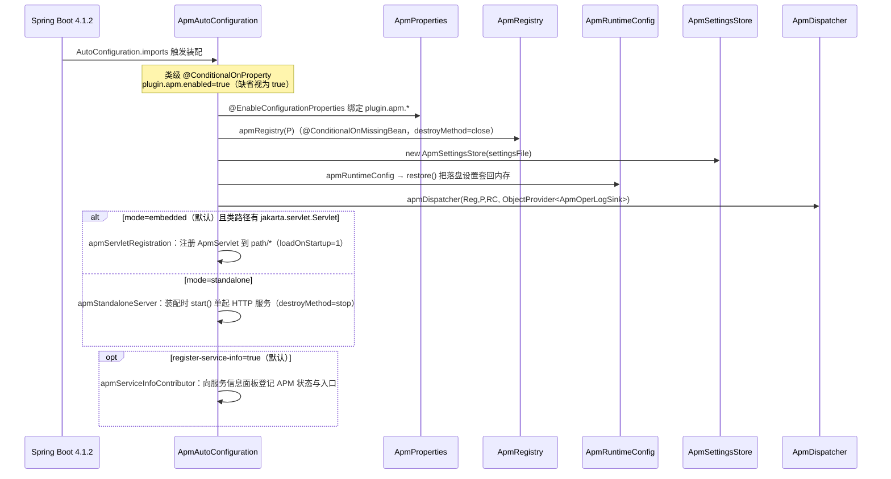
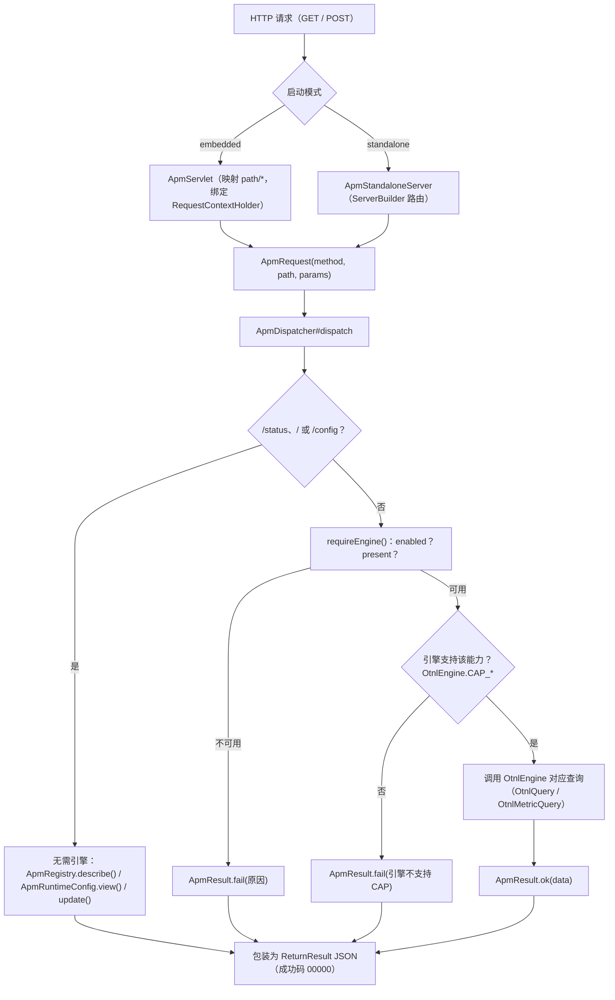

# spring-support-apm-starter

APM 基础模块 —— 定义 `ApmProvider` SPI，把任意 APM 数据面（utils 层统一的 `OtnlEngine`）聚合成一套**协议无关**的 REST 接口，并支持「嵌入宿主 Servlet」与「独立 HTTP 服务」两种启动方式。

- 业务侧只依赖 `ApmProvider` 与 `OtnlEngine`，不直接依赖任何 APM SDK；新增一种 APM = 新增一个扩展模块。
- 本模块**不含任何具体 APM 实现**。没有引入扩展模块时（或都不可用），模块照常装配，`/status` 返回 `present=false` 与原因，前端据此渲染「本服务器未接入 APM」的降级页。
- 当前版本：`4.0.0.51`（跟随父 POM `spring-support-parent-starter` 的 `${revision}`）；基于 Spring Boot `4.1.2`（`${spring.boot.version}`）、Java `25`。

## 1. 架构图

### 1.1 模块在体系中的位置



要点：扩展模块依赖方向是 `spring-support-apm-xx-starter → 本模块`（扩展实现 `ApmProvider` 并通过 `META-INF/extensions` 登记）；本模块向下依赖 utils 层（数据面契约 `OtnlEngine`、独立模式 HTTP 底座 `ServerBuilder`、SPI 加载器 `ServiceProvider`）与公共层（服务信息面板）。链路总结：`ApmProvider 实现 → ApmRegistry（选择）→ ApmDispatcher（路由）→ ApmServlet / ApmStandaloneServer（出口）`。

### 1.2 模块内部分层



分层说明：`config` 负责装配与设置热改/落盘；`web` 的 `ApmDispatcher` 是协议无关核心（只吃 `ApmRequest`、吐 `ApmResult`，不碰 `HttpServletRequest` / `ServerRequest`）；`servlet` 与 `server` 是两种出口适配；`spi` + `ApmRegistry` 负责引擎发现与选择；`model` 是状态描述模型。

## 2. 核心流程图

### 2.1 装配流程（Spring 启动时）



### 2.2 请求处理流程（两种模式共用）



数据流要点：探测结果由 `ApmRegistry` 按 `plugin.apm.detect-interval`（下限 1000ms）缓存；`/metrics-batch` 单次最多 `MAX_BATCH_SERIES = 24` 条曲线；`POST /config` 执行后经 `ApmOperLogSink`（若宿主提供）留痕，并写入 `ApmSettingsStore`（临时文件 + 原子 move）。

## 3. 能力清单

| 能力域 | 关键类 | 入口 |
| --- | --- | --- |
| SPI 定义 | `com.chua.starter.apm.support.spi.ApmProvider` | 由各 `spring-support-apm-xx-starter` 实现 |
| 引擎探测与选择 | `ApmRegistry`（`detect` / `provider` / `engine` / `candidates` / `describe`） | 首次访问状态、或 `plugin.apm.detect-interval` 到期后自动探测 |
| 统一路由 | `ApmDispatcher#dispatch(ApmRequest)` | `{plugin.apm.path}/**`，默认 `/api/apm/v1/**` |
| 嵌入模式 | `ApmServlet` + `ServletRegistrationBean` | `ApmAutoConfiguration#apmServletRegistration`，映射 `path + "/*"` |
| 独立模式 | `ApmStandaloneServer`（内部用 utils 层 `ServerBuilder`） | `plugin.apm.mode=standalone` |
| 独立进程入口 | `ApmServerMain#main(String[])` | `java -cp ... com.chua.starter.apm.support.ApmServerMain` |
| 运行期设置 | `ApmRuntimeConfig`（`view` / `update` / `restore`） | `GET /config`、`POST /config` |
| 设置落盘 | `ApmSettingsStore`（`load` / `save` / `file`） | `plugin.apm.settings-file` 指向的 properties 文件 |
| 状态描述模型 | `ApmDescriptor`、`ApmDescriptor.ApmCandidate` | `GET /status` |
| 请求/结果模型 | `ApmRequest`（`get` / `param`）、`ApmResult`（`ok` / `fail`） | 两种模式共用，逐请求构造 |
| 写操作留痕 | `ApmOperLogSink#record(ApmRequest, ApmResult, long)` | 仅在 `POST /config` 分支回调 |
| 服务信息面板 | `ApmAutoConfiguration#apmServiceInfoContributor` | `ServiceInfoContributor` Bean（回调里调用 `registerFlag` / `registerEndpoint`） |
| 自动配置 | `ApmAutoConfiguration` | `META-INF/spring/org.springframework.boot.autoconfigure.AutoConfiguration.imports` |

### 统一接口清单

路径相对 `plugin.apm.path`（默认 `/api/apm/v1`），**只接受 `GET` / `POST`**，其它方法直接返回失败结果。能力常量均为 `OtnlEngine` 的 `CAP_*`。

| 方法 | 路径 | 说明 | 关键参数 | 能力判断 |
| --- | --- | --- | --- | --- |
| GET | `/status`（或 `/`） | 是否存在/启用了 APM，返回 `ApmDescriptor` | 无 | 无（永远可用） |
| GET | `/capabilities` | 当前引擎支持的能力清单 | 无 | 无（需引擎在） |
| GET | `/overview` | 健康度 + 描述 | `minutes` / `startTime` / `endTime` / `service` | 无 |
| GET | `/services` | 服务目录 | 同上 | `CAP_SERVICES` |
| GET | `/instances` | 服务实例 | `service`（必填） | `CAP_INSTANCES` |
| GET | `/endpoints` | 端点 | `service`（必填）、`keyword` | `CAP_ENDPOINTS` |
| GET | `/traces` | 链路列表 | `service` / `state` / `pageNum` / `pageSize` / `orderByDuration` | `CAP_TRACES` |
| GET | `/trace/{traceId}` | 链路详情（含 Span） | 路径参数 `traceId` | `CAP_TRACES` |
| GET | `/topology` | 服务拓扑 | `service`（空表示全局） | `CAP_TOPOLOGY` |
| GET | `/topology/multi` | 多服务合并拓扑 | `services=a,b`（必填，逗号分隔） | `CAP_TOPOLOGY` |
| GET | `/metrics` | 指标时序 | `name`（必填）、`scope` / `service` / `instance` / `endpoint` / `step` | `CAP_METRICS` |
| GET | `/metric-definitions` | 指标定义（下拉框） | `scope`（`SERVICE` 缺省） | 无 |
| GET | `/alarms` | 告警 | `keyword` / 时间窗口 | `CAP_ALARMS` |
| GET | `/alerts` | 告警（`/alarms` 的别名，能力判断走 `CAP_ALERTS`） | 同上 | `CAP_ALERTS` |
| GET | `/logs` | 日志 | `service` / `keyword` | `CAP_LOGS` |
| GET | `/profiles` | 性能剖析任务列表 | `service` / `endpoint` | `CAP_PROFILES` |
| GET | `/profiles/{taskId}/segments` | 剖析任务采样片段 | 路径参数 `taskId` | `CAP_PROFILES` |
| GET | `/profiles/{taskId}/analysis` | 剖析结果（线程栈树） | 路径参数 `taskId` | `CAP_PROFILES` |
| GET | `/metrics-batch` | 批量指标（多实体对比，上限 24 条曲线） | `names=a,b`（必填）、`services=a,b`、`scope` | `CAP_METRICS` |
| GET | `/infra-3d` | 全局拓扑 + 分层信息（3D 基础设施图） | `minutes` | `CAP_TOPOLOGY` |
| GET | `/config` | APM 设置视图 | 无 | 无 |
| POST | `/config` | 保存 APM 设置（热改并落盘） | `enabled` / `type` / `detectInterval` / 引擎项（如 `oapUrl`）/ `action=detect` | 无 |

查询条件统一由 `ApmDispatcher` 解析：`minutes` 默认 `30`，`pageNum` 默认 `1`，`pageSize` 默认 `20`，`step` 缺省为 `MINUTE`，`scope` 缺省为 `OtnlScope.SERVICE`，`state` 缺省为 `OtnlTraceState.ALL`。

## 4. Bean 能力矩阵

以下 Bean 全部由 `ApmAutoConfiguration` 声明；该类本身受类级 `@ConditionalOnProperty(prefix = "plugin.apm", name = "enabled", havingValue = "true", matchIfMissing = true)` 控制，即 `plugin.apm.enabled=false` 时**整个模块的 Bean 都不装配**。

| Bean 名 | 类型 | 装配条件（除类级开关外） | 可否覆盖 | 典型注入姿势 |
| --- | --- | --- | --- | --- |
| `apmRegistry` | `ApmRegistry` | `@ConditionalOnMissingBean` | 可：自定义 `ApmRegistry` 类型 Bean | 构造器注入；调 `describe()` / `provider()` / `detect()` |
| `apmRuntimeConfig` | `ApmRuntimeConfig` | `@ConditionalOnMissingBean`；装配时执行 `restore()` | 可：自定义同类型 Bean | 构造器注入；调 `view()` / `update(Map)` |
| `apmDispatcher` | `ApmDispatcher` | `@ConditionalOnMissingBean`；可选注入 `ObjectProvider<ApmOperLogSink>` | 可：自定义同类型 Bean | 构造器注入；调 `dispatch(ApmRequest)` |
| `apmServletRegistration` | `ServletRegistrationBean<ApmServlet>` | `@ConditionalOnClass(name = "jakarta.servlet.Servlet")` + `@ConditionalOnProperty plugin.apm.mode=embedded`（缺省视为 embedded）。**没有** `@ConditionalOnMissingBean` | 不可按名覆盖：只能通过 `mode`/`path` 配置调整或关闭 | 一般不注入；容器按映射自动注册 Servlet |
| `apmStandaloneServer` | `ApmStandaloneServer` | `@ConditionalOnMissingBean` + `@ConditionalOnProperty plugin.apm.mode=standalone`（必须显式指定）；装配时 `start()`，`destroyMethod = "stop"` | 可：自定义同类型 Bean | 注入后管理生命周期：`isRunning()` / `url()` / `stop()` |
| `apmServiceInfoContributor` | `ServiceInfoContributor` | `@ConditionalOnMissingBean(name = "apmServiceInfoContributor")` + `@ConditionalOnProperty plugin.apm.register-service-info=true`（缺省视为 true） | 可：按 Bean 名 `apmServiceInfoContributor` 覆盖 | 一般不直接注入；由服务信息面板收集全部 `ServiceInfoContributor` |

补充说明：

- 两个出口 Bean（`apmServletRegistration` / `apmStandaloneServer`）的方法参数需要容器里的 `ObjectMapper`：本模块强制依赖 `jackson-databind`，Spring Boot 的 Jackson 自动配置会提供该 Bean，宿主通常无需自己声明。
- 本模块**没有** `@RestController` / `@Controller`：对外接口由 `ApmServlet`（嵌入）或 `ApmStandaloneServer`（独立）提供，不走 Spring MVC。
- 本模块**没有** Mapper、数据库表、定时任务；`ApmSettingsStore` 只读写本地 properties 文件。

## 5. 完整配置

`ApmProperties` 使用 `@ConfigurationProperties(prefix = "plugin.apm")`（经 `@EnableConfigurationProperties` 装配）。

### 5.1 `plugin.apm.*` 全字段

| 配置项（完整路径） | 类型 | 默认值 | 说明 | 生效开关 / 作用范围 |
| --- | --- | --- | --- | --- |
| `plugin.apm.enabled` | `boolean` | `true` | 模块总开关；`false` 时整个自动配置不装配，`/status` 的 `enabled=false`、`present=false`，原因「APM 模块已关闭」 | 类级 `@ConditionalOnProperty`，控制全部 Bean；可热改（`POST /config` 的 `enabled=`，接受 `true/false/1/0/on/off`） |
| `plugin.apm.type` | `String` | `""`（空） | 引擎名（如 `skywalking` / `opentelemetry` / `hotspot`）；空 = 按 `ApmProvider#order()` 升序取第一个 `isAvailable()` 为真者 | `ApmRegistry` 探测选择；可热改；被部署侧 `-Dplugin.apm.type` 固定时设置文件里的值被忽略 |
| `plugin.apm.mode` | `String` | `embedded` | `embedded` = 注册 `ApmServlet` 随宿主启动；`standalone` = `ApmStandaloneServer` 单起 HTTP 服务 | 决定 `apmServletRegistration` / `apmStandaloneServer` 哪个装配；改了必须重启（`RESTART_KEYS`） |
| `plugin.apm.path` | `String` | `/api/apm/v1` | 统一 REST 前缀；嵌入 = Servlet 映射 `path + "/*"`，独立 = Server 路由；装配时经 `normalizedPath` 规范化（以 `/` 开头、去尾部 `/`） | 两种出口；改了必须重启 |
| `plugin.apm.host` | `String` | `0.0.0.0` | 独立模式监听地址（注意：`ApmServerMain` 里缺省是 `127.0.0.1`） | 仅 `standalone`；改了必须重启 |
| `plugin.apm.port` | `int` | `12801` | 独立模式监听端口 | 仅 `standalone`；改了必须重启 |
| `plugin.apm.server-type` | `String` | `jdk` | 独立模式底层 `Server` SPI 类型（utils 层 `ServerBuilder#type`） | 仅 `standalone`；改了必须重启；系统属性用 kebab-case |
| `plugin.apm.detect-interval` | `long` | `10000` | 探测结果缓存毫秒数；实际 TTL = `Math.max(1000, detectInterval)`；通过 `POST /config` 设置小于 1000 会被 `parseInterval` 拒绝 | `ApmRegistry#ensureDetected`；可热改 |
| `plugin.apm.settings-file` | `String` | `config/apm-settings.properties` | 运行期设置落盘位置（UTF-8 properties，临时文件 + 原子 move）；相对路径按进程工作目录解析，留空用默认值 | `ApmSettingsStore`；改了必须重启 |
| `plugin.apm.register-service-info` | `boolean` | `true` | 是否登记到统一服务信息面板（`ServiceInfoRegistry`） | 控制 `apmServiceInfoContributor` 是否装配 |

> Spring 绑定字段名为 `serverType` / `detectInterval` / `registerServiceInfo`（camelCase），relaxed binding 同样接受上表的 kebab-case 写法。

### 5.2 额外的部署侧开关（系统属性 / 环境变量，不是 `ApmProperties` 字段）

| 系统属性 / 环境变量 | 说明 |
| --- | --- |
| `-Dplugin.apm.enabled.locked=true` | 锁定界面开关：`restore()` 不再用设置文件覆盖启动参数，`/config` 视图中 `enabledLocked=true` |
| `-Dplugin.apm.type=skywalking` | 部署侧固定引擎；设置文件里的 `type` 会被忽略（视图中 `typeFromDeployment=true`，启动日志说明） |
| `-Dskywalking.url` / `-Dplugin.apm.skywalking.url` / 环境变量 `SW_OAP_ADDRESS` | 任一存在时，设置文件里的 `oapUrl` 不再覆盖（视图中 `oapUrlFromDeployment=true`） |

### 5.3 可热改 vs 需重启（`ApmRuntimeConfig` 的边界）

| 分类 | 键 | 行为 |
| --- | --- | --- |
| 可热改（`/config` 视图 `editable`） | `enabled`、`type`、`detectInterval`、引擎自声明项（如 `oapUrl`） | `POST /config` 立即生效并落盘，改完自动 `registry.detect()` |
| 需重启（`ApmRuntimeConfig#RESTART_KEYS`） | `mode`、`path`、`port`、`serverType`、`host`、`settingsFile` | `POST /config` 携带这些键会抛 `IllegalArgumentException`（「不支持热改」），不会静默写入 |

## 6. 使用方式

### 6.1 Maven 坐标

```xml
<dependency>
    <groupId>com.chua</groupId>
    <artifactId>spring-support-apm-starter</artifactId>
    <version>4.0.0.51</version>
</dependency>

<!-- 二选一或都加：真正提供数据面实现的扩展模块 -->
<dependency>
    <groupId>com.chua</groupId>
    <artifactId>spring-support-apm-skywalking-starter</artifactId>
    <version>4.0.0.51</version>
</dependency>
<dependency>
    <groupId>com.chua</groupId>
    <artifactId>spring-support-apm-hotspot-starter</artifactId>
    <version>4.0.0.51</version>
</dependency>
```

### 6.2 依赖说明

| 依赖 | 版本来源 | 作用 | 是否必需 |
| --- | --- | --- | --- |
| `spring-support-common-starter` | `${revision}` = `4.0.0.51` | `ServiceInfoContributor` / `ServiceInfoRegistry` | 是 |
| `utils-support-common-starter` | `${utils.version}` = `4.0.0.51` | `OtnlEngine` / `OtnlQuery` / `OtnlMetricQuery` / `OtnlScope` / `OtnlTraceState` / `ReturnResult` / `ServerBuilder` / `ServiceProvider` | 是 |
| `jackson-databind` | spring-boot-dependencies BOM（4.1.2）托管 | 两种出口的 JSON 序列化 | 是 |
| `spring-boot-starter-web` | `${spring.boot.version}` = `4.1.2`，`<optional>true</optional>` | 嵌入模式所需的 `jakarta.servlet` API 与 `spring-web`（`RequestContextHolder`） | **否**（仅嵌入模式需要） |
| `spring-boot-configuration-processor` | 父 POM 管理，`provided` | 生成配置元数据 | 否 |
| `lombok` | 父 POM 管理，`provided` | `@Slf4j` / `@Getter` / `@Setter` | 否 |

### 6.3 最小可运行示例（嵌入模式）

第 1 步：加依赖（见上），至少加入一个扩展模块，否则只有 `/status` 与 `/config` 有意义。

第 2 步：`application.yml` 确认模式与开关：

```yaml
plugin:
  apm:
    enabled: true
    type: skywalking     # 留空则自动探测；填了就必须是已引入的实现名
    mode: embedded       # 嵌入宿主；若要做独立观测网关改成 standalone
    path: /api/apm/v1
```

第 3 步：启动后先打状态接口：

```bash
curl http://127.0.0.1:8080/api/apm/v1/status
```

`data.present=true` 表示选中了可用引擎；`data.candidates` 会列出全部已探测引擎（含不可用的与各自原因），便于区分「装了但连不上」与「压根没装」。

### 6.4 Java 内直接调用（协议无关入口）

```java
// 1) 两个 Bean 都由 ApmAutoConfiguration 声明，可直接注入或 getBean
ApmRegistry registry = context.getBean(ApmRegistry.class);
ApmDispatcher dispatcher = context.getBean(ApmDispatcher.class);

// 2) 构造协议无关请求：ApmRequest.get(String path, Map<String,String> params)
ApmRequest request = ApmRequest.get("/api/apm/v1/traces",
        Map.of("service", "order-service", "minutes", "60", "pageSize", "50"));

// 3) 分发并读取结果（ApmResult 是 record：ok() / data() / message()）
ApmResult result = dispatcher.dispatch(request);
if (result.ok()) {
    Object traces = result.data();
} else {
    log.warn("APM 查询失败: {}", result.message());
}

// 4) 直接用注册表判断可用性与候选
boolean usable = registry.provider().isPresent();     // Optional<ApmProvider>
OtnlEngine engine = registry.engine();                // 可能为 null
ApmDescriptor descriptor = registry.describe();       // present() / name() / candidates()
```

### 6.5 独立模式（不走 Spring）

**纯 Java 启动**（等价于 `ApmServerMain` 做的事）：

```java
ApmProperties properties = new ApmProperties();
properties.setMode("standalone");
properties.setType("skywalking");          // ApmProperties 是 lombok setter，无链式写法
properties.setHost("127.0.0.1");
properties.setPort(12801);
properties.setPath("/api/apm/v1");
properties.setServerType("jdk");

ApmRegistry registry = new ApmRegistry(properties);
ApmDispatcher dispatcher = new ApmDispatcher(registry, properties); // 该构造器自带 ApmSettingsStore
ApmStandaloneServer server = new ApmStandaloneServer(properties, dispatcher, new ObjectMapper());

server.start();                            // 幂等
String url = server.url();                  // http://127.0.0.1:12801/api/apm/v1
// ... 进程存活期间对外提供同一套接口 ...
server.stop();                              // 幂等；或 server.close()
registry.close();
```

**命令行入口**：

```bash
java -cp "app.jar;lib/*" com.chua.starter.apm.support.ApmServerMain \
     -Dplugin.apm.type=skywalking \
     -Dskywalking.url=http://127.0.0.1:12800 \
     -Dplugin.apm.host=127.0.0.1 -Dplugin.apm.port=12801
```

> 注意：`ApmServerMain` 读取的是 kebab-case 系统属性 `plugin.apm.server-type` 与 `plugin.apm.detect-interval`；与 Spring 侧字段名 `serverType` / `detectInterval` 拼写不同，手写启动脚本时按 kebab-case 传。

**关于链式 API**：本模块自身没有链式 Builder（`ApmProperties` 为 setter 式，`ApmDispatcher` 只有 `setOperLogSink` 且返回 `void`，静态工厂 `ApmResult.ok(...)` / `ApmRequest.get(...)` 也不返回 `this`）。唯一的链式写法来自 utils 层的 `ServerBuilder`，出现在 `ApmStandaloneServer#start()` 内部：

```java
Server instance = ServerBuilder.create()
        .type(properties.getServerType())      // 返回 this
        .host(properties.getHost())
        .port(properties.getPort())
        .mapping(base + "/**", HttpMethod.GET, this::handle)
        .mapping(base + "/**", HttpMethod.POST, this::handle)
        .build();
```

## 7. 使用场景

### 7.1 适用

- **多 APM 共存/可替换**：同一套前端观测页，底层在 SkyWalking、Hotspot（或未来 OpenTelemetry）之间切换，业务代码零改动。
- **Spring Boot 宿主嵌入**：宿主是 Servlet Web 应用，想要随应用一起启动的观测接口（默认模式）。
- **独立观测网关**：观测能力单独部署成一个进程（`ApmServerMain` / `mode=standalone`），与业务进程解耦；宿主不是 Spring Web 也能用。
- **需要降级语义**：前端需要明确区分「没接 APM」「装了但连不上」「模块被关闭」，`/status` 的 `ApmDescriptor` + `candidates` 就是为此设计的。
- **需要运行期调参**：不重启进程切换引擎、改 OAP 地址、临时关停 APM（`POST /config` + 设置文件落盘，重启后自动套用）。

### 7.2 不适用

- **采集/埋点**：本模块是 APM 的**查询面**，不负责埋点、不产数据；探针/agent 仍由各扩展模块与 APM 自身负责。
- **需要走 Spring MVC 体系的接口**：嵌入模式是独立 `Servlet`，`@ControllerAdvice`、鉴权拦截器、`@SysLog` 切面都拦不到它（写操作留痕请提供 `ApmOperLogSink` Bean）。
- **需要多值查询参数语义**：`ApmServlet#params` 与独立模式 `ServerRequest#getParams()` 都按单值 `Map<String,String>` 使用，多值请用逗号分隔（如 `services=a,b`）。
- **把 `mode`/`path`/`port` 当动态配置**：这些决定 Servlet 与端口的注册方式，只认启动参数，改了必须重启。

### 7.3 与相邻模块的取舍

| 需求 | 选择 | 原因 |
| --- | --- | --- |
| 接入 SkyWalking 数据面 | `spring-support-apm-skywalking-starter`（order=0，优先） | 它实现本模块 `ApmProvider` 并携带 SkyWalking 引擎 |
| 无商业 APM 时的进程内兜底 | `spring-support-apm-hotspot-starter`（order=100） | 进程内 hotspot 引擎，参数来自 `-javaagent`，无远端后端 |
| 写操作留痕进监控/日志体系 | 宿主提供 `ApmOperLogSink` Bean | 本模块只定义回调接口，落库由宿主决定 |
| 服务信息面板展示 | 依赖 `spring-support-common-starter` 的 `ServiceInfoContributor` 机制 | `apmServiceInfoContributor` 自动登记 APM 状态与入口 |
| 独立 HTTP 底座 | 复用 utils 层 `ServerBuilder`（`Server` SPI） | 不为独立模式引入新的 HTTP 服务器依赖 |

## 8. 扩展点

### 8.1 主扩展点：`ApmProvider` SPI

接口：`com.chua.starter.apm.support.spi.ApmProvider`（`extends AutoCloseable`）。本模块**内置实现 0 个**，全部实现都在扩展模块。

| 方法 | 是否必须实现 | 默认行为 | 说明 |
| --- | --- | --- | --- |
| `name()` | **必须** | — | 提供者名称，与 `plugin.apm.type` 对应（如 `skywalking`） |
| `engine()` | **必须** | — | 返回底层 `OtnlEngine`；当前环境不具备时返回 `null` |
| `order()` | 可选覆盖 | `100` | 优先级，越小越优先；现有实现：skywalking=0，hotspot=100 |
| `isAvailable()` | 可选覆盖 | `engine() != null && engine().status().available()` | 当前环境是否真的具备该 APM |
| `status()` | 可选覆盖 | 引擎为 null 时返回 `OtnlStatus.unavailable(name(), "当前环境未引入该 APM 模块实现")`；否则透传 `engine().status()` | 可用性、版本、后端地址、失败原因 |
| `runtimeSettings()` | 可选覆盖 | `Map.of()` | 声明本引擎「可运行期修改」的配置项（键 → 当前值），如 `oapUrl`；设置页据此渲染 |
| `applyRuntimeSettings(Map<String,String>)` | 可选覆盖 | 空实现 | 应用热改项；上层只下发 `runtimeSettings()` 里声明过的键 |
| `mode()` | 可选覆盖 | 取 `status().mode()`，null 时 `"none"` | 运行模式：`agent`（进程内）/ `remote`（远端后端）/ `none` |
| `close()` | 可选覆盖 | 关闭底层引擎 | Bean 销毁时由 `apmRegistry` 的 `destroyMethod="close"` 级联调用 |

**登记方式**（两份都要）：

1. `src/main/resources/META-INF/extensions/com.chua.starter.apm.support.spi.ApmProvider`，每行 `名称=实现类`：

   ```text
   # ApmProvider SPI 注册：名称=实现类
   myapm=com.example.apm.MyApmProvider
   ```

2. `src/main/resources/META-INF/extensions/com.chua.common.support.apm.OtnlEngine`，登记引擎本体（`myapm=com.example.apm.MyOtnlEngine`）。

**生效机制**：`ApmRegistry#detect()` 通过 `ServiceProvider.of(ApmProvider.class).forEach(...)` 扫描全部登记项，按 `order()` 升序；`plugin.apm.type` 为空时取第一个 `isAvailable()` 为真的提供者，非空时只认同名提供者。选中后 `/status`、`/capabilities`、`/config` 立即反映它；`/config` 里该引擎的可热改项来自它自己的 `runtimeSettings()`。

扩展示例骨架（方法签名与接口一致）：

```java
package com.example.apm;

import com.chua.common.support.apm.OtnlEngine;
import com.chua.common.support.spi.ServiceProvider;
import com.chua.common.support.spi.annotations.Spi;
import com.chua.starter.apm.support.spi.ApmProvider;

@Spi("myapm")
public class MyApmProvider implements ApmProvider {

    private volatile OtnlEngine engine;

    @Override
    public String name() {
        return "myapm";                       // 必须与 plugin.apm.type 的值一致
    }

    @Override
    public int order() {
        return 50;                            // 越小越优先
    }

    @Override
    public OtnlEngine engine() {
        OtnlEngine current = engine;
        if (current == null) {
            // 真正的数据面契约在 utils 层：OtnlEngine 的 SPI 名 = myapm
            current = ServiceProvider.of(OtnlEngine.class).getExtension("myapm");
            engine = current;
        }
        return current;
    }
}
```

**本模块外的现有实现**：

| SPI 名 | 实现类 | 所在模块 |
| --- | --- | --- |
| `skywalking` | `com.chua.starter.apm.skywalking.SkywalkingApmProvider` | `spring-support-apm-skywalking-starter` |
| `hotspot` | `com.chua.starter.apm.hotspot.HotspotApmProvider` | `spring-support-apm-hotspot-starter` |

### 8.2 次要扩展点：`ApmOperLogSink`（写操作留痕）

`com.chua.starter.apm.support.web.ApmOperLogSink`（`@FunctionalInterface`）：`void record(ApmRequest request, ApmResult result, long costMs)`。

- 由宿主以 **Spring Bean** 形式提供，`ApmAutoConfiguration#apmDispatcher` 通过 `ObjectProvider<ApmOperLogSink>` 注入，**不经过** `META-INF` 登记；未提供时 APM 模块照常工作。
- 只在**写操作**（`POST /config`）执行完后回调；GET 查询不回调。
- `ApmDispatcher#recordOperLog` 已吞掉实现抛出的异常并降级为日志，「记不下来」不会变成「改不了设置」。

### 8.3 自定义入口（不注册 SPI 也能用）

`ApmRegistry`、`ApmDispatcher`、`ApmStandaloneServer`、`ApmRuntimeConfig`、`ApmSettingsStore` 都是普通类（非 final、公共构造器），可脱离 Spring 手工组装（见 6.5），也允许用 `@ConditionalOnMissingBean` 语义自定义 Bean 替换默认实现。

## 9. 常见问题

### 9.1 装配不生效

- **加了依赖但 `/status` 返回 `present=false`？** 先看 `data.message` 与 `data.candidates[]`：候选为空 = 没引入任何扩展模块；候选里有记录但 `available=false` = 装了但连不上（看 `message`）。两者都不是，检查 `plugin.apm.type` 是否拼错——`validateType` 只接受空或已探测候选名，拼错会在 `POST /config` 时直接报错并列出可选值。
- **整个模块的 Bean 都没装配？** 检查 `plugin.apm.enabled` 是否被设成 `false`：这是类级 `@ConditionalOnProperty`，一票否决全部 Bean（`matchIfMissing = true`，不配置即视为开启）。
- **嵌入模式接口 404？** 确认三点：`mode=embedded`（或缺省）；宿主是 Servlet Web 应用（类路径要有 `jakarta.servlet.Servlet`，即引入了 `spring-boot-starter-web`）；访问路径是 `plugin.apm.path + "/*"` 之下。非 Web 宿主请改用 `mode=standalone`。
- **想替换默认实现？** 除 `apmServletRegistration` 外，其余 Bean 都有 `@ConditionalOnMissingBean`，自定义同类型（或同名）Bean 即可覆盖；`apmServletRegistration` 没有该注解，只能通过 `mode`/`path` 配置调整。
- **启动时缺 `ObjectMapper`？** 出口 Bean 需要容器提供 `ObjectMapper`；本模块强制依赖 `jackson-databind`，Spring Boot 的 Jackson 自动配置会自动提供，除非宿主排除了该自动配置。

### 9.2 端口 / 开关

- **12801 端口是谁在听？** 只有 `mode=standalone` 时 `ApmStandaloneServer` 监听 `plugin.apm.port`；嵌入模式不新开端口，接口随宿主端口暴露。
- **改端口/路径/模式为什么不生效？** 它们在 `ApmRuntimeConfig#RESTART_KEYS`（`mode`/`path`/`port`/`serverType`/`host`/`settingsFile`）里，`POST /config` 携带会抛「不支持热改」，必须改启动参数并重启。
- **界面开关保存后，重启会不会丢？** 不会：`POST /config` 写入 `settings-file`，启动时 `ApmRuntimeConfig#restore()` 套回。但**启动参数优先**：显式传了 `-Dplugin.apm.type` 或部署侧 OAP 地址（`-Dskywalking.url` / `-Dplugin.apm.skywalking.url` / `SW_OAP_ADDRESS`）时，文件里的对应值被忽略；`-Dplugin.apm.enabled.locked=true` 时连 `enabled` 都以启动参数为准且界面置灰。
- **`detect-interval` 能设多小？** 运行期下限 1000ms：读取侧 `Math.max(1000, detectInterval)` 兜底，`POST /config` 侧 `parseInterval` 对小于 1000 的值直接报错。
- **设置文件写失败怎么办？** `ApmSettingsStore#save` 只记日志，`POST /config` 返回 `persisted=false` 与 `persistMessage`：本次运行内生效，重启后丢失。
- **`/alerts` 和 `/alarms` 有什么区别？** 都调用 `engine.alarms(...)`，但能力判断分别是 `CAP_ALERTS` 与 `CAP_ALARMS`；引擎只声明其一时，另一个接口返回「不支持」。
- **批量指标为什么少了几条？** `/metrics-batch` 上限 `MAX_BATCH_SERIES = 24` 条曲线，超出部分被丢弃。
- **`ApmServerMain` 的参数名为什么对不上？** 它不走 Spring relaxed binding，`server-type` / `detect-interval` 是 kebab-case 系统属性；host 缺省 `127.0.0.1`（与 `ApmProperties` 的 `0.0.0.0` 不同）。

### 9.3 与 Spring Boot 4 兼容性

- 本模块按 **Spring Boot 4.1.2**（父 POM `spring-boot-starter-parent` + `spring-boot-dependencies` BOM，`java.version=25`）开发。
- 自动配置注册只用 `META-INF/spring/org.springframework.boot.autoconfigure.AutoConfiguration.imports`（内容：`com.chua.starter.apm.support.config.ApmAutoConfiguration`），配合 `@AutoConfiguration` 注解；**本模块没有 `spring.factories`**，也不要再用 Boot 2.x 的旧注册方式扩展它。
- Servlet 相关使用 `jakarta.servlet.*` 命名空间；`ServletRegistrationBean` 来自 `org.springframework.boot.web.servlet`（以源码 import 为准）。Boot 3 之前的 `javax.servlet` 宿主不兼容。
- 嵌入模式依赖的 `spring-boot-starter-web` 在本模块中是 `optional`：纯独立模式（或非 Web 宿主）不需要 Web 依赖。

### 9.4 其他已知限制

1. 本模块不产数据：没有可用引擎时，除 `/status`、`/config` 外所有接口返回 `ApmResult.fail`（不是空列表）。
2. 只支持 `GET` / `POST`，其它方法返回「仅支持 GET / POST，当前为 XXX」。
3. 嵌入模式不经过 Spring MVC：无 `@ControllerAdvice` / 拦截器 / `@SysLog`；`ApmServlet` 会自行绑定并在 finally 还原 `RequestContextHolder`。
4. 参数单值：多值查询参数只保留第一个，需要多值请用逗号分隔。
5. 探测有缓存（`detect-interval`），`POST /config` 带 `action=detect` 可强制立即重新探测。

