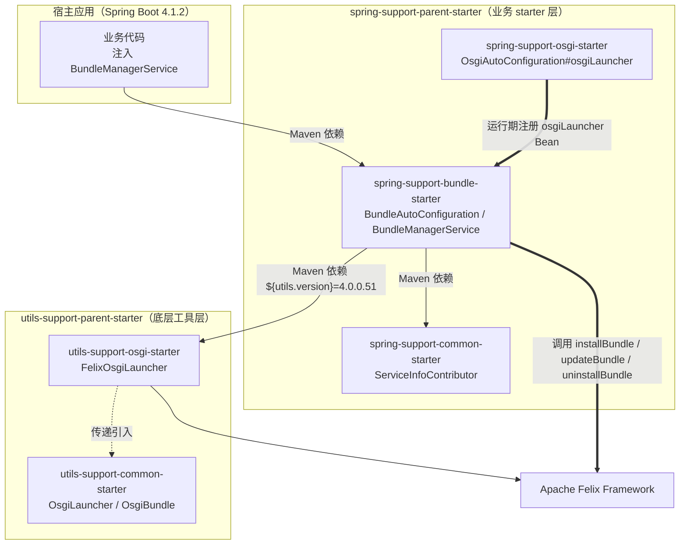
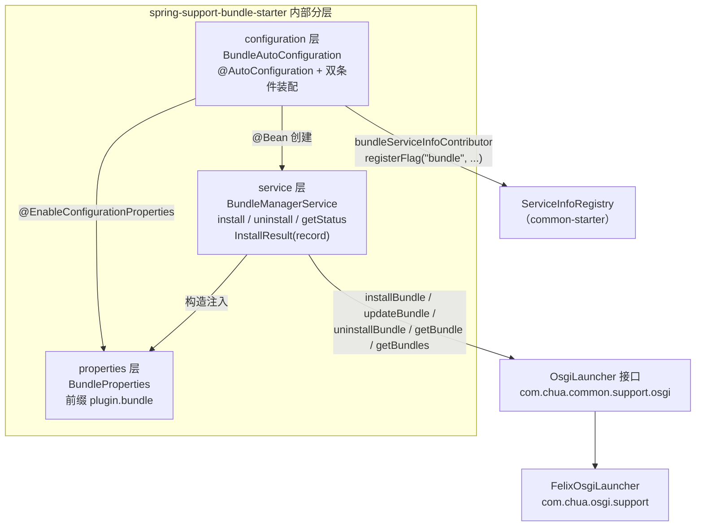
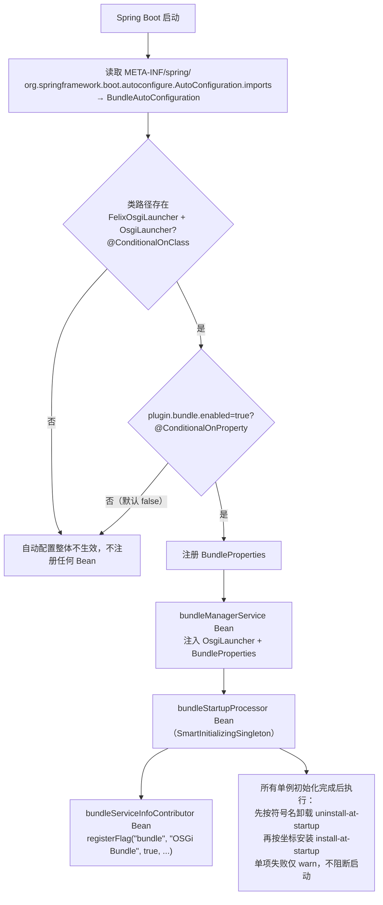
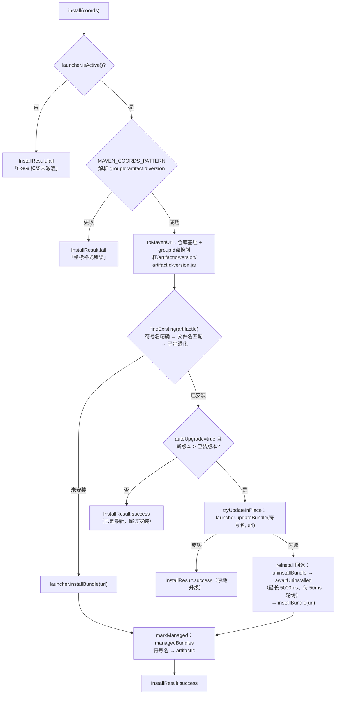

# spring-support-bundle-starter

OSGi Bundle 生命周期管理 Starter：以 Maven 坐标（`groupId:artifactId:version`）为入口，
提供 Bundle 的安装、原地升级、卸载与状态查询，并把「启动时批量装卸」收敛成一组配置项。

- 坐标：`com.chua:spring-support-bundle-starter:4.0.0.51`（父工程 `spring-support-parent-starter`，首次引入于 `4.0.0.43`）
- 运行基线：Spring Boot `4.1.2`（父工程 `spring.boot.version`，Java 25）
- 定位：本模块**没有 Controller**，不暴露任何 REST 路径；全部能力以 Spring Bean 形式提供，由宿主注入 `BundleManagerService` 调用。

## 1. 架构图

### 1.1 模块在体系中的位置

依赖方向遵循生态分层：`spring-support-api-*` → `spring-support-parent-starter` → `utils-support-*`。
本模块是业务 starter 层的一枚「轻装配」模块：自己不启动 OSGi 框架，只把底层 `OsgiLauncher` 包装成 Maven 坐标驱动的管理服务。



要点：

- **编译期依赖**只有 `spring-support-common-starter`、`utils-support-osgi-starter`、`spring-boot-autoconfigure`（见 pom）。
- **运行期协作**：真正把 `FelixOsgiLauncher` 注册成 `OsgiLauncher` Bean 的是 `spring-support-osgi-starter`（`osgiLauncher` Bean，`@Bean(destroyMethod = "stop")`）。只引本模块不引 `spring-support-osgi-starter` 时，容器里没有 `OsgiLauncher` 可注入，`bundleManagerService` 无法装配。
- 两个 starter 是**并列引入**关系：仓库内没有任何 starter 把本模块声明为 Maven 依赖；`spring-support-osgi-starter` 的 README 只以「可选能力」方式提到本模块。

### 1.2 模块内部分层



## 2. 核心流程图

### 2.1 自动装配流程（启动期）



### 2.2 `install(coords)` 安装 / 升级数据流



## 3. 能力清单

| 能力域 | 关键类 | 入口（REST 路径或 SPI） |
|---|---|---|
| 自动配置装配 | `com.chua.starter.bundle.configuration.BundleAutoConfiguration` | `META-INF/spring/org.springframework.boot.autoconfigure.AutoConfiguration.imports` |
| 坐标安装 / 原地升级 | `com.chua.starter.bundle.service.BundleManagerService#install(String)` | 无 REST，Java 调用 |
| 批量安装 | `BundleManagerService#installAll(List<String>)` | 无 REST，Java 调用 |
| 卸载 / 批量卸载 | `BundleManagerService#uninstall(String)`、`#uninstallAll(List<String>)` | 无 REST，Java 调用 |
| 运行状态查询 | `BundleManagerService#getStatus()`、`#isInstalled(String)` | 无 REST，Java 调用 |
| 托管清单 | `BundleManagerService#getManagedBundles()` | 无 REST，Java 调用 |
| 启动期批量装卸 | `BundleAutoConfiguration#bundleStartupProcessor`（`SmartInitializingSingleton`） | `plugin.bundle.install-at-startup` / `plugin.bundle.uninstall-at-startup` |
| 安装结果模型 | `BundleManagerService.InstallResult`（`record`） | 由 `install` / `installAll` 返回 |
| 服务信息登记 | `BundleAutoConfiguration#bundleServiceInfoContributor` | `ServiceInfoContributor.registerFlag("bundle", "OSGi Bundle", true, "OSGi Bundle 生命周期管理")` |

安装策略（`BundleManagerService` 类注释口径）：检测到同符号名高版本坐标时，优先走框架原生
`updateBundle` 原地升级（保留 bundle 标识与已解析依赖）；仅当原生升级失败才回退
「卸载旧版 + 安装新版」，且回退路径上轮询等待旧 bundle 真正进入已卸载状态，不使用固定时长休眠。

## 4. Bean 能力矩阵

| Bean 名 | 类型 | 装配条件 | 可否覆盖 | 典型注入姿势 |
|---|---|---|---|---|
| `bundleManagerService` | `com.chua.starter.bundle.service.BundleManagerService` | 类级 `@ConditionalOnClass({FelixOsgiLauncher, OsgiLauncher})` + `@ConditionalOnProperty(prefix="plugin.bundle", name="enabled", havingValue="true")`；方法参数还需容器已有 `OsgiLauncher` Bean | 方法上**没有** `@ConditionalOnMissingBean`；同名覆盖需 `spring.main.allow-bean-definition-overriding=true` | 构造器或 `@Autowired` 注入 `BundleManagerService` |
| `bundleStartupProcessor` | `org.springframework.beans.factory.SmartInitializingSingleton`（lambda） | 同类级条件；随 `bundleManagerService` 一起注册 | 同上（无 `@ConditionalOnMissingBean`） | 一般不注入，由容器在单例就绪后回调 |
| `bundleServiceInfoContributor` | `com.chua.starter.common.support.serviceinfo.ServiceInfoContributor` | 同类级条件 | 同上（无 `@ConditionalOnMissingBean`） | 一般不注入，由 `ServiceInfoRegistry` 收集 |

补充说明：

- 本模块**不创建** `OsgiLauncher` Bean，只消费它。`OsgiLauncher` Bean 由 `spring-support-osgi-starter`
  的 `OsgiAutoConfiguration#osgiLauncher` 提供（`@Bean(destroyMethod = "stop")`，条件
  `plugin.osgi.enabled`，`matchIfMissing = true`）。
- 三个 Bean 的条件都挂在 `BundleAutoConfiguration` 类上：开关关闭时**三个 Bean 一并消失**，
  而不是只停用部分能力。
- 因为没有 `@ConditionalOnMissingBean`，宿主自定义同类型 Bean 时若与自动配置 Bean 同名，
  需开启 Bean 覆盖；不同名同类型会因二义性导致装配失败——扩展时优先「包一层自己的服务」而非重名替换。

## 5. 完整配置

前缀：`plugin.bundle`，绑定类 `com.chua.starter.bundle.properties.BundleProperties`
（`@ConfigurationProperties(prefix = "plugin.bundle")` + `@Data`）。
配置元数据已由 `spring-boot-configuration-processor` 生成（`META-INF/spring-configuration-metadata.json`）。

| 配置路径 | 类型 | 默认值 | 说明 | 生效开关 |
|---|---|---|---|---|
| `plugin.bundle.enabled` | `boolean` | `false` | 是否启用 Bundle 管理器；默认禁用，需显式置 `true` | 自身即总开关（`@ConditionalOnProperty` 消费） |
| `plugin.bundle.install-at-startup` | `List<String>` | `[]`（空列表） | 启动时自动安装的 Bundle Maven 坐标列表，格式 `groupId:artifactId:version`，如 `org.apache.felix:org.apache.felix.gogo.runtime:1.1.6` | 需 `enabled=true` |
| `plugin.bundle.uninstall-at-startup` | `List<String>` | `[]`（空列表） | 启动时自动卸载的 Bundle 符号名列表 | 需 `enabled=true` |
| `plugin.bundle.auto-upgrade` | `boolean` | `true` | 已装同符号名 Bundle 时，是否允许升级到更高版本 | 需 `enabled=true` |
| `plugin.bundle.repository-url` | `String` | `https://repo1.maven.org/maven2` | 远程解析 Bundle 的 Maven 仓库基址 | 需 `enabled=true` |

`repository-url` 的用法是「基址 + Maven 标准路径」：
`{groupId 点换斜杠}/{artifactId}/{version}/{artifactId}-{version}.jar`（见 `BundleManagerService#toMavenUrl`）。
基址末尾的 `/` 会被去掉一次，写不写结尾斜杠都可以。

示例：

```yaml
plugin:
  bundle:
    enabled: true
    auto-upgrade: true
    repository-url: https://repo1.maven.org/maven2
    uninstall-at-startup:
      - org.apache.felix.gogo.runtime
    install-at-startup:
      - org.apache.felix:org.apache.felix.gogo.runtime:1.1.6
```

## 6. 使用方式

### 6.1 Maven 坐标

```xml
<dependency>
    <groupId>com.chua</groupId>
    <artifactId>spring-support-bundle-starter</artifactId>
    <version>4.0.0.51</version>
</dependency>
```

### 6.2 依赖说明

| 依赖 | 版本来源 | 作用 | 是否可选 |
|---|---|---|---|
| `spring-support-common-starter` | 父工程 `dependencyManagement`（`${project.version}`） | `ServiceInfoContributor` 服务信息登记 | 必需 |
| `utils-support-osgi-starter` | `${utils.version}` = `4.0.0.51` | `FelixOsgiLauncher` 实现；`OsgiLauncher` 抽象层经其传递自 `utils-support-common-starter` | 必需 |
| `spring-boot-autoconfigure` | Spring Boot BOM（父级 `4.1.2`） | `@AutoConfiguration` 等自动装配设施 | 必需 |
| `spring-boot-configuration-processor` | Spring Boot BOM | 生成配置元数据 | `optional` |
| `lombok` | 父工程 `1.18.48` | `@Slf4j` / `@Data` | `optional` |

**运行期还需要** `spring-support-osgi-starter`（不在本模块 pom 中声明）：它注册 `OsgiLauncher` Bean，
并提供 Felix 框架启动、目录热部署、SSH/Telnet 管理通道与 `/osgi/*` 观测端点。

### 6.3 最小可运行示例

**第一步：引入依赖。** 同时引入 `spring-support-osgi-starter`（提供 `OsgiLauncher` Bean，并决定 Felix
框架缓存目录、启动级别等）与本模块。

**第二步：打开开关。** 在 `application.yml` 中设置 `plugin.bundle.enabled: true`。
默认值是 `false`，不打开时本模块不注册任何 Bean。

**第三步：注入并调用。**

```java
@Service
@RequiredArgsConstructor
public class BundleBootstrap {

    private final BundleManagerService bundleManager;

    public void install() {
        BundleManagerService.InstallResult result =
                bundleManager.install("org.apache.felix:org.apache.felix.gogo.runtime:1.1.6");
        if (!result.success()) {
            throw new IllegalStateException("安装失败: " + result.message());
        }
    }
}
```

调用方式说明：**本模块无链式 API**，`install` / `uninstall` 返回结果对象或布尔值，不返回 `this`，
`BundleManagerService` 也没有 Builder。`InstallResult` 是 `record`，取值用
`artifactId()` / `version()` / `success()` / `message()`。

批量安装（逐个安装，返回顺序与入参一致）：

```java
List<BundleManagerService.InstallResult> results = bundleManager.installAll(List.of(
        "org.apache.felix:org.apache.felix.gogo.runtime:1.1.6",
        "org.apache.felix:org.apache.felix.gogo.shell:1.1.4"));
for (BundleManagerService.InstallResult r : results) {
    if (!r.success()) {
        log.warn("[Bundle] {} 安装失败: {}", r.artifactId(), r.message());
    }
}
```

卸载与状态查询：

```java
boolean removed = bundleManager.uninstall("org.apache.felix.gogo.runtime");
List<Boolean> flags = bundleManager.uninstallAll(List.of("org.apache.felix.gogo.shell"));

// getStatus() 每项是 LinkedHashMap，键：bundleId / symbolicName / state / version / location / managed
for (Map<String, Object> row : bundleManager.getStatus()) {
    log.info("{} [{}] {} managed={}", row.get("symbolicName"), row.get("state"),
            row.get("version"), row.get("managed"));
}
boolean installed = bundleManager.isInstalled("org.apache.felix.gogo.runtime");
List<String> managed = bundleManager.getManagedBundles();   // 返回 artifactId
```

`getStatus()` 在 OSGi 框架未激活（`launcher.isActive() == false`）时返回空列表，而不是抛异常。

## 7. 使用场景

### 7.1 适用

- 宿主已启用 OSGi（通常已引入 `spring-support-osgi-starter`），希望**用 Maven 坐标直接安装/升级/卸载** Bundle，而不关心仓库路径拼接与升级判定。
- 需要**启动时按配置批量装配**一组 Bundle（`install-at-startup` / `uninstall-at-startup`），把「装哪些插件」做成纯配置。
- 需要在业务代码里做**受控的插件治理**：带自动升级判定（`auto-upgrade`）、原地升级优先、失败回退重装、托管清单查询。

### 7.2 不适用

- 需要 **HTTP/控制台入口**管理 Bundle：本模块无 REST；请使用 `spring-support-osgi-starter` 的
  `/osgi/bundles/install`、`/osgi/bundles/{symbolicName}/update`、`/osgi/bundles/{symbolicName}/uninstall` 等端点。
- 需要**解析 POM / 传递依赖 / 私服认证**：`install` 只把坐标拼成 jar URL 交给 `launcher.installBundle`，
  不读 `pom.xml`、不预装传递依赖；`repository-url` 只参与字符串拼接，没有账号/令牌配置。
- 非 OSGi 的插件体系（如纯 SPI / 类加载器插件方案）。

### 7.3 与相邻模块的取舍

| 维度 | spring-support-bundle-starter（本模块） | spring-support-osgi-starter |
|---|---|---|
| 职责 | Maven 坐标 → 远程 jar → 安装/升级/卸载；启动期批量装卸配置 | Felix 框架启动、`OsgiLauncher` Bean、目录热部署、Gogo/SSHD 管理、`/osgi/*` 观测端点 |
| 入口 | Java API（`BundleManagerService`） | REST + SSH(8122)/Telnet(6666) |
| 引入关系 | 并列引入，互不依赖 | 并列引入；为本模块提供 `OsgiLauncher` Bean |
| 选择建议 | 只要「按坐标装/卸/查」的程序化能力 | 要框架托管、热部署、控制台与运维通道 |

## 8. 扩展点

**本模块不提供自有 SPI 扩展点。** `src/main/resources/META-INF` 下只有
`META-INF/spring/org.springframework.boot.autoconfigure.AutoConfiguration.imports`
（内容为 `com.chua.starter.bundle.configuration.BundleAutoConfiguration`），
没有 `META-INF/services/*`，也没有自定义扩展接口。

需要替换/扩展时，走 Spring 自身与底层 OSGi 契约的扩展方式：

1. **替换 OSGi 启动器**：自己声明一个 `OsgiLauncher` Bean（或复用 `spring-support-osgi-starter` 提供的
   `osgiLauncher`），`BundleAutoConfiguration#bundleManagerService` 通过构造参数注入它。
2. **自定义安装策略**：不改本模块，在宿主里包一层自己的服务，直接调用 `OsgiLauncher` 的框架能力——
   `installBundle(url)` / `updateBundle(symbolicName, url)` / `uninstallBundle(symbolicName)` /
   `getBundle(...)` / `getBundles()`（即 `BundleManagerService` 内部使用的同一组方法）。
3. **全局启动器引用**：底层 `FelixOsgiLauncher` 启动后会把自身注册到
   `com.chua.common.support.osgi.OsgiLauncherHolder`，可在无注入场景下经 Holder 取用。
4. **Bundle 应用扩展**：底层 `FelixOsgiLauncher` 会发现所有
   `com.chua.common.support.osgi.BundleApplication` SPI 实现，在 Bundle 上下文就绪后回调——
   这是 utils 层的 SPI，属于生态级扩展点，本模块不重复定义。
5. **服务信息登记**：本模块的 `bundleServiceInfoContributor` 即 `ServiceInfoContributor`
   函数式接口的示例，宿主可按同样方式向 `ServiceInfoRegistry` 贡献自己的端点/开关信息。

## 9. 常见问题

### 9.1 引入后没有任何 Bean / `BundleManagerService` 注入失败

按顺序检查：

1. `plugin.bundle.enabled` 是否为 `true`？默认 `false`，不开启时 `BundleAutoConfiguration` 整体不生效。
2. 类路径是否同时有 `FelixOsgiLauncher` 与 `OsgiLauncher`（即是否引入了 `utils-support-osgi-starter`）？
3. 容器里是否已有 `OsgiLauncher` Bean？本模块只消费不创建；需引入 `spring-support-osgi-starter`
   （其开关 `plugin.osgi.enabled` 默认放行）。只引本模块时，`bundleManagerService(OsgiLauncher, ...)`
   会因缺少 `OsgiLauncher` 而装配失败。
4. 三个 Bean 都没有 `@ConditionalOnMissingBean`：宿主定义了同类型 Bean 时会冲突；
   同名替换需 `spring.main.allow-bean-definition-overriding=true`，否则建议改为包装扩展。

### 9.2 端口与开关

- 本模块**不监听任何端口**，没有网络服务；OSGi 管理端口属于 `spring-support-osgi-starter`
  （SSH 默认 `8122`，Telnet 回退 `6666`，二选一由 `plugin.osgi.shell.protocol` 决定）。
- 相关开关：`plugin.bundle.enabled`（本模块总开关，默认 `false`）与
  `plugin.osgi.enabled`（Felix 框架开关，默认 `true`）。前者开启、后者关闭时，本模块 Bean
  会因缺少 `OsgiLauncher` 而无法装配。

### 9.3 为什么 install 提示「已是最新」跳过安装？

`install` 在已装同 artifactId 的 Bundle 时会比较版本：`auto-upgrade=false`，或请求版本不高于已装版本
（版本比较只取前三段数字，`(\d+)\.(\d+)\.(\d+)`，取不到三段数字时视为相等）都会跳过安装，
返回 `success` 的既有版本。需要强制换版本时，确认 `auto-upgrade=true` 且坐标版本更高。

### 9.4 与 Spring Boot 4.1.2 的兼容性

- 注册机制使用 `META-INF/spring/org.springframework.boot.autoconfigure.AutoConfiguration.imports`
  （Boot 2.7+ 标准；本模块**没有** `spring.factories`，不依赖已被移除的旧注册方式），Boot 4 下正常生效。
- 父工程已随 Spring Boot `4.1.2` 升级（`spring.boot.version=4.1.2`，Java 25）；本模块仅依赖
  `spring-boot-autoconfigure` 与配置处理器，未引入 servlet/jakarta 相关 API。
- 代码使用 `record`（`InstallResult`）与 `List.of` 等 API，需 Java 17+，与父工程 Java 25 基线一致。

### 9.5 其它已知限制

1. **安装与卸载的键口径不同。** 安装按 `artifactId` 查找已装 Bundle（`findExisting`：先符号名精确等于
   artifactId；再按来源文件名包含 `-{artifactId}-` / `-{artifactId}.` 或以 `{artifactId}-数字` 开头匹配；
   最后退化为符号名子串包含）；卸载与 `isInstalled` 按符号名。`getManagedBundles()` 对外返回
   artifactId，内部 `managedBundles` 以符号名为键。
2. **`InstallResult.artifactId` 在成功路径上装的是符号名。** `install` 成功时调用
   `InstallResult.success(符号名, 版本)`，失败路径 `fail(coords, message)` 放的是入参坐标；
   字段名与内容不完全对应，使用方以 `success()` + `message()` 判定更稳妥。
3. **启动期装卸只执行一次。** `bundleStartupProcessor` 是 `SmartInitializingSingleton`，容器刷新后跑一遍；
   单个坐标失败只记 `warn`，不影响应用启动。
4. **回退重装的卸载等待有上限。** `awaitUninstalled` 最多等 5000ms（每 50ms 轮询一次），
   超时后仍会尝试安装新版；框架彻底卸载较慢时可能拿到「安装失败」。
5. **仓库地址不支持认证、不解析 POM。** 见 7.2。
