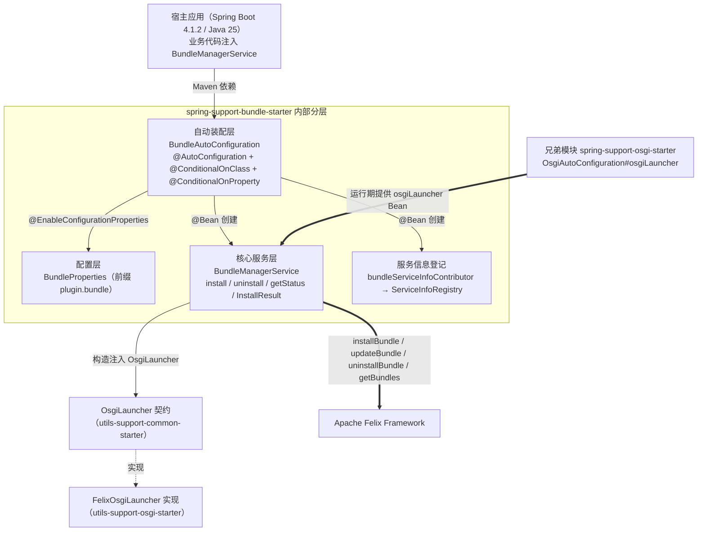
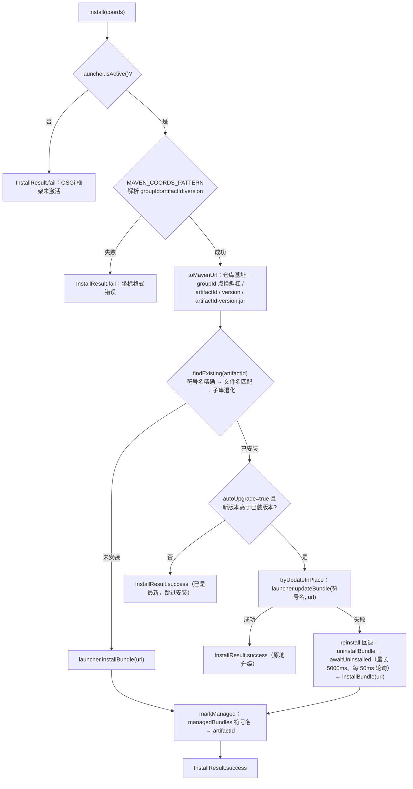

# spring-support-bundle-starter

OSGi Bundle 生命周期管理 Starter：以 Maven 坐标（`groupId:artifactId:version`）为入口，提供 Bundle 的安装、原地升级、卸载与状态查询，并把「启动时批量装卸」收敛成一组配置项。

**模块定位**：本模块属于 `spring-support-parent-starter` 生态的业务 starter 层，是宿主应用与底层 OSGi 能力（`utils-support-osgi-starter` / Apache Felix）之间的薄适配层——把「按 Maven 坐标装卸 Bundle」包装成 Spring Bean 能力，不重复实现框架功能，也不暴露任何 Web 端点。
在 spring-support 体系中，它是业务 starter 层的一枚「轻装配」模块：自身不启动 OSGi 框架，只把底层 `OsgiLauncher` 包装成 Maven 坐标驱动的管理服务；无 Controller、无 REST 端点、不监听端口，全部能力以 Spring Bean 形式供宿主注入使用。坐标 `com.chua:spring-support-bundle-starter:4.0.0.51`，首次引入于 `4.0.0.43`。

## 1. 架构图

依赖方向遵循生态分层：`spring-support-api-*` → `spring-support-parent-starter` → `utils-support-*`。一张图同时看体系位置与模块内部分层：



要点：

- **编译期依赖**只有 `spring-support-common-starter`、`utils-support-osgi-starter`、`spring-boot-autoconfigure`（见 `pom.xml`）；`spring-boot-configuration-processor` 与 `lombok` 为 `optional`。
- **运行期协作**：本模块不创建 `OsgiLauncher`，只消费它。`osgiLauncher` Bean 由 `spring-support-osgi-starter` 的 `OsgiAutoConfiguration#osgiLauncher` 注册（`@Bean(destroyMethod = "stop")`，条件 `plugin.osgi.enabled`，`matchIfMissing = true`）。只引本模块不引 `spring-support-osgi-starter` 时，容器里没有 `OsgiLauncher` 可注入，`bundleManagerService` 装配失败。
- 两个 starter 是**并列引入**关系：仓库内没有 starter 把本模块声明为 Maven 依赖，本模块自身也只依赖 `spring-support-common-starter` 与 `utils-support-osgi-starter`，不依赖任何兄弟业务 starter。

## 2. 核心流程图

最核心的流程是 `install(coords)` 的安装 / 升级数据流。升级策略（`BundleManagerService` 类注释口径）：检测到同符号名高版本坐标时，优先走框架原生 `updateBundle` 原地升级（保留 bundle 标识与已解析依赖）；仅当原生升级失败才回退「卸载旧版 + 安装新版」，回退路径轮询等待旧 bundle 真正进入已卸载状态，不使用固定时长休眠。



自动装配与启动期流程（文字版）：Spring Boot 启动读取 `META-INF/spring/org.springframework.boot.autoconfigure.AutoConfiguration.imports` 加载 `BundleAutoConfiguration`；类路径缺 `FelixOsgiLauncher`/`OsgiLauncher`（`@ConditionalOnClass`）或 `plugin.bundle.enabled=false`（默认）时整体不生效、不注册任何 Bean；条件满足时依次注册 `bundleManagerService`、`bundleStartupProcessor`、`bundleServiceInfoContributor`；容器单例就绪后 `bundleStartupProcessor` 先按符号名卸载 `uninstall-at-startup`，再按坐标安装 `install-at-startup`，单项失败仅 warn，不阻断应用启动。

## 3. 能力清单

| 能力域 | 关键类 | 入口/触发方式 |
|---|---|---|
| 自动配置装配 | `com.chua.starter.bundle.configuration.BundleAutoConfiguration` | `META-INF/spring/...AutoConfiguration.imports` |
| 坐标安装 / 原地升级 | `com.chua.starter.bundle.service.BundleManagerService#install(String)`、`#installAll(List)` | Java 调用（无 REST） |
| 卸载 / 批量卸载 | `BundleManagerService#uninstall(String)`、`#uninstallAll(List)` | Java 调用（无 REST） |
| 运行状态查询 | `BundleManagerService#getStatus()`、`#isInstalled(String)` | Java 调用（无 REST） |
| 托管清单查询 | `BundleManagerService#getManagedBundles()` | Java 调用（无 REST） |
| 启动期批量装卸 | `BundleAutoConfiguration#bundleStartupProcessor`（`SmartInitializingSingleton`） | `plugin.bundle.install-at-startup` / `plugin.bundle.uninstall-at-startup` |
| 安装结果模型 | `BundleManagerService.InstallResult`（`record`） | 由 `install` / `installAll` 返回 |
| 服务信息登记 | `BundleAutoConfiguration#bundleServiceInfoContributor` | `ServiceInfoContributor.registerFlag("bundle", "OSGi Bundle", true, "OSGi Bundle 生命周期管理")` |

## 4. Bean 能力矩阵

| Bean 名 | 类型 | 装配条件（含默认值） | 可否覆盖 | 典型用途 |
|---|---|---|---|---|
| `bundleManagerService` | `com.chua.starter.bundle.service.BundleManagerService` | 类级 `@ConditionalOnClass({FelixOsgiLauncher, OsgiLauncher})` + `@ConditionalOnProperty(prefix="plugin.bundle", name="enabled", havingValue="true")`（默认 `false`，不开不装配）；方法参数还需容器已有 `OsgiLauncher` Bean | **无** `@ConditionalOnMissingBean`；同名覆盖需 `spring.main.allow-bean-definition-overriding=true` | 注入后按 Maven 坐标安装/升级/卸载/查询 Bundle |
| `bundleStartupProcessor` | `org.springframework.beans.factory.SmartInitializingSingleton`（lambda） | 同类级条件，随 `bundleManagerService` 一起注册 | 同上（无 `@ConditionalOnMissingBean`） | 一般不注入；单例就绪后按配置批量装卸 |
| `bundleServiceInfoContributor` | `com.chua.starter.common.support.serviceinfo.ServiceInfoContributor` | 同类级条件 | 同上（无 `@ConditionalOnMissingBean`） | 一般不注入；向 `ServiceInfoRegistry` 登记 bundle 能力信息 |

说明：三个 Bean 的条件都挂在 `BundleAutoConfiguration` 类上，开关关闭时**一并消失**。本模块不创建 `OsgiLauncher`，只消费它。因为没有 `@ConditionalOnMissingBean`，宿主定义同类型 Bean 时同名需开启 Bean 覆盖、不同名会因二义性装配失败——扩展时建议「包一层自己的服务」而非重名替换。

## 5. 完整配置

前缀 `plugin.bundle`，绑定类 `com.chua.starter.bundle.properties.BundleProperties`（`@ConfigurationProperties(prefix = "plugin.bundle")` + `@Data`），无嵌套配置类；元数据由 `spring-boot-configuration-processor` 生成（`META-INF/spring-configuration-metadata.json`）。

| 配置路径 | 类型 | 默认值 | 说明 |
|---|---|---|---|
| `plugin.bundle.enabled` | `boolean` | `false` | 总开关；被 `@ConditionalOnProperty` 消费，默认禁用，需显式置 `true` |
| `plugin.bundle.install-at-startup` | `List<String>` | `[]`（空列表） | 启动时自动安装的 Maven 坐标列表，格式 `groupId:artifactId:version`，如 `org.apache.felix:org.apache.felix.gogo.runtime:1.1.6` |
| `plugin.bundle.uninstall-at-startup` | `List<String>` | `[]`（空列表） | 启动时自动卸载的 Bundle 符号名列表 |
| `plugin.bundle.auto-upgrade` | `boolean` | `true` | 已装同符号名 Bundle 时，是否允许升级到更高版本 |
| `plugin.bundle.repository-url` | `String` | `https://repo1.maven.org/maven2` | 远程仓库基址；`toMavenUrl` 按「基址 + Maven 标准路径」拼 jar URL，基址末尾 `/` 会被去掉一次 |

除 `enabled` 由自动装配条件直接消费外，其余四项需 `enabled=true` 才有意义。

### 5.1 逐项配置示例

#### ① 开关与装配

**`plugin.bundle.enabled`**

| 项 | 说明 |
|---|---|
| 含义 | Bundle 管理总开关，被 `BundleAutoConfiguration` 类上的 `@ConditionalOnProperty(prefix="plugin.bundle", name="enabled", havingValue="true")` 直接消费 |
| 默认值 | `false`（禁用）。不显式置 `true` 时，`bundleManagerService` / `bundleStartupProcessor` / `bundleServiceInfoContributor` 三个 Bean 一并消失 |

```yaml
plugin:
  bundle:
    enabled: true
```

#### ② 启动期批量装卸

**`plugin.bundle.uninstall-at-startup`**

| 项 | 说明 |
|---|---|
| 含义 | 启动时自动卸载的 Bundle 符号名列表；先于安装列表执行，空白条目跳过，单项失败仅 warn、不阻断应用启动 |
| 默认值 | `[]`（空列表，不自动卸载） |

```yaml
plugin:
  bundle:
    uninstall-at-startup:
      - org.apache.felix.gogo.runtime
```

**`plugin.bundle.install-at-startup`**

| 项 | 说明 |
|---|---|
| 含义 | 启动时自动安装的 Maven 坐标列表（`groupId:artifactId:version`）；在容器单例就绪后按列表顺序逐项走 `install(coords)`（含升级判定），单项失败仅 warn、不阻断应用启动 |
| 默认值 | `[]`（空列表，不自动安装） |

```yaml
plugin:
  bundle:
    install-at-startup:
      - org.apache.felix:org.apache.felix.gogo.runtime:1.1.6
```

#### ③ 升级策略

**`plugin.bundle.auto-upgrade`**

| 项 | 说明 |
|---|---|
| 含义 | 已装同 artifactId 的 Bundle 时是否允许升级：`true` 且请求版本更高 → 优先框架原生 `updateBundle` 原地升级，失败回退「卸载旧版 + 安装新版」；`false` 或请求版本不高于已装版本 → 跳过安装，返回已装版本的成功结果。版本比较只取前三段数字 |
| 默认值 | `true` |

```yaml
plugin:
  bundle:
    auto-upgrade: true
```

#### ④ 远程仓库

**`plugin.bundle.repository-url`**

| 项 | 说明 |
|---|---|
| 含义 | 远程 Maven 仓库基址，`toMavenUrl` 按「基址 + `/groupId(点换斜杠)/artifactId/version/artifactId-version.jar`」拼 jar 下载 URL，基址末尾的 `/` 会被去掉一次。仅做字符串拼接：无私服认证、不解析 POM、不装传递依赖 |
| 默认值 | `https://repo1.maven.org/maven2`（Maven Central） |

```yaml
plugin:
  bundle:
    repository-url: https://repo1.maven.org/maven2
```

### 5.2 完整 YAML 示例

生产可用的完整配置（含相邻 `spring-support-osgi-starter` 的框架开关）：

```yaml
spring:
  application:
    name: bundle-host-demo

plugin:
  # 相邻模块 spring-support-osgi-starter 的框架开关（其 osgiLauncher Bean 是本模块的运行前提）
  osgi:
    enabled: true
  bundle:
    # 总开关：默认 false，必须显式开启，否则本模块自动配置整体不生效
    enabled: true
    # 启动时先卸载（按符号名），再安装（按 Maven 坐标）；单项失败仅 warn、不阻断启动
    uninstall-at-startup:
      - org.apache.felix.gogo.runtime
    install-at-startup:
      - org.apache.felix:org.apache.felix.gogo.runtime:1.1.6
    # 已装同名 Bundle 时允许升级到更高版本（原地升级优先，失败回退「卸载+重装」）
    auto-upgrade: true
    # 远程仓库基址（末尾多余的 / 会被去掉；不支持私服认证）
    repository-url: https://repo1.maven.org/maven2
```

配套的启动校验代码（启动期装卸失败只 warn，关键 Bundle 应主动校验）：

```java
@Service
@RequiredArgsConstructor
public class BundleStartupGuard implements ApplicationRunner {

    private final BundleManagerService bundleManager;

    @Override
    public void run(ApplicationArguments args) {
        if (!bundleManager.isInstalled("org.apache.felix.gogo.runtime")) {
            throw new IllegalStateException("关键 Bundle 未安装: org.apache.felix.gogo.runtime");
        }
    }
}
```

### 5.3 生产注意事项

1. **必须并列引入 `spring-support-osgi-starter`**：本模块只消费 `OsgiLauncher` Bean、不创建它；缺失时 `bundleManagerService` 装配失败。
2. **默认关闭**：`plugin.bundle.enabled` 默认 `false`，开启前确认宿主确实需要 OSGi 插件化能力。
3. **启动期装卸不阻断启动**：`install-at-startup` / `uninstall-at-startup` 单项失败仅记录 warn；关键插件建议启动后用 `isInstalled` / `getStatus` 主动校验并接告警。
4. **仓库无认证、无传递依赖**：`repository-url` 只参与 URL 拼接，不读 POM、不装依赖、不支持账号/令牌。私服需匿名可读或经网关代理；Bundle 建议打成自带依赖的 fat bundle，或提前安装其依赖 Bundle。
5. **坐标务必钉死版本**：坐标中的 version 会原样进入下载 URL，不要使用 `LATEST`/`SNAPSHOT` 等无法定位具体构件的写法。
6. **版本比较只看前三段数字**：`1.2.3.RELEASE` 与 `1.2.3` 视为相等；需要强制重装时先 `uninstall` 再 `install`。
7. **回退重装等待上限固定**：原地升级失败回退时，等待旧 Bundle 卸载最长 5000ms（每 50ms 轮询），为代码内常量、不可配置；超时仍会尝试安装新版。
8. **无 REST 端点**：本模块不监听任何端口；运维入口请使用 `spring-support-osgi-starter` 的 `/osgi/*` 端点与 SSH(8122)/Telnet(6666) 通道。

## 6. 使用方式

```xml
<dependency>
    <groupId>com.chua</groupId>
    <artifactId>spring-support-bundle-starter</artifactId>
    <version>4.0.0.51</version>
</dependency>
```

最小启用示例（`application.yml`）：

```yaml
plugin:
  bundle:
    enabled: true                     # 默认 false，必须显式开启
    auto-upgrade: true
    repository-url: https://repo1.maven.org/maven2
    uninstall-at-startup:
      - org.apache.felix.gogo.runtime
    install-at-startup:
      - org.apache.felix:org.apache.felix.gogo.runtime:1.1.6
```

```java
@Service
@RequiredArgsConstructor
public class BundleBootstrap {

    private final BundleManagerService bundleManager;

    public void install() {
        BundleManagerService.InstallResult result =
                bundleManager.install("org.apache.felix:org.apache.felix.gogo.runtime:1.1.6");
        if (!result.success()) {
            throw new IllegalStateException("安装失败: " + result.message());
        }
    }
}
```

调用口径：**无链式 API**，`install`/`uninstall` 返回结果对象或布尔值，不返回 `this`，也没有 Builder。`InstallResult` 是 `record`，取值用 `artifactId()` / `version()` / `success()` / `message()`；成功路径的 `artifactId` 字段装的是符号名，失败路径装的是入参坐标，判定以 `success()` + `message()` 为准。`getStatus()` 每项是 `LinkedHashMap`（键：`bundleId` / `symbolicName` / `state` / `version` / `location` / `managed`），框架未激活时返回空列表而非抛异常。`getManagedBundles()` 返回去重后的 artifactId 列表。

依赖说明（缺失后果）：

| 依赖 | 作用 | 可选性 | 缺失后果 |
|---|---|---|---|
| `spring-support-common-starter` | `ServiceInfoContributor` 服务信息登记 | 必需 | 编译失败 |
| `utils-support-osgi-starter`（`${utils.version}`） | `FelixOsgiLauncher` 实现；`OsgiLauncher` 契约经其传递自 `utils-support-common-starter` | 必需 | `@ConditionalOnClass` 不满足，自动配置整体不生效 |
| `spring-boot-autoconfigure` | `@AutoConfiguration` 等自动装配设施 | 必需 | 无法自动装配 |
| `spring-boot-configuration-processor` | 生成配置元数据 | `optional` | 仅失去 IDE 配置提示，不影响运行 |
| `lombok` | `@Slf4j` / `@Data` | `optional` | 仅影响本模块源码编译，依赖方无感 |

**运行期还需并列引入 `spring-support-osgi-starter`**（不在本模块 pom 中声明）：它注册 `OsgiLauncher` Bean，并负责 Felix 框架启动、目录热部署、SSH/Telnet 管理通道与 `/osgi/*` 观测端点。

## 7. 使用场景

适用：

- 宿主已启用 OSGi（通常已引入 `spring-support-osgi-starter`），希望**用 Maven 坐标直接安装/升级/卸载** Bundle，不关心仓库路径拼接与升级判定。
- 需要**启动时按配置批量装配**一组 Bundle（`install-at-startup` / `uninstall-at-startup`），把「装哪些插件」做成纯配置。
- 需要在业务代码里做**受控的插件治理**：自动升级判定（`auto-upgrade`）、原地升级优先、失败回退重装、托管清单查询。

不适用/慎用：

- 需要 **HTTP/控制台入口**管理 Bundle：本模块无 REST，请使用 `spring-support-osgi-starter` 的 `/osgi/bundles/install`、`/osgi/bundles/{symbolicName}/update`、`/osgi/bundles/{symbolicName}/uninstall` 等端点。
- 需要**解析 POM / 传递依赖 / 私服认证**：`install` 只把坐标拼成 jar URL 交给 `launcher.installBundle`，不读 `pom.xml`、不预装传递依赖；`repository-url` 只参与字符串拼接，没有账号/令牌配置。非 OSGi 的插件体系（纯 SPI / 类加载器方案）也不适用。

与相邻模块的取舍：

| 维度 | spring-support-bundle-starter（本模块） | spring-support-osgi-starter |
|---|---|---|
| 职责 | Maven 坐标 → 远程 jar → 安装/升级/卸载；启动期批量装卸配置 | Felix 框架启动、`OsgiLauncher` Bean、目录热部署、Gogo/SSHD 管理、`/osgi/*` 观测端点 |
| 入口 | Java API（`BundleManagerService`） | REST + SSH(8122)/Telnet(6666) |
| 引入关系 | 并列引入，互不依赖 | 并列引入；为本模块提供 `OsgiLauncher` Bean |
| 选择建议 | 只要「按坐标装/卸/查」的程序化能力 | 要框架托管、热部署、控制台与运维通道 |

## 8. 扩展点

**本模块不提供自有 SPI/接口/抽象类扩展点。** `src/main/resources/META-INF` 下只有自动装配登记 `META-INF/spring/org.springframework.boot.autoconfigure.AutoConfiguration.imports`（内容为 `com.chua.starter.bundle.configuration.BundleAutoConfiguration`）与配置元数据 `META-INF/spring-configuration-metadata.json`，没有 `META-INF/services/*`，也没有自定义扩展接口。

需要替换/扩展时，走 Spring 自身与底层 OSGi 契约：

1. **替换 OSGi 启动器**：自行声明一个 `OsgiLauncher` Bean（或复用 `spring-support-osgi-starter` 的 `osgiLauncher`），`BundleAutoConfiguration#bundleManagerService` 通过构造参数注入它。
2. **自定义安装策略**：不改本模块，在宿主里包一层自己的服务，直接调用 `OsgiLauncher` 的框架能力——`installBundle(url)` / `updateBundle(symbolicName, url)` / `uninstallBundle(symbolicName)` / `getBundle(...)` / `getBundles()`（即 `BundleManagerService` 内部使用的同一组方法）。
3. **全局启动器引用**：底层 `FelixOsgiLauncher` 启动后会把自身注册到 `com.chua.common.support.osgi.OsgiLauncherHolder`，无注入场景可经 Holder 取用。
4. **Bundle 应用扩展**：`FelixOsgiLauncher` 会发现所有 `com.chua.common.support.osgi.BundleApplication` SPI 实现，在 Bundle 上下文就绪后回调——这是 utils 层的生态级 SPI，本模块不重复定义。
5. **服务信息登记**：本模块的 `bundleServiceInfoContributor` 即 `ServiceInfoContributor` 函数式接口的用法示例，宿主可按同样方式向 `ServiceInfoRegistry` 贡献自己的端点/开关信息。

## 9. 常见问题

**1. 引入后没有任何 Bean / `BundleManagerService` 注入失败？** 按序排查：① `plugin.bundle.enabled` 是否为 `true`（默认 `false`，不开则 `BundleAutoConfiguration` 整体不生效）；② 类路径是否同时有 `FelixOsgiLauncher` 与 `OsgiLauncher`（即是否引入 `utils-support-osgi-starter`）；③ 容器里是否已有 `OsgiLauncher` Bean——本模块只消费不创建，需引入 `spring-support-osgi-starter`（其开关 `plugin.osgi.enabled` 默认放行，`matchIfMissing = true`）；④ 三个 Bean 均无 `@ConditionalOnMissingBean`，宿主定义同类型 Bean 时同名替换需 `spring.main.allow-bean-definition-overriding=true`，不同名会二义性冲突，建议改为包装扩展。

**2. 为什么 install 提示「已是最新」跳过安装？安装还有哪些行为细节？** 已装同 artifactId 的 Bundle 时，`auto-upgrade=false` 或请求版本不高于已装版本都会跳过安装，返回 `success` 的既有版本；版本比较只取前三段数字（`(\d+)\.(\d+)\.(\d+)`，取不到三段数字时视为相等）。其它细节：安装按 artifactId 查找已装 Bundle（`findExisting` 三级匹配：符号名精确相等 → 来源文件名含 `-{artifactId}-`/`-{artifactId}.` 或以 `{artifactId}-数字` 开头 → 符号名子串退化）；卸载与 `isInstalled` 按符号名；`getManagedBundles()` 对外返回 artifactId，内部 `managedBundles` 以符号名为键；回退重装等待旧 bundle 卸载最长 5000ms（每 50ms 轮询），超时仍会尝试安装新版；启动期装卸（`bundleStartupProcessor`）只在容器刷新后执行一次，单项失败仅 warn。

**3. 与 Spring Boot 4 兼容性如何？** 注册机制是 `META-INF/spring/org.springframework.boot.autoconfigure.AutoConfiguration.imports`（Boot 2.7+ 标准；本模块**没有** `spring.factories`，不依赖已移除的旧注册方式），Boot 4 下正常生效。父工程已随 Spring Boot `4.1.2` 升级（Java 25 基线）；本模块仅依赖 `spring-boot-autoconfigure` 与配置处理器，未引入 servlet/jakarta 相关 API；代码使用 `record` 等 API，需 Java 17+。

**4. 与兄弟模块会冲突吗？** 本模块不监听任何端口、无网络服务；OSGi 管理端口属于 `spring-support-osgi-starter`（SSH 默认 `8122`，Telnet 回退 `6666`，由 `plugin.osgi.shell.protocol` 决定）。两个 starter 并列引入、互不依赖。注意开关组合：`plugin.bundle.enabled=true` 而 `plugin.osgi.enabled=false` 时，本模块会因缺少 `OsgiLauncher` Bean 而无法装配。
