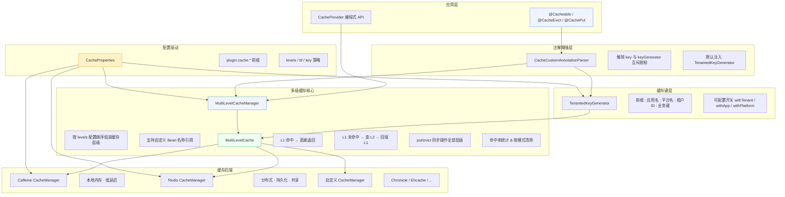
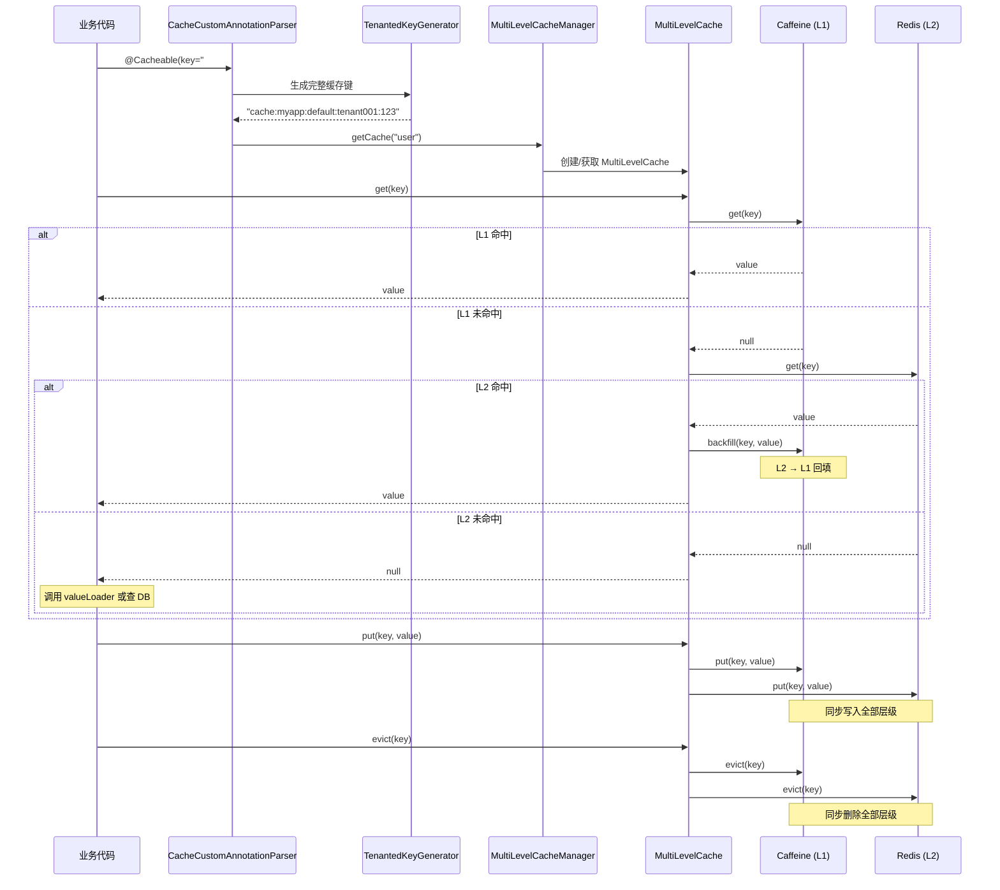

# Spring Support Cache Starter

企业级多级缓存解决方案，提供 Caffeine + Redis 多级缓存管理、租户级缓存键生成、注解增强等能力。

---

## 架构总览



---

## 数据流



---

## 模块结构

```
spring-support-cache-starter/
├── pom.xml
├── README.md
└── src/main/java/com/chua/
    ├── common/support/cache/
    │   └── CacheProvider.java          # 编程式缓存 API（内存 / Redis）
    └── starter/common/support/
        ├── cache/
        │   ├── CacheConfiguration.java           # 自动配置（注册 Bean）
        │   ├── CacheProperties.java              # 配置属性（plugin.cache.*）
        │   ├── CacheCustomAnnotationParser.java  # 注解增强解析器
        │   ├── CacheProxyCachingConfiguration.java # 代理配置
        │   ├── MultiLevelCacheManager.java       # 多级缓存管理器
        │   ├── MultiLevelCache.java              # 多级缓存实现
        │   └── TenantedKeyGenerator.java         # 租户缓存键生成器
        └── constant/
            └── CacheConstant.java                # 缓存常量
```

---

## 快速开始

### 1. 引入依赖

```xml
<dependency>
    <groupId>com.chua</groupId>
    <artifactId>spring-support-cache-starter</artifactId>
    <version>4.0.0.42</version>
</dependency>
```

### 2. 配置

```yaml
plugin:
  cache:
    enabled: true
    levels:
      - caffeine
      - redis
    caffeine:
      initial-capacity: 256
      maximum-size: 50000
      expire-after-write: 300
      record-stats: true
    redis:
      ttl: 1800
      key-prefix: "cache:"
    key:
      prefix: "cache:"
      with-tenant: true
      with-application: true
      with-platform: true
    cache-null-values: false
```

### 3. 使用注解

```java
@Service
public class UserService {

    @Cacheable(value = "user", key = "#id")
    public User getUser(Long id) {
        return userMapper.selectById(id);
    }

    @CacheEvict(value = "user", key = "#id")
    public void deleteUser(Long id) {
        userMapper.deleteById(id);
    }

    @CachePut(value = "user", key = "#result.id")
    public User updateUser(User user) {
        userMapper.updateById(user);
        return user;
    }
}
```

### 4. 编程式 API

```java
@Autowired
private CacheProvider cacheProvider;

// 内存缓存
cacheProvider.set("key", "value");
String value = cacheProvider.getString("key");

// Redis 缓存（自动选择）
cacheProvider.setRedis("session:123", user, 1800);
User user = cacheProvider.getRedis("session:123", User.class);
```

---

## 核心特性

### 多级缓存读写

| 操作 | L1 (Caffeine) | L2 (Redis) | 说明 |
|------|:------------:|:----------:|------|
| `get` 命中 L1 | 返回 | 不查询 | L1 直接返回 |
| `get` 未命中 L1，命中 L2 | 回填 | 返回 | L2 → L1 自动回填 |
| `get` 全部未命中 | 无操作 | 无操作 | 调用方负责加载 |
| `put` | 写入 | 写入 | 全部层级同步写入 |
| `evict` | 删除 | 删除 | 全部层级同步删除 |

### 二级更新一级

`MultiLevelCache` 已内置双向同步：
- **写入方向**：`put()` 同步写入 Caffeine(L1) 和 Redis(L2)
- **读取方向**：`get()` 从 Redis(L2) 命中后自动回填 Caffeine(L1)
- **删除方向**：`evict()` 同步删除全部层级

若需跨实例缓存一致性（例如实例 A 的 Redis 写入后通知实例 B 的 Caffeine），可通过 Redis Pub/Sub 扩展实现。

### 缓存键策略

通过 `KeyProperties` 配置缓存键组成：

```
prefix : applicationName : platformName : tenantId : businessKey
```

```yaml
plugin:
  cache:
    key:
      prefix: "cache:"
      with-application: true   # 追加 spring.application.name
      with-platform: true      # 追加 platform-name
      with-tenant: true        # 追加租户 ID
```

### 多 Redis 实例

默认自动配置仅注册一个 `redisCacheManager`，如需多实例：

```java
@Configuration
public class MultiRedisConfig {

    @Bean("redisCacheManager1")
    public CacheManager redisManager1(
            @Qualifier("redisConnectionFactory1") RedisConnectionFactory factory,
            CacheProperties properties) {
        return buildRedisManager(factory, properties);
    }

    @Bean("redisCacheManager2")
    public CacheManager redisManager2(
            @Qualifier("redisConnectionFactory2") RedisConnectionFactory factory,
            CacheProperties properties) {
        return buildRedisManager(factory, properties);
    }
}
```

然后在配置中引用：

```yaml
plugin:
  cache:
    levels:
      - caffeineCacheManager
      - redisCacheManager1
      - redisCacheManager2
```

### 自定义 CacheManager

`levels` 列表直接引用 Spring 容器中的 Bean 名称（忽略大小写），任何实现了 `org.springframework.cache.CacheManager` 的 Bean 均可加入多级缓存。

---

## 配置项完整列表

| 配置项 | 类型 | 默认值 | 说明 |
|--------|------|--------|------|
| `plugin.cache.enabled` | boolean | `false` | 启用多级缓存 |
| `plugin.cache.levels` | list | `[caffeine, redis]` | 缓存层级（按读取顺序） |
| `plugin.cache.cache-null-values` | boolean | `false` | 缓存空值防穿透 |
| `plugin.cache.null-value-ttl` | long | `60` | 空值过期时间（秒） |
| `plugin.cache.record-stats` | boolean | `true` | 启用命中率统计 |
| `plugin.cache.caffeine-bean` | string | `caffeineCacheManager` | Caffeine Bean 名称 |
| `plugin.cache.redis-bean` | string | `redisCacheManager` | Redis Bean 名称 |
| `plugin.cache.expires` | map | `{}` | 按缓存名细化 TTL |

### Caffeine 配置

| 配置项 | 类型 | 默认值 | 说明 |
|--------|------|--------|------|
| `caffeine.initial-capacity` | int | `256` | 初始容量 |
| `caffeine.maximum-size` | long | `10000` | 最大容量 |
| `caffeine.expire-after-write` | long | `300` | 写入后过期（秒），≤0 禁用 |
| `caffeine.expire-after-access` | long | `0` | 访问后过期（秒），≤0 禁用 |
| `caffeine.record-stats` | boolean | `true` | 统计命中率 |
| `caffeine.weak-keys` | boolean | `false` | 弱引用 key |
| `caffeine.weak-values` | boolean | `false` | 弱引用 value |

### Redis 配置

| 配置项 | 类型 | 默认值 | 说明 |
|--------|------|--------|------|
| `redis.ttl` | long | `600` | 默认过期时间（秒），≤0 永不过期 |
| `redis.key-prefix` | string | `cache:` | key 前缀 |
| `redis.serializer` | string | `jackson` | 序列化方式：jackson / jdk |
| `redis.separator` | string | `:` | key 分隔符 |
| `redis.use-key-prefix` | boolean | `true` | 启用 key 前缀 |

### 缓存键配置

| 配置项 | 类型 | 默认值 | 说明 |
|--------|------|--------|------|
| `key.prefix` | string | `cache:` | 统一前缀 |
| `key.separator` | string | `:` | 分隔符 |
| `key.with-tenant` | boolean | `true` | 追加租户 ID |
| `key.with-application` | boolean | `true` | 追加应用名 |
| `key.with-platform` | boolean | `true` | 追加平台名 |

---

## 管理端点

```java
@Autowired
private MultiLevelCacheManager cacheManager;

// 获取统计信息
Map<String, CacheStats> stats = cacheManager.getStats();
// 输出: {user={hitCount=150, missCount=10, hitRate=0.9375, backfillCount=8, levelCount=2}}

// 预热缓存
Map<Object, Object> data = Map.of("1", user1, "2", user2);
cacheManager.warmUp("user", data);

// 按模式清除
cacheManager.evictByPattern("user", "tenant001");

// 清除全部
cacheManager.clearAll();
```
