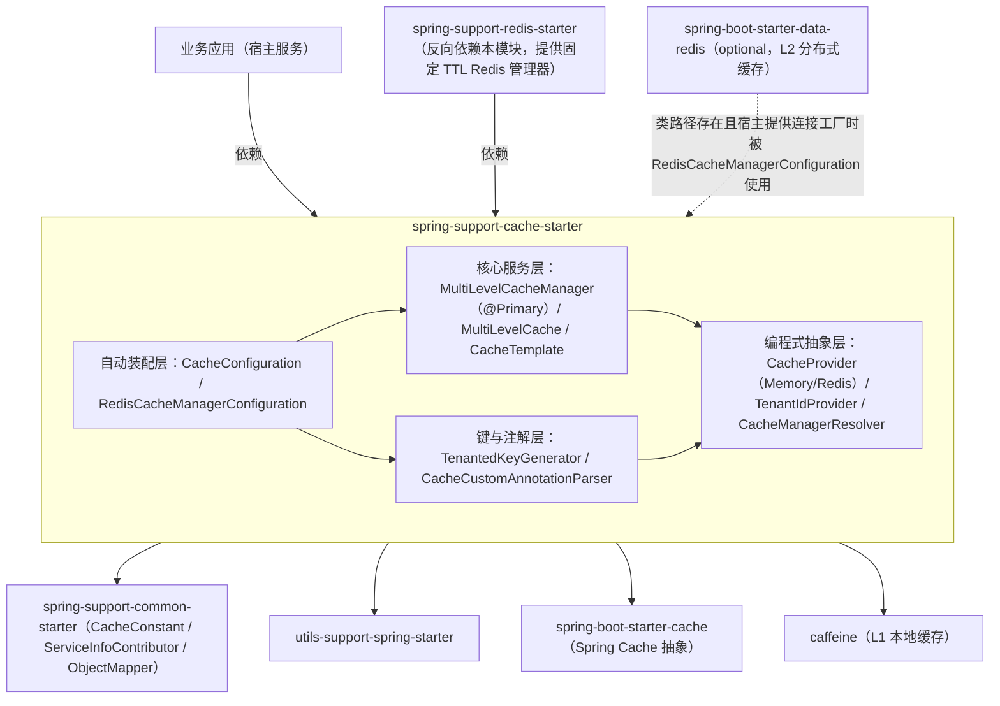
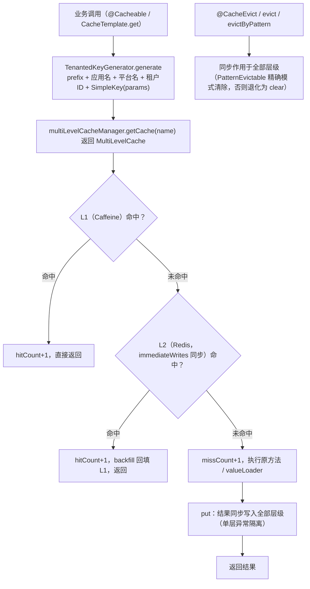

# spring-support-cache-starter

Caffeine + Redis 多级缓存 Starter，为 spring-support 体系提供统一的缓存底座：注解缓存增强（`key` 与 `keyGenerator` 可同时使用）、租户级缓存键、`MultiLevelCache` 多级读写回填、手动缓存模板 `CacheTemplate` 与编程式 `CacheProvider` 抽象。它是业务 starter 的通用基础设施：`spring-support-redis-starter` 反向依赖本模块，宿主应用引入后通过 `plugin.cache.*` 一键开启多级缓存。

- Maven 坐标：`com.chua:spring-support-cache-starter:4.0.0.51`
- 配置前缀：`plugin.cache`（配置类 `CacheProperties`）
- 自动装配入口：`META-INF/spring/org.springframework.boot.autoconfigure.AutoConfiguration.imports`，注册 `CacheConfiguration` 与 `RedisCacheManagerConfiguration`（本模块无 `spring.factories`）
- 总开关：`plugin.cache.enabled`，默认 `false`

## 1. 架构图



要点：本模块是**被依赖方**，`spring-support-redis-starter` 的 pom 依赖本模块，且 `CacheConfiguration` 标注 `@AutoConfigureAfter(name = "com.chua.starter.redis.support.CacheConfiguration")`，保证 redis-starter 的 `CacheManager` Bean 先就绪再被 `levels` 按名称引用；Redis 能力**可选**（`spring-boot-starter-data-redis` 为 `optional`），宿主不引入时多级缓存自动退化为纯 Caffeine 单层；宿主实现的 `TenantIdProvider` Bean 会被 `TenantedKeyGenerator` 自动装配。

## 2. 核心流程图

运行期数据流转（`@Cacheable` 注解与 `CacheTemplate` 手动调用同口径）：



启动期装配：`MultiLevelCacheManager#afterPropertiesSet` 通过 `Binder.get(environment).bindOrCreate("plugin.cache", CacheProperties.class)` 重新绑定配置，再从 `applicationContext.getBeansOfType(CacheManager.class)` 按 Bean 名大写建索引，遍历 `levels`（`caffeine`→`caffeine-bean`、`redis`→`redis-bean`，其余按 `toUpperCase()` 匹配）依次组合底层管理器。

## 3. 能力清单

| 能力域 | 关键类 | 入口 / 触发方式 |
|---|---|---|
| 多级缓存管理器 | `MultiLevelCacheManager`（`@Primary`，Bean 名 `multiLevelCacheManager`） | `plugin.cache.enabled=true` |
| 多级缓存实现 | `MultiLevelCache`（L1 命中直返 / 高层命中回填 / 写删同步全部层级 / 单层异常隔离） | 管理器按缓存名懒创建 |
| 本地缓存（L1） | `caffeineCacheManager`（`CaffeineCacheManager`） | `enabled=true` + `plugin.cache.caffeine.*` |
| Redis 缓存（L2） | `redisCacheManager`（`RedisCacheManager`，`immediateWrites(true)` 同步写） | `enabled=true` + 类路径有 `RedisSerializer` + 容器有 `RedisConnectionFactory` |
| 租户缓存键与上下文 SPI | `TenantedKeyGenerator`（Bean 名 `tenantedKeyGenerator`）+ `TenantIdProvider`（`@FunctionalInterface`） | 无条件注册；宿主声明 `TenantIdProvider` Bean 后自动装配，缺省租户 `0` |
| 注解缓存增强 | `CacheCustomAnnotationParser` + `customCacheOperationSource`（`@Primary`） | 无条件注册；允许 `key` + `keyGenerator` 同用，缺省 `keyGenerator=tenantedKeyGenerator` |
| 手动缓存模板 | `CacheTemplate`（buildKey/put/get/evict/evictByPattern/clear/clearAll/getStats） | `plugin.cache.enabled=true` |
| 编程式缓存抽象 | `CacheProvider`（`MemoryCacheProvider` / 抽象 `RedisCacheProvider`） | 代码直接调用（`CacheProvider.auto()`），非 Spring Bean |
| 主管理器确定性解析 | `CacheManagerResolver`（静态工具） | 宿主 `CachingConfigurer` 调用 |
| 统计与运维 | `getStats` / `warmUp` / `evictByPattern` / `clearAll` / `resetAllStats` | 代码调用 |
| 服务信息登记 | `cacheServiceInfoContributor`（`ServiceInfoContributor`） | 无条件注册，启动横幅展示 `cache` 标志 |

## 4. Bean 能力矩阵

| Bean 名 | 类型 | 装配条件（含默认值） | 可否覆盖 | 典型用途 |
|---|---|---|---|---|
| `caffeineCacheManager` | `CacheManager`（`CaffeineCacheManager`） | `@ConditionalOnProperty(plugin.cache.enabled=true)` + `@ConditionalOnClass(Caffeine)` + `@ConditionalOnMissingBean(name)` | 可，同名 Bean 让位 | L1 本地缓存层 |
| `redisCacheManager` | `CacheManager`（`RedisCacheManager`） | 类级 `@ConditionalOnClass(RedisSerializer)` + `enabled=true`；方法级 `@ConditionalOnBean(RedisConnectionFactory)` + `@ConditionalOnMissingBean(name)` | 可，同名 Bean 让位 | L2 分布式缓存层，`levels` 按名引用 |
| `multiLevelCacheManager` | `MultiLevelCacheManager`（实现 `CacheManager`/`InitializingBean`/`ApplicationContextAware`） | `enabled=true` + `@ConditionalOnMissingBean(name)`；标注 `@Primary` | 可，同名 Bean 让位 | 默认缓存管理器；`@Cacheable` 不指定 `cacheManager` 时使用 |
| `cacheTemplate` | `CacheTemplate` | `enabled=true` + `@ConditionalOnMissingBean(CacheTemplate.class)` | 可，同类型 Bean 让位 | 手动缓存读写 |
| `tenantedKeyGenerator` | `TenantedKeyGenerator`（实现 `KeyGenerator`） | 仅 `@ConditionalOnMissingBean(name)`；**不受 `enabled` 控制，始终注册** | 可，同名 Bean 让位 | `@Cacheable(keyGenerator="tenantedKeyGenerator")` 与 `CacheTemplate` 键生成 |
| `customTenantedKeyGenerator` | `KeyGenerator`（实际 `SimpleKeyGenerator`） | 仅 `@ConditionalOnMissingBean(name)`；不受 `enabled` 控制 | 可，同名 Bean 让位 | 兼容旧引用，无租户语义 |
| `cacheCustomAnnotationParser` | `CacheCustomAnnotationParser`（实现 `CacheAnnotationParser`） | 仅 `@ConditionalOnMissingBean(CacheCustomAnnotationParser.class)`；不受 `enabled` 控制 | 可，同类型 Bean 让位 | 解除 `key`+`keyGenerator` 同用限制 |
| `customCacheOperationSource` | `CacheOperationSource`（实际 `AnnotationCacheOperationSource`） | **无条件创建 + `@Primary`**（若依赖 `@ConditionalOnMissingBean` 会被 `@EnableCaching` 的标准解析器抢注，导致 key+keyGenerator 同用报 `IllegalStateException`） | 仅当开启 `spring.main.allow-bean-definition-overriding=true` 时同名覆盖，并需自行处理 `@Primary` 冲突 | Spring Cache 拦截链内部消费 |
| `cacheServiceInfoContributor` | `ServiceInfoContributor` | 无条件创建（无 `@ConditionalOnMissingBean`） | 仅当开启 `spring.main.allow-bean-definition-overriding=true` 时同名覆盖 | 启动信息横幅登记 `cache` 模块 |

补充：`CacheProxyCachingConfiguration`（仅 `@EnableCaching`）**不在**自动装配列表，是给未声明 `@EnableCaching` 的应用显式 `@Import` 的兜底入口；`CacheManagerResolver`、`CacheProvider` 不是 Spring Bean，不参与装配。

## 5. 完整配置

配置类 `CacheProperties`，前缀 `plugin.cache`（`ignoreInvalidFields = true`）。以下字段与默认值逐项来自源码；标注「声明项」的字段当前无代码消费、配置不生效。

| 配置路径 | 类型 | 默认值 | 说明 |
|---|---|---|---|
| `plugin.cache.enabled` | `boolean` | `false` | 总开关；关闭时 `caffeineCacheManager`/`redisCacheManager`/`multiLevelCacheManager`/`cacheTemplate` 均不注册 |
| `plugin.cache.levels` | `List<String>` | `["caffeine","redis"]` | 层级顺序，越靠前越接近调用方（L1 在前）；`caffeine`/`redis` 映射到下述 Bean 名，其余值按 `toUpperCase()` 匹配容器中的 `CacheManager` Bean 名 |
| `plugin.cache.caffeine-bean` | `String` | `caffeineCacheManager` | 本地层 `CacheManager` Bean 名 |
| `plugin.cache.redis-bean` | `String` | `redisCacheManager` | 分布式层 `CacheManager` Bean 名 |
| `plugin.cache.cache-null-values` | `boolean` | `false` | 是否缓存空值（防穿透）；作用于 Caffeine `allowNullValues`、Redis `disableCachingNullValues` 与 `MultiLevelCache` 空值占位符 |
| `plugin.cache.null-value-ttl` | `long` | `60` | 声明项，不生效 |
| `plugin.cache.record-stats` | `boolean` | `true` | 声明项；`MultiLevelCache` 统计计数器始终开启，该字段无消费方 |
| `plugin.cache.expires` | `Map<String,Long>` | `{}` | 声明项（按缓存名细化 TTL），不生效 |
| `plugin.cache.caffeine.initial-capacity` | `int` | `256` | Caffeine 初始容量 |
| `plugin.cache.caffeine.maximum-size` | `long` | `10000` | 最大条目数 |
| `plugin.cache.caffeine.expire-after-write` | `long` | `300` | 写入后过期（秒），`<=0` 不设置 |
| `plugin.cache.caffeine.expire-after-access` | `long` | `0` | 访问后过期（秒），`<=0` 不设置 |
| `plugin.cache.caffeine.record-stats` | `boolean` | `true` | Caffeine `recordStats()` |
| `plugin.cache.caffeine.weak-keys` | `boolean` | `false` | 弱引用 Key |
| `plugin.cache.caffeine.weak-values` | `boolean` | `false` | 弱引用 Value |
| `plugin.cache.redis.ttl` | `long` | `600` | 默认 TTL（秒）；`>0` 按 `entryTtl(秒)` 生效，`=-1`（`TTL_NEVER_EXPIRE`）→ `entryTtl(Duration.ZERO)` 永不过期，其它 `<=0` 不调用 `entryTtl`（跟随 Spring Data Redis 默认） |
| `plugin.cache.redis.key-prefix` | `String` | `cache:` | 键前缀；构建时先 `prefixCacheNameWith(keyPrefix)`，随后被 `computePrefixWith(name -> name + separator)` 覆盖，最终前缀为 `缓存名 + separator` |
| `plugin.cache.redis.separator` | `String` | `:` | 缓存名与键之间的分隔符 |
| `plugin.cache.redis.use-key-prefix` | `boolean` | `true` | 是否启用键前缀策略 |
| `plugin.cache.redis.serializer` | `String` | `jackson` | 声明项；实现固定 `GenericJackson2JsonRedisSerializer(ObjectMapper)`，该字段不参与构建 |
| `plugin.cache.redis.cache-null-values` | `boolean` | `false` | 声明项；Redis 构建实际读取顶层 `cache-null-values`，本字段无消费方 |
| `plugin.cache.key.prefix` | `String` | `cache:` | 缓存键统一前缀（作用于 `TenantedKeyGenerator`） |
| `plugin.cache.key.separator` | `String` | `:` | 声明项；键拼接固定使用 `:`，该字段无消费方 |
| `plugin.cache.key.with-application` | `boolean` | `true` | 键中追加应用名（`spring.application.name`，缺省 `app`） |
| `plugin.cache.key.with-platform` | `boolean` | `true` | 键中追加平台名（`plugin.api.platform.platform-name`，缺省 `default`） |
| `plugin.cache.key.with-tenant` | `boolean` | `true` | 键中追加租户 ID（`TenantIdProvider` 提供，缺省 `0`） |

```yaml
plugin:
  cache:
    enabled: true
    levels: [caffeine, redis]
    caffeine: { maximum-size: 50000, expire-after-write: 300 }
    redis: { ttl: 1800, key-prefix: "cache:" }
```

### 5.1 逐项配置示例（按功能分组）

每项含义、默认值与 YAML 示例如下；默认值逐项来自源码 `CacheProperties` 字段初始化，「声明项」表示字段存在但当前无消费方、配置不生效。

#### 总开关与层级

| 配置项 | 类型 | 默认值 | 含义 |
|---|---|---|---|
| `plugin.cache.enabled` | `boolean` | `false` | 多级缓存总开关，必须显式开启 |
| `plugin.cache.levels` | `List<String>` | `[caffeine, redis]` | 层级读取顺序，越靠前越接近调用方；`caffeine`/`redis` 映射到下方 Bean 名，其余值按 Bean 名大写匹配 |
| `plugin.cache.caffeine-bean` | `String` | `caffeineCacheManager` | 本地层 `CacheManager` Bean 名 |
| `plugin.cache.redis-bean` | `String` | `redisCacheManager` | 分布式层 `CacheManager` Bean 名 |

```yaml
plugin:
  cache:
    enabled: true
    levels: [caffeine, redis]
    caffeine-bean: caffeineCacheManager
    redis-bean: redisCacheManager
```

#### 空值策略

| 配置项 | 类型 | 默认值 | 含义 |
|---|---|---|---|
| `plugin.cache.cache-null-values` | `boolean` | `false` | 是否缓存空值占位符（防穿透）；同时作用于 Caffeine `allowNullValues`、Redis `disableCachingNullValues` 与 `MultiLevelCache` 空值占位符；关闭时 `null` 结果不落缓存 |
| `plugin.cache.null-value-ttl` | `long` | `60` | 声明项，不生效；空值占位符实际跟随各层自身 TTL |

```yaml
plugin:
  cache:
    cache-null-values: false
```

#### Caffeine 本地层

| 配置项 | 类型 | 默认值 | 含义 |
|---|---|---|---|
| `plugin.cache.caffeine.initial-capacity` | `int` | `256` | 初始容量 |
| `plugin.cache.caffeine.maximum-size` | `long` | `10000` | 最大条目数（Caffeine `maximumSize`） |
| `plugin.cache.caffeine.expire-after-write` | `long` | `300` | 写入后过期（秒）；`<=0` 不设置 |
| `plugin.cache.caffeine.expire-after-access` | `long` | `0` | 访问后过期（秒）；`<=0` 不设置 |
| `plugin.cache.caffeine.record-stats` | `boolean` | `true` | Caffeine `recordStats()` |
| `plugin.cache.caffeine.weak-keys` | `boolean` | `false` | 弱引用 Key |
| `plugin.cache.caffeine.weak-values` | `boolean` | `false` | 弱引用 Value |

```yaml
plugin:
  cache:
    caffeine:
      initial-capacity: 256
      maximum-size: 10000
      expire-after-write: 300
      expire-after-access: 0
      record-stats: true
      weak-keys: false
      weak-values: false
```

#### Redis 分布式层

| 配置项 | 类型 | 默认值 | 含义 |
|---|---|---|---|
| `plugin.cache.redis.ttl` | `long` | `600` | 默认 TTL（秒）；`>0` 生效；`=-1` 永不过期；其它 `<=0` 跟随 Spring Data Redis 默认 |
| `plugin.cache.redis.key-prefix` | `String` | `cache:` | 键前缀；`use-key-prefix=true` 时参与构建，最终前缀为「缓存名 + separator」 |
| `plugin.cache.redis.separator` | `String` | `:` | 缓存名与键之间的分隔符 |
| `plugin.cache.redis.use-key-prefix` | `boolean` | `true` | 是否启用键前缀策略 |
| `plugin.cache.redis.serializer` | `String` | `jackson` | 声明项，不生效；实现固定为 `GenericJackson2JsonRedisSerializer(ObjectMapper)` |
| `plugin.cache.redis.cache-null-values` | `boolean` | `false` | 声明项，不生效；以顶层 `cache-null-values` 为准 |

```yaml
plugin:
  cache:
    redis:
      ttl: 1800
      key-prefix: "cache:"
      separator: ":"
      use-key-prefix: true
```

#### 缓存键策略

| 配置项 | 类型 | 默认值 | 含义 |
|---|---|---|---|
| `plugin.cache.key.prefix` | `String` | `cache:` | 业务键统一前缀 |
| `plugin.cache.key.separator` | `String` | `:` | 声明项，不生效；键拼接固定使用 `:` |
| `plugin.cache.key.with-application` | `boolean` | `true` | 键中追加应用名（`spring.application.name`，缺省 `app`） |
| `plugin.cache.key.with-platform` | `boolean` | `true` | 键中追加平台名（`plugin.api.platform.platform-name`，缺省 `default`） |
| `plugin.cache.key.with-tenant` | `boolean` | `true` | 键中追加租户 ID（`TenantIdProvider` 提供，缺省 `0`） |

```yaml
plugin:
  cache:
    key:
      prefix: "cache:"
      with-application: true
      with-platform: true
      with-tenant: true
```

#### 声明项汇总（当前版本配置不生效）

`plugin.cache.expires`（按缓存名细化 TTL，默认空 Map）、`plugin.cache.null-value-ttl`、`plugin.cache.record-stats`（顶层；Caffeine 层请配 `plugin.cache.caffeine.record-stats`）、`plugin.cache.redis.serializer`、`plugin.cache.redis.cache-null-values`、`plugin.cache.key.separator`。这些字段存在于 `CacheProperties`，但源码中无消费方；需要对应能力时须自行定义 `CacheManager` / 键生成逻辑。

### 5.2 生产级完整 YAML 示例

```yaml
spring:
  application:
    name: order-service              # 进入缓存键（key.with-application=true 时）
  data:
    redis:                           # Redis 层需宿主自行引入 spring-boot-starter-data-redis
      host: your-redis-host          # 占位符，替换为真实地址
      port: 6379
      password: your-password        # 占位符，替换为真实口令（建议走配置中心/密钥管理）

plugin:
  cache:
    enabled: true
    levels: [caffeine, redis]
    cache-null-values: false         # 不缓存空值；若要防穿透改 true（注意清理策略）
    caffeine:                        # L1：短 TTL，控制跨实例脏读窗口
      initial-capacity: 512
      maximum-size: 50000
      expire-after-write: 300
      expire-after-access: 0
      record-stats: true
    redis:                           # L2：长 TTL，承载分布式容量
      ttl: 1800
      key-prefix: "cache:"
      separator: ":"
      use-key-prefix: true
    key:
      prefix: "cache:"
      with-application: true
      with-platform: true
      with-tenant: true
```

### 5.3 生产注意事项

- **跨实例脏读窗口**：写删只同步本实例看到的层级，没有跨实例 L1 失效广播——实例 A 写入后，实例 B 的 Caffeine 副本要等自己的 `expire-after-write` 到期。多实例部署时 L1 TTL 应远小于 L2 TTL，把脏读窗口压到业务可接受范围；需要强一致失效请自行叠加 Redis Pub/Sub 广播。
- **L1 容量即堆占用**：`caffeine.maximum-size` × 平均条目大小 ≈ 本地缓存堆上限，按 JVM 堆余量给值，避免缓存挤占业务内存；`record-stats: true` 时可通过 `cacheTemplate.getStats()` 观测命中率与回填量。
- **L2 序列化约束**：Redis 值固定走 Jackson（`GenericJackson2JsonRedisSerializer`），缓存对象需可被 Jackson 反序列化（保留默认构造器与可写字段）；要换序列化方案需自行覆盖 `redisCacheManager` Bean。
- **写路径延迟**：`redisCacheManager` 已强制 `immediateWrites(true)` 同步写，`@CacheEvict`/写入会受 Redis RTT 影响；Redis 抖动会传导到写接口（单层异常会被隔离记录，不抛出）。
- **空值防穿透的代价**：`cache-null-values: true` 会把空结果以占位符写入全部层级，注意配合层级 TTL 与按模式清理（`evictByPattern`）定期回收；`null-value-ttl` 当前不生效。
- **键形态变更需清缓存**：完整键 = `key.prefix + 应用名 + 平台名 + 租户ID + 参数键`，调整 `key.*` 开关或前缀会让历史键全部失配（表现为「缓存突然全 miss」），变更前先清空相关缓存或安排双读过渡。
- **别配声明项**：`expires`、`null-value-ttl`、顶层 `record-stats`、`redis.serializer`、`redis.cache-null-values`、`key.separator` 当前不生效，配置了也会被忽略，避免产生「已调优」错觉。
- **自定义层级的注册时机**：`levels` 引用的 `CacheManager` Bean 必须在 `MultiLevelCacheManager#afterPropertiesSet` 之前完成注册，否则启动日志出现「未找到层级对应的 CacheManager」WARN 并跳过该层。

## 6. 使用方式

```xml
<dependency>
    <groupId>com.chua</groupId>
    <artifactId>spring-support-cache-starter</artifactId>
    <version>4.0.0.51</version>
</dependency>
```

依赖说明：`spring-support-common-starter`、`utils-support-spring-starter`、`spring-boot-starter-cache`、`caffeine`、`spring-boot-autoconfigure` 为普通依赖，随本 starter 传递引入；`spring-boot-starter-data-redis` 为 **`optional`**——需要 Redis 层（L2）时由宿主显式引入并配置 `spring.data.redis.*`，否则类路径无 `RedisSerializer`、容器无 `RedisConnectionFactory`，`redisCacheManager` 不创建，多级缓存退化为纯 Caffeine 单层。`lombok` 为 `provided`，仅编译期使用。

最小启用（打开开关，并在应用上声明 `@EnableCaching`；本模块的 `CacheProxyCachingConfiguration` 不在自动装配列表，仅作显式 `@Import` 兜底）：

```yaml
plugin:
  cache:
    enabled: true
    levels: [caffeine, redis]
```

```java
@Service
public class UserService {
    @Cacheable(cacheNames = "user", key = "#id")   // 写了 key 表达式时实际键 = 表达式结果；不写 key 时走租户键生成器
    public User getUser(Long id) { return userMapper.selectById(id); }

    @CacheEvict(cacheNames = "user", key = "#id")
    public void deleteUser(Long id) { userMapper.deleteById(id); }
}
```

注解**不写 `key`** 时的键结构（`key` 与 `keyGenerator` 可同时声明；注解未指定 `keyGenerator` 时默认 `tenantedKeyGenerator`）：

```text
{key.prefix}{applicationName}:{platformName}:{tenantId}:{SimpleKey(params)}
例：cache:myapp:system:tenant-001:123
```

手动缓存（键固定由 `tenantedKeyGenerator` 生成完整键；与注解键完全一致的前提是注解也不写 `key` 且业务键与参数简单键一致）：

```java
@Autowired private CacheTemplate cacheTemplate;

String fullKey = cacheTemplate.buildKey("user:" + id);        // cache:app:default:0:user:123（默认配置）
cacheTemplate.put("user", "user:" + id, user);                // 写入全部层级
User u = cacheTemplate.get("user", "user:" + id, User.class); // 未命中返回 null
cacheTemplate.evictByPattern("user", "user:*");               // 按模式清理
Map<String, MultiLevelCacheManager.CacheStats> stats = cacheTemplate.getStats();
```

## 7. 使用场景

适用：

- 读多写少、需要「本地速度 + 分布式容量」的数据：字典、配置、权限、档案类查询。
- 多租户应用：键天然携带应用名 / 平台名 / 租户 ID，避免跨租户脏读。
- 需要 `@Cacheable` 同时指定 `key`（SpEL）与 `keyGenerator`，或希望注解默认带租户前缀。
- 需要命中率统计、预热、按模式清除、整体清空等运维能力。

不适用 / 慎用：

- 强一致写场景：写删只同步**本实例**看到的层级，没有跨实例 L1 失效广播，实例 A 的写入不会清理实例 B 的 Caffeine 副本（需自行用 Redis Pub/Sub 等补齐）。
- 依赖 `expires`（按缓存名 TTL）、`null-value-ttl`、JDK 序列化的场景：这些配置当前无消费方，需自行定义 `CacheManager`。

与相邻模块的取舍：

- **vs `spring-support-redis-starter`**：redis-starter 反向依赖本模块，提供 `redis-cache-10` / `redis-cache-30` / `redis-cache-60` / `redis-cache-600` / `redis-cache-3600` / `redis-cache--1`（永久，常量 `REDIS_CACHE_ALWAYS`）/ `redis-cache-86400` 系列**固定 TTL** 的 `RedisCacheManager`（常量见 `CacheConstant`）。要「按业务选固定 TTL 档位」用 redis-starter；要「两级缓存 + 注解增强 + 租户键 + 统计运维」用本模块；二者可并存，`@AutoConfigureAfter` 已保证装配顺序。
- **vs 裸 Spring Cache**：裸 `spring-boot-starter-cache` + Caffeine 仅单层、无租户键、不允许 key/keyGenerator 同用；本模块在其上增强，`customCacheOperationSource` 以 `@Primary` 无条件接管注解解析，对宿主透明。

## 8. 扩展点

本模块无 Java `ServiceLoader` SPI（`META-INF` 下仅有 `AutoConfiguration.imports`）；扩展点均为 Spring Bean 级与继承级：

| 扩展点 | 方式 | 生效条件 |
|---|---|---|
| `TenantIdProvider` | 宿主声明实现 Bean（如从请求头 `X-Tenant-Id` 读取）；`TenantedKeyGenerator` 在 `afterPropertiesSet` 时自动装配，未声明时租户取 `0` | 容器中存在该类型 Bean |
| 自定义缓存层级 | 声明任意 `CacheManager` Bean，写入 `plugin.cache.levels`（写 Bean 名，匹配按 `toUpperCase()`；`caffeine`/`redis` 为保留名，映射 `caffeine-bean`/`redis-bean`） | `enabled=true`，且该 Bean 在 `afterPropertiesSet` 前已注册 |
| 覆盖内置管理器/模板 | 同名 Bean 覆盖 `caffeineCacheManager`/`redisCacheManager`/`multiLevelCacheManager`，或同类型覆盖 `cacheTemplate`（均有 `@ConditionalOnMissingBean`） | Bean 覆盖规则 |
| 覆盖注解解析 | 替换 `cacheCustomAnnotationParser`（按类型缺省让位）或同名覆盖 `customCacheOperationSource`（注意 `@Primary` 冲突） | Bean 覆盖规则 |
| `MultiLevelCache.PatternEvictable` | 底层 `Cache` 实现该接口后，`evictByPattern` 走精确模式清除，否则退化为 `clear()` | 自定义 `Cache` 实现时 |
| `CacheProvider.RedisCacheProvider` | 编程式 Redis 缓存：继承抽象类实现 `put(key,value,ttlSeconds)`/`get(key,type)`/`remove(key)`/`clear()`，构造传 `keyPrefix` 与 `defaultTtl` | 代码直接 `new`，非 Spring Bean |
| `CacheManagerResolver` | 宿主实现 `CachingConfigurer#cacheManager` 时调用 `CacheManagerResolver.resolve(applicationContext)`，确定性选出主管理器（偏好：`multiLevelCacheManager` → `caffeineCacheManager` → `cacheManager` → Bean 名最小） | 多 `CacheManager` 冲突时 |

自定义层级示例（声明 Bean 后加入 `levels`）：

```yaml
plugin:
  cache:
    enabled: true
    levels: [caffeineCacheManager, ehcacheManager]   # ehcacheManager 为宿主自行注册的 CacheManager Bean
```

## 9. 常见问题

**Q1：引入依赖后缓存不生效，或部分配置「配了也不生效」？**
装配排查：① `plugin.cache.enabled` 默认 `false`，必须显式 `true`，否则 `caffeineCacheManager`/`redisCacheManager`/`multiLevelCacheManager`/`cacheTemplate` 均不注册（仅键生成器与注解解析器在）；② 宿主是否声明 `@EnableCaching`（本模块不代开）；③ `levels` 名称能否匹配 Bean：`caffeine`→`caffeine-bean`、`redis`→`redis-bean`，其余按 `toUpperCase()` 匹配 Bean 名，匹配不到输出 `未找到层级对应的 CacheManager` WARN 并跳过该层。配置项中 `null-value-ttl`、顶层 `record-stats`、`expires`、`redis.serializer`、`redis.cache-null-values`（以顶层为准）、`key.separator`（固定 `:`）均为声明项、无消费方；空值缓存以顶层 `cache-null-values=true` 为准，关闭时返回 `null` 不落缓存（无法防穿透）。

**Q2：启动报 `NoUniqueBeanDefinitionException: expected single matching CacheManager but found N`？**
容器里存在多个 `CacheManager` 且无可解析 `@Primary` 时，Spring `CacheAspectSupport` 的兜底探测会失败并导致启动失败。本模块 `multiLevelCacheManager` 已标 `@Primary`；若被同名覆盖或仍有冲突，在 `CachingConfigurer#cacheManager` 中改用 `CacheManagerResolver.resolve(applicationContext)`。

**Q3：`@CacheEvict` 后 Redis 里还有旧值？**
Spring Data Redis 4.x 默认异步写缓存，失效指令的 Future 从不 join、异常静默丢失。本模块 `redisCacheManager` 已用 `RedisCacheWriter.create(connectionFactory, writer -> writer.immediateWrites(true))` 强制同步写；若宿主同名覆盖了该 Bean，需自行保留同步写语义。

**Q4：与 Spring Boot 4.x 的兼容性？**
本仓库基线 Spring Boot 4.1.2。模块使用 `AutoConfiguration.imports` 机制注册（无 `spring.factories`，Boot 4 已不再读取）；`RedisCacheManagerConfiguration` 为标准 `@AutoConfiguration`。针对 Spring Data Redis 4.x 异步写默认行为，以 `immediateWrites(true)` 规避 `@CacheEvict` 丢指令；L2 值序列化固定 `GenericJackson2JsonRedisSerializer(ObjectMapper)`（复用 common-starter 的 Jackson 配置）。本模块无独立端口、无定时任务、无表迁移，宿主副作用仅限第 4 节列出的 Bean。
