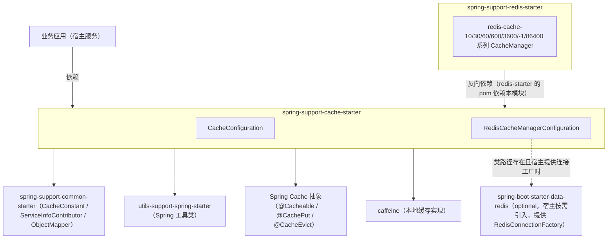
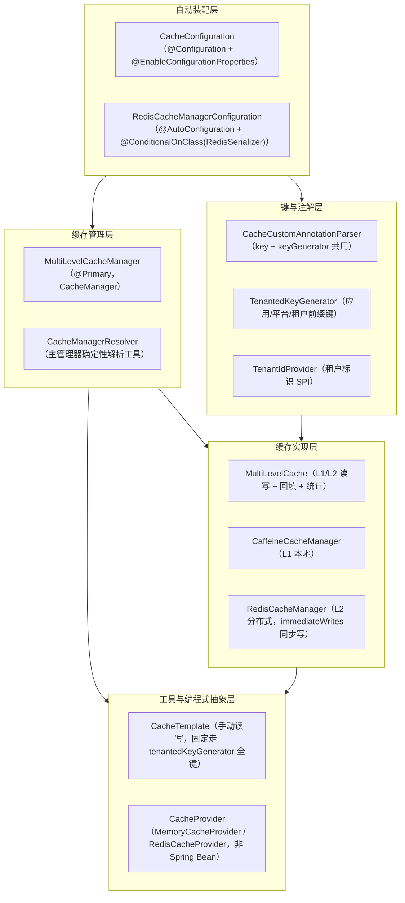
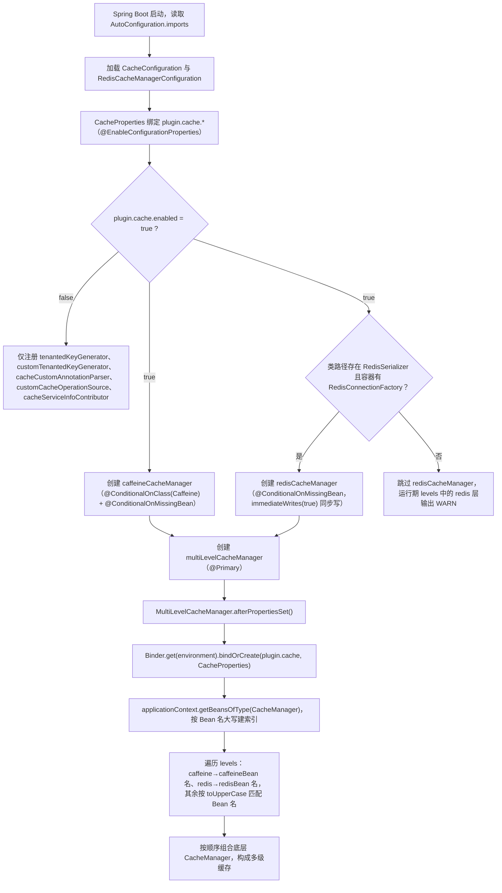
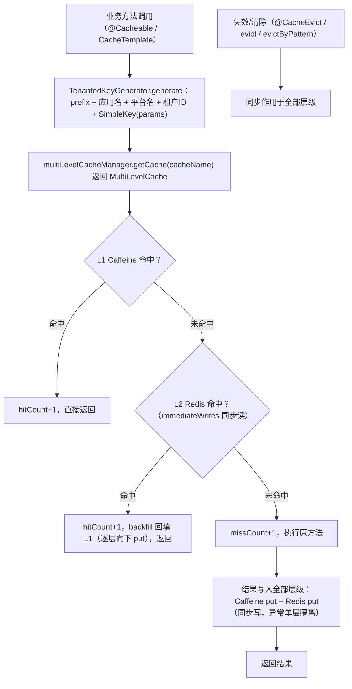

# spring-support-cache-starter

Caffeine + Redis 多级缓存 Starter：`@Cacheable` 注解增强（允许 `key` 与 `keyGenerator` 同时使用）、租户级缓存键、按层级组装的 `MultiLevelCache`、手动缓存模板 `CacheTemplate` 与编程式 `CacheProvider` 抽象。

- Maven 坐标：`com.chua:spring-support-cache-starter:4.0.0.51`
- 配置前缀：`plugin.cache`（配置类 `CacheProperties`）
- 自动装配入口：`META-INF/spring/org.springframework.boot.autoconfigure.AutoConfiguration.imports`，注册 `CacheConfiguration` 与 `RedisCacheManagerConfiguration` 两个类（本模块无 `spring.factories`）
- 总开关：`plugin.cache.enabled`，默认 `false`

---

## 1. 架构图

### 1.1 模块在体系中的位置



要点：

- 本模块是**被依赖方**：`spring-support-redis-starter` 的 pom 依赖本模块（`spring-support-redis-starter/pom.xml`），并由 `CacheConfiguration` 上的 `@AutoConfigureAfter(name = "com.chua.starter.redis.support.CacheConfiguration")` 保证 redis-starter 的 `CacheManager` Bean 先就绪，再被 `levels` 按名称引用。
- Redis 能力是**可选**的：`spring-boot-starter-data-redis` 在 pom 中为 `optional`，宿主不引入时多级缓存自动退化为纯 Caffeine。

### 1.2 模块内部分层



---

## 2. 核心流程图

### 2.1 装配流程（启动期）



### 2.2 读写数据流（运行期，`@Cacheable` 与手动模板同口径）



---

## 3. 能力清单

| 能力域 | 关键类 | 入口 |
|---|---|---|
| 多级缓存管理器 | `MultiLevelCacheManager`（`@Primary`，Bean 名 `multiLevelCacheManager`） | `plugin.cache.enabled=true` |
| 多级缓存实现 | `MultiLevelCache`（L1 命中直返 / L2 命中回填 L1 / 写删同步全部层级 / 单层异常隔离） | 由管理器按缓存名创建 |
| 本地缓存（L1） | `caffeineCacheManager`（`CaffeineCacheManager`） | `plugin.cache.enabled=true` + `plugin.cache.caffeine.*` |
| Redis 缓存（L2） | `redisCacheManager`（`RedisCacheManager`，`RedisCacheWriter.immediateWrites(true)`） | `plugin.cache.enabled=true` + 类路径有 `RedisSerializer` + 容器有 `RedisConnectionFactory` |
| 租户缓存键 | `TenantedKeyGenerator`（Bean 名 `tenantedKeyGenerator`） | 无条件注册；行为由 `plugin.cache.key.*` 控制 |
| 租户上下文 | `TenantIdProvider`（`@FunctionalInterface`） | 宿主声明 Bean 后被 `TenantedKeyGenerator` 自动装配，缺省租户 `0` |
| 注解增强 | `CacheCustomAnnotationParser`、`customCacheOperationSource`（`@Primary`） | 无条件注册；允许 `key` + `keyGenerator` 同时使用，缺省 `keyGenerator=tenantedKeyGenerator` |
| 手动缓存模板 | `CacheTemplate`（`buildKey/put/get/evict/evictByPattern/clear/clearAll/getStats`） | `plugin.cache.enabled=true` |
| 编程式缓存抽象 | `CacheProvider`（`MemoryCacheProvider` / 抽象类 `RedisCacheProvider`） | 代码直接调用（`CacheProvider.auto()`），非 Spring Bean |
| 主管理器确定性解析 | `CacheManagerResolver`（静态工具，非 Bean） | 宿主 `CachingConfigurer` 调用（如 ai-starter 的 `CacheResilienceConfiguration`） |
| 统计与运维 | `MultiLevelCacheManager#getStats/warmUp/evictByPattern/clearAll/resetAllStats` | 代码调用 |
| 服务信息登记 | `cacheServiceInfoContributor`（`ServiceInfoContributor`，注册 `cache` 标志） | 无条件注册，启动横幅展示 |

---

## 4. Bean 能力矩阵

下表逐项来自 `CacheConfiguration`、`RedisCacheManagerConfiguration` 的 `@Bean` 方法与注解。

| Bean 名 | 类型 | 装配条件 | 可否覆盖 | 典型注入姿势 |
|---|---|---|---|---|
| `caffeineCacheManager` | `CacheManager`（实际 `CaffeineCacheManager`） | `@ConditionalOnProperty(plugin.cache.enabled=true)` + `@ConditionalOnClass(Caffeine)` + `@ConditionalOnMissingBean(name=caffeineCacheManager)` | 可，声明同名 Bean 即自动让位 | `@Autowired CacheManager`（经 `@Primary` 会拿到多级管理器；按名注入可拿本 Bean） |
| `redisCacheManager` | `CacheManager`（实际 `RedisCacheManager`） | 类级：`@ConditionalOnClass(RedisSerializer)` + `@ConditionalOnProperty(plugin.cache.enabled=true)`；方法级：`@ConditionalOnBean(RedisConnectionFactory)` + `@ConditionalOnMissingBean(name=redisCacheManager)` | 可，声明同名 Bean 即自动让位 | `levels: [caffeine, redis]` 按名引用；或 `@Qualifier("redisCacheManager")` |
| `multiLevelCacheManager` | `MultiLevelCacheManager`（实现 `CacheManager`、`InitializingBean`、`ApplicationContextAware`） | `@ConditionalOnProperty(plugin.cache.enabled=true)` + `@ConditionalOnMissingBean(name=multiLevelCacheManager)`；标注 `@Primary` | 可，声明同名 Bean 即自动让位 | `@Autowired MultiLevelCacheManager`；`@Cacheable` 不写 `cacheManager` 时默认使用它 |
| `cacheTemplate` | `CacheTemplate` | `@ConditionalOnProperty(plugin.cache.enabled=true)` + `@ConditionalOnMissingBean(CacheTemplate.class)` | 可，声明同类型 Bean 即自动让位 | `@Autowired CacheTemplate` |
| `tenantedKeyGenerator` | `TenantedKeyGenerator`（实现 `KeyGenerator`） | `@ConditionalOnMissingBean(name=tenantedKeyGenerator)`；**不受 `enabled` 开关控制，始终注册** | 可，声明同名 Bean 即自动让位 | `@Cacheable(keyGenerator = "tenantedKeyGenerator")` |
| `customTenantedKeyGenerator` | `KeyGenerator`（实际返回 `SimpleKeyGenerator`） | `@ConditionalOnMissingBean(name=customTenantedKeyGenerator)`；兼容旧引用，不受 `enabled` 控制 | 可，声明同名 Bean 即自动让位 | 旧代码 `@Cacheable(keyGenerator = "customTenantedKeyGenerator")` 兼容 |
| `cacheCustomAnnotationParser` | `CacheCustomAnnotationParser`（实现 `CacheAnnotationParser`） | `@ConditionalOnMissingBean(CacheCustomAnnotationParser.class)`；不受 `enabled` 控制 | 可，声明同类型 Bean 即自动让位 | 由 `customCacheOperationSource` 内部消费，一般不直接注入 |
| `customCacheOperationSource` | `CacheOperationSource`（实际 `AnnotationCacheOperationSource`） | **无条件创建并标注 `@Primary`**（若依赖 `@ConditionalOnMissingBean` 会被 `@EnableCaching` 的标准解析器抢注，导致 key+keyGenerator 同用时报 `IllegalStateException`） | 可，但需同名 Bean 并自行处理 `@Primary` 冲突 | Spring Cache 拦截链内部消费 |
| `cacheServiceInfoContributor` | `ServiceInfoContributor` | 无条件创建 | 可，但属无条件注册，覆盖需同名 + `@Primary` | 启动信息横幅内部消费 |

补充说明：

- `CacheProxyCachingConfiguration`（仅 `@EnableCaching`）**不在** `AutoConfiguration.imports` 中，不会自动注册；它是给未显式声明 `@EnableCaching` 的应用显式 `@Import` 用的兜底入口。宿主通常应自带 `@EnableCaching`。
- `CacheManagerResolver`、`CacheProvider` 不是 Spring Bean，不参与装配。
- `multiLevelCacheManager` 初始化时通过 `Binder` 从 `Environment` 重新绑定 `plugin.cache`，因此即使 `CacheProperties` 未被其它路径激活，只要开关打开即可生效。

---

## 5. 完整配置

配置类：`CacheProperties`，前缀 `plugin.cache`（`ignoreInvalidFields = true`）。所有字段与默认值逐项来自源码。

### 5.1 顶层字段

| 路径 | 类型 | 默认值 | 说明 | 生效开关 |
|---|---|---|---|---|
| `plugin.cache.enabled` | `boolean` | `false` | 总开关。关闭时 `caffeineCacheManager`、`redisCacheManager`、`multiLevelCacheManager`、`cacheTemplate` 均不注册 | 本身即开关 |
| `plugin.cache.levels` | `List<String>` | `["caffeine", "redis"]` | 多级缓存层级顺序，越靠前越接近调用方（L1 在前）。`caffeine`/`redis` 会解析为 `caffeine-bean`/`redis-bean` 指定的 Bean 名，其它值按 `toUpperCase()` 匹配容器中的 `CacheManager` Bean 名 | `enabled=true` |
| `plugin.cache.caffeine-bean` | `String` | `caffeineCacheManager`（常量 `CAFFEINE_BEAN_NAME`） | 本地层 `CacheManager` Bean 名，`levels` 含 `caffeine` 时按此名解析 | `enabled=true` 且 levels 含 `caffeine` |
| `plugin.cache.redis-bean` | `String` | `redisCacheManager`（常量 `REDIS_BEAN_NAME`） | 分布式层 `CacheManager` Bean 名，`levels` 含 `redis` 时按此名解析 | `enabled=true` 且 levels 含 `redis` |
| `plugin.cache.cache-null-values` | `boolean` | `false` | 是否缓存空值（防穿透）。同时作用于 Caffeine 的 `allowNullValues`、Redis 的 `disableCachingNullValues` 与 `MultiLevelCache` 的空值占位符 | `enabled=true` |
| `plugin.cache.null-value-ttl` | `long` | `60` | 空值占位符过期时间（秒）。**声明项，当前无代码消费，配置不生效** | 不生效 |
| `plugin.cache.record-stats` | `boolean` | `true` | 多级缓存命中率统计开关。**声明项；`MultiLevelCache` 的统计计数器始终开启，该字段当前无消费方** | 不生效 |
| `plugin.cache.expires` | `Map<String, Long>` | `{}` | 按缓存名细化 TTL（秒）。**声明项，当前无代码消费，配置不生效** | 不生效 |

### 5.2 `plugin.cache.caffeine.*`（`CaffeineProperties`）

| 路径 | 类型 | 默认值 | 说明 | 生效开关 |
|---|---|---|---|---|
| `caffeine.initial-capacity` | `int` | `256` | Caffeine 初始容量 | `enabled=true` 且 `caffeineCacheManager` 由本模块创建 |
| `caffeine.maximum-size` | `long` | `10000` | 最大条目数 | 同上 |
| `caffeine.expire-after-write` | `long` | `300` | 写入后过期（秒），`<=0` 时不设置 | 同上 |
| `caffeine.expire-after-access` | `long` | `0` | 访问后过期（秒），`<=0` 时不设置 | 同上 |
| `caffeine.record-stats` | `boolean` | `true` | Caffeine 命中率统计（`Caffeine.recordStats()`） | 同上 |
| `caffeine.weak-keys` | `boolean` | `false` | 弱引用 Key | 同上 |
| `caffeine.weak-values` | `boolean` | `false` | 弱引用 Value | 同上 |

### 5.3 `plugin.cache.redis.*`（`RedisProperties`）

| 路径 | 类型 | 默认值 | 说明 | 生效开关 |
|---|---|---|---|---|
| `redis.ttl` | `long` | `600` | 默认过期（秒）。`>0` 按 `entryTtl(秒)` 生效；`=-1`（常量 `TTL_NEVER_EXPIRE`）→ `entryTtl(Duration.ZERO)` 永不过期；其它 `<=0` 不调用 `entryTtl`（跟随 Spring Data Redis 默认） | `enabled=true` 且 `redisCacheManager` 由本模块创建 |
| `redis.key-prefix` | `String` | `cache:` | Redis key 前缀。构建时先 `prefixCacheNameWith(keyPrefix)`，随后 `computePrefixWith(name -> name + separator)`，后者最终生效 | 同上，且 `use-key-prefix=true` |
| `redis.separator` | `String` | `:` | 缓存名与键之间的分隔符（`computePrefixWith` 中拼接） | 同上 |
| `redis.use-key-prefix` | `boolean` | `true` | 是否启用键前缀策略 | 同上 |
| `redis.serializer` | `String` | `jackson` | 声明值 `jackson` / `jdk`。**声明项：当前实现固定使用 `GenericJackson2JsonRedisSerializer`，该字段不参与构建** | 不生效 |
| `redis.cache-null-values` | `boolean` | `false` | **声明项：Redis 构建实际读取顶层 `plugin.cache.cache-null-values`，本字段无消费方** | 不生效（以顶层为准） |

### 5.4 `plugin.cache.key.*`（`KeyProperties`，作用于 `TenantedKeyGenerator`）

| 路径 | 类型 | 默认值 | 说明 | 生效开关 |
|---|---|---|---|---|
| `key.prefix` | `String` | `cache:` | 缓存键统一前缀 | 始终生效（`tenantedKeyGenerator` 无条件注册） |
| `key.separator` | `String` | `:` | **声明项：`TenantedKeyGenerator` 固定使用 `:` 拼接，该字段无消费方** | 不生效 |
| `key.with-application` | `boolean` | `true` | 键中追加应用名（`spring.application.name`，缺省 `app`） | 始终生效 |
| `key.with-platform` | `boolean` | `true` | 键中追加平台名（`plugin.api.platform.platform-name`，缺省 `default`） | 始终生效 |
| `key.with-tenant` | `boolean` | `true` | 键中追加租户 ID（`TenantIdProvider` 提供，缺省 `0`） | 始终生效 |

### 5.5 完整配置示例

```yaml
plugin:
  cache:
    enabled: true
    levels:
      - caffeine
      - redis
    caffeine-bean: caffeineCacheManager
    redis-bean: redisCacheManager
    cache-null-values: false
    caffeine:
      initial-capacity: 256
      maximum-size: 50000
      expire-after-write: 300
      expire-after-access: 0
      record-stats: true
      weak-keys: false
      weak-values: false
    redis:
      ttl: 1800
      key-prefix: "cache:"
      separator: ":"
      use-key-prefix: true
    key:
      prefix: "cache:"
      with-application: true
      with-platform: true
      with-tenant: true
```

---

## 6. 使用方式

### 6.1 Maven 坐标

```xml
<dependency>
    <groupId>com.chua</groupId>
    <artifactId>spring-support-cache-starter</artifactId>
    <version>4.0.0.51</version>
</dependency>
```

### 6.2 依赖说明

| 依赖 | 作用 | 引入方式 |
|---|---|---|
| `spring-support-common-starter` | `CacheConstant`、`ServiceInfoContributor`、Jackson `ObjectMapper` | 必需（传递引入） |
| `utils-support-spring-starter` | Spring 工具类 | 必需（传递引入） |
| `spring-boot-starter-cache` | Spring Cache 抽象与注解 | 必需（传递引入） |
| `caffeine` | L1 本地缓存实现 | 必需（传递引入） |
| `spring-boot-starter-data-redis` | L2 Redis 缓存管理器 | **`optional`**：需要 Redis 层时由宿主显式引入，并配置 `spring.data.redis.*` |
| `spring-boot-autoconfigure` | 自动装配基础 | 必需（传递引入） |

### 6.3 最小可运行示例

**第一步**：需要 L2 时引入 `spring-boot-starter-data-redis` 并配置连接；纯本地缓存可跳过。

**第二步**：打开开关（并在应用上声明 `@EnableCaching`，本模块的 `CacheProxyCachingConfiguration` 仅是可显式 `@Import` 的兜底，不在自动装配列表中）：

```yaml
plugin:
  cache:
    enabled: true
    levels:
      - caffeine
      - redis
    caffeine:
      maximum-size: 50000
      expire-after-write: 300
    redis:
      ttl: 1800
      key-prefix: "cache:"
```

**第三步**：正常使用注解，不写 `cacheManager` 时自动使用 `@Primary` 的 `multiLevelCacheManager`：

```java
@Service
public class UserService {

    @Cacheable(cacheNames = "user", key = "#id")
    public User getUser(Long id) { return userMapper.selectById(id); }

    @CachePut(cacheNames = "user", key = "#result.id")
    public User updateUser(User user) { userMapper.updateById(user); return user; }

    @CacheEvict(cacheNames = "user", key = "#id")
    public void deleteUser(Long id) { userMapper.deleteById(id); }
}
```

**缓存键结构**（注解**未写 `key`** 时由 `TenantedKeyGenerator` 生成；`key + keyGenerator` 可同时声明，未指定 `keyGenerator` 时默认 `tenantedKeyGenerator`。注解写了 `key` 表达式（如 `key="#id"`）时，实际键是表达式结果本身，不走下述结构）：

```text
{key.prefix}{applicationName}:{platformName}:{tenantId}:{SimpleKey(params)}
# 例：cache:myapp:system:tenant-001:123
#     └前缀   └应用名(缺省 app) └平台名(缺省 default) └租户(缺省 0)
```

**手动读写（`CacheTemplate`）**：键固定由 `tenantedKeyGenerator` 生成完整键 `prefix + 应用名 + 平台名 + 租户ID + businessKey`。**仅当注解不写 `key`（走 `tenantedKeyGenerator`）且 `businessKey` 与方法参数的简单键一致时，手动键才与注解键完全一致**；注解写了 `key` 表达式时二者不同（见上）：

```java
@Autowired
private CacheTemplate cacheTemplate;

String fullKey = cacheTemplate.buildKey("user:" + id);         // 完整键，如 cache:app:default:0:user:123（默认配置）
cacheTemplate.put("user", "user:" + id, user);                 // 写入全部层级
User u = cacheTemplate.get("user", "user:" + id, User.class);  // 读取，未命中返回 null
cacheTemplate.evict("user", "user:" + id);                     // 删除单键（全部层级）
cacheTemplate.evictByPattern("user", "user:*");                // 按模式清理
cacheTemplate.clearAll();                                      // 清空所有多级缓存

Map<String, MultiLevelCacheManager.CacheStats> stats = cacheTemplate.getStats();
// CacheStats(hitCount, missCount, hitRate, backfillCount, levelCount)
```

**管理器级运维（`MultiLevelCacheManager`）**：

```java
@Autowired
private MultiLevelCacheManager cacheManager;

cacheManager.warmUp("user", Map.of("user:1", user1, "user:2", user2)); // 预热
cacheManager.evictByPattern("user", "tenant001");                      // 按模式清除
cacheManager.resetAllStats();                                          // 重置统计
```

**多 Redis 实例 / 自定义层级**：`levels` 直接引用容器中的 `CacheManager` Bean 名，可自行注册后加入。下面的 `createRedisCacheManager` 是 **`spring-support-redis-starter`** 提供的静态工厂，完整引用为 `com.chua.starter.redis.support.CacheConfiguration#createRedisCacheManager(ObjectMapper, RedisConnectionFactory, int)`；本模块的 `CacheConfiguration`（`com.chua.starter.common.support.cache.CacheConfiguration`）没有该方法：

```java
import com.chua.starter.redis.support.CacheConfiguration;

@Bean("redisCacheManager2")
public CacheManager redisCacheManager2(RedisConnectionFactory factory) {
    return CacheConfiguration.createRedisCacheManager(null, factory, 1800);
}
```

宿主未引入 `spring-support-redis-starter` 时，可用 `RedisCacheManager.builder(RedisCacheWriter.create(factory, writer -> writer.immediateWrites(true)))` 直接构建自定义 TTL 的管理器（同步写语义见 Q3）。

```yaml
plugin:
  cache:
    levels: [caffeineCacheManager, redisCacheManager, redisCacheManager2]
```

---

## 7. 使用场景

### 7.1 适用

- 需要「本地速度 + 分布式一致」的读多写少数据：字典、配置、权限、档案类查询。
- 多租户应用：键天然携带应用名 / 平台名 / 租户 ID，避免跨租户脏读。
- 希望 `@Cacheable` 同时指定 `key`（SpEL）与 `keyGenerator`，或希望注解默认带租户前缀。
- 需要手动 API 与注解缓存**键一致**（`CacheTemplate`）：仅当注解不写 `key`（走 `tenantedKeyGenerator`）且 `businessKey` 与方法参数的简单键一致时二者完全一致，避免手写键命中不到注解缓存；注解写了 `key` 表达式时，注解键是表达式结果，与 `CacheTemplate` 的完整键不同，需按 6.3 的键规则对齐。
- 需要命中率统计、预热、按模式清除、整体清空等运维能力。

### 7.2 不适用

- 强一致写场景：多实例下「写入/删除同步全部层级」只保证本实例视角，**没有跨实例 L1 失效广播**，实例 A 的写入不会清理实例 B 的 Caffeine 副本（需自行用 Redis Pub/Sub 等补齐）。
- 需要 JDK 序列化、按缓存名细化 TTL（`expires`）、空值独立 TTL（`null-value-ttl`）的场景：这些配置当前无消费方，需自行定义 `CacheManager`。
- 极低延迟且数据量小、单机即可满足的场景：直接用 Caffeine 即可，无需引入 Redis 层。

### 7.3 与相邻模块的取舍

- **vs `spring-support-redis-starter`**：redis-starter 依赖本模块，并提供 `redis-cache-10/30/60/600/3600/-1/86400` 系列**固定 TTL** 的 `RedisCacheManager`（常量见 `CacheConstant`）。需要「按业务选固定 TTL 档位」时用 redis-starter 的系列 Bean；需要「本地 + 分布式两级、注解增强、租户键、统计运维」时用本模块，二者可在同一应用并存，`CacheConfiguration` 已 `@AutoConfigureAfter` redis-starter 的配置类以保证 `levels` 解析时其 Bean 就绪。
- **vs 裸 Spring Cache**：裸 `spring-boot-starter-cache` + Caffeine 只有单层、无租户键、无 key/keyGenerator 共用；本模块在其上做了增强，且 `customCacheOperationSource` 以 `@Primary` 无条件接管注解解析，行为对宿主透明。
- **上游**：依赖 `spring-support-common-starter`（`CacheConstant`、`ServiceInfoContributor`、`ObjectMapper`）。common-starter 中 `OptionalProvider` 等使用的 `systemCacheManager` / `redis-cache--1` 常量名对应的 Bean 由 redis-starter 提供，不在本模块。

---

## 8. 扩展点

**没有 Java SPI**：本模块 `META-INF` 下仅有 `spring/org.springframework.boot.autoconfigure.AutoConfiguration.imports`，无 `extensions` / `services` 目录，不提供 `ServiceLoader` 式 SPI。可扩展点均为 Spring Bean 级与继承级：

| 扩展点 | 方式 | 生效条件 |
|---|---|---|
| `TenantIdProvider` | 宿主声明一个实现 Bean（如从请求头 `X-Tenant-Id` 读取），`TenantedKeyGenerator` 在 `afterPropertiesSet` 时自动装配；未声明时租户取 `"0"` | 容器中存在该类型 Bean |
| 自定义 `CacheManager` 层级 | 声明任意 `CacheManager` Bean，写入 `plugin.cache.levels`（写 Bean 名，匹配时按 `toUpperCase()`）；`caffeine`/`redis` 两个保留名分别映射 `caffeine-bean`/`redis-bean` | `plugin.cache.enabled=true`，且该 Bean 在 `MultiLevelCacheManager#afterPropertiesSet` 之前已注册 |
| 覆盖内置管理器 | 同名 Bean 覆盖 `caffeineCacheManager` / `redisCacheManager` / `multiLevelCacheManager`（均有 `@ConditionalOnMissingBean`） | 同名 Bean 先注册 |
| 覆盖注解解析 | 替换 `cacheCustomAnnotationParser`（`@ConditionalOnMissingBean`）或同名覆盖 `customCacheOperationSource`（注意 `@Primary` 冲突） | Bean 覆盖规则 |
| `MultiLevelCache.PatternEvictable` | 底层 `Cache` 实现该接口后，`evictByPattern` 走精确模式清除；否则回退 `clear()` | 自定义 `Cache` 实现时 |
| `CacheProvider.RedisCacheProvider` | 编程式 Redis 缓存：继承该抽象类，实现 `put(key, value, ttlSeconds)` / `get(key, type)` / `remove(key)` / `clear()`，构造时传 `keyPrefix` 与 `defaultTtl` | 代码直接 `new`，非 Spring Bean |
| `CacheManagerResolver` | 宿主实现 `CachingConfigurer` 时用 `CacheManagerResolver.resolve(applicationContext)` 确定性选出主管理器，避免多 `CacheManager` 下 Spring 抛 `NoUniqueBeanDefinitionException` | 代码调用（ai-starter 的 `CacheResilienceConfiguration` 即此用法） |

自定义层级示例：

```java
@Configuration
public class CustomCacheConfig {
    @Bean("ehcacheManager")
    public CacheManager ehcacheManager() { return new EhCacheCacheManager(...); }
}
```

```yaml
plugin:
  cache:
    enabled: true
    levels: [caffeineCacheManager, ehcacheManager]
```

---

## 9. 常见问题

**Q1：引入依赖后缓存不生效？**
按顺序排查：① `plugin.cache.enabled` 默认 `false`，必须显式设为 `true`，否则 `caffeineCacheManager`、`redisCacheManager`、`multiLevelCacheManager`、`cacheTemplate` 都不注册（仅键生成器与注解解析器在）；② 宿主是否声明了 `@EnableCaching`（本模块不代开，`CacheProxyCachingConfiguration` 不在自动装配列表，需显式 `@Import`）；③ `levels` 里的名称能否匹配到 Bean：`caffeine`→`caffeine-bean`、`redis`→`redis-bean`，其它值按 `toUpperCase()` 匹配 Bean 名，匹配不到会输出 `未找到层级对应的 CacheManager` WARN 并跳过该层。

**Q2：启动报 `NoUniqueBeanDefinitionException: expected single matching CacheManager but found N`？**
容器里有多个 `CacheManager` 且没有可解析的 `@Primary` 时，Spring 的 `CacheAspectSupport` 兜底探测会失败。本模块的 `multiLevelCacheManager` 已标 `@Primary`；若被同名 Bean 覆盖或仍有冲突，在 `CachingConfigurer#cacheManager` 中改用 `CacheManagerResolver.resolve(applicationContext)`（偏好顺序：`multiLevelCacheManager` → `caffeineCacheManager` → `cacheManager`，再按 Bean 名排序兜底）。

**Q3：`@CacheEvict` 后 Redis 里还有旧值？**
Spring Data Redis 4.x 默认异步写缓存，失效指令异常静默丢失。本模块的 `redisCacheManager` 已通过 `RedisCacheWriter.create(connectionFactory, writer -> writer.immediateWrites(true))` 强制同步写；若宿主自定义了 `redisCacheManager`（同名覆盖），需自行保留同步写语义。

**Q4：哪些配置项「配了也不生效」？**
截至当前代码：`null-value-ttl`、顶层 `record-stats`、`expires`、`redis.serializer`、`redis.cache-null-values`（以顶层 `cache-null-values` 为准）、`key.separator`（键分隔符固定 `:`）均为声明项，无消费方。空值缓存以顶层 `cache-null-values=true` 为准，关闭时 `@Cacheable` 返回 `null` 不会落缓存（无法防穿透）。

**Q5：Redis 层为什么被跳过？**
`redisCacheManager` 需要类路径存在 `RedisSerializer`（即引入了 spring-data-redis）且容器中有 `RedisConnectionFactory`，二者缺一则 Bean 不创建，`levels` 中的 `redis` 层被跳过并输出 WARN，多级缓存退化为纯 Caffeine。

**Q6：`key` 和 `keyGenerator` 能同时写在 `@Cacheable` 上吗？**
能。标准 Spring 解析器会拒绝，本模块的 `CacheCustomAnnotationParser` + `@Primary` 的 `customCacheOperationSource` 解除了该限制；未指定 `keyGenerator` 时默认使用 `tenantedKeyGenerator`，并支持类级 `@CacheConfig` 默认值继承。

**Q7：与 Spring Boot 4.1.2 的兼容性？**
本仓库基线为 Spring Boot 4.1.2（2026-11-19 升级）。模块使用 Boot 2.7+ 的 `AutoConfiguration.imports` 机制注册（无 `spring.factories`，Boot 4 已不再读取）；`RedisCacheManagerConfiguration` 为标准 `@AutoConfiguration`。针对 Spring Data Redis 4.x 的异步写默认行为，模块以 `immediateWrites(true)` 同步写规避 `@CacheEvict` 丢指令；L2 值序列化固定 `GenericJackson2JsonRedisSerializer(ObjectMapper)`（复用 common-starter 的 Jackson 配置），升级 Boot 时注意 Jackson 模块兼容性即可，本模块无独立端口、无定时任务、无表迁移，宿主副作用仅限上述 Bean。

**Q8：多实例部署下本地层会互相污染吗？**
不会共享，但也**不会互相同步失效**：写入/删除只作用于本实例看到的层级列表，其它实例的 Caffeine 副本要等自身 TTL 过期。对一致性有要求时，用 Redis Pub/Sub / Key 过期监听自行广播失效，或对高频变更数据只启用 `redis` 单层。
