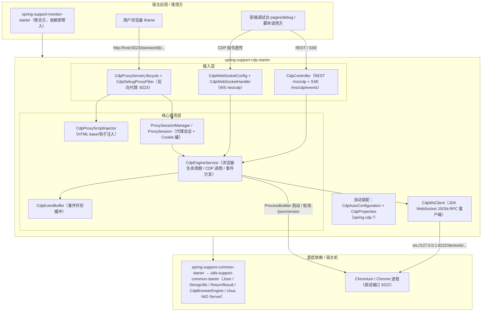
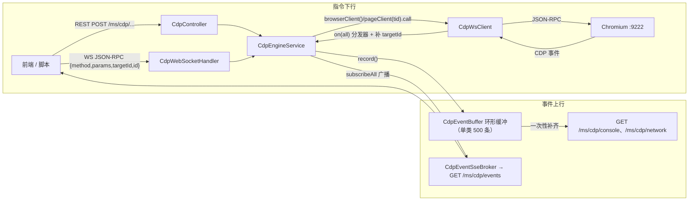

# spring-support-cdp-starter

CDP（Chrome DevTools Protocol）调试模块：内嵌 headless Chromium 引擎，提供 `/ms/cdp` REST（状态 / 目标 / 页面 / 求值 / 截屏 / 控制台 / 网络）、`/ws/cdp` WebSocket 指令透传、`/ms/cdp/events` 全局 SSE 事件流与实时页面反向代理（默认独立端口 9223）。在 spring-support 体系中它是 monitor 生态的「浏览器观测底座」：宿主引入依赖即自动装配；`spring-support-monitor-starter` 聚合本模块，浏览器探测与 NIO 反向代理复用底层 `spring-support-common-starter`（其传递依赖 `utils-support-common-starter` 提供 `CdpBrowserEngine` 与 chua NIO `Server`）。
- 版本 `4.0.0.51`（父 POM `spring-support-parent-starter`），基线 Spring Boot 4.1.2 / Java 25 / jakarta 命名空间；自动装配入口：`META-INF/spring/org.springframework.boot.autoconfigure.AutoConfiguration.imports` → `com.chua.starter.cdp.config.CdpAutoConfiguration`（本模块**没有** `spring.factories`）

## 1. 架构图



模块内部分层：**自动装配**（`CdpAutoConfiguration` 组件扫描 + `CdpProperties`）→ **接入层**（REST / WebSocket / SSE / 反向代理四种入口）→ **核心服务层**（引擎、代理会话、事件缓冲、脚本注入）→ **连接层**（`CdpWsClient` 直连 Chromium DevTools）。本模块不依赖任何业务 starter、不持有数据库表；唯一的外部进程依赖是宿主机上可找到的 Chrome / Chromium。

## 2. 核心流程图



实时增量走 SSE（单条全局流，15s 心跳保活），历史回补走 REST 环形缓冲拉取；CDP 指令（导航 / 求值 / 截屏等）既可走 REST，也可经 `/ws/cdp` 直接透传 JSON-RPC——带 `targetId` 走页面级通道，带 `id` 回复 `{"id":..,"result":{..}}`。

## 3. 能力清单

| 能力域 | 关键类 | 入口 / 触发方式 |
|---|---|---|
| 自动装配与配置 | `CdpAutoConfiguration`、`CdpProperties`、`CdpConstants` | `AutoConfiguration.imports` 注册；配置前缀 `spring.cdp`；`spring.cdp.enabled=false` 运行时整体关闭 |
| 浏览器生命周期 | `CdpEngineService`（状态机 `Status`：NOT_STARTED / STARTING / STARTED / STOPPING / STOPPED / FAILED） | 容器启动 `@PostConstruct` 自动拉起；`POST /ms/cdp/start`、`POST /ms/cdp/stop`、`GET /ms/cdp/status` |
| 目标 / 页面管理 | `CdpEngineService`、`CdpController` | `GET/POST /ms/cdp/targets`、`DELETE /ms/cdp/targets/{targetId}`、`GET /ms/cdp/pages`（`Target.createTarget` / `Target.closeTarget`） |
| 页面运算 | `CdpEngineService#pageCall`、`#captureScreenshot` | `POST /ms/cdp/targets/{id}/navigate`、`POST .../evaluate`、`GET .../content`、`GET .../cookies`、`POST .../screenshot?fullPage=` |
| 控制台 / 网络日志 | `CdpEventBuffer` | `GET /ms/cdp/console?targetId=&limit=`、`GET /ms/cdp/network?...`（环形缓冲单类 500 条，默认返回 200 条） |
| 全局实时事件流 | `CdpEventSseBroker`、`CdpEngineService#subscribeAll` | `GET /ms/cdp/events`（SSE `text/event-stream`，帧 `{"event":"Push","method","params","targetId"}`，15s 心跳） |
| CDP 指令透传 | `CdpWebSocketHandler`、`CdpWsClient` | WS `spring.cdp.ws-path`（默认 `/ws/cdp`），`setAllowedOrigins("*")` |
| 实时页面反向代理 | `CdpProxyServerLifecycle`、`CdpDebugProxyFilter`、`ProxySessionManager`、`CdpProxyScriptInjector` | `ApplicationReadyEvent` 启动 chua NIO `Server`（:9223）；`POST/GET /ms/cdp/proxy-session`、`POST /ms/cdp/proxy-session/{id}/navigate`、`DELETE /ms/cdp/proxy-session/{id}` |
| 底层 CDP 客户端 | `CdpWsClient` | 静态工厂 `CdpWsClient.connect(endpoint, timeout)`；非 Spring Bean，可独立复用 |

## 4. Bean 能力矩阵

装配说明：`CdpAutoConfiguration` 上只有 `@AutoConfiguration` + `@ComponentScan("com.chua.starter.cdp")` + `@EnableConfigurationProperties(CdpProperties.class)`，**没有任何 `@ConditionalOnXxx`**。自动装配生效时下表 Bean 全部注册；`spring.cdp.enabled=false` 不裁剪 Bean，只在运行时跳过浏览器启动（`CdpEngineService#init`，`@PostConstruct`）与代理启动（`CdpProxyServerLifecycle#start`）。

| Bean 名 | 类型 | 装配条件 | 可否覆盖 | 典型用途 |
|---|---|---|---|---|
| `cdpController` | `CdpController`（`@RestController`） | 组件扫描命中 `@RequestMapping("/ms/cdp")` | 同名覆盖需 `spring.main.allow-bean-definition-overriding=true`（不建议） | `/ms/cdp` REST / SSE 入口 |
| `cdpEngineService` | `CdpEngineService`（`@Service`） | 组件扫描；`@PostConstruct` 启动浏览器 | 不建议覆盖；扩展走其公开方法 | 注入后编排任意 CDP 能力 |
| `cdpEventSseBroker` | `CdpEventSseBroker`（`@Component`） | 组件扫描；懒注册全局订阅者 | 不建议覆盖 | `subscribe()` 获取 `SseEmitter` |
| `cdpEventBuffer` | `CdpEventBuffer`（`@Component`） | 组件扫描 | 不建议覆盖 | `console` / `network` 拉取快照 |
| `cdpWebSocketHandler` | `CdpWebSocketHandler`（`@Component`，继承 `TextWebSocketHandler`） | 组件扫描；由 `CdpWebSocketConfig` 注册到 `spring.cdp.ws-path` | 不建议覆盖 | 一般经 WS 端点使用，不直接注入 |
| `cdpWebSocketConfig` | `CdpWebSocketConfig`（`@Configuration` + `@EnableWebSocket`，实现 `WebSocketConfigurer`） | 组件扫描；注册路径 `properties.getWsPath()`、`setAllowedOrigins("*")`、外包 `MdcWebSocketHandlerDecorator` | 不建议覆盖 | 无需注入 |
| `proxySessionManager` | `ProxySessionManager`（`@Service`） | 组件扫描；`@PostConstruct` 启动 30s 一次的 TTL 清扫线程 | 不建议覆盖 | 代理会话创建 / 导航 / 关闭 |
| `cdpProxyServerLifecycle` | `CdpProxyServerLifecycle`（`@Component`） | 组件扫描；`@EventListener(ApplicationReadyEvent)` 启动 chua NIO `Server` | 不建议覆盖 | 无需注入 |
| `cdpProxyScriptInjector` | `CdpProxyScriptInjector`（`@Component`） | 组件扫描；被 `CdpDebugProxyFilter` 用于 HTML 注入 | 可同名覆盖（需开启 bean 覆盖）以定制注入 | 自定义 `<base>` / fetch/XHR 钩子注入策略 |
| `spring.cdp-com.chua.starter.cdp.config.CdpProperties` | `CdpProperties`（`@ConfigurationProperties(prefix = "spring.cdp")`） | `@EnableConfigurationProperties` 注册，随自动装配生效 | 配置值可任意改；Bean 不建议覆盖 | 构造器注入读取配置 |

**非 Bean 的关键对象**：`CdpWsClient`（静态工厂 `connect` 创建，实现 `AutoCloseable`，每个浏览器 / 页面通道各一个）、`CdpDebugProxyFilter`（`CdpProxyServerLifecycle` 启动代理时 `new` 并挂到 chua `Server` 过滤器链）、`ProxySession`（`ProxySessionManager.open(url)` 创建，内含 `StoredCookie` record 的 Cookie 罐）、`CdpConstants`（`API_PREFIX="/ms/cdp"`、`WS_PATH="/ws/cdp"`，私有构造）。

## 5. 完整配置

配置前缀 `spring.cdp`（`CdpProperties`），嵌套前缀 `spring.cdp.live-proxy`（`CdpProperties.LiveProxy`）。除特别注明外，均随自动装配生效。

| 配置路径 | 类型 | 默认值 | 说明 |
|---|---|---|---|
| `spring.cdp.enabled` | `boolean` | `true` | 总开关；`false` 时运行时关闭引擎与代理（Bean 仍注册） |
| `spring.cdp.port` | `int` | `9222` | 浏览器调试端口（`--remote-debugging-port`）；被无头残留占用会先清理，仍占用则启动失败 |
| `spring.cdp.executable` | `String` | 无（`null`） | Chrome/Chromium 路径；为空按环境变量 `CHUA_CHROME`/`CHROME_PATH`/`CHROME_BIN`、Playwright 缓存与常见安装路径探测 |
| `spring.cdp.headless` | `boolean` | `true` | 无头启动（追加 `--headless=new`） |
| `spring.cdp.user-data-dir` | `String` | 无 | 用户数据目录（持久化 Cookies/LocalStorage/书签）；缺省用系统临时目录 `chua-cdp-*`，用完即弃 |
| `spring.cdp.proxy` | `String` | 无 | 浏览器代理地址（如 `http://127.0.0.1:7890`），追加 `--proxy-server` |
| `spring.cdp.user-agent` | `String` | 无 | 全局 User-Agent，追加 `--user-agent`；空白用浏览器默认 |
| `spring.cdp.viewport-width` | `int` | `1280` | 窗口宽（`--window-size`，也作整页截屏兜底宽） |
| `spring.cdp.viewport-height` | `int` | `900` | 窗口高（`--window-size`，也作整页截屏兜底高） |
| `spring.cdp.launch-timeout` | `Duration` | `120s` | 启动后等待 `/json/version` 可访问的超时 |
| `spring.cdp.command-timeout` | `Duration` | `30s` | 页面级 CDP 命令默认超时（`Page.navigate`、`Runtime.evaluate` 等） |
| `spring.cdp.screenshot-timeout` | `Duration` | `60s` | 截屏专用超时（整页栅格化较慢） |
| `spring.cdp.args` | `List<String>` | `[]` | 追加给浏览器命令行的额外 `--xxx` 参数 |
| `spring.cdp.ws-path` | `String` | `/ws/cdp` | 暴露给前端的 WebSocket 路径 |
| `spring.cdp.enable-console` | `boolean` | `true` | **预留项**：当前版本代码未读取（控制台事件随页面域订阅一起开启），见第 9 节 |
| `spring.cdp.enable-network` | `boolean` | `true` | **预留项**：同上 |
| `spring.cdp.live-proxy.enabled` | `boolean` | `true` | 实时页面反向代理开关；`false` 时不启动 9223 端口 |
| `spring.cdp.live-proxy.port` | `int` | `9223` | 代理监听端口（独立于主服务端口，iframe 直连）；被占用仅记日志，不影响主服务 |
| `spring.cdp.live-proxy.host` | `String` | `0.0.0.0` | 代理监听地址（默认全部网卡，前后端可能不同机） |
| `spring.cdp.live-proxy.external-url` | `String` | 无 | 对外代理基地址（如 `http://192.168.1.10:9223`）；经开发代理 / Nginx 转发导致 Host 头被改写时必填，缺省按请求 Host + 代理端口推导 |
| `spring.cdp.live-proxy.session-ttl` | `Duration` | `30m` | 会话空闲 TTL，超时自动关闭（含无头浏览器页面；每 30s 清扫一次） |
| `spring.cdp.live-proxy.max-sessions` | `int` | `8` | 最大并发会话数，超限关闭最久未用的会话 |
| `spring.cdp.live-proxy.allowed-hosts` | `List<String>` | `[]` | 上游主机白名单；空 = 不限制（调试工具语义，仅建议内网 / 可信环境放开） |
| `spring.cdp.live-proxy.inject-script` | `boolean` | `true` | 是否向 HTML 注入 `<base>` 与 fetch/XHR/点击/表单/MutationObserver 钩子 |

## 6. 使用方式

Maven 坐标：

```xml
<dependency>
    <groupId>com.chua</groupId>
    <artifactId>spring-support-cdp-starter</artifactId>
    <version>4.0.0.51</version>
</dependency>
```

依赖说明（均来自本模块 `pom.xml`，**没有 optional 依赖**，不存在「缺可选依赖降级运行」）：`spring-support-common-starter`（starter 侧工具，如 `MdcWebSocketHandlerDecorator`）及其传递依赖 `utils-support-common-starter`（`Json` / `StringUtils` / `ReturnResult`、浏览器探测 `CdpBrowserEngine`、chua NIO `Server`）、`spring-boot-starter-web`（REST / `SseEmitter` / Servlet）、`spring-boot-starter-websocket`（`/ws/cdp` 端点）、`io.swagger.core.v3:swagger-annotations`（`@Tag` / `@Operation`，版本由父 POM 统一管理）均为必需；`org.projectlombok:lombok` 为 `provided`（仅编译期）。注意**依赖即带入**：引入本模块会同时带入 Web + WebSocket 容器，并额外监听 9223 代理端口（可 `spring.cdp.live-proxy.enabled=false` 关闭）；宿主机必须能找到 Chrome / Chromium 可执行文件，否则浏览器启动阶段失败（设 `spring.cdp.executable` 或环境变量 `CHUA_CHROME` / `CHROME_PATH` / `CHROME_BIN`）。

最小启用示例（`application.yml`，全部可选，不配即用默认值）：

```yaml
spring:
  cdp:
    enabled: true          # 总开关
    port: 9222             # Chromium 调试端口
    # executable: D:/chrome/chrome.exe   # 不配则自动探测
    headless: true
    launch-timeout: 120s
    command-timeout: 30s
    screenshot-timeout: 60s
    ws-path: /ws/cdp
    live-proxy:
      enabled: true
      port: 9223
      # external-url: http://192.168.1.10:9223   # 经开发代理转发时必填
      session-ttl: 30m
      max-sessions: 8
```

加依赖后无需任何代码，容器启动即自动拉起 headless Chromium、REST / WS / SSE 端点与反向代理。HTTP 直接验证：

```bash
curl http://localhost:8080/ms/cdp/status
curl -X POST http://localhost:8080/ms/cdp/targets -H 'Content-Type: application/json' -d '{"url":"https://example.com"}'
curl -X POST "http://localhost:8080/ms/cdp/targets/{targetId}/evaluate?expression=1%2B1"
curl -X POST "http://localhost:8080/ms/cdp/targets/{targetId}/screenshot?fullPage=true"
curl -N http://localhost:8080/ms/cdp/events   # SSE 全局事件流
```

WebSocket 透传（连 `ws://host:port/ws/cdp`，JSON-RPC 风格）：页面级 `{"method":"Runtime.evaluate","params":{"expression":"document.title"},"targetId":"<targetId>","id":2}`，回复 `{"id":2,"result":{...}}`；不带 `targetId` 走浏览器级通道（如 `{"method":"Target.createTarget","params":{"url":"about:blank"},"id":1}`）。

代理会话（iframe 内嵌真实页面并共享登录态）：`POST /ms/cdp/proxy-session` 传 `{"url":"https://example.com"}` 得到 `sessionId / targetId / proxyBase`，前端 iframe 指向 `{proxyBase}/{sessionId}/`；`POST /ms/cdp/proxy-session/{sessionId}/navigate` 换页；`DELETE /ms/cdp/proxy-session/{sessionId}` 关闭。

Java 侧直接注入引擎服务：

```java
@Service
@RequiredArgsConstructor
public class DemoService {

    private final CdpEngineService engine;

    public String title(String targetId) {
        Map<String, Object> result = engine.pageCall(targetId, "Runtime.evaluate",
                Map.of("expression", "document.title", "returnByValue", true));
        return String.valueOf(result.get("result"));
    }
}
```

## 7. 使用场景

**适用**

- 本地 / 内网部署的「网页调试台」：控制台日志、网络请求、DOM 求值、整页截屏一站式查看（monitor 生态的 `pages/debug` 即构建于此）。
- 页面自动化与巡检：导航、求值、取内容、取 Cookies、截图，配合 SSE 实时观察页面行为。
- 需要在 iframe 里原样预览并操作真实站点、且与无头浏览器共享登录态（服务端 Cookie 罐）的场景。
- 作为 `spring-support-monitor-starter` 的浏览器观测底座（monitor 是聚合方，引入即带入）。

**不适用 / 慎用**

- 对外公网服务：代理默认监听 `0.0.0.0:9223` 且 `allowed-hosts` 默认不限制、WS 端点 `setAllowedOrigins("*")`——这是调试工具语义，公网暴露前必须自行加鉴权与白名单。
- 大规模并发抓取 / 压测：单浏览器实例 + 会话上限默认 8，面向调试而非采集（采集能力由 `spring-support-collect-starter` 承担）。
- 无 Chrome/Chromium 的宿主机：引擎起不来（除非整体 `spring.cdp.enabled=false`）。

**与相邻模块的取舍**

- `spring-support-monitor-starter`：聚合方，引入 monitor 即带入本模块；只需要 CDP 时可直接依赖本模块。
- `spring-support-socket-*-starter`：业务 Socket 通道抽象（同端口 WS / SSE 等）；本模块 `/ws/cdp` 是面向 Chromium DevTools 的**协议透传**，不承担业务消息总线。
- `spring-support-control-starter`：WebRTC 远程控制（桌面采集 / 键鼠注入），与本模块的「浏览器页面调试」互补而不重叠。

## 8. 扩展点

本模块**未定义 Java SPI 接口，也没有 `spring.factories` 扩展文件**；扩展以「注入公开服务 + 复用底层客户端」为主：

| 扩展点 | 类型 / 方法 | 说明 |
|---|---|---|
| 引擎服务公开 API | `CdpEngineService`：`start()` / `stop()` / `status()` / `targets()` / `pages()` / `createTarget(params)` / `closeTarget(targetId)` / `pageCall(targetId, method, params[, timeout])` / `pageOn(targetId, method, handler)` / `on(method, handler)` / `captureScreenshot(targetId, fullPage)` / `browserClient()` / `pageClient(targetId)` / `attachPageEvents(targetId)` | 注入后可直接编排任意 CDP 能力（本模块 REST 即全部构建在这些方法之上） |
| 全局事件订阅 | `CdpEngineService#subscribeAll(Consumer<Map<String,Object>>)` / `#unsubscribeAll(handler)` | 订阅 Console / Network / Page / Target 全部事件；订阅者关闭时务必 `unsubscribeAll`，否则 handler 泄漏 |
| 轻量 CDP 客户端 | `CdpWsClient.connect(endpoint, timeout)` → `call(method, params, timeout)` / `on(method, handler)` / `onAll(handler)` / `close()` | 非 Spring Bean 的独立 JSON-RPC WebSocket 客户端（JDK `java.net.http.WebSocket`），可在模块外复用 |
| 代理 HTML 注入 | `CdpProxyScriptInjector#inject(html, baseHref, sessionId, upstreamOrigin)` / `#charsetOf(contentType)` | 需要改注入策略时替换同名 Bean（需开启 `spring.main.allow-bean-definition-overriding=true`）或在其上包装 |
| 上游访问控制 | `ProxySessionManager#validateUpstream(URI)` | 白名单 / scheme / 回环校验的统一入口，公开方法，可在会话管理外复用 |
| 路径常量 | `CdpConstants.API_PREFIX`（`/ms/cdp`）、`CdpConstants.WS_PATH`（`/ws/cdp`） | 外部网关 / 前端拼接路径时引用，避免硬编码 |

自定义建议：优先组合 `CdpEngineService` 的公开方法实现自己的门面，不要绕过它直连 9222 端口——引擎内含端口抢占清理、进程树强杀、通道自愈（`requireBrowserClient`）与页面域幂等挂载（`attachPageEvents`）等健壮性处理，绕过会重新踩一遍这些坑。

## 9. 常见问题

**Q1：引入依赖后没有出现 `/ms/cdp/**` 接口？**
先确认自动装配被触发：本模块经 `META-INF/spring/org.springframework.boot.autoconfigure.AutoConfiguration.imports` 注册 `CdpAutoConfiguration`，它自带 `@ComponentScan("com.chua.starter.cdp")`，宿主**不需要**把自己的扫描范围扩到 `com.chua`。若宿主用 `@SpringBootApplication(scanBasePackages=...)` 排除或 `spring.autoconfigure.exclude` 排除了该类，接口不会出现。

**Q2：`spring.cdp.enabled=false` 之后为什么接口还在？**
该开关是**运行时开关**而非装配条件：Bean（Controller / Service 等）仍全部注册，只是 `CdpEngineService#init` 不再启动浏览器、`CdpProxyServerLifecycle#start` 不再启动 9223 代理。此时调启动类接口要么返回 `STOPPED`，要么抛「浏览器未启动」类错误，属预期行为。

**Q3：9222 / 9223 端口被占用导致启动失败？**
9222：`start()` 启动前会检查调试端口，若被**无头**残留浏览器（命令行同时含 `--remote-debugging-port=<port>` 与 `--headless`）占用会先按端口清理（只清无头进程，不会碰日常使用的浏览器）；清理后仍被其它进程占用则抛「调试端口 9222 已被其它进程占用」，换 `spring.cdp.port` 或手动处理。9223：`CdpProxyServerLifecycle#start` 捕获异常后仅记录日志，主服务不受影响但代理会话不可用，改 `spring.cdp.live-proxy.port` 或释放端口即可。

**Q4：`spring.cdp.enable-console` / `enable-network` 配了没效果？**
这两个开关当前版本**已声明但代码未消费**（预留项）：控制台与网络事件在页面通道建立时随 `Runtime.enable` / `Network.enable` 一起启用，不单独受这两个值控制，不要依赖它们做细粒度关闭。

**Q5：与 Spring Boot 4 的兼容性？**
本模块随父 POM 构建于 Spring Boot **4.1.2**（jakarta 命名空间、Java 25）：使用 `@AutoConfiguration` + `AutoConfiguration.imports`（无 `spring.factories` 回退）、`jakarta.servlet` / `jakarta.annotation`、JDK 原生 `java.net.http.WebSocket`（无 Netty 依赖）。请勿把本模块混入 Boot 2.x / javax 体系的应用。
