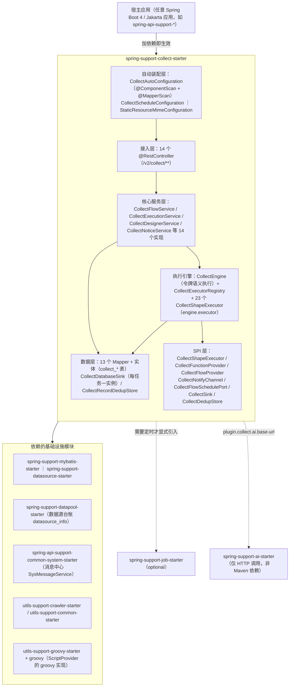
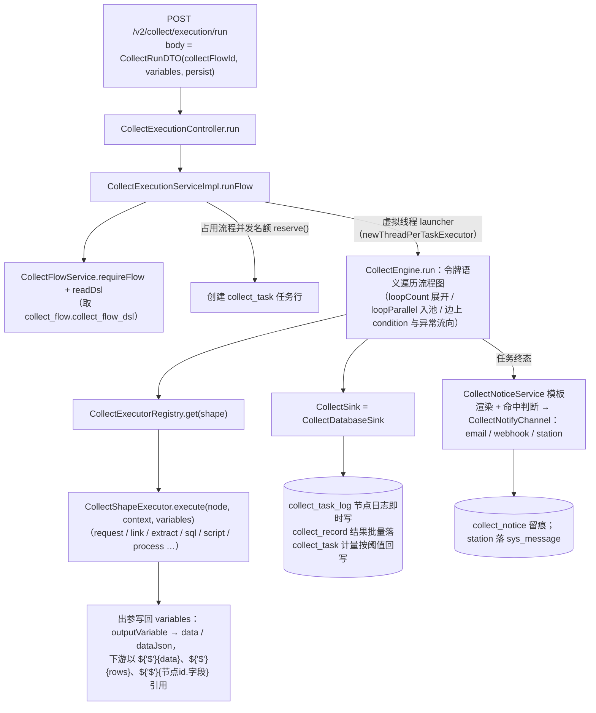

# spring-support-collect-starter

采集调度一体化平台：可视化流程编排 + 复用调度平台作业台账，覆盖「数据源 / 目录 / 字段 / 变量 / 函数 → 流程与版本 → 任务执行 / 结果 / 告警通知」的完整采集链路。在 spring-support 体系中，它是被业务系统依赖后即整体生效的业务 starter；采集本体不依赖调度器（`spring-support-job-starter` 为 optional），「AI 生成流程」经 HTTP 调用 `spring-support-ai-starter`，不是 Maven 依赖。Maven 坐标 `com.chua:spring-support-collect-starter:4.0.0.51`；运行基线父 POM `spring-boot-starter-parent:4.1.2`（Spring Boot 4.1.2，Java 25）；自动装配登记于 `META-INF/spring/org.springframework.boot.autoconfigure.AutoConfiguration.imports`（无 `spring.factories`，Boot 4 已移除旧机制）。

## 1. 架构图



## 2. 核心流程图

一次流程执行的请求处理 / 数据流转：



## 3. 能力清单

| 能力域 | 关键类 | 入口 / 触发方式 |
| --- | --- | --- |
| 自动装配 | `CollectAutoConfiguration`、`CollectScheduleConfiguration`、`StaticResourceMimeConfiguration` | `AutoConfiguration.imports` + 组件扫描；开关 `plugin.collect.enable` |
| 流程设计与版本 | `CollectFlowServiceImpl`、`CollectFlowVersionServiceImpl` | `POST /v2/collect/flow/save`、`PUT /v2/collect/flow/status`、`POST /v2/collect/flow-version/save`、`POST /v2/collect/flow-version/rollback` |
| 设计器支撑 | `CollectDesignerServiceImpl`、`CollectAgentCatalog` | `GET /v2/collect/designer/metas`、`GET /v2/collect/designer/runtime`、`POST /v2/collect/designer/ai-generate` |
| 流程执行 | `CollectExecutionServiceImpl`、`CollectEngine`、`CollectExecutorRegistry`、`CollectDatabaseSink` | `POST /v2/collect/execution/run`、`POST /v2/collect/execution/dry-run`、`POST /v2/collect/execution/stop` |
| 节点执行器（23 种） | `CollectRequestExecutor`、`CollectExtractExecutor`、`CollectSqlExecutor`、`CollectScriptExecutor`、`CollectProcessExecutor` 等 | 经 `CollectShapeExecutor` SPI 注册；设计器 `GET /v2/collect/designer/metas` 展示工具箱 |
| 数据源管理 | `CollectDatasourceServiceImpl`、`CollectDatasourceRegistry`（读 datapool 台账） | `GET /v2/collect/datasource/options`、`POST /v2/collect/datasource/test`、`GET /v2/collect/datasource/tables` |
| 变量与函数 | `CollectVariableServiceImpl`、`CollectFunctionServiceImpl`（兼 `CollectFunctionProvider`）、`CollectFunctionRegistry` | `POST /v2/collect/variable/save`、`POST /v2/collect/function/save`、`POST /v2/collect/function/test` |
| 任务与结果观测 | `CollectTaskServiceImpl`、`CollectRecordServiceImpl`、`CollectFieldServiceImpl`、`CollectRecordDedupStore` | `GET /v2/collect/task/page`、`GET /v2/collect/task/logs`、`GET /v2/collect/task/quality`、`GET /v2/collect/record/page` |
| 通知与告警 | `CollectNoticeServiceImpl`、`CollectNotifyChannel` 三个实现、`CollectAlertRuleServiceImpl` | `GET /v2/collect/notice/channels`、`POST /v2/collect/notice/test`、`POST /v2/collect/alert-rule/toggle` |
| 运行参数 | `CollectSettingsServiceImpl`（表 `collect_setting` 为唯一可信来源） | `GET /v2/collect/settings/list`、`PUT /v2/collect/settings`、`POST /v2/collect/settings/reset` |
| 定时排期 | `CollectFlowSchedulePort` → `JobFlowSchedulePort` / `LocalOnlyFlowSchedulePort`、`CollectFlowJobHandler`、`CollectSelfCheckJob` | `PUT /v2/collect/flow/status`；到点由 job-starter 派发 |
| 建表与种子数据 | `db/init/V2.0__init_all_api_collect.sql`（13 张 `collect_*` 表）、`db/init/V2.0__initdata_all_api_collect.sql` | 由 `plugin.datasource.script` 以 `classpath*:db/init/*.sql` 扫描执行（ONCE 语义：空库才建） |

内置节点类型（23 种，shape → 执行器）：来源 `start` / `request` / `link` / `extract` / `sql` / `neo4j-read` / `influxdb-read` / `entry`；加工 `filter` / `dedup` / `exists` / `script` / `ai` / `agent` / `process`；控制 `condition` / `sleep` / `comment`；输出 `database` / `neo4j-write` / `influxdb-write` / `output` / `end`。

## 4. Bean 能力矩阵

> 除显式 `@Bean` 外，其余 Bean 均来自 `CollectAutoConfiguration` 的 `@ComponentScan("com.chua.starter.collect")`，Bean 名默认为类名首字母小写。同名覆盖需 `spring.main.allow-bean-definition-overriding=true`。

| Bean 名 | 类型 | 装配条件（含默认值） | 可否覆盖 | 典型用途 |
| --- | --- | --- | --- | --- |
| `collectFlowSchedulePort` | `CollectFlowSchedulePort`（实现为 `JobFlowSchedulePort` 或 `LocalOnlyFlowSchedulePort`） | `CollectScheduleConfiguration`（`@AutoConfiguration`）总是登记；实现由运行期能否按类名找到 `com.chua.starter.job.support.operate.JobOperator` 决定 | 可覆盖：实现 `CollectFlowSchedulePort` 并注册同名 Bean（需开 overriding） | 构造器注入接口；换调度器不改流程 |
| `yamlMimeMappings` | `WebServerFactoryCustomizer<TomcatServletWebServerFactory>`（`StaticResourceMimeConfiguration`） | 随组件扫描装配（即 `plugin.collect.enable=true`，缺省 true） | 可再注册自己的 `WebServerFactoryCustomizer`，勿同名 | 为 SPA 的 `.yaml/.yml` 补 `text/yaml` MIME 映射 |
| `collectProperties` | `CollectProperties`（`plugin.collect.*`） | `@EnableConfigurationProperties(CollectProperties.class)`，随自动装配生效 | 改 yml 即可，无需覆盖 Bean | 读取采集平台全部运行参数 |
| `collectEngine` | `CollectEngine` | `plugin.collect.enable=true` | 不建议覆盖（任务编排核心） | 流程图执行、超时与并发控制 |
| `collectExecutorRegistry` | `CollectExecutorRegistry` | `plugin.collect.enable=true`；构造期先初始化运行参数，再收集执行器 | 不建议覆盖；扩展走 `CollectShapeExecutor` | `get(shape)` / `metas()` / `shapes()` |
| `collectFunctionRegistry` | `CollectFunctionRegistry`（实现 `CollectBuiltinInvoker.UserHook`） | `plugin.collect.enable=true`；`function.enable=false` 时仅不挂函数解析链，Bean 仍注册 | 不建议覆盖 | 函数解析缓存，`invalidate()` 立即刷新 |
| `collectDatasourceRegistry` | `CollectDatasourceRegistry` | `plugin.collect.enable=true` | 不建议覆盖 | 把数据源引用解析成可建池参数 |
| `collectRecordDedupStore` | `CollectRecordDedupStore`（实现 `CollectDedupStore`） | `plugin.collect.enable=true` | 可自实现 `CollectDedupStore` 并 `@Primary` | 结果判重（基于 `collect_record`） |
| 23 个节点执行器 | 各 `Collect*Executor`（实现 `CollectShapeExecutor`） | 随扫描装配（`plugin.collect.enable=true`）；另：`script` → `plugin.collect.script.enable`、`process` → `plugin.collect.process.enable`、`ai` → `plugin.collect.ai.enable` + `@ConditionalOnClass(AiChatFacadeService)`、`agent` → `plugin.collect.agent.enable` + `@ConditionalOnClass(AgentRegistry)` | 新 shape 自由扩展；同 shape 重复注册先到者生效、后到者忽略并告警 | 各节点类型的实际执行逻辑 |
| 14 个 Service 实现 | `CollectFlowServiceImpl` 等 | `plugin.collect.enable=true`；`collectFunctionServiceImpl` 另要求 `plugin.collect.function.enable=true` | 可注入；替换需同名覆盖或 `@Primary` | 按接口注入（如 `CollectFlowService`） |
| 14 个 Controller | `CollectFlowController` 等 | 每个类均有 `@ConditionalOnProperty plugin.collect.enable`（缺省 true） | 一般不注入（HTTP 入口） | REST API |
| `collectEmailNotifyChannel` / `collectWebhookNotifyChannel` | `CollectNotifyChannel` | `plugin.collect.notify.enable=true`；email 未配 `spring.mail.host` 时仍注册，发送返回可读失败原因 | 可扩展新渠道；同 `channel()` 先注册生效（Spring 侧优先于 `@Spi`） | 任务终态通知投递 |
| `collectStationNotifyChannel` | `CollectNotifyChannel` | `plugin.collect.notify.enable=true` **且** `@ConditionalOnBean(SysMessageService.class)` | 同上 | 站内消息（容器无消息中心时自动不注册） |
| `collectJobEmailAlarmNotifier` / `collectJobWebhookAlarmNotifier` | `JobAlarmNotifier`（job-starter 契约） | `plugin.collect.enable=true` + `@ConditionalOnClass(JobAlarmNotifier.class)` | 可追加自己的 `JobAlarmNotifier` | job 告警转 email/webhook 渠道 |
| `collectSelfCheckJob` | `@Job("collect.self.check")` 本地自检任务 | `@ConditionalOnClass(JobHandlerFactory.class)`（有 job-starter 才装配）；cron `0 0/30 * * * ?`，分组 `collect-flow` | 不建议覆盖 | 由 `JobAnnotationScanner` 登记进 sys_job |
| （非 Bean）`CollectDatabaseSink` | `CollectSink` 的数据库实现 | **不是 Spring Bean**：每次执行由 `CollectExecutionServiceImpl` 按任务创建 | — | 要换落库行为时实现 `CollectSink`（见第 8 节） |

## 5. 完整配置

### 5.1 `plugin.collect.*`（`CollectProperties`，前缀常量 `CollectProperties.PRE = "plugin.collect"`）

| 配置路径 | 类型 | 默认值 | 说明 |
| --- | --- | --- | --- |
| `plugin.collect.enable` | `boolean` | `true` | 平台总开关，关闭后不装配控制器、服务、执行引擎与调度任务 |
| `plugin.collect.default-thread-count` | `int` | `4` | 流程默认并行线程数，可被流程定义覆盖 |
| `plugin.collect.request-timeout-ms` | `int` | `30000` | 单次抓取默认超时毫秒，节点未显式配置时使用 |
| `plugin.collect.request-retry-times` | `int` | `1` | 默认重试次数，节点未显式配置时使用 |
| `plugin.collect.user-agent` | `String` | Chrome/120 的 Mozilla UA（`DEFAULT_USER_AGENT`） | 默认 User-Agent，节点未显式配置时使用 |
| `plugin.collect.sql-allow-write` | `boolean` | `false` | SQL 节点是否允许写语句（非 SELECT/WITH/SHOW）；默认禁止，写库改走 `database` 节点（PreparedStatement 绑定） |
| `plugin.collect.task-timeout-ms` | `long` | `1800000`（30 分钟） | 单任务最长执行毫秒，超时置失败并中断流程线程池；量级保护由 `max-record-per-task` 兜底 |
| `plugin.collect.max-record-per-task` | `int` | `100000` | 单任务最多落库记录数，超出丢弃并写任务日志 |
| `plugin.collect.preview-length` | `int` | `500` | 节点出参预览保留字符数 |
| `plugin.collect.node-output-limit` | `int` | `2000` | 各节点产出留存条数上限（`${'$'}{nodes.<id>.字段}` 的底表）；0 或负数不限 |
| `plugin.collect.exists-batch-size` | `int` | `500` | 「查已存在」节点 IN 查询每片条数，避免超 `max_allowed_packet` |
| `plugin.collect.script.enable` | `boolean` | `true` | 脚本节点开关；关闭后执行器不注册，存量流程校验报「类型未注册」 |
| `plugin.collect.function.enable` | `boolean` | `true` | 自定义函数库开关；关闭后自定义函数不再进解析链，`${'$'}{}` 与脚本里的 `fn` 只剩内置函数，`CollectFunctionServiceImpl` 也不再装配。注意函数管理接口（`CollectFunctionController`）只带 `plugin.collect.enable` 条件、强依赖该服务实现，所以关闭前需一并处理该接口的装配，否则启动失败 |
| `plugin.collect.notify.enable` | `boolean` | `true` | 执行通知开关；关闭后任务终态不投递，试发直接失败并给原因 |
| `plugin.collect.process.enable` | `boolean` | `true` | 子流程节点开关；关闭后子流程执行器不注册 |
| `plugin.collect.process.max-depth` | `int` | `5` | 子流程嵌套层数上限，超过后节点直接失败 |
| `plugin.collect.ai.enable` | `boolean` | `true` | 「AI 生成流程」开关（还要求类路径有 `AiChatFacadeService`） |
| `plugin.collect.ai.base-url` | `String` | `http://127.0.0.1:8787` | ai-starter 服务地址（默认与采集后端同机，走回环） |
| `plugin.collect.ai.model` | `String` | `deepseek-v4.1-flash` | 模型名，须为 ai-starter 中已启用的模型 |
| `plugin.collect.ai.trust-header` | `String` | `x-nomi-local-trust` | 本地信任头名（ai-starter `LocalTrustAuthFilter` 约定） |
| `plugin.collect.ai.trust-value` | `String` | `collect-designer` | 本地信任头的值（服务端只要求非空） |
| `plugin.collect.ai.timeout-ms` | `int` | `180000` | 单次生成总超时毫秒（整图 JSON 生成较慢） |
| `plugin.collect.agent.enable` | `boolean` | `true`（未配置即开启） | Agent 节点开关（`CollectProperties.Agent`）。`CollectAgentExecutor` 以 `@ConditionalOnProperty` 读取（`matchIfMissing=true`），并要求类路径存在 `com.chua.starter.ai.support.registry.AgentRegistry`，缺类时自动不注册 |
| `plugin.collect.agent.timeout-ms` | `long` | `120000` | Agent 调用兜底超时毫秒，节点 `callTimeoutMs` 留空时使用；`0` 表示不限制。超时只中断等待并按失败策略处置，不保证底层 Agent 立即停止 |
| `plugin.collect.agent.failure-strategy` | `String` | `fail` | Agent 调用失败默认策略：`fail` 中断流程 / `skip` 记警告后跳过 / `defaultValue` 写入兜底值继续；节点参数优先于本配置 |
| `plugin.collect.persistence.type` | `String` | `database` | 内置结果持久化实现：`database` 数据库落库 / `none` 只跑流程不落结果；经 `CollectSinkFactory` 选择，宿主替换工厂 Bean 后本项不再参与选择 |
| `plugin.collect.persistence.search-enabled` | `boolean` | `true` | 是否维护 `collect_record` 的 Lucene 全文索引；关闭后 `GET /v2/collect/record/search` 降级为数据库 LIKE 模糊查询 |
| `plugin.collect.persistence.search-index-path` | `String` | 空（回落 `java.io.tmpdir/collect-search-index`） | Lucene 索引目录；索引可经 `POST /v2/collect/record/search/rebuild` 从结果表全量重建，生产建议显式指向稳定盘 |

### 5.2 相关联动配置（非本模块前缀，但直接影响本模块）

| 配置路径 | 归属 | 说明 |
| --- | --- | --- |
| `plugin.datasource.script` | spring-support-datasource-starter | 建表脚本执行开关；本模块 `classpath*:db/init/*.sql`（13 张 `collect_*` 表 + 种子数据）由它扫描执行，ONCE 语义 |
| `plugin.job.enable` 等 | spring-support-job-starter | job-starter 自己的开关；为 `false` 时本模块排期自动落到 `LocalOnlyFlowSchedulePort` 兜底 |
| `spring.mail.host` 等 | Spring Boot 邮件自动配置 | 未配置时 `CollectEmailNotifyChannel` 仍在渠道列表，但发送返回「未配置邮件账号」的可读失败原因 |

> 运行期可用 `GET /v2/collect/settings/list` 读取全部参数定义（类型、范围、缺省值、是否重启生效），`PUT /v2/collect/settings` 在线修改（写 `collect_setting` 表立即生效），`POST /v2/collect/settings/reset` 恢复 yml 缺省。

### 5.3 逐项配置示例（按功能分组）

> 全部键都属于 `plugin.collect.*`（`CollectProperties`），注释即「含义 + 默认值」。YAML 一律空格缩进。

#### ① 总开关与执行引擎

控制平台是否装配、流程并发与抓取默认行为。

```yaml
plugin:
  collect:
    enable: true               # 平台总开关，默认 true；false 时控制器/服务/引擎/调度全部不装配
    default-thread-count: 4    # 流程默认并行线程数，默认 4；流程未配置或 ≤0 时回落此值
    request-timeout-ms: 30000  # 单次抓取默认超时毫秒，默认 30000；节点超时留空或 ≤0 时回落此值
    request-retry-times: 1     # 默认重试次数，默认 1；节点配置为负时执行侧钳到 0
    user-agent: "Mozilla/5.0 (Windows NT 10.0; Win64; x64) AppleWebKit/537.36 (KHTML, like Gecko) Chrome/120.0.0.0 Safari/537.36"  # 默认 UA
```

#### ② SQL 与结果保护

SQL 节点安全边界与任务级失控保护。

```yaml
plugin:
  collect:
    sql-allow-write: false      # SQL 节点是否允许写语句，默认 false；写库走 database 节点
    task-timeout-ms: 1800000    # 单任务最长执行毫秒，默认 1800000（30 分钟）
    max-record-per-task: 100000 # 单任务最多落库记录数，默认 100000，超出丢弃并写任务日志
    preview-length: 500         # 节点出参预览字符数，默认 500（执行侧最小按 32 生效）
    node-output-limit: 2000     # 节点产出留存条数上限，默认 2000；0 或负数不限
    exists-batch-size: 500      # 「查已存在」IN 查询每片条数，默认 500（执行侧最小按 1 生效）
```

#### ③ 脚本 / 函数 / 子流程

节点类型级开关：关闭后对应执行器不注册，存量流程校验报「类型未注册」。

```yaml
plugin:
  collect:
    script:
      enable: true             # 脚本节点开关，默认 true
    function:
      enable: true             # 自定义函数库开关，默认 true；关闭后 ${'$'}{} 与脚本只剩内置函数
    process:
      enable: true             # 子流程节点开关，默认 true
      max-depth: 5             # 子流程嵌套层数上限，默认 5；配置 ≤0 时按 1 层生效
```

> 注意：`function.enable=false` 时 `CollectFunctionServiceImpl` 不再装配，而函数管理接口（`CollectFunctionController`）强依赖该服务实现，关闭前需一并处理该接口的装配，否则启动失败。

#### ④ 执行通知

```yaml
plugin:
  collect:
    notify:
      enable: true             # 执行通知开关，默认 true；false 时任务终态不投递，试发直接失败
```

#### ⑤ AI 生成流程

设计器「AI 生成」把自然语言描述发给 ai-starter（OpenAI 兼容接口）产出流程 DSL。

```yaml
plugin:
  collect:
    ai:
      enable: true                      # 开关，默认 true；还要求类路径有 AiChatFacadeService
      base-url: http://127.0.0.1:8787   # ai-starter 地址，默认本机回环（同机部署）
      model: deepseek-v4.1-flash        # 模型名，须为 ai-starter 已启用模型
      trust-header: x-nomi-local-trust  # 本地信任头名
      trust-value: collect-designer     # 本地信任头的值（服务端只要求非空）
      timeout-ms: 180000                # 单次生成总超时毫秒，默认 180000
```

#### ⑥ Agent 节点

```yaml
plugin:
  collect:
    agent:
      enable: true             # Agent 节点开关，默认 true（未配置即开启）；还要求类路径有 AgentRegistry
      timeout-ms: 120000       # Agent 调用兜底超时毫秒，默认 120000；0 表示不限制
      failure-strategy: fail   # 失败默认策略：fail / skip / defaultValue，节点参数优先
```

#### ⑦ 结果持久化

```yaml
plugin:
  collect:
    persistence:
      type: database           # 内置实现：database=数据库落库 / none=只跑流程不落结果
      search-enabled: true     # collect_record 的 Lucene 全文索引开关，默认 true
      search-index-path: ""    # 索引目录；留空用 java.io.tmpdir/collect-search-index
```

## 6. 使用方式

### 6.1 Maven 坐标

```xml
<dependency>
    <groupId>com.chua</groupId>
    <artifactId>spring-support-collect-starter</artifactId>
    <version>4.0.0.51</version>
</dependency>
```

### 6.2 最小启用示例

启动类不需要任何额外注解——组件扫描（`@ComponentScan("com.chua.starter.collect")`）与 Mapper 扫描（`@MapperScan("com.chua.starter.collect.mapper")`）已内置。常量 `CollectAutoConfiguration.BASE_PACKAGE` / `MAPPER_PACKAGE` 可供消费方自行控制扫描范围。

```java
@SpringBootApplication
public class CollectApp {
    public static void main(String[] args) {
        SpringApplication.run(CollectApp.class, args);
    }
}
```

```yaml
plugin:
  collect:
    enable: true            # 总开关，默认 true
    sql-allow-write: false  # SQL 节点默认只读
    notify:
      enable: true
# 数据源与建表脚本遵循 spring-support-datasource-starter / datapool 约定；pom 已自带 h2（runtime）可免外部库启动，生产换 MySQL 按数据源中心登记。
```

保存并运行一个最小流程（`start → request → output`，DSL 契约见 `CollectFlowSaveDTO` / `CollectDslDTO` / `CollectNodeDTO` / `CollectEdgeDTO` / `CollectParamDTO`）：

```bash
curl -X POST http://localhost:8080/v2/collect/flow/save -H 'Content-Type: application/json' -d '{
  "collectFlowName": "示例-抓取一个页面",
  "dsl": {
    "name": "示例-抓取一个页面",
    "nodes": [
      {"id": "n1", "shape": "start",   "name": "开始", "params": []},
      {"id": "n2", "shape": "request", "name": "抓取", "params": [
          {"name": "url", "value": "https://example.com", "description": ""}]},
      {"id": "n3", "shape": "output",  "name": "输出", "params": []}
    ],
    "edges": [
      {"id": "e1", "from": "n1", "to": "n2"},
      {"id": "e2", "from": "n2", "to": "n3"}
    ]
  }
}'

# 运行（persist=false 只试跑不落结果；true 写入 collect_record），再查任务与节点日志
curl -X POST http://localhost:8080/v2/collect/execution/run -H 'Content-Type: application/json' -d '{"collectFlowId": 1, "variables": [], "persist": false}'
curl 'http://localhost:8080/v2/collect/task/page?current=1&size=10'
```

### 6.3 可选依赖说明

| 依赖 | 是否可选 | 引入 / 不引入的效果 |
| --- | --- | --- |
| `spring-support-job-starter` | **可选（`<optional>true</optional>`）** | 引入且开启：排期经 `JobFlowSchedulePort` 落 `sys_job` 台账，到点派发 `CollectFlowJobHandler`；不引入（或 `plugin.job.enable=false`）：`LocalOnlyFlowSchedulePort` 兜底，流程照常设计、手动执行、看结果，仅无定时触发。设计成 optional 是为了不让「只想要采集能力」的宿主被动继承整套调度引擎（Leader 选举、`sys_job_cluster`、`/v2/job` 治理接口及其建表） |
| `mysql-connector-j` / `h2` | runtime 自带 | h2 支持免外部数据库启动；生产建议 MySQL，DDL 均为 `CREATE TABLE IF NOT EXISTS` |
| `utils-support-groovy-starter` + `groovy` | 必带 | 脚本节点与自定义函数的 Groovy 执行运行时 |
| `utils-support-crawler-starter` / `jsoup` | 必带 | 抓取与 DOM 解析能力 |
| `spring-support-datapool-starter` | 必带 | SQL / 入库节点的数据源台账来源（`datasource_info`），迁移期回落老 `collect_datasource` |
| `spring-support-ai-starter` | **非 Maven 依赖** | 仅「AI 生成流程」经 HTTP 调用（`plugin.collect.ai.*`）；默认只在采集后端与 ai-starter 同机部署时可用（本地信任头回环放行） |

### 6.4 完整配置示例（application.yml）

一份可直接粘贴的完整配置（键与默认值均来自 `CollectProperties`，逐项含义见 5.1 / 5.3）：

```yaml
plugin:
  collect:
    enable: true
    default-thread-count: 4
    request-timeout-ms: 30000
    request-retry-times: 1
    sql-allow-write: false
    task-timeout-ms: 1800000
    max-record-per-task: 100000
    preview-length: 500
    node-output-limit: 2000
    exists-batch-size: 500
    script:
      enable: true
    function:
      enable: true
    notify:
      enable: true
    process:
      enable: true
      max-depth: 5
    ai:
      enable: true
      base-url: http://127.0.0.1:8787
      model: deepseek-v4.1-flash
      trust-header: x-nomi-local-trust
      trust-value: collect-designer
      timeout-ms: 180000
    agent:
      enable: true
      timeout-ms: 120000
      failure-strategy: fail
    persistence:
      type: database
      search-enabled: true
      search-index-path: /data/collect/search-index   # 生产建议显式指向稳定盘

# 相关联动配置（非本模块前缀，但直接影响本模块）：
plugin:
  datasource:
    script: true            # 扫描执行 classpath*:db/init/*.sql 建表（ONCE 语义，空库才建）

spring:
  mail:                     # 邮件通知渠道需要；未配置时 email 渠道发送返回可读失败原因
    host: smtp.example.com  # 示例地址，按实际 SMTP 服务填写
    username: your-account
    password: your-password # 占位符，勿写真实凭据
```

生产注意事项：

- **`sql-allow-write` 保持 `false`**：SQL 节点支持 `${'$'}{}` 插值且无语句白名单，插值内容可能来自被抓取页面；写库一律走 `database` 节点（PreparedStatement 绑定）。
- **任务失控保护按数据量评估**：`task-timeout-ms`（默认 30 分钟）与 `max-record-per-task`（默认 10 万条）配合使用——超时防线程挂死，记录上限防结果表被撑爆；分片型大任务适当调大前者。
- **`persistence.search-index-path` 指向稳定盘**：默认落在 `java.io.tmpdir/collect-search-index`，临时目录可能被清理；索引虽可经 `POST /v2/collect/record/search/rebuild` 从结果表重建，但重建有成本。
- **跨机部署时调整 `ai.base-url`**：默认 `http://127.0.0.1:8787` 只适用于采集后端与 ai-starter 同机的形态；分机部署改成可达地址并确认网络与鉴权策略。
- **通知渠道按需启用**：邮件渠道需要 `spring.mail.host` 等配置（示例中的账号口令均为占位符）；webhook 渠道地址在通知渠道管理页配置；站内渠道依赖容器中的消息中心，缺失时自动不注册。
- **Agent 节点失败策略按业务选择**：不允许中断流程的场景用 `skip` 或 `defaultValue`（配合节点 `failureValue`），默认 `fail` 中断流程。
- **`exists-batch-size` 与目标库 `max_allowed_packet` 匹配**：默认 500，目标库包限较小时调小，避免「查已存在」IN 语句超包。
- **生产建议 MySQL**：pom 自带 h2（runtime）便于免外部库启动，仅适合开发与演示；建表由 `plugin.datasource.script` 扫描 `classpath*:db/init/*.sql` 完成（`CREATE TABLE IF NOT EXISTS`，ONCE 语义）。
- **需要定时排期时显式引入 `spring-support-job-starter`**：不引入（或 `plugin.job.enable=false`）时排期落到 `LocalOnlyFlowSchedulePort` 兜底，流程可手动执行但无定时触发。
- **优先用运行参数接口调参**：`GET /v2/collect/settings/list` → `PUT /v2/collect/settings` 写 `collect_setting` 立即生效；直接改 yml 需重启生效。

## 7. 使用场景

**适用：**

- 需要可视化编排的批式数据采集：网页抓取（request/link/extract）、接口拉取、SQL 抽取、脚本加工、去重、条件分支，最后入库（database / neo4j-write / influxdb-write）。
- 想复用调度平台的作业台账做流程级 cron，而不是自建 Quartz：每个流程在 `sys_job` 一行，启停/改 cron/删除自动同步。
- 需要任务级可观测性：节点日志、实时节点状态、质量报告、执行趋势统计、告警规则与多渠道通知。
- 想把采集能力整体嵌入自己的业务系统：加依赖即生效，开关与运行参数齐全。

**不适用 / 慎用：**

- 只需要一个轻量 HTTP 抓取客户端——直接用 `utils-support-crawler-starter` 即可，不必引入 13 张表与整套平台。
- 追求流式、毫秒级实时采集——本模块是任务批式执行 + 结果落库的形态，不是流处理引擎。

**与相邻模块的取舍：**

| 相邻模块 | 取舍结论 |
| --- | --- |
| `spring-support-job-starter` | 采集本体不依赖调度器，排期收口在 `CollectFlowSchedulePort`；要定时就显式引入 job-starter |
| `spring-support-datapool-starter` | 数据源台账统一读数据源中心 `datasource_info`，本模块不自建台账（老 `collect_datasource` 仅迁移期回落） |
| `spring-support-ai-starter` | 只在「AI 生成流程」时经 HTTP 调用，不是编译期依赖；AI 节点（`ai` / `agent` shape）按 `@ConditionalOnClass` 自动降级 |
| `spring-api-support-common-system-starter` 的消息中心 | 站内通知复用 `SysMessageService.broadcast → sys_message`，不引 `spring-support-message-starter`（两者各带一套同名 `SysMessage*`，共存会 `ConflictingBeanDefinitionException`） |

## 8. 扩展点

| 扩展点 | 关键方法 | 注册方式 | 默认实现 |
| --- | --- | --- | --- |
| `CollectShapeExecutor`（节点执行器） | `supportShape()`、`meta()`、`execute(node, context, variables)`、`summary(...)`、`loopParams()`、`defaultOutput(node)` | Spring Bean 或 `@Spi`（`CollectExecutorRegistry` 先收 Spring `ObjectProvider`，再 `ServiceProvider.of(CollectShapeExecutor.class)` 收 `@Spi` 扩展）；新 shape 即新节点类型，设计器工具箱自动出现 | 23 个内置执行器；同 shape 重复注册先到者生效、后到者忽略并告警 |
| `CollectFunctionProvider`（自定义函数来源） | `loadEnabled()` 返回启用函数清单 | Spring Bean 或 `@Spi`；实现要能被采集线程反复调用，代价高请自行缓存；函数名冲突先注册者生效并告警 | `CollectFunctionServiceImpl`（编译校验通过才允许入库） |
| `CollectFlowProvider`（子流程来源） | `load(flowId)` 返回 `CollectFlowRef` | Spring Bean 或 `@Spi`（例如从 XML 或资源文件加载子流程） | `CollectFlowServiceImpl` |
| `CollectNotifyChannel`（通知渠道） | `channel()`、`label()`、`targetHint()`、`send(CollectNotifyMessage)`（失败返回 `MessageResponse.failure`，不要抛出） | Spring Bean 或 `@Spi("渠道名")`；注册后直接出现在 `/v2/collect/notice/channels`，Spring 侧优先 | `CollectEmailNotifyChannel` / `CollectWebhookNotifyChannel` / `CollectStationNotifyChannel` |
| `CollectFlowSchedulePort`（排期端口） | `schedulingAvailable()`、`declare(spec)`、`remove(jobKey)`、`changeStatus(...)`、`runtime(jobKey)`、`listRuntimes()`、`removeLegacyTick()` | 覆盖 `collectFlowSchedulePort` Bean 或提供新实现（方法签名只用本包中立类型，不依赖 job） | `JobFlowSchedulePort`（有 job-starter）/ `LocalOnlyFlowSchedulePort`（兜底） |
| `CollectSink`（执行落库通道） | `nodeLog(...)`、`record(entry)`、`trace(message)` | 实现后由服务层在任务启动时注入 `CollectContext`；引擎不依赖 Mapper，便于单测换内存实现 | `CollectDatabaseSink`（非 Bean，每任务一实例） |
| `CollectDedupStore`（判重存储） | `seen(flowId, global, key)` | 服务层实现；引擎侧只认接口 | `CollectRecordDedupStore`（基于 `collect_record`） |
| `JobAlarmNotifier`（job-starter 告警 → 本模块渠道） | `type()`、`notify(JobAlarmMessage)` | Spring Bean + `@ConditionalOnClass(JobAlarmNotifier.class)` | `CollectJobEmailAlarmNotifier` / `CollectJobWebhookAlarmNotifier` |

> 自定义函数在脚本里以 `fn.名字(...)` 调用，在任意节点参数里以 `${'$'}{名字(...)}` 调用，两条路共用同一张函数表；注册表缓存 5 秒过期，写入方调用 `CollectFunctionRegistry.invalidate()` 立即生效，函数递归超过 8 层直接拒绝。

## 9. 常见问题

- **整个平台没起来 / 接口 404**：先确认 `plugin.collect.enable` 未被置为 `false`（默认 `true`）。自动装配与 14 个 Controller 都挂在这一个开关上。函数管理接口不可用则检查 `plugin.collect.function.enable`（该开关关闭时 `CollectFunctionServiceImpl` 不装配，而函数管理接口强依赖它）；工具箱缺脚本 / 子流程 / AI / Agent 节点分别检查 `plugin.collect.script.enable`、`plugin.collect.process.enable`、`plugin.collect.ai.enable`、`plugin.collect.agent.enable`（`ai` 与 `agent` 还要求类路径存在 ai-starter 的 `AiChatFacadeService` / `AgentRegistry`，缺类时自动不注册）。
- **定时排期不生效**：`spring-support-job-starter` 是可选依赖。类路径上没有它（或 `plugin.job.enable=false`）时，`CollectScheduleConfiguration` 运行期找不到 `JobOperator`，排期落到 `LocalOnlyFlowSchedulePort`：流程可设计、可手动执行、可看结果，只是没有定时触发，启用排期会得到明确提示（绝不假装排期成功）。这里用运行期按类名查 `JobOperator` 而不是 `@ConditionalOnBean`，因为后者依赖装配顺序会误判，而把 job 类型写进 `@Bean` 签名又会在缺依赖时 `NoClassDefFoundError`。改了流程图不用重新登记调度：派发时才回表读最新 DSL。
- **表没建**：建表不是本模块自动装配的职责，由 `plugin.datasource.script` 扫描 `classpath*:db/init/*.sql` 执行，ONCE 语义（空库才建，已有库不动结构）。
- **Boot 4 兼容性**：本模块随父 POM 基于 Spring Boot 4.1.2 / Java 25 构建，宿主需同为 Boot 4 / Jakarta 命名空间；自动装配只走 `AutoConfiguration.imports`，无 `spring.factories`。Tomcat MIME 定制使用 Boot 4 新类型（`org.springframework.boot.tomcat.servlet.TomcatServletWebServerFactory`），宿主改用 Undertow 等容器时 `yamlMimeMappings` 不会命中。执行派发使用虚拟线程（Java 21+）。MyBatis-Plus 集成由 `spring-support-mybatis-starter` 统一提供，勿在宿主重复引入旧版 `mybatis-plus-boot-starter` 造成双装配。
