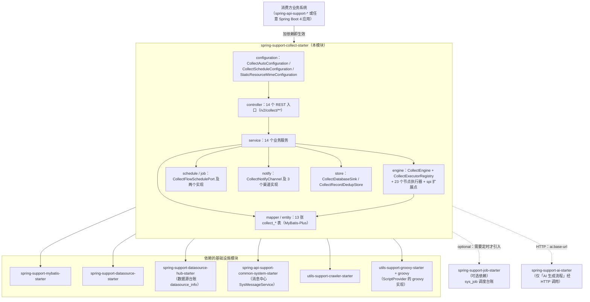
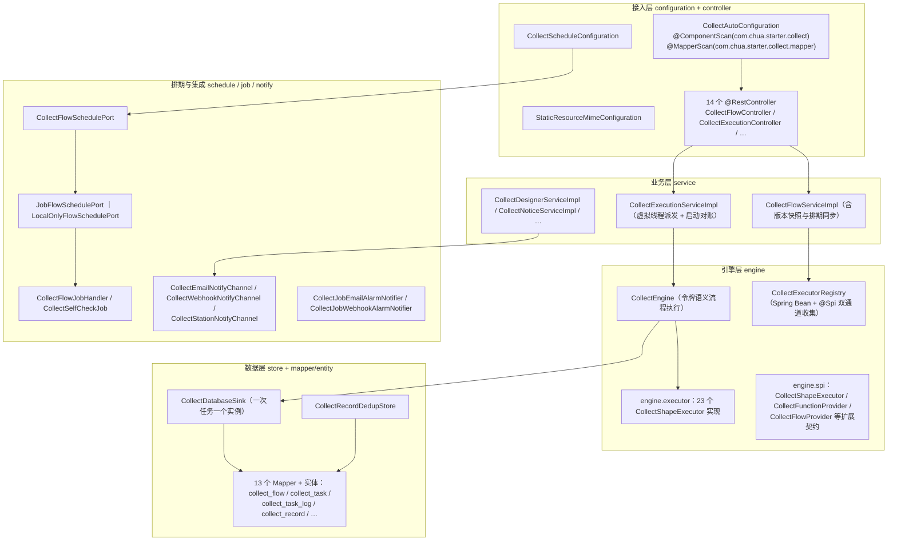
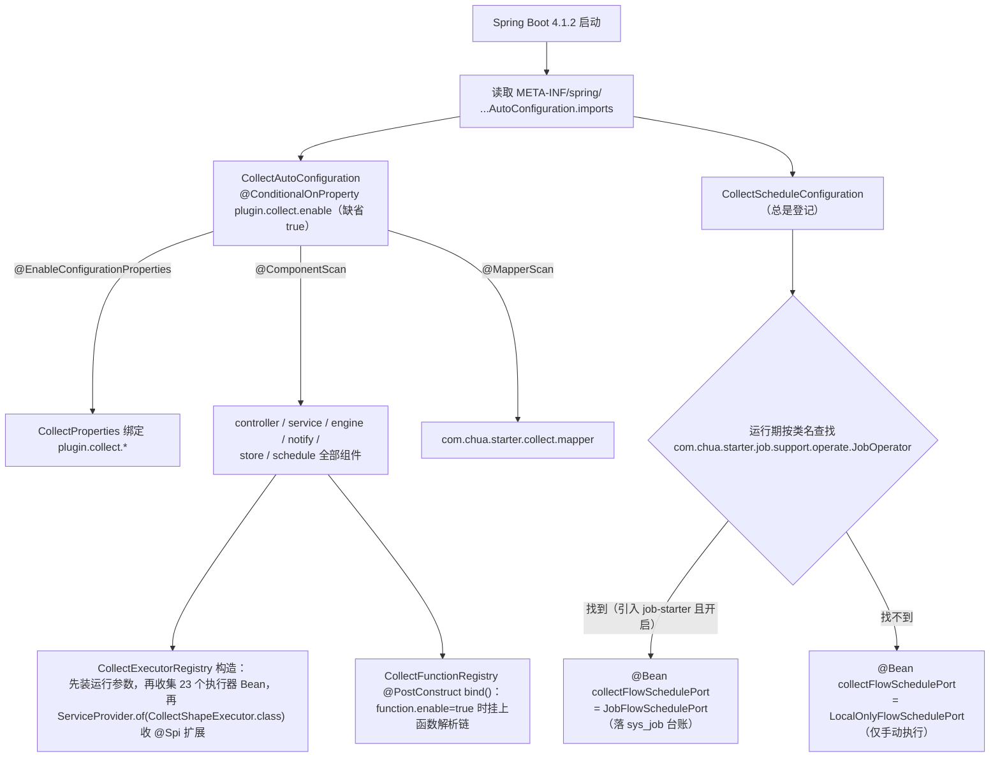
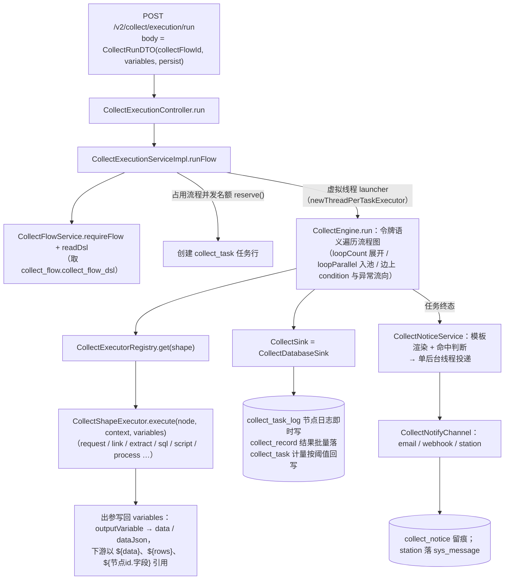
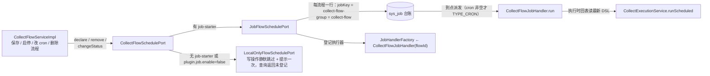

# spring-support-collect-starter

采集调度一体化平台：可视化流程编排 + 复用调度平台作业台账。覆盖数据源、目录、字段、变量、函数 → 流程与版本 → 任务、执行记录、告警规则与通知的完整采集链路。

- Maven 坐标：`com.chua:spring-support-collect-starter:4.0.0.51`
- 运行基线：父 POM `spring-boot-starter-parent:4.1.2`（Spring Boot 4.1.2，2026-11-19 升级），Java 25
- 自动装配登记：`META-INF/spring/org.springframework.boot.autoconfigure.AutoConfiguration.imports`（无 `spring.factories`）

---

## 1. 架构图

### 1.1 模块在体系中的位置

本模块是 `spring-support-parent-starter` 仓库中的业务 starter 之一，被业务系统（`spring-api-support-*` 或任意 Spring Boot 4 应用）依赖后即获得完整采集能力。调度器 `spring-support-job-starter` 是**可选依赖**；AI 生成流程经 HTTP 调用 `spring-support-ai-starter`，不是 Maven 依赖。



### 1.2 内部分层



---

## 2. 核心流程图

### 2.1 自动装配流程



### 2.2 一次流程执行的请求处理 / 数据流



### 2.3 排期数据流（可选 job-starter）



---

## 3. 能力清单

### 3.1 能力域 × 关键类 × 入口

| 能力域 | 关键类 | 入口 |
| --- | --- | --- |
| 自动装配 | `CollectAutoConfiguration`、`CollectScheduleConfiguration`、`StaticResourceMimeConfiguration` | `AutoConfiguration.imports` + 组件扫描；开关 `plugin.collect.enable` |
| 流程设计与版本 | `CollectFlowServiceImpl`、`CollectFlowVersionServiceImpl` | `POST /v2/collect/flow/save`、`PUT /v2/collect/flow/status`、`POST /v2/collect/flow-version/save`、`POST /v2/collect/flow-version/rollback` |
| 设计器支撑 | `CollectDesignerServiceImpl`、`CollectAgentCatalog` | `GET /v2/collect/designer/metas`、`GET /v2/collect/designer/runtime`、`POST /v2/collect/designer/ai-generate` |
| 流程执行 | `CollectExecutionServiceImpl`、`CollectEngine`、`CollectExecutorRegistry`、`CollectDatabaseSink` | `POST /v2/collect/execution/run`、`POST /v2/collect/execution/dry-run`、`POST /v2/collect/execution/stop` |
| 节点执行器（23 种） | `CollectRequestExecutor`、`CollectExtractExecutor`、`CollectSqlExecutor`、`CollectScriptExecutor`、`CollectProcessExecutor` 等 | 经 `CollectShapeExecutor` SPI 注册，设计器 `GET /v2/collect/designer/metas` 展示 |
| 数据源管理 | `CollectDatasourceServiceImpl`、`CollectDatasourceRegistry`（读 datasource-hub 台账） | `GET /v2/collect/datasource/options`、`POST /v2/collect/datasource/test`、`GET /v2/collect/datasource/tables` |
| 变量与函数 | `CollectVariableServiceImpl`、`CollectFunctionServiceImpl`（兼 `CollectFunctionProvider`）、`CollectFunctionRegistry` | `POST /v2/collect/variable/save`、`POST /v2/collect/function/save`、`POST /v2/collect/function/test` |
| 任务与结果观测 | `CollectTaskServiceImpl`、`CollectRecordServiceImpl`、`CollectFieldServiceImpl`、`CollectRecordDedupStore` | `GET /v2/collect/task/page`、`GET /v2/collect/task/logs`、`GET /v2/collect/task/quality`、`GET /v2/collect/record/page` |
| 通知与告警 | `CollectNoticeServiceImpl`、`CollectNotifyChannel` 三个实现、`CollectAlertRuleServiceImpl` | `GET /v2/collect/notice/channels`、`POST /v2/collect/notice/test`、`POST /v2/collect/alert-rule/toggle` |
| 运行参数 | `CollectSettingsServiceImpl`（定义表 `collect_setting` 为唯一可信来源） | `GET /v2/collect/settings/list`、`PUT /v2/collect/settings`、`POST /v2/collect/settings/reset` |
| 定时排期 | `CollectFlowSchedulePort` → `JobFlowSchedulePort` / `LocalOnlyFlowSchedulePort`、`CollectFlowJobHandler`、`CollectSelfCheckJob` | `PUT /v2/collect/flow/status`；到点由 job-starter 派发 |
| 建表与种子数据 | `db/init/V2.0__init_all_api_collect.sql`（13 表）、`db/init/V2.0__initdata_all_api_collect.sql`（种子） | 由 `plugin.datasource.script` 以 `classpath*:db/init/*.sql` 扫描执行（ONCE 语义：空库才建） |

### 3.2 内置节点类型（23 种，shape → 执行器）

| 分类 | shape（执行器） |
| --- | --- |
| 来源 | `start`（CollectStartExecutor）、`request`（CollectRequestExecutor）、`link`（CollectLinkExecutor）、`extract`（CollectExtractExecutor）、`sql`（CollectSqlExecutor）、`neo4j-read`（CollectNeo4jReadExecutor）、`influxdb-read`（CollectInfluxdbReadExecutor）、`entry`（CollectDataEntryExecutor） |
| 加工 | `filter`（CollectFilterExecutor）、`dedup`（CollectDedupExecutor）、`exists`（CollectExistsExecutor）、`script`（CollectScriptExecutor）、`ai`（CollectAiExecutor）、`agent`（CollectAgentExecutor）、`process`（CollectProcessExecutor） |
| 控制 | `condition`（CollectConditionExecutor）、`sleep`（CollectSleepExecutor）、`comment`（CollectCommentExecutor） |
| 输出 | `database`（CollectDatabaseExecutor）、`neo4j-write`（CollectNeo4jWriteExecutor）、`influxdb-write`（CollectInfluxdbWriteExecutor）、`output`（CollectOutputExecutor）、`end`（CollectEndExecutor） |

### 3.3 HTTP 接口（14 个控制器，均带 `@ConditionalOnProperty plugin.collect.enable`）

| 控制器（基路径） | 方法 | 路径 | 说明 |
| --- | --- | --- | --- |
| `CollectAlertRuleController`（`/v2/collect/alert-rule`） | GET | `/page` | 告警规则分页 |
|  | GET | `/list` | 启用中的告警规则 |
|  | POST | `/save` | 新增规则 |
|  | DELETE | `/delete` | 删除规则 |
|  | POST | `/toggle` | 启停规则 |
| `CollectCategoryController`（`/v2/collect/category`） | GET | `/tree` | 分类树 |
|  | GET | `/options` | 分类下拉选项 |
|  | POST | `/save` | 新增分类 |
|  | PUT | `/update` | 修改分类 |
|  | DELETE | `/delete` | 删除分类，存在子分类或流程时拒绝 |
| `CollectDatasourceController`（`/v2/collect/datasource`） | GET | `/list` | 数据源列表（永不回传密码） |
|  | GET | `/options` | 下拉选项，首项为应用主库 |
|  | POST | `/save` | 新增数据源 |
|  | PUT | `/update` | 修改数据源，密码留掩码表示不改 |
|  | DELETE | `/delete` | 删除数据源，被流程引用时拒绝 |
|  | POST | `/test` | 测试连接，返回数据库产品信息 |
|  | GET | `/tables` | 列出表与视图，供入库节点选择目标表 |
|  | GET | `/columns` | 列出指定表的列元数据 |
| `CollectDesignerController`（`/v2/collect/designer`） | GET | `/metas` | 全部节点类型元数据（工具箱） |
|  | GET | `/agents` | 已注册 Agent 目录 |
|  | GET | `/runtime` | 运行时概览 |
|  | GET | `/cron/next` | 预览 cron 触发时间 |
|  | GET | `/fetch-preview` | 预览抓取（仅 http/https，拒内网与本机地址） |
|  | POST | `/ai-generate` | 自然语言生成流程 DSL（经图校验后返回） |
| `CollectExecutionController`（`/v2/collect/execution`） | POST | `/run` | 运行已保存流程，立即返回任务号，虚拟线程执行 |
|  | POST | `/dry-run` | 试运行未保存流程图，结果不落库 |
|  | POST | `/stop` | 停止运行中的任务 |
|  | GET | `/running` | 本机执行中的任务数 |
|  | GET | `/inflight` | 某流程排队与执行中的任务数 |
| `CollectFieldController`（`/v2/collect/field`） | GET | `/list` | 某流程节点的字段定义 |
|  | POST | `/replace` | 整体保存字段定义 |
| `CollectFlowController`（`/v2/collect/flow`） | GET | `/page` | 流程分页列表（不返回 DSL 正文） |
|  | GET | `/list` | 流程精简列表 |
|  | GET | `/detail` | 流程详情，含流程图 DSL |
|  | POST | `/save` | 新增流程（校验通过才落库） |
|  | PUT | `/update` | 修改流程 |
|  | PUT | `/status` | 启停流程调度（同步 sys_job 台账） |
|  | POST | `/copy` | 复制流程 |
|  | DELETE | `/delete` | 删除流程 |
|  | POST | `/validate` | 只校验流程图不落库 |
| `CollectFlowVersionController`（`/v2/collect/flow-version`） | GET | `/list` | 版本列表 |
|  | POST | `/save` | 保存版本快照 |
|  | POST | `/rollback` | 回滚到指定版本 |
|  | GET | `/diff` | 版本差异 |
| `CollectFunctionController`（`/v2/collect/function`） | GET | `/list` | 函数列表 |
|  | POST | `/save` | 新增函数（先编译校验） |
|  | PUT | `/update` | 修改函数 |
|  | DELETE | `/delete` | 删除函数 |
|  | POST | `/test` | 试跑函数 |
| `CollectNoticeController`（`/v2/collect/notice`） | GET | `/list` | 通知配置列表（平台级一份） |
|  | GET | `/channels` | 可用渠道及接收目标填法 |
|  | POST | `/save` | 新增通知配置 |
|  | PUT | `/update` | 修改通知配置 |
|  | DELETE | `/delete` | 删除通知配置 |
|  | POST | `/test` | 按配置试发一条通知 |
| `CollectRecordController`（`/v2/collect/record`） | GET | `/page` | 结果分页列表（按字段定义渲染） |
|  | GET | `/detail` | 结果详情 |
|  | DELETE | `/delete` | 删除单条结果 |
|  | POST | `/deletes` | 批量删除结果 |
|  | DELETE | `/clear` | 清空结果，流程与任务至少指定一个 |
|  | GET | `/count` | 结果总数 |
| `CollectSettingsController`（`/v2/collect/settings`） | GET | `/list` | 全部运行参数（含类型、范围、缺省值、是否重启生效） |
|  | PUT | `/` | 保存运行参数，只传要改的键，校验通过写库立即生效 |
|  | POST | `/reset` | 恢复缺省：传键只恢复这些键，空数组恢复全部 |
| `CollectTaskController`（`/v2/collect/task`） | GET | `/page` | 任务分页列表 |
|  | GET | `/detail` | 任务详情 |
|  | GET | `/logs` | 节点日志（按执行顺序） |
|  | GET | `/node-states` | 节点最近状态（设计器回显） |
|  | DELETE | `/delete` | 删除任务 |
|  | POST | `/clean` | 清理历史任务 |
|  | GET | `/quality` | 从节点日志聚合质量指标 |
|  | GET | `/stats` | 执行历史统计（趋势 + 节点耗时） |
|  | GET | `/live` | 运行中任务的实时节点状态（前端轮询） |
| `CollectVariableController`（`/v2/collect/variable`） | GET | `/list` | 变量列表，加密变量脱敏 |
|  | POST | `/save` | 新增变量 |
|  | PUT | `/update` | 修改变量，掩码表示不改原值 |
|  | DELETE | `/delete` | 删除变量 |

---

## 4. Bean 能力矩阵

> 除前两行显式 `@Bean` 外，其余 Bean 均来自 `CollectAutoConfiguration` 的 `@ComponentScan("com.chua.starter.collect")`，Bean 名默认为「类名首字母小写」。同名覆盖需开启 `spring.main.allow-bean-definition-overriding=true`；同类型多候选注入时用 `@Primary` 或按名 `@Qualifier` 区分。

### 4.1 显式声明的 Bean

| Bean 名 | 类型 | 装配条件 | 可否覆盖 | 典型注入姿势 |
| --- | --- | --- | --- | --- |
| `collectFlowSchedulePort` | `CollectFlowSchedulePort`（实现为 `JobFlowSchedulePort` 或 `LocalOnlyFlowSchedulePort`） | `CollectScheduleConfiguration`（`@AutoConfiguration`）总是登记；实现由运行期能否按类名找到 `com.chua.starter.job.support.operate.JobOperator` 决定 | 一般不覆盖；要换调度器时实现 `CollectFlowSchedulePort` 并自管装配（同名覆盖需 `allow-bean-definition-overriding=true`） | 构造器注入接口 `CollectFlowSchedulePort`（本模块内 `CollectFlowServiceImpl` 即如此） |
| `yamlMimeMappings` | `WebServerFactoryCustomizer<TomcatServletWebServerFactory>`（`StaticResourceMimeConfiguration`） | 随组件扫描装配（即 `plugin.collect.enable=true`）；为 SPA 的 `app.yaml` 补 `text/yaml` MIME 映射 | 可再注册自己的 `WebServerFactoryCustomizer`，不要同名 | 由 Boot 自动应用到 Tomcat 工厂，通常无需注入 |
| `collectProperties` | `CollectProperties`（`plugin.collect.*`） | `@EnableConfigurationProperties(CollectProperties.class)`，随自动装配生效 | 配置值直接改 yml，无需覆盖 Bean | 构造器注入 `CollectProperties` |

### 4.2 组件扫描的关键 Bean（节选）

| Bean 名 | 类型 | 装配条件 | 可否覆盖 | 典型注入姿势 |
| --- | --- | --- | --- | --- |
| `collectEngine` | `CollectEngine` | `plugin.collect.enable=true` | 可注入不可随意替换（任务编排核心） | 构造器注入 `CollectEngine` |
| `collectExecutorRegistry` | `CollectExecutorRegistry` | `plugin.collect.enable=true`；构造期先 `settingsService.initialize()` 再收集执行器 | 不建议覆盖；扩展走 `CollectShapeExecutor` | 注入后用 `get(shape)` / `metas()` / `shapes()` |
| `collectFunctionRegistry` | `CollectFunctionRegistry`（实现 `CollectBuiltinInvoker.UserHook`） | `plugin.collect.enable=true`；`function.enable=false` 时仅不挂载函数解析链，Bean 仍注册 | 不建议覆盖 | 注入后可 `invalidate()` 立即刷新函数缓存 |
| `collectDatasourceRegistry` | `CollectDatasourceRegistry` | `plugin.collect.enable=true` | 不建议覆盖 | 注入后 `resolve(...)` 把数据源引用解析成可建池参数 |
| `collectRecordDedupStore` | `CollectRecordDedupStore`（实现 `CollectDedupStore`） | `plugin.collect.enable=true` | 可自实现 `CollectDedupStore` 并 `@Primary` | 以 `CollectDedupStore` 类型注入 |
| 23 个节点执行器 | 各 `Collect*Executor`（实现 `CollectShapeExecutor`） | 全部要求 `plugin.collect.enable=true`（随扫描）；另有：`script` → `plugin.collect.script.enable`、`process` → `plugin.collect.process.enable`、`ai` → `plugin.collect.ai.enable` + `@ConditionalOnClass(AiChatFacadeService)`、`agent` → `plugin.collect.agent.enable` + `@ConditionalOnClass(AgentRegistry)` | 新 shape 自由扩展；**同 shape 重复注册先到者生效，后到者忽略并告警** | 以 `CollectShapeExecutor` 类型实现并注册为 Bean 或 `@Spi` |
| 14 个 Service 实现 | `CollectFlowServiceImpl` 等 | `plugin.collect.enable=true`；`collectFunctionServiceImpl` 另要求 `plugin.collect.function.enable=true` | 可注入；替换需同名覆盖开关或 `@Primary` | 按接口注入，如 `CollectFlowService` |
| 14 个 Controller | `CollectFlowController` 等 | `plugin.collect.enable=true`（每个类上都有该 `@ConditionalOnProperty`） | 一般不注入（HTTP 入口） | — |
| `collectEmailNotifyChannel` / `collectWebhookNotifyChannel` | `CollectNotifyChannel` | `plugin.collect.notify.enable=true`；email 渠道未配 `spring.mail.host` 时仍注册，但发送返回可读失败原因 | 新渠道自由扩展；同 `channel()` 先注册生效（Spring 侧优先于 `@Spi`） | 由 `CollectNoticeServiceImpl` 构造期收集，业务代码一般不直接注入 |
| `collectStationNotifyChannel` | `CollectNotifyChannel` | `plugin.collect.notify.enable=true` **且** `@ConditionalOnBean(SysMessageService.class)`（容器无消息中心时不注册，渠道下拉自动少一项） | 同上 | 同上 |
| `collectJobEmailAlarmNotifier` / `collectJobWebhookAlarmNotifier` | `JobAlarmNotifier`（job-starter 契约） | `plugin.collect.enable=true` + `@ConditionalOnClass(JobAlarmNotifier.class)`（类路径无 job-starter 时不装配） | 可追加自己的 `JobAlarmNotifier` 实现 | 由 job-starter 的告警链路发现并调用 |
| `collectSelfCheckJob` | `@Job("collect.self.check")` 本地自检任务 | `@ConditionalOnClass(JobHandlerFactory.class)`（有 job-starter 才装配）；cron `0 0/30 * * * ?`，分组 `collect-flow` | 不建议覆盖 | 由 `JobAnnotationScanner` 登记进 sys_job，无需注入 |
| （非 Bean）`CollectDatabaseSink` | `CollectSink` 的数据库实现 | **不是 Spring Bean**：每次执行由 `CollectExecutionServiceImpl` 按任务创建 | — | 不可注入；要换落库行为时实现 `CollectSink`（见第 8 节） |

---

## 5. 完整配置

### 5.1 `plugin.collect.*`（`CollectProperties`，前缀常量 `CollectProperties.PRE`）

| 路径 | 类型 | 默认值 | 说明 | 生效开关 / 影响点 |
| --- | --- | --- | --- | --- |
| `plugin.collect.enable` | `boolean` | `true` | 平台总开关，关闭后不装配控制器、服务、执行引擎与调度任务 | `CollectAutoConfiguration`、14 个 Controller、2 个告警通知器的 `@ConditionalOnProperty` |
| `plugin.collect.default-thread-count` | `int` | `4` | 流程默认并行线程数，可被流程定义覆盖 | 流程未指定线程数时的缺省 |
| `plugin.collect.request-timeout-ms` | `int` | `30000` | 单次抓取默认超时毫秒，节点未显式配置时使用 | 抓取类节点 |
| `plugin.collect.request-retry-times` | `int` | `1` | 默认重试次数，节点未显式配置时使用 | 抓取类节点 |
| `plugin.collect.user-agent` | `String` | Chrome/120 的 Mozilla UA（`DEFAULT_USER_AGENT`） | 默认 User-Agent，节点未显式配置时使用 | 抓取类节点 |
| `plugin.collect.sql-allow-write` | `boolean` | `false` | SQL 节点是否允许写语句（非 SELECT/WITH/SHOW）；默认禁止，写库改走 `database` 节点（PreparedStatement 绑定） | `CollectSqlExecutor` |
| `plugin.collect.task-timeout-ms` | `long` | `1800000`（30 分钟） | 单任务最长执行毫秒，超时置失败并中断流程线程池；真正的量级保护由 `max-record-per-task` 兜底 | `CollectEngine` 任务超时、启动对账水位 |
| `plugin.collect.max-record-per-task` | `int` | `100000` | 单任务最多落库记录数，超出丢弃并写任务日志 | 落库通道 |
| `plugin.collect.preview-length` | `int` | `500` | 节点出参预览保留字符数 | 节点日志出参列 |
| `plugin.collect.node-output-limit` | `int` | `2000` | 各节点产出留存条数上限（`${nodes.<id>.字段}` 的底表）；0 或负数不限，超限后新产出取值同「变量未定义」 | `CollectEngine` 跨节点留存 |
| `plugin.collect.exists-batch-size` | `int` | `500` | 「查已存在」节点 IN 查询每片条数，避免超 `max_allowed_packet` | `CollectExistsExecutor` |
| `plugin.collect.script.enable` | `boolean` | `true` | 脚本节点开关；关闭后执行器不注册，工具箱无脚本节点，存量流程校验报「类型未注册」 | `CollectScriptExecutor` 的 `@ConditionalOnProperty` + 注册表双保险 |
| `plugin.collect.function.enable` | `boolean` | `true` | 自定义函数库开关；关闭后函数管理接口不装配，`${}` 与脚本里的 `fn` 只剩内置函数，已登记函数保留在库 | `CollectFunctionServiceImpl` 的 `@ConditionalOnProperty`、`CollectFunctionRegistry.bind()` |
| `plugin.collect.notify.enable` | `boolean` | `true` | 执行通知开关；关闭后任务终态不投递，试发直接失败并给原因 | 3 个 `CollectNotifyChannel` 实现的 `@ConditionalOnProperty` |
| `plugin.collect.process.enable` | `boolean` | `true` | 子流程节点开关；关闭后子流程执行器不注册 | `CollectProcessExecutor` 的 `@ConditionalOnProperty` + 注册表双保险 |
| `plugin.collect.process.max-depth` | `int` | `5` | 子流程嵌套层数上限，超过后节点直接失败 | `CollectProcessExecutor` |
| `plugin.collect.ai.enable` | `boolean` | `true` | 「AI 生成流程」开关 | `CollectAiExecutor` 的 `@ConditionalOnProperty` |
| `plugin.collect.ai.base-url` | `String` | `http://127.0.0.1:8787` | ai-starter 服务地址（默认与采集后端同机，走回环） | AI 生成流程的 HTTP 调用 |
| `plugin.collect.ai.model` | `String` | `deepseek-v4.1-flash` | 模型名，须为 ai-starter 中已启用的模型 | AI 生成流程 |
| `plugin.collect.ai.trust-header` | `String` | `x-nomi-local-trust` | 本地信任头名（ai-starter `LocalTrustAuthFilter` 约定，回环来源放行） | AI 生成流程 |
| `plugin.collect.ai.trust-value` | `String` | `collect-designer` | 本地信任头的值（服务端只要求非空） | AI 生成流程 |
| `plugin.collect.ai.timeout-ms` | `int` | `180000` | 单次生成总超时毫秒（整图 JSON 生成较慢） | AI 生成流程 |
| `plugin.collect.agent.enable` | `boolean` | `true`（未配置即开启） | Agent 节点开关。注意：本项**不在** `CollectProperties` 中，仅由 `CollectAgentExecutor` 的 `@ConditionalOnProperty` 读取；该执行器还要求类路径存在 `com.chua.starter.ai.support.registry.AgentRegistry` | `CollectAgentExecutor` 装配 |

### 5.2 相关联动配置（非本模块前缀，但直接影响本模块）

| 路径 | 归属 | 说明 |
| --- | --- | --- |
| `plugin.datasource.script` | spring-support-datasource-starter | 建表脚本执行开关；本模块的 `classpath*:db/init/*.sql`（2 个文件、13 张 `collect_*` 表 + 种子数据）由它扫描执行，ONCE 语义 |
| `plugin.job.enable` 等 | spring-support-job-starter | job-starter 自己的开关；为 `false` 时本模块排期自动落到 `LocalOnlyFlowSchedulePort` 兜底 |
| `spring.mail.host` 等 | Spring Boot 邮件自动配置 | 未配置时 `CollectEmailNotifyChannel` 仍在渠道列表，但发送返回「未配置邮件账号」的可读失败原因 |

> 运行期还可用 `GET /v2/collect/settings/list` 读取全部参数定义（类型、范围、缺省值、是否重启生效），`PUT /v2/collect/settings` 在线修改（写 `collect_setting` 表并立即生效），`POST /v2/collect/settings/reset` 恢复 yml 缺省。

---

## 6. 使用方式

### 6.1 Maven 坐标

```xml
<dependency>
    <groupId>com.chua</groupId>
    <artifactId>spring-support-collect-starter</artifactId>
    <version>4.0.0.51</version>
</dependency>
```

### 6.2 最小可运行示例

启动类不需要任何额外注解——组件扫描与 Mapper 扫描已内置（这也是本模块与同仓库其它 starter 的差异：job-starter 等只暴露 `MAPPER_PACKAGE` 常量，由消费方自己 `@MapperScan`；采集模块面向整体集成，直接扫 `com.chua.starter.collect`）。

```java
@SpringBootApplication
public class CollectApp {
    public static void main(String[] args) {
        SpringApplication.run(CollectApp.class, args);
    }
}
```

```yaml
plugin:
  collect:
    enable: true            # 总开关，默认 true
    sql-allow-write: false  # SQL 节点默认只读
    notify:
      enable: true
# 数据源与建表脚本执行遵循 spring-support-datasource-starter / datasource-hub 的配置约定；
# 本模块 pom 已自带 h2（runtime），默认配置可免外部数据库启动，生产换 MySQL 只需按数据源中心登记。
```

保存一个最小流程并运行（DSL 契约见 `CollectFlowSaveDTO` / `CollectDslDTO` / `CollectNodeDTO` / `CollectEdgeDTO` / `CollectParamDTO`）：

```bash
# 1) 保存流程：start -> request -> output 三个节点
curl -X POST http://localhost:8080/v2/collect/flow/save -H 'Content-Type: application/json' -d '{
  "collectFlowName": "示例-抓取一个页面",
  "dsl": {
    "name": "示例-抓取一个页面",
    "nodes": [
      {"id": "n1", "shape": "start",   "name": "开始",   "params": []},
      {"id": "n2", "shape": "request", "name": "抓取",   "params": [
          {"name": "url", "value": "https://example.com", "description": ""}]},
      {"id": "n3", "shape": "output",  "name": "输出",   "params": []}
    ],
    "edges": [
      {"id": "e1", "from": "n1", "to": "n2"},
      {"id": "e2", "from": "n2", "to": "n3"}
    ]
  }
}'

# 2) 运行（persist=false 只试跑不落结果；true 则写入 collect_record）
curl -X POST http://localhost:8080/v2/collect/execution/run -H 'Content-Type: application/json' \
  -d '{"collectFlowId": 1, "variables": [], "persist": false}'

# 3) 查看任务与节点日志
curl 'http://localhost:8080/v2/collect/task/page?current=1&size=10'
```

> 想要定时触发：给流程配 `collectFlowCron` 并在宿主引入 `spring-support-job-starter`（见 6.3）；不引入也能设计、手动执行、看结果，只是没有定时。启动后可用 `GET /service-info` 查看模块开关与端点汇总。

### 6.3 可选依赖说明

| 依赖 | 是否可选 | 引入 / 不引入的效果 |
| --- | --- | --- |
| `spring-support-job-starter` | **可选（pom 中 `<optional>true</optional>`）** | 引入且开启：`CollectScheduleConfiguration` 找到 `JobOperator`，排期经 `JobFlowSchedulePort` 落 `sys_job` 台账，到点由 job-starter 派发 `CollectFlowJobHandler`；不引入（或 `plugin.job.enable=false`）：`LocalOnlyFlowSchedulePort` 兜底，流程照常设计与手动执行，仅无定时触发，启用排期会得到明确提示。设计成 optional 是为了不让「只想要采集能力」的宿主被动继承整套调度引擎（Leader 选举、`sys_job_cluster`、`/v2/job` 治理接口及其建表） |
| `mysql-connector-j` / `h2` | runtime 自带 | h2 支持免外部数据库启动；生产建议 MySQL，表 DDL 均为 `CREATE TABLE IF NOT EXISTS` |
| `utils-support-groovy-starter` + `groovy` | 必带 | 提供脚本节点与自定义函数的 Groovy 执行运行时 |
| `utils-support-crawler-starter` / `jsoup` | 必带 | 抓取与 DOM 解析能力 |
| `spring-support-datasource-hub-starter` | 必带 | SQL / 入库节点的数据源台账来源（`datasource_info`），迁移期回落老 `collect_datasource` |
| `spring-support-ai-starter` | **非 Maven 依赖** | 仅「AI 生成流程」经 HTTP 调用（`plugin.collect.ai.*`）；默认只在采集后端与 ai-starter 同机部署时可用（本地信任头回环放行） |

---

## 7. 使用场景

### 7.1 适用

- 需要可视化编排的批式数据采集：网页抓取（request/link/extract）、接口拉取、SQL 抽取、脚本加工、去重、条件分支，最后入库（database / neo4j-write / influxdb-write）。
- 想复用调度平台的作业台账做流程级 cron，而不是自建 Quartz：每个流程在 `sys_job` 一行，启停/改 cron/删除自动同步。
- 需要任务级可观测性：节点日志、实时节点状态、质量报告、执行趋势统计、告警规则与多渠道通知。
- 想把采集能力整体嵌入自己的业务系统（后续承接 eduai 采集的场景）：加依赖即生效，开关与运行参数齐全。

### 7.2 不适用

- 只需要一个轻量 HTTP 抓取客户端——直接用 `utils-support-crawler-starter` 即可，不必引入 13 张表与整套平台。
- 宿主不是 Spring Boot 4 / 不接受 MyBatis-Plus 与关系库——本模块强依赖 MyBatis-Plus 与 `collect_*` 表。
- 追求流式、毫秒级实时采集——本模块是任务批式执行 + 结果落库的形态，不是流处理引擎。

### 7.3 与相邻模块的取舍

| 相邻模块 | 取舍结论 |
| --- | --- |
| `spring-support-job-starter` | 采集本体不依赖调度器，排期收口在 `CollectFlowSchedulePort`；换调度器不用改流程。要定时就显式引入 job-starter |
| `spring-support-datasource-hub-starter` | 数据源台账统一读数据源中心 `datasource_info`，本模块不自建台账（老 `collect_datasource` 仅迁移期回落） |
| `spring-support-ai-starter` | 只在「AI 生成流程」时经 HTTP 调用，不是编译期依赖；AI 节点（`ai` / `agent` shape）按 `@ConditionalOnClass` 自动降级 |
| `spring-api-support-common-system-starter` 的消息中心 | 站内通知复用 `SysMessageService.broadcast → sys_message`，不引 `spring-support-message-starter`（两者各带一套同名 `SysMessage*`，共存会 `ConflictingBeanDefinitionException`） |
| 前端 SPA | 本模块把前端交给同进程托管（`/static/**` → `file:./static/`），并补 `.yaml/.yml → text/yaml` MIME 映射，避免 SPA 启动配置被静默丢弃 |

---

## 8. 扩展点

| 扩展点 | 关键方法 | 注册方式 | 默认实现 |
| --- | --- | --- | --- |
| `CollectShapeExecutor`（节点执行器） | `supportShape()`、`meta()`、`execute(node, context, variables)`、`summary(...)`、`loopParams()`、`defaultOutput(node)` | Spring Bean 或 `@Spi`（`CollectExecutorRegistry` 先收 Spring `ObjectProvider`，再 `ServiceProvider.of(CollectShapeExecutor.class).collect(...)`）；新 shape 即新节点类型，设计器工具箱自动出现 | 23 个内置执行器；同 shape 重复注册先到者生效、后到者忽略并告警 |
| `CollectFunctionProvider`（自定义函数来源） | `loadEnabled()` 返回启用函数清单 | Spring Bean 或 `@Spi`；实现要能被采集线程反复调用，代价高请自行缓存；函数名冲突先注册者生效并告警 | `CollectFunctionServiceImpl`（编译校验通过才允许入库） |
| `CollectFlowProvider`（子流程来源） | `load(flowId)` 返回 `CollectFlowRef` | Spring Bean 或 `@Spi`（例如从 XML 或资源文件加载子流程） | `CollectFlowServiceImpl` |
| `CollectNotifyChannel`（通知渠道） | `channel()`、`label()`、`targetHint()`、`send(CollectNotifyMessage)`（失败返回 `MessageResponse.failure`，不要抛出） | Spring Bean 或 `@Spi("渠道名")`；注册后直接出现在 `/v2/collect/notice/channels` 与前端下拉，Spring 侧优先 | `CollectEmailNotifyChannel` / `CollectWebhookNotifyChannel` / `CollectStationNotifyChannel` |
| `CollectFlowSchedulePort`（排期端口） | `schedulingAvailable()`、`declare(spec)`、`remove(jobKey)`、`changeStatus(...)`、`runtime(jobKey)`、`listRuntimes()`、`removeLegacyTick()` | 覆盖 `collectFlowSchedulePort` Bean 或提供新实现（方法签名只用本包中立类型，不依赖 job） | `JobFlowSchedulePort`（有 job-starter）/ `LocalOnlyFlowSchedulePort`（兜底） |
| `CollectSink`（执行落库通道） | `nodeLog(...)`、`record(entry)`、`trace(message)` | 实现后交由服务层在任务启动时注入 `CollectContext`；引擎不依赖 Mapper，便于单测换内存实现 | `CollectDatabaseSink`（非 Bean，每任务一实例） |
| `CollectDedupStore`（判重存储） | `seen(flowId, global, key)` | 服务层实现；引擎侧只认接口 | `CollectRecordDedupStore`（基于 `collect_record`） |
| `JobAlarmNotifier`（job-starter 告警 → 本模块渠道） | `type()`、`notify(JobAlarmMessage)` | Spring Bean + `@ConditionalOnClass(JobAlarmNotifier.class)` | `CollectJobEmailAlarmNotifier` / `CollectJobWebhookAlarmNotifier` |

> 自定义函数在脚本里以 `fn.名字(...)` 调用，在任意节点参数里以 `${名字(...)}` 调用，两条路共用同一张函数表；注册表缓存 5 秒过期，写入方调用 `CollectFunctionRegistry.invalidate()` 立即生效，函数递归超过 8 层直接拒绝。

---

## 9. 常见问题

### 9.1 装配不生效

- **整个平台没起来 / 接口 404**：先确认 `plugin.collect.enable` 未被置为 `false`（默认 `true`）。14 个 Controller 与自动装配都挂在这一个开关上。
- **想自己控制扫描范围**：本模块已内置 `@ComponentScan("com.chua.starter.collect")` 与 `@MapperScan("com.chua.starter.collect.mapper")`；消费方再显式扫描同一批类不会冲突（同名同类视为兼容定义会被跳过）。常量 `CollectAutoConfiguration.BASE_PACKAGE` / `MAPPER_PACKAGE` 可直接引用。
- **表没建**：建表不是本模块自动装配的职责，由 `plugin.datasource.script` 扫描 `classpath*:db/init/*.sql` 执行，ONCE 语义（空库才建，已有库不动结构）。
- **函数管理接口 404**：`plugin.collect.function.enable=false` 会连同函数解析链一起关闭 `CollectFunctionServiceImpl`；已登记的函数定义仍保留在库里。
- **工具箱里少了脚本 / 子流程 / AI / Agent 节点**：分别检查 `plugin.collect.script.enable`、`plugin.collect.process.enable`、`plugin.collect.ai.enable`、`plugin.collect.agent.enable`；`ai` 与 `agent` 还要求类路径上存在 ai-starter 的 `AiChatFacadeService` / `AgentRegistry`，缺类时自动不注册。
- **通知渠道下拉里没有「站内消息」**：`CollectStationNotifyChannel` 带 `@ConditionalOnBean(SysMessageService.class)`，宿主没有消息中心时该渠道自动不出现（优雅失败而非启动报错）。

### 9.2 端口 / 开关

- **为什么排期有时不生效**：`spring-support-job-starter` 是可选依赖。类路径上没有它（或 `plugin.job.enable=false`）时，`CollectScheduleConfiguration` 运行期找不到 `JobOperator`，排期落到 `LocalOnlyFlowSchedulePort`：流程可设计、可手动执行、可看结果，只是没有定时触发，启用排期会得到明确提示（绝不假装排期成功）。需要定时就显式引入 job-starter。
- **为什么用运行期查类名而不是 `@ConditionalOnBean`**：`@ConditionalOnBean` 依赖装配顺序，`JobOperator` 由 job-starter 自己的自动装配创建，顺序不保证，实测会误判成「没有 job」静默降级；把 job 类型写进 `@Bean` 方法签名又会在类路径没有 job-starter 时触发 `NoClassDefFoundError`。所以方法签名只用中立类型，job 类型通过类名在运行期查找。
- **改了流程图要重新登记调度吗**：不用。每流程在 `sys_job` 一行（键 `collect-flow-<流程ID>`），`CollectFlowJobHandler` 派发时才回表读最新 DSL。
- **邮件通知发不出去**：未配置 `spring.mail.host` 时邮件渠道仍在列表里，但发送会返回「未配置邮件账号」并写进通知记录的最近结果，便于排查。
- **流程版本与线上任务**：版本发布后运行期只认已发布版本，设计器改动不会直接影响线上任务；调度派发读的是当前流程 DSL，改图后下一次触发即生效。

### 9.3 与 Spring Boot 4 的兼容性

- 本模块随仓库父 POM 基于Spring Boot **4.1.2**（2026-11-19 升级）、Java 25 构建运行；启动类与依赖方需同为 Boot 4 / Jakarta 命名空间（`jakarta.annotation`、`jakarta.mail`）。
- 自动装配只走 `META-INF/spring/...AutoConfiguration.imports`，不再提供 `spring.factories`（Boot 4 已移除旧机制）。
- Tomcat MIME 定制使用 Boot 4 的新类型：`org.springframework.boot.tomcat.servlet.TomcatServletWebServerFactory` 与 `org.springframework.boot.web.server.MimeMappings`；若宿主改用 Undertow 等其它容器，`yamlMimeMappings` 这个 `WebServerFactoryCustomizer<TomcatServletWebServerFactory>` 不会命中（SPA 托管的 yaml 配置需自行处理）。
- 执行派发使用虚拟线程（`Executors.newThreadPerTaskExecutor(Thread.ofVirtual()...)`），Java 21+ 可用，Java 25 下为默认运行时能力。
- MyBatis-Plus 集成走 `com.baomidou.mybatisplus.spring.service.impl.ServiceImpl`（由 `spring-support-mybatis-starter` 统一提供），勿在宿主重复引入旧版 `mybatis-plus-boot-starter` 造成双装配。
