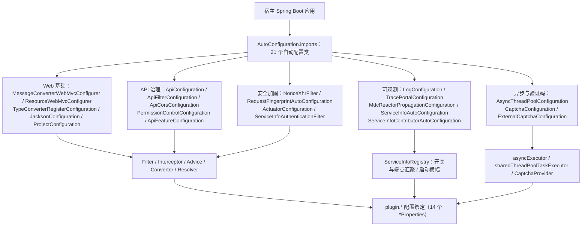

# spring-support-common-starter

Spring Boot 通用支撑 Starter：为宿主应用提供 Web 统一响应与全局异常、API 治理（版本 / 加解密 / 灰度 / 内部接口 / 弃用告警 / 功能开关 / 权限拦截）、安全加固（Nonce 防重放、请求指纹、Actuator 认证、安全响应头）、可观测（MDC 链路、参数日志、链路汇聚、服务信息端点与横幅）、异步线程池、验证码、IP 归属地、邮件通知等横切能力。基于 Spring Boot 4.1.2 基线，引入即自动装配，多数能力可通过 `plugin.*` 开关按需启停（个别能力恒生效，见「五、配置参考」）。

```xml
<dependency>
    <groupId>com.chua</groupId>
    <artifactId>spring-support-common-starter</artifactId>
    <version>4.0.0.51</version>
</dependency>
```

装配入口：`META-INF/spring/org.springframework.boot.autoconfigure.AutoConfiguration.imports` 登记 21 个自动配置类；`META-INF/spring.factories` 登记 3 个 `EnvironmentPostProcessor`（Freemarker / Spring / Profile 环境后处理）；`META-INF/extensions` 登记 4 个 SPI 扩展点；配置绑定由 14 个 `*Properties` 承担。

## 一、整体架构

模块按「装配层 → 组件层 → 支撑层」组织：装配层由 21 个自动配置类按条件装配；组件层是注册进 Servlet 容器与 MVC 的过滤器、拦截器、Advice、转换器；支撑层提供配置绑定、SPI、`ServiceInfoRegistry` 与全局环境。其中 `ServiceInfoContributorAutoConfiguration` 在 `ContextRefreshedEvent` 时收集容器内所有 `ServiceInfoContributor`，统一写入 `ServiceInfoRegistry`。



## 二、核心流程

一次 HTTP 请求经过的组件链（`order` 越小越先执行）：

```mermaid
flowchart LR
    A["HTTP 请求"] --> B["MdcHandlerFilter<br/>MIN_VALUE · 注入 traceId"]
    B --> C["apiVersionFilter<br/>MIN_VALUE · 写 x-response-version"]
    C --> D["nonceXhrFilter<br/>MIN_VALUE+1 · Nonce 防重放"]
    D --> E["actuatorAuthenticationFilter<br/>MIN_VALUE+10 · 仅 /actuator/*"]
    E --> F["apiSecurityHeaderFilter<br/>MIN_VALUE+10 · 补安全响应头"]
    F --> G["corsFilter · 来源白名单放行"]
    G --> H["requestFingerprintFilter<br/>MIN_VALUE+20 · 指纹去重"]
    H --> P["parameterLogFilter<br/>MAX_VALUE-100 · 链尾记录"]
    P --> I["DispatcherServlet"]
    I --> J["PermissionControlInterceptor / ApiControlInterceptor"]
    J --> K["Controller 业务处理"]
    K --> L["ApiUniformResponseBodyAdvice 统一响应<br/>ApiRequestDecodeBodyAdvice / ApiResponseEncodeResponseBodyAdvice 加解密"]
```



## 三、能力清单

- **Web 基础**：统一响应（`ApiUniformResponseBodyAdvice`）、全局异常（`ApiExceptionAdvice`）、消息转换器扩展（二进制 / XML）、`RequestParamsMapMethodArgumentResolver` 参数解析器、静态资源映射（`/static/**`、`/webjars/**`）与 URL 解码修正。
- **API 治理**：`@ApiVersion` 同路径多版本路由（经 `WebMvcRegistrations`）、`@ApiPlatform` / `@ApiProfile` / `@ApiDeprecated` / `@ApiInternal` / `@ApiMock` / `@ApiGray` / `@ApiFeature` 控制注解、请求 / 响应加解密、SPI 短名映射、`@Permission` 权限拦截。
- **安全加固**：XHR Nonce 防重放（签名 + 时间戳）、请求指纹去重（409 + `X-Blocked-Reason: DUPLICATE_REQUEST`）、Actuator Basic 认证 + IP 白名单、安全响应头（CSP / HSTS / X-Content-Type-Options 等）、`/service-info` 可选认证。
- **可观测**：MDC traceId 全链路传播（Servlet / RestTemplate / Reactor）、参数日志与慢请求告警、TracePortal 链路日志汇聚、`/service-info` 端点与启动横幅。
- **异步支撑**：`asyncExecutor`（@Async）与 `sharedThreadPoolTaskExecutor` 双执行器、`MdcTaskDecorator`、Reactor 自动上下文传播。
- **业务支撑**：图形验证码（内置 + yescaptcha / captcha-run 外部打码）、IP 归属地（ip2region / ip2proxy）、邮件通知、Jackson 定制、通用类型转换、Freemarker / Profile 环境后处理。

## 四、Bean 装配矩阵

| Bean | 所属配置类 | 装配条件 | 说明 |
| --- | --- | --- | --- |
| mdcHandlerFilter | MessageConverterWebMvcConfigurer | 恒定 | traceId 注入，order=MIN_VALUE |
| uniformResponseBodyAdvice | ApiConfiguration | `plugin.api.uniform`（缺省开） | 统一响应封装 |
| apiExceptionAdvice | ApiConfiguration | 恒定 | 全局异常 → 统一响应 |
| apiResponseEncodeResponseBodyAdvice / apiResponseEncodeRegister | ApiConfiguration | `plugin.api.encode.enable`≠false | 响应加密；显式 false 时不装配 |
| apiRequestDecodeBodyAdvice / apiRequestDecodeRegister | ApiConfiguration | `plugin.api.decode.enable`≠false | 请求解密；显式 false 时不装配 |
| webMvcRegistrations | ApiConfiguration | `plugin.api.version.enable`（缺省开） | `@ApiVersion` 多版本路由映射 |
| executor（名 `uniform`） | ApiConfiguration | 恒定 | 虚拟线程执行器 + MDC 包装 |
| apiVersionFilterRegistration | ApiFilterConfiguration | 恒定 | 写 `x-response-version`，order=MIN_VALUE |
| nonceXhrFilterRegistration | ApiFilterConfiguration | 恒定 | Nonce 防重放，order=MIN_VALUE+1 |
| apiCorsFilterRegistrationBean | ApiCorsConfiguration | `plugin.api.cors.enable`（`matchIfMissing=true`，缺省即装配） | CorsFilter，来源白名单放行（白名单为空则不放行任何跨域来源） |
| apiSecurityHeaderFilterRegistrationBean | ApiCorsConfiguration | 同上（安全头恒写入，`plugin.api.security.header.enable` 当前不参与判断） | 安全响应头，order=MIN_VALUE+10 |
| permissionControlInterceptor | PermissionControlConfiguration | `plugin.api.permission.enable`（缺省开） | `/**` 权限拦截，排除 `/error`、`/actuator/**` |
| defaultAuthService / authService | CommonConfiguration | 无 `AuthService` / 无 `IptablesService` 时兜底（`@ConditionalOnMissingBean`） | 鉴权实现 |
| nonceSignInitializer / restTemplate / watchPointcutAdvisor | CommonConfiguration | 恒定 | Nonce 初始化、带 traceId 的 RestTemplate、watch 切面 |
| asyncExecutor / sharedThreadPoolTaskExecutor / taskDecorator | AsyncThreadPoolConfiguration | `plugin.async.enable`（缺省开） | 双执行器 + MdcTaskDecorator |
| defaultObjectMapper / objectMapperBuilder | JacksonConfiguration | `@ConditionalOnMissingBean` | 恒装配；`include-null` 决定 ALWAYS / NON_NULL |
| captchaProvider | CaptchaConfiguration | `plugin.captcha.enable`（缺省开） | `/v1/captcha/**` 图形验证码 |
| yesCaptchaParser / captchaRunParser | ExternalCaptchaConfiguration | `plugin.captcha.external.enable=true` 且 classpath 有 CaptchaParser | 外部打码客户端 |
| parameterLogFilterRegistration | LogConfiguration | `plugin.log.enable=true`（需显式） | 出入参日志，order=MAX_VALUE-100 |
| tracePortalAppender | TracePortalConfiguration | `plugin.log.portal.enabled=true` | 挂载 logback root 的链路汇聚 |
| requestFingerprintFilter | RequestFingerprintAutoConfiguration | 恒定（运行时按 `enabled` 短路） | 指纹去重，order=MIN_VALUE+20 |
| actuatorAuthenticationFilterRegistration | ActuatorConfiguration | `plugin.actuator.enable-auth=true` | `/actuator/*` Basic 认证，order=MIN_VALUE+10 |
| serviceInfoController / serviceInfoEndpointDetector / serviceInfoBannerListener | ServiceInfoAutoConfiguration | `plugin.service-info.enable`（缺省开） | `/service-info` 端点、端点探测、启动横幅 |
| serviceInfoAuthenticationFilterRegistration | ServiceInfoAutoConfiguration | `plugin.service-info.auth.enable=true` | `/service-info` 认证过滤器 |
| apiServiceInfoContributor / logServiceInfoContributor 等 | 各配置类 | 恒定 | 向 ServiceInfoRegistry 上报各模块开关 |

## 五、配置参考

所有前缀均为 `plugin.*`。带 `*` 的项：属性字段默认值与实际装配开关不一致，以「说明」列为准。

| 配置项 | 默认值 | 说明 |
| --- | --- | --- |
| `plugin.api.uniform` | `true` | 统一响应封装 |
| `plugin.api.version.enable` | `true` | `@ApiVersion` 版本路由与版本响应头 |
| `plugin.api.platform.enable` / `platform.name` | `true` / `SYSTEM` | `@ApiPlatform` 平台标识 |
| `plugin.api.permission.enable` | `true` | `@Permission` 拦截器 |
| `plugin.api.internal.enable` | `true` | `@ApiInternal` 内部接口 |
| `plugin.api.deprecated.enable` / `add-warning-header` | `true` / `true` | 弃用告警与响应头 |
| `plugin.api.gray.enable` / `header-name` / `default-percentage` | `true` / `X-Gray-Hit` / `0` | 灰度发布 |
| `plugin.api.feature.enable` / `feature.path` | `false` / `/api/features` | 功能开关目录端点 |
| `plugin.api.spi.enable` | `true` | SPI 短名映射 |
| `plugin.api.mock.enable` / `profiles` | `false` / `dev,test` | Mock 模式与生效环境 |
| `plugin.api.encode.enable` / `codec-type` / `white-list` | `false` / `aes` / `[]` | 响应加密 |
| `plugin.api.decode.enable` / `reject-on-decode-failure` | `false` / `false` | 请求解密与失败拒绝 |
| `plugin.api.cors.enable` | `false` | 跨域与安全响应头总开关（`ApiCorsConfiguration` 为 `matchIfMissing=true`，未配置也会装配，但来源白名单为空时不放行任何跨域） |
| `plugin.api.cors.allowed-origins` / `pattern` | `[]` / `[]` | 来源白名单（空=不放行）/ 路径匹配（空=`/**`） |
| `plugin.api.cors.allow-credentials` | `false` | 携带凭证（必须配好来源白名单） |
| `plugin.api.security.header.enable` | `true` | 安全头配置字段（须 `cors.enable=true` 才装配过滤器；字段值当前不参与判断） |
| `plugin.async.enable` | `true` | 装配异步双执行器 |
| `plugin.thread.core-pool-size` / `max-pool-size` / `queue-capacity` | `20` / `200` / `100000` | 线程池参数 |
| `plugin.log.enable`* | `true` | ParameterLogFilter 装配为 `matchIfMissing=false`，需显式 `true` |
| `plugin.log.open-interface-log` / `slow-request-threshold-ms` | `false` / `3000` | 接口日志 / 慢请求告警阈值 |
| `plugin.log.portal.enabled` | `false` | 链路日志汇聚总开关 |
| `plugin.log.portal.file` | `./logs/trace-portal.log` | 汇聚输出文件 |
| `plugin.log.portal.max-events-per-trace` / `idle-millis` / `max-pending-traces` | `200` / `3000` / `512` | 汇聚缓冲策略 |
| `plugin.jackson.include-null` | `false` | 输出 null 字段（无装配开关，恒生效） |
| `plugin.captcha.enable` | `true` | 图形验证码：`GET /v1/captcha.jpg`（图片）、`GET /v1/captcha`（Base64）；前缀可用 `plugin.captcha.context-path` 改 |
| `plugin.captcha.type` / `ttl` / `length` / `width` | `SPEC` / `120` / `4` / `120` | 验证码形态 / 缓存秒数 / 长度 / 宽度 |
| `plugin.captcha.external.enable` / `provider` / `api-token` | `false` / `yescaptcha` / 无 | 外部打码（`captcha-run` 可选；需 classpath 有 CaptchaParser） |
| `plugin.actuator.enable`* | `true` | Actuator 加固配置类总开关（字段默认 `false`，装配条件 `matchIfMissing=true`） |
| `plugin.actuator.enable-auth` | `false` | `/actuator/*` Basic 认证 |
| `plugin.actuator.username` / `password` | 空 / 空 | 认证凭据 |
| `plugin.actuator.ip-whitelist` / `exclude-paths` | `[]` / `[]` | IP 白名单（支持 CIDR）/ 排除路径 |
| `plugin.security.fingerprint.enabled` | `false` | 请求指纹（过滤器恒注册，关闭时直通） |
| `plugin.security.fingerprint.reject-duplicate` | `false` | 重复请求返回 409 |
| `plugin.security.fingerprint.validity-ms` | `60000` | 指纹缓存有效期 |
| `plugin.security.fingerprint.algorithm` / `salt` | `SHA-256` / 无 | 哈希算法（支持 sha256 / sha1 / md5 / murmur3_32 / murmur3_128，无法识别时回退 murmur3_128）与盐 |
| `plugin.security.fingerprint.include-body` 等 | 见 `FingerprintProps` | 方法 / 路径 / 参数 / 头 / 请求体是否参与指纹 |
| `plugin.nonce.sign.secret-key` | 内置默认值 | 回退环境变量 `PLUGIN_NONCE_SIGN_SECRET_KEY`、前缀 `nonce.sign` |
| `plugin.service-info.enable` / `banner` | `true` / `true` | `/service-info` 端点与启动横幅 |
| `plugin.service-info.auth.enable` / `auth.username` / `auth.password` | `false` / `admin` / 空 | 端点认证 |
| `plugin.service-info.infrastructure` | `true` | 横幅展示 Redis/JDBC/Kafka 等已配置的连接信息 |
| `plugin.ip.enable` / `database-file` / `ip-type` | `false` / `classpath:qqwry.dat` / `ip2region` | IP 归属地 |
| `plugin.notice.enable` / `email.smtp-host` / `email.from` | `false` / `smtp.qq.com` / 无 | 邮件通知 |
| `plugin.optional.enable`* | `true` | `/v1/option` 端点装配为 `matchIfMissing=false`，需显式 `true` |
| `plugin.message.enable` / `data-format` | `false` / `yyyy-MM-dd HH:mm:ss` | 消息转换增强（配置类恒装配；`enable` 仅用于 `/service-info` 展示）/ 日期格式 |
| `plugin.message.open-desensitize` / `open-crypto` | `true` / `true` | 脱敏 / 加解密 |

## 六、使用方式

1. 引入依赖（坐标见文首），Spring Boot 自动完成 21 个配置类装配，无需任何 `@Enable*`。
2. 按需在 `application.yml` 调整 `plugin.*` 开关，未配置的项使用缺省值：

```yaml
plugin:
  api:
    uniform: true              # 统一响应
    encode:
      enable: true             # 响应加密（AES）
    gray:
      enable: true             # 灰度发布
  log:
    enable: true               # 参数日志过滤器（需显式开启）
    portal:
      enabled: true            # 链路日志汇聚
  captcha:
    enable: true               # 图形验证码
  actuator:
    enable-auth: true          # Actuator Basic 认证
    username: admin
    password: admin123
    ip-whitelist: [ "127.0.0.1", "192.168.1.0/24" ]
  security:
    fingerprint:
      enabled: true            # 请求指纹
      reject-duplicate: true
  service-info:
    enable: true               # /service-info 与启动横幅
```

3. 业务代码直接使用装配好的 Bean（`RestTemplate`、名为 `uniform` 的 `ExecutorService`、`ObjectMapper` 等），或在接口上使用 `@ApiVersion` / `@Permission` / `@ApiGray` 等注解声明式接入。
4. 关闭能力：将对应 `enable` 置为 `false`。标注「需显式」的开关（`plugin.log.enable`、`plugin.optional.enable`、`plugin.security.fingerprint.enabled`、`plugin.actuator.enable-auth`）不配置即不生效。

## 七、使用场景

- **新服务快速起步**：引入即获得统一响应、全局异常、参数日志、启动横幅，无需重复搭建 Web 基础设施。
- **接口治理**：多版本共存（`@ApiVersion`）、灰度放量（`@ApiGray`）、内部接口保护、弃用接口告警、功能开关目录。
- **前后端联调安全**：响应加密 + 请求解密、Nonce 防重放、请求指纹去重，配套 `x-ec` / `x-ck` / `x-ot` 加密协商头。
- **运维加固与巡检**：Actuator 认证与 IP 白名单、`/service-info` 一览各模块开关与端点、TracePortal 汇聚链路日志排障。
- **异步与高并发**：双线程池 + MDC 透传，虚拟线程执行器处理轻量异步任务，Reactor 链路自动传播 traceId。

## 八、扩展点

`META-INF/extensions` 登记 4 个 SPI，均可按同名替换默认实现：

| SPI 接口 | 默认实现 | 用途 |
| --- | --- | --- |
| `MediaTypeHandler` | `XmlMediaTypeHandler` | 媒体类型处理 |
| `Formatter` | `DateFormatter` / `NoneFormatter` | 媒体内容格式化 |
| `ExpressionParser` | `SpelExpressionParser` | 表达式解析 |
| `Console` | `DefaultConsole` | watch 日志控制台输出 |

其他扩展方式：

- **`ServiceInfoContributor`**：注册 Bean 即可把自定义开关 / 端点信息上报到 `/service-info` 与启动横幅。
- **`CaptchaParser`**（`com.chua.captcha.support`）：classpath 提供实现并开启 `plugin.captcha.external.enable`，即可接入自定义打码服务。
- **`AuthService`**：替换 `defaultAuthService` 即可接入宿主自己的鉴权体系，`@Permission` 拦截器自动使用。
- **`TypeConverter`**：通过底层 SPI 注册自定义转换器，`TypeConverterRegisterConfiguration` 自动桥接进 Spring `ConversionService`。

## 九、常见问题

**Q：为什么没配 `plugin.log.enable` 时参数日志不打印？**
ParameterLogFilter 的装配条件是 `matchIfMissing=false`，不显式配置 `true` 就不会注册；`LogProperties` 字段默认值 `true` 只影响横幅展示。

**Q：`/v1/option` 返回 404？**
`plugin.optional.enable` 需显式置为 `true`，`OptionalProvider` 才会装配（`matchIfMissing=false`）。

**Q：接口返回没有被加密？**
`plugin.api.encode.enable` 默认 `false`；开启后命中白名单的路径不加密，前端需读取 `x-ec` / `x-ck` / `x-ot` 响应头完成解密。

**Q：重复提交被 409 拒绝？**
开启了 `plugin.security.fingerprint.enabled` 且 `reject-duplicate=true`；指纹在 `validity-ms` 内再次命中即返回 409 与 `X-Blocked-Reason: DUPLICATE_REQUEST`，按需调整有效期或关闭。

**Q：Nonce 校验返回 400？**
仅当请求携带 `x-nonce` 等签名头时才校验；确认前端使用与 `plugin.nonce.sign.secret-key` 一致的密钥，或通过环境变量 `PLUGIN_NONCE_SIGN_SECRET_KEY` 注入。

**Q：跨域请求 403？**
`plugin.api.cors.enable=true` 时 `allowed-origins` 为空则不放行任何跨域来源；把前端域名加入白名单（支持端口通配），不要使用 `*` 与 `allow-credentials=true` 组合。

**Q：如何查看当前生效了哪些开关？**
访问 `GET /service-info`（公网环境请开启 `plugin.service-info.auth.enable=true`），或查看应用启动横幅。
