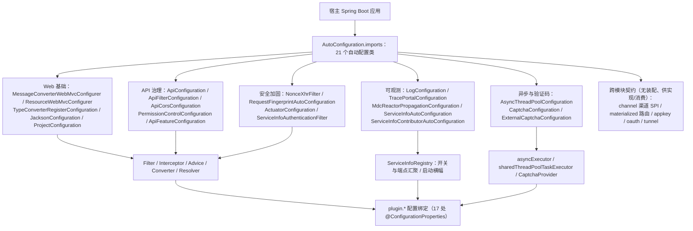

# spring-support-common-starter

Spring Boot 通用支撑 Starter：为宿主应用提供 Web 统一响应与全局异常、API 治理（版本 / 加解密 / 灰度 / 内部接口 / 弃用告警 / 功能开关 / 权限拦截）、安全加固（Nonce 防重放、请求指纹、Actuator 认证、安全响应头）、可观测（MDC 链路、参数日志、链路汇聚、`@Watch` 方法追踪、服务信息端点与横幅）、异步线程池、验证码、IP 归属地与 IP 质量、邮件通知等横切能力；同时下沉了一组**跨模块契约**：渠道能力 SPI（`channel` 包，`account ← ai` 不反向依赖的契约基础）、物化视图 SQL 路由、AppKey 认证、隧道配置存储、幂等模板等。基于 Spring Boot 4.1.2 基线，引入即自动装配，多数能力可通过 `plugin.*` 开关按需启停（个别能力恒生效，见「八、配置参考」）。

```xml
<dependency>
    <groupId>com.chua</groupId>
    <artifactId>spring-support-common-starter</artifactId>
    <version>4.0.0.51</version>
</dependency>
```

装配入口：`META-INF/spring/org.springframework.boot.autoconfigure.AutoConfiguration.imports` 登记 21 个自动配置类；`META-INF/spring.factories` 登记 3 个 `EnvironmentPostProcessor`（Freemarker / Spring / Profile 环境后处理）；`META-INF/extensions` 登记 4 个 SPI 扩展点；配置绑定由 17 处 `@ConfigurationProperties` 承担。源码分布在两个包根：`com.chua.starter.common.support`（主包：Web / API / 安全 / 日志 / 渠道契约等）与 `com.chua.common.starter.support`、`com.chua.common.support`、`com.chua.mysql.support`、`com.chua.sharding.v5`、`com.chua.spring.support`（次级根：IP 质量、对象结构、物化路由、binlog、分片、Spring 桥接），完整清单见文末「附录：包结构速览」。本模块依赖底层 `utils-support-common-starter`——它是**纯 Java 工具模块，不是 Spring starter**；`@Spi` / `ServiceProvider` SPI 设施与 JSON/XML 门面、HTTP 执行器、类型转换、表达式解析等底层契约均来自该模块，本模块只做 Spring 侧桥接与复用。

## 一、整体架构

模块按「装配层 → 组件层 → 契约/支撑层」组织：装配层由 21 个自动配置类按条件装配；组件层是注册进 Servlet 容器与 MVC 的过滤器、拦截器、Advice、转换器；契约/支撑层提供配置绑定、SPI、`ServiceInfoRegistry`、全局环境，以及供 account / ai 等业务模块实现或消费的渠道契约接口。其中 `ServiceInfoContributorAutoConfiguration` 在 `ContextRefreshedEvent` 时收集容器内所有 `ServiceInfoContributor`，统一写入 `ServiceInfoRegistry`。



## 二、核心流程

一次 HTTP 请求经过的组件链（`order` 越小越先执行）：

```mermaid
flowchart LR
    A["HTTP 请求"] --> B["MdcHandlerFilter<br/>MIN_VALUE · 注入 traceId"]
    B --> C["apiVersionFilter<br/>MIN_VALUE · 写 x-response-version"]
    C --> D["nonceXhrFilter<br/>MIN_VALUE+1 · Nonce 防重放"]
    D --> E["actuatorAuthenticationFilter<br/>MIN_VALUE+10 · 仅 /actuator/*"]
    E --> F["apiSecurityHeaderFilter<br/>MIN_VALUE+10 · 补安全响应头"]
    F --> G["corsFilter · 来源白名单放行"]
    G --> H["requestFingerprintFilter<br/>MIN_VALUE+20 · 指纹去重"]
    H --> P["parameterLogFilter<br/>MAX_VALUE-100 · 链尾记录"]
    P --> I["DispatcherServlet"]
    I --> J["PermissionControlInterceptor / ApiControlInterceptor"]
    J --> K["Controller 业务处理"]
    K --> L["ApiUniformResponseBodyAdvice 统一响应<br/>ApiRequestDecodeBodyAdvice / ApiResponseEncodeResponseBodyAdvice 加解密"]
```



## 三、能力清单

- **Web 基础**：统一响应（`ApiUniformResponseBodyAdvice`）、全局异常（`ApiExceptionAdvice`）、消息转换器扩展（二进制 / XML）、`RequestParamsMapMethodArgumentResolver` 参数解析器（配合 `@RequestParamMapping` 一参多名）、静态资源映射（`/static/**`、`/webjars/**`）与 URL 解码修正、`ModelView` 数据/视图双模返回值。
- **API 治理**：`@ApiVersion` 同路径多版本路由（经 `WebMvcRegistrations`）、`@ApiPlatform` / `@ApiProfile` / `@ApiDeprecated` / `@ApiInternal` / `@ApiMock` / `@ApiGray` / `@ApiFeature` 控制注解、请求 / 响应加解密、SPI 短名映射、`@Permission` 权限拦截。
- **安全加固**：XHR Nonce 防重放（签名 + 时间戳）、请求指纹去重（409 + `X-Blocked-Reason: DUPLICATE_REQUEST`）、Actuator Basic 认证 + IP 白名单、安全响应头（CSP / HSTS / X-Content-Type-Options 等）、`/service-info` 可选认证。
- **可观测**：MDC traceId 全链路传播（Servlet / RestTemplate / HttpClient / WebSocket / Reactor）、参数日志与慢请求告警、TracePortal 链路日志汇聚、`@Watch` 方法级链路追踪、`/service-info` 端点与启动横幅。
- **异步支撑**：`asyncExecutor`（@Async）与 `sharedThreadPoolTaskExecutor` 双执行器、`MdcTaskDecorator` / `MdcWrap` 跨线程 MDC 透传、Reactor 自动上下文传播。
- **业务支撑**：图形验证码（内置 5 种形态 + yescaptcha / captcha-run 外部打码）、IP 归属地（ip2region / ip2proxy）、IP 质量检测（代理 / VPN / Tor / 数据中心）、邮件通知、Jackson 定制、通用类型转换、Freemarker / Profile 环境后处理。
- **渠道契约**：`channel` 包 7 个 SPI 契约 + `ChannelHttp` / `ChannelException` / `MagpieSupport`，是 account 与 ai 渠道能力的共享契约层（见「四、渠道契约层」）。
- **数据与集成支撑**：物化视图 SQL 路由契约、MySQL binlog 客户端骨架、ShardingSphere 5.x 数据源构建器、单机幂等模板、对象树/图表结构、隧道配置存储与 SSE 推送（见「六、数据与集成支撑」）。

## 四、渠道契约层（channel 包）

**设计动机**：渠道实现方（account-starter）与消费方（ai-starter）分处两个业务模块，按模块铁律不得反向依赖。渠道能力的**最小契约**因此下沉到本模块：实现方通过 `@Spi` + 各自模块的 `META-INF/extensions/<接口全限定名>` 注册，消费方用 `ServiceProvider.of(契约.class).list() / getExtension(别名)` 发现（`@Spi` / `ServiceProvider` 由底层 `utils-support-common-starter` 提供，非 Spring 设施），双方互不感知。凭据一律是**不透明 Map**（`access_token` / `refresh_token` / `expires_at`…），由调用方持久化，契约不感知字段形态。

| 契约接口 | since | 职责 | 关键方法 |
| --- | --- | --- | --- |
| `AccountChannelAuthManager` | 4.0.0.43 | 账号类 AI 渠道（Cline / Qoder / Trae / Gemini…）的鉴权与生命周期管理器，每渠道一个实现 | `startLogin` / `pollLogin` / `refresh` / `status` / `checkin` / `listModels` / `toRouteTarget`；`loginMethod()` ∈ device-code / browser-device / browser-oauth / qr-code / sms / api-key / keyless |
| `ChannelUpstreamAdmin` | 4.0.0.51 | 网关型渠道（magpie）的上游 provider 管理：增删改查、插件、登录会话、额度卡 | `list` / `save` / `delete` / `action`（只读动作白名单 detect/models/test）、`plugins*` / `signin*` / `quotas`；`ownedChannels()` 是前端「网关分组」唯一真值 |
| `ChannelUpstreamProvider` | 4.0.0.53 | 网关内部**单个上游 provider** 的字段归一与余额补读（渠道级 SPI 之下的第二层，不再有第三层） | `modelMeta`（contextWindow/free/priceInput/priceOutput/rate，缺值不补 0）、`credit`（返回 null=不接管，实现永不抛异常） |
| `ChannelUpstreamCodec` | 4.0.0.53 | 网关 provider「线上形态」适配：列表下发形态 ↔ 写接口输入形态互转 + 凭据脱敏 | `desensitize` / `toUpstreamInput`（默认防御性复制） |
| `KeylessChatChannel` | 4.0.0.53 | 免登录**对话**渠道最小契约：只暴露路由所需四项事实，供 ai 并进免费渠道路由表 | `channel` / `extension` / `listModels`；无 baseUrl 概念（ChatClient 自持协议） |
| `KeylessMediaChannel` | 4.0.0.54 | 免登录**生成类**渠道（文生图 / 文生视频）平行契约 | `channel` / `tasks()`（image_generation / video_generation）/ `listModels` |
| `ChannelTaskProvider` | 4.0.0.52 | 渠道「成长任务」SPI（签到=每日动作；任务=带进度、达标后显式领取），实现永不抛异常 | `tasks` / `acceptTasks`（幂等报名）/ `claimTask` / `runTasks`（默认组合：报名+领取） |

配套约定：

- **异常契约** `ChannelException`：跨模块统一业务异常，错误码词表 `UNAUTHORIZED / FORBIDDEN / NOT_FOUND / INVALID_PARAM / NOT_IMPLEMENTED / UPSTREAM_ERROR / INTERNAL_ERROR`，`getHttpStatus()` 推导 401/403/404/400/501/502/500；消费方在自己的边界翻译成模块内异常，避免全部吞成 502。
- **HTTP 访问** `ChannelHttp`（`http` 包）：渠道实现共享的静态 HTTP 客户端（15s 连接超时），三档读超时常量 `DEFAULT_TIMEOUT=60s` / `POLL_TIMEOUT=30s`（登录轮询）/ `LONG_TIMEOUT=5min`（插件安装等长任务）；内建 429 退避（按 `Retry-After` 限 1~10s，重试 2 次，仍失败抛带 `渠道上游限流` 标记的异常）；`postJson / getJson / getBytes / getRaw / postForm`，非 2xx 抛 `ChannelHttpException`。
- **Magpie 归一化** `MagpieSupport`：magpie 统一网关的地址/凭据工具。数据面 `:3425 /v1/*`（网关 key）与管理面 `:3430 /api/*`（页面 Key，Cookie `magpie_web_<port>`）是两个不同地址，凭据分存 `base_url` 与 `page_url`；本机判定含网卡 IP，本机时优先现读配置目录的 `web-page.json` / `settings.json`。
- **实现分布**：`AccountChannelAuthManager` 的 16 个渠道实现与 5 个 `ChannelTaskProvider` 在 ai-starter；magpie 的 `UpstreamAdmin / UpstreamProvider / Codec`、免登录渠道实现与 `ApiChannelAuthController`（消费 AuthManager / TaskProvider）在 account-starter。本模块只定义契约，不依赖任何一方。

## 五、方法追踪与操作日志

### 5.1 `@Watch` 方法级链路追踪

- `@Watch`（类/方法级）：`value` 追踪描述、`timeoutMs` 超时阈值（超过打 WARN，0 不限）、`logArgs` / `logResult` 是否记录出入参（默认 false，防敏感泄露）。
- 切面 `WatchPointcutAdvisor`（`CommonConfiguration` 兜底装配）：进入时若为链路入口则生成 UUID linkId 写入 `TrackContext`，经 `NewTrackManager`（ThreadLocal Span 栈）压栈；栈空 → 根 Span（id=linkId），栈非空 → 子 Span（pid=栈顶 id）。结束时刷新纳秒级耗时、填充方法/堆栈/调用者，最外层结束清空 Span 栈与 `TrackContext`（防线程池复用泄漏）。
- `Span`：链路节点数据模型（linkId/id/pid、enterTime/endTime/costTime、method/args/ex、children/parents），主要供 agent/采集端消费；`WatchPointcutAdvisor.build(stack)` 可整理成树形列表上报。
- **与 MDC 的关系**：MDC traceId 由 `MdcHandlerFilter` 在 HTTP 边界管理；Span linkId 由 `TrackContext` 在方法边界管理——两条独立线，仅在 `@Watch` 切面入口用同一个 UUID 关联。

### 5.2 操作日志注解（契约在本模块，切面在下层模块）

- `@SysLog`（系统操作审计）：`module` / `name`（空则回读 Swagger）、`content`（SpEL 模板，支持 `{用户名}` / `{$参数}` / `{$方法}` / `{$结果}`）、`enable` / `logArgs` / `logResultData`。切面 `SysLoggerPointcutAdvisor` 在 **mybatis-starter**。
- `@UserLog`（用户行为追踪）：额外带 `action` 枚举与 `loginType`（密码 / sms / OAuth…）。切面 `UserLoggerPointcutAdvisor` 在 **oauth-client-starter**。
- 两者共用抽象基类 `AbstractLoggerPointcutAdvisor`：耗时统计、SpEL 模板解析（带缓存）、Swagger 取名、按方法名推断模块、参数 JSON 化（过滤 Servlet/Spring/JDK 类型）、用户身份解析（优先网关头，单体回退 oauth-client 反射，全链路静默降级），构建 `SysLoggerInfo` / `UserLoggerInfo` / `InterfaceLoggerInfo` 事件发布，由各业务模块的监听器消费落库。
- `@LoggerIgnore`：方法级跳过日志切面。`ModuleLog`：模块日志工具，统一 `[模块名]` 前缀 + ANSI 染色。

### 5.3 Console 树形日志（watchlog SPI）

把一次业务操作的多行日志按调用层级整合成一棵树、最后一次性输出：`Console.section(line)` 追加一行并返回下一级对象（链式下钻），`info/warn/error/debug` 带等级，`end()` 退回上一层，`print()` 输出整份。默认实现 `DefaultConsole`（`@SpiDefault`），经 `Consoles.create(name)` 走 SPI 加载、未命中回落默认；`ConsoleConfig` 控制缩进连接符、ANSI 染色、MDC 头、耗时尾注、等级阈值（不可变对象，setter 返回新实例）。

## 六、数据与集成支撑

| 能力 | 类 | 说明 |
| --- | --- | --- |
| 物化视图 SQL 路由契约 | `common.support.data.materialized.*` | `MaterializedSqlRouter` / `MaterializedSqlDataSourceRouter` 定义「把 SELECT 路由到物化库、写成功后回调刷新」的契约；`MaterializedSqlRequest`（statementId/sql/commandType/tables/parameters）→ `MaterializedSqlRoute`（dataSourceName，`notRouted()` 走源库）。实现在 datasource-starter（Calcite），消费在 mybatis-starter 的 `MaterializedSqlInterceptor`，本模块只持契约 |
| MySQL binlog 客户端骨架 | `mysql.support.binlog.BinaryLogClient` | API 形状仿 mysql-binlog-connector-java（connect/disconnect/registerEventListener + Write/UpdateRows/TableMap 事件模型），但**不依赖任何 binlog 库、方法均为空实现**；仓库内真正可用的 CDC 在 `utils-support-datalake-cdc-starter`（zendesk mysql-binlog-connector 0.25.6） |
| ShardingSphere 构建器骨架 | `sharding.v5.support.builder.ShardingDataSourceBuilder` | 链式 API：`newBuilder().dataSources(...).shardingDatabase(...).shardingTable(逻辑表).shardingColumn(...).shardByYear/Quarter/Month/Week/Day/Hour().done().showSql(bool).build()`；类路径无 ShardingSphere 时不生效（`build()` 返回 null 的兼容占位） |
| 单机幂等模板 | `starter.strategy.template.IdempotentTemplate` | 内存版幂等锁：`tryAcquire(key, timeout, unit)` 抢占（过期可重占、null key 放行）、`release` / `complete` 释放；`ConcurrentHashMap` + 守护线程每 60s 清理过期 key。**仅单机**，分布式场景请用 Redis 实现。典型 key：`payment:idempotent:wallet:{bizType}:{merchantId}:{userId}:{bizNo}` |
| 对象树与图表结构 | `common.starter.support.objects.struct.*` | `ObjectStruct.toTree(list)` 把扁平对象按 id/parentId 组装成 `TreeNode` 树；`toBarChartData / toRadarChartData / toRelationData / toTreemapData` 产出 ECharts 风格图表数据；提取器由 `TreeStructConfig`（id/parentId/name/value 四函数）定义 |
| 数据/视图双模返回值 | `ModelView` + `ResponseModelViewMethodProcessor` | Controller 返回 `ModelView<T>(data, mediaType)`：mediaType 不含 text/html 时按消息转换器写 JSON；含 text/html 且 data 是 CharSequence 时当视图名（支持 `redirect:` 前缀）。已注册为 MVC 返回值处理器 |
| 自定义注解注入基类 | `AnnotationInjectedBeanPostProcessor<A>` | 仿 `AutowiredAnnotationBeanPostProcessor`：按自定义注解扫描字段/Setter 构建注入元数据（并发缓存），注入对象由子类 `doGetInjectedBean` 提供并按 key 缓存，`destroy()` 联动销毁。各 starter 借此实现「注解即引用」 |
| Spring 桥接 | `spring.support.*` | `SpringServiceAutowire`：给**非 Spring 创建的 SPI 实例**补字段注入（SPI 实例也能注入 Mapper/Service）、`createBean` 交容器创建；`PluginBeanRegisteredEvent` / `PluginBeanUnregisteredEvent`：插件 Bean 注册/卸载时发布，监听方可做后续处理 |
| 隧道配置支撑 | `tunnel.*` | `TunnelRecord`（ngrok/cloudflared 能力并集的落盘模型）+ `TunnelFileStore`（一条映射一个 JSON、临时文件+原子替换、SAFE_ID 防目录穿越、全方法 synchronized、坏文件跳过）+ `TunnelView`（叠加 running/publicUrls/error 等内存运行态）+ `TunnelStatusStream`（守护线程定时取快照，以事件名 `tunnels` SSE 广播，页面免轮询） |
| IP 质量检测 | `common.starter.support.network.quality.*` | 策略接口 `IpQualityDetector`（非 SPI）+ 结果模型 `IpQuality`（proxy/vpn/tor/dataCenter/riskScore 0-100，`isRisky()` 判定）；离线实现 `IP2ProxyLiteIpQualityDetector`（classpath `IP2PROXY-LITE-PX2.BIN`，BIN 缺失降级为不可用、绝不抛异常），在线实现 `ToDetectIpQualityDetector`（todetect.cn）；HTTP 模板基类统一 OkHttp+Jackson、失败降级返回空结果；`IpQualityProbe` 提供命令行探针 |
| HTTP 执行器适配 | `WebClientHttpClientExecutor` | `@Spi("webclient")` 实现底层 `HttpClientExecutor`（接口在 `utils-support-common-starter`），用 Spring WebClient（10MB 内存上限）执行 `ClientRequest`；classpath 无 WebClient 时自动不可用 |
| UA 解析 | `network.UserAgent` | UA 串 → 浏览器/操作系统枚举，`isCrawler()` 按 bot/spider/python 等关键字判爬虫 |
| JSON / XML 门面 | `text.json.Json` / `xml.Xml` | 统一 JSON/XML 出入口，全部委托底层 `utils-support-common-starter` 实现；**其他 spring-\* 模块必须经本类复用，禁止重复实现** |
| 请求体可重复读 | `filter.CustomHttpServletRequestWrapper` | 构造时缓存请求体 byte[]，覆盖 getInputStream/getReader 支持多次读取（日志、指纹、验签场景前置） |

## 七、Bean 装配矩阵

| Bean | 所属配置类 | 装配条件 | 说明 |
| --- | --- | --- | --- |
| mdcHandlerFilter | MessageConverterWebMvcConfigurer | 恒定 | traceId 注入，order=MIN_VALUE |
| uniformResponseBodyAdvice | ApiConfiguration | `plugin.api.uniform`（缺省开） | 统一响应封装 |
| apiExceptionAdvice | ApiConfiguration | 恒定 | 全局异常 → 统一响应 |
| apiResponseEncodeResponseBodyAdvice / apiResponseEncodeRegister | ApiConfiguration | `plugin.api.encode.enable`≠false | 响应加密；显式 false 时不装配 |
| apiRequestDecodeBodyAdvice / apiRequestDecodeRegister | ApiConfiguration | `plugin.api.decode.enable`≠false | 请求解密；显式 false 时不装配 |
| webMvcRegistrations | ApiConfiguration | `plugin.api.version.enable`（缺省开） | `@ApiVersion` 多版本路由映射 |
| executor（名 `uniform`） | ApiConfiguration | 恒定 | 虚拟线程执行器 + MDC 包装 |
| apiVersionFilterRegistration | ApiFilterConfiguration | 恒定 | 写 `x-response-version`，order=MIN_VALUE |
| nonceXhrFilterRegistration | ApiFilterConfiguration | 恒定 | Nonce 防重放，order=MIN_VALUE+1 |
| apiCorsFilterRegistrationBean | ApiCorsConfiguration | `plugin.api.cors.enable`（`matchIfMissing=true`，缺省即装配） | CorsFilter，来源白名单放行（白名单为空则不放行任何跨域来源） |
| apiSecurityHeaderFilterRegistrationBean | ApiCorsConfiguration | 同上（安全头恒写入，`plugin.api.security.header.enable` 当前不参与判断） | 安全响应头，order=MIN_VALUE+10 |
| permissionControlInterceptor | PermissionControlConfiguration | `plugin.api.permission.enable`（缺省开） | `/**` 权限拦截，排除 `/error`、`/actuator/**` |
| defaultAuthService / authService | CommonConfiguration | 无 `AuthService` / 无 `IptablesService` 时兜底（`@ConditionalOnMissingBean`） | 鉴权实现 |
| nonceSignInitializer / restTemplate / watchPointcutAdvisor | CommonConfiguration | 恒定 | Nonce 初始化、带 traceId 的 RestTemplate、`@Watch` 切面 |
| asyncExecutor / sharedThreadPoolTaskExecutor / taskDecorator | AsyncThreadPoolConfiguration | `plugin.async.enable`（缺省开） | 双执行器 + MdcTaskDecorator |
| defaultObjectMapper / objectMapperBuilder | JacksonConfiguration | `@ConditionalOnMissingBean` | 恒装配；`include-null` 决定 ALWAYS / NON_NULL |
| captchaProvider | CaptchaConfiguration | `plugin.captcha.enable=true`（端点 `matchIfMissing=false`，需显式） | `/v1/captcha/**` 图形验证码 |
| yesCaptchaParser / captchaRunParser | ExternalCaptchaConfiguration | `plugin.captcha.external.enable=true` 且 classpath 有 CaptchaParser | 外部打码客户端 |
| parameterLogFilterRegistration | LogConfiguration | `plugin.log.enable=true`（需显式） | 出入参日志，order=MAX_VALUE-100 |
| tracePortalAppender | TracePortalConfiguration | `plugin.log.portal.enabled=true` | 挂载 logback root 的链路汇聚 |
| requestFingerprintFilter | RequestFingerprintAutoConfiguration | 恒定（运行时按 `enabled` 短路） | 指纹去重，order=MIN_VALUE+20 |
| actuatorAuthenticationFilterRegistration | ActuatorConfiguration | `plugin.actuator.enable-auth=true` | `/actuator/*` Basic 认证，order=MIN_VALUE+10 |
| serviceInfoController / serviceInfoEndpointDetector / serviceInfoBannerListener | ServiceInfoAutoConfiguration | `plugin.service-info.enable`（缺省开） | `/service-info` 端点、端点探测、启动横幅 |
| serviceInfoAuthenticationFilterRegistration | ServiceInfoAutoConfiguration | `plugin.service-info.auth.enable=true` | `/service-info` 认证过滤器 |
| apiServiceInfoContributor / logServiceInfoContributor 等 | 各配置类 | 恒定 | 向 ServiceInfoRegistry 上报各模块开关 |

## 八、配置参考

所有前缀均为 `plugin.*`。带 `*` 的项：属性字段默认值与实际装配开关不一致，以「说明」列为准。

| 配置项 | 默认值 | 说明 |
| --- | --- | --- |
| `plugin.api.uniform` | `true` | 统一响应封装 |
| `plugin.api.version.enable` | `true` | `@ApiVersion` 版本路由与版本响应头 |
| `plugin.api.platform.enable` / `platform.name` | `true` / `SYSTEM` | `@ApiPlatform` 平台标识 |
| `plugin.api.permission.enable` | `true` | `@Permission` 拦截器 |
| `plugin.api.internal.enable` | `true` | `@ApiInternal` 内部接口 |
| `plugin.api.deprecated.enable` / `add-warning-header` | `true` / `true` | 弃用告警与响应头 |
| `plugin.api.gray.enable` / `header-name` / `default-percentage` | `true` / `X-Gray-Hit` / `0` | 灰度发布 |
| `plugin.api.feature.enable` / `feature.path` | `false` / `/api/features` | 功能开关目录端点 |
| `plugin.api.spi.enable` | `true` | SPI 短名映射 |
| `plugin.api.mock.enable` / `profiles` | `false` / `dev,test` | Mock 模式与生效环境 |
| `plugin.api.encode.enable` / `codec-type` / `white-list` | `false` / `aes` / `[]` | 响应加密 |
| `plugin.api.decode.enable` / `reject-on-decode-failure` | `false` / `false` | 请求解密与失败拒绝 |
| `plugin.api.cors.enable` | `false` | 跨域与安全响应头总开关（`ApiCorsConfiguration` 为 `matchIfMissing=true`，未配置也会装配，但来源白名单为空时不放行任何跨域） |
| `plugin.api.cors.allowed-origins` / `pattern` | `[]` / `[]` | 来源白名单（空=不放行）/ 路径匹配（空=`/**`） |
| `plugin.api.cors.allow-credentials` | `false` | 携带凭证（必须配好来源白名单） |
| `plugin.api.security.header.enable` | `true` | 安全头开关字段（须 `cors.enable=true` 才装配过滤器；字段值当前不参与运行时判断，安全头随过滤器恒写入） |
| `plugin.api.security.header.frame-options` / `referrer-policy` / `permissions-policy` | `SAMEORIGIN` / `strict-origin-when-cross-origin` / `camera=(), microphone=(), geolocation=()` | 安全头取值（SAMEORIGIN 因文件预览依赖 iframe，不用 DENY） |
| `plugin.api.security.header.csp` / `hsts-enabled` / `hsts-max-age-seconds` | 空 / `false` / `31536000` | CSP 默认不输出（内联样式站点需评估后开启）；HSTS 默认关闭（http 部署开启会让浏览器强制升级 https） |
| `plugin.async.enable` | `true` | 装配异步双执行器 |
| `plugin.thread.enable`* | `false` | 线程池属性字段开关：仅影响 `/service-info` 展示与全局环境登记，不控制装配（装配开关是 `plugin.async.enable`） |
| `plugin.thread.core-pool-size` / `max-pool-size` / `queue-capacity` | `20` / `200` / `100000` | 线程池参数 |
| `plugin.log.enable`* | `true` | ParameterLogFilter 装配为 `matchIfMissing=false`，需显式 `true` |
| `plugin.log.open-interface-log` / `slow-request-threshold-ms` | `false` / `3000` | 接口日志 / 慢请求告警阈值 |
| `plugin.log.portal.enabled` | `false` | 链路日志汇聚总开关 |
| `plugin.log.portal.file` | `./logs/trace-portal.log` | 汇聚输出文件 |
| `plugin.log.portal.max-events-per-trace` / `idle-millis` / `max-pending-traces` | `200` / `3000` / `512` | 汇聚缓冲策略 |
| `plugin.jackson.include-null` | `false` | 输出 null 字段（无装配开关，恒生效） |
| `plugin.captcha.enable`* | `true` | 图形验证码：`GET /v1/captcha.jpg`（图片）、`GET /v1/captcha`（Base64）；前缀可用 `plugin.captcha.context-path` 改（缺省 `/v1/`）。字段默认 `true`，但端点装配为 `matchIfMissing=false`，需显式 `true` 才暴露 |
| `plugin.captcha.type` / `ttl` / `length` / `width` | `SPEC` / `120` / `4` / `120` | 验证码形态 / 缓存秒数 / 长度 / 宽度 |
| `plugin.captcha.external.enable` / `provider` / `api-token` | `false` / `yescaptcha` / 无 | 外部打码（`captcha-run` 可选；需 classpath 有 CaptchaParser） |
| `plugin.actuator.enable`* | `true` | Actuator 加固配置类总开关（字段默认 `false`，装配条件 `matchIfMissing=true`） |
| `plugin.actuator.enable-auth` | `false` | `/actuator/*` Basic 认证 |
| `plugin.actuator.username` / `password` | 空 / 空 | 认证凭据 |
| `plugin.actuator.ip-whitelist` / `exclude-paths` | `[]` / `[]` | IP 白名单（支持 CIDR）/ 排除路径 |
| `plugin.security.fingerprint.enabled` | `false` | 请求指纹（过滤器恒注册，关闭时直通） |
| `plugin.security.fingerprint.reject-duplicate` | `false` | 重复请求返回 409 |
| `plugin.security.fingerprint.validity-ms` | `60000` | 指纹缓存有效期 |
| `plugin.security.fingerprint.algorithm` / `salt` | `SHA-256` / 无 | 哈希算法（支持 sha256 / sha1 / md5 / murmur3_32 / murmur3_128，无法识别时回退 murmur3_128）与盐 |
| `plugin.security.fingerprint.include-body` 等 | 见 `FingerprintProps` | 方法 / 路径 / 参数 / 头 / 请求体是否参与指纹 |
| `plugin.nonce.sign.secret-key` | 内置默认值 | 回退环境变量 `PLUGIN_NONCE_SIGN_SECRET_KEY`、前缀 `nonce.sign` |
| `plugin.service-info.enable` / `banner` | `true` / `true` | `/service-info` 端点与启动横幅 |
| `plugin.service-info.auth.enable` / `auth.username` / `auth.password` | `false` / `admin` / 空 | 端点认证 |
| `plugin.service-info.infrastructure` | `true` | 横幅展示 Redis/JDBC/Kafka 等已配置的连接信息 |
| `plugin.ip.enable` / `database-file` / `ip-type` | `false` / `classpath:qqwry.dat` / `ip2region` | IP 归属地 |
| `plugin.notice.enable` / `email.smtp-host` / `email.from` | `false` / `smtp.qq.com` / 无 | 邮件通知 |
| `plugin.optional.enable`* | `true` | `/v1/option` 端点装配为 `matchIfMissing=false`，需显式 `true` |
| `plugin.message.enable` / `data-format` | `false` / `yyyy-MM-dd HH:mm:ss` | 消息转换增强（配置类恒装配；`enable` 仅用于 `/service-info` 展示）/ 日期格式 |
| `plugin.message.open-desensitize` / `open-crypto` | `true` / `true` | 脱敏 / 加解密 |

> 渠道契约（`channel` 包）、物化路由、binlog、Sharding、幂等模板、隧道支撑、IP 质量等能力**没有装配开关**：契约接口不参与自动装配，策略类由使用方直接实例化或经 SPI 发现。

## 九、使用方式

1. 引入依赖（坐标见文首），Spring Boot 自动完成 21 个配置类装配，无需任何 `@Enable*`。
2. 按需在 `application.yml` 调整 `plugin.*` 开关，未配置的项使用缺省值：

```yaml
plugin:
  api:
    uniform: true              # 统一响应
    encode:
      enable: true             # 响应加密（AES）
    gray:
      enable: true             # 灰度发布
  log:
    enable: true               # 参数日志过滤器（需显式开启）
    portal:
      enabled: true            # 链路日志汇聚
  captcha:
    enable: true               # 图形验证码
  actuator:
    enable-auth: true          # Actuator Basic 认证
    username: admin
    password: admin123
    ip-whitelist: [ "127.0.0.1", "192.168.1.0/24" ]
  security:
    fingerprint:
      enabled: true            # 请求指纹
      reject-duplicate: true
  service-info:
    enable: true               # /service-info 与启动横幅
```

3. 业务代码直接使用装配好的 Bean（`RestTemplate`、名为 `uniform` 的 `ExecutorService`、`ObjectMapper` 等），或在接口上使用 `@ApiVersion` / `@Permission` / `@ApiGray` / `@Watch` / `@SysLog` 等注解声明式接入。
4. 契约与策略类按需直接使用：

```java
// 渠道契约：消费方按 SPI 发现实现（实现注册在 account / ai 模块）
List<AccountChannelAuthManager> managers =
        ServiceProvider.of(AccountChannelAuthManager.class).collectDistinct();

// 方法追踪
@Watch(value = "下单主流程", timeoutMs = 3000)
public OrderResult createOrder(...) { ... }

// 单机幂等
if (!IdempotentTemplate.tryAcquire(key, 10, TimeUnit.MINUTES)) {
    throw new BusinessException("重复请求");
}
```

5. 关闭能力：将对应 `enable` 置为 `false`。标注「需显式」的开关（`plugin.log.enable`、`plugin.captcha.enable`、`plugin.optional.enable`、`plugin.security.fingerprint.enabled`、`plugin.actuator.enable-auth`）不配置即不生效。

## 十、使用场景

- **新服务快速起步**：引入即获得统一响应、全局异常、参数日志、启动横幅，无需重复搭建 Web 基础设施。
- **接口治理**：多版本共存（`@ApiVersion`）、灰度放量（`@ApiGray`）、内部接口保护、弃用接口告警、功能开关目录。
- **前后端联调安全**：响应加密 + 请求解密、Nonce 防重放、请求指纹去重，配套 `x-ec` / `x-ck` / `x-ot` 加密协商头。
- **运维加固与巡检**：Actuator 认证与 IP 白名单、`/service-info` 一览各模块开关与端点、TracePortal 汇聚链路日志排障。
- **异步与高并发**：双线程池 + MDC 透传，虚拟线程执行器处理轻量异步任务，Reactor 链路自动传播 traceId。
- **渠道生态扩展**：新增账号类 AI 渠道实现 `AccountChannelAuthManager`，新增免登录生成渠道实现 `KeylessMediaChannel`，网关型渠道实现 `ChannelUpstreamAdmin` 系——account / ai 侧自动经 SPI 发现，无需改消费方代码。
- **方法级性能排查**：`@Watch` 标注可疑方法，配合 `timeoutMs` 告警定位慢点；`Console` 把一次操作的多行日志按层级整合输出。

## 十一、扩展点

`META-INF/extensions` 登记 4 个 SPI，均可按同名替换默认实现：

| SPI 接口 | 默认实现 | 用途 |
| --- | --- | --- |
| `MediaTypeHandler` | `XmlMediaTypeHandler` | 媒体类型处理（另有 `JsonMediaTypeHandler` / `CsvMediaTypeHandler` 按扩展名取用） |
| `Formatter` | `DateFormatter` / `NoneFormatter`（`@SpiDefault` 兜底） | 媒体内容按字段类型格式化 |
| `ExpressionParser` | `SpelExpressionParser` | 表达式解析（SPI 接口在 `utils-support-common-starter` 的 `lang.ast` 包） |
| `Console` | `DefaultConsole` | watch 日志控制台输出 |

> 注意：新增 `@Spi` 扩展实现且未标 `@AutoSpi` 时，必须手工在 `src/main/resources/META-INF/extensions/<SPI 接口全限定名>` 追加实现类全限定名，否则编译绿但启动时静默不注册。

渠道契约 SPI（`AccountChannelAuthManager` / `ChannelUpstreamAdmin` / `ChannelUpstreamProvider` / `ChannelUpstreamCodec` / `KeylessChatChannel` / `KeylessMediaChannel` / `ChannelTaskProvider`）的 extensions 文件登记在实现方模块（account / ai），本模块只定义接口；`CaptchaGenerator` 提供 5 种内置形态（arithmetic / chinese / chinese_gif / gif / spec），按 `plugin.captcha.type` 选择。

其他扩展方式：

- **`ServiceInfoContributor`**：注册 Bean 即可把自定义开关 / 端点信息上报到 `/service-info` 与启动横幅。
- **`CaptchaParser`**（`com.chua.captcha.support`）：classpath 提供实现并开启 `plugin.captcha.external.enable`，即可接入自定义打码服务。
- **`AuthService`**：替换 `defaultAuthService` 即可接入宿主自己的鉴权体系，`@Permission` 拦截器自动使用；`CurrentUser` 提供 `hasPermission` / `hasRole`（支持 `*` 通配）、`isAdmin`、数据权限判断。
- **`AppKeyAuthenticator`**：AI 模块 appKey 台账的认证契约（`authenticate(appKey, ip)` 返回归属用户名），oauth-client 回退认证只依赖本契约，禁止跨模块直查 `sys_ai_app_key` 表。
- **`TypeConverter`**（接口在 `utils-support-common-starter`）：通过底层 SPI 注册自定义转换器，`TypeConverterRegisterConfiguration` 自动桥接进 Spring `ConversionService`。
- **`IpQualityDetector`**：策略接口（非 SPI），可直接实现 `detect(ip)` 接入自有风控源；HTTP 类检测继承 `AbstractHttpIpQualityDetector` 只需实现 `buildUrl` / `parseResult`。

## 十二、常见问题

**Q：为什么没配 `plugin.log.enable` 时参数日志不打印？**
ParameterLogFilter 的装配条件是 `matchIfMissing=false`，不显式配置 `true` 就不会注册；`LogProperties` 字段默认值 `true` 只影响横幅展示。

**Q：`/v1/option` 返回 404？**
`plugin.optional.enable` 需显式置为 `true`，`OptionalProvider` 才会装配（`matchIfMissing=false`）。

**Q：`/v1/captcha` 返回 404？**
同理：`CaptchaProvider` 端点的装配条件是 `matchIfMissing=false`，需显式配置 `plugin.captcha.enable=true`；`CaptchaProperties` 字段默认值 `true` 不会让端点自动注册。

**Q：接口返回没有被加密？**
`plugin.api.encode.enable` 默认 `false`；开启后命中白名单的路径不加密，前端需读取 `x-ec` / `x-ck` / `x-ot` 响应头完成解密。

**Q：重复提交被 409 拒绝？**
开启了 `plugin.security.fingerprint.enabled` 且 `reject-duplicate=true`；指纹在 `validity-ms` 内再次命中即返回 409 与 `X-Blocked-Reason: DUPLICATE_REQUEST`，按需调整有效期或关闭。

**Q：Nonce 校验返回 400？**
仅当请求携带 `x-nonce` 等签名头时才校验；确认前端使用与 `plugin.nonce.sign.secret-key` 一致的密钥，或通过环境变量 `PLUGIN_NONCE_SIGN_SECRET_KEY` 注入。

**Q：跨域请求 403？**
`plugin.api.cors.enable=true` 时 `allowed-origins` 为空则不放行任何跨域来源；把前端域名加入白名单（支持端口通配），不要使用 `*` 与 `allow-credentials=true` 组合。

**Q：如何查看当前生效了哪些开关？**
访问 `GET /service-info`（公网环境请开启 `plugin.service-info.auth.enable=true`），或查看应用启动横幅。

**Q：`@Watch` 的链路和日志里的 traceId 是一回事吗？**
不是。traceId 由 `MdcHandlerFilter` 在 HTTP 边界写入 MDC；`@Watch` 的 linkId 由 `TrackContext` 在方法边界管理。两者仅在 `@Watch` 切面入口用同一个 UUID 关联，跨线程传播也各走各的（MDC 走 `MdcWrap`/`MdcTaskDecorator`，Span 栈是 ThreadLocal、最外层结束即清空）。

**Q：binlog / ShardingSphere 相关类为什么是空实现？**
`BinaryLogClient` 与 `ShardingDataSourceBuilder` 是「API 骨架 + 安全降级」：接口与链式 API 完整，但本模块不引入对应重依赖。binlog 的可用实现在 `utils-support-datalake-cdc-starter`（zendesk mysql-binlog-connector）；Sharding 需宿主类路径带 ShardingSphere 5.x。直接调用骨架方法会得到 no-op / null，属预期行为。

**Q：如何新增一个渠道实现？**
实现对应契约接口（如 `AccountChannelAuthManager`），类上标 `@Spi("渠道id")`，并在**实现方模块**的 `META-INF/extensions/com.chua.starter.common.support.channel.AccountChannelAuthManager` 追加实现类全限定名；非 Spring 创建的 SPI 实例需要注入时依赖 `SpringServiceAutowire` 补装。上游请求统一走 `ChannelHttp`，失败抛 `ChannelException` 系异常。

## 附录：包结构速览

| 包 | 内容 |
| --- | --- |
| `...support.api.*` | API 治理：版本 / 平台 / 环境 / 弃用 / 内部 / Mock / 灰度 / 功能开关注解与拦截、CORS 与安全头、请求解密 / 响应加密、统一响应与异常、`@Permission` MVC 拦截 |
| `...support.actuator` | `/actuator/*` Basic 认证过滤器与配置 |
| `...support.annotations` | `@SysLog` / `@UserLog` / `@Crypto` / `@Permission` / `@RequestParamMapping` 注解契约 |
| `...support.appkey` | `AppKeyAuthenticator` appKey 认证契约 |
| `...support.channel` | 渠道契约 SPI 群 + `ChannelException` + `MagpieSupport`（见第四节） |
| `...support.codec` | `Codec.build(type, key)` 底层加解密器兼容包装 |
| `...support.configuration` | 自动配置类群：消息转换器、静态资源、异步线程池、类型转换、验证码、项目信息、全局环境、请求指纹；`environment.*` 三个 EnvironmentPostProcessor；`resolver.*` 参数解析器 |
| `...support.converter` | `BinaryHttpMessageConverter`、`ResultDataHttpMessageConverter`（fastjson 兼容）、String→日期/时间/Long/数组等类型转换器 |
| `...support.crypto` / `...algorithm.crypto` | 字段加密序列化器（配合 `@Crypto`） |
| `...support.exception` | `BusinessException`（携带 ResultCode，供全局异常处理转统一响应） |
| `...support.expression` | `SpelExpressionParser`（语法校验）/ `SpringSpelExpressionParser`（`#{}` 模板求值），实现底层 `ExpressionParser` SPI（接口在 `utils-support-common-starter`） |
| `...support.filter` | 请求体可重复读包装器 |
| `...support.function` | `Joiner`（Guava 风格拼接）、`Upgrade<T>`（配置升级回调） |
| `...support.http` | `ChannelHttp` / `ChannelHttpException` / `ContentDisposition` / `ContentType` |
| `...support.jackson` | ObjectMapper 定制（null 序列化、时间反序列化、问题处理器、`ArrayToJsonString` 等收口） |
| `...support.lang` | `NamingCase`、`ReturnPageResult` 分页响应 |
| `...support.log` | MDC 过滤器 / 任务装饰器 / Reactor 传播 / WebSocket 装饰、RestTemplate 与 HttpClient traceId 拦截器、ParameterLogFilter、TracePortal 汇聚、`%pid` 占位符 |
| `...support.logger` | 日志事件模型（Sys/User/Interface）、`AbstractLoggerPointcutAdvisor` 抽象、`@LoggerIgnore`、`ModuleLog` |
| `...support.media` | `MediaTypeHandler`（xml/json/csv）与 `Formatter`（date/none）SPI |
| `...support.model` / `...processor` | `ModelView` 双模返回值、`ResponseModelViewMethodProcessor`、`AnnotationInjectedBeanPostProcessor` |
| `...support.network` | `UserAgent` 解析；`com.chua.common.starter.support.network.quality`为 IP 质量检测，`network.client` 为 WebClient 执行器 SPI 适配 |
| `...support.oauth` | `AuthService` / `CurrentUser` 当前用户契约与权限判断 |
| `...support.provider` | `CaptchaProvider` REST 端点 + 5 种 `CaptchaGenerator`、`OptionalProvider`（`/v1/option` SPI 选项目录） |
| `...support.properties` | `AsyncThreadPoolProperties` / `CaptchaProperties` / `IpProperties` / `MessageConverterProperties` / `NonceSignProperties` / `NoticeProperties` / `OptionalProperties` |
| `...support.protocol` | 协议层占位 `ServletRequest` / `ServletResponse` |
| `...support.serialize` / `deserialize` | JSON 数组 ↔ 字符串/Long 的 Jackson 双向适配 |
| `...support.service` | `MailService`（文本/HTML/附件/告警通知，`@ConditionalOnBean(JavaMailSender)`）、`IptablesService`（IP→归属地，Redis 600s 缓存） |
| `...support.serviceinfo` | `/service-info` 端点、启动横幅、端点探测、认证过滤器、`ServiceInfoRegistry` |
| `...support.text` / `xml` | `Json` / `Xml` 统一门面 |
| `...support.trace` | `TrackContext`（方法级链路 ThreadLocal） |
| `...support.tunnel` | 隧道配置存储四件套（见第六节） |
| `...support.utils` | `IpUtils`（真实 IP/CIDR）、`CookieUtil`、`NonceUtils`（签名+防重放）、`RequestUtils` / `ResponseUtils`、`MultipartFileUtils`、`JakartaValidationUtils`、`LocaleUtils`（i18n）、`SpringCompatUtils`、`BeanDefinitionUtils` / `BeanDefinitionRegistryUtils` |
| `...support.watch` | `@Watch` + `WatchPointcutAdvisor` + `Span` / `NewTrackManager` |
| `...support.watchlog.console` | `Console` 树形日志 SPI |
| `...strategy.template` | `IdempotentTemplate` 单机幂等锁 |
| `com.chua.common.support.data.materialized` | 物化视图 SQL 路由契约 |
| `com.chua.common.support.objects` | `ConfigureObjectContext` 可配置对象上下文扩展 |
| `com.chua.common.support.spi` | `SpiOption` SPI 选项元信息契约 |
| `com.chua.common.starter.support.objects.struct` | 对象树 / 图表数据结构 |
| `com.chua.mysql.support.binlog` | MySQL binlog 客户端骨架 |
| `com.chua.sharding.v5` | ShardingSphere 数据源构建器骨架 |
| `com.chua.spring.support` | `SpringServiceAutowire`、插件 Bean 注册/卸载事件 |
