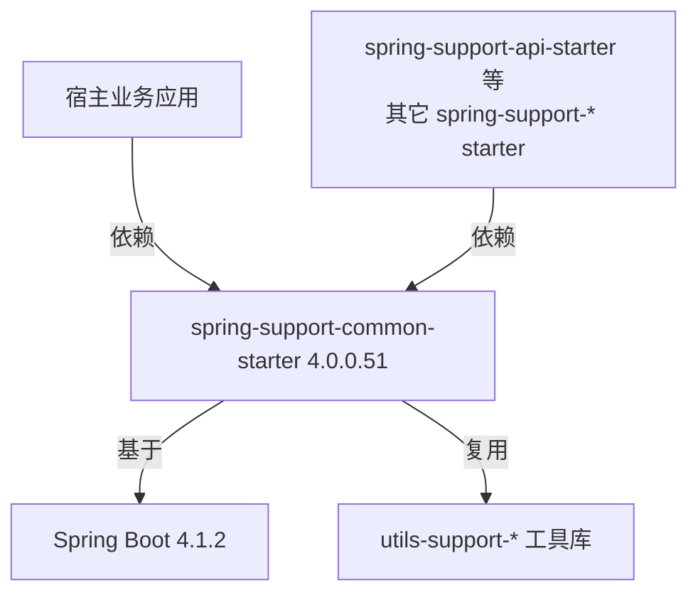
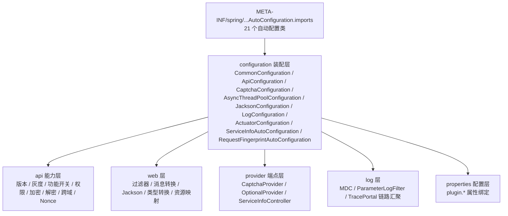

# spring-support-common-starter

> 版本：`4.0.0.51` ｜ 基于 Spring Boot `4.1.2` ｜ 本模块是 `spring-support-*` 体系的公共底座。

`spring-support-common-starter` 提供一套开箱即用的 Web 横切能力：统一响应体与请求/响应加解密、API 版本与灰度、功能开关、权限拦截、异步线程池、MDC 与链路日志、验证码、service-info 自描述端点、Actuator 加固、请求指纹防重、跨域与安全响应头等。宿主应用只需引入依赖，即可通过 `plugin.*` 配置项按需开关各项能力。

---

## 1. 模块定位

### 1.1 在体系中的位置

本模块位于整个 starter 体系的最底层公共支撑位置：上层的 `spring-support-api-starter`、业务 starter 与宿主应用都可以依赖它，从而获得统一的 Web 基础设施；它自身则基于 Spring Boot 4.1.2 并复用 `utils-support-*` 底层工具库。



### 1.2 内部分层

模块内部由「自动配置注册 → 装配层 → 能力组件 → 配置属性」四层构成，全部通过 Spring Boot 自动配置机制装配，无 XML：



---

## 2. 核心流程

### 2.1 装配流程

Spring Boot 启动时读取 `META-INF/spring/org.springframework.boot.autoconfigure.AutoConfiguration.imports` 中登记的 21 个自动配置类，逐个评估其 `@ConditionalOnProperty` 开关（绝大多数缺省开启），生成对应的 Bean、Servlet Filter、HandlerInterceptor 与 `ResponseBodyAdvice`。另有 3 个 `EnvironmentPostProcessor`（Freemarker / Spring / Profile）在环境准备阶段生效，4 个 SPI 扩展点通过 `META-INF/extensions/` 登记。

### 2.2 请求处理链路

一个 HTTP 请求进入后，依次经过过滤器链、拦截器、控制器与响应加工 advice。各过滤器的 `order` 值如下（同一 order 的实际先后由注册顺序决定）：

```mermaid
flowchart LR
    REQ["HTTP 请求"] --> FILTERS["Servlet 过滤器链"]
    subgraph FILTERS["过滤器（按 order 装配）"]
        F1["ApiVersionFilter<br/>order=MIN_VALUE<br/>写 x-response-version"]
        F2["NonceXhrFilter<br/>order=MIN_VALUE+1<br/>校验 x-nonce / x-sign / x-timestamp / x-req-fingerprint"]
        F3["RequestFingerprintFilter<br/>order=MIN_VALUE+20<br/>指纹防重"]
        F4["ParameterLogFilter<br/>order=MAX_VALUE-100<br/>参数日志"]
    end
    FILTERS --> DS["DispatcherServlet"]
    DS --> INT["拦截器<br/>PermissionControlInterceptor / ApiControlInterceptor"]
    INT --> CTRL["业务 Controller<br/>@ApiVersion / @ApiGray / @ApiFeature / @Permission"]
    CTRL --> ADV["响应加工<br/>ApiRequestDecodeBodyAdvice /<br/>ApiResponseEncodeResponseBodyAdvice /<br/>UniformResponseBodyAdvice"]
    ADV --> RESP["HTTP 响应<br/>+ 安全响应头 ApiSecurityHeaderFilter"]
```



关键行为：

- `RequestFingerprintFilter` 运行时按 `plugin.security.fingerprint.enabled` 放行（默认关闭）；命中重复指纹且 `reject-duplicate=true` 时返回 `409` 与响应头 `X-Blocked-Reason: DUPLICATE_REQUEST`。
- `NonceXhrFilter` 校验失败时直接返回 `400` 与 JSON 错误体。
- `MdcHandlerFilter`（由 `MessageConverterWebMvcConfigurer` 注册）承担 MDC / traceId 注入，永久开启。

---

## 3. 能力清单

| 能力 | 说明 | 关键类 |
|---|---|---|
| 统一响应体 | 按 `plugin.api.uniform`（缺省开启）统一包装返回体 | `UniformResponseBodyAdvice` |
| 响应编码 | 对响应体加密并补 `X-Content-Type-Options` 等头 | `ApiResponseEncodeResponseBodyAdvice`、`ApiResponseEncodeRegister` |
| 请求解密 | 对请求体按配置解密 | `ApiRequestDecodeBodyAdvice`、`ApiRequestDecodeRegister` |
| API 版本管理 | 方法/类级版本路由，响应头 `x-response-version` | `@ApiVersion`、`ApiVersionRequestMappingHandlerMapping`、`ApiVersionFilter` |
| 灰度发布 | 方法/类级灰度标注与横幅展示 | `@ApiGray` |
| 功能开关 | 扫描 `@ApiFeature` 注册到管理器，未启用返回 503 | `@ApiFeature`、`ApiFeatureManager`、`ApiControlInterceptor` |
| 权限控制 | `@Permission` 方法级权限拦截 | `PermissionControlInterceptor`、`AuthService` |
| API 元信息标注 | 平台 / 环境 / 内部 / Mock 标注并进 service-info 横幅 | `@ApiPlatform`、`@ApiProfile`、`@ApiInternal`、`@ApiMock` |
| 异步线程池 | 双执行器（共享池 + 插件池），MDC 装饰器传递上下文 | `AsyncThreadPoolConfiguration`、`MdcTaskDecorator` |
| MDC / 链路日志 | MDC 注入 + 链路事件汇聚到独立文件 | `mdcHandlerFilter`、`TracePortalAppender` |
| 参数日志 | 请求参数/响应日志过滤器 | `ParameterLogFilter` |
| 图形验证码 | 图片流 + JSON 两种输出 | `CaptchaProvider` |
| 外部打码 | 对接 yescaptcha / captcha-run | `ExternalCaptchaConfiguration` |
| 服务自描述 | `/service-info` 端点 + 启动横幅 | `ServiceInfoController`、`ServiceInfoRegistry`、`ServiceInfoContributor` |
| Actuator 加固 | Basic 认证 + IP 白名单保护 `/actuator/**` | `actuatorAuthenticationFilterRegistration` |
| 请求指纹防重 | SHA-256 指纹 + 有效期去重 | `RequestFingerprintFilter` |
| 跨域 | CORS 过滤器，路径可配 | `CorsFilter`（`apiCorsFilterRegistrationBean`） |
| 安全响应头 | nosniff / X-Frame-Options / Referrer-Policy / Permissions-Policy 等 | `ApiSecurityHeaderFilter` |
| Nonce 防重放 | XHR 请求 nonce + 时间戳 + 签名校验 | `NonceXhrFilter`、`NonceSignProperties` |
| IP 归属地 | qqwry.dat / ip2region 解析 | `IpProperties` |
| Jackson 定制 | 大小写不敏感、忽略未知字段、日期/JavaTime 序列化 | `JacksonConfiguration`、`defaultObjectMapper` |
| 类型转换 | 统一注册自定义转换器 | `TypeConverterRegisterConfiguration` |
| SPI 选项端点 | 暴露 SPI 实现清单供前端选择 | `OptionalProvider`（`/v1/option`） |
| 通知 | 邮件通知配置 | `NoticeProperties` |
| 环境后置处理 | Freemarker / Spring / Profile 三个 EnvironmentPostProcessor | `spring.factories` 登记 |
| 方法监控 | `@Watch` 切面统计 | `watchPointcutAdvisor` |

---

## 4. Bean 矩阵

> 「条件」列即 `@ConditionalOnXxx`；「默认」列为未做任何配置时的实际行为。所有 `@ConfigurationProperties` 均开启 `ignoreInvalidFields = true`。

### 4.1 CommonConfiguration（公共支撑）

| Bean | 类型 | 条件 | 默认 |
|---|---|---|---|
| `authService` | `AuthService` | `@ConditionalOnMissingBean(AuthService)` | 默认实现 `IptablesServiceImpl` |
| `nonceSignInitializer` | `Object` | 无条件 | Nonce 签名初始化 |
| `restTemplate` | `RestTemplate` | `@ConditionalOnMissingBean` + `@Lazy` | connectTimeout 5000ms / readTimeout 30000ms |
| `watchPointcutAdvisor` | 切面 Advisor | `@ConditionalOnMissingBean` + `@Lazy` | 支撑 `@Watch` 方法监控 |

> 该类同时 `@EnableConfigurationProperties({ActuatorProperties, IpProperties, NonceSignProperties})`，并 `@ComponentScan` 扫描 service 包。

### 4.2 ApiConfiguration（API 核心，`@Priority(0)` `@Order(HIGHEST_PRECEDENCE+1)`）

| Bean | 类型 | 条件 | 默认 |
|---|---|---|---|
| `apiResponseEncodeResponseBodyAdvice` / `apiResponseEncodeRegister` | ResponseBodyAdvice / 注册器 | `@ConditionalOnProperty(plugin.api.encode.enable, havingValue="true", matchIfMissing=true)` + `@ConditionalOnMissingBean`；register 为 `@Lazy` | 缺省装配 |
| `apiRequestDecodeBodyAdvice` / `apiRequestDecodeRegister` | RequestBodyAdvice / 注册器 | `@ConditionalOnProperty(plugin.api.decode.enable, havingValue="true", matchIfMissing=true)` + `@ConditionalOnMissingBean`；register 为 `@Lazy` | 缺省装配 |
| `webMvcRegistrations` | `WebMvcRegistrations` | `@ConditionalOnMissingBean(WebMvcRegistrations)` + `plugin.api.version.enable`（matchIfMissing=true） | 提供自定义 `ApiVersionRequestMappingHandlerMapping` |
| `uniformResponseBodyAdvice` | ResponseBodyAdvice | `plugin.api.uniform`（matchIfMissing=true） + `@ConditionalOnMissingBean` | 缺省装配 |
| `executor("uniform")` | `Executor` | 无条件 | 虚拟线程 + `MdcWrap.decorate` |
| `apiExceptionAdvice` | 异常 advice | `@ConditionalOnMissingBean` | 缺省装配 |
| `apiServiceInfoContributor` | `ServiceInfoContributor` | 无条件 | 注册 api-version / platform / profile / deprecated / feature / internal / mock / gray 横幅 |

> 该类实现 `EnvironmentAware`：绑定 `ApiProperties.PRE`（`plugin.api`）并设置 `GlobalSettingFactory.PREFIX`。

### 4.3 ApiFilterConfiguration（过滤器注册，无类级条件）

| Bean | 类型 | 条件 | 默认 |
|---|---|---|---|
| `apiVersionFilterRegistration` | `FilterRegistrationBean` | `@ConditionalOnMissingBean(name=...)` | order=`Integer.MIN_VALUE`，路径 `/*`，写 `x-response-version` 头 |
| `nonceXhrFilterRegistration` | `FilterRegistrationBean` | `@ConditionalOnMissingBean(name=...)` | order=`MIN_VALUE+1`，校验 `x-nonce` / `x-sign` / `x-timestamp` / `x-req-fingerprint`，失败返回 400 JSON |

### 4.4 AsyncThreadPoolConfiguration（异步线程池）

类级条件：`@EnableAsync` + `@ConditionalOnProperty(prefix="plugin.async", name="enable", havingValue="true", matchIfMissing=true)`（缺省装配）。

| Bean | 类型 | 条件 | 默认 |
|---|---|---|---|
| `sharedThreadPoolTaskExecutor` | `ThreadPoolTaskExecutor` | 无附加条件 | 双名 `default-executor-2` / `default-task-executor`，线程前缀 `shared-thread-pool-`，拒绝策略 `CallerRunsPolicy` |
| `asyncExecutor` | `ThreadPoolTaskExecutor` | 无附加条件 | 名 `default-executor`，线程前缀取 `plugin.thread.thread-name-prefix` |
| `taskDecorator` | `TaskDecorator` | 无附加条件 | `MdcTaskDecorator`（异步传递 MDC） |
| `asyncThreadPoolServiceInfoContributor` | `ServiceInfoContributor` | 无附加条件 | 线程池横幅展示 |

> 实现了 `AsyncConfigurer`；`plugin.thread.enable` 字段默认 `false`，仅用于横幅展示，不是装配开关。

### 4.5 JacksonConfiguration（无 `plugin.jackson.enable` 装配开关，恒装配）

| Bean | 类型 | 条件 | 默认 |
|---|---|---|---|
| `defaultObjectMapper` | `ObjectMapper` | `@ConditionalOnMissingBean` | 属性大小写不敏感；`FAIL_ON_UNKNOWN_PROPERTIES=false`；`FAIL_ON_INVALID_SUBTYPE=false`；`FAIL_ON_EMPTY_BEANS=false`；`FAIL_ON_READING_DUP_TREE_KEY=true`；`NullableFieldsDeserializationProblemHandler`（START_ARRAY→String、START_OBJECT→ArrayList）；日期 `yyyy-MM-dd HH:mm:ss`；`JavaTimeModule` 自定义 LocalDateTime/LocalDate/LocalTime/Year；`Jdk8Module`；`NullValueSerializer`；`include-null=true` 时 `ALWAYS` 否则 `NON_NULL` |
| `objectMapperBuilder` | `Jackson2ObjectMapperBuilder` | `@ConditionalOnMissingBean` | 基于 defaultObjectMapper |

### 4.6 LogConfiguration（日志）

| Bean | 类型 | 条件 | 默认 |
|---|---|---|---|
| `parameterLogFilterRegistration` | `FilterRegistrationBean` | `@ConditionalOnProperty(plugin.log.enable, havingValue="true", matchIfMissing=false)` + `@ConditionalOnMissingBean(name=...)` | order=`MAX_VALUE-100`；**不配置 `plugin.log.enable=true` 则不注册** |
| `logServiceInfoContributor` | `ServiceInfoContributor` | 无条件 | mdc / mdc-async / param-log / interface-log / slow-request 横幅 |

> MDC 注入由 `MessageConverterWebMvcConfigurer` 注册的 `mdcHandlerFilter` 承担（order=`MIN_VALUE`，永久开启），与 `plugin.log.enable` 无关。

### 4.7 TracePortalConfiguration（链路汇聚）

类级条件：`@ConditionalOnProperty(plugin.log.portal.enabled, havingValue="true", matchIfMissing=false)`（默认关闭）。

| Bean | 类型 | 条件 | 默认 |
|---|---|---|---|
| `tracePortalAppender` | `TracePortalAppender` | 无附加条件 | `destroyMethod="stop"`，挂载 logback root；`@PreDestroy flushRemaining()` 兜底收口 |

### 4.8 ActuatorConfiguration（Actuator 加固）

类级条件：`@ConditionalOnProperty(prefix="plugin.actuator", name="enable", havingValue="true", matchIfMissing=true)`（缺省装配）。

| Bean | 类型 | 条件 | 默认 |
|---|---|---|---|
| `actuatorAuthenticationFilterRegistration` | `FilterRegistrationBean` | 另需 `plugin.actuator.enable-auth=true` + `@ConditionalOnMissingBean(name=...)` | 路径 `/actuator/*`，order=`MIN_VALUE+10`；Basic 认证 + IP 白名单 + 排除路径 |

### 4.9 RequestFingerprintAutoConfiguration（请求指纹防重，`@Configuration` 无条件）

| Bean | 类型 | 条件 | 默认 |
|---|---|---|---|
| `requestFingerprintFilter` | `RequestFingerprintFilter` | 无装配条件，`@Order(HIGHEST_PRECEDENCE+20)` | 运行时按 `plugin.security.fingerprint.enabled` 放行（默认 `false`，即不过滤） |

### 4.10 ServiceInfoAutoConfiguration（服务自描述）

类级条件：`@AutoConfiguration` + `@ConditionalOnWebApplication` + `@ConditionalOnProperty(plugin.service-info.enable, havingValue="true", matchIfMissing=true)`。

| Bean | 类型 | 条件 | 默认 |
|---|---|---|---|
| `serviceInfoController` | `ServiceInfoController` | `@ConditionalOnMissingBean` | `GET /service-info` → `ServiceInfoRegistry.getInstance().getInfo()` |
| `serviceInfoEndpointDetector` | 端点探测器 | 无附加条件 | 探测端点信息 |
| `serviceInfoBannerListener` | 启动横幅监听 | 无附加条件 | 启动时打印 service-info |
| `serviceInfoAuthenticationFilterRegistration` | `FilterRegistrationBean` | `plugin.service-info.auth.enable=true` + `@ConditionalOnMissingBean(name=...)` | patterns `/service-info`、`/service-info/*`，order=`HIGHEST_PRECEDENCE` |

> `ServiceInfoContributorAutoConfiguration` 监听 `ContextRefreshedEvent` 收集所有 `ServiceInfoContributor`。

### 4.11 CaptchaConfiguration / ExternalCaptchaConfiguration（验证码）

| Bean | 类型 | 条件 | 默认 |
|---|---|---|---|
| `captchaProvider` | `CaptchaProvider` | 类级 `@ConditionalOnProperty(plugin.captcha.enable, havingValue="true", matchIfMissing=true)` + `@ConditionalOnMissingBean` | `GET /v1/captcha/captcha.jpg` 图片流；`GET /v1/captcha/captcha` 返回 JSON `CaptchaResult{verifyCodeKey, verifyCodeBase64}`；向 `ServiceInfoRegistry` 注册 flag `captcha` |
| 外部打码 Bean | `CaptchaSetting` 等 | `@ConditionalOnClass(CaptchaParser)` + `plugin.captcha.external.enable`（默认 false） | `provider=yescaptcha / captcha-run`；配置 `api-token` 后才创建 `CaptchaSetting`；超时 30000ms |

### 4.12 PermissionControlConfiguration（权限拦截）

类级条件：`@ConditionalOnProperty(plugin.api.permission.enable, havingValue="true", matchIfMissing=true)`，实现 `WebMvcConfigurer`。

| Bean | 类型 | 条件 | 默认 |
|---|---|---|---|
| `permissionControlInterceptor` | `PermissionControlInterceptor` | 无附加条件 | 拦截 `/**`，排除 `/error`、`/actuator/**`；依赖 `ObjectProvider<AuthService>` |

### 4.13 ApiCorsConfiguration（跨域与安全响应头）

类级条件：`@ConditionalOnProperty(plugin.api.cors.enable, havingValue="true", matchIfMissing=true)`；`@EnableConfigurationProperties({ApiCorsProperties, ApiSecurityHeaderFilter.ApiSecurityHeaderProperties})`。

| Bean | 类型 | 条件 | 默认 |
|---|---|---|---|
| `apiCorsFilterRegistrationBean` | `FilterRegistrationBean<CorsFilter>` | 无附加条件 | 按 `plugin.api.cors.pattern` 注册 CORS |
| `apiSecurityHeaderFilterRegistrationBean` | `FilterRegistrationBean<ApiSecurityHeaderFilter>` | 无附加条件 | 最前置兜底写入安全响应头（含静态资源与 404） |

### 4.14 ApiFeatureConfiguration（功能开关）

类级条件：`@ConditionalOnProperty(plugin.api.feature.enable, havingValue="true", matchIfMissing=true)`，实现 `WebMvcConfigurer` + `SmartInitializingSingleton`。

| Bean | 类型 | 条件 | 默认 |
|---|---|---|---|
| 功能开关扫描与拦截 | `ApiFeatureManager`、`ApiControlInterceptor` | 无附加条件 | 单例初始化时扫描控制器上的 `@ApiFeature`；拦截 `/**`，排除 `/error`，未启用功能返回 503 |

---

## 5. 完整配置

全部配置前缀（`@ConfigurationProperties`，均 `ignoreInvalidFields=true`）：

| 前缀 | 属性类 | 关键属性与默认值 | 说明 |
|---|---|---|---|
| `plugin.api` | `ApiProperties` | `encode.enable=true`、`decode.enable=true`、`version.enable=true`、`uniform=true`、`feature.enable=true`、`permission.enable=true` | API 核心开关，缺省全开；其余字段见 `ApiProperties` |
| `plugin.api.cors` | `ApiCorsProperties` | `enable=true`、`pattern`（跨域路径列表） | 跨域；条件 `matchIfMissing=true` |
| `plugin.api.security.header` | `ApiSecurityHeaderFilter.ApiSecurityHeaderProperties` | `enable=true`、`frame-options=SAMEORIGIN`、`referrer-policy=strict-origin-when-cross-origin`、`permissions-policy=camera=(), microphone=(), geolocation=()`、`csp=""`（不启用）、`hsts-enabled=false`、`hsts-max-age-seconds=31536000` | 安全响应头；CSP/HSTS 默认关闭（内联样式与 http 部署兼容） |
| `plugin.security.fingerprint` | `RequestFingerprintAutoConfiguration.FingerprintProps` | `enabled=false`、`header-name=X-Request-Fingerprint`、`algorithm=SHA-256`、`salt=`（空）、`include-method=true`、`include-path=true`、`include-params=true`、`include-headers=空集`、`include-body=false`、`include-body-max-bytes=1048576`、`body-methods=POST,PUT,PATCH`、`validity-ms=60000`、`reject-duplicate=false` | 请求指纹防重，默认关闭 |
| `plugin.captcha` | `CaptchaProperties` | `enable=true`、`type`、`length`、`width=120`、`height=36`、`font-name=Verdana`、`font-style=PLAIN`、`font-size=20`、`context-path=/v1/` | 验证码 |
| `plugin.captcha.external` | 外部打码属性 | `enable=false`、`provider=yescaptcha / captcha-run`、`api-token`、`timeout=30000` | 外部打码；需 classpath 存在 `CaptchaParser` |
| `plugin.async` | —（装配条件前缀） | `enable=true`（matchIfMissing=true） | **异步装配总开关** |
| `plugin.thread` | `AsyncThreadPoolProperties` | `enable=false`（仅横幅展示）、`core-pool-size=20`、`max-pool-size=200`、`queue-capacity=100000`、`keep-alive-seconds=10`、`await-termination-seconds=60`、`thread-name-prefix=async-thread-pool-%d` | 线程池参数；不是装配开关 |
| `plugin.log` | `LogProperties` | `enable=false`（matchIfMissing=false） | 参数日志过滤器；**不配置即不注册** |
| `plugin.log.portal` | `TracePortalProperties` | `enabled=false`、`file=./logs/trace-portal.log`、`max-events-per-trace=200`、`idle-millis=3000`、`max-pending-traces=512`、`sweep-interval-millis=1000` | 链路日志汇聚 |
| `plugin.service-info` | `ServiceInfoProperties` | `enable=true`、`auth.enable=false` | `/service-info` 端点与横幅 |
| `plugin.actuator` | `ActuatorProperties` | `enable=true`、`enable-auth=false` | Actuator 加固；`enable-auth=true` 才注册认证过滤器 |
| `plugin.message` | `MessageConverterProperties` | `enable=false`、`data-format=yyyy-MM-dd HH:mm:ss`、`open-desensitize=true`、`open-crypto=true`、`media-types=application/json, text/xml` | 消息转换器 |
| `plugin.ip` | `IpProperties` | `enable=false`、`database-file=classpath:qqwry.dat`、`ip-type=ip2region` | IP 归属地解析 |
| `plugin.nonce.sign` | `NonceSignProperties` | `secret-key`=环境变量 `PLUGIN_NONCE_SIGN_SECRET_KEY`，否则内置开发兜底值 | Nonce 签名密钥；多路径回退（备用前缀 `nonce.sign`） |
| `plugin.notice` | `NoticeProperties` | `enable=false`、`email.smtp-host=smtp.qq.com`、`email.ssl-smtp-port=465`、`email.smtp-port=25`、`email.from`、`email.password` | 邮件通知 |
| `plugin.optional` | `OptionalProperties` | `enable=true`（属性默认值），但 `OptionalProvider` 装配条件 `matchIfMissing=false` | **未显式配置 `plugin.optional.enable=true` 时不注册 `/v1/option` 端点** |
| `plugin.jackson` | `JacksonProperties` | `include-null` 等 | **不存在 `plugin.jackson.enable` 装配开关**，`JacksonConfiguration` 恒装配；`include-null` 只影响序列化行为 |

---

## 6. 使用方式

### 6.1 引入依赖

```xml
<dependency>
    <groupId>com.chua</groupId>
    <artifactId>spring-support-common-starter</artifactId>
    <version>4.0.0.51</version>
</dependency>
```

引入即自动装配。绝大多数能力缺省开启，通过 `plugin.*` 配置按需关闭或定制。

### 6.2 API 版本控制 `@ApiVersion`

作用域：方法 / 类。属性：`value` —— 语义化版本号字符串（支持 `1`、`1.0`、`1.0.0`、`1.0.0-rc.1` 等）。需 `plugin.api.version.enable=true`（缺省开启）。

```java
@RestController
@RequestMapping("/api/user")
@ApiVersion(1)
public class UserController {

    @GetMapping("/info")          // 继承类版本 v1
    public User getInfo() { ... }

    @GetMapping("/info")
    @ApiVersion(2)                // 方法级覆盖为 v2
    public UserV2 getInfoV2() { ... }
}
// GET /api/user/info?apiVersion=1      -> getInfo()
// GET /api/user/info?apiVersion=latest -> getInfoV2()
// 或请求头 X-Api-Version: 2
```

响应会携带 `x-response-version` 头（由 `ApiVersionFilter` 写入）。

### 6.3 灰度发布 `@ApiGray`

作用域：方法（拦截器阶段处理）。属性：

| 属性 | 类型 | 默认 | 说明 |
|---|---|---|---|
| `value` | String | `""` | 灰度版本标识 |
| `description` | String | `""` | 灰度描述 |
| `percentage` | int | — | 百分比灰度，按比例随机分配流量 |
| `rule` | String | — | 规则灰度，SpEL 表达式 |
| `users` | String[] | — | 白名单灰度（用户名） |

SpEL 上下文变量：`#userId`、`#username`、`#ip`、`#header('name')`、`#param('name')`、`#cookie('name')`。

```java
@ApiGray(rule = "#userId % 10 == 0")     // 规则灰度
@GetMapping("/recommend")
public Result recommendV2() { ... }

@ApiGray(users = {"vip"}, percentage = 20) // 白名单优先，再按比例
@GetMapping("/new-feature")
public Result newFeature() { ... }
```

### 6.4 功能开关 `@ApiFeature`

作用域：方法 / 类（拦截器阶段处理，未启用返回 503）。属性：`value`（必填，功能标识）、`description`、`group`（默认 `default`）、`defaultEnabled`（默认 `true`）。支持运行时热切换与分组管理（`ApiFeatureManager`，可经 `ApiSwitchOverrideProvider` 远程覆盖）。

```java
@ApiFeature(value = "beta-feature", defaultEnabled = false)
@GetMapping("/beta")
public Result betaFeature() { ... }
```

### 6.5 权限控制 `@Permission`

作用域：方法 / 类，由 `PermissionControlInterceptor` 拦截（需 `plugin.api.permission.enable=true`，缺省开启）。属性：`value` / `permission`（互为别名，权限标识数组，**任一命中即可**）、`role`（角色标识数组，任一命中即可）。

```java
@Permission({"login:create", "admin"})
@DeleteMapping("/users/{id}")
public Result delete(@PathVariable Long id) { ... }

@Permission(role = {"ADMIN"})
@GetMapping("/audit")
public Result audit() { ... }
```

### 6.6 方法监控 `@Watch`

作用域：方法 / 类，由 `watchPointcutAdvisor` 切面生效。属性：`value`（追踪描述）、`timeoutMs`（超时阈值毫秒，默认 0 不限制，超时打 WARN）、`logArgs`（记录入参，默认 false）、`logResult`（记录返回值，默认 false）。

```java
@Watch(value = "订单创建", timeoutMs = 500)
public Order create(OrderRequest req) { ... }
```

### 6.7 验证码

```yaml
plugin:
  captcha:
    enable: true          # 缺省开启
    context-path: /v1/    # 端点前缀
    width: 120
    height: 36
    length: 4
```

- `GET /v1/captcha/captcha.jpg`：直接输出图片流（image/jpeg），验证码存入 session（`CAPTCHA_SESSION_KEY`），响应头带 `Access-Control-Captcha`；
- `GET /v1/captcha/captcha`：返回 JSON `CaptchaResult{verifyCodeKey, verifyCodeBase64}`（Base64 图片）。

外部打码（对接 yescaptcha / captcha-run）需 `plugin.captcha.external.enable=true` 且 classpath 存在 `CaptchaParser`。

### 6.8 service-info 服务自描述

`GET /service-info` 返回 `ServiceInfoRegistry` 汇总的服务信息（含 api-version / platform / profile / feature / mock / gray / captcha 等横幅，由各 `ServiceInfoContributor` 贡献）。宿主可实现 `ServiceInfoContributor` 接口注册自定义信息。保护：`plugin.service-info.auth.enable=true` 时启用认证过滤器。

### 6.9 异步线程池

装配后提供两个执行器：

- `default-executor-2` / `default-task-executor`：共享线程池（前缀 `shared-thread-pool-`，`CallerRunsPolicy`）；
- `default-executor`：插件线程池，线程名前缀取 `plugin.thread.thread-name-prefix`。

```java
@Async("default-executor")
public void refreshCache() { ... }
```

池参数经 `plugin.thread.*` 调整（core=20、max=200、queue=100000、keep-alive=10s 等）；MDC 上下文经 `MdcTaskDecorator` 自动传递。

### 6.10 链路日志 TracePortal

```yaml
plugin:
  log:
    portal:
      enabled: true                     # 默认 false
      file: ./logs/trace-portal.log
      max-events-per-trace: 200
```

开启后 `TracePortalAppender` 挂载到 logback root，将链路事件按 traceId 汇聚输出；配合 `@Watch` 标注业务节点。

### 6.11 SPI 扩展

模块按「接口目录 + 实现」的 ServiceLoader 约定登记扩展：`META-INF/extensions/<接口全限定名>` 文件中每行写一个实现类全限定名。已登记 4 个扩展点：

| SPI 接口 | 默认实现 |
|---|---|
| `com.chua.starter.common.support.media.MediaTypeHandler` | `XmlMediaTypeHandler` |
| `com.chua.starter.common.support.media.formatter.Formatter` | `DateFormatter`、`NoneFormatter` |
| `com.chua.common.support.lang.expression.parser.ExpressionParser` | `SpelExpressionParser` |
| `com.chua.starter.common.support.watchlog.console.Console` | `DefaultConsole` |

自定义步骤：① 确定要扩展的 SPI 接口；② 编写实现类；③ 在 `META-INF/extensions/<接口全限定名>` 中登记实现类全限定名。

---

## 7. 使用场景

- **新服务快速起步**：引入即获得统一响应体、异常 advice、Jackson 定制、类型转换等 Web 基座，无需重复搭建。
- **多版本 API 并行**：老客户端走 v1、新客户端走 v2，`@ApiVersion` + `?apiVersion=` / `X-Api-Version` 平滑迁移。
- **新功能灰度放量**：`@ApiGray` 按白名单 / SpEL 规则 / 百分比控制流量，`@ApiFeature` 运行时热开关。
- **接口安全加固**：`@Permission` 权限拦截、`NonceXhrFilter` 防重放、`RequestFingerprintFilter` 防重复提交、Actuator Basic + IP 白名单。
- **可观测性**：`@Watch` 方法追踪、MDC traceId、参数日志、TracePortal 链路汇聚、`/service-info` 自描述端点。
- **前后端分离部署**：CORS 统一配置 + `ApiSecurityHeaderFilter` 安全响应头兜底（含静态资源与 404 响应）。

---

## 8. 扩展点

| 扩展点 | 方式 | 说明 |
|---|---|---|
| SPI 实现 | `META-INF/extensions/` 登记 | 4 个扩展点见 6.11；新增实现只需登记全限定类名 |
| 替换默认 Bean | `@ConditionalOnMissingBean` 让位 | `AuthService`、`RestTemplate`、`ObjectMapper` / `Jackson2ObjectMapperBuilder`、`WebMvcRegistrations`、`uniformResponseBodyAdvice`、`apiExceptionAdvice`、`serviceInfoController` 等均可被宿主同名 Bean 覆盖 |
| 替换过滤器 | `@ConditionalOnMissingBean(name=...)` | `apiVersionFilterRegistration`、`nonceXhrFilterRegistration`、`parameterLogFilterRegistration`、`actuatorAuthenticationFilterRegistration`、`serviceInfoAuthenticationFilterRegistration` |
| 服务信息贡献 | 实现 `ServiceInfoContributor` | 向 `/service-info` 与启动横幅注册自定义条目 |
| 功能开关远程覆盖 | 实现 `ApiSwitchOverrideProvider` | 为 `@ApiFeature` 提供运行时开关状态 |
| 环境后置处理 | `spring.factories` 登记 `EnvironmentPostProcessor` | 本模块内置 Freemarker / Spring / Profile 三个 |

---

## 9. 常见问题

**Q1：`@Async` 线程名前缀为什么不生效 / 线程池没按我配的参数创建？**
异步装配的总开关是 `plugin.async.enable`（缺省 `true`）；`plugin.thread.*` 只负责池参数与线程名前缀，其 `enable` 字段默认 `false`，仅用于横幅展示，**不是**装配开关。

**Q2：配置了 `plugin.jackson.enable=false`，为什么 `ObjectMapper` 还是被装配了？**
`JacksonConfiguration` 没有 `plugin.jackson.enable` 装配条件，恒装配；`plugin.jackson` 下只有 `include-null` 等行为参数。

**Q3：为什么参数日志一条都没打印？**
`ParameterLogFilter` 的条件是 `plugin.log.enable=true` 且 `matchIfMissing=false`——不显式配置就不会注册。

**Q4：`/v1/option` 返回 404？**
`OptionalProvider` 装配条件 `matchIfMissing=false`，必须显式配置 `plugin.optional.enable=true`（属性类字段的默认值 `true` 不参与该判定）。

**Q5：接口返回 409，响应头 `X-Blocked-Reason: DUPLICATE_REQUEST`？**
请求指纹防重命中：`validity-ms`（默认 60 秒）内相同指纹且 `reject-duplicate=true` 时拒绝。整套能力默认关闭，需 `plugin.security.fingerprint.enabled=true` 开启。

**Q6：访问 `/actuator/**` 被拦截或返回 401？**
`plugin.actuator.enable` 缺省开启模块，但只有 `plugin.actuator.enable-auth=true` 才注册 Basic 认证 + IP 白名单过滤器；按需开启并配置账号与白名单。

**Q7：为什么响应里没有 `Content-Security-Policy` / `Strict-Transport-Security`？**
二者默认关闭（`csp=""`、`hsts-enabled=false`）：CSP 会破坏内联样式与 dev ws，HSTS 在 http 部署下会导致浏览器强制升级 https。确认部署形态后再显式开启。

**Q8：SPI 扩展点有几个？**
4 个：`MediaTypeHandler`、`Formatter`、`ExpressionParser`、`Console`（见 6.11）。

**Q9：想关掉响应加密 / 请求解密？**
`plugin.api.encode.enable=false`、`plugin.api.decode.enable=false`（二者缺省均为 `true`）。

**Q10：MDC / traceId 是哪个组件注入的？为什么和 `plugin.log.enable` 无关？**
由 `MessageConverterWebMvcConfigurer` 注册的 `mdcHandlerFilter` 承担，永久开启；`plugin.log.enable` 只控制 `ParameterLogFilter`（参数日志）。


