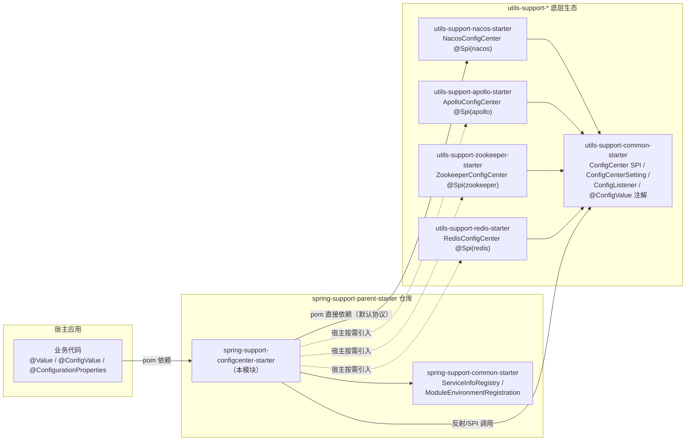
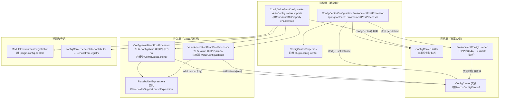
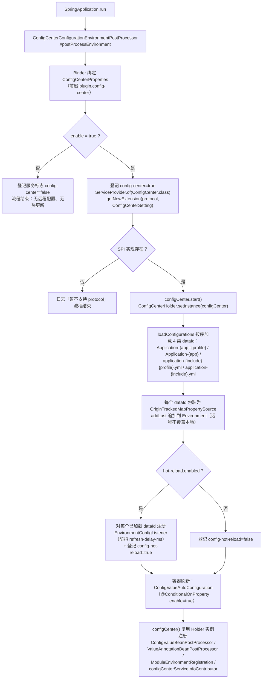
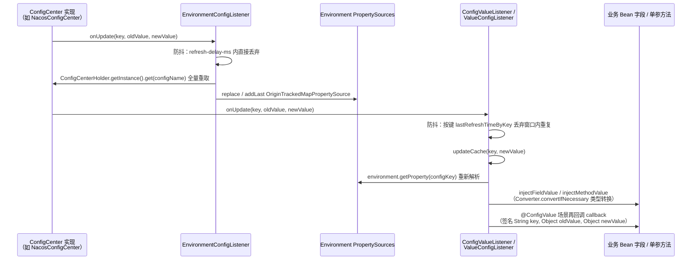

# spring-support-configcenter-starter

在 Spring `Environment` 准备阶段从远程配置中心（Nacos / Apollo / ZooKeeper / Redis）加载配置，并为 `@ConfigValue`、`@Value` 注入的字段提供热更新能力。本模块是纯粹的"配置客户端"：不监听端口、不暴露端点、不持有表结构。

> 基于 Spring Boot **4.1.2**（`spring-boot-starter-parent` 4.1.2，Jakarta 命名空间），生态版本 `4.0.0.51`。

## 1. 架构图

### 1.1 模块在体系中的位置



- 依赖方向遵循 `spring-support-* → utils-support-*`；本模块只**消费** `ConfigCenter` SPI，不实现任何协议。
- `@ConfigValue` 注解本体定义在 `utils-support-common-starter`，本模块只提供注入与热更新的处理器。

### 1.2 模块内部分层



## 2. 核心流程图

### 2.1 启动装配流程（EnvironmentPostProcessor 阶段 → Bean 阶段）



### 2.2 配置热更新数据流（配置中心推送 → 字段回写）



启动期实际发生的事（与上图对应的源码事实）：

1. `EnvironmentPostProcessor` 读取 `plugin.config-center.*`，未 `enable` 直接返回，并在 `ServiceInfoRegistry` 登记为关闭；
2. `ServiceProvider.of(ConfigCenter.class).getNewExtension(protocol, ConfigCenterSetting)` 创建实现，返回 `null` 时打「暂不支持」并退出，不抛异常；
3. `configCenter.start()` 后存入 `ConfigCenterHolder`，再按固定优先级把配置以 `addLast` 写入 `PropertySources`；
4. `hot-reload.enabled=true` 且实现 `isSupportListener()` 为 `true` 时，为每个已加载 dataId 注册 `EnvironmentConfigListener`；
5. Bean 阶段由两个 `BeanPostProcessor` 扫描注解、注入初值、按需注册键级监听。

## 3. 能力清单

| 能力域 | 关键类 | 入口 |
|---|---|---|
| 远程配置加载 | `ConfigCenterConfigurationEnvironmentPostProcessor`（实现 `EnvironmentPostProcessor`、`Ordered`，`getOrder() = Ordered.LOWEST_PRECEDENCE - 100`） | `META-INF/spring.factories` 的 `EnvironmentPostProcessor` 键 |
| 配置实例持有 | `ConfigCenterHolder`（静态单例，双检锁写入；`@PreDestroy` 时 `shutdown()`） | EPP 写入，AutoConfiguration 复用 |
| 自动装配 | `ConfigValueAutoConfiguration`（`@ConditionalOnProperty(prefix="plugin.config-center", name="enable", havingValue="true")`） | `META-INF/spring/org.springframework.boot.autoconfigure.AutoConfiguration.imports` |
| `@ConfigValue` 注入与热更新 | `ConfigValueBeanPostProcessor`（内部类 `ConfigValueListener`、record `BindingInfo`） | Bean `configValueBeanPostProcessor` |
| `@Value` 注入与热更新 | `ValueAnnotationBeanPostProcessor`（内部类 `ValueConfigListener`、record `ValueBindingInfo`） | Bean `valueAnnotationBeanPostProcessor` |
| 占位符解析 | `PlaceholderExpressions`（薄委托底层 `PlaceholderSupport.parseExpression`，解析 `${key:default}`） | 两个后置处理器内部调用 |
| 协议 SPI（消费方） | `com.chua.common.support.config.center.ConfigCenter` / `AbstractConfigCenter`（来自 `utils-support-common-starter`） | `ServiceProvider.of(ConfigCenter.class).getNewExtension(protocol, ConfigCenterSetting)` |
| 配置变更监听契约 | `com.chua.common.support.config.center.ConfigListener`（`onChange` / `onUpdate` / `onDelete`） | `configCenter.addListener(dataId, listener)` |
| 模块环境登记 | `ModuleEnvironmentRegistration`（组 `plugin.config-center`，登记进 `GlobalSettingFactory`） | Bean `configCenterModuleEnvironment` |
| 服务信息登记 | `ServiceInfoContributor` → `ServiceInfoRegistry` | Bean `configCenterServiceInfoContributor`（标志 `configcenter`）；EPP 另登记 `config-center` / `config-hot-reload` |

## 4. Bean 能力矩阵

以下 Bean 全部由 `ConfigValueAutoConfiguration` 提供，整类受 `plugin.config-center.enable=true` 约束；`enable=false` 时一个都不存在。

| Bean 名 | 类型 | 装配条件 | 可否覆盖 | 典型注入姿势 |
|---|---|---|---|---|
| `configCenter` | `ConfigCenter`（实际为 SPI 实现，如 `NacosConfigCenter`） | 类级 `@ConditionalOnProperty`；实例来自 EPP 阶段写入的 `ConfigCenterHolder`，不重复创建 | 可，但本模块未用 `@ConditionalOnMissingBean`，同名覆盖需 `spring.main.allow-bean-definition-overriding=true` | `@Autowired(required = false) ConfigCenter configCenter;` 一般无需直接注入 |
| `configValueBeanPostProcessor` | `ConfigValueBeanPostProcessor` | 类级条件；方法内再按 `hot-reload.enabled && hot-reload.config-value-annotation-enabled` 与 `configCenter.isSupportListener()` 决定热更新开关 | 同上 | 不建议注入：`BeanPostProcessor` 由容器回调 |
| `valueAnnotationBeanPostProcessor` | `ValueAnnotationBeanPostProcessor` | 类级条件；方法内再按 `hot-reload.enabled && hot-reload.value-annotation-enabled` 与 `isSupportListener()` 决定热更新开关 | 同上 | 同上 |
| `configCenterModuleEnvironment` | `ModuleEnvironmentRegistration` | 类级条件 | 同上 | 无需注入：构造时即向 `GlobalSettingFactory` 登记组 `plugin.config-center` |
| `configCenterServiceInfoContributor` | `ServiceInfoContributor` | 类级条件 | 同上 | 无需注入：容器回调 `contribute(registry)` 登记标志 `configcenter` |
| `plugin.config-center-com.chua.starter.configcenter.support.properties.ConfigCenterProperties` | `ConfigCenterProperties` | `@EnableConfigurationProperties` 引入（EPP 与 AutoConfiguration 均开启） | 属性值可被环境覆盖；Bean 本身不建议替换 | 构造器 / 字段注入 `ConfigCenterProperties` |

补充说明：

- `ConfigCenterConfigurationEnvironmentPostProcessor` **不是 Bean**：由 `SpringApplication` 按 `spring.factories` 反射创建，在环境准备阶段执行，早于容器刷新。
- `configCenter()` 复用 EPP 创建的实例（日志「复用已创建的 ConfigCenter 实例」）；若 EPP 阶段未创建成功（如协议拼错），取到 `null` 并打 WARN「ConfigCenter 实例未初始化, @ConfigValue 热更新功能将不可用」，此时热更新链路整体失效。
- 两个后置处理器只处理**单例** Bean（`beanFactory.isSingleton(beanName)` 为假直接跳过）。

## 5. 完整配置

配置类 `ConfigCenterProperties`，前缀 `plugin.config-center`（常量 `ConfigCenterProperties.PRE`），`@ConfigurationProperties(ignoreInvalidFields = true)`。绑定采用 kebab-case。

| 配置路径 | 类型 | 默认值 | 说明 | 生效开关 |
|---|---|---|---|---|
| `plugin.config-center.enable` | `boolean` | `false` | 总开关。`false` 时 EPP 直接返回、`ConfigValueAutoConfiguration` 整体不装配 | —（自身即总开关） |
| `plugin.config-center.protocol` | `String` | 无（`null`） | 协议名，对应 `ConfigCenter` SPI 名：`nacos` / `apollo` / `zookeeper` / `redis`（或自定义） | `enable=true` |
| `plugin.config-center.address` | `String` | 无（`null`） | 配置中心地址，如 `http://127.0.0.1:8848` | `enable=true` |
| `plugin.config-center.username` | `String` | 无（`null`） | 认证账号 | `enable=true` |
| `plugin.config-center.password` | `String` | 无（`null`） | 认证密码 | `enable=true` |
| `plugin.config-center.namespace-id` | `String` | 无（`null`） | 命名空间标识；为空时回落 `spring.profiles.active`，二者作为 `ConfigCenterSetting#profile` 传给实现（Nacos 侧即命名空间） | `enable=true` |
| `plugin.config-center.connect-timeout` | `int` | `5000` | 连接超时（毫秒），传入 `ConfigCenterSetting#connectionTimeout` | `enable=true` |
| `plugin.config-center.read-timeout` | `int` | `5000` | 读取超时（毫秒），传入 `ConfigCenterSetting#readTimeout` | `enable=true` |
| `plugin.config-center.hot-reload.enabled` | `boolean` | `true` | 是否注册配置变更监听（EPP 的 `EnvironmentConfigListener` + 处理器的键级监听都以它为前提） | `enable=true` |
| `plugin.config-center.hot-reload.value-annotation-enabled` | `boolean` | `true` | 是否让 `@Value` 字段/方法支持热更新 | `enable=true` 且 `hot-reload.enabled=true` |
| `plugin.config-center.hot-reload.config-value-annotation-enabled` | `boolean` | `true` | 是否让 `@ConfigValue` 字段/方法支持热更新（字段上还需 `hotReload=true`） | `enable=true` 且 `hot-reload.enabled=true` |
| `plugin.config-center.hot-reload.refresh-delay-ms` | `long` | `100` | 防抖窗口（毫秒）：同键/同 dataId 在窗口内的后续变更直接丢弃，不合并 | `enable=true` 且热更新启用 |
| `plugin.config-center.hot-reload.log-on-change` | `boolean` | `true` | 变更时是否打印日志（作用于 `EnvironmentConfigListener` 与 `ConfigValueBeanPostProcessor`；`ValueAnnotationBeanPostProcessor` 的热更新日志不受此项控制，固定打印） | `enable=true` |

**远程 dataId 加载优先级**（`loadConfigurations`，从高到低；`{app}` = `spring.application.name`，`{profile}` = `spring.profiles.active`）：

| 顺序 | dataId | 加载条件 |
|---|---|---|
| 1 | `Application-{app}-{profile}` | application.name 与 active 都非空 |
| 2 | `Application-{app}` | application.name 与 active 都非空（源码中与顺序 1 同一分支，任一为空则这两类均不加载） |
| 3 | `application-{include}-{profile}.yml` | `spring.profiles.include` 的每一项，active 非空 |
| 4 | `application-{include}.yml` | `spring.profiles.include` 中未被第 3 步命中的项 |

所有远程配置以 `OriginTrackedMapPropertySource` **`addLast`** 追加：远程配置优先级低于本地 `application.yml`，同层之间按上表顺序先加载者先入列。

注意：`ConfigCenterSetting` 自身还有 `retryCount=3`、`sslEnabled=false`、`connectionTimeout=3000` 等默认值，但本模块组装 setting 时总是显式传入 `connect-timeout` / `read-timeout`，因此这两个 Setting 默认值在本链路中不会生效。

## 6. 使用方式

### 6.1 Maven 坐标

```xml
<dependency>
    <groupId>com.chua</groupId>
    <artifactId>spring-support-configcenter-starter</artifactId>
    <version>4.0.0.51</version>
</dependency>
```

在本生态内使用时，版本由 `spring-support-parent-starter` 根 pom 的 `dependencyManagement` 统一托管（`${project.version}`），可省略 `<version>`。

### 6.2 依赖说明

| 依赖 | 作用 | 是否必需 |
|---|---|---|
| `spring-support-common-starter` | `ServiceInfoRegistry`、`ModuleEnvironmentRegistration` 等登记能力 | 必需（pom 直接声明） |
| `utils-support-nacos-starter` | 提供 `@Spi("nacos")` 的 `NacosConfigCenter` 及 `META-INF/extensions` 注册文件 | 必需（pom 直接声明，默认协议） |
| `utils-support-apollo-starter` | `ApolloConfigCenter`（`@Spi("apollo")`） | 可选，宿主按需引入 |
| `utils-support-zookeeper-starter` | `ZookeeperConfigCenter`（`@Spi("zookeeper")`） | 可选，宿主按需引入 |
| `utils-support-redis-starter` | `RedisConfigCenter`（`@Spi("redis")`） | 可选，宿主按需引入 |

> 未引入对应实现就配置其 `protocol` 时，启动日志只会出现「暂不支持 {protocol}」，不会抛异常，但也没有任何远程配置。

### 6.3 最小可运行示例

**第一步**：引入本模块（默认已带 Nacos 实现）。

**第二步**：本地 `application.yml` 打开开关并配置连接：

```yaml
spring:
  application:
    name: demo-app
  profiles:
    active: dev

plugin:
  config-center:
    enable: true
    protocol: nacos
    address: http://127.0.0.1:8848
    username: nacos
    password: nacos
    namespace-id: dev
    hot-reload:
      enabled: true
      refresh-delay-ms: 200
```

**第三步**：在配置中心按命名约定创建 dataId（本例即 `Application-demo-app-dev`，可选再加 `Application-demo-app`），内容为普通 YAML。Nacos 实现自动识别 YAML / properties 两种格式。

**第四步**：业务代码直接注解注入：

```java
@SpringBootApplication
public class DemoApplication {
    public static void main(String[] args) {
        SpringApplication.run(DemoApplication.class, args);
    }
}
```

```java
@Component
public class DemoConfigBean {

    /** 启动注入 + 热更新；hotReload=true 才注册监听，不写则为一次性注入 */
    @ConfigValue(value = "${demo.timeout:3000}", hotReload = true, callback = "onTimeoutChange")
    private Integer timeout;

    /** @Value 同样支持热更新，无需 @RefreshScope */
    @Value("${demo.greeting:hello}")
    private String greeting;

    /** 回调签名固定为 (String key, Object oldValue, Object newValue) */
    public void onTimeoutChange(String key, Object oldValue, Object newValue) {
        // 配置变更回调
    }
}
```

传统 `@ConfigurationProperties` 继续可用——远程配置在环境准备阶段已进入 `Environment`，早于容器刷新与属性绑定：

```java
@ConfigurationProperties(prefix = "demo")
public record DemoProperties(String greeting, Integer timeout) {
}
```

## 7. 使用场景

**适用**：

- 已有 Nacos / Apollo / ZooKeeper / Redis 之一作为配置中心，希望用同一套 SPI 抽象与同一份 `plugin.config-center.*` 配置接入，未来可切换协议；
- 需要**字段级热更新**（改一个 key，运行中的 Bean 字段同步变化），但不想为这一个能力引入 Spring Cloud Config / Spring Cloud Context 的 `@RefreshScope` 全家桶；
- 团队接受「按 `Application-{app}-{profile}` 等固定命名约定管理 dataId」的轻量方案；
- 需要把「模块是否启用、热更新是否开启」作为运行标志暴露给运维观测（`ServiceInfoRegistry` 的 `config-center` / `config-hot-reload` / `configcenter` 标志）。

**不适用**：

- 需要配置**加密、版本管理、灰度发布、回滚、审计**——本模块一概不提供；
- 需要**远程配置覆盖本地配置**——所有远程源 `addLast`，本地同名 key 永远赢；
- 需要自定义 dataId 命名、指定 group、聚合多文件、按 marker 加载等高级约定——加载链路只调用 `ConfigCenter#get(dataId)`，dataId 完全由代码拼装；
- 非 Spring Boot 环境——两个入口（`EnvironmentPostProcessor` + 自动配置）都依赖 Boot 机制。

**与相邻模块的取舍**：

- vs **`spring-support-common-starter`**：common 负责"本地环境/模块登记"等基础设施；本模块负责"远程拉取 + 热更新"。两者通过 `ModuleEnvironmentRegistration`、`ServiceInfoRegistry` 衔接，业务上无重叠。
- vs **`utils-support-*-starter` 直接用 SDK**：utils 层的 `ConfigCenter` 实现是纯 Java 客户端；本模块补齐 Spring 装配、`Environment` 集成与注解热更新，是"Spring 粘合层"。
- vs **Spring Cloud Alibaba Nacos Config / Spring Cloud Config**：本模块不依赖 Spring Cloud，启动开销小、概念少（只有 1 个前缀 + 4 类 dataId）；代价是没有 spring-cloud config 的 bus、加密、placeholder 链路等能力。
- vs **`spring-support-api-starter`**：后者 pom 仅在 `dependencyManagement` 登记本模块版本，不产生依赖；本仓库内也没有其它 starter 依赖本模块，引入与否完全由宿主应用决定。

## 8. 扩展点

### 8.1 协议 SPI：`com.chua.common.support.config.center.ConfigCenter`

本模块唯一的正式扩展点（定义在 `utils-support-common-starter`）。接口要点：

| 方法 | 说明 |
|---|---|
| `Map<String, Object> get(String dataId)` | 读取一个 dataId 的全部键值（本模块加载链路只用到它） |
| `Map<String, Object> get(String dataId, String group)` | 带 group 读取（本模块链路不传 group） |
| `String getValue(String dataId, String key)` | default 方法，单键读取 |
| `boolean publish(...)` / `publishIfAbsent(...)` / `publishBatch(...)` / `remove(...)` | 写入/删除能力；`AbstractConfigCenter` 默认实现打 WARN 并返回 `false`，需实现方覆盖 |
| `void start()` / `void close()` | 生命周期（`AutoCloseable`）；接口抽象方法，`AbstractConfigCenter` 未提供默认实现，自定义实现必须覆盖 |
| `boolean isSupportListener()` | 是否支持变更监听；`AbstractConfigCenter` 默认 `true` |
| `boolean isSupportPublish()` | 是否声称支持发布；默认 `true`，**不代表真的可用**，发布前需确认实现覆盖了 `publish` |
| `void addListener(String dataId, ConfigListener listener)` | 注册变更监听 |
| `getDefaultDataId()` / `getDefaultGroup()` | default：`application` / `DEFAULT_GROUP` |

**自定义实现步骤**（继承 `AbstractConfigCenter` 可复用监听器管理与启停日志；但 `start()` / `close()` 仍是 `ConfigCenter` 的抽象方法，基类未提供默认实现，必须连同两个 `get` 一并实现，下方示例即重写了这四个方法）：

```java
@Spi("mycenter")
public class MyConfigCenter extends AbstractConfigCenter {

    public MyConfigCenter(ConfigCenterSetting setting) {
        super(setting);
    }

    @Override
    public Map<String, Object> get(String dataId) {
        // 从自有存储读取该 dataId 的键值，解析成扁平 Map
        return Map.of();
    }

    @Override
    public Map<String, Object> get(String dataId, String group) {
        return get(dataId);
    }

    @Override
    public void start() { logStartup(); }

    @Override
    public void close() { logShutdown(); }
}
```

登记：在自有 jar 下新建 `META-INF/extensions/com.chua.common.support.config.center.ConfigCenter`，格式 `名称=实现类全限定名`（与官方四个实现一致）：

```text
mycenter=com.example.config.MyConfigCenter
```

生效：配置 `plugin.config-center.protocol: mycenter`。构造方法必须接收 `ConfigCenterSetting`——本模块通过 `ServiceProvider#getNewExtension(protocol, setting)` 反射创建。启动后实例进入 `ConfigCenterHolder`，`ConfigValueAutoConfiguration#configCenter()` 直接复用（日志「复用已创建的 ConfigCenter 实例」）。

### 8.2 监听契约：`com.chua.common.support.config.center.ConfigListener`

```java
public interface ConfigListener {
    void onChange(String key, String oldValue, String newValue); // 通用回调
    void onDelete(String key, String oldValue);                  // 删除
    void onUpdate(String key, String oldValue, String newValue); // 更新
}
```

宿主可对任意 `ConfigCenter` 实例调用 `addListener(dataId, listener)` 观察原始变更事件；本模块内部的 `EnvironmentConfigListener`、`ConfigValueListener`、`ValueConfigListener` 都是该契约的实现。

### 8.3 其它可复用点

- **`ConfigCenterHolder`**：静态入口 `getInstance()` / `isInitialized()` / `isSupportListener()`，宿主代码可在不走注解的情况下拿实例读配置。
- **Bean 级替换**：第 4 节的 Bean 均无 `@ConditionalOnMissingBean`；在 `spring.main.allow-bean-definition-overriding=true` 时，宿主可定义同名 Bean 接管（例如替换某个处理器以定制注入行为）。
- **不建议扩展的方向**：`ConfigCenterConfigurationEnvironmentPostProcessor` 属于内部装配（无 Bean 语义）；占位符解析已下沉在底层 `PlaceholderSupport`，按 R4 不得在上层再造第二份解析实现。

## 9. 常见问题

**Q1：配置了 `enable=true`，但启动后既没有远程配置也没有热更新？**
按顺序排查：① `protocol` 拼写错误或对应 utils 模块未引入——启动日志出现「暂不支持 {protocol}，请重新设置!」；② `spring.application.name` 或 `spring.profiles.active` 为空——`Application-*` 两类 dataId 不会加载（`application-{include}*.yml` 仍会尝试）；③ dataId 命名与四类约定不一致——本模块不支持自定义 dataId；④ 观察启动日志中的 `[配置中心]开始处理配置中心` / `[配置中心]加载配置: {dataId}` 确认走到哪一步。

**Q2：`@Value` / `@ConfigValue` 字段注入了初始值，但配置变更后不更新？**
热更新需同时满足：`enable=true` → `hot-reload.enabled=true` → 对应注解开关（`value-annotation-enabled` / `config-value-annotation-enabled`）为 `true` → `@ConfigValue` 字段上还要写 `hotReload = true` → 协议实现 `isSupportListener()` 返回 `true` → 该 key 的 dataId 已被加载。任一不满足，字段只在启动时注入一次。另注意防抖是"丢弃"：`refresh-delay-ms` 窗口内同键的后续变更直接跳过，被丢的中间值不会补发。

**Q3：本模块监听端口吗？运行开关在哪里看？**
不监听任何端口、不注册任何 HTTP 端点，是纯客户端模块。运行状态可通过启动日志（`[配置中心]...`）以及 `ServiceInfoRegistry` 中的标志确认：`config-center`（是否启用远程配置）、`config-hot-reload`（是否启用热更新）、`configcenter`（模块装配标志，由 `configCenterServiceInfoContributor` 登记）。

**Q4：与 Spring Boot 4.x 的兼容性如何？**
本模块随仓库基于 `spring-boot-starter-parent` **4.1.2** 构建与验证。自动配置走 `META-INF/spring/org.springframework.boot.autoconfigure.AutoConfiguration.imports`（Boot 2.7+ 标准机制）；`EnvironmentPostProcessor` 走 `META-INF/spring.factories`——该键在 Boot 4 中仍然受支持（被移除的是用 spring.factories 注册自动配置类的旧机制，本模块从未使用）；代码使用 `jakarta.annotation.PreDestroy` 等 Jakarta 命名空间，无 `javax` 遗留。

**Q5：为什么远程配置没有覆盖本地 `application.yml` 里的同名 key？**
设计如此：所有远程 `PropertySource` 以 `addLast` 追加到 `Environment` 末尾，本地配置优先。想让某 key 由配置中心决定，本地文件里就不要写这个 key。

**Q6：需要 `@RefreshScope` 吗？**
不需要，也不要加。`@RefreshScope` 属于 Spring Cloud 的"重建 Bean"式刷新；本模块的 `ValueAnnotationBeanPostProcessor` / `ConfigValueBeanPostProcessor` 在 `postProcessAfterInitialization` 阶段直接反射回写字段，两套链路互不相干，混用反而可能把 Bean 变成代理导致回写落空。

**Q7：`@ConfigValue` 的 `callback` 没有被调用？**
回调方法必须存在于同一个 Bean 中，且签名严格为 `void xxx(String key, Object oldValue, Object newValue)`（三参依次为配置键、旧值、新值，新值已按字段类型转换）。方法不存在时只记 WARN「回调方法不存在」，回调抛异常也只记日志，不影响字段注入结果。

已知误报：`ConfigValueBeanPostProcessor#invokeCallback` 会先用 `ReflectUtils.findDeclaredMethod` 预检方法是否存在，再以 `ReflectUtils.invoke(..., Object.class, ...)` 调用，并按「返回值 == null」判定「回调方法不存在」。由于 `void` 回调经反射调用必然返回 `null`，**签名正确、成功执行的 `void` 回调也会在执行之后追加一条 WARN「回调方法不存在」**。看到该 WARN 时先核对方法是否存在、签名是否一致；若方法确实存在且热更新已生效，这条 WARN 属于误报，可忽略（不影响注入与回调执行本身）。

**Q8：`namespace-id` 到底是什么语义？**
它被装入 `ConfigCenterSetting#profile`，语义随实现而定：Nacos 侧作为命名空间（namespace）使用。为空时回落 `spring.profiles.active`。

**Q9：能把配置写回配置中心吗？**
本 starter 自身不调用 `publish` / `publishIfAbsent` / `publishBatch` / `remove`（`@ConfigValue` 没有推送相关属性）。这些写能力在 `ConfigCenter` SPI 上存在，但 `AbstractConfigCenter` 的默认实现是打 WARN 并返回 `false`（`isSupportPublish()` 却默认 `true`）——调用前必须确认所用的实现（如 `NacosConfigCenter`）真的覆盖了 `publish`。

**Q10：热更新一次变更会触发多少次重取？**
两路并行：`EnvironmentConfigListener`（按 dataId，更新 `Environment` 的 PropertySource）与 `ConfigValueListener` / `ValueConfigListener`（按 key，回写 Bean 字段）。每路各自有 `refresh-delay-ms` 防抖；对同一配置中心实例，一次推送会同时驱动这两路监听器。

---

本项目采用 Apache License 2.0 许可证。
