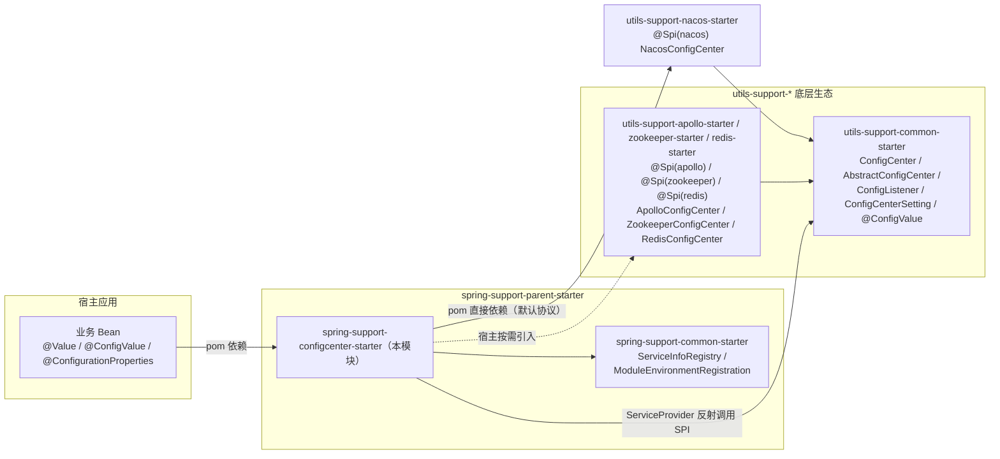
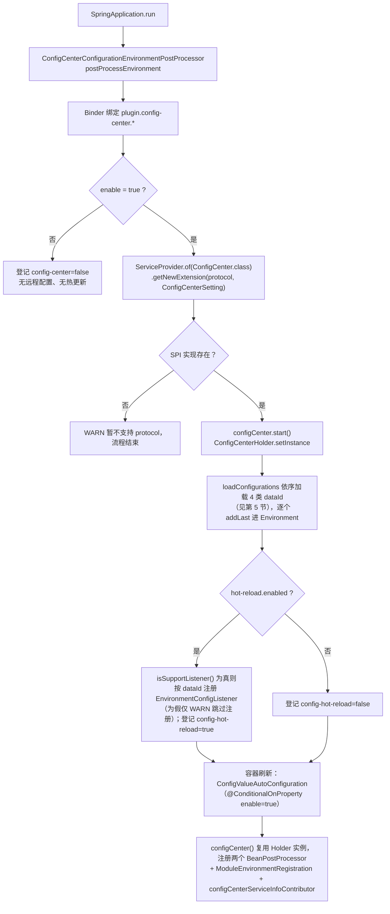

# spring-support-configcenter-starter

在 Spring `Environment` 准备阶段从远程配置中心（Nacos / Apollo / ZooKeeper / Redis）拉取配置，并为 `@ConfigValue`、`@Value` 注解的字段提供运行期热更新。本模块是 `spring-support` 体系中纯粹的「配置客户端」：只消费底层 `ConfigCenter` SPI，不监听端口、不暴露端点、不持有表结构。

## 1. 架构图



模块内部分层：**自动装配**（`ConfigCenterConfigurationEnvironmentPostProcessor` 经 `spring.factories` 注册，`ConfigValueAutoConfiguration` 经 `AutoConfiguration.imports` 注册）→ **核心服务**（`ConfigCenterHolder` 全局单例、`ConfigValueBeanPostProcessor` / `ValueAnnotationBeanPostProcessor` 两个注入处理器、`PlaceholderExpressions` 占位符解析）→ **SPI**（只消费 `ConfigCenter` 契约，协议实现全部位于底层 utils 模块）。

## 2. 核心流程图



配置中心推送后的双路数据流：实现类回调 `ConfigListener.onUpdate` → ① `EnvironmentConfigListener`（按 dataId，`refresh-delay-ms` 防抖后全量重取并 `replace` / `addLast` PropertySource，更新 `Environment`）；② `ConfigValueListener` / `ValueConfigListener`（按 key，防抖后 `environment.getProperty(key)` 重解析，经 `Converter.convertIfNecessary` 反射回写字段或单参方法；`@ConfigValue` 场景再回调 `callback(String key, Object oldValue, Object newValue)`）。

## 3. 能力清单

| 能力域 | 关键类 | 入口/触发方式 |
|---|---|---|
| 远程配置加载 | `ConfigCenterConfigurationEnvironmentPostProcessor`（实现 `EnvironmentPostProcessor`、`Ordered`，`getOrder() = Ordered.LOWEST_PRECEDENCE - 100`） | `META-INF/spring.factories` 的 `EnvironmentPostProcessor` 键 |
| 自动装配 | `ConfigValueAutoConfiguration`（`@ConditionalOnProperty(prefix = "plugin.config-center", name = "enable", havingValue = "true")`） | `META-INF/spring/org.springframework.boot.autoconfigure.AutoConfiguration.imports` |
| 配置实例持有 | `ConfigCenterHolder`（静态单例，双检锁写入，`shutdown()` 关闭） | EPP 写入实例，自动配置复用 |
| `@ConfigValue` 注入与热更新 | `ConfigValueBeanPostProcessor`（内部类 `ConfigValueListener`、record `BindingInfo`） | Bean `configValueBeanPostProcessor` |
| `@Value` 注入与热更新 | `ValueAnnotationBeanPostProcessor`（内部类 `ValueConfigListener`、record `ValueBindingInfo`） | Bean `valueAnnotationBeanPostProcessor` |
| 占位符解析 | `PlaceholderExpressions`（委托底层 `PlaceholderSupport.parseExpression`，解析 `${key:default}`） | 两个后置处理器内部调用 |
| 协议 SPI（消费方） | `com.chua.common.support.config.center.ConfigCenter` / `AbstractConfigCenter` | `ServiceProvider.of(ConfigCenter.class).getNewExtension(protocol, setting)` |
| 变更监听契约 | `com.chua.common.support.config.center.ConfigListener`（`onChange` / `onUpdate` / `onDelete`） | `configCenter.addListener(dataId, listener)` |
| 模块环境登记 | `ModuleEnvironmentRegistration`（组 `plugin.config-center`） | Bean `configCenterModuleEnvironment` |
| 服务信息登记 | `ServiceInfoContributor` → `ServiceInfoRegistry` | Bean `configCenterServiceInfoContributor`（标志 `configcenter`）；EPP 另登记 `config-center` / `config-hot-reload` |

本模块不监听端口、不注册任何 HTTP 端点；运行状态通过 `ServiceInfoRegistry` 标志（`config-center` / `config-hot-reload` / `configcenter`）与启动日志（`[配置中心]...`）观测。

## 4. Bean 能力矩阵

以下 Bean 全部由 `ConfigValueAutoConfiguration` 提供，整类受 `plugin.config-center.enable=true` 约束；`enable=false` 时一个都不注册。

| Bean 名 | 类型 | 装配条件（含默认值） | 可否覆盖 | 典型用途 |
|---|---|---|---|---|
| `configCenter` | `ConfigCenter`（SPI 实现，如 `NacosConfigCenter`） | 类级 `@ConditionalOnProperty enable=true`；实例复用 EPP 阶段写入 `ConfigCenterHolder` 的对象，不重复创建 | 本模块未用 `@ConditionalOnMissingBean`；同名覆盖需 `spring.main.allow-bean-definition-overriding=true` | 一般无需直接注入；也可经 `ConfigCenterHolder.getInstance()` 获取 |
| `configValueBeanPostProcessor` | `ConfigValueBeanPostProcessor` | 类级条件；方法内热更新开关 = `hot-reload.enabled && hot-reload.config-value-annotation-enabled` 且 `configCenter.isSupportListener()` | 同上 | 容器回调，不建议注入；扫描 `@ConfigValue` 字段与单参方法 |
| `valueAnnotationBeanPostProcessor` | `ValueAnnotationBeanPostProcessor` | 类级条件；热更新开关 = `hot-reload.enabled && hot-reload.value-annotation-enabled` 且 `isSupportListener()` | 同上 | 容器回调，不建议注入；扫描 `@Value` 字段与单参方法 |
| `configCenterModuleEnvironment` | `ModuleEnvironmentRegistration` | 类级条件；构造参数 `(plugin.config-center, properties, enable)` | 同上 | 无需注入；构造时向 `GlobalSettingFactory` 登记组 `plugin.config-center` |
| `configCenterServiceInfoContributor` | `ServiceInfoContributor` | 类级条件 | 同上 | 无需注入；登记标志 `configcenter` |
| `plugin.config-center-com.chua.starter.configcenter.support.properties.ConfigCenterProperties` | `ConfigCenterProperties` | `@EnableConfigurationProperties` 引入（EPP 与自动配置均开启） | 属性值可被环境覆盖；Bean 本身不建议替换 | 注入 `ConfigCenterProperties` 读取生效配置 |

补充：`ConfigCenterConfigurationEnvironmentPostProcessor` 不是 Bean，由 `SpringApplication` 按 `spring.factories` 反射创建，早于容器刷新；两个后置处理器只处理单例 Bean（`beanFactory.isSingleton(beanName)` 为假直接跳过）。

## 5. 完整配置

配置类 `ConfigCenterProperties`，前缀 `plugin.config-center`（常量 `ConfigCenterProperties.PRE`），`@ConfigurationProperties(ignoreInvalidFields = true)`，kebab-case 绑定。

| 配置路径 | 类型 | 默认值 | 说明 |
|---|---|---|---|
| `plugin.config-center.enable` | `boolean` | `false` | 总开关。`false` 时 EPP 直接返回、自动配置整体不装配 |
| `plugin.config-center.protocol` | `String` | 无（`null`） | SPI 协议名：`nacos` / `apollo` / `zookeeper` / `redis`（或自定义注册名） |
| `plugin.config-center.address` | `String` | 无（`null`） | 配置中心地址，如 `http://127.0.0.1:8848` |
| `plugin.config-center.username` | `String` | 无（`null`） | 认证账号 |
| `plugin.config-center.password` | `String` | 无（`null`） | 认证密码 |
| `plugin.config-center.namespace-id` | `String` | 无（`null`） | 命名空间标识，装入 `ConfigCenterSetting#profile`；为空回落 `spring.profiles.active` |
| `plugin.config-center.connect-timeout` | `int` | `5000` | 连接超时（毫秒），传入 `ConfigCenterSetting#connectionTimeout` |
| `plugin.config-center.read-timeout` | `int` | `5000` | 读取超时（毫秒），传入 `ConfigCenterSetting#readTimeout` |
| `plugin.config-center.hot-reload.enabled` | `boolean` | `true` | 是否注册配置变更监听（EPP 的 dataId 级监听与处理器的 key 级监听共同前提） |
| `plugin.config-center.hot-reload.value-annotation-enabled` | `boolean` | `true` | `@Value` 字段/方法是否支持热更新 |
| `plugin.config-center.hot-reload.config-value-annotation-enabled` | `boolean` | `true` | `@ConfigValue` 字段/方法是否支持热更新（字段上还需 `hotReload=true`，注解默认 `false`） |
| `plugin.config-center.hot-reload.refresh-delay-ms` | `long` | `100` | 防抖窗口（毫秒）：同 dataId / 同 key 窗口内的后续变更直接丢弃，不合并 |
| `plugin.config-center.hot-reload.log-on-change` | `boolean` | `true` | 变更时是否打印日志（作用于 `EnvironmentConfigListener` 与 `ConfigValueBeanPostProcessor`；`ValueAnnotationBeanPostProcessor` 的热更新日志不受此项控制，固定打印） |

远程 dataId 加载优先级（`loadConfigurations`，从高到低；`{app}` = `spring.application.name`，`{profile}` = `spring.profiles.active`，`{include}` = `spring.profiles.include` 的每一项）：

| 顺序 | dataId | 加载条件 |
|---|---|---|
| 1 | `Application-{app}-{profile}` | application.name 与 active 均非空 |
| 2 | `Application-{app}` | 同上（与顺序 1 同一分支，任一为空则两类均不加载） |
| 3 | `application-{include}-{profile}.yml` | `spring.profiles.include` 各项，active 非空 |
| 4 | `application-{include}.yml` | 第 3 步未命中的 include 项 |

所有远程配置以 `OriginTrackedMapPropertySource` **`addLast`** 追加：远程优先级低于本地 `application.yml`，本地同名 key 永远生效。`ConfigCenterSetting` 自身还有 `connectionTimeout=3000`、`readTimeout=5000`、`retryCount=3`、`sslEnabled=false` 等默认值；本模块组装 setting 时总是显式传入 `connect-timeout` / `read-timeout`，故这两个超时默认值在本链路不生效，而 `retryCount` / `sslEnabled` 未传入，仍取底层默认。

### 5.1 逐项配置示例（按功能分组）

以下示例均可直接并入 `application.yml`；表中「默认值」与 `ConfigCenterProperties` 字段初始化代码一致。

**基础开关与连接**

| 配置项 | 含义 | 默认值 |
|---|---|---|
| `enable` | 总开关；`false` 时本模块整体不装配，无远程配置、无热更新 | `false` |
| `protocol` | 配置中心协议（底层 `ConfigCenter` SPI 注册名）：`nacos` / `apollo` / `zookeeper` / `redis` | 无 |
| `address` | 配置中心地址，格式随协议而定 | 无 |
| `username` | 认证账号 | 无 |
| `password` | 认证密码（建议经环境变量/启动参数注入） | 无 |

```yaml
plugin:
  config-center:
    enable: true
    protocol: nacos
    address: http://127.0.0.1:8848
    username: your-username
    password: your-password
```

**命名空间与超时**

| 配置项 | 含义 | 默认值 |
|---|---|---|
| `namespace-id` | 命名空间标识，装入 `ConfigCenterSetting#profile`；未配置回落 `spring.profiles.active` | 无 |
| `connect-timeout` | 连接超时（毫秒），原样传入底层 `ConfigCenterSetting` | `5000` |
| `read-timeout` | 读取超时（毫秒），原样传入底层 `ConfigCenterSetting` | `5000` |

```yaml
plugin:
  config-center:
    namespace-id: dev
    connect-timeout: 5000
    read-timeout: 5000
```

**热更新（`hot-reload`）**

| 配置项 | 含义 | 默认值 |
|---|---|---|
| `hot-reload.enabled` | 热更新总开关；dataId 级监听与注解 key 级监听的共同前提 | `true` |
| `hot-reload.value-annotation-enabled` | `@Value` 字段/单参方法热更新开关 | `true` |
| `hot-reload.config-value-annotation-enabled` | `@ConfigValue` 字段/单参方法热更新开关；字段上还需 `hotReload = true` | `true` |
| `hot-reload.refresh-delay-ms` | 防抖窗口（毫秒）；窗口内同 dataId/同 key 的后续变更直接丢弃，≤0 关闭防抖 | `100` |
| `hot-reload.log-on-change` | 变更是否打印日志（`@Value` 热更新日志固定打印，不受此项控制） | `true` |

```yaml
plugin:
  config-center:
    hot-reload:
      enabled: true
      value-annotation-enabled: true
      config-value-annotation-enabled: true
      refresh-delay-ms: 100
      log-on-change: true
```

## 6. 使用方式

Maven 坐标：

```xml
<dependency>
    <groupId>com.chua</groupId>
    <artifactId>spring-support-configcenter-starter</artifactId>
    <version>4.0.0.51</version>
</dependency>
```

本生态内使用时，版本由 `spring-support-parent-starter` 根 pom 的 `dependencyManagement` 统一托管，可省略 `<version>`。

最小启用示例（`application.yml`）：

```yaml
spring:
  application:
    name: demo-app
  profiles:
    active: dev

plugin:
  config-center:
    enable: true
    protocol: nacos
    address: http://127.0.0.1:8848
    username: nacos
    password: nacos
    namespace-id: dev
    hot-reload:
      enabled: true
      refresh-delay-ms: 200
```

随后在配置中心按命名约定创建 dataId（本例为 `Application-demo-app-dev`，可选再加 `Application-demo-app`），内容为普通 YAML / properties。业务代码注解注入即可，无需 `@RefreshScope`：

```java
@Component
public class DemoConfigBean {

    /** 启动注入 + 热更新；hotReload=true 才注册监听（注解默认 false，即一次性注入） */
    @ConfigValue(value = "${demo.timeout:3000}", hotReload = true, callback = "onTimeoutChange")
    private Integer timeout;

    /** @Value 同样支持热更新 */
    @Value("${demo.greeting:hello}")
    private String greeting;

    /** 回调签名固定为 (String key, Object oldValue, Object newValue) */
    public void onTimeoutChange(String key, Object oldValue, Object newValue) { }
}
```

传统 `@ConfigurationProperties` 继续可用——远程配置在环境准备阶段已进入 `Environment`，早于容器刷新与属性绑定。

可选依赖说明：pom 直接依赖只有 `spring-support-common-starter`（`ServiceInfoRegistry` / `ModuleEnvironmentRegistration` 等登记能力，必需）与 `utils-support-nacos-starter`（默认协议实现，必需）；`utils-support-apollo-starter` / `utils-support-zookeeper-starter` / `utils-support-redis-starter` 不是本模块的依赖，宿主要用对应协议时自行引入。未引入实现就配置其 `protocol` 时，启动日志出现「暂不支持 {protocol}」，不抛异常，但没有任何远程配置。

### 6.1 完整配置示例

```yaml
spring:
  application:
    name: demo-app
  profiles:
    active: dev
    include: common   # 公共配置也会按 application-common[-dev].yml 从配置中心加载

plugin:
  config-center:
    enable: true
    protocol: nacos
    address: http://127.0.0.1:8848
    username: ${CONFIG_CENTER_USERNAME:your-username}
    password: ${CONFIG_CENTER_PASSWORD:your-password}
    namespace-id: dev
    connect-timeout: 5000
    read-timeout: 5000
    hot-reload:
      enabled: true
      value-annotation-enabled: true
      config-value-annotation-enabled: true
      refresh-delay-ms: 200
      log-on-change: true
```

该示例启动后会依次尝试加载 `Application-demo-app-dev`、`Application-demo-app`、`application-common-dev.yml`、`application-common.yml` 四类 dataId（后两类因 `include: common` 而来）；全部以 `addLast` 追加，本地同名 key 优先。业务代码注入方式见上文 `@ConfigValue` / `@Value` 示例。

### 6.2 生产注意事项

- **远程不覆盖本地**：所有远程 PropertySource 都是 `addLast`，本地 `application.yml` 同名 key 永远生效；希望「远程可调」的键不要在本地文件里定义同名项。
- **凭据不入库**：`username` / `password` 用环境变量或启动参数注入（如 `--plugin.config-center.password=change-me`），仓库内 yml 只保留占位符；配置中心命名空间按环境隔离，敏感配置不要放公共空间。
- **dataId 命名固定**：只加载 `Application-{app}-{profile}`、`Application-{app}`、`application-{include}-{profile}.yml`、`application-{include}.yml` 四类，不支持自定义 dataId / group；在配置中心建目录时按此约定命名。
- **防抖是丢弃语义**：`refresh-delay-ms` 窗口内同键的后续变更被直接跳过，中间值不会补发；不要假设「每一次变更都会被应用」。
- **热更新范围有限**：仅对单例 Bean 生效；`@ConfigValue` 字段必须显式 `hotReload = true`；回调方法签名固定 `(String key, Object oldValue, Object newValue)`；`@ConfigurationProperties` 绑定的 Bean 不会自动重新绑定（远程变更只更新 `Environment`，已绑定的属性对象不会回刷）。
- **`plugin.config-center.*` 本身不支持热改**：这些属性在启动期由环境后置处理器绑定一次，运行期修改不会重新生效；启停/灰度请走发布流程。
- **协议实现按需引入**：本模块默认只带 `nacos` 实现；`apollo` / `zookeeper` / `redis` 需自行引入对应 `utils-support-*-starter`，缺失时启动仅 WARN「暂不支持 {protocol}」，容易漏配而不自知。
- **可观测性与超时**：通过 `ServiceInfoRegistry` 标志 `config-center` / `config-hot-reload` / `configcenter` 与启动日志 `[配置中心]...` 确认装配与监听状态；网络不稳时适当调大 `connect-timeout` / `read-timeout`（底层另有 `retryCount=3` 重试，本模块未暴露该参数）。

## 7. 使用场景

**适用**：

- 已有 Nacos / Apollo / ZooKeeper / Redis 之一作为配置中心，希望用同一套 SPI 抽象与同一份 `plugin.config-center.*` 配置接入，未来可切换协议；
- 需要字段级热更新（改一个 key，运行中的 Bean 字段同步变化），但不想引入 Spring Cloud Config / `@RefreshScope` 全家桶；
- 接受「按 `Application-{app}-{profile}` 等固定命名约定管理 dataId」的轻量方案；
- 需要把「是否启用、热更新是否开启」作为运行标志暴露给运维观测（`ServiceInfoRegistry` 标志）。

**不适用/慎用**：

- 需要配置加密、版本管理、灰度发布、回滚、审计——本模块一概不提供；
- 需要远程配置覆盖本地配置——所有远程源 `addLast`，本地同名 key 永远赢；
- 需要自定义 dataId 命名、指定 group、聚合多文件——加载链路只调 `ConfigCenter#get(dataId)`，dataId 由代码拼装，不支持自定义。

**与相邻模块的取舍**：

- vs **`spring-support-common-starter`**：common 提供 `ServiceInfoRegistry` / `ModuleEnvironmentRegistration` 等登记设施；本模块负责远程拉取与热更新，通过这两个设施衔接，业务无重叠。
- vs **直接用 `utils-support-*-starter` SDK**：utils 层的 `ConfigCenter` 实现是纯 Java 客户端；本模块补齐 Spring 装配、`Environment` 集成与注解热更新，是「Spring 粘合层」。
- vs **Spring Cloud Alibaba Nacos Config / Spring Cloud Config**：本模块不依赖 Spring Cloud，概念少（1 个前缀 + 4 类 dataId）；代价是没有 bus、加密、灰度等能力。

## 8. 扩展点

本模块唯一的正式扩展点是底层 SPI `com.chua.common.support.config.center.ConfigCenter`（定义在 `utils-support-common-starter`），核心方法：

| 方法 | 说明 |
|---|---|
| `Map<String, Object> get(String dataId)` / `get(String dataId, String group)` | 读取一个 dataId 的全部键值（本模块加载链路只用到 `get(dataId)`） |
| `String getValue(String dataId, String key)` | default 方法，单键读取 |
| `boolean publish(...)` / `publishIfAbsent(...)` / `publishBatch(...)` / `remove(...)` | 写入/删除能力；`publishIfAbsent` 是接口 default（先读后写）；`AbstractConfigCenter` 的 `publish` / `remove` 默认打 WARN 并返回 `false`，`publishBatch` 逐条委托 `publish`，需实现方覆盖 |
| `void start()` / `void close()` | 生命周期（`AutoCloseable`）；接口抽象方法，自定义实现必须覆盖 |
| `boolean isSupportListener()` / `isSupportPublish()` | 能力声明；`AbstractConfigCenter` 默认均为 `true`，`isSupportPublish()` 为 `true` 不代表真的可用，发布前需确认实现覆盖了 `publish` |
| `void addListener(String dataId, ConfigListener listener)` | 注册变更监听 |
| `getDefaultDataId()` / `getDefaultGroup()` | default：`application` / `DEFAULT_GROUP` |

自定义实现步骤（继承 `AbstractConfigCenter` 可复用监听器管理与 `logStartup()` / `logShutdown()`；但 `start()` / `close()` 与两个 `get` 仍是必须覆盖的方法）：

```java
@Spi("mycenter")
public class MyConfigCenter extends AbstractConfigCenter {

    public MyConfigCenter(ConfigCenterSetting setting) { super(setting); }

    @Override
    public Map<String, Object> get(String dataId) {
        return Map.of(); // 从自有存储读取该 dataId 的键值，解析成扁平 Map
    }

    @Override
    public Map<String, Object> get(String dataId, String group) { return get(dataId); }

    @Override
    public void start() { logStartup(); }

    @Override
    public void close() { logShutdown(); }
}
```

登记：在自有 jar 下新建 `META-INF/extensions/com.chua.common.support.config.center.ConfigCenter`，内容为 `名称=实现类全限定名`（与官方 `nacos=com.chua.nacos.support.config.NacosConfigCenter` 一致）。生效：配置 `plugin.config-center.protocol: mycenter`；构造方法必须接收 `ConfigCenterSetting`——本模块经 `ServiceProvider#getNewExtension(protocol, setting)` 反射创建，实例随后进入 `ConfigCenterHolder` 复用。

监听契约 `ConfigListener`（`onChange` / `onUpdate` / `onDelete`）同样可被宿主直接使用：对任意 `ConfigCenter` 实例 `addListener(dataId, listener)` 即可观察原始变更事件。`ConfigCenterHolder` 提供 `getInstance()` / `isInitialized()` / `isSupportListener()` 静态入口，宿主可不走注解直接读配置。

除上述 SPI 外，本模块不再暴露其它扩展点：`ConfigCenterConfigurationEnvironmentPostProcessor` 属内部装配（非 Bean）；占位符解析已下沉在底层 `PlaceholderSupport`，按 R4 不得在上层再造第二份实现。

## 9. 常见问题

**Q1：配置了 `enable=true`，但既没有远程配置也没有热更新？**
按序排查：① 启动日志出现「暂不支持 {protocol}，请重新设置!」→ `protocol` 拼写错误或对应 utils 模块未引入；② `spring.application.name` / `spring.profiles.active` 为空 → `Application-*` 两类 dataId 不会加载（`application-{include}*.yml` 仍会尝试）；③ dataId 命名与第 5 节四类约定不一致 → 本模块不支持自定义 dataId；④ 观察日志 `[配置中心]开始处理配置中心` / `[配置中心]加载配置: {dataId}` 确认走到哪一步。

**Q2：`@Value` / `@ConfigValue` 注入了初始值，但配置变更后不更新？**
热更新需同时满足：`enable=true` → `hot-reload.enabled=true` → 对应注解开关（`value-annotation-enabled` / `config-value-annotation-enabled`）为 `true` → `@ConfigValue` 字段还需 `hotReload = true`（注解默认 `false`）→ 协议实现 `isSupportListener()` 为 `true` → 该 key 的 dataId 已被加载。任一不满足，字段只在启动时注入一次。另注意防抖是「丢弃」语义：`refresh-delay-ms` 窗口内同键的后续变更直接跳过，被丢的中间值不会补发。

**Q3：与 Spring Boot 4.x 兼容吗？会与兄弟 starter 冲突吗？**
本模块随仓库基于 `spring-boot-starter-parent` 4.1.2 构建验证：自动配置走 `AutoConfiguration.imports`（Boot 2.7+ 标准机制），`EnvironmentPostProcessor` 走 `spring.factories`（该键在 Boot 4 仍受支持，被移除的只是用 spring.factories 注册自动配置类的旧机制）；代码使用 `jakarta.annotation.PreDestroy` 等 Jakarta 命名空间。仓库内没有其它 starter 依赖本模块（根 pom 仅在 `<modules>` 与 `dependencyManagement` 登记它），引入与否完全由宿主决定，不存在兄弟模块装配冲突。

**Q4：`@ConfigValue` 的 `callback` 为什么有时打「回调方法不存在」WARN？**
回调方法必须与字段同 Bean，签名严格为 `void xxx(String key, Object oldValue, Object newValue)`（新值已按字段类型转换）。已知误报：`ConfigValueBeanPostProcessor#invokeCallback` 先经 `ReflectUtils.findDeclaredMethod` 预检方法存在，再以 `ReflectUtils.invoke(...)` 调用并按「返回值 == null」判定方法不存在；`void` 回调经反射必然返回 `null`，因此签名正确、成功执行的 `void` 回调也会在执行后追加一条 WARN。若方法确实存在且热更新已生效，该 WARN 属误报，可忽略。

---

本项目采用 Apache License 2.0 许可证。
