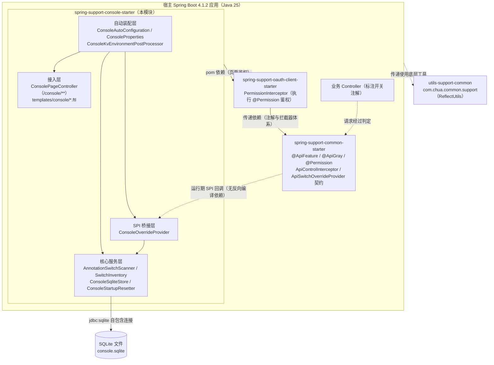
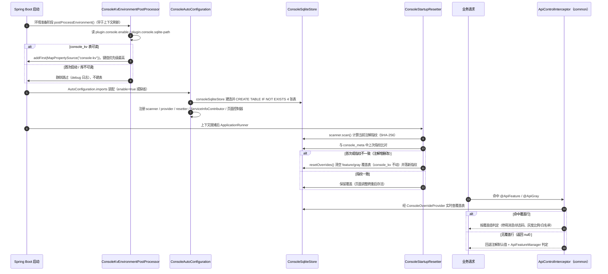

# spring-support-console-starter

管理控制台：以内置 FreeMarker（FTL）页面在**运行期**临时调整 `@ApiFeature` / `@ApiGray`
覆盖与通用键值运行设置，调整数据落 SQLite 持久化；启动时做「注解指纹」比对——注解变了
就重置覆盖库，注解没变则保留运行时调整。在 spring-support 体系中，它是 common-starter
`@ApiFeature`/`@ApiGray` 注解体系的**配套管理端**：独立可选 starter，仓库内没有其它
starter 依赖它，由宿主应用按需引入。

- 坐标：`com.chua:spring-support-console-starter:4.0.0.51`（版本随父工程 `spring-support-parent-starter`）
- 运行基线：Spring Boot **4.1.2** / Java **25**
- 依赖方向单向：`console → oauth-client → common`；底层经传递使用 `com.chua.common.support` 工具（如 `ReflectUtils`）

## 1. 架构图



依赖方向单向：common 的 `ApiControlInterceptor` 经 `ObjectProvider<ApiSwitchOverrideProvider>` 咨询本模块的 `ConsoleOverrideProvider`，common 不依赖本模块。

## 2. 核心流程图

启动装配、指纹重置与运行期覆盖判定（一张时序图贯穿模块全生命周期）：



覆盖表在每次请求判定时实时读取：页面改完，下一条请求立即生效，无需重启。

## 3. 能力清单

| 能力域 | 关键类 | 入口 / 触发方式 |
|---|---|---|
| 自动装配 | `com.chua.starter.console.ConsoleAutoConfiguration` | `META-INF/spring/...AutoConfiguration.imports` |
| 键值注入 Environment | `environment.ConsoleKvEnvironmentPostProcessor` | `META-INF/spring.factories`（EnvironmentPostProcessor） |
| 控制台首页 | `controller.ConsolePageController#index` | `GET /console/` → 302 `/console/features` |
| 功能开关页面 | `ConsolePageController#features` | `GET /console/features`（视图 `console/features`） |
| 灰度规则页面 | `ConsolePageController#grays` | `GET /console/grays`（视图 `console/grays`） |
| 键值设置页面 | `ConsolePageController#kv` | `GET /console/kv`（视图 `console/kv`） |
| 功能覆盖写/删 | `#upsertFeature` / `#deleteFeature` | `POST /console/api/features`、`POST /console/api/features/delete` |
| 灰度覆盖写/删 | `#upsertGray` / `#deleteGray` | `POST /console/api/grays`、`POST /console/api/grays/delete` |
| 键值写/删 | `#upsertKv` / `#deleteKv` | `POST /console/api/kv`、`POST /console/api/kv/delete` |
| 注解扫描与指纹 | `scan.AnnotationSwitchScanner#scan()` → `scan.SwitchInventory` | Spring Bean；页面与启动重置器共用 |
| SQLite 持久层 | `store.ConsoleSqliteStore`（4 张表） | Spring Bean（`destroyMethod="close"`） |
| 覆盖判定接入 | `store.ConsoleOverrideProvider`（实现 `ApiSwitchOverrideProvider`） | Spring Bean；被 common 拦截器咨询 |
| 启动指纹比对/重置 | `store.ConsoleStartupResetter`（ApplicationRunner） | 应用启动完成后自动执行 |
| 服务信息登记 | `ConsoleAutoConfiguration#consoleServiceInfoContributor` | `ServiceInfoContributor` → `registerFlag("console", "管理控制台", ...)` |

页面与调整接口全部标注 `@Permission(ConsolePageController.CONSOLE_PERMISSION)`（权限码常量 `console:manage`），由 oauth-client 的 `PermissionInterceptor` 执行。

SQLite 固定四张表（`ConsoleSqliteStore#initSchema`，`CREATE TABLE IF NOT EXISTS`）：

| 表 | 用途 | 关键列 |
|---|---|---|
| `console_feature_override` | `@ApiFeature` 覆盖 | `feature_id` PK、`enabled`、`disabled_message`、`disabled_status`（默认 -1）、`updated_at` |
| `console_gray_override` | `@ApiGray` 覆盖 | `pattern` PK、`percentage`、`roles`、`users`、`headers`、`rule`、`updated_at` |
| `console_kv` | 通用键值运行设置 | `k` PK、`v`、`updated_at` |
| `console_meta` | 注解指纹 | `k='annotation-fingerprint'` → SHA-256 hex |

## 4. Bean 能力矩阵

自动配置类 `ConsoleAutoConfiguration`（`@Configuration(proxyBeanMethods = false)` + `@Import(ConsolePageController.class)` + `@EnableConfigurationProperties(ConsoleProperties.class)`），条件 `@ConditionalOnProperty(prefix = "plugin.console", name = "enable", havingValue = "true", matchIfMissing = true)`——**不配置也生效**，下表前 5 个 Bean 共用该条件。

| Bean 名 | 类型 | 装配条件 | 可否覆盖 | 典型用途 |
|---|---|---|---|---|
| `annotationSwitchScanner` | `scan.AnnotationSwitchScanner` | `plugin.console.enable=true`（或缺省） | 可：无 `@ConditionalOnMissingBean`，同名覆盖需开 `spring.main.allow-bean-definition-overriding=true` | 注入后调 `scan()` 取开关清单/指纹 |
| `consoleSqliteStore` | `store.ConsoleSqliteStore`（AutoCloseable，`destroyMethod="close"`） | 同上 | 可（同上） | 直接调 upsert/get/delete/list 系列 `synchronized` 方法 |
| `consoleOverrideProvider` | `store.ConsoleOverrideProvider`（实现 `ApiSwitchOverrideProvider`） | 同上 | 可：多实现需 `@Primary` 指定唯一候选 | common 拦截器判定 @ApiFeature/@ApiGray 时咨询 |
| `consoleStartupResetter` | `store.ConsoleStartupResetter`（ApplicationRunner） | 同上 | 可（同上） | 一般不主动注入，由 Boot 在启动完成后自动 `run()` |
| `consoleServiceInfoContributor` | `common...serviceinfo.ServiceInfoContributor`（lambda） | 同上 | 可（同上） | 由 `ServiceInfoRegistry` 聚合展示，无需注入 |
| `consolePageController`（`@Import` 导入） | `controller.ConsolePageController`（`@Controller`） | 随自动配置一并导入 | 不可用 `@Bean` 方式替换 | 不注入；直接经 HTTP `/console/**` 访问 |

注意：`ConsoleKvEnvironmentPostProcessor` **不是 Bean**——由 Boot 在环境准备阶段经 `spring.factories` 实例化调用，早于 `ApplicationContext` 创建，无法也不需要注入。

## 5. 完整配置

配置类 `com.chua.starter.console.ConsoleProperties`，`@ConfigurationProperties(prefix = "plugin.console")`（常量 `ConsoleProperties.PRE`）；本模块唯一的 `@ConfigurationProperties`，无嵌套类，全部字段如下：

| 配置路径 | 类型 | 默认值 | 说明 |
|---|---|---|---|
| `plugin.console.enable` | `boolean` | `true` | 总开关：自动装配条件与环境注入器都读它；`matchIfMissing=true`，不写即启用 |
| `plugin.console.sqlite-path` | `String` | `console.sqlite` | SQLite 文件路径（相对运行目录解析）；持久层与环境注入器读同一文件 |
| `plugin.console.permission-code` | `String` | `console:manage` | 预留的页面权限码。**当前代码未读取**：控制器绑定编译期常量 `CONSOLE_PERMISSION`，`getPermissionCode()` 无调用点 |
| `plugin.console.kv-prefix` | `String` | `""`（空=管理全部键值） | 预留的键值前缀过滤。**当前代码未读取**：页面固定调 `store.listKv("")` |

示例：

```yaml
plugin:
  console:
    enable: true
    sqlite-path: ./data/console.sqlite
```

键名建议用上表的连字符形式：`ConsoleKvEnvironmentPostProcessor` 以 `environment.getProperty("plugin.console.enable", "true")`、`environment.getProperty("plugin.console.sqlite-path", "console.sqlite")` 精确取值，不走松散绑定。模块无独立端口/路径前缀配置，控制台固定挂在宿主的 `/console/**` 下。

## 6. 使用方式

Maven 坐标（版本也可省略，由父工程 `dependencyManagement` 统一管理）：

```xml
<dependency>
    <groupId>com.chua</groupId>
    <artifactId>spring-support-console-starter</artifactId>
    <version>4.0.0.51</version>
</dependency>
```

最小启用示例（不配置即启用；`sqlite-path` 建议显式指到可写目录）：

```yaml
plugin:
  console:
    enable: true
    sqlite-path: console.sqlite
```

在业务接口上使用 common-starter 的开关注注解，即可在控制台调整：

```java
@RestController
public class DemoController {
    @ApiFeature(value = "order-export", defaultEnabled = true, disabledMessage = "导出功能维护中", disabledStatus = 503)
    @GetMapping("/api/order/export")
    public String export() { return "ok"; }

    @ApiGray(value = "gray-order-v2", percentage = 0)
    @GetMapping("/api/order/gray")
    public String gray() { return "gray-ok"; }
}
```

启动后访问 `GET /console/`（302 到 `/console/features`）查看与调整：停用 `order-export` 后 `GET /api/order/export` 立即返回 503 与提示消息，删除覆盖后回落注解默认值。

依赖说明（来自模块 pom.xml，**没有 optional 依赖**，全部随依赖传递带入）：

| 依赖 | 作用 | 缺失后果 |
|---|---|---|
| `com.chua:spring-support-oauth-client-starter` | `@Permission` 页面鉴权；传递引入 common 的注解与拦截器体系 | 不可省；若被宿主排除，鉴权注解失效，`/console/**` 失去访问闸门 |
| `org.springframework.boot:spring-boot-starter-web` | MVC 控制器与 `RequestMappingHandlerMapping`（注解扫描数据源） | 缺失则模块无法工作（非 Web MVC 宿主勿引入本模块） |
| `org.springframework.boot:spring-boot-starter-freemarker` | 渲染 `templates/console/*.ftl` | 缺失则页面视图无法解析 |
| `org.xerial:sqlite-jdbc` | 自包含 SQLite 持久化（版本由 Boot BOM 托管，无需宿主 DataSource） | 缺失则 `consoleSqliteStore` 初始化抛 `IllegalStateException` |
| `org.projectlombok:lombok`（`provided`） | 编译期代码生成 | 仅编译期，不影响运行时 |

宿主若已自定义 `ApiSwitchOverrideProvider`，与本模块默认实现共存时需给其中一个标 `@Primary`（见第 9 节）。

## 7. 使用场景

适用：

- 需要**不停机**临时启停接口功能（`@ApiFeature`）或调整灰度比例/白名单（`@ApiGray`），并想要现成管理页面。
- 需要轻量的键值「运行设置」入口，且希望这些值在启动时以最高优先级注入 `Environment`（`@Value` / `environment.getProperty` 可读）。
- 单体应用或少量实例，不打算为几个开关引入配置中心/外部数据库。
- 已在使用 common-starter 的 `@ApiFeature`/`@ApiGray` 体系，需要配套管理界面与服务信息展示。

不适用/慎用：

- **WebFlux 响应式栈**：本模块基于 Spring MVC（`@Controller`、`RequestMappingHandlerMapping`、`HandlerInterceptor`），无响应式实现。
- **无法提供鉴权体系**的应用：页面只有 `@Permission` 一道闸，宿主没接登录态时不要把控制口暴露到公网。
- **多实例集中管控**：覆盖库是本机 SQLite 文件，实例之间不共享；每个实例的调整只影响自己。

与相邻模块的取舍：

| 需求 | 选择 | 理由 |
|---|---|---|
| 接口级开关/灰度的运行期临时调整 | 本模块 | 直接面向 `@ApiFeature`/`@ApiGray`，页面化操作，落 SQLite，改完即生效 |
| 应用配置集中管理与动态下发 | `spring-support-configcenter-starter` | 面向配置项本身、支持分布式集中管理；本模块键值是单机文件级补充 |
| 运维监控、服务观测 | monitor / server 等 starter | 面向「看」；本模块面向「改行为」，二者互补 |
| 永久性开关决策 | 直接改注解并发布 | 页面调整是临时覆盖；注解变更会改变指纹并在下次启动清空覆盖库 |

## 8. 扩展点

本模块**没有 `META-INF/services`（JDK SPI）文件**，扩展通过 Spring Bean 与 Spring Boot 标准机制进行：

1. **覆盖数据源 SPI：`ApiSwitchOverrideProvider`**（接口在 common-starter `com.chua.starter.common.support.api.feature`）。默认实现 `ConsoleOverrideProvider` 读 SQLite 覆盖表；接口方法均为 `default`、返回 `null` 表示无覆盖，拦截器回退注解 + `ApiFeatureManager` 判定。自定义实现声明成 Bean 即被 `ObjectProvider<ApiSwitchOverrideProvider>` 咨询；多个实现需给其中一个标 `@Primary`。
2. **持久层 API 复用：`ConsoleSqliteStore`**。公开方法均为 `synchronized`：`upsertFeatureOverride / getFeatureOverride / deleteFeatureOverride / listFeatureOverrides`、`upsertGrayOverride / getGrayOverride / deleteGrayOverride / listGrayOverrides`、`setKv / getKv / deleteKv / listKv`、`getFingerprint / setFingerprint / resetOverrides`；可注入后把覆盖数据同步到自己的审计/通知通道。
3. **扫描清单复用：`AnnotationSwitchScanner#scan()`**。返回 `SwitchInventory`（`@ApiFeature`/`@ApiGray` 描述 + 整体 SHA-256 指纹），可用于自定义报表或变更告警。
4. **环境注入模式：`EnvironmentPostProcessor`**。`ConsoleKvEnvironmentPostProcessor` 经 `spring.factories` 注册（`Ordered.LOWEST_PRECEDENCE - 100`，键值 `PropertySource` 置于最前）；宿主可同样注册自己的 EPP，互不冲突。
5. **不可扩展点（如实说明）**：控制器路由 `/console/**`、四张 SQLite 表结构、权限码常量 `console:manage` 均为编译期固定值，无配置化重写入口；需要改只能改源码。

## 9. 常见问题

**Q1：引入依赖后 `/console/**` 404，控制台没装配？**
依次检查：① 依赖在 classpath；② `plugin.console.enable` 未被设为 `false`（装配条件与环境注入器读同一键，`false` 时整个模块不装配、键值也不注入）；③ 宿主为标准 Spring Boot 自动装配（本模块用 `AutoConfiguration.imports`，Boot 2.7+/4.x 原生支持）。

**Q2：改了 `plugin.console.permission-code` 或 `plugin.console.kv-prefix` 没效果？**
这两个配置项当前**不被代码读取**：权限码绑定编译期常量 `ConsolePageController.CONSOLE_PERMISSION = "console:manage"`（`getPermissionCode()` 无调用点）；键值页面固定调 `store.listKv("")`（`getKvPrefix()` 无调用点）。要改实际权限码需改源码常量。

**Q3：页面改过的开关重启后丢了？**
① 代码里的 `@ApiFeature`/`@ApiGray` 注解有增删改——`ConsoleStartupResetter` 指纹比对不一致会清空 `console_feature_override` / `console_gray_override`（设计行为，`console_kv` 不清）；② `sqlite-path` 或运行目录变了，读到另一个空库。

**Q4：与 Spring Boot 4 / 兄弟模块会冲突吗？**
本模块基于 Spring Boot **4.1.2**（Java 25）构建：自动配置走 `AutoConfiguration.imports`，`EnvironmentPostProcessor` 仍走 `spring.factories`（Boot 4 保持兼容），宿主请用同一 4.1.x 线。仓库内无其它 starter 依赖本模块；唯一常见冲突是宿主自定义了第二个 `ApiSwitchOverrideProvider`——common 用 `ObjectProvider.getIfAvailable()` 取唯一实现，需给其中一个标 `@Primary`（或同名覆盖并开 `spring.main.allow-bean-definition-overriding=true`）。
