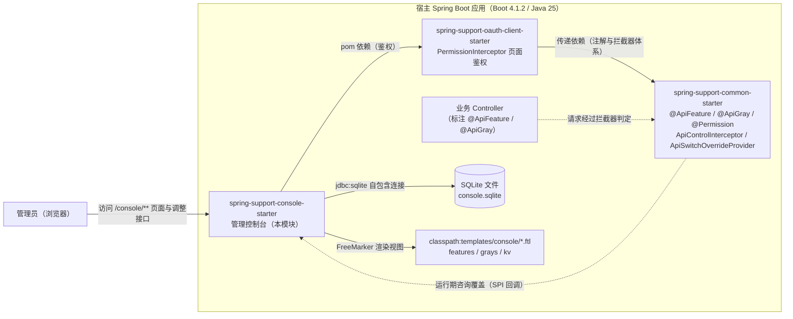
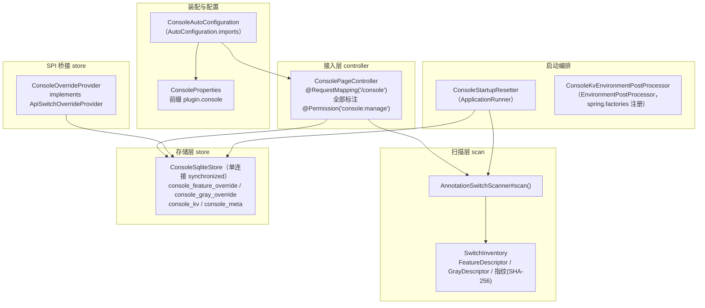
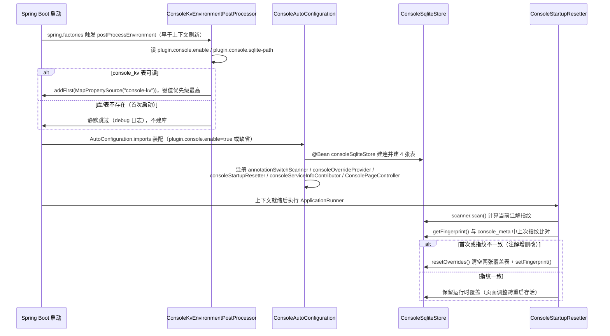
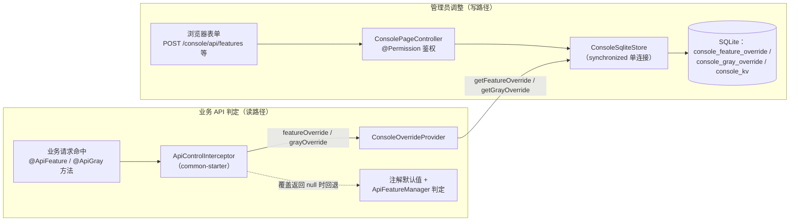

# spring-support-console-starter

管理控制台：用内置 FTL 页面（带鉴权）在**运行期**临时调整 `@ApiFeature` / `@ApiGray`
覆盖与通用键值运行设置；覆盖数据落 SQLite 持久化；启动时做「注解指纹」比对，
注解变了就重置覆盖库，注解没变则保留运行时调整。

- 坐标：`com.chua:spring-support-console-starter:4.0.0.51`（随父工程 `spring-support-parent-starter`）
- 运行基线：Spring Boot **4.1.2** / Java **25**（2026-11-19 升级后基线）
- 模块性质：独立可选 starter，仓库内没有其它 starter 依赖它，由宿主应用按需引入

---

## 1. 架构图

### 1.1 模块在体系中的位置



依赖方向是单向的：`console → oauth-client → common`。运行期 common-starter 的
`ApiControlInterceptor` 通过本模块注册的 `ConsoleOverrideProvider`（`ApiSwitchOverrideProvider`
的 SQLite 实现）读覆盖数据，不产生反向编译依赖。

### 1.2 内部分层



---

## 2. 核心流程图

### 2.1 启动装配与指纹重置流程



### 2.2 运行期覆盖数据流（写路径 + 读路径）



覆盖表在**每次请求判定时实时读取**，页面改完下一次请求立即生效，无需重启。

---

## 3. 能力清单

| 能力域 | 关键类 | 入口（REST 路径 / SPI / 注册文件） |
|---|---|---|
| 自动配置装配 | `com.chua.starter.console.ConsoleAutoConfiguration` | `META-INF/spring/org.springframework.boot.autoconfigure.AutoConfiguration.imports` |
| 键值注入 Environment | `com.chua.starter.console.environment.ConsoleKvEnvironmentPostProcessor` | `META-INF/spring.factories`（`EnvironmentPostProcessor`） |
| 控制台首页 | `controller.ConsolePageController#index` | `GET /console/`（302 → `/console/features`） |
| 功能开关页面 | `ConsolePageController#features` | `GET /console/features` |
| 灰度规则页面 | `ConsolePageController#grays` | `GET /console/grays` |
| 键值设置页面 | `ConsolePageController#kv` | `GET /console/kv` |
| 功能覆盖写/删 | `ConsolePageController#upsertFeature` / `#deleteFeature` | `POST /console/api/features`、`POST /console/api/features/delete` |
| 灰度覆盖写/删 | `ConsolePageController#upsertGray` / `#deleteGray` | `POST /console/api/grays`、`POST /console/api/grays/delete` |
| 键值写/删 | `ConsolePageController#upsertKv` / `#deleteKv` | `POST /console/api/kv`、`POST /console/api/kv/delete` |
| 注解扫描与指纹 | `scan.AnnotationSwitchScanner#scan()` → `SwitchInventory` | Spring Bean；页面与启动重置器共用 |
| SQLite 持久层 | `store.ConsoleSqliteStore`（4 张表） | Spring Bean（`destroyMethod = "close"`） |
| 覆盖判定接入 | `store.ConsoleOverrideProvider`（实现 `ApiSwitchOverrideProvider`） | Spring Bean，被 common-starter `ApiControlInterceptor` / `ApiFeatureConfiguration` 咨询 |
| 启动指纹比对/重置 | `store.ConsoleStartupResetter`（`ApplicationRunner`） | 应用启动完成后自动执行 |
| 服务信息登记 | `ConsoleAutoConfiguration#consoleServiceInfoContributor` | `ServiceInfoContributor` → `registerFlag("console", "管理控制台", enable, ...)` |

页面与调整接口全部标注 `@Permission(ConsolePageController.CONSOLE_PERMISSION)`，
权限码常量为 `console:manage`，由 `spring-support-oauth-client-starter` 的
`PermissionInterceptor`（`AuthClientConfiguration` 注册）执行。

SQLite 固定四张表（`ConsoleSqliteStore#initSchema`，`CREATE TABLE IF NOT EXISTS`）：

| 表 | 用途 | 关键列 |
|---|---|---|
| `console_feature_override` | `@ApiFeature` 覆盖 | `feature_id` PK、`enabled`、`disabled_message`、`disabled_status`（默认 -1）、`updated_at` |
| `console_gray_override` | `@ApiGray` 覆盖 | `pattern` PK、`percentage`、`roles`、`users`、`headers`、`rule`、`updated_at` |
| `console_kv` | 通用键值运行设置 | `k` PK（VARCHAR 255）、`v`（VARCHAR 1000）、`updated_at` |
| `console_meta` | 注解指纹 | `k='annotation-fingerprint'` → SHA-256 hex |

---

## 4. Bean 能力矩阵

自动配置类：`ConsoleAutoConfiguration`
（`@Configuration(proxyBeanMethods = false)` + `@Import(ConsolePageController.class)` +
`@EnableConfigurationProperties(ConsoleProperties.class)`）。
装配条件：`@ConditionalOnProperty(prefix = "plugin.console", name = "enable",
havingValue = "true", matchIfMissing = true)` —— **不配置也生效**。下表所有 Bean 共用该条件。

| Bean 名（默认） | 类型 | 装配条件 | 可否覆盖 | 典型注入姿势 |
|---|---|---|---|---|
| `annotationSwitchScanner` | `scan.AnnotationSwitchScanner` | `plugin.console.enable=true`（或缺省） | 可：普通 `@Bean`，同名覆盖需开 `spring.main.allow-bean-definition-overriding=true` | `@Autowired AnnotationSwitchScanner scanner;` 后调 `scan()` |
| `consoleSqliteStore` | `store.ConsoleSqliteStore`（`AutoCloseable`，`destroyMethod="close"`） | 同上 | 可（同上） | `@Autowired ConsoleSqliteStore store;` 直接调 upsert/get/delete |
| `consoleOverrideProvider` | `store.ConsoleOverrideProvider`（实现 `ApiSwitchOverrideProvider`） | 同上 | 可：建议自定义实现标 `@Primary`；common-starter 用 `ObjectProvider.getIfAvailable()` 取唯一实现 | `@Autowired ApiSwitchOverrideProvider provider;` |
| `consoleStartupResetter` | `store.ConsoleStartupResetter`（`ApplicationRunner`） | 同上 | 可（同上） | 一般不主动注入，由 Boot 在启动完成后自动 `run()` |
| `consoleServiceInfoContributor` | `common...serviceinfo.ServiceInfoContributor`（lambda） | 同上 | 可（同上） | 无需注入：由 `ServiceInfoRegistry` 聚合展示 |
| `consolePageController`（`@Import` 注册） | `controller.ConsolePageController`（`@Controller`） | 随自动配置一并导入 | 不可用 `@Bean` 方式替换（`@Import` 导入的组件） | 不注入；直接经 HTTP `/console/**` 访问 |

注意两点：

1. `ConsoleKvEnvironmentPostProcessor` **不是 Bean**。它由 Spring Boot 在环境准备阶段经
   `spring.factories` 实例化并调用，早于 `ApplicationContext` 创建，无法也不需要注入。
2. 本模块 Bean 均未标注 `@ConditionalOnMissingBean`，宿主可用同类型/同名 Bean 替换；
   同名替换必须开启 `spring.main.allow-bean-definition-overriding=true`，类型替换（如多个
   `ApiSwitchOverrideProvider`）必须用 `@Primary` 指定唯一候选。

---

## 5. 完整配置

配置类：`com.chua.starter.console.ConsoleProperties`，
`@ConfigurationProperties(prefix = ConsoleProperties.PRE)`，`PRE = "plugin.console"`。
这是本模块唯一的 `@ConfigurationProperties`，**全部字段如下，没有其它隐藏配置**：

| 配置路径 | 类型 | 默认值 | 说明 | 生效开关/状态 |
|---|---|---|---|---|
| `plugin.console.enable` | `boolean` | `true` | 是否启用控制台（自动配置条件 + 环境注入器都读它；`matchIfMissing=true`，不写即启用） | 它本身就是总开关 |
| `plugin.console.sqlite-path` | `String` | `console.sqlite` | SQLite 文件路径（相对运行目录解析）；持久层与环境注入器读同一文件 | `plugin.console.enable=true` |
| `plugin.console.permission-code` | `String` | `console:manage` | 页面访问权限码。**当前代码未读取该值**：控制器绑定的是编译期常量 `ConsolePageController.CONSOLE_PERMISSION`，`getPermissionCode()` 无调用点 | 暂不生效（见第 9 节 FAQ） |
| `plugin.console.kv-prefix` | `String` | `""`（空串，管理全部键值） | 键值列表前缀过滤。**当前代码未读取该值**：页面固定调用 `store.listKv("")` | 暂不生效（见第 9 节 FAQ） |

示例：

```yaml
plugin:
  console:
    enable: true
    sqlite-path: ./data/console.sqlite
```

键名书写注意：`@ConfigurationProperties` 本身支持驼峰/中划线松散绑定；但
`ConsoleKvEnvironmentPostProcessor` 是用 `environment.getProperty("plugin.console.enable", "true")`
与 `environment.getProperty("plugin.console.sqlite-path", "console.sqlite")` **精确读取**这两个键的，
所以涉及键值注入的配置请写成上表的连字符形式，不要用 `sqlitePath` 驼峰变体。

模块无独立端口、无独立 HTTP 前缀配置：控制台固定挂在宿主应用的 `/console/**` 路径下。

---

## 6. 使用方式

### 6.1 Maven 坐标

版本与父工程一致（当前 `4.0.0.51`，由父 POM `dependencyManagement` 统一管理）：

```xml
<dependency>
    <groupId>com.chua</groupId>
    <artifactId>spring-support-console-starter</artifactId>
    <version>4.0.0.51</version>
</dependency>
```

### 6.2 最小可运行示例

**第一步：引入依赖**（见上）。`spring-support-oauth-client-starter` 会被传递引入，
宿主需提供登录态与权限数据源，否则所有 `/console/**` 会被 `PermissionInterceptor` 拦下。

**第二步（可选）配置**：

```yaml
plugin:
  console:
    enable: true            # 默认即启用
    sqlite-path: console.sqlite   # 相对运行目录
```

**第三步：在业务接口上使用开关注解**（来自 common-starter）：

```java
@RestController
public class DemoController {

    @ApiFeature(value = "order-export", defaultEnabled = true,
                disabledMessage = "导出功能维护中", disabledStatus = 503)
    @GetMapping("/api/order/export")
    public String export() {
        return "ok";
    }

    @ApiGray(value = "gray-order-v2", percentage = 0)
    @GetMapping("/api/order/gray")
    public String gray() {
        return "gray-ok";
    }
}
```

**第四步：启动应用，访问控制台**：

```text
GET /console/           → 302 到 /console/features
GET /console/features   → 功能开关列表（注解默认值 + 覆盖值 + 生效值）
GET /console/grays      → 灰度规则列表
GET /console/kv         → 键值运行设置列表
```

在页面上把 `order-export` 停用后，`GET /api/order/export` 立即按覆盖值返回
`503` 与提示消息；删除覆盖后回落到注解默认值。

### 6.3 依赖说明（来自模块 pom.xml）

| 依赖 | 版本来源 | 作用 |
|---|---|---|
| `com.chua:spring-support-oauth-client-starter` | 父工程 `${project.version}` | `@Permission` 页面鉴权；传递引入 common-starter 的注解与拦截器体系 |
| `org.springframework.boot:spring-boot-starter-web` | Boot 4.1.2 BOM | MVC 控制器、`RequestMappingHandlerMapping`（注解扫描的数据源） |
| `org.springframework.boot:spring-boot-starter-freemarker` | Boot 4.1.2 BOM（FreeMarker 2.3.34） | 渲染 `templates/console/*.ftl` |
| `org.xerial:sqlite-jdbc` | Boot BOM 托管 | 自包含 SQLite 持久化，不需要宿主提供 `DataSource` |
| `org.projectlombok:lombok` | 父工程 1.18.48，`provided` | `@Data` / `@Builder` / `@Slf4j` |

模板在 jar 内的固定位置（类路径）：`templates/console/features.ftl`、`grays.ftl`、`kv.ftl`。
控制器返回视图名（`console/features` 等），依赖 FreeMarker 默认的 `classpath:/templates/`
前缀与 `.ftl` 后缀；宿主若改过 `spring.freemarker.prefix/suffix`，需保证这三个模板仍可达。

---

## 7. 使用场景

### 适用

- 需要在**不停机**的情况下临时启停接口功能（`@ApiFeature`）或调整灰度比例/白名单（`@ApiGray`）。
- 需要一个轻量的键值「运行设置」入口，并希望这些值能以最高优先级注入 Spring `Environment`
  （`@Value` / `environment.getProperty` 可读）。
- 单体应用或少量实例、不打算为几个开关引入配置中心/数据库的团队。
- 已在使用本生态 common-starter 的 `@ApiFeature` / `@ApiGray` 体系，想要配套管理界面。

### 不适用

- **WebFlux 响应式栈**：本模块基于 Spring MVC（`RequestMappingHandlerMapping`、
  `@Controller`、`HandlerInterceptor`），没有响应式实现。
- **无法提供鉴权体系的应用**：页面只有 `@Permission` 一道闸，宿主没接登录态时不要把
  控制口暴露到公网。
- **多实例集中管控**：覆盖库是本机 SQLite 文件，实例之间不共享；每个实例的调整只影响自己
  （除非把 `sqlite-path` 指到共享存储上的同一文件，并自行承担并发风险）。

### 与相邻模块的取舍

| 需求 | 选择 | 理由 |
|---|---|---|
| 接口级功能开关/灰度的运行期临时调整 | 本模块 | 直接面向 `@ApiFeature`/`@ApiGray` 注解，页面化操作，落 SQLite，改完即生效 |
| 应用配置/参数的集中管理与动态刷新 | `spring-support-configcenter-starter`（配置中心） | 面向配置项本身，支持分布式集中下发；本模块的键值是单机文件级补充 |
| 运维监控、服务信息观测 | monitor / server 等 starter | 面向观测；本模块面向「改行为」，二者互补 |
| 永久性开关决策 | 直接改注解并发布 | 页面调整是「临时覆盖」，注解变更会改变指纹并在下次启动时清空覆盖库 |

---

## 8. 扩展点

本模块**没有 `META-INF/services`（JDK SPI）文件**，扩展通过 Spring Bean 与标准
Spring Boot 扩展机制进行：

1. **覆盖数据源 SPI：`ApiSwitchOverrideProvider`**（接口定义在 common-starter：
   `com.chua.starter.common.support.api.feature.ApiSwitchOverrideProvider`）。
   本模块默认实现为 `ConsoleOverrideProvider`（读 SQLite 覆盖表）。方法均为 `default`、
   返回 `null` 表示「无覆盖」，拦截器随即回退注解 + `ApiFeatureManager` 默认判定。
   自定义示例：

   ```java
   @Bean
   @Primary
   public ApiSwitchOverrideProvider myOverrideProvider() {
       return new ApiSwitchOverrideProvider() {
           @Override
           public FeatureOverride featureOverride(String featureId) {
               return null;   // 回退注解默认判定
           }
           @Override
           public GrayOverride grayOverride(String pattern) {
               return null;
           }
       };
   }
   ```

   消费方式：`ApiControlInterceptor` 与 `ApiFeatureConfiguration` 通过
   `ObjectProvider<ApiSwitchOverrideProvider>` 取实现，声明成 Bean 即被咨询；
   容器内多个实现时必须给其中一个标 `@Primary`。

2. **持久层 API 复用：`ConsoleSqliteStore`**。公开方法均为 `synchronized`：
   `upsertFeatureOverride / getFeatureOverride / deleteFeatureOverride / listFeatureOverrides`、
   `upsertGrayOverride / getGrayOverride / deleteGrayOverride / listGrayOverrides`、
   `setKv / getKv / deleteKv / listKv`、`getFingerprint / setFingerprint / resetOverrides`。
   可注入后把覆盖数据同步到自己的审计或通知通道。

3. **扫描清单复用：`AnnotationSwitchScanner#scan()`**。返回 `SwitchInventory`
   （`@ApiFeature` / `@ApiGray` 描述 + 整体 SHA-256 指纹），可用于自定义报表或变更告警。

4. **环境注入模式：`EnvironmentPostProcessor`**。本模块经 `spring.factories` 注册
   `ConsoleKvEnvironmentPostProcessor`（顺序 `Ordered.LOWEST_PRECEDENCE - 100`，键值
   `PropertySource` 置于最前）。宿主可用同样方式注册自己的 EPP，与本模块互不冲突。

5. **不可扩展点（如实说明）**：控制器路由 `/console/**`、四张 SQLite 表结构、
   权限码常量 `console:manage` 均为编译期固定值，没有提供配置化重写入口；
   需要改这些只能改源码。

---

## 9. 常见问题

**Q1：引入依赖后 `/console/**` 404，控制台没装配？**
依次检查：① 依赖确实在 classpath；② `plugin.console.enable` 没有被设成 `false`
（自动配置条件与环境注入器读的是同一个键，设 false 时整个模块不装配、键值也不注入）；
③ 宿主是标准 Spring Boot 自动装配（本模块用 `AutoConfiguration.imports`，Boot 2.7+/4.x
原生支持，无需额外 `@EnableAutoConfiguration` 以外的操作）。

**Q2：控制台占用独立端口吗？**
不占用。控制台复用宿主应用的 HTTP 端口，路径固定为 `/console/**`；它也不走
Actuator 的 management port。反向代理环境注意把 `/console/**` 纳入鉴权与访问控制。

**Q3：改了 `plugin.console.permission-code` 或 `plugin.console.kv-prefix` 没效果？**
这两个配置项当前**不被代码读取**：权限码绑定的是编译期常量
`ConsolePageController.CONSOLE_PERMISSION = "console:manage"`（`getPermissionCode()` 无调用点）；
键值页面固定调用 `store.listKv("")`（`getKvPrefix()` 无调用点）。要改实际权限码需修改源码常量。

**Q4：页面改过的开关重启后丢了？**
两种可能：① 代码里的 `@ApiFeature`/`@ApiGray` 注解发生了增删改 —— `ConsoleStartupResetter`
比对指纹不一致会清空 `console_feature_override` / `console_gray_override`（这是设计行为，
`console_kv` 不会被清）；② `sqlite-path` 变了或运行目录变了，读到的是另一个空库。

**Q5：`@Value("${some.key}")` 读不到控制台里写的键值？**
键值注入只发生在**启动时**（`ConsoleKvEnvironmentPostProcessor`）。运行期用页面/`setKv`
写入的值不会即时进入 `Environment`，需重启后生效；要立即读取请注入 `ConsoleSqliteStore`
调 `getKv(key)`。另外首次启动时库表尚不存在，注入器会静默跳过，写完键值再重启即可。

**Q6：与 Spring Boot 4 的兼容性？**
本模块随父工程基于 Spring Boot **4.1.2**（`spring-boot-starter-parent:4.1.2`，BOM
`spring-boot-dependencies:4.1.2`）与 Java 25 构建：自动配置用 `AutoConfiguration.imports`，
`EnvironmentPostProcessor` 仍走 `spring.factories`（Boot 4 对该机制保持兼容）；FreeMarker
为 2.3.34（Boot 4.1 BOM 要求的含 jakarta 支持的版本）；`sqlite-jdbc` 版本由 Boot BOM 托管。
宿主请使用同一 Spring Boot 4.1.x 线，不要与 Boot 3.x / javax 时代的旧体系混依赖。

**Q7：启动报「SQLite 持久层初始化失败」？**
`ConsoleSqliteStore` 构造时用 `jdbc:sqlite:<plugin.console.sqlite-path>` 建连并建表；
路径所在目录不存在、不可写或文件被独占锁住都会抛 `IllegalStateException`。
把 `sqlite-path` 指向一个可写目录即可（相对路径按运行目录解析）。

**Q8：多个 `ApiSwitchOverrideProvider` 实现导致启动失败？**
common-starter 用 `ObjectProvider.getIfAvailable()` 取唯一实现。容器里同时有
`ConsoleOverrideProvider` 和你的自定义实现时，给其中一个标 `@Primary`（或用同名 Bean
覆盖并开启 `spring.main.allow-bean-definition-overriding=true`）。

**Q9：安全性上要注意什么？**
页面对外暴露的是「改线上行为」的能力：① 必须保证 oauth-client 的 `PermissionInterceptor`
真实生效（宿主提供了登录态与权限数据源），否则 `@Permission` 不产生校验，`/console/**`
将无鉴权暴露；② 调整接口是普通表单 `@PostMapping`，**无 CSRF 防护、无操作审计**
（记录只带数据库默认的 `updated_at`，不记操作人）；③ 生产环境建议限制来源 IP 或仅内网开放。
