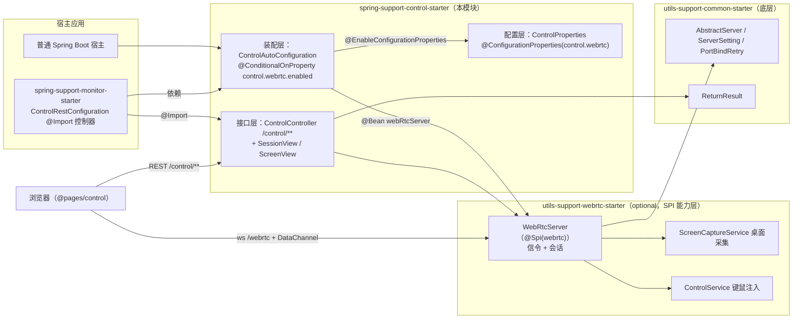
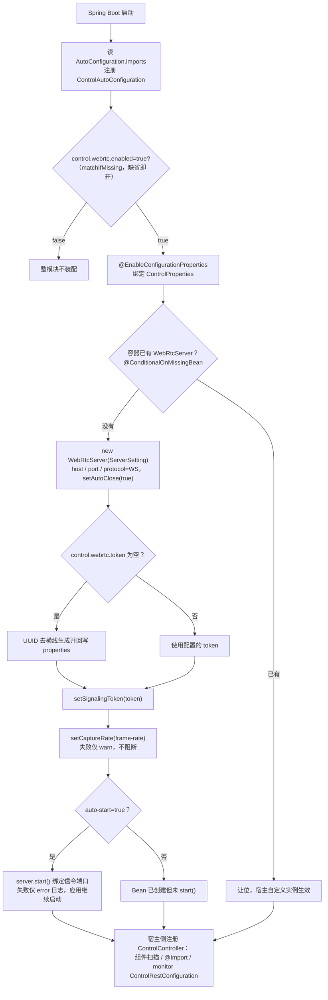

# spring-support-control-starter

WebRTC 远程控制模块：把 `utils-support-webrtc-starter` 的 WebSocket 信令、桌面采集与键鼠注入装配成 Spring Bean，并对外提供 `/control/**` 的会话 / 屏幕 / 配置辅助 REST 接口；媒体流与键鼠控制走 WebSocket 信令 + WebRTC DataChannel，REST 只做辅助管理。在 spring-support 体系中，它是「桌面远控」能力的 Spring Boot 装配入口：向下装配 `utils-support-webrtc-starter`，向上被 `spring-support-monitor-starter` 聚合（经 `ControlRestConfiguration` 导入控制器，供前端 `@pages/control` 使用）。

- 模块坐标：`com.chua:spring-support-control-starter:4.0.0.51`（父 POM `spring-support-parent-starter`，基线 Spring Boot `4.1.2` / Java 25）
- 自动装配登记：`META-INF/spring/org.springframework.boot.autoconfigure.AutoConfiguration.imports` → `ControlAutoConfiguration`（Boot 3+/4 方式，无 `spring.factories`）

## 1. 架构图



依赖方向：宿主 → 本模块 → `utils-support-webrtc-starter` / `utils-support-common-starter`。本模块只做「Spring 装配 + REST 辅助接口」，采集与注入能力全部在下游 webrtc 模块。

## 2. 核心流程图

本模块的本质是 starter 装配，选自动装配流程：



运行期数据流（文字版）：浏览器先 `GET /control/config` 取 `wsUrl` 与 `token` → 与 `ws://{host}:{port}/webrtc?token=...` 握手（`WebRtcSignalingHandler#isAuthorized` 校验，不匹配回 403）→ offer / answer / ice-candidate 经 `WebRtcServer#receiveSignaling` 协商 → 连接建立后 `ScreenCaptureService` 向浏览器推桌面 VideoTrack，键鼠事件走 DataChannel 由 `ControlService#onControlEvent`（`java.awt.Robot`）注入；DataChannel 不可用时可走 `POST /control/event/send` 兜底（`DefaultControlEventFactory#parse` 解析后进同一条链路）。

## 3. 能力清单

| 能力域 | 关键类 | 入口 / 触发方式 |
|---|---|---|
| 自动装配 | `com.chua.starter.control.configuration.ControlAutoConfiguration` | `AutoConfiguration.imports` 登记，容器启动触发 |
| 配置绑定 | `com.chua.starter.control.properties.ControlProperties` | 配置前缀 `control.webrtc` |
| 信令服务装配 | `ControlAutoConfiguration#webRtcServer` → `com.chua.webrtc.server.WebRtcServer` | Bean `webRtcServer`（`destroyMethod="stop"`）；`ws://{host}:{port}/webrtc` |
| 会话管理 REST | `com.chua.starter.control.controller.ControlController#sessions` / `#createSession` / `#destroySession` | `GET /control/sessions`、`POST /control/session/create?sessionId=...`、`DELETE /control/session/destroy/{sessionId}` |
| 桌面采集源查询 | `ControlController#screens` | `GET /control/screens`（失败返回空列表，不报错） |
| 信令配置下发 | `ControlController#config` | `GET /control/config`（host / port / path / wsUrl / token / frameRate / width / height） |
| 控制事件兜底 | `ControlController#sendEvent` | `POST /control/event/send?sessionId=...&peerId=...`，请求体为事件 JSON |
| WebSocket 信令 | `com.chua.webrtc.server.WebRtcServer`（`SIGNALING_PATH="/webrtc"`） | `ws://{host}:{port}/webrtc?token=...` |
| 视图模型 | `com.chua.starter.control.model.SessionView`、`ScreenView` | 控制器返回的 `record` |

返回值统一包在 `com.chua.common.support.lang.code.ReturnResult` 中；`SessionView` 字段 `sessionId` / `peerCount` / `capturing`（按 `ScreenCaptureService#videoTrack() != null` 判定），`ScreenView` 字段 `id` / `name` / `width` / `height`。

## 4. Bean 能力矩阵

| Bean 名 | 类型 | 装配条件（含默认值） | 可否覆盖 | 典型用途 |
|---|---|---|---|---|
| `webRtcServer` | `com.chua.webrtc.server.WebRtcServer` | 类级 `@ConditionalOnProperty(prefix="control.webrtc", name="enabled", havingValue="true", matchIfMissing=true)`；方法级 `@ConditionalOnMissingBean(WebRtcServer.class)`；另需类路径存在 webrtc 实现（optional 依赖） | 可覆盖：宿主注册同型 Bean 后本模块让位 | 信令服务与会话管理；经 `extensions()` 取采集 / 注入能力 |
| `control.webrtc-com.chua.starter.control.properties.ControlProperties` | `com.chua.starter.control.properties.ControlProperties` | `@EnableConfigurationProperties(ControlProperties.class)`，随自动配置的条件生效 | 否（绑定式注册，改值走 `control.webrtc.*`） | 读取远控配置；构造注入到 `ControlController` |
| `controlController` | `com.chua.starter.control.controller.ControlController` | **不在本模块自动装配范围**：需宿主组件扫描、`@Import(ControlController.class)` 或 monitor 的 `ControlRestConfiguration`（`@AutoConfiguration` + `@ConditionalOnClass` + `@ConditionalOnProperty(control.webrtc.enabled)`） | 可覆盖（注册权在宿主） | `/control/**` HTTP 辅助接口；不建议业务代码注入 |

补充：`webRtcServer` 的 `destroyMethod="stop"` 走 `AbstractServer#stop()`（`final synchronized`、幂等，未启动直接返回），完成销毁会话、停采集、关信令端口、释放 `PeerConnectionFactory`。`extensions()` 返回的 `DefaultExtensions` 不是 Spring Bean，每次调用都新建，只是 `ScreenCaptureService`（默认 `JavaScreenCaptureService`）与 `ControlService`（默认 `JavaInputSender`，headless 回落 `NoopControlService`）的访问门面。`ControlController` 构造依赖 `WebRtcServer` 与 `ControlProperties` 两个 Bean，`enabled=false` 时两者都不存在，不要无条件导入它，否则启动失败。

## 5. 完整配置

配置类：`com.chua.starter.control.properties.ControlProperties`，`@ConfigurationProperties(prefix = "control.webrtc")`，无嵌套类，全部字段如下（无其他隐藏配置项）：

| 配置路径 | 类型 | 默认值 | 说明 |
|---|---|---|---|
| `control.webrtc.enabled` | `boolean` | `true` | 总开关（`matchIfMissing=true`），`false` 时整模块不装配 |
| `control.webrtc.token` | `String` | `""` | 信令令牌；为空启动时自动生成（UUID 去横线）并回写，随 `/control/config` 下发 |
| `control.webrtc.host` | `String` | `0.0.0.0` | 信令监听地址 |
| `control.webrtc.port` | `int` | `10000` | 信令端口，独立于 `server.port` |
| `control.webrtc.auto-start` | `boolean` | `true` | 是否随应用启动信令服务 |
| `control.webrtc.frame-rate` | `int` | `15` | 桌面采集帧率，装配时调用 `setCaptureRate` |
| `control.webrtc.width` | `int` | `1280` | 采集最大宽度；当前仅随 `/control/config` 下发，未参与采集设置 |
| `control.webrtc.height` | `int` | `720` | 采集最大高度；同上 |

## 6. 使用方式

Maven 坐标（`utils-support-webrtc-starter` 版本由父工程 `dependencyManagement` 托管，继承 `spring-support-parent-starter` 时可省略版本号）：

```xml
<dependency>
    <groupId>com.chua</groupId>
    <artifactId>spring-support-control-starter</artifactId>
    <version>4.0.0.51</version>
</dependency>
<!-- 必须显式声明：本模块将其标为 optional，不会传递 -->
<dependency>
    <groupId>com.chua</groupId>
    <artifactId>utils-support-webrtc-starter</artifactId>
    <version>4.0.0.51</version>
</dependency>
```

最小启用示例（引入依赖 + 显式导入控制器 + 配置）：

```java
@SpringBootApplication
// ControlController 不在自动装配范围，需 @Import 或让组件扫描覆盖 com.chua.starter.control.controller
@Import(ControlController.class)
public class DemoApplication {
    public static void main(String[] args) {
        SpringApplication.run(DemoApplication.class, args);
    }
}
```

```yaml
control:
  webrtc:
    enabled: true
    host: 0.0.0.0
    port: 10000
    auto-start: true
    frame-rate: 15
    # token 留空则启动时自动生成；页面先 GET /control/config 取 token 再连 ws
```

启动后先取信令配置再连 WebSocket，返回值统一包在 `ReturnResult`（`code` / `msg` / `data` 三层，业务字段在 `data`）：

```bash
curl http://127.0.0.1:8080/control/config
# {"code":"00000","msg":"操作成功","data":{"host":"0.0.0.0","port":10000,"path":"/webrtc",
#  "wsUrl":"ws://127.0.0.1:10000/webrtc","token":"...","frameRate":15,"width":1280,"height":720}}
```

编程式使用（注入 `WebRtcServer`）：

```java
WebRtcSession session = webRtcServer.createSession("demo-1");   // 同 ID 复用已有会话
webRtcServer.destroySession("demo-1");
ScreenCaptureService capture = webRtcServer.extensions().screenCaptureService();
boolean capturing = capture.videoTrack() != null;
```

可选依赖说明（缺失后果）：

| 依赖 | optional | 缺失后果 |
|---|---|---|
| `utils-support-webrtc-starter` | 是 | `WebRtcServer` 等全部远控类缺失，装配时 `ClassNotFoundException`，应用起不来；宿主必须自己声明 |
| `spring-boot-configuration-processor` | 是 | 仅失去 `control.webrtc.*` 的 IDE 配置元数据提示，不影响运行 |
| `lombok` | 是 | 仅编译期需要；直接依赖本模块二进制 jar 时无需关心 |
| `spring-boot-starter-web` | 否 | 无 MVC 运行时，`/control/**` 接口不可用 |
| `utils-support-common-starter` | 否 | `ReturnResult` / `ServerSetting` / `ProtocolType` 缺失，编译不通过 |

## 7. 使用场景

适用：

- 浏览器远程查看 / 控制服务器桌面：运维远控、监控端远程排查、无人值守设备管理。
- 已在 `spring-support-monitor-starter` 体系内：monitor 聚合本模块与 webrtc 实现，经 `ControlRestConfiguration` 自动导入控制器，前端 `@pages/control` 开箱即用。
- 需要「信令 + 采集 + 注入」一条龙的 Spring Boot 宿主：本模块负责装配、配置与辅助 REST。

不适用 / 慎用：

- headless / 无桌面环境：键鼠注入降级为只读（`NoopControlService`），采集能力取决于平台实现（Windows DXGI Desktop Duplication、Linux X11/PipeWire、macOS VideoToolbox）。
- 通用 WebRTC 信令中转（音视频通话、直播）：信令服务于「桌面采集 + 键鼠注入」闭环，不是通用 SFU；跨机级联远控编排也不在范围内。

与相邻模块的取舍：

- 直接用 `utils-support-webrtc-starter`：非 Spring 环境或要完全自管生命周期 → `new WebRtcServer(setting)` + `start()`；要自动装配、`control.webrtc.*` 配置与 `/control/**` 辅助接口 → 本模块。
- `spring-support-monitor-starter`：本模块的真实宿主 / 聚合方（还聚合 docker、cdp 等）；只要远控能力不必引入整个 monitor。
- `spring-support-docker-starter` / `spring-support-cdp-starter`：并列能力（容器管理 / 浏览器调试 / 桌面远控），互不依赖，monitor 中并列引入。

## 8. 扩展点

本模块自身不定义 SPI：`META-INF` 下只有 `AutoConfiguration.imports`，没有 `META-INF/services/*`，也没有自定义扩展接口或抽象类。可行的扩展方式：

1. **覆盖 `WebRtcServer` Bean**：`webRtcServer` 标注 `@ConditionalOnMissingBean(WebRtcServer.class)`，宿主声明自己的 `WebRtcServer`（或子类）Bean 后本模块让位，适合替换信令实现、加统一鉴权、接管启停时机（仅支持单实例）。
2. **消费下游能力接口**（来自 `utils-support-webrtc-starter`，本模块只是使用方）：`com.chua.webrtc.spi.media.ScreenCaptureService`（采集，控制器与帧率设置使用）、`com.chua.webrtc.control.ControlService`（注入，支持 `register(ControlEventListener)` 监听事件）、`com.chua.webrtc.spi.WebRtcService`（`WebRtcServer` 标注 `@Spi("webrtc")` + `@SpiDefault`，供 SPI 体系按名发现）。
3. **自定义控制事件解析**：`/control/event/send` 固定使用 `DefaultControlEventFactory`（支持 `mouse` / `keyboard` 两类）；需要更多事件类型应扩展下游 `ControlEvent` 体系，而不是改本模块。

## 9. 常见问题

**Q1：引入 starter 后 `GET /control/sessions` 404 / 报 "No static resource control/sessions"？**
`ControlAutoConfiguration` 只装配 `WebRtcServer`，不注册 `ControlController`。控制器在 `com.chua.starter.control.controller` 包下，需满足其一：宿主组件扫描覆盖该包（`scanBasePackages` 含 `com.chua.starter.control`）、显式 `@Import(ControlController.class)`、或经 monitor 的 `ControlRestConfiguration` 自动导入。同时确认 `control.webrtc.enabled` 未被关闭——控制器构造依赖 `WebRtcServer` 与 `ControlProperties` 两个 Bean，开关关闭时它们都不存在。

**Q2：`control.webrtc.enabled=false` 到底关掉什么？**
整个自动配置类被 `@ConditionalOnProperty` 短路：`WebRtcServer` Bean 与 `ControlProperties` 绑定都不发生，`/webrtc` 信令端口也不会绑定。已通过组件扫描 / `@Import` 注册的 `ControlController` 会因缺少 `WebRtcServer` 依赖而启动失败，关闭开关时需一并移除控制器注册（monitor 的 `ControlRestConfiguration` 带同名条件，会自动让位）。

**Q3：信令端口和 Web 端口是什么关系？被占用会怎样？**
信令走独立端口 `control.webrtc.port`（默认 10000、路径 `/webrtc`），与 `server.port` 无关。端口被占用时 `AbstractServer#start()` 先按 `PortBindRetry` 策略重试绑定，仍失败则抛出；自动配置捕获后只记录 error 日志（"远程控制信令启动失败"），应用继续启动但远控不可用（`isRunning()` 为 `false`，`/control/config` 返回连不上的 `wsUrl`）。`auto-start: false` 时同理：Bean 已创建但未 `start()`，需自行调用。

**Q4：token 为什么每次重启都变？与 Spring Boot 4 / 兄弟模块同用要注意什么？**
`token` 为空时启动生成 `UUID.randomUUID().toString().replace("-", "")` 并回写 `ControlProperties`，内存态、不持久化，重启即失效——页面必须每次先 `GET /control/config` 取新 token。它只保护 `/webrtc` 信令握手（查询参数 `?token=`，不匹配回 403）；`/control/**` REST 没有方法级鉴权，访问控制依赖宿主自身的拦截器 / 网关。兼容性方面：本模块基于 Spring Boot `4.1.2` / Java 25，自动装配只走 `AutoConfiguration.imports`（Boot 3+/4 已移除 `spring.factories` 注册自动配置的方式），Servlet 用 `jakarta.servlet`，自动配置类为 `@Configuration(proxyBeanMethods = false)`；Boot 4.x + Jakarta 宿主可直接引入，Boot 2.x（`javax.*`）不兼容。与 monitor 等兄弟模块同用不会重复装配：`webRtcServer` 有 `@ConditionalOnMissingBean`，monitor 的 `ControlRestConfiguration` 也受 `control.webrtc.enabled` 同一开关控制。
