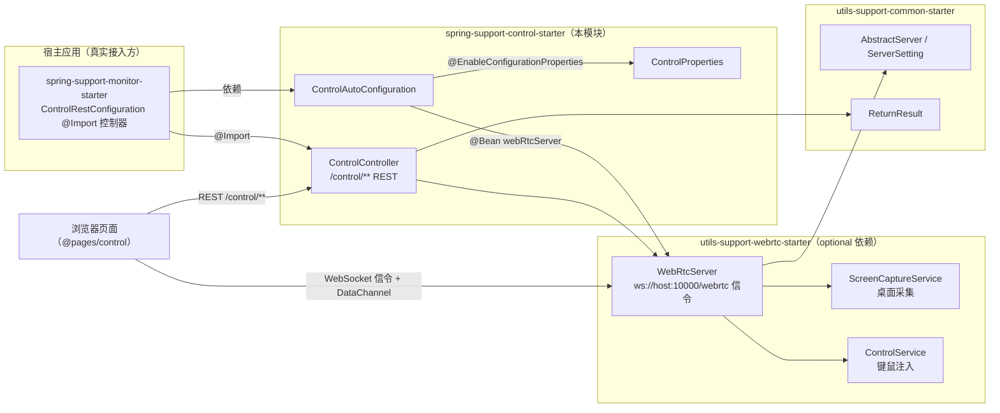
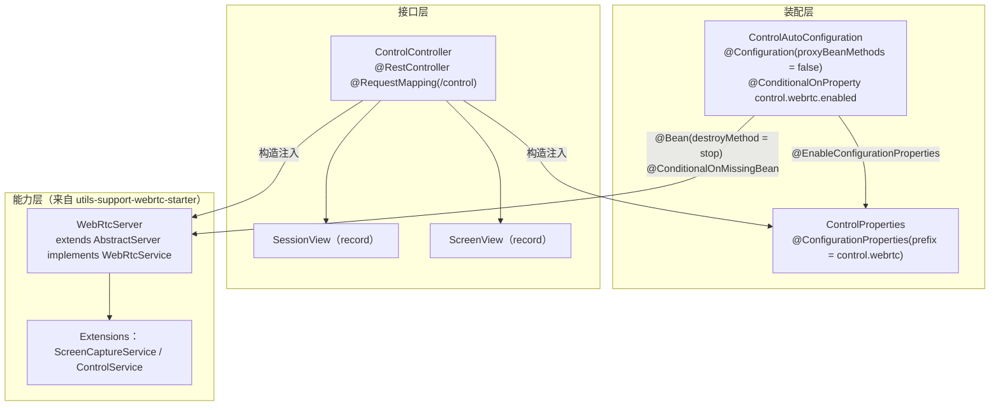
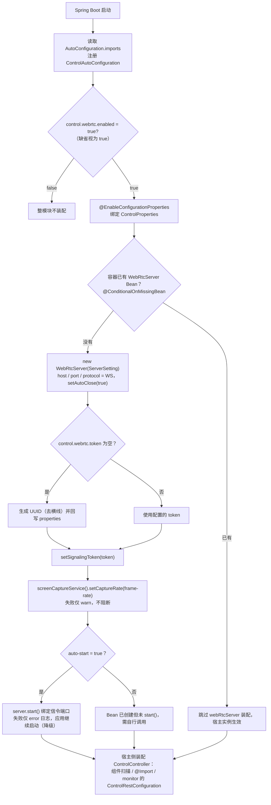
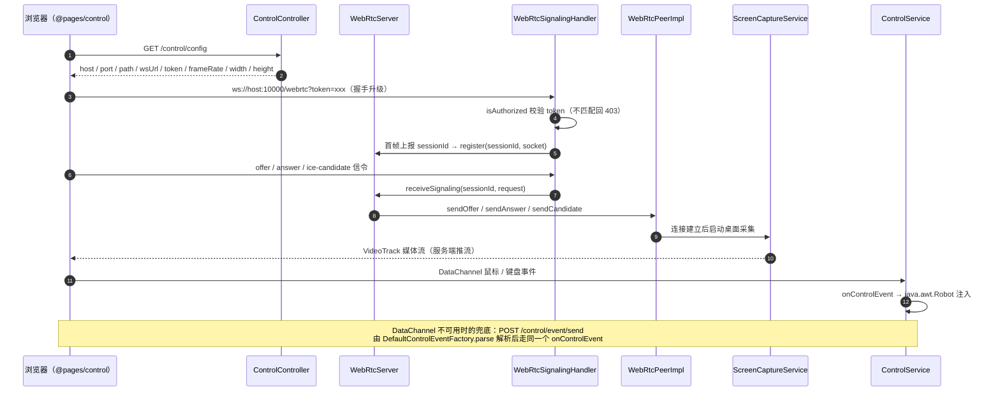

# spring-support-control-starter

WebRTC 远程控制模块：把 `utils-support-webrtc-starter` 的信令服务、桌面采集与键鼠注入
装配成 Spring Bean，并对外提供 `/control/**` 的会话 / 屏幕 / 配置辅助接口。
媒体流与键鼠控制走 WebSocket 信令 + WebRTC DataChannel，REST 只做辅助管理。

- 模块坐标：`com.chua:spring-support-control-starter:4.0.0.51`
- 基线：Spring Boot `4.1.2`（父 POM `spring-boot-starter-parent`）、Java 25
- 自动装配登记：`META-INF/spring/org.springframework.boot.autoconfigure.AutoConfiguration.imports` → `ControlAutoConfiguration`

---

## 1. 架构图

### 1.1 模块在体系中的位置



依赖方向：宿主 → 本模块 → `utils-support-webrtc-starter` / `utils-support-common-starter`。
本模块只做「Spring 装配 + REST 辅助接口」，媒体与注入能力全部在 `utils-support-webrtc-starter`。

### 1.2 模块内部分层



---

## 2. 核心流程图

### 2.1 装配流程（启动期）



### 2.2 请求处理 / 数据流（运行期）



---

## 3. 能力清单

| 能力域 | 关键类 | 入口（REST 路径或 SPI） |
|---|---|---|
| 自动配置装配 | `com.chua.starter.control.configuration.ControlAutoConfiguration` | `META-INF/spring/org.springframework.boot.autoconfigure.AutoConfiguration.imports` |
| 配置绑定 | `com.chua.starter.control.properties.ControlProperties` | 配置前缀 `control.webrtc` |
| 信令服务装配 | `ControlAutoConfiguration#webRtcServer` → `com.chua.webrtc.server.WebRtcServer` | Spring Bean `webRtcServer`（`destroyMethod = "stop"`）；`ws://{host}:{port}/webrtc` |
| 会话列表 | `com.chua.starter.control.controller.ControlController#sessions` | `GET /control/sessions` |
| 创建会话 | `ControlController#createSession` | `POST /control/session/create?sessionId=...` |
| 销毁会话 | `ControlController#destroySession` | `DELETE /control/session/destroy/{sessionId}` |
| 桌面采集源列表 | `ControlController#screens` | `GET /control/screens` |
| 信令地址与配置下发 | `ControlController#config` | `GET /control/config` |
| 控制事件兜底通道 | `ControlController#sendEvent` | `POST /control/event/send?sessionId=...&peerId=...` |
| WebSocket 信令 | `com.chua.webrtc.server.WebRtcServer`（`SIGNALING_PATH = "/webrtc"`） | `ws://{host}:{port}/webrtc?token=...` |
| 会话视图 / 屏幕视图 | `com.chua.starter.control.model.SessionView`、`com.chua.starter.control.model.ScreenView` | 控制器返回的 `record` |

控制器真实契约（与 `ControlController` 注解一一对应）：

```text
GET    /control/sessions                       活跃会话列表
POST   /control/session/create?sessionId=xxx   创建会话（同 ID 复用已有会话）
DELETE /control/session/destroy/{sessionId}    销毁会话
GET    /control/screens                        桌面采集源（失败返回空列表，不报错）
GET    /control/config                         信令地址、端口、path、wsUrl、token、采集参数
POST   /control/event/send                     控制事件 REST 兜底（DataChannel 不可用时）
```

- 返回值统一包在 `com.chua.common.support.lang.code.ReturnResult` 中。
- `SessionView` 字段：`sessionId`、`peerCount`、`capturing`（判定依据是 `ScreenCaptureService#videoTrack() != null`）。
- `ScreenView` 字段：`id`、`name`、`width`、`height`（来自 `ScreenCaptureService.ScreenInfo`）。
- `/control/event/send` 请求体是原始 JSON 字符串，由 `com.chua.webrtc.model.DefaultControlEventFactory#parse(String)`
  解析成 `ControlEvent`（`mouse` / `keyboard` 两类），再交给
  `webRtcServer.extensions().controlService().onControlEvent(sessionId, peerId, event.path(), event)`。

---

## 4. Bean 能力矩阵

| Bean 名 | 类型 | 装配条件 | 可否覆盖 | 典型注入姿势 |
|---|---|---|---|---|
| `webRtcServer` | `com.chua.webrtc.server.WebRtcServer` | 类级：`@ConditionalOnProperty(prefix="control.webrtc", name="enabled", havingValue="true", matchIfMissing=true)`；方法级：`@ConditionalOnMissingBean(WebRtcServer.class)`；另要求类路径存在 webrtc 实现（本模块 pom 中 `utils-support-webrtc-starter` 为 `optional`） | **可覆盖**：宿主自定义 `WebRtcServer` 类型 Bean 后，本模块不再创建 | 构造器注入（`ControlController` 即此姿势）或 `@Autowired`；经 `extensions()` 取 `ScreenCaptureService` / `ControlService` |
| `control.webrtc-com.chua.starter.control.properties.ControlProperties` | `com.chua.starter.control.properties.ControlProperties` | `@EnableConfigurationProperties(ControlProperties.class)`，随 `ControlAutoConfiguration` 的 `@ConditionalOnProperty` 生效 | 否（绑定式注册；修改值走 `control.webrtc.*` 配置项） | 构造器注入或 `@Autowired` |
| `controlController` | `com.chua.starter.control.controller.ControlController` | **不在本模块自动装配范围内**：需宿主组件扫描覆盖 `com.chua.starter.control.controller`，或显式 `@Import(ControlController.class)`；仓库内参考 monitor 的 `ControlRestConfiguration`（`@ConditionalOnClass` + `@ConditionalOnProperty(control.webrtc.enabled)` + `@Import`） | 可覆盖：注册权在宿主，可自行提供同型 Bean 替代 | 仅供 HTTP 层使用，不建议业务代码注入 |

补充说明：

- `WebRtcServer` Bean 的 `destroyMethod = "stop"`：应用关闭时走 `AbstractServer#stop()`
  （`final synchronized`、幂等，未启动时调用直接返回），完成销毁会话、停采集、关信令端口、释放 `PeerConnectionFactory`。
- `WebRtcServer#extensions()` 返回的 `DefaultExtensions` **不是 Spring Bean**，每次调用都新建，
  只是 `ScreenCaptureService`（默认 `JavaScreenCaptureService`）与 `ControlService`
  （默认 `JavaInputSender`，headless 下回落 `NoopControlService`）的访问门面。
- `ControlController` 构造依赖 `WebRtcServer`，因此 `control.webrtc.enabled=false` 时不要无条件导入它，否则启动失败。

---

## 5. 完整配置

配置类：`com.chua.starter.control.properties.ControlProperties`，
`@ConfigurationProperties(prefix = ControlProperties.PREFIX)`，`PREFIX = "control.webrtc"`。
全部字段如下（无其他隐藏配置项）：

| 配置路径 | 类型 | 默认值 | 说明 | 生效位置 / 开关 |
|---|---|---|---|---|
| `control.webrtc.enabled` | `boolean` | `true` | 是否启用远控模块（总开关，`matchIfMissing = true`） | `ControlAutoConfiguration` 的 `@ConditionalOnProperty`；monitor 宿主的 `ControlRestConfiguration` 同款条件 |
| `control.webrtc.token` | `String` | `""`（空串） | 信令访问令牌；为空时启动自动生成（`UUID` 去横线）并回写该属性 | `webRtcServer` 装配（`setSignalingToken`）、`GET /control/config` 下发、`/webrtc` 握手校验 |
| `control.webrtc.host` | `String` | `0.0.0.0` | 信令监听地址 | `ServerSetting`（信令端口绑定）；`GET /control/config` 回包的 `host` 字段 |
| `control.webrtc.port` | `int` | `10000` | 信令端口（独立于 `server.port`） | `ServerSetting`（WebSocket 路径 `/webrtc`）；`wsUrl` 拼接 |
| `control.webrtc.auto-start` | `boolean` | `true` | 是否随应用启动信令服务 | `webRtcServer` 装配中是否调用 `server.start()` |
| `control.webrtc.frame-rate` | `int` | `15` | 桌面采集帧率（1-30） | 装配时调用 `screenCaptureService().setCaptureRate(...)`；随 `/control/config` 下发 |
| `control.webrtc.width` | `int` | `1280` | 采集最大宽度。**仅随 `/control/config` 下发，不参与采集设置**（自动配置未调用 `setResize`） | `GET /control/config` 回包 |
| `control.webrtc.height` | `int` | `720` | 采集最大高度。同上 | `GET /control/config` 回包 |

示例：

```yaml
control:
  webrtc:
    enabled: true
    host: 0.0.0.0
    port: 10000
    auto-start: true
    frame-rate: 15
    width: 1280
    height: 720
    # token 留空即启动时自动生成，随 /control/config 下发
```

---

## 6. 使用方式

### 6.1 Maven 坐标

```xml
<dependency>
    <groupId>com.chua</groupId>
    <artifactId>spring-support-control-starter</artifactId>
    <version>4.0.0.51</version>
</dependency>
<!-- 必须显式声明：本模块将其标为 optional，不会传递 -->
<dependency>
    <groupId>com.chua</groupId>
    <artifactId>utils-support-webrtc-starter</artifactId>
    <version>4.0.0.51</version>
</dependency>
```

`utils-support-webrtc-starter` 的版本由父工程 `dependencyManagement` 统一托管（`${utils.version}`）；
若宿主继承 `spring-support-parent-starter`，可不写版本号。

### 6.2 最小可运行示例

```java
@SpringBootApplication
// ControlController 不在自动装配范围，需显式导入（或让组件扫描覆盖 com.chua.starter.control.controller）
@Import(ControlController.class)
public class DemoApplication {
    public static void main(String[] args) {
        SpringApplication.run(DemoApplication.class, args);
    }
}
```

```java
@Autowired
private WebRtcServer webRtcServer;

// 创建 / 查询 / 销毁会话
WebRtcSession session = webRtcServer.createSession("demo-1");
Collection<WebRtcSession> all = webRtcServer.sessions();
int peers = session.peers().size();
webRtcServer.destroySession("demo-1");

// 桌面源与采集对象（来自 webRtcServer.extensions()）
ScreenCaptureService capture = webRtcServer.extensions().screenCaptureService();
ScreenCaptureService.ScreenInfo[] screens = capture.screens();
boolean capturing = capture.videoTrack() != null;
```

启动后先取信令配置，再连 WebSocket。返回值统一包在 `com.chua.common.support.lang.code.ReturnResult`
中（`code` / `msg` / `data` 三层结构，见第 3 节），业务字段都在 `data` 节点内：

```bash
curl http://127.0.0.1:8080/control/config
# => {"code":"00000","msg":"操作成功","data":{"host":"0.0.0.0","port":10000,"path":"/webrtc",
#     "wsUrl":"ws://127.0.0.1:10000/webrtc","token":"...","frameRate":15,"width":1280,"height":720}}
```

控制事件 REST 兜底（字段与 DataChannel 协议一致、平铺在根节点）：

```bash
curl -X POST "http://127.0.0.1:8080/control/event/send?sessionId=demo-1&peerId=peer-0" \
  -H "Content-Type: application/json" \
  -d '{"type":"mouse","path":"control","timestamp":1,"x":100,"y":200,"button":"left","action":"press","delta":0}'
```

`sessionId` / `peerId` 都有默认值 `rest`（`@RequestParam(defaultValue = "rest")`），
不传时事件会投递到名为 `rest` 的会话/连接上，实际使用应显式传入。

### 6.3 可选依赖说明

| 依赖 | optional | 作用 |
|---|---|---|
| `utils-support-webrtc-starter` | 是 | `WebRtcServer`、`WebRtcSession`、`ScreenCaptureService`、`ControlService` 等全部远控能力。**宿主必须自己声明**，否则装配 `WebRtcServer` 时 `ClassNotFoundException`，应用起不来 |
| `spring-boot-configuration-processor` | 是 | 生成 `control.webrtc.*` 配置元数据（IDE 提示），仅编译期 |
| `lombok` | 是 | `@Data` / `@RequiredArgsConstructor` / `@Slf4j`，仅编译期 |
| `spring-boot-starter-web` | 否 | `/control/**` REST 控制器 |
| `utils-support-common-starter` | 否 | `ReturnResult`、`ServerSetting`、`ProtocolType` 等公共设施 |

---

## 7. 使用场景

**适用：**

- 需要从浏览器远程查看 / 控制服务器桌面的场景：运维远控、监控端远程排查、无人值守设备管理。
- 已在 `spring-support-monitor-starter` 体系内：monitor 同时声明本模块与 `utils-support-webrtc-starter`，
  并通过 `ControlRestConfiguration` 自动导入控制器，前端 `@pages/control` 页面开箱即用
  （`control.webrtc.enabled=false` 可整体关闭）。
- 需要「信令 + 采集 + 注入」一条龙的 Spring Boot 宿主：本模块负责装配、配置与辅助 REST。

**不适用：**

- 无桌面 / headless 环境：键鼠注入会降级为只读（`NoopControlService`），采集能力取决于平台实现
  （Windows DXGI Desktop Duplication、Linux X11/PipeWire、macOS VideoToolbox，见 `ScreenCaptureService` 说明）。
- 想把本模块当通用 WebRTC 信令中转（音视频通话、直播）：信令服务服务于「桌面采集 + 键鼠注入」闭环，
  不是通用 SFU。
- 需要跨机级联远控（A 控 B、B 控 C）的编排：本模块只管理单机内的会话。

**与相邻模块的取舍：**

| 对比对象 | 取舍 |
|---|---|
| 直接用 `utils-support-webrtc-starter` | 要 Spring Boot 自动装配、`control.webrtc.*` 配置与 `/control/**` 辅助接口 → 本模块；非 Spring 环境或要完全自管生命周期 → 直接用下游模块（`new WebRtcServer(setting)` + `start()`） |
| `spring-support-monitor-starter` | monitor 是本模块的真实宿主/聚合方（还聚合 docker、cdp 等）；只要远控能力不必引入整个 monitor |
| `spring-support-docker-starter` / `spring-support-cdp-starter` | 并列能力（容器管理 / 浏览器调试 / 桌面远控），互不依赖；monitor 中并列引入 |

---

## 8. 扩展点

**本模块自身不定义 SPI。** `META-INF` 下只有
`META-INF/spring/org.springframework.boot.autoconfigure.AutoConfiguration.imports`
（内容为 `ControlAutoConfiguration`），没有 `META-INF/services/*`，也没有自定义扩展接口。

可行的扩展方式：

1. **覆盖 `WebRtcServer` Bean**：`webRtcServer` 标注 `@ConditionalOnMissingBean(WebRtcServer.class)`，
   宿主声明自己的 `WebRtcServer`（或子类）Bean 后，本模块让位。适合替换信令实现、加统一鉴权、
   接管启停时机。注意只支持单个实例。
2. **消费下游能力接口**（来自 `utils-support-webrtc-starter`，本模块只是使用方）：

   | 下游接口 | 本模块使用位置 |
   |---|---|
   | `com.chua.webrtc.spi.media.ScreenCaptureService` | `ControlController#screens`、`#toSessionView`、自动配置设置帧率 |
   | `com.chua.webrtc.control.ControlService` | `ControlController#sendEvent` 投递控制事件；支持 `register(ControlEventListener)` 监听事件 |
   | `com.chua.webrtc.spi.WebRtcService`（`WebRtcServer` 标注 `@Spi("webrtc")` `@SpiDefault`） | 供 SPI 体系按名发现远控服务 |

3. **自定义控制事件解析**：`/control/event/send` 固定使用 `DefaultControlEventFactory`（支持 `mouse` / `keyboard`）；
   需要更多事件类型时应扩展下游模型（`ControlEvent` 体系），而不是改本模块。

---

## 9. 常见问题

**Q1：引入了 starter，但 `GET /control/sessions` 返回 500 “No static resource control/sessions”？**
`ControlAutoConfiguration` 只装配 `WebRtcServer`，**不注册 `ControlController`**。
控制器在 `com.chua.starter.control.controller` 包下，需满足其一：
宿主组件扫描覆盖该包（如启动类 `scanBasePackages` 包含 `com.chua.starter.control`）、
显式 `@Import(ControlController.class)`、或经由 monitor 的 `ControlRestConfiguration`（自动导入）。
同时确认 `control.webrtc.enabled` 未被关掉——控制器构造依赖 `WebRtcServer` Bean，开关关闭时该 Bean 不存在。

**Q2：启动报 `ClassNotFoundException: com.chua.webrtc.*`？**
`utils-support-webrtc-starter` 在本模块是 `optional`，不会传递。宿主必须显式声明该依赖（见 6.1）。

**Q3：信令端口和 Web 端口是什么关系？被占用会怎样？**
信令走独立端口 `control.webrtc.port`（默认 10000、路径 `/webrtc`），与 `server.port`（默认 8080）无关。
端口被占用时 `AbstractServer#start()` 先按 `PortBindRetry` 策略重试绑定，仍失败则抛出；
`ControlAutoConfiguration` 捕获后只记录 `error` 日志（“远程控制信令启动失败”），应用继续启动但远控不可用
（`WebRtcServer` Bean 仍存在，`isRunning()` 为 false，`/control/config` 会返回一个连不上的 `wsUrl`）。
`auto-start: false` 时同理：Bean 已创建但未 `start()`，需自行调用。

**Q4：token 为什么每次重启都变？它保护哪些接口？**
`token` 为空时启动生成 `UUID.randomUUID().toString().replace("-", "")` 并回写 `ControlProperties`，
是内存态、不持久化，重启即失效——页面必须每次先调 `GET /control/config` 取新 token。
它只保护 `/webrtc` 信令握手（查询参数 `?token=`，常量时间比较，不匹配回 403）；
`/control/**` REST 没有方法级鉴权，访问控制依赖宿主自身的拦截器/网关。
另注意 `wsUrl` 的 host 取自当前请求（`request.getServerName()`，按 `isSecure` 选 `ws/wss`），
端口固定用 `control.webrtc.port`：反向代理/端口映射场景下需在网关侧对齐该端口。

**Q5：与 Spring Boot 4 的兼容性？**
本模块基于 Spring Boot `4.1.2`（父 POM `spring-boot-starter-parent:4.1.2`，Java 25 基线）：
自动装配只走 `AutoConfiguration.imports`（Boot 3+/4 已移除 `spring.factories` 注册自动配置的方式）；
Servlet API 用 `jakarta.servlet`；自动配置类标注 `@Configuration(proxyBeanMethods = false)`。
宿主使用 Boot 4.x + Jakarta 体系即可直接引入；Boot 2.x（`javax.*`）不兼容。

**Q6：`control.webrtc.width` / `height` 配了没效果？**
已知限制：自动配置只调用 `screenCaptureService().setCaptureRate(frame-rate)`，
未调用 `setResize(width, height)`；这两个值当前唯一用途是 `GET /control/config` 的回包字段。

**Q7：Linux / Docker / headless 环境能用吗？**
采集与注入依赖平台实现：桌面采集走 `ScreenCaptureService`（Windows DXGI Desktop Duplication、
Linux X11/PipeWire、macOS VideoToolbox），键鼠走 `ControlService`（`java.awt.Robot`）。
headless 下 `JavaInputSender` 构造失败时 `WebRtcServer` 内部回落 `NoopControlService`——
画面照常推、控制事件丢弃（只读模式）。本模块不做平台探测，也不做额外降级。
