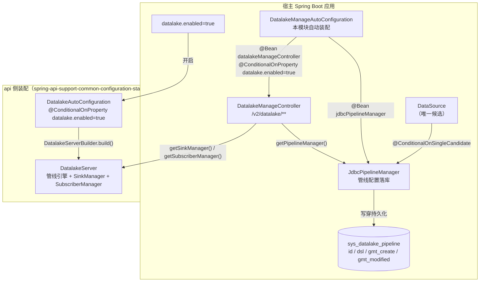

# spring-support-datalake-starter

数据中台**管理面** Starter：为已启用的 `DatalakeServer` 暴露 `/v2/datalake/**` 管理端点（管线 CRUD / 运行统计 / 订阅器 / Sink 清单），并提供管线配置的 JDBC 落库（`JdbcPipelineManager` → `sys_datalake_pipeline`），使管线配置在服务重启后仍然存在。

- 坐标：`com.chua:spring-support-datalake-starter:4.0.0.51`
- 基线：Spring Boot 4（父 pom `spring-support-parent-starter` 统一管理），pom 无打包插件配置（纯库 jar）
- 边界：本模块只做**管理面**（配置 CRUD + 只读统计）。数据面（管线执行、数据分发、Sink 投递、订阅推送）全部在 `utils-support-datalake-*` 三个底层包（core / sink / subscribe）中；本模块**不包含** cdc / mqtt / webhook / query 等扩展通道
- 依赖方向：宿主应用 → 本 starter → `utils-support-datalake-starter` + `utils-support-datalake-sink-starter` + `utils-support-datalake-subscribe-starter` + `spring-boot-autoconfigure` + `spring-web`

## 1. 架构图



| 层 | 类 | 职责 |
|:---|:---|:---|
| 装配层 | `com.chua.starter.datalake.configuration.DatalakeManageAutoConfiguration` | 条件装配 `JdbcPipelineManager` 与 `DatalakeManageController` 两个 Bean |
| 端点层 | `com.chua.starter.datalake.controller.DatalakeManageController` | `/v2/datalake/**` 管理端点（管线 CRUD、统计、订阅器、Sink） |
| 持久层（底层） | `com.chua.datalake.support.pipeline.JdbcPipelineManager` | 在内存编译缓存之上「写穿数据库」，落库表 `sys_datalake_pipeline` |
| 服务端（底层） | `com.chua.datalake.support.server.DatalakeServer` | 数据中台控制中心，由 api 侧 `DatalakeAutoConfiguration` 构建并启动 |

## 2. 能力概览与端点一览

本模块对外只有一个 REST 入口前缀 `/v2/datalake`，全部端点如下（均要求 `datalake.enabled=true`，否则整个前缀 404）：

| 方法 | 路径 | 能力 | 成功返回 |
|:-----|:-----|:-----|:---------|
| GET | `/v2/datalake/pipelines` | 管线清单：id、DSL 原文、审计时间、运行计数（按 id 升序） | `[{id, dsl, gmtCreate, gmtModified, count}]` |
| GET | `/v2/datalake/pipelines/{id}` | 单条管线详情（DSL 原文 + 运行计数）；不存在时报 400 | `{id, dsl, count}` |
| POST | `/v2/datalake/pipelines` | 新建或更新管线：先校验 DSL 可解析，再写穿数据库并刷新引擎编译缓存 | `{id}` |
| DELETE | `/v2/datalake/pipelines/{id}` | 删除管线（同步清库与编译缓存）；不存在时报 400 | `{id, deleted: true}` |
| GET | `/v2/datalake/stats` | 运行统计：总吞吐、管线/订阅器/Sink 数量与单管线计数 | `{total, pipelines, subscribers, sinks, perPipeline: [{id, count}]}` |
| GET | `/v2/datalake/subscribers` | 已登记订阅器清单 | `[{subscriberId, topics}]` |
| GET | `/v2/datalake/sinks` | 已注册 Sink 清单（类型 + 是否带数据源） | `[{type, hasDataSource}]` |

参数/状态类错误（`IllegalArgumentException` / `IllegalStateException`）统一映射为 **400**，返回体为 `{"error": "<原因>"}`，例如 `{"error":"管线不存在: xxx"}`、`{"error":"管线 DSL 解析失败: ..."}`。

两个自动装配 Bean 的条件：

| Bean | 类型 | 装配条件 | 缺条件时的行为 |
|:-----|:-----|:---------|:---------------|
| `jdbcPipelineManager` | `PipelineManager`（实际 `JdbcPipelineManager`） | 宿主存在**唯一候选** `DataSource`（`@ConditionalOnSingleCandidate`）且未自定义 `PipelineManager`（`@ConditionalOnMissingBean`） | 不装配；api 侧 `DatalakeServerBuilder` 回退默认内存实现 `DefaultPipelineManager`（重启后管线配置丢失） |
| `datalakeManageController` | `DatalakeManageController` | `datalake.enabled=true`（`@ConditionalOnProperty`，缺省不装配） | 端点整体 404，前端呈现「数据中台未启用」空态 |

> 为什么控制器用属性条件而不是 `@ConditionalOnBean(DatalakeServer.class)`：后者跨自动装配类按「bean 定义是否已登记」判定，受解析顺序影响，在 Spring Boot 4 运行时实测恒不命中（`jdbcPipelineManager` 与 `datalakeServer` 都已创建，控制器却被静默跳过，`/v2/datalake/**` 整体 404）。属性条件与 bean 注册顺序无关；且 `datalake.enabled=true` 时 `DatalakeServer` 必然由 api 侧 `DatalakeAutoConfiguration` 装配（本 starter 硬依赖 datalake 类，缺类时属性条件也不会通过）。

## 3. 引入方式

Maven：

```xml
<dependency>
    <groupId>com.chua</groupId>
    <artifactId>spring-support-datalake-starter</artifactId>
    <version>4.0.0.51</version>
</dependency>
```

前置条件（三者齐备管理端点才可用）：

1. **数据中台核心在类路径**：本 starter 已传递引入 `utils-support-datalake-*` 三个包，无需额外声明；
2. **`DatalakeServer` 已装配**：在本项目标准 api 栈中由 `com.chua.starter.service.configuration.DatalakeAutoConfiguration` 完成（同样要求 `datalake.enabled=true`）；
3. **宿主有数据源**：宿主存在唯一 `DataSource` 候选时，本 starter 自动装配 `JdbcPipelineManager` 完成配置落库；没有数据源则退化为纯内存模式。

## 4. 配置说明

本模块自身**只读取一个配置项**，且没有 `*Properties` 配置类；其余行为均由 Bean 条件与底层 datalake 核心决定。

### 4.1 配置总表

| 配置键 | 含义 | 默认值 | 影响范围 |
|:-------|:-----|:-------|:---------|
| `datalake.enabled` | 是否启用数据中台。`true` 时 api 侧装配并启动 `DatalakeServer`，本 starter 暴露 `/v2/datalake/**` 管理端点 | `false`（不启用） | `DatalakeServer` 生命周期 + 本模块全部管理端点 |

> 数据面 / 管线执行 / Sink / 订阅器的更细粒度参数属于 `utils-support-datalake-*` 底层核心，不在本模块配置范围内，此处不展开。

### 4.2 逐项配置示例

**`datalake.enabled`** —— 数据中台总开关。

- 含义：控制 `DatalakeServer` 是否随应用启动，以及本模块管理端点是否装配。
- 默认值：`false`。不配置或配为 `false` 时，`DatalakeServer` 不启动、`/v2/datalake/**` 整体 404。
- YAML 示例：

```yaml
datalake:
  enabled: true   # 开启数据中台与管理端点；缺省/false 时管理端点整体 404
```

**宿主数据源（落库前提，非本模块配置项）** —— `JdbcPipelineManager` 需要一个唯一候选 `DataSource` 才会装配；配置方式与宿主其它模块共用同一套 Spring 数据源配置：

```yaml
spring:
  datasource:
    url: jdbc:mysql://127.0.0.1:3306/monitordb
    username: your-username
    password: your-password
```

## 5. 使用示例

### 5.1 完整 application.yml

```yaml
server:
  port: 8080

spring:
  datasource:
    url: jdbc:mysql://127.0.0.1:3306/monitordb
    username: your-username
    password: your-password

datalake:
  enabled: true   # 启用数据中台 + /v2/datalake 管理端点
```

启动后，本 starter 自动完成：

1. `JdbcPipelineManager` 装配：建表 `sys_datalake_pipeline`（`CREATE TABLE IF NOT EXISTS`，MySQL/H2 兼容）并全表预载进内存编译缓存；
2. `DatalakeServer` 启动（api 侧装配）：拉起管线引擎、Sink、订阅器；
3. `/v2/datalake/**` 管理端点上线（鉴权沿用宿主统一接口鉴权体系，不设免鉴权白名单）。

落库表结构（由 `JdbcPipelineManager` 启动时自动创建，无需手工执行 DDL）：

```sql
CREATE TABLE IF NOT EXISTS sys_datalake_pipeline (
    id VARCHAR(128) PRIMARY KEY,
    dsl TEXT,
    gmt_create DATETIME,
    gmt_modified DATETIME
);
```

### 5.2 管线 CRUD（curl）

管线 DSL 的结构对应底层 `PipelineConfig`：`id` + `stages`（stage 名 → filter / parser / cleaner / standardizer / sink 动作列表）。`POST /pipelines` 的请求体为 `{"id": "...", "dsl": "<JSON 字符串>"}`，`dsl` 是管线配置的 JSON 文本，保存前会先校验可解析。

```bash
BASE=http://localhost:8080

# 1) 保存（新建或更新）一条管线：json 解析 + 空值过滤，结果下沉 jdbc 与 realtime
curl -X POST "$BASE/v2/datalake/pipelines" \
  -H 'Content-Type: application/json' \
  -d '{
    "id": "pipeline-001",
    "dsl": "{\"id\":\"pipeline-001\",\"stages\":{\"default\":{\"filter\":[{\"name\":\"null-filter\"}],\"parser\":[{\"name\":\"json\"}],\"sink\":[{\"type\":\"jdbc\"},{\"type\":\"realtime\"}]}}}"
  }'
# => {"id":"pipeline-001"}

# 2) 管线清单（含 DSL 原文与运行计数）
curl "$BASE/v2/datalake/pipelines"

# 3) 单条管线详情
curl "$BASE/v2/datalake/pipelines/pipeline-001"

# 4) 删除管线
curl -X DELETE "$BASE/v2/datalake/pipelines/pipeline-001"
# => {"id":"pipeline-001","deleted":true}

# 5) 运行统计
curl "$BASE/v2/datalake/stats"

# 6) 订阅器与 Sink 清单
curl "$BASE/v2/datalake/subscribers"
curl "$BASE/v2/datalake/sinks"
```

### 5.3 典型消费方式

管理面前端（数据中台控制台）启动时先 `GET /v2/datalake/stats` 与 `GET /v2/datalake/pipelines` 渲染总览；未启用（404）时呈现「数据中台未启用」空态。数据接入方（CDC / MQTT / Webhook 等采集通道）属于底层 datalake 扩展模块，不经过本管理面。

## 6. 注意事项

1. **默认不启用**：`datalake.enabled` 缺省为 `false`，此时 `DatalakeServer` 不启动、`/v2/datalake/**` 整体 404。这是设计内行为（前端据此显示未启用空态），不是故障。
2. **落库失败自动降级**：`JdbcPipelineManager` 构造时建表/预载失败（如数据库不可达）**不会**阻断应用启动，而是降级为纯内存模式并记录 error——重启后管线配置将丢失。生产环境请确保数据源可用。
3. **单数据源候选要求**：`jdbcPipelineManager` 带 `@ConditionalOnSingleCandidate(DataSource.class)`；宿主存在多个 `DataSource` 且未标记主候选时，落库管理器不会装配（管线退化为内存模式）。此时可自行声明 `PipelineManager` Bean 接管。
4. **自定义 PipelineManager 必须是 `DefaultPipelineManager`**：管理端点内部把 `DatalakeServer.getPipelineManager()` 强转为 `DefaultPipelineManager`；注入了其它实现时端点统一返回 400 `{"error":"管线管理器不可用"}`。
5. **DSL 先校验后落库**：保存前会用 `PipelineConfig` 解析校验，坏 DSL 返回 400，不会写穿进库导致引擎侧静默告警。
6. **统计计数是内存态**：`/stats` 与管线 `count` 来自 `StatisticSink` 的内存计数器，应用重启后归零；它只做吞吐观测，不承载业务数据。
7. **Sink 由 SPI 在服务端构建期注册**：`DatalakeServerBuilder` 构建时通过 SPI 扫描注册全部 `DataSink`（如 `statistic`、`jdbc`、`realtime` 等，以各 Sink `type()` 为准）；构建后晚注册的 Sink 要到管线下次执行才生效。
8. **本模块不开设任何监听端口**：`DatalakeServer` 的 api 侧装配「未注入 API 服务端，不开设任何 HTTP 端口」；管理端点挂载在宿主应用的 Web 容器上。
9. **鉴权**：`/v2/datalake/**` 沿用宿主统一接口鉴权体系，本模块不设免鉴权白名单。
10. **扩展通道不随本模块带入**：cdc / mqtt / webhook / query 等数据接入通道是独立的底层扩展包，本 starter 刻意不依赖；需要时另行引入对应模块。
