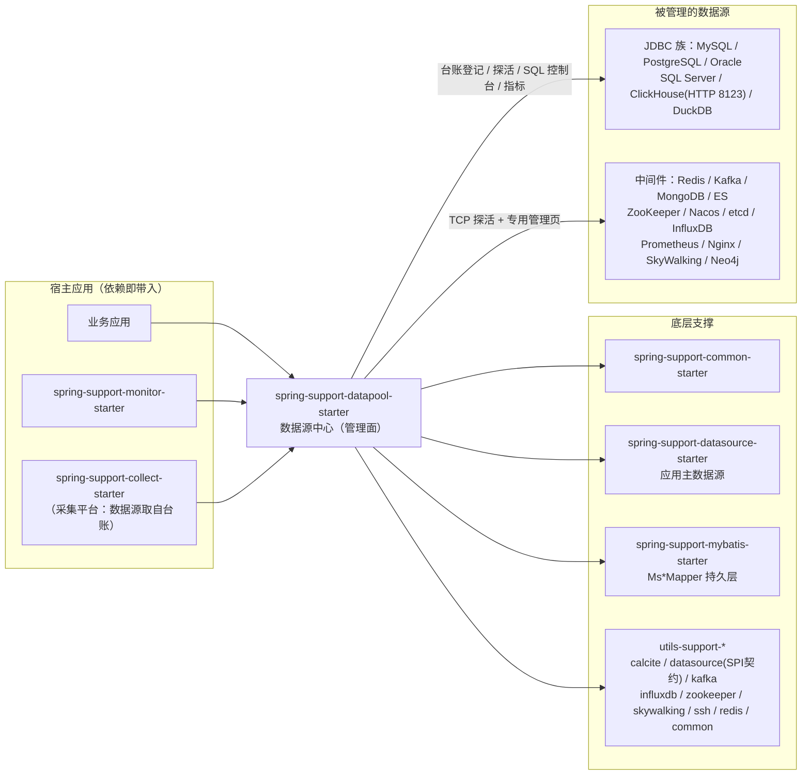
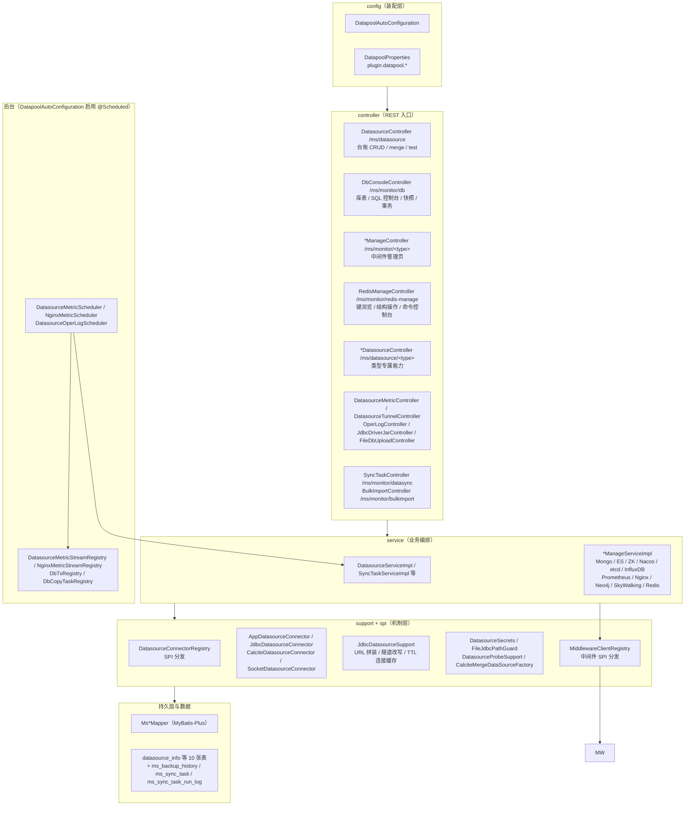
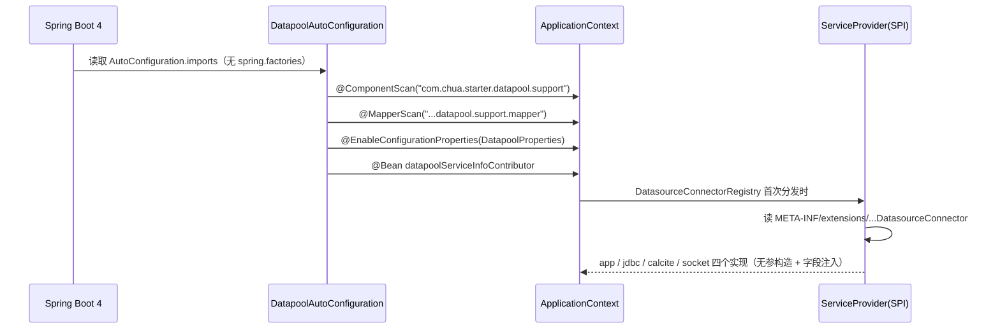
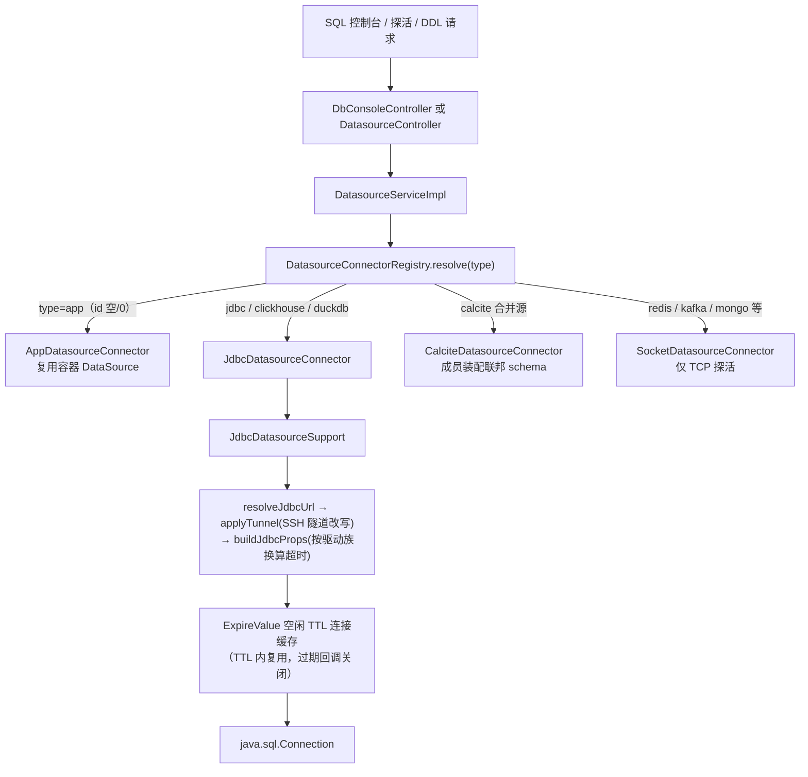
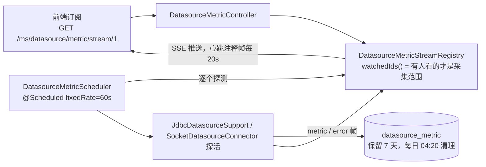

# spring-support-datapool-starter

数据源中心模块：统一登记与管理被采集/被连接的数据源（JDBC / Redis / InfluxDB / Neo4j / Nacos / ZooKeeper / Nginx / Kafka / MongoDB / Elasticsearch / Prometheus / etcd / ClickHouse / DuckDB / SkyWalking 等），
提供数据源台账 CRUD、连通性探测、可复用的 JDBC 连接（空闲 TTL 缓存 + 跨方言元数据）、数据库 Web 管理器（navicat 风格）、SSH 隧道、中间件管理面与数据源级 Redis 键/命令管理。
独立于监控模块，供监控、采集等系统共享依赖。

**能力边界（先看这个）**：

- **能做什么**：台账管理、连通性探测（含 SSH 隧道中转）、JDBC 连接复用与 SQL 控制台、显式事务、数据库文档、库表结构与数据浏览、DDL 执行、表复制、导入导出、结构快照与回滚、跨库合并查询（Calcite）、数据库备份与恢复、数据同步与 CSV 直灌、各中间件的管理页（MongoDB / Elasticsearch / ZooKeeper / Nacos / etcd / InfluxDB / Prometheus / Nginx / SkyWalking / Kafka）、数据源级 Redis 管理（`/ms/monitor/redis-manage`）、数据源指标监控（SSE）、驱动 jar 与文件库上传。
- **明确不做什么**：不拦截运行时 SQL（它是管理面，不是 ORM 代理）；不为业务代码提供多数据源路由与 `@DS` 切换；不保证跨库事务；REST 接口无内置鉴权注解，暴露面由外部网关/oauth 决定（本模块不提供 `@Permission`）。

## 1. 架构图

### 1.1 模块在体系中的位置



可选依赖（`optional=true`，宿主引了才生效）：`spring-support-ai-starter`（text2sql）、`spring-api-support-common-tenant-starter`（租户库连接口）、`utils-support-word-starter` / `utils-support-pdf-starter`（数据库文档导出）。

### 1.2 内部分层



## 2. 核心流程图

### 2.1 自动装配流程



装配无条件（无 `@ConditionalOnProperty` 模块开关）；`plugin.datapool.enabled` 只影响服务信息面板的展示旗标。可选实现按 classpath 自动降级：`DatasourceTenantLookupAdapter` 带 `@ConditionalOnClass(TenantDatasourceLookup)`，ai / word / pdf 能力经 `ObjectProvider` 探测。

### 2.2 请求处理流程（建连分发）



分发顺序按 `@Spi(order)` 降序：app=1000 → socket=900 → calcite=300 → jdbc=200；没有实现认领时回退 app 实现（由它报告「未配置默认数据源」）。

### 2.3 数据源指标 SSE 数据流



## 3. 能力清单

| 能力域 | 关键类 | 入口 |
|:-------|:-------|:-----|
| 自动配置 | `DatapoolAutoConfiguration` | `@ComponentScan("...datapool.support")` + `@MapperScan` + `@EnableScheduling` + `plugin.datapool.*` |
| 配置绑定 | `DatapoolProperties` | `plugin.datapool.*` |
| 台账 CRUD / 连通性 | `DatasourceController` | `/ms/datasource`（list / get / create / merge / update / delete / top / test / types） |
| 类型专属能力基类 | `DatasourceTypeController`（抽象基类） | 由各 `*DatasourceController` 继承，只实现「该类型才有的能力」 |
| 数据源类型常量 | `DatapoolConstants` | `DS_TYPES`（15 类）、`DS_DEFAULT_PORTS`、`DS_JDBC_TYPES` |
| 连接扩展点 SPI | `DatasourceConnector` / `DatasourceConnectorRegistry` | `META-INF/extensions/...DatasourceConnector`（app / jdbc / calcite / socket） |
| JDBC 建连与探活 | `JdbcDatasourceSupport` | 空闲 TTL 缓存 + SSH 隧道改写 + 方言超时换算 |
| 文件库路径守卫 | `FileJdbcPathGuard` | SQLite / H2 file / Derby / HSQLDB / DuckDB 路径白名单 |
| 口令加密存储 | `DatasourceSecrets` | AES-GCM `enc:v1:` 前缀，兼容历史 `b64:` |
| 数据库 Web 管理器 | `DbConsoleController` | `/ms/monitor/db`（库表浏览 / SQL 控制台 / 结构维护 / 导入导出 / ER 图 / 显式事务） |
| 结构快照与回滚 | `DbSchemaSnapshotService` / `DbConsoleController#snapshot*` | `/ms/monitor/db/table/{tableName}/schema-snapshots`（拍/列表/详情/回滚） |
| 表复制（跨库） | `DbTableCopyService` / `DbCopyTaskRegistry` | `/ms/monitor/db`（copy 端点，SSE 心跳 20s） |
| 数据库文档导出 | `DbDocumentController` | `/ms/monitor/db/document`（`/formats`、`/export`、`/preview`） |
| 数据库 SPI 能力网关 | `DbSpiCapabilityController` | `/ms/monitor/db`（用户/权限/进程/慢查询，按方言 SPI） |
| SSH 隧道（高级配置） | `DatasourceTunnelService` / `DatasourceTunnelController` | `/ms/datasource/tunnel`（LOCAL / REMOTE / DYNAMIC） |
| 驱动 jar / 文件库上传 | `JdbcDriverJarController` / `FileDbUploadController` | `/ms/datasource/jdbc-driver`（别名 `/ms/datasource/driver-jar`）、`/ms/datasource/file-db` |
| 动态接口发布（契约） | `DynamicApiService`（接口 + DTO/VO/`MsDatasourceApi` 实体） | **仅声明契约，无实现与 REST 控制器**；embedded / standalone 两轨描述见接口 Javadoc，当前模块未装配 |
| 中间件管理 | `*ManageController` + `*ManageServiceImpl` | `/ms/monitor/{mongodb,elasticsearch,zookeeper,nacos,etcd,influxdb,prometheus,nginx,neo4j,skywalking}` |
| 中间件数据源控制器 | `*DatasourceController`（Redis / Mongo / Nginx / Neo4j / InfluxDB / Nacos / ZK / JDBC） | `/ms/datasource/<type>` |
| 中间件 SPI 分发 | `MiddlewareClientRegistry` / `MiddlewareDriverSupport` | `MiddlewareClientProvider` SPI + 上传 jar 后装 |
| 数据源指标（SSE + 调度） | `DatasourceMetricStreamRegistry` / `DatasourceMetricScheduler` | `/ms/datasource/metric`（订阅即采集，60s 一轮） |
| Nginx 管理与指标 | `NginxManageService` / `NginxRuntimeRouter` / `NginxMetricScheduler` | `/ms/monitor/nginx` |
| 操作日志 | `DatasourceOperLogController` / `DatasourceOperLogScheduler` / `DatasourceOperLogListener` | `/ms/datasource/oper-log`（清理每日 04:40，保留 90 天） |
| 服务信息登记 | `datapoolServiceInfoContributor` | 控制台模块能力 |
| 数据同步任务 | `SyncTaskController` / `SyncTaskService` / `SyncTaskServiceImpl`（`datasync` 包：源读取、字段映射、Sink、目录监听、写模式） | `/ms/monitor/datasync`（`/tasks` CRUD + run/enable/disable、`/logs` 列表/详情/统计/趋势/重跑、`/preview`、`/validate-source`、`/write-modes`） |
| CSV 批量导入 | `BulkImportController` / `JdbcCsvLoader` SPI（`mysql` / `postgresql`） | `/ms/monitor/bulkimport`、`/ms/monitor/bulkimport/preview` |
| 数据库备份与恢复 | `DatabaseBackupController` / `DatabaseBackupService` / `BackupEventStreamRegistry` | `/ms/datasource/database-backup`，兼容 `/ms/monitor/database-backup`；历史表 `ms_backup_history` |
| 数据初始化 | `db/init/V3.1__init_all_datapool.sql`、`db/init/V3.2__init_backup_and_sync.sql` | `datasource_info` 等 10 张表 + 备份历史与 `ms_sync_task*`（幂等） |

实际生效的能力：

- 数据源类型（`DatapoolConstants.DS_TYPES`）：`jdbc`、`redis`、`influxdb`、`neo4j`、`nacos`、`zookeeper`、`kafka`、`nginx`、`etcd`、`prometheus`、`mongodb`、`elasticsearch`、`clickhouse`、`duckdb`、`skywalking`；各类型默认端口在 `DS_DEFAULT_PORTS` 常量表（如 jdbc=3306、clickhouse=8123 走 HTTP、prometheus=9090、mongodb=27017）；
- JDBC 族统一走一条链路：`jdbc` / `clickhouse` / `duckdb`（`DS_JDBC_TYPES`）+ `calcite` 合并源；
- 文件库（`duckdb`）按文件语义处理：不设 TCP 超时不 TCP 探活，路径过 `FileJdbcPathGuard` 白名单（工作目录 / 临时目录 / 用户主目录 + 配置追加）；
- Calcite 合并数据源：把成员 `{"members":[id,...]}` 逐个建连装配成联邦 schema（重名自动加 `-2/-3` 后缀），支持跨库联合查询；合并记录自身不可编辑、没有单一 JDBC 连接串；
- 口令存储：`secret-key` 配置后新写入口令走 AES-GCM（`enc:v1:`）；未配置则明文入库并打一次性 WARN；历史 `b64:` 前缀兼容解码；
- 指标采集「有人看才采」：只探测 `DatasourceMetricStreamRegistry.watchedIds()`，无人订阅不产生探测流量，历史只覆盖被观测时段；
- 动态接口发布（**当前仅契约**）：`DynamicApiService` 接口定义了 `embedded`（动态注册进本应用 `RequestMappingHandlerMapping`，走系统 oauth 门控）/ `standalone`（独立端口起 HTTP 服务，AppKey 鉴权）两轨描述，但本模块只有接口 + DTO/VO + `MsDatasourceApi` 实体 + Mapper，**没有实现类与 REST 控制器**，运行期不可用。

## 4. Bean 能力矩阵

装配入口只有一个：`DatapoolAutoConfiguration`（`META-INF/spring/org.springframework.boot.autoconfigure.AutoConfiguration.imports`，本模块**没有** `spring.factories`）。除表格所列外，无其它 `@Bean` 方法。

| Bean 名 / 类型 | 装配条件 | 可否覆盖 | 典型注入姿势 |
|:---------------|:---------|:---------|:-------------|
| `datapoolServiceInfoContributor`（`ServiceInfoContributor`） | 无条件（`DatapoolAutoConfiguration` 的 `@Bean`） | 可以：声明同类型 `@Bean` 或 `@Primary` | 构造器/字段注入 `ServiceInfoContributor` |
| `datapoolProperties`（`DatapoolProperties`，`plugin.datapool.*`） | `@EnableConfigurationProperties`，无条件 | 属性可配，Bean 可用 `@Primary` 替换 | 构造器注入（如 `JdbcDatasourceSupport`） |
| `jdbcDatasourceSupport`（`JdbcDatasourceSupport`，`@Component`） | 无条件 | 可以 | 构造器注入（`DatapoolProperties` + `DatasourceTunnelService` + `JdbcDriverJarService`） |
| `datasourceConnectorRegistry`（`DatasourceConnectorRegistry`，`@Component`） | 无条件 | 可以 | 构造器/字段注入 |
| `middlewareClientRegistry`（`MiddlewareClientRegistry`，`@Component`） | 无条件 | 可以 | 构造器/字段注入 |
| `calciteMergeDataSourceFactory`（`CalciteMergeDataSourceFactory`，`@Component`） | 无条件 | 可以 | `ObjectProvider` 懒取（避免与数据源服务循环依赖） |
| `datasourceMetricStreamRegistry` / `nginxMetricStreamRegistry` / `dbTxRegistry` / `dbCopyTaskRegistry`（均 `@Component`） | 无条件 | 可以 | 字段注入 |
| `datasourceMetricScheduler` / `nginxMetricScheduler` / `datasourceOperLogScheduler`（均 `@Component`） | 无条件注册；`@Scheduled` 是否执行取决于**宿主**是否开了 `@EnableScheduling` | 可以 | `ObjectProvider` 可选装配服务，服务缺失时本轮跳过 |
| `datasourceTenantLookupAdapter`（`DatasourceTenantLookupAdapter`，`@Component`） | `@ConditionalOnClass(name = "com.chua.starter.tenant.server.support.TenantDatasourceLookup")`——tenant-starter 在 classpath 才装配 | 可以 | 由租户模块按 `TenantDatasourceLookup` 契约消费 |
| `datasourceServiceImpl` 等 `*ServiceImpl`（`@Service`） | 无条件 | 可以 | 构造器注入 |
| `Ms*Mapper`（`MsDatasourceMapper` 等 10 个） | `@MapperScan("com.chua.starter.datapool.support.mapper")` | 不建议覆盖（MyBatis-Plus 代理） | 构造器/字段注入 |
| `*ManageController` / `*DatasourceController` / `DbConsoleController` 等（`@RestController`） | 无条件 | 可以（`@Primary` 同类型替换） | 构造器注入 |

**不是 Spring Bean 的扩展对象**（由 `ServiceProvider` SPI 创建，无参构造 + `SpringServiceAutowire` 补字段注入，依赖必须写成 `@Autowired` 字段）：

| 对象 | 注册位置 | order |
|:-----|:---------|:------|
| `AppDatasourceConnector`（`@Spi("datasource-app")`） | `META-INF/extensions/com.chua.starter.datapool.support.spi.connector.DatasourceConnector` | 1000 |
| `SocketDatasourceConnector`（`@Spi("datasource-socket")`） | 同上 | 900 |
| `CalciteDatasourceConnector`（`@Spi("datasource-calcite")`） | 同上 | 300 |
| `JdbcDatasourceConnector`（`@Spi("datasource-jdbc")`） | 同上 | 200 |
| `MiddlewareClientProvider` 各实现（Kafka / InfluxDB / ZooKeeper / SkyWalking …） | 各 `utils-support-*-starter` 的 `META-INF/extensions/com.chua.datasource.support.middleware.MiddlewareClientProvider`，或 OSGi bundle / 上传 jar（同名以上传为准） | 按 SPI 优先级 |
| `LocalNginxExecutor`（`@Spi("nginx-local", order=300)`）、`SshNginxExecutor`、`WindowsNginxCommandProvider`、`PosixNginxCommandProvider` | `@Spi` 注解，由 `NginxRuntimeRouter`（`@Component`）按「平台 + 执行通道」配对路由 | 见注解 |
| `MysqlCsvLoader`（`@Spi("mysql")`）、`PostgresqlCsvLoader`（`@Spi("postgresql")`） | `META-INF/extensions/com.chua.starter.datapool.support.datasync.loader.JdbcCsvLoader` | `键=类名` |

## 5. 完整配置

配置前缀：**`plugin.datapool`**（`DatapoolProperties`， relaxed binding 连字符风格）。这是本模块**唯一**的 `@ConfigurationProperties`；全部字段如下：

| 配置路径 | 类型 | 默认值 | 说明 | 生效情况 |
|:---------|:-----|:-------|:-----|:---------|
| `plugin.datapool.enabled` | `boolean` | `true` | 服务信息面板「数据源中心」展示旗标 | **非模块开关**，不影响装配 |
| `plugin.datapool.connection-ttl-minutes` | `long` | `10` | JDBC 连接空闲存活时长（分钟），超时自动关闭（小于 1 按 1 处理）；`ExpireValue` 惰性过期 + 后台清扫 | 生效（连接缓存 TTL） |
| `plugin.datapool.connection-sweep-interval-ms` | `long` | `60000` | 空闲连接后台清扫周期（毫秒） | **仅声明，运行期未读取**（清扫节拍写死在 `JdbcDatasourceSupport#sweepExpiredJdbcConnections` 的 `@Scheduled(fixedDelay=60_000L)`） |
| `plugin.datapool.probe-timeout-ms` | `int` | `5000` | 连通性探测超时（毫秒） | 生效 |
| `plugin.datapool.connect-timeout-seconds` | `int` | `30` | JDBC 建连超时（秒）；实现按驱动族换算单位（MySQL/MariaDB/Oracle 毫秒、PostgreSQL 秒、SQL Server `loginTimeout`）；配置 ≤0 按 1 秒处理 | 生效 |
| `plugin.datapool.query-timeout-seconds` | `int` | `60` | SQL 执行超时（秒），0 = 不设上限；只约束语句级执行（`Statement.setQueryTimeout`），不影响建连 | 生效 |
| `plugin.datapool.driver-jar-dir` | `String` | `data/jdbc-driver`（按 `File.separator`） | 上传的 JDBC 驱动 jar 落盘目录（工作目录下，文件名加内容指纹） | 生效 |
| `plugin.datapool.driver-jar-max-bytes` | `long` | `67108864`（64MB） | 驱动 jar 单个上限（字节） | 生效 |
| `plugin.datapool.file-db-upload-dir` | `String` | `data/file-db` | 文件库（SQLite/DuckDB/H2）库文件上传落盘目录 | 生效 |
| `plugin.datapool.file-db-max-bytes` | `long` | `67108864`（64MB） | 文件库库文件单个上限（字节） | 生效 |
| `plugin.datapool.file-jdbc-allowed-dirs` | `List<String>` | 空列表 | 文件库 JDBC URL 允许的根目录白名单；留空默认放行工作目录 / 系统临时目录 / 用户主目录 | 生效 |
| `plugin.datapool.secret-key` | `String` | 空串 | 数据源口令加密密钥（原文，SHA-256 派生 AES-256）；**留空 = 明文入库**，配置后只影响之后写入的口令；`@PostConstruct` 推给 `DatasourceSecrets` | 生效 |

不属于该前缀、但容易误当成模块配置的项：

- `monitor.db.tx.idleTimeoutMinutes`（默认 10）、`monitor.db.tx.maxSessions`（默认 8）：`DbTxRegistry` 用 `Long.getLong` / `Integer.getInteger` 读取的 **JVM 系统属性**（`-D` 启动参数），不是 application.yaml 配置；
- `monitor.nginx.collect-interval-ms`：`NginxMetricScheduler` 注释中的设计键，**未接入**注解，采集周期固定 30s；
- 全部调度周期 / cron（指标 60s、SSE 心跳 20s、nginx 30s、操作日志清理 04:40、指标清理 04:20）均为编译期常量，不走配置（宿主经 collect-starter 传递依赖引入时，早期创建链上 `${...}` 解析器未就绪会炸启动，故刻意不用占位符）；
- 建表脚本由 `spring-support-datasource-starter` 的脚本机制执行：`plugin.datasource.script.enable=true`（其 `DataSourceEnvironmentPostProcessor` 缺省置 true），自动执行 `db/init/V3.1__init_all_datapool.sql` 创建台账等表，并执行 `V3.2__init_backup_and_sync.sql` 创建备份历史与同步任务/日志表（幂等）。

### 5.1 逐项配置示例（按功能分组）

本节 `plugin.datapool.*` 键名与 `DatapoolProperties` 字段一一对应（relaxed binding，推荐连字符风格）。备份中心保留独立的历史兼容前缀，见 §5.4。以下片段可放入 `application.yaml`。

#### 面板开关

| 配置项 | 含义 | 默认值 |
|:-------|:-----|:-------|
| `plugin.datapool.enabled` | 服务信息面板「数据源中心」展示旗标；**非模块开关**，置 false 只藏旗标、不关模块 | `true` |

```yaml
plugin:
  datapool:
    enabled: true
```

#### 连接与超时

| 配置项 | 含义 | 默认值（含回落） |
|:-------|:-----|:-----------------|
| `plugin.datapool.connection-ttl-minutes` | JDBC 连接空闲存活时长（分钟），过期自动关闭；TTL 内复用同一物理连接 | `10`；≤0 按 `1` 处理 |
| `plugin.datapool.connection-sweep-interval-ms` | 空闲连接后台清扫周期（毫秒），由 `@Scheduled(fixedDelayString="${plugin.datapool.connection-sweep-interval-ms:60000}")` 读取 | `60000` |
| `plugin.datapool.probe-timeout-ms` | 连通性探测超时（毫秒），台账测活与指标采集共用 | `5000` |
| `plugin.datapool.connect-timeout-seconds` | JDBC 建连超时（秒），按驱动族换算单位（MySQL/MariaDB/Oracle 毫秒、PostgreSQL/SQL Server 秒） | `30`；≤0 按 `1` 处理 |
| `plugin.datapool.query-timeout-seconds` | SQL 执行超时（秒），语句级；只约束执行、不约束建连 | `60`；`0`（或负数）= 不设上限 |

```yaml
plugin:
  datapool:
    connection-ttl-minutes: 10          # 空闲连接 10 分钟后关闭
    probe-timeout-ms: 5000              # 探活 5 秒超时
    connect-timeout-seconds: 30         # 建连 30 秒超时
    query-timeout-seconds: 60           # 单条 SQL 60 秒超时；0 = 不设上限
```

#### 上传目录与大小上限

| 配置项 | 含义 | 默认值 |
|:-------|:-----|:-------|
| `plugin.datapool.driver-jar-dir` | 上传的 JDBC 驱动 jar 落盘目录（相对工作目录，文件名加内容指纹） | `data/jdbc-driver`（按平台分隔符） |
| `plugin.datapool.driver-jar-max-bytes` | 驱动 jar 单个上限（字节） | `67108864`（64MB） |
| `plugin.datapool.file-db-upload-dir` | 文件库（SQLite/DuckDB/H2）库文件上传目录（相对工作目录） | `data/file-db` |
| `plugin.datapool.file-db-max-bytes` | 文件库库文件单个上限（字节） | `67108864`（64MB） |

```yaml
plugin:
  datapool:
    driver-jar-dir: data/jdbc-driver
    driver-jar-max-bytes: 67108864      # 64MB
    file-db-upload-dir: data/file-db
    file-db-max-bytes: 67108864         # 64MB
```

#### 文件库路径白名单

| 配置项 | 含义 | 默认值（含回落） |
|:-------|:-----|:-----------------|
| `plugin.datapool.file-jdbc-allowed-dirs` | 文件库 JDBC URL（带磁盘路径）允许的根目录白名单；解析后的路径必须落在白名单内才允许建连 | 空列表 → 回落放行工作目录 / 系统临时目录 / 用户主目录 |

```yaml
plugin:
  datapool:
    file-jdbc-allowed-dirs:             # 追加放行的根目录（留空 = 三个默认目录）
      - /data/dbs
      - D:/app-data/file-db
```

#### 口令加密

| 配置项 | 含义 | 默认值（含回落） |
|:-------|:-----|:-----------------|
| `plugin.datapool.secret-key` | 数据源口令加密密钥（原文，SHA-256 派生 AES-256）。**配了就不要换**：换钥后旧 `enc:v1:` 密文全部解不开，口令只能重录 | 空串 → 明文入库，进程启动打一次 WARN |

```yaml
plugin:
  datapool:
    secret-key: ${DATASOURCE_SECRET_KEY:change-me}   # 推荐经环境变量注入，避免明文进配置仓库
```

### 5.2 完整 YAML 使用示例

一份可直接落地的 `application.yaml`（含宿主侧前置条件）：

```yaml
spring:
  datasource:
    # 宿主主数据源（台账表 datasource_info 等建在这里；也是 app 连接复用的容器数据源）
    url: jdbc:mysql://127.0.0.1:3306/datasource_hub?useUnicode=true&characterEncoding=UTF-8&useSSL=false
    username: root
    password: your-password             # 占位符：替换为真实口令

plugin:
  datasource:
    script:
      enable: true                      # 框架数据源脚本机制：V3.1 台账等表 + V3.2 备份与同步表（幂等）
  datapool:
    enabled: true                       # 面板展示旗标（非模块开关）
    connection-ttl-minutes: 10          # JDBC 连接空闲 TTL（分钟）；≤0 按 1 处理
    probe-timeout-ms: 5000              # 探活超时（毫秒）
    connect-timeout-seconds: 30         # 建连超时（秒）；≤0 按 1 处理
    query-timeout-seconds: 60           # SQL 执行超时（秒）；0 = 不设上限
    driver-jar-dir: data/jdbc-driver    # 驱动 jar 落盘目录（相对工作目录）
    driver-jar-max-bytes: 67108864      # 驱动 jar 单个上限（64MB）
    file-db-upload-dir: data/file-db    # 文件库上传目录（相对工作目录）
    file-db-max-bytes: 67108864         # 文件库单个上限（64MB）
    file-jdbc-allowed-dirs:             # 文件库路径白名单（追加项；留空 = 工作目录/临时目录/用户主目录）
      - /data/dbs
    secret-key: ${DATASOURCE_SECRET_KEY:change-me}   # 口令加密密钥；留空 = 明文入库；一经配置不要更换
```

最小可运行配置（只配主数据源 + 建表脚本）见第 6 节「使用方式」；未列出的配置项保持默认即可。

### 5.3 生产注意事项

- **口令安全**：`secret-key` 用环境变量/配置中心注入，不要提交进代码库；一经配置不可更换（旧密文解不开，只能重录口令）；不配则明文入库。REST 接口无内置 `@Permission`，`/ms/datasource/**`、`/ms/monitor/db/**`、`/ms/monitor/middleware/**` 必须置于网关/oauth 之后——台账里存的就是目标库口令。
- **文件库白名单**：生产上显式把 `file-jdbc-allowed-dirs` 收紧到专用数据目录，不要依赖默认放行的工作目录/临时目录/用户主目录；`file-db-upload-dir` 必须落在白名单内，否则上传成功也建不了连。
- **落盘目录**：`driver-jar-dir` / `file-db-upload-dir` 放持久磁盘（默认已在工作目录 `data/` 下），不要指向会被系统清理的临时目录——台账里记着 jar/库文件路径，目录被清后数据源就连不上了；关注磁盘配额，单个文件上限默认 64MB，可按需调大。
- **超时预算**：`connect-timeout-seconds` 加重试次数要小于网关/前端超时；`query-timeout-seconds` 按最慢的报表 SQL 调整，`0 = 不设上限`在共享库上慎用（失控 SQL 会挂死请求直到网关超时）。
- **模块自带调度入口**：`DatapoolAutoConfiguration` 启用 `@EnableScheduling`，指标采集、连接清扫、事务回收、SSE 心跳和日志清理无需 monitor 额外开启调度。同步任务另由 `SyncTaskServiceImpl` 自持的 `ThreadPoolTaskScheduler` 执行；它与 `@Scheduled` 入口分开。
- **连接清扫**：`connection-sweep-interval-ms` 决定清扫节拍，`connection-ttl-minutes` 决定空闲过期阈值；仅清理超时连接。
- **`monitor.db.tx.*` 不是 yaml**：事务会话的 `idleTimeoutMinutes`/`maxSessions` 是 JVM 系统属性，用 `-Dmonitor.db.tx.idleTimeoutMinutes=10 -Dmonitor.db.tx.maxSessions=8` 传入。
- **指标历史按订阅产生**：「有人看才采」，无人订阅不产生探测流量；要长期历史曲线就保持订阅或由外部系统定期拉取。

### 5.4 数据库备份兼容配置

备份中心的 Controller、Service、配置、历史实体/Mapper 和 SSE 心跳均由本模块装配。接口同时接受 `/ms/datasource/database-backup` 与历史 `/ms/monitor/database-backup`，配置仍使用 `plugin.monitor.database-backup`，迁移不要求修改现有宿主配置。

当前库连接参数按 `DataSourceProperties`、Hikari `DataSource`、`spring.datasource.*` 顺序解析；指定外部数据源时由本模块台账解析。备份/恢复仍使用底层工具的独立连接路径，此处不承诺复用 SQL 控制台的连接租约。

```yaml
plugin:
  monitor:
    database-backup:
      enabled: true
      backup-dir: ""          # 空值回退 {user.home}/monitor-backup/database
      retention-days: 30
      max-backup-count: 0      # 0 表示不按份数清理
      consistent-snapshot: true
      write-manifest: true
```

`ms_backup_history`、`ms_sync_task` 与 `ms_sync_task_run_log` 统一由 `db/init/V3.2__init_backup_and_sync.sql` 幂等建表；monitor 初始化脚本不再重复定义。迁移 SQL 只创建缺失表，不删除、清空或搬运存量记录。

## 6. 使用方式

**Maven 坐标**（版本由父 POM `spring-support-parent-starter:4.0.0.51` 管理，其 parent 为 `spring-boot-starter-parent:4.1.2`）：

```xml
<dependency>
    <groupId>com.chua</groupId>
    <artifactId>spring-support-datapool-starter</artifactId>
    <version>4.0.0.51</version>
</dependency>
```

**最小可运行示例**：

1. 引入依赖，准备一个主数据源（MySQL 驱动默认提供；DuckDB / H2 / SQLite 驱动已随依赖进 runtime classpath；连其它数据库需自行引入驱动或走「驱动 jar 上传」）。
2. 配置 yaml：

```yaml
spring:
  datasource:
    url: jdbc:mysql://127.0.0.1:3306/datasource_hub?useUnicode=true&characterEncoding=UTF-8&useSSL=false
    username: root
    password: ""
plugin:
  datasource:
    script:
      enable: true          # 框架数据源脚本执行：db/init 下 SQL 建 datasource_info 等 10 张表
    hub:
      # enabled: true       # 面板展示旗标，不影响装配
      # secret-key: ${DS_HUB_SECRET}   # 建议配置，否则口令明文入库
```

3. 验证：

- 启动后 `GET /actuator/health` UP；`datasource_info` 等 10 张表自动创建（幂等）；
- 台账 CRUD：`GET /ms/datasource` → `POST /ms/datasource`（body 带 `datasourceType`/`datasourceName`/`datasourceHost`/`datasourcePort`/`datasourceDatabase`/`datasourceUsername`/`datasourcePassword`）→ `POST /ms/datasource/{id}/test` 验证连通性；
- 打开数据库管理台：`GET /ms/monitor/db/tables?datasourceId=1`（或 `0` 表示应用主库）；
- 新增合并数据源：`POST /ms/datasource/merge {"name":"合并库","memberIds":[1,2]}` 后，`GET /ms/monitor/db/tables?datasourceId=<mergeId>` 即可跨库联合查询（SQL 里以成员 schema 名限定表）。

**调用示例**：

```bash
# SQL 控制台执行查询
curl -X POST http://127.0.0.1:8080/ms/monitor/db/execute \
  -H "Content-Type: application/json" \
  -d '{"datasourceId": 1, "sql": "SELECT * FROM sys_user LIMIT 10"}'

# DDL（结构维护在 /ms/datasource 前缀下）
curl -X POST http://127.0.0.1:8080/ms/datasource/ddl/execute \
  -H "Content-Type: application/json" \
  -d '{"datasourceId": 1, "datasourceDatabase": "app", "sql": "CREATE TABLE t(id BIGINT)"}'

# 数据源指标 SSE（订阅即开启该数据源的定时探测，每 60s 一轮，心跳注释帧每 20s）
curl -N http://127.0.0.1:8080/ms/datasource/metric/stream/1
```

**可选依赖说明**：

| 依赖 | 引入后开放的能力 | 不引入时 |
|:-----|:-----------------|:---------|
| `spring-support-ai-starter`（optional） | text2sql（`/ms/monitor/db/ai/status`、`ai/text2sql`） | `ObjectProvider` 取不到实现，`ai/status` 如实上报「不可用」，不启动失败 |
| `utils-support-word-starter` / `utils-support-pdf-starter`（optional） | 数据库文档 word / pdf 导出（pdf 另需服务端装 `wkhtmltopdf`） | `/ms/monitor/db/document/formats` 不列出对应格式，`/export` 返回 501 |
| `spring-api-support-common-tenant-starter`（optional） | 租户库连接口：`DatasourceTenantLookupAdapter` 补上 `TenantDatasourceLookup` 实现 | 适配器不装配（`@ConditionalOnClass` 不命中），其余能力不受影响 |
| `utils-support-kafka-starter` 等中间件实现 | 对应中间件管理页「开放」 | `MiddlewareClientRegistry` 抛 `MiddlewareNotInstalledException` → 业务结果「功能未开放」，不落 500 |

## 7. 使用场景

**适用**：

- 需要一个统一台账登记「被采集 / 被连接」的数据源，并做连通性探测与指标观测；
- 需要给运维/开发一个 navicat 风格的 Web 数据库控制台（浏览、SQL、DDL、导入导出、结构快照回滚、跨库合并查询）；
- 采集平台 / 监控平台要复用同一套「按类型建连、探活」的细节（`DatasourceConnector` 就是为此拆出的扩展点）；
- 需要按数据源行管理中间件（MongoDB / ES / ZK / Nacos / etcd / InfluxDB / Prometheus / Nginx / SkyWalking / Kafka）。

**不适用**：

- 业务代码的多数据源路由 / `@DS` 切换 / 读写分离——那是 `spring-support-datasource-starter` 的职责；
- 需要跨库分布式事务的场景（本模块不保证）；
- 需要对 SQL 做运行时拦截、审计、改写的 ORM 层需求；
- 把它当公网服务裸奔：REST 接口无内置 `@Permission`，必须置于网关/oauth 之后。

**与相邻模块的取舍**：

| 模块 | 方向 | 取舍 |
|:-----|:-----|:-----|
| `spring-support-datasource-starter` | 本模块依赖它 | 后者是「连接基础设施」（应用主数据源、路由/切换/池、脚本初始化）；本模块是**管理面**。业务多数据源路由用前者，不要用 hub |
| `spring-support-mybatis-starter` | 本模块依赖它 | 只为本模块台账提供 MyBatis-Plus 映射器 |
| `spring-support-monitor-starter` | 同源不同模块 | 数据库管理台与全部 `Db*` 支撑类从 monitor 迁到本模块，URL 保持 `/ms/monitor/db/**` 不变；监控与采集各自依赖本模块即得同一套控制台 |
| `spring-support-collect-starter` | 可组合 | 采集任务的「数据源」取自本模块台账；`DatasourceConnector` 拆分的直接动因是让采集复用同一套建连细节 |
| `spring-support-ai-starter` | optional | 只为 text2sql；不要为了渠道/模型管理引入（那是 account/ai 的事） |
| `spring-support-oauth-starter` | 不依赖 | 暴露面由部署侧决定 |

## 8. 扩展点

### 8.1 连接扩展点 `DatasourceConnector`（本模块核心 SPI）

`@Spi("datasource-connector")`，实现方法：`name()` / `supports(type)` / `connection(id,row)` / `newConnection(id,row)` / `probe(...)` / `jdbcInfo(...)` / `evict(id)`。

内置四个实现（order 降序分发，第一个 `supports` 认领的胜出）：

| 实现 | 别名 | 接管范围 | order |
|:-----|:-----|:---------|:------|
| `AppDatasourceConnector` | `app` | 应用主库（复用容器 `DataSource` bean） | 1000 |
| `SocketDatasourceConnector` | `socket` | 非 JDBC 中间件（仅 TCP 探活） | 900 |
| `CalciteDatasourceConnector` | `calcite` | Calcite 合并源（成员装配联邦连接） | 300 |
| `JdbcDatasourceConnector` | `jdbc` | 台账 JDBC 族（jdbc / clickhouse / duckdb） | 200 |

新增一种数据源：实现类加 `@Spi(value = "datasource-xxx", order = ...)`，并在
`src/main/resources/META-INF/extensions/com.chua.starter.datapool.support.spi.connector.DatasourceConnector`
里写一行 `datasource-xxx=实现类全限定名` 即可，不必改服务层与 Controller。
实现约定：SPI 以无参构造创建、`SpringServiceAutowire` 补字段注入，**依赖必须写成 `@Autowired` 字段**，不能只依赖构造器注入。

### 8.2 中间件契约 `MiddlewareClientProvider`（utils 层）

`com.chua.datasource.support.middleware.MiddlewareClientProvider`——实现方在各自 starter 的 `META-INF/extensions/...MiddlewareClientProvider` 注册；宿主（本模块）只认契约。支持 classpath 装配、OSGi bundle 后装、上传 jar 后装（同名以上传为准）。新增中间件只提交实现，不写本模块代码；已注册清单见 `GET /ms/monitor/middleware/types`。

### 8.3 Nginx 执行通道 SPI

`NginxExecutor`（执行通道：`LocalNginxExecutor` 本机 / `SshNginxExecutor` 远程）与 `NginxCommandProvider`（平台命令文本：Windows / POSIX），由 `NginxRuntimeRouter` 按「平台 + 控制方式（systemd / local）」做一致性配对。替换默认实现：提交自己的 `@Spi` 实现类即可。

### 8.4 其它可定制点

- `ServiceInfoContributor`（`datapoolServiceInfoContributor`）：普通 `@Bean`，可声明同类型 Bean 覆盖面板文案；
- `JdbcDatasourceSupport`、`DatasourceConnectorRegistry`、`MiddlewareClientRegistry` 等均为普通 Spring Bean，可 `@Primary` 替换；
- 方言级能力（用户/权限/进程/慢查询）走 `DbSpiCapabilityController` 背后的数据库 SPI，按方言分发；
- **没有**的扩展点：`DynamicApiService` 只有接口契约，当前无实现可替换的运行时行为。

### 8.5 CSV 直灌 SPI `JdbcCsvLoader`

`com.chua.starter.datapool.support.datasync.loader.JdbcCsvLoader`：与 datasync 逐行引擎并行的「LOAD 直灌」路径，按目标方言取用（`mysql` 走 `LOAD DATA LOCAL INFILE`，`postgresql` 走 `COPY ... FROM STDIN`）。索引登记在 `META-INF/extensions/com.chua.starter.datapool.support.datasync.loader.JdbcCsvLoader`（`键=类名`）；未注册的方言返回「不支持」，由调用方回退逐行路径。PostgreSQL 实现按类名反射取 pgjdbc 类型，不携带驱动制品——部署方需提供 `org.postgresql:postgresql`，缺驱动时只影响该目标并给出可读原因。

## 9. 常见问题

### 9.1 装配不生效

- **模块没被装配**：Spring Boot 4 只读 `META-INF/spring/org.springframework.boot.autoconfigure.AutoConfiguration.imports`（本模块无 `spring.factories`）。确认依赖已引入且未被 `exclude`；本模块装配**没有** `@ConditionalOnProperty` 开关，`plugin.datapool.enabled=false` 只会隐藏面板旗标，不会关掉模块。
- **定时任务不跑**：本模块由 `DatapoolAutoConfiguration` 启用 `@EnableScheduling`。确认自动配置已导入且没有被宿主显式排除；同步任务由它自己的 `ThreadPoolTaskScheduler` 管理。
- **中间件管理页 404 / 功能未开放**：对应 `utils-support-*-starter` 实现不在 classpath 且没有上传 jar。`MiddlewareClientRegistry` 会把这种缺失转成「功能未开放」业务结果，不是 500。
- **SPI 实现注入为 null**：SPI 对象不是 Spring Bean，是无参构造 + `SpringServiceAutowire` 字段注入；实现里写构造器注入拿不到依赖，必须用 `@Autowired` 字段。
- **text2sql / word / pdf / 租户适配没生效**：这些都是 optional 依赖，按 classpath 探测降级，缺失时如实上报不可用（501 / status 不可用 / 适配器不装配），属预期行为。

### 9.2 端口与开关

- **各类型默认端口**：见 `DatapoolConstants.DS_DEFAULT_PORTS`（jdbc=3306、redis=6379、influxdb=8086、neo4j=7474、nacos=8848、zookeeper=2181、nginx=80、etcd=2379、prometheus=9090、mongodb=27017、kafka=9092、elasticsearch=9200、clickhouse=8123 HTTP、skywalking=12800）；台账未填端口时探测用它兜底。
- **`connection-sweep-interval-ms` 改了没用**：检查宿主是否导入 datapool 自动配置；该属性绑定到 `JdbcDatasourceSupport#sweepExpiredJdbcConnections` 的 `@Scheduled` 固定延迟值。连接 TTL（`connection-ttl-minutes`）独立决定连接何时过期。
- **`monitor.db.tx.*` 不是 yaml 配置**：`DbTxRegistry` 用 `Long.getLong` / `Integer.getInteger` 读 JVM 系统属性，要用 `-Dmonitor.db.tx.idleTimeoutMinutes=10 -Dmonitor.db.tx.maxSessions=8` 传入。
- **调度周期**：指标采集、SSE 心跳、nginx 采集与日志清理周期按代码常量执行；指标/操作日志保留策略也按对应实现配置或常量执行。调整固定周期需要改代码并重新编译。

### 9.3 与 Spring Boot 4 的兼容性

- 仓库基线：父 POM `spring-boot-starter-parent:4.1.2`（2026-11-19 升级），本模块编译目标 Java 25；自动配置走 `@AutoConfiguration` + imports 文件，与 Boot 3 起移除的 `spring.factories` 机制无关（本模块从未提供该文件）。
- 代码使用 `jakarta` 命名空间（如 `jakarta.annotation.PostConstruct`），不要与 `javax.*` 旧依赖混用。
- Web 层基于 `spring-boot-starter-web`（Servlet MVC + SSE）；SSE 端点（指标流、复制任务流、结构同步流）依赖异步上下文，反向代理需放行长连接并关闭过早的读超时（网关 30~60s 掐空闲连接由 20s 心跳帧保活）。
- MyBatis-Plus 映射器经 `@MapperScan` 装配，需要宿主数据源就绪；应用主库连接由 `AppDatasourceConnector` 用 `ObjectProvider` 懒取——只引入本模块而不配主数据源时，启动不会失败，访问主库能力时会如实报「未配置默认数据源」。

### 9.4 其它已知限制

- **动态接口未实现**：`DynamicApiService` 只有接口与模型，无实现类与 Controller，`/ms/datasource/api/**` 不存在；Javadoc 里的两轨发布（embedded / standalone）是设计描述，当前代码不可调用。
- **文件库路径白名单只认本地文件形态**：`FileJdbcPathGuard` 对 `mem:` / `tcp:` / `ssl:` / `hsql:` / `res:` 等不落盘形态直接放行；白名单默认放行 工作目录 / 临时目录 / 用户主目录，其它目录（如 `/data/dbs`）必须显式追加 `file-jdbc-allowed-dirs`。
- **`secret-key` 配了不能换**：更换密钥会让此前 `enc:v1:` 密文全部解不开（解密返回空串 + WARN），那些数据源口令只能重新录入；未配密钥时明文入库并每进程打一次 WARN。
- **指标历史只覆盖被观测时段**：采集是「订阅即采」，新建数据源第一次打开监控页签时曲线在一轮采集前为空，不是数据丢失。
- **非 JDBC 中间件只做 TCP 探活**：`SocketDatasourceConnector` 仅验证端口可达（redis/nacos/influxdb/prometheus 补一次协议往返），不验证协议/凭据；结构能力由各 `*ManageController` 的专用客户端承担。
- **合并数据源无单一连接串**：`CalciteDatasourceConnector#jdbcInfo` 抛 `UnsupportedOperationException`；`create`/`update` 拒绝外部直接写这类记录，只能经 `POST /ms/datasource/merge` 产生。
- **REST 接口无内置鉴权**：本模块控制器不含 `@Permission`，台账中可能存有口令（未配密钥时为明文）；生产环境必须把 `/ms/datasource/**`、`/ms/monitor/db/**`、`/ms/monitor/middleware/**` 置于网关鉴权之后。
- **Nginx 管理作用于目标主机**：`LocalNginxExecutor`（裸进程 / systemd）与 `SshNginxExecutor` 二选一，写配置/重载/重启全部作用于目标主机，路径与命令不受本模块约束。
