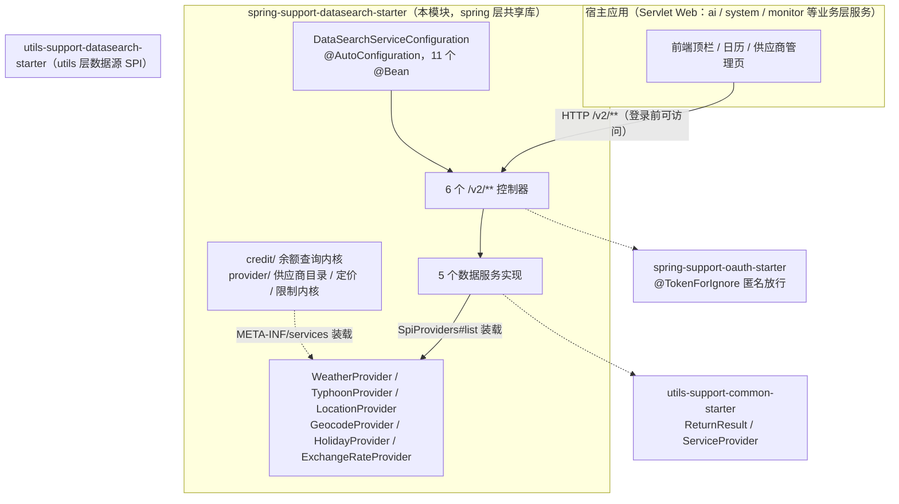
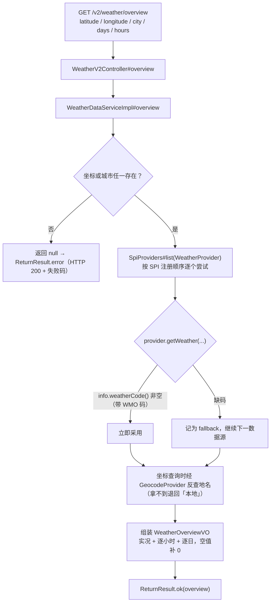

# spring-support-datasearch-starter

数据检索服务化 starter：把天气 / 定位 / 台风 / 汇率 / 节假日 / IP 归属地的多来源数据归一成前端唯一契约，以 `/v2/**` 匿名接口暴露，并附带供应商余额查询、目录 / 定价 / 限制的共用内核。在 spring-support 体系中它是「平台可选增强」共享库：ai / system / monitor 等各类 Servlet Web 宿主引入即生效；数据源 SPI 来自底层 `utils-support-datasearch-starter`，本模块负责自动装配、HTTP 契约与数据归一。

## 1. 架构图



放在 spring 层的原因：这套能力是平台可选增强，各类宿主都可能要，而 spring 层不得反向依赖 api 层，故下沉为共享库，api 业务层与 spring 业务层共用同一份实现（原实现位于 `spring-api-support-common-service-starter`，已迁出）。

内部分层：**自动装配**（`DataSearchServiceConfiguration`）→ **接入层**（6 个控制器，只做参数接收、异常兜底与 `ReturnResult` 包装）→ **服务层**（5 个服务实现，承载 WMO 天气码优先、时间归一、风圈报文解析、去重、缓存等归一规则）→ **SPI 数据源层**（`SpiProviders#list` 装载，本模块不写死任何一家上游）。

## 2. 核心流程图



## 3. 能力清单

| 能力域 | 关键类 | 入口/触发方式 |
|---|---|---|
| 自动装配 | `DataSearchServiceConfiguration` | `META-INF/spring/...AutoConfiguration.imports` |
| 天气总览 | `WeatherV2Controller` + `WeatherDataService` / `WeatherDataServiceImpl` | `GET /v2/weather/overview` |
| 定位解析 | `LocationV2Controller`（复用 `WeatherDataService#resolveLocation`） | `GET /v2/location/resolve` |
| 台风列表 / 详情 | `TyphoonV2Controller` + `TyphoonDataService` / `TyphoonDataServiceImpl` | `GET /v2/typhoon/active`、`GET /v2/typhoon/detail` |
| 汇率概览 | `ExchangeRateV2Controller` + `ExchangeRateDataService` / `ExchangeRateDataServiceImpl` | `GET /v2/exchange-rate/overview` |
| 节假日 | `HolidayV2Controller` + `HolidayDataService` / `HolidayDataServiceImpl` | `GET /v2/holiday/get` |
| IP 归属地 | `IpLookupV2Controller` + `IpLookupDataService` / `IpLookupDataServiceImpl` | `GET /v2/ip/lookup` |
| SPI 装载 | `SpiProviders#list(Class)`（底层 `ServiceProvider#collectDistinct()` 按实现类去重、保序，失败返回空列表） | 各 `*DataServiceImpl` 内部调用 |
| 余额查询内核 | `CreditQueries` / `CreditQueryProvider`（23 个内置实现）/ `CreditSigner` / `CreditHttp` / `CreditExpressions` | `CreditQueries#query(CreditQuery)`（供账户页与 AI 供应商页调用，无 HTTP 端点） |
| 供应商目录 / 定价 / 限制 / 能力位 | `ProviderRegistries` / `ProviderPricings` / `ProviderLimits` / `ProviderModelCatalogs` / `ProviderModelMetrics` / `ProviderCapabilities` + 6 条 `provider.spi` 接口 | `META-INF/services` 装载，供 ai / 监控侧消费 |
| 响应包装 | `ReturnResult.ok/error`（HTTP 200 + 业务码） | 全部控制器端点 |

七个端点全部标注 `@TokenForIgnore`（顶栏与日历在登录前就可能渲染，必须匿名可访问）。除台风详情的 `id` 外参数全部可选，启动期 HEAD 探测不带查询串也要能命中映射。

## 4. Bean 能力矩阵

类级装配条件（对下表全部 Bean 生效）：`@AutoConfiguration` + `@ConditionalOnWebApplication(type = SERVLET)` + `@ConditionalOnProperty(prefix = "plugin.datasearch", name = "enabled", havingValue = "true", matchIfMissing = true)`。

| Bean 名（方法名） | 类型 | 装配条件 | 可否覆盖 | 典型用途 |
|---|---|---|---|---|
| `weatherDataService` | `WeatherDataService`（实现类 `WeatherDataServiceImpl`） | 类级三条件 + `@ConditionalOnMissingBean` | 可：宿主自建同类型 Bean 即退让 | 注入后直查天气 / 定位，绕过 HTTP |
| `typhoonDataService` | `TyphoonDataService`（实现类 `TyphoonDataServiceImpl`） | 同上 | 可 | 台风列表 / 详情服务端调用 |
| `exchangeRateDataService` | `ExchangeRateDataService`（实现类 `ExchangeRateDataServiceImpl`） | 同上 | 可 | 汇率最新价 + 周期涨跌 |
| `holidayDataService` | `HolidayDataService`（实现类 `HolidayDataServiceImpl`） | 同上 | 可 | 节假日按年查询 |
| `ipLookupDataService` | `IpLookupDataService`（实现类 `IpLookupDataServiceImpl`） | 同上 | 可 | IP 归属地解析（本地库，无外呼） |
| `weatherV2Controller` | `WeatherV2Controller` | 同上 | 可 | MVC 映射 `/v2/weather/overview` |
| `locationV2Controller` | `LocationV2Controller`（复用 `weatherDataService`） | 同上 | 可 | MVC 映射 `/v2/location/resolve` |
| `typhoonV2Controller` | `TyphoonV2Controller` | 同上 | 可 | MVC 映射 `/v2/typhoon/*` |
| `exchangeRateV2Controller` | `ExchangeRateV2Controller` | 同上 | 可 | MVC 映射 `/v2/exchange-rate/overview` |
| `holidayV2Controller` | `HolidayV2Controller` | 同上 | 可 | MVC 映射 `/v2/holiday/get` |
| `ipLookupV2Controller` | `IpLookupV2Controller` | 同上 | 可 | MVC 映射 `/v2/ip/lookup` |

说明：服务实现类虽标了 `@Service`，但多数宿主只扫自己的子包、扫不到 `com.chua.starter.datasearch`，实际装配走自动配置；`@ConditionalOnMissingBean` 保证两条路径不重复注册。本模块没有 `@ConfigurationProperties` Bean、没有 `WebMvcConfigurer` / `Filter` / 定时任务 Bean；唯一的配置读取是类级 `@ConditionalOnProperty`。

## 5. 完整配置

**本模块没有 `@ConfigurationProperties` 配置类**：入参全部来自 HTTP 请求与 SPI 登记。唯一 Spring 配置项由 `DataSearchServiceConfiguration` 类级 `@ConditionalOnProperty` 直接读取（下表已与源码逐项核对一致）：

| 配置路径 | 类型 | 默认值 | 说明 |
|---|---|---|---|
| `plugin.datasearch.enabled` | `Boolean` | `true`（`matchIfMissing = true`，不配置也生效） | 整体开关；`false` 时 6 个控制器与 5 个数据服务都不注册 |

以下是代码内固定默认值（不是配置项，修改需改源码），便于对照前端预期：

| 常量 | 值 | 位置 |
|---|---|---|
| 预报天数默认 / 上限 | 7 / 16 | `WeatherDataServiceImpl` |
| 逐小时点数默认 / 上限 | 24 / 72 | `WeatherDataServiceImpl` |
| 定位候选请求头顺序 | `X-Forwarded-For` → `X-Real-IP` → `Proxy-Client-IP` → `WL-Proxy-Client-IP` | `WeatherDataServiceImpl` |
| 汇率默认周期 | `1m`（回看 30 天；`3m`/`6m`/`12m` 为 90/180/365 天） | `ExchangeRateDataServiceImpl` |
| 汇率数据源与兜底 | `open-exchange-rate` → `frankfurter` → `er-api` | `ExchangeRateDataServiceImpl` |
| 汇率外呼超时 / 历史缓存 | 8 秒；10 分钟、上限 64 条 | `ExchangeRateDataServiceImpl` |
| 节假日年份合法区间 | 1900–2200，越界或缺省取当年 | `HolidayDataServiceImpl` |
| IP 归属地进程内缓存 / 默认解析器 | 2048 条（满后清空重建）；`ip2region` | `IpLookupDataServiceImpl` |

### 5.1 逐项配置示例

本模块配置面极小：Spring 配置项只有 1 个总开关，另有 6 个 JVM 系统属性只影响余额查询内核的外呼代理。逐项如下（均可在源码中核对）。

**A. 模块总开关（Spring Boot 配置项，写 `application.yml`）**

| 配置项 | 含义 | 默认值 |
|---|---|---|
| `plugin.datasearch.enabled` | 数据检索服务化整体开关；`false` 时 6 个 `/v2/**` 控制器与 5 个数据服务 Bean 全部不注册 | `true`（`matchIfMissing = true`，不配置也生效） |

开启（默认即开启，可整段省略）：

```yaml
plugin:
  datasearch:
    enabled: true
```

整体关闭（宿主不想要这套 `/v2/**` 接口与数据服务时）：

```yaml
plugin:
  datasearch:
    enabled: false
```

**B. 余额查询外呼代理（JVM 系统属性，不是 Spring 配置项）**

`credit/` 余额查询内核的所有外呼统一走 `CreditHttp`，它会读取 JVM 级代理系统属性（`System.getProperty`）。这组属性**不能写在 `application.yml`**，要通过启动参数 `-D` 设置：

| 系统属性 | 含义 | 默认行为 |
|---|---|---|
| `http.proxyHost` / `http.proxyPort` | HTTP 外呼代理主机 / 端口 | 未配置直连；端口缺省回落 `80` |
| `https.proxyHost` / `https.proxyPort` | HTTPS 外呼代理主机 / 端口 | 未配置直连；端口缺省回落 `443` |
| `http.nonProxyHosts` | 不走代理的主机名单（`\|` 分隔，支持 `127.*`、`*.local` 通配） | 未配置则全部按代理走 |
| `https.nonProxyHosts` | 同上（HTTPS；未配置时回落读 `http.nonProxyHosts`） | 同上 |

```bash
java -Dhttp.proxyHost=proxy.example.com -Dhttp.proxyPort=7897 \
     -Dhttps.proxyHost=proxy.example.com -Dhttps.proxyPort=7897 \
     -Dhttp.nonProxyHosts="127.*|*.local|192.168.*" \
     -jar my-service.jar
```

> 说明：天气 / 定位 / 台风 / 汇率 / 节假日等数据服务的外呼由 utils 层各 `*Provider` 自行实现，不读这组代理属性；这组属性只作用于余额查询（`CreditQueries#query`）与经 `CreditHttp` 的供应商数据外呼。

### 5.2 完整 YAML 使用示例

一个典型 Servlet Web 宿主引入本模块后的 `application.yml`（本模块只认 `plugin.datasearch.enabled` 一个键，其余为宿主自身配置）：

```yaml
server:
  port: 8080

spring:
  application:
    name: my-service

plugin:
  datasearch:
    enabled: true   # 数据检索服务化总开关（默认 true，可省略）
```

启动与自测：

```bash
java -jar my-service.jar
curl -s "http://localhost:8080/v2/weather/overview?city=杭州&days=3&hours=12"
curl -s "http://localhost:8080/v2/exchange-rate/overview?symbols=USD/CNY,USD/EUR&period=1m"
curl -s "http://localhost:8080/v2/holiday/get?year=2026"
curl -s "http://localhost:8080/v2/ip/lookup?ip=114.114.114.114"
```

7 个端点（天气 / 定位 / 台风列表 / 台风详情 / 汇率 / 节假日 / IP 归属地）全部匿名可访问，参数全部可选（除台风详情 `id`），返回统一为 `ReturnResult` 包装（HTTP 200 + 业务码）。

### 5.3 生产注意事项

1. **匿名暴露面**：7 个 `/v2/**` 端点都标注 `@TokenForIgnore`（顶栏与日历在登录前就要出数），不做登录鉴权。若网关侧需要收敛，请自行加 IP 白名单 / 限流，不要把这些端点当成受保护接口。
2. **失败语义**：数据源不可用时返回 HTTP 200 + `ReturnResult.error` 失败码，不是 4xx/5xx；调用方（前端或网关聚合层）必须判业务码，不要按 HTTP 状态码重试。空数组（如无活跃台风、某年无节假日数据）是权威结论，与失败码含义不同。
3. **外呼与超时**：天气 / 定位 / 台风 / 汇率 / 节假日会外呼三方数据源；汇率外呼超时 8 秒、历史缓存 10 分钟（上限 64 条）。防火墙需放行对应外网域名；完全隔离的内网环境这些接口会稳定返回失败码（属预期，前端应回落三方或内置表）。
4. **IP 归属地依赖可选**：不引入 ip2region / geoip2 实现依赖时，仅 `/v2/ip/lookup` 返回失败码，其余接口不受影响。
5. **关闭要成套**：`plugin.datasearch.enabled=false` 后 11 个 Bean 全部不注册，前端会探测不到能力；建议同步关闭前端能力开关（`app.yaml` 的 `other.capabilities` 对应项），避免前端反复 HEAD 探测落空。
6. **路径冲突**：宿主里若还留有旧的同路径控制器（如 api 侧 `/v2/ip/lookup` 旧实现），启动会报 `Ambiguous handler methods mapped`；引入 `spring-support-monitor-starter` 的宿主由 `DatasearchConflictResolve` 自动移走旧控制器，其余宿主需自行保留一处。
7. **Bean 覆盖即退让**：11 个自动配置 Bean 均带 `@ConditionalOnMissingBean`，宿主自建同类型 Bean 时本模块对应 Bean 自动让位；替换后请自行保证新实现的能力完整（如 IP 库加载、缓存语义）。

## 6. 使用方式

**Maven 坐标**：

```xml
<dependency>
    <groupId>com.chua</groupId>
    <artifactId>spring-support-datasearch-starter</artifactId>
    <version>4.0.0.51</version>
</dependency>
```

**最小启用示例**——宿主是 Servlet Web 应用并已装配 `spring-support-oauth-starter` 的 `@TokenForIgnore` 支持，引入依赖即生效；开关默认开启，可不写：

```yaml
plugin:
  datasearch:
    enabled: true
```

```bash
curl -s "http://localhost:8080/v2/weather/overview?city=杭州&days=3&hours=12"
curl -s "http://localhost:8080/v2/holiday/get?year=2026"
curl -s "http://localhost:8080/v2/ip/lookup?ip=114.114.114.114"
```

不需要 `@ComponentScan` 覆盖 `com.chua.starter.datasearch`——本模块用自动配置注册 Bean。服务端也可跳过 HTTP 直接注入 `WeatherDataService` 等接口调用（无可用数据源时返回 `null`，由调用方降级）。

**可选依赖说明**：

| 依赖 | 缺了会怎样 |
|---|---|
| `spring-boot-starter-web` / `spring-boot-autoconfigure` / `utils-support-datasearch-starter` / `utils-support-common-starter` / `spring-support-oauth-starter` | 必需（传递引入），缺一自动装配或端点即失效 |
| `jakarta.servlet-api` | `provided`，由 Web 容器提供；仅定位接口用 `HttpServletRequest` |
| `org.projectlombok:lombok` | `provided`，仅编译期；运行期不需要 |
| `io.swagger.core.v3:swagger-annotations` | 仅文档注解，缺失不影响功能 |
| `org.jsoup:jsoup`（1.24.1） | 必需（随模块传递）；余额/定价内核读官方价格页用 |
| ip2region / geoip2 实现依赖 | **宿主可选**：不引入时 `/v2/ip/lookup` 返回失败码，其余接口不受影响 |

测试仅用 JUnit 5（`junit-jupiter`），不引 `spring-boot-starter-test`（会传递 mockito，项目规约禁用）。

## 7. 使用场景

**适用**：

- 宿主要给前端顶栏 / 日历提供天气、定位、台风、汇率、节假日、IP 归属地数据，且希望「后台统一出数、前端不直连三方」。
- 多个宿主（ai / system / monitor / api 业务层）需要同一份 `/v2/**` 实现，避免各写一份。
- 供应商管理页需要查上游余额（`credit/` 内核）或读供应商目录 / 定价 / 限制（`provider/` 内核）。

**不适用 / 慎用**：

- WebFlux / 非 Servlet 宿主：类级 `@ConditionalOnWebApplication(SERVLET)`，不会装配任何 Bean。
- 需要**写**节假日数据（`/v2/holiday/sync`）的场景：本模块不读也不写 `sys_holiday` 表，同步由 system 模块的 `SysHolidayController` 负责。
- 全文检索 / 向量检索等「搜索」需求：本模块是结构化数据源归一，不是搜索引擎。

**与相邻模块的取舍**：只要 SPI、不要 HTTP 契约 → 只依赖 `utils-support-datasearch-starter`，自己消费 `WeatherProvider` 等接口；api 业务层宿主 → 经 `spring-api-support-common-service-starter` 传递依赖本模块，不要在 api 侧重写同名控制器；`spring-support-ai-starter` 依赖本模块以获取 utils 层 `UsageParser` / `ModelMetricsProvider` / `UsagePricingReconciler` 契约（会同时带上 `/v2/**` 接口）；`spring-support-monitor-starter` 的 `MonitorAutoConfiguration` 注册 `DatasearchConflictResolve`，把宿主里旧的 `/v2/holiday/get`、`/v2/ip/lookup` 控制器移走，避免同路径双映射。前端能力开关见 `app.yaml` 的 `other.capabilities`（`weather` / `location` / `typhoon` / `exchangeRate` / `holiday` / `ipLookup`）。

## 8. 扩展点

**数据源 SPI（定义在 `utils-support-datasearch-starter`，本模块消费）**：`WeatherProvider`、`TyphoonProvider`、`LocationProvider`、`GeocodeProvider`、`HolidayProvider`、`ExchangeRateProvider`。内置实现如 `OpenMeteoWeatherProvider`（带 WMO 码，优先）、`WttrInWeatherProvider`（城市兜底）、`ZhejiangTyphoonProvider`、`IpApiLocationProvider`、`BigDataCloudGeocodeProvider`、`OnlineHolidayProvider`、`OpenExchangeRateProvider`。新增数据源：实现接口（标 `@Spi`），在自己 jar 的 `META-INF/services/<SPI 接口全限定名>` 登记实现类全限定名，放进宿主 classpath 即可；装配顺序即 SPI 注册顺序，天气侧优先采用带 WMO 天气码的结果。

**本模块 SPI——余额查询 `CreditQueryProvider`**：方法 `name()` / `supports(CreditQuery)` / `query(CreditQuery)`，以及账号登录钩子 `loginPageUrl()` / `loginPageUrl(String baseUrl)` / `loginCookieName()` / `loginCaptureUrlPattern()` / `loginTokenJsonPath()` / `loginStorageKey()` / `supportsTokenRenewal()` / `renewPageUrl(String baseUrl)`。登记文件 `META-INF/services/com.chua.starter.datasearch.credit.spi.CreditQueryProvider`；现有 23 个内置实现（`kind`）：`expression`、`billing`、`new-api`、`sub2api`、`openai`、`host`、`registry`、`custom`、`moss`、`agnes`、`deepseek`、`sensenova`、`shusheng`、`minimax-platform`、`modelscope`、`zai`、`openrouter`、`opencode`、`opencode-console`、`volc-plan`（AK/SK 经 `CreditSigner` 签名）、`ppio`、`anthropic`、`xai`。约定：查不到不抛异常，返回 `CreditResult.fail(kind, 原因)`。

**本模块 SPI——供应商数据 6 条接口（`provider.spi` 包）**：`ProviderRegistryProvider`（供应商描述，内置 `RegistryProviderRegistry`）、`ProviderPricingProvider`（定价规则，内置 `RegistryProviderPricingProvider`）、`ProviderModelCatalogProvider`（模型目录，内置 `ModelsDevCatalogProvider`）、`ProviderModelMetricsProvider`（模型指标，内置 `ModelsDevModelMetricsProvider`）、`ProviderLimitProvider`（限制登记，内置 `RegistryProviderLimitProvider`）、`ProviderCapabilityProvider`（能力位，内置 `ProtocolCapabilityProvider`）。登记方式同上。

**限制机制 `ProviderLimitMechanism`（`provider.limit` 包）**：内置链 `ManualLimitMechanism`（order 10）→ `DocLimitMechanism`（order 20）→ `HeaderLimitMechanism`（order 30），由 `ProviderLimitMechanisms` 调度、`ProviderLimitCollector#collect` 输出可解释报告。扩展两种方式（同一 `kind()` 只保留一个，Spring Bean 优先）：声明为 `@Component` / `@Bean` 后调 `ProviderLimitMechanisms#install(...)`；或在 `META-INF/services/com.chua.starter.datasearch.provider.limit.ProviderLimitMechanism` 登记（无 Spring 上下文时走 `ServiceLoader`）。

**Bean 覆盖**：11 个自动配置 Bean 全部带 `@ConditionalOnMissingBean`，宿主自建同类型 Bean（如自定义 `IpLookupV2Controller` 或 `WeatherDataService` 实现）时本模块对应 Bean 自动退让，可整体替换某个能力。

## 9. 常见问题

**Q1：引入依赖后接口 404 / Bean 不存在？**
按装配条件逐条排查：① 宿主是否 Servlet Web 应用（WebFlux 不装配任何 Bean）；② `plugin.datasearch.enabled` 是否被设成 `false`；③ 是否自建了同类型 Bean 导致本模块退让（设计行为）。本模块走 `AutoConfiguration.imports`，不要指望 `@ComponentScan` 扫到 `com.chua.starter.datasearch`——多数宿主扫不到，也不需要扫。

**Q2：HTTP 返回 200 但拿不到数据？**
失败语义是 `ReturnResult.error(...)`（HTTP 200 + 失败码），不是 5xx，调用方必须看业务码。空集合与失败码含义不同：台风 `active` 无台风、节假日某年无数据返回**空数组**；数据源整体不可用才返回失败码（前端回落三方 / 内置表）。

**Q3：与 Spring Boot 4 的兼容性？**
仓库当前基于 Spring Boot 4.1.2。本模块自动配置经 `META-INF/spring/org.springframework.boot.autoconfigure.AutoConfiguration.imports` 注册（Boot 3 起的标准机制，本模块**没有** `spring.factories`）；Servlet 依赖为 `jakarta.servlet-api`（jakarta 命名空间）；条件注解与 MVC 注解均为当前版本标准用法，无已废弃 API。

**Q4：启动报 `Ambiguous handler methods mapped`？**
宿主里还有旧的同路径控制器（如 api 侧 `SysIpController` 同样映射 `/v2/ip/lookup`）。部署侧保留一处即可；本模块 Bean 带 `@ConditionalOnMissingBean`，宿主自建同名控制器时自动退让。引入 `spring-support-monitor-starter` 的宿主由 `DatasearchConflictResolve` 自动移走旧控制器。另注意：日志出现 `Cannot find cache named 'redis-cache-600'` 不是本模块抛的——本模块 IP 归属地直接消费 `IpPosition` SPI + 进程内缓存，不走 `IptablesService`。
