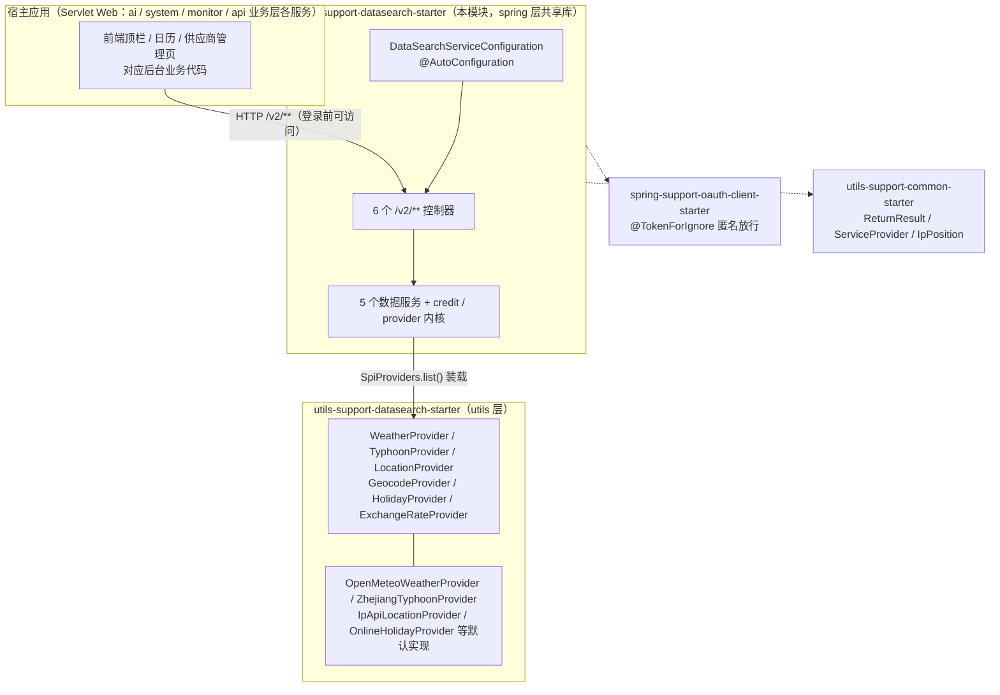
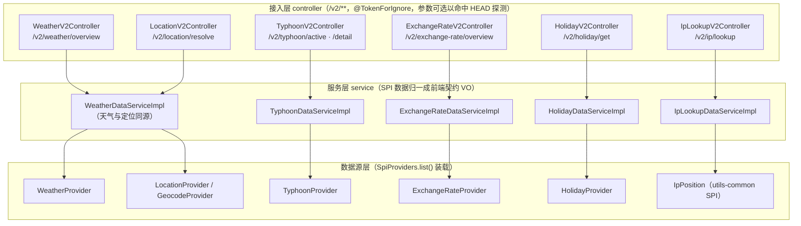
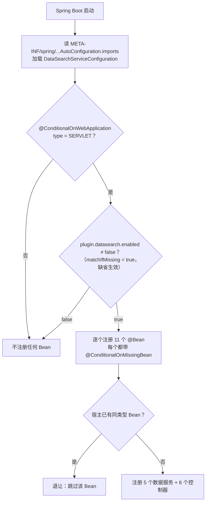
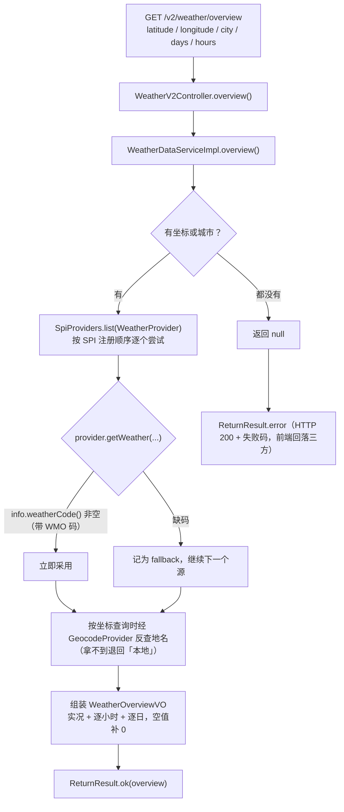
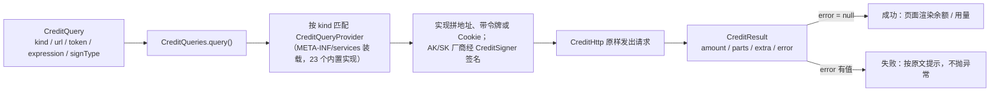

# spring-support-datasearch-starter

数据检索服务化：天气 / 定位 / 台风 / 汇率 / 节假日 / IP 归属地的后台统一契约（前端顶栏与日历数据源），另含供应商目录 / 定价 / 限制 / 余额查询共用内核。

把 `utils-support-datasearch-starter` 的数据源 SPI（`WeatherProvider` / `TyphoonProvider` / `LocationProvider` / `GeocodeProvider` / `HolidayProvider` / `ExchangeRateProvider`）归一成前端唯一契约，以 `/v2/**` 匿名接口暴露；`credit/` 与 `provider/` 目录是「上游余额读数、供应商登记、模型目录、定价、限流」的共用内核。以自动配置注册（引入依赖即生效，无需 `@ComponentScan` 覆盖本包），仅 Servlet Web 应用生效，`plugin.datasearch.enabled=false` 可整体关闭。

## 1. 架构图

### 1.1 模块在体系中的位置



放在 spring 层的原因：这套能力是「平台可选增强」，ai / system / monitor 等各类宿主都可能要，而 spring 层不得反向依赖 api 层，故在此下沉为共享库，api 业务层与 spring 业务层共用同一份实现（原实现位于 `spring-api-support-common-service-starter`，已迁出，避免两份代码分叉）。

### 1.2 内部分层



- **接入层**：只做参数接收、异常兜底与 `ReturnResult` 包装，全部 `@TokenForIgnore`。
- **服务层**：承载归一规则——WMO 天气码优先、时间统一 `yyyy-MM-ddTHH:mm`、风圈报文解析、按日期去重、内存缓存。
- **数据源层**：SPI 装载（注册顺序即优先级），本模块不写死任何一家上游。

## 2. 核心流程图

### 2.1 自动装配流程



### 2.2 天气请求处理流程（数据流）



### 2.3 余额查询数据流（credit/ 内核）



## 3. 能力清单

| 能力域 | 关键类 | 入口 |
|---|---|---|
| 自动配置 | `DataSearchServiceConfiguration` | `META-INF/spring/...AutoConfiguration.imports` |
| 天气总览 | `WeatherV2Controller` + `WeatherDataService` / `WeatherDataServiceImpl` | `GET /v2/weather/overview` |
| 定位解析 | `LocationV2Controller`（复用 `WeatherDataService#resolveLocation`） | `GET /v2/location/resolve` |
| 台风列表 / 详情 | `TyphoonV2Controller` + `TyphoonDataService` / `TyphoonDataServiceImpl` | `GET /v2/typhoon/active`、`GET /v2/typhoon/detail` |
| 汇率概览 | `ExchangeRateV2Controller` + `ExchangeRateDataService` / `ExchangeRateDataServiceImpl` | `GET /v2/exchange-rate/overview` |
| 节假日 | `HolidayV2Controller` + `HolidayDataService` / `HolidayDataServiceImpl` | `GET /v2/holiday/get` |
| IP 归属地 | `IpLookupV2Controller` + `IpLookupDataService` / `IpLookupDataServiceImpl` | `GET /v2/ip/lookup` |
| SPI 装载 | `SpiProviders#list(Class)`（`ServiceProvider#collectDistinct()` 按实现类去重、保持注册顺序、失败返回空列表） | 各 `*DataServiceImpl` 内部调用 |
| 余额查询内核 | `CreditQueries` / `CreditQueryProvider`（23 个内置实现）/ `CreditSigner` / `CreditHttp` / `CreditExpressions` | `CreditQueries.query(CreditQuery)`（供账户页与 AI 供应商页调用，无 HTTP 端点） |
| 供应商目录 / 定价 / 限制 / 能力位 | `ProviderRegistries` / `ProviderPricings` / `ProviderLimits` / `ProviderModelCatalogs` / `ProviderModelMetrics` / `ProviderCapabilities` + 6 条 `provider.spi` 扩展接口 | `META-INF/services` 装载，供 ai / 监控侧消费 |
| 响应包装 | `ReturnResult.ok/error`（HTTP 200 + 业务码） | 七个控制器端点 |

七个接口全部标注 `@TokenForIgnore`：**顶栏与日历在登录前就可能渲染**，必须匿名可访问。除台风详情的 `id` 外参数全部可选，启动期的 HEAD 探测不带查询串也要能命中映射（前端 `probeBackend` 用 HEAD 判定能力是否存在）。

## 4. Bean 能力矩阵

类级装配条件（对下表全部 Bean 生效）：`@AutoConfiguration` + `@ConditionalOnWebApplication(type = SERVLET)` + `@ConditionalOnProperty(prefix = "plugin.datasearch", name = "enabled", havingValue = "true", matchIfMissing = true)`。

| Bean 名（方法名） | 类型 | 装配条件 | 可否覆盖 | 典型注入姿势 |
|---|---|---|---|---|
| `weatherDataService` | `WeatherDataServiceImpl`（实现 `WeatherDataService`） | 类级三条件 + `@ConditionalOnMissingBean` | 可：宿主自建同类型 Bean 即退让 | `@RequiredArgsConstructor` 注入 `private final WeatherDataService` |
| `typhoonDataService` | `TyphoonDataServiceImpl`（实现 `TyphoonDataService`） | 同上 | 可 | 同上（`TyphoonDataService`） |
| `exchangeRateDataService` | `ExchangeRateDataServiceImpl`（实现 `ExchangeRateDataService`） | 同上 | 可 | 同上（`ExchangeRateDataService`） |
| `holidayDataService` | `HolidayDataServiceImpl`（实现 `HolidayDataService`） | 同上 | 可 | 同上（`HolidayDataService`） |
| `ipLookupDataService` | `IpLookupDataServiceImpl`（实现 `IpLookupDataService`） | 同上 | 可 | 同上（`IpLookupDataService`） |
| `weatherV2Controller` | `WeatherV2Controller` | 同上 | 可 | 宿主一般不注入控制器，仅 MVC 映射生效 |
| `locationV2Controller` | `LocationV2Controller`（复用 `weatherDataService`） | 同上 | 可 | 同上 |
| `typhoonV2Controller` | `TyphoonV2Controller` | 同上 | 可 | 同上 |
| `exchangeRateV2Controller` | `ExchangeRateV2Controller` | 同上 | 可 | 同上 |
| `holidayV2Controller` | `HolidayV2Controller` | 同上 | 可 | 同上 |
| `ipLookupV2Controller` | `IpLookupV2Controller` | 同上 | 可 | 同上 |

说明：

- 各服务实现类虽标了 `@Service`，但多数宿主只扫自己的子包、扫不到 `com.chua.starter.datasearch`，因此**实际装配走上面的自动配置**；`@Service` 只在恰好被扫到时与自动配置等价（`@ConditionalOnMissingBean` 保证不重复注册）。
- 控制器构造参数即对应服务 Bean（如 `LocationV2Controller(WeatherDataService)`），定位与天气同源收口在一个服务里。
- 本模块**没有** `@ConfigurationProperties` Bean、没有 `WebMvcConfigurer` / `Filter` / 定时任务 Bean；唯一的配置读取是类级 `@ConditionalOnProperty`。

## 5. 完整配置

**本模块没有 `@ConfigurationProperties` 配置类**：入参全部来自 HTTP 请求与 SPI 登记，无需要静态配置的属性。唯一配置项由 `@ConditionalOnProperty` 直接读取：

| 配置项 | 类型 | 默认值 | 说明 | 生效开关 |
|---|---|---|---|---|
| `plugin.datasearch.enabled` | `Boolean` | `true`（`matchIfMissing = true`，不配置也生效） | 整体开关。`false` 时 6 个控制器与 5 个数据服务都不注册 | 作用于 `DataSearchServiceConfiguration` 类级条件 |

生效条件（三个同时满足）：Servlet Web 应用（`@ConditionalOnWebApplication(SERVLET)`）、开关不为 `false`、宿主未自建同名 Bean（逐个 `@ConditionalOnMissingBean`）。

以下是**代码内固定默认值**（不是配置项，修改需改源码），便于对照前端预期：

| 常量 | 值 | 位置 |
|---|---|---|
| 预报天数默认 / 上限 | 7 / 16 | `WeatherDataServiceImpl` |
| 逐小时点数默认 / 上限 | 24 / 72 | `WeatherDataServiceImpl` |
| 定位候选请求头顺序 | `X-Forwarded-For` → `X-Real-IP` → `Proxy-Client-IP` → `WL-Proxy-Client-IP` | `WeatherDataServiceImpl` |
| 汇率默认周期 | `1m`（回看 30 天；`3m`/`6m`/`12m` 为 90/180/365 天） | `ExchangeRateDataServiceImpl` |
| 汇率默认币种篮子 | `USD/EUR`、`USD/GBP`、`USD/JPY`、`USD/CNY`、`USD/HKD`、`USD/SGD` | `ExchangeRateDataServiceImpl` |
| 汇率历史序列缓存 | 10 分钟，上限 64 条；最新价表 6 小时 | `ExchangeRateDataServiceImpl` |
| 三方外呼超时 | 8 秒 | `ExchangeRateDataServiceImpl` |
| 节假日年份合法区间 | 1900–2200，越界或缺省取当年 | `HolidayDataServiceImpl` |
| IP 归属地进程内缓存 | 2048 条（满后清空重建） | `IpLookupDataServiceImpl` |
| IP 解析器默认名 | `ip2region`（不可用则退到任意已注册实现） | `IpLookupDataServiceImpl` |

## 6. 使用方式

**Maven 坐标**（版本随 parent `spring-support-parent-starter`）：

```xml
<dependency>
    <groupId>com.chua</groupId>
    <artifactId>spring-support-datasearch-starter</artifactId>
    <version>4.0.0.51</version>
</dependency>
```

**最小可运行示例**：

1. 宿主是 Servlet Web 应用，并已装配 `spring-support-oauth-client-starter` 的 `@TokenForIgnore` 支持（否则接口会被鉴权拦下）。
2. 引入依赖即生效；开关默认开启，可不写：

```yaml
plugin:
  datasearch:
    enabled: true
```

3. 直接访问任一接口验证：

```bash
curl -s "http://localhost:8080/v2/weather/overview?city=杭州&days=3&hours=12"
curl -s "http://localhost:8080/v2/typhoon/detail?id=202618"
curl -s "http://localhost:8080/v2/exchange-rate/overview?symbols=USD/CNY,USD/EUR&period=3m"
curl -s "http://localhost:8080/v2/holiday/get?year=2026"
curl -s "http://localhost:8080/v2/ip/lookup?ip=114.114.114.114"
```

**不需要** `@ComponentScan` 覆盖 `com.chua.starter.datasearch`——本模块用自动配置注册 Bean。

**服务端直接调用**（跳过 HTTP，适合内部聚合）：

```java
@Service
@RequiredArgsConstructor
public class TopBarService {

    private final WeatherDataService weatherDataService;
    private final HolidayDataService holidayDataService;

    public WeatherOverviewVO weather(String city) {
        WeatherQuery query = new WeatherQuery();
        query.setCity(city);
        query.setDays(3);
        query.setHours(12);
        return weatherDataService.overview(query);   // 无可用数据源时返回 null
    }

    public List<HolidayVO> holidays(Integer year) {
        return holidayDataService.list(year);        // 无数据源时返回 null
    }
}
```

**HTTP 契约速查**：

| 方法与路径 | 参数（全可选，除注明外） | 出参 |
|---|---|---|
| `GET /v2/weather/overview` | `latitude`、`longitude`、`city`、`days`（默认 7，上限 16）、`hours`（默认 24，上限 72） | `WeatherOverviewVO`（实况 + 逐小时 + 逐日） |
| `GET /v2/location/resolve` | 无（取请求头 `X-Forwarded-For` / `X-Real-IP` / `Proxy-Client-IP` / `WL-Proxy-Client-IP`） | `LocationVO` |
| `GET /v2/typhoon/active` | 无 | `List<TyphoonItemVO>`；无活跃台风时为空数组 |
| `GET /v2/typhoon/detail` | `id`（**必填**，如 `202618`） | `TyphoonDetailVO`（历史路径 + 预报路径） |
| `GET /v2/exchange-rate/overview` | `symbols`（逗号分隔或重复传参）、`period`（`1m`/`3m`/`6m`/`12m`，默认 `1m`） | `ExchangeRateOverviewVO`（最新价 + 周期涨跌 + 周期极值） |
| `GET /v2/holiday/get` | `year`（缺省当年） | `List<HolidayVO>`，按日期逐行 |
| `GET /v2/ip/lookup` | `ip`（支持 `1.2.3.4:8080`，端口忽略） | `IpLookupVO`（国家/省/市/运营商 + 经纬度/邮编/时区） |

`symbols` 同时接受两种前端序列化方式：`symbols=USD/EUR,USD/CNY` 与 axios 默认的 `symbols[]=USD/EUR&symbols[]=USD/CNY`（`ExchangeRateV2Controller#flatten`）。

**依赖说明**：

| 依赖 | 作用 | 说明 |
|---|---|---|
| `spring-boot-starter-web` | `@RestController` / `@GetMapping` / MVC 绑定 | 必需（传递引入） |
| `spring-boot-autoconfigure` | `@AutoConfiguration`、条件注解 | 必需（传递引入） |
| `utils-support-datasearch-starter` | 6 个数据源 SPI 与 `WeatherInfo` 等模型 | 必需（传递引入） |
| `utils-support-common-starter` | `ReturnResult`、`ServiceProvider`、`IpPosition` | 必需（传递引入） |
| `spring-support-oauth-client-starter` | `@TokenForIgnore` | 必需（匿名放行） |
| `org.jsoup:jsoup` | HTML 解析（官方价格页表格 / 卡片 / role-grid 读取） | 1.23.2，随模块传递 |
| `io.swagger.core.v3:swagger-annotations` | `@Tag` / `@Operation` / `@Schema` | 仅文档用途 |
| `jakarta.servlet-api` | `HttpServletRequest`（定位接口按来源 IP 解析） | `provided` |
| `lombok` | 构造注入 / 日志 | `provided` |
| ip2region / geoip2 实现依赖 | `IpPosition` SPI 实现（IP 归属地本地库） | **宿主可选**：不引入时 `/v2/ip/lookup` 返回失败码，其余接口不受影响 |

测试仅用 JUnit 5（`junit-jupiter`），不引 `spring-boot-starter-test`（它会传递 mockito，项目规约禁用）。

## 7. 使用场景

**适用**：

- 宿主要给前端顶栏 / 日历提供天气、定位、台风、汇率、节假日、IP 归属地数据，且希望「后台统一出数、前端不直连三方」。
- 多个宿主（ai / system / monitor / api 业务层）需要同一份 `/v2/**` 实现，避免各写一份。
- 供应商管理页需要查上游余额（`credit/` 内核）或读供应商目录 / 定价 / 限制（`provider/` 内核）。

**不适用**：

- WebFlux / 非 Servlet 宿主（类级 `@ConditionalOnWebApplication(SERVLET)`，不会装配任何控制器）。
- 需要**写**节假日数据（`/v2/holiday/sync`）的场景：本模块不读也不写 `sys_holiday` 表，同步仍由 system 模块的 `SysHolidayController` 负责。
- 需要复杂检索（全文检索、向量检索）的场景——本模块是「结构化数据源归一」，不是搜索引擎。

**与相邻模块的取舍**：

- **只要 SPI、不要 HTTP 契约** → 只依赖 `utils-support-datasearch-starter`（更底层），自己消费 `WeatherProvider` 等接口。
- **api 业务层宿主** → 经 `spring-api-support-common-service-starter` 传递依赖本模块，获得同一份实现；不要在 api 侧重写同名控制器。
- **`spring-support-ai-starter`** → 依赖本模块以获取 utils 层的 `UsageParser`、`ModelMetricsProvider`、`UsagePricingReconciler` 契约（会同时带上本模块的 `/v2/**` 接口）。
- **`spring-support-monitor-starter`** → 其 `MonitorAutoConfiguration` 注册 `DatasearchConflictResolve`，把宿主里旧的 `/v2/holiday/get`、`/v2/ip/lookup` 控制器移走，避免同路径双映射导致 `Ambiguous handler methods mapped`。
- **前端能力开关** → `app.yaml` 的 `other.capabilities`（`weather` / `location` / `typhoon` / `exchangeRate` / `holiday` / `ipLookup`）。`false` 表示后台不提供该能力：前端不发探测请求，对应入口一并隐藏（清单见 `packages/core/src/api/capability.ts`）。

## 8. 扩展点

### 8.1 数据源 SPI（定义在 `utils-support-datasearch-starter`，本模块消费）

| SPI 接口 | 关键方法 | 内置实现 |
|---|---|---|
| `WeatherProvider` | `name()`、`getWeather(String city)`、`getWeather(Double lat, Double lon, Integer days)`（坐标重载默认返回 `null`） | `OpenMeteoWeatherProvider`（带 WMO 码，优先）、`WttrInWeatherProvider`（城市兜底） |
| `TyphoonProvider` | `name()`、`getActiveTyphoons()`、`getTyphoon(String id)` | `ZhejiangTyphoonProvider` |
| `LocationProvider` | `name()`、`locateIp(String ip)`、`resolveClientIp(headers, remoteAddr)` | `IpApiLocationProvider` |
| `GeocodeProvider` | `name()`、`reverseGeocode(lat, lon)` | `BigDataCloudGeocodeProvider` |
| `HolidayProvider` | `name()`、`getHolidays(int year)` | `OnlineHolidayProvider` |
| `ExchangeRateProvider` | `name()`、取 USD 基准汇率表 | `OpenExchangeRateProvider` |

新增一个数据源的步骤（以天气为例）：

```java
@Spi("my-weather")
public class MyWeatherProvider implements WeatherProvider {

    @Override
    public String name() { return "my-weather"; }

    @Override
    public WeatherInfo getWeather(String city) {
        // 拉取并转成 WeatherInfo（天气现象填 WMO 4677 数字码）
        return null;
    }

    // 支持坐标查询时再覆盖 getWeather(Double, Double, Integer)
}
```

在自有 jar 下新建 `META-INF/services/com.chua.common.support.datasearch.weather.spi.WeatherProvider`，一行一个实现类全限定名：

```text
com.example.weather.MyWeatherProvider
```

把 jar 放进宿主 classpath 即可，无需改本模块。装配顺序即 SPI 注册顺序（`SpiProviders#list` 去重保序），天气侧逐个尝试、**优先采用带 WMO 天气码的结果**，全部缺码时才退回首个结果。

### 8.2 本模块 SPI：余额查询 `CreditQueryProvider`

接口方法：`name()`、`supports(CreditQuery)`、`query(CreditQuery)`，以及「账号登录」钩子 `loginPageUrl()` / `loginPageUrl(String baseUrl)` / `loginCookieName()` / `loginCaptureUrlPattern()` / `loginTokenJsonPath()` / `loginStorageKey()`。

- 登记文件：`META-INF/services/com.chua.starter.datasearch.credit.spi.CreditQueryProvider`，一行一个实现类。
- 现有 23 个内置实现（`kind`）：`expression`（通用地址 + 字段表达式）、`billing`（OpenAI 兼容计费口径）、`new-api`、`sub2api`、`openai`、`host`（厂商官方端点预设）、`registry`（读 `provider-credit-endpoints.json`）、`custom`（JSONPath / XPath 逐字段映射）、`moss`、`agnes`、`deepseek`、`sensenova`、`shusheng`、`minimax-platform`、`modelscope`、`zai`、`openrouter`、`opencode`、`opencode-console`、`volcengine-plan`（AK/SK 签名）、`ppio`、`anthropic`、`xai`。
- 实现约定：查不到**不抛异常**，返回 `CreditResult.fail(kind, 原因)`；调用方按原文提示，N 个上游逐个查不会因一家超时带崩整页。
- AK/SK 签名厂商经 `CreditSigner` 产出「完整 URL + 最终请求头 + body」，`CreditHttp` 原样发出、不二次编码。

### 8.3 本模块 SPI：供应商数据 6 条接口（`provider.spi` 包）

| SPI | 职责 | 内置实现 |
|---|---|---|
| `ProviderRegistryProvider` | 一家供应商一条 `ProviderDescriptor`（名称 / 协议 / 地址 / 别名 / models.dev 键） | `RegistryProviderRegistry` |
| `ProviderPricingProvider` | 定价规则（峰谷时段、按次计价），`refresh()` 支持点击同步 | `RegistryProviderPricingProvider` |
| `ProviderModelCatalogProvider` | 按「平台 + 地址」查厂商模型目录 | `ModelsDevCatalogProvider` |
| `ProviderModelMetricsProvider` | 按模型 id 查指标（免登录渠道无 baseUrl 时用） | `ModelsDevModelMetricsProvider` |
| `ProviderLimitProvider` | 限制登记项（官方文档口径） | `RegistryProviderLimitProvider` |
| `ProviderCapabilityProvider` | 能力位（流式 / 异步），查不到不猜值 | `ProtocolCapabilityProvider` |

登记方式与 8.2 相同：实现接口 + 在 `META-INF/services/com.chua.starter.datasearch.provider.spi.<接口名>` 文件中加一行实现类全限定名。

### 8.4 限制机制 `ProviderLimitMechanism`（`provider.limit` 包）

回答「**怎么拿**」限制（与 8.3 的「去哪拿」互补）。内置链：`ManualLimitMechanism`（order 10）→ `DocLimitMechanism`（order 20）→ `HeaderLimitMechanism`（order 30），由 `ProviderLimitMechanisms` 统一调度、`ProviderLimitCollector#collect` 输出可解释报告（`declared` / `observed` / `doc_url` / `attempted`）。

扩展接入两种方式（同一 `kind()` 只保留一个，Spring Bean 优先）：

- **Spring Bean**：把实现声明为 `@Component` / `@Bean`，宿主装配后调用 `ProviderLimitMechanisms#install(List<ProviderLimitMechanism>)`；
- **JAR SPI**：在 `META-INF/services/com.chua.starter.datasearch.provider.limit.ProviderLimitMechanism` 登记，无 Spring 上下文（单测 / CLI）时由 `ServiceLoader` 装载。

### 8.5 Bean 覆盖

11 个自动配置 Bean 全部带 `@ConditionalOnMissingBean`：宿主自建同类型 Bean（例如自定义 `IpLookupV2Controller` 或 `WeatherDataService` 实现）时，本模块对应 Bean 自动退让，可用于整体替换某个能力。

## 9. 常见问题

**Q1：引入依赖后接口 404 / Bean 不存在？**
按装配条件逐条排查：① 宿主是否 Servlet Web 应用（WebFlux 不装配任何 Bean）；② `plugin.datasearch.enabled` 是否被设成了 `false`；③ 是否自建了同类型 Bean 导致本模块退让（这是设计行为）。本模块走 `AutoConfiguration.imports`，**不要**指望 `@ComponentScan` 扫到 `com.chua.starter.datasearch`——多数宿主扫不到，也不需要扫。

**Q2：接口被鉴权拦截（401 / 403）？**
七个端点靠 `@TokenForIgnore` 匿名放行，该注解来自 `spring-support-oauth-client-starter`；宿主未装配其鉴权支持时，接口会落入全局鉴权链。请确认宿主已引入并启用 oauth-client。

**Q3：HTTP 返回 200 但拿不到数据？**
本模块失败语义是 `ReturnResult.error(...)`（HTTP 200 + 失败码），**不是 5xx**；调用方必须看业务码。空集合与失败码含义不同：台风 `active` 无台风、节假日某年无数据返回**空数组**（权威结论）；数据源整体不可用才返回失败码（前端回落三方 / 内置表）。

**Q4：启动报 `Ambiguous handler methods mapped`？**
宿主里还有旧的同路径控制器（如 api 侧 `SysIpController` 同样映射 `/v2/ip/lookup`）。部署侧保留一处即可；本模块 Bean 带 `@ConditionalOnMissingBean`，宿主自建同名控制器时自动退让。引入 `spring-support-monitor-starter` 的宿主由 `DatasearchConflictResolve` 自动移走旧控制器。

**Q5：日志出现 `Cannot find cache named 'redis-cache-600'`？**
不是本模块抛的。本模块 IP 归属地直接消费 `IpPosition` SPI + 进程内缓存，**不走** `IptablesService`（后者钉了 `redis-cache-600` 缓存管理器，需 redis + ai 侧配置）。若看到该异常，说明调用链进了别的模块的 `IptablesService`。

**Q6：定位接口返回失败，但服务器明明能定位？**
设计如此：客户端来源 IP 是内网 / 回环地址或查不到归属地时返回 `null`（控制器回失败码），**不会退回服务器自身定位**——把服务器地址当客户端地址会让顶栏显示错城市。前端应降级到浏览器定位。

**Q7：与 Spring Boot 4 的兼容性？**
仓库当前基于 Spring Boot 4.1.2。本模块：自动配置经 `META-INF/spring/org.springframework.boot.autoconfigure.AutoConfiguration.imports` 注册（Boot 3 起的标准机制，本模块**没有** `spring.factories`）；Servlet 依赖为 `jakarta.servlet-api`（jakarta 命名空间）；条件注解（`@ConditionalOnWebApplication` / `@ConditionalOnProperty` / `@ConditionalOnMissingBean`）与 MVC 注解均为当前版本标准用法，无已废弃 API。

**Q8：数据源全空怎么排查？**
先看启动 / 调用日志中的 `[datasearch] SPI 装载失败` 与各服务 `[weather]` / `[typhoon]` / `[holiday]` 告警：SPI 未注册（缺 jar 或登记文件路径 / 类名写错）时 `SpiProviders#list` 返回空列表；网络不可达时各实现返回 `null`。汇率有 frankfurter 与 er-api 兜底，天气 / 台风没有额外三方兜底，SPI 全不可用即为空。
