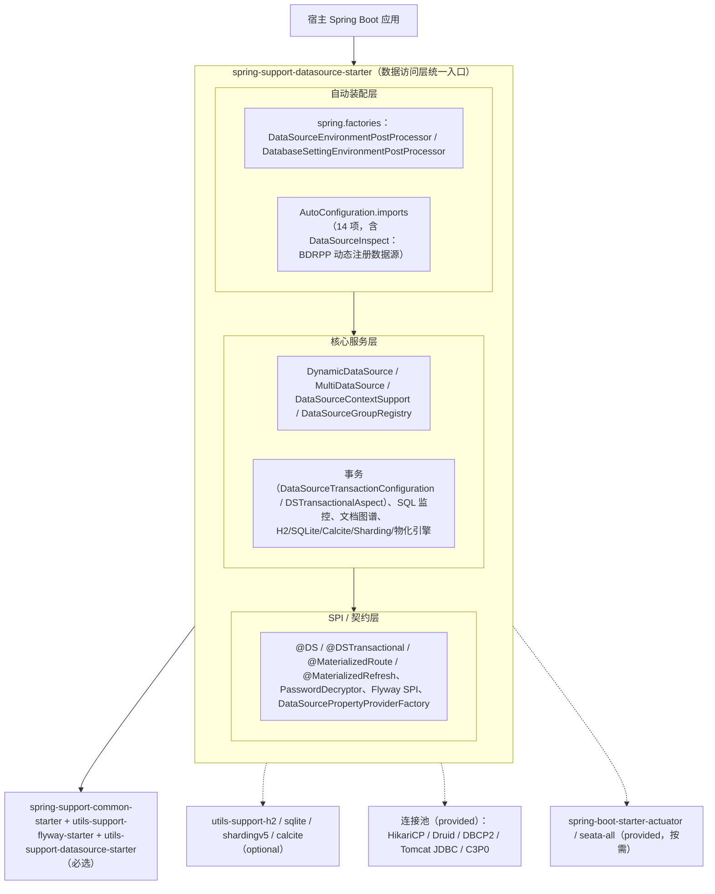
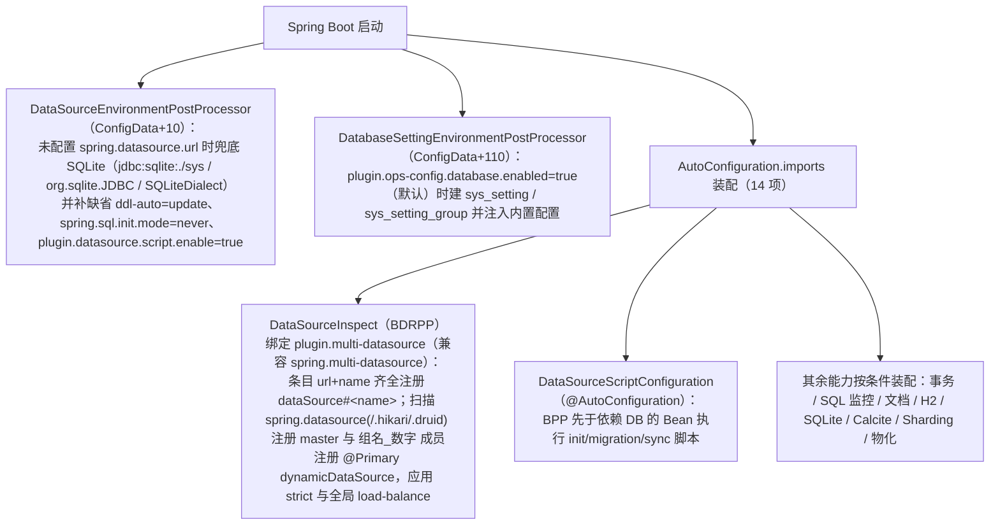

# spring-support-datasource-starter

数据源与数据访问基础设施 starter：动态多数据源注册与路由（`@DS`）、分组负载均衡、多数据源事务（`@DSTransactional`）、按方法名前缀的声明式事务、数据库脚本初始化、纯 JDBC 层 SQL 监控、数据库设计文档在线预览、Calcite 联邦查询、ShardingSphere 分库分表、H2/SQLite 嵌入式引擎与 SQL 物化路由。在 spring-support 体系中，它是**数据访问层的统一入口**：向上为宿主应用提供 `DataSource`、事务与观测能力，向下通过 optional 依赖挂接 H2、SQLite、Calcite、ShardingSphere 等引擎实现。

| 项目 | 值 |
| --- | --- |
| 坐标 | `com.chua:spring-support-datasource-starter:4.0.0.51`（继承父工程 `spring-support-parent-starter`） |
| 基线 | Spring Boot `4.1.2` / Java `25` |

## 1. 架构图

本模块是数据访问层统一入口，依赖兄弟模块 `spring-support-common-starter` 与底层 `utils-support-flyway-starter`，并通过 optional 依赖挂接各数据引擎；连接池由宿主按需以 provided 方式引入。



## 2. 核心流程图

启动自动装配流程（EnvironmentPostProcessor 补缺省 → imports 装配 → BDRPP 动态注册数据源）：



## 3. 能力清单

| 能力域 | 关键类 | 入口/触发方式 |
| --- | --- | --- |
| 多数据源注册与动态路由 | `DataSourceInspect`、`DynamicDataSource`、`DataSourceContextSupport` | 自动装配；`plugin.multi-datasource.dataSource[*]` 或 `spring.datasource.*` 中 url+name 齐全即注册 |
| `@DS` 注解切换与聚合 | `MethodPointcutAdvisor`、`DynamicDataSourceAspect`、`MultiDataSource` | 方法/类标注 `@DS` 即生效；支持 SpEL（方法参数 / `#header` / `#session`）与逗号分隔多数据源 |
| 分组负载均衡 | `DataSourceGroupRegistry`、`DataSourceGroup` | 数据源命名 `组名_数字` 自动成组；策略 `round_robin`（默认）/ `random` |
| 多数据源事务 | `DSTransactionalAspect`、`MultiDSTransactionContext` | `@DSTransactional`；需 `@Import(DSTransactionalConfiguration.class)`（未在 imports） |
| 声明式事务（按方法名前缀） | `DataSourceTransactionConfiguration` | `plugin.transaction.enable=true`（默认 `false`） |
| 数据库脚本初始化 | `DataSourceScriptConfiguration`、`DataSourceScriptBeanPostProcessor` | `plugin.datasource.script.enable=true`（缺省 `true`）；扫描 `db/init|migration|sync` |
| 纯 JDBC 层 SQL 监控与端点 | `SqlMonitorAutoConfiguration`、`DataSourceSqlMonitor`、`SqlMonitorEndpoint` | `plugin.datasource.monitor.enabled` 未设置时 dev/test/uat/local 自动启用；`GET/POST /actuator/sqlmonitor` |
| 数据库设计文档预览 | `DocumentAutoConfiguration`、`DataSourceDocumentController`、`DatabaseGraphService` | Web 环境 + `plugin.datasource.document.enable=true`（默认 `true`） |
| H2 / SQLite 嵌入式引擎 | `H2EngineAutoConfiguration`、`SqliteEngineAutoConfiguration`、`SqliteEngineEndpointAutoConfiguration`、`H2Engine`、`SqliteEngine` | `plugin.h2.enable=true` / `plugin.sqlite.enable=true`（默认均 `false`）；`GET /actuator/sqlite` |
| Calcite 跨库联邦查询 | `CalciteAutoConfiguration`、`CalciteDataSourceConversion` | `plugin.datasource.calcite.enabled=true`（默认 `false`）；运行期联邦 `ds_calcite_federation` + `/ms/ds-runtime/calcite`（见 §6.3） |
| ShardingSphere 分库分表 | `ShardingAutoConfiguration`、`ShardingV5Conversion` | `plugin.datasource.sharding.enabled=true`（默认 `false`）；运行期规则 `ds_sharding_rule` + `/ms/ds-runtime/sharding`（见 §6.1） |
| SQL 物化路由 | `MaterializedRouteAutoConfiguration`、`MaterializedRouteAdvisor`、`CalciteMaterializedSqlRouter` | `plugin.datasource.materialized.enabled=true`（默认 `false`）；`@MaterializedRoute` / `@MaterializedRefresh` |
| Seata 分布式事务代理 | `SeataAutoConfiguration`、`SeataDataSourcePostProcessor` | Seata 在类路径 + `seata.enabled=true`（缺省 `true`）；需 `@Import`（未在 imports） |
| ENC 配置加密解密 | `ENCEnvironmentPostProcessor`、`AesPasswordDecryptor` | `plugin.datasource.enc.enabled=true`（默认 `false`）；EPP 与 Bean 均需宿主注册/导入 |
| 健康检查 / 优雅关闭 | `DataSourceHealthIndicator`、`GracefulShutdownListener` | `DatasourceP2AutoConfiguration`（需 `@Import`）；默认开启 |
| 并发控制端点 | `ConcurrentEndpoint` | 自动装配；3 个 Flow + 3 个 Repository 在类路径；`/actuator/concurrent` |
| 零配置兜底 / 库内配置中心 | `DataSourceEnvironmentPostProcessor`、`DatabaseSettingEnvironmentPostProcessor` | spring.factories 自动触发 |

## 4. Bean 能力矩阵

> imports 中 14 项仅 `DataSourceScriptConfiguration` 与 `DsRuntimeAutoConfiguration` 标注了 `@AutoConfiguration`；`DSTransactionalConfiguration`、`DatasourceP2AutoConfiguration`（均带 `@AutoConfiguration`）与 `SeataAutoConfiguration`（仅 `@Configuration`）**不在 imports**，需宿主 `@Import`。可否覆盖：✅ = 带 `@ConditionalOnMissingBean`，⚠️ = 核心链路/无让位注解，❌ = 动态生成。

| Bean 名 | 类型 | 装配条件（含默认值） | 可否覆盖 | 典型用途 |
| --- | --- | --- | --- | --- |
| `dynamicDataSource` | `DynamicDataSource`（`@Primary`） | `DataSourceInspect` 总是注册 | ⚠️ 路由核心，不建议覆盖 | 注入 `DataSource`，`JdbcTemplate`/MyBatis/事务管理器自动复用 |
| `dataSource#<name>` | `DataSource` | 条目 `url`+`name` 齐全即注册 | ⚠️ 动态注册，无让位注解 | `@Qualifier("dataSource#slave_1")` 按名注入 |
| `master`、`slave_1` 等 | `DataSource` | `spring.datasource*`（含 `.hikari`/`.druid`）存在 `url`/`jdbc-url`；同名定义已存在时跳过 | ✅ | 按名注入具体数据源 |
| `jdbcTransactionManager` | `JdbcTransactionManager` | `@ConditionalOnClass(DataSourceTransactionManager)` + `@ConditionalOnMissingBean` | ✅ | 注入 `PlatformTransactionManager`，配合 `@Transactional` |
| `transactionTemplate` / `jdbcTemplate` | `TransactionTemplate` / `JdbcTemplate` | `@ConditionalOnMissingBean` | ✅ | 编程式事务 / 直接执行 SQL |
| `<txManagerName>_advisor` | `DefaultPointcutAdvisor` | `plugin.transaction.enable=true`（默认 `false`），BDRPP 动态注册 | ❌ 动态生成 | 按方法名前缀织入事务 |
| `methodPointcutAdvisor` | `MethodPointcutAdvisor` | 自动注册；运行期匹配 `@DS` | ⚠️ `@DS` 核心 | 自动拦截 `@DS` 方法 |
| `dataSourceScriptBeanPostProcessor` | `DataSourceScriptBeanPostProcessor` | `@ConditionalOnMissingBean`；`plugin.datasource.script.enable`（缺省 `true`，关闭时仅注册不执行） | ✅ | 依赖 DB 的 Bean 就绪前执行脚本 |
| `dataSourceSqlMonitor` | `DataSourceSqlMonitor` | `@ConditionalOnClass(DataSource)` + `@ConditionalOnMissingBean`；`enabled` 按配置/profile 解析 | ✅ | SQL 统计/慢 SQL；`@EventListener(SqlExecutionEvent)` |
| `sqlMonitorEndpoint` | `SqlMonitorEndpoint` | `@ConditionalOnClass(Endpoint)` + `@ConditionalOnMissingBean` | ✅ | `GET/POST /actuator/sqlmonitor` |
| `dataSourceDocumentService` 等 5 Bean | 文档服务/图谱/控制器/注册器 | Web 环境 + `RequestMappingHandlerMapping`/`DocumentParser` 在类路径 + `document.enable=true`（缺省 `true`） | ⚠️ 无 `@ConditionalOnMissingBean` | `GET /plugin/datasource/document` |
| `h2Engine` / `h2Flyway` / `h2CleanupPlugin` / `h2DataSource` | H2 引擎与数据源 | `@ConditionalOnClass(H2Engine)` + `plugin.h2.enable=true` + `@ConditionalOnMissingBean`；`h2DataSource` 另要求容器无 `DataSource` | ✅ 宿主已有数据源时让位 | Lambda 链式查询/迁移/注入 `DataSource` |
| `sqliteEngine` / `sqliteDataSource` / `sqliteEngineEndpoint` | SQLite 引擎/数据源/端点 | `@ConditionalOnClass(SqliteEngine)` + `plugin.sqlite.enable=true` + `@ConditionalOnMissingBean` | ✅ | 注入 `SqliteEngine`/`DataSource`；`GET /actuator/sqlite` |
| `calciteDataSourceConversion` / `calciteDataSource` | `DataSourceConversion` / 聚合数据源 | `@ConditionalOnClass(CalciteDataSourceConversion)` + `calcite.enabled=true` + `@ConditionalOnMissingBean(name=...)`；`register-mode=replace`（默认）时无已注册数据源或创建失败直接抛异常；`derive` 时返回 null | ✅ 同名覆盖 | 跨库联邦查询 |
| `shardingV5Conversion` / `shardingDataSource` 等列表自定义名 | `DataSourceConversion` / 分片数据源 | `@ConditionalOnClass(ShardingV5Conversion)`；`plugin.datasource.sharding` 列表经 `ShardingDataSourceRegistrar`（BFPP）逐项注册，`name` 指定 Bean 名（缺省 `shardingDataSource`），同名冲突告警跳过、`enabled=false` 跳过；无已注册数据源时返回 null | ✅ 同名覆盖 | 分库分表 |
| `materializedRouteProperties` / `defaultAdvisorAutoProxyCreator` / `materializedRouteAdvisor` / `materializedRefreshAdvisor` / `materializedSqlRouter` | 物化路由组件 | 自定义 `Condition`：`materialized.enabled=true`（默认 `false`，兼容 `spring.datasource.materialized`）+ `@ConditionalOnMissingBean` | ✅ | `@MaterializedRoute` / `@MaterializedRefresh` |
| `concurrentEndpoint` | `ConcurrentEndpoint` | 自动装配；`@ConditionalOnClass` 6 个类（3 Flow + 3 Repository） | ⚠️ 不建议覆盖 | `/actuator/concurrent` |
| `passwordDecryptor` | `AesPasswordDecryptor` | `DatasourceP2AutoConfiguration`（需 `@Import`）+ `enc.enabled=true`（默认 `false`）+ `@ConditionalOnMissingBean(PasswordDecryptor)` | ✅ 推荐自定义 | 解密 `ENC(...)` 密码 |
| `dataSourceHealthIndicator` / `gracefulShutdownListener` | 健康指示器 / 优雅关闭监听器 | 需 `@Import`；`health.enabled` / `graceful-shutdown.enabled`（缺省均 `true`）；健康另需 `@ConditionalOnClass(HealthIndicator)` | ✅ | `/actuator/health` 的 `dataSource` 组件；停机时关闭连接池 |
| `dsTransactionalAspect` | `DSTransactionalAspect` | `DSTransactionalConfiguration`（需 `@Import`）+ `@ConditionalOnClass(Aspect)` + `@ConditionalOnMissingBean(DSTransactionalAspect)` | ✅ | `@DSTransactional` 切面 |
| `seataDataSourcePostProcessor` | `SeataDataSourcePostProcessor` | `SeataAutoConfiguration`（需 `@Import`）+ Seata 类在类路径 + `seata.enabled=true`（缺省 `true`）+ `@ConditionalOnMissingBean(name=...)` | ✅ | 动态数据源包装为 `DataSourceProxy` |

## 5. 完整配置

> 全部来自源码 `@ConfigurationProperties` 类与 `@ConditionalOnProperty` 条件；带 legacy 的前缀（`spring.multi-datasource*`、`spring.datasource.materialized`）与新版**合并生效，新版优先**。

| 配置路径 | 类型 | 默认值 | 说明 |
| --- | --- | --- | --- |
| `plugin.multi-datasource.enable / strict / force-annotation` | `Boolean` | `false` / `false` / `true` | 属性开关（注册实际由条目 `url`+`name` 决定）/ 严格模式抛 `IllegalStateException` / `@DS` 数据源缺失仍按注解值处理 |
| `plugin.multi-datasource.load-balance` | `String` | `round_robin` | 分组负载均衡策略：`round_robin` / `random` |
| `plugin.multi-datasource.dataSource[*].name/url/username/password/driver-class-name` | `String` | — | 数据源条目；`name` 形如 `组名_数字` 自动归组；`password` 支持 `ENC(...)` |
| `plugin.multi-datasource.hikari.enable / hikari.dataSource[*]` | `Boolean`/`List` | `false` / — | Hikari 专项列表（legacy：`spring.multi-datasource.hikari`），条目同上 + 连接池扩展项 |
| `...hikari.dataSource[*].max-pool-size / min-idle / idle-timeout / max-lifetime / leak-detection-threshold` | `Integer`/`Long` | `100` / `10` / `600000` / `1800000` / `0` | 最大连接 / 最小空闲 / 空闲存活 / 最大生命周期 / 泄漏检测（毫秒，`0` 关闭） |
| `plugin.transaction.enable / timeout` | `Boolean`/`Integer` | `false` / `10` | 按方法名前缀的声明式事务开关 / 写事务超时（秒） |
| `plugin.transaction.tx-mapper` | `String` | `""` | 切点表达式；缺省 `execution(* <主包>..*..*(..))` |
| `plugin.transaction.read-only / write-only / no-tx` | `String` | `""` | 只读/写/无事务方法名前缀（逗号分隔）；缺省 `get*,query*,find*,list*,count*,exist*,search*,fetch*` ／ `add*,save*,insert*,update*,modify*,delete*,remove*` ／ `noTx*` |
| `plugin.datasource.script.enable` | `Boolean` | `true` | 脚本执行总开关（EPP 未配置时缺省置 `true`） |
| `plugin.datasource.script.mode / entity-packages` | `Enum`/`List` | `SCRIPT` / — | 结构驱动模式（`SCRIPT` 脚本驱动 / `ENTITY` 实体建表，后者需 `SchemaDriver` 的 entity 扩展）/ 实体驱动扫描包（逗号分隔） |
| `plugin.datasource.script.script-path` | `String` | `classpath*:db/init/*.sql,classpath*:db/migration/*.sql,classpath*:db/sync/*.sql` | 脚本扫描路径（逗号分隔） |
| `plugin.datasource.script.scan-mode / migration-scan-mode / data-scan-mode` | `Enum` | `ONCE` / `ALWAYS` / `ONCE` | 表结构/升级/数据脚本扫描模式（`NONE`/`ONCE`/`ALWAYS`） |
| `plugin.datasource.script.continue-on-error / ignore-failed-drops / separator / sql-script-encoding` | `Boolean`/`String` | `true` / `true` / `;` / `UTF-8` | 语句失败容错 / 忽略失败 DROP / 语句分隔符 / 脚本编码 |
| `plugin.datasource.script.version-table / baseline-version / baseline-description / baseline-on-migrate / clean-disabled` | `String`/`Boolean` | `sys_database_version` / `1.0.0` / `Initial baseline` / `true` / `true` | 版本记录表 / 基线版本 / 基线描述 / 迁移时建基线 / 禁用清理 |
| `plugin.datasource.script.script-prefix / script-suffix / version-separator / validate-checksum / mixed` | `String`/`Boolean` | `V` / `.sql` / `__` / `true` / `false` | 脚本命名规则 / 校验和 / 混合模式 |
| `plugin.datasource.script.timeout / verbose / database-type` | `Integer`/`Boolean`/`String` | `0` / `true` / — | 迁移超时（秒，`0` 不限）/ 详细日志 / 指定数据库类型脚本目录 |
| `plugin.datasource.script.release-type / allowed-release-types` | `Enum`/`Set` | `STABLE` / — | 允许执行的版本类型（`SNAPSHOT`/`ALPHA`/`BETA`/`RC`/`STABLE`/`ALL`） |
| `plugin.datasource.script.initdata-parallelism / initdata-timeout-minutes / scope / exclude-table-prefixes` | `Integer`/`String`/`String[]` | `0` / `5` / `table` / `[sys_]` | 数据脚本并行度（`0` 不限制，每个脚本一个虚拟线程）/ 超时（分钟）/ 空库判断范围 / 排除表前缀 |
| `plugin.datasource.monitor.enabled / auto-enable-environments` | `Boolean`/`List` | `null` / `dev,test,uat,local` | `null`=按 profile 自动；显式 `true`/`false` 优先 |
| `plugin.datasource.monitor.slow-sql-threshold-ms` | `Long` | `1000` | 慢 SQL 阈值（毫秒） |
| `plugin.datasource.monitor.max-sql-length / record-sql / publish-event` | `Integer`/`Boolean` | `2000` / `true` / `true` | SQL 截断长度 / 记录文本 / 发布 Spring 事件 |
| `plugin.datasource.monitor.max-tracked-data-sources / overflow-policy` | `Integer`/`Enum` | `1000` / `REJECT` | 统计数据源上限 / 溢出策略（`REJECT`/`EVICT_ELDEST`） |
| `plugin.datasource.document.enable / cacheable` | `Boolean` | `true` / `true` | 文档预览开关（非 Web 环境自动跳过）/ 缓存解析结果 |
| `plugin.datasource.document.base-path / title / version` | `String` | `/plugin/datasource/document` / `数据库设计文档` / `1.0.0` | 接口根路径 / 标题 / 版本 |
| `plugin.datasource.document.template` | `String` | `DEFAULT` | `DEFAULT`/`AURORA`/`SWAGGER`；SPI 缺失回退 `DEFAULT` |
| `plugin.datasource.document.include-tables / exclude-tables / include-schemas / options` | `String`/`Map` | — / `flyway_schema_history,sys_database_version` / — / — | 表/schema 黑白名单（逗号分隔，`*` 通配）/ 透传 `DocumentParser` 参数 |
| `plugin.datasource.calcite.enabled / max-pool-size` | `Boolean`/`Integer` | `false` / `10` | 聚合已注册普通数据源为 Calcite 数据源 / 聚合连接池上限 |
| `plugin.datasource.calcite.bean-name` | `String` | `calciteDataSource` | 聚合数据源 Bean 名；规范名固定为 `calciteDataSource`（联邦管理器/热替换注册表依赖），配置为其它名时以**别名**注册到同一 Bean，两个名字均可注入 |
| `plugin.datasource.calcite.register-mode` | `String` | `replace` | 注册模式：`replace`（默认）＝聚合数据源升为 primary 主数据源，其余 primary 的 `DataSource` Bean 让位（按类型注入命中聚合数据源，原数据源仍可按名称/`@Qualifier` 注入），无可聚合成员或创建失败直接抛异常；`derive`＝历史行为，作为额外 Bean 派生注册，主数据源不变，**必须同时配置 `bean-name`**；其它取值启动期抛 `IllegalStateException` |
| `plugin.datasource.calcite.data-sources` | `List<String>` | —（聚合全部） | 参与聚合的数据源名单；未配置时聚合全部普通数据源，名单中未注册的名称告警跳过，全部未命中则不创建聚合数据源 |
| `plugin.datasource.calcite.schema-mapping / default-schema` | `Map`/`String` | — | 数据源→模式名映射 / 默认模式名 |
| `plugin.datasource.sharding` | `List<ShardingDataSourceProperties>` | — | 分片配置**列表**：每个元素注册为独立的分片数据源 Bean（经 `ShardingDataSourceRegistrar` 在 Bean 定义阶段注册）；兼容旧的单对象写法（等价单元素列表） |
| `plugin.datasource.sharding[*].name` | `String` | `shardingDataSource` | 该配置注册的数据源 Bean 名（可按名注入/`@Qualifier`）；与已有 Bean 同名时告警跳过、保留已有 Bean |
| `plugin.datasource.sharding[*].enabled / show-sql` | `Boolean` | `false` / `false` | 分片开关（逐项生效）/ 打印改写后 SQL |
| `plugin.datasource.sharding[*].tables[*].logic-table / sharding-column / time-unit / strategy` | `String` | — / — / — / `TABLE` | 逻辑表（同时为物理表前缀）/ 分片列 / 时间单位 `YEAR`·`QUARTER`·`MONTH`·`WEEK`·`DAY`·`HOUR`（配置后走 `INTERVAL` 固定 12 片，物理表 `逻辑表_yyyy…`；缺省走 `MOD` 固定 16 片，物理表 `逻辑表_0..15`）/ 策略（`TABLE`/`DB`，当前仅解析、不参与路由） |
| `plugin.datasource.sharding[*].databases` | `List<String>` | — | 分库列表；数量 > 1 时启用分库（每表按分片列对库数取模 `db_mod`） |
| `plugin.datasource.partition.auto-create-enabled` | `Boolean` | `false` | 分区表自动创建开关（启动预热 + 周期检查；服务自管守护线程，不开启全局 `@EnableScheduling`）；关闭时仍可 `POST /ms/ds-runtime/partition/create-current` 手动触发 |
| `plugin.datasource.partition.check-interval-minutes` | `Long` | `60` | 自动检查间隔（分钟，最小 1）；每次只为「当前周期」补建缺失的分区表 |
| `plugin.datasource.partition.tables[*].source-table / prefix / granularity` | `String` | — / — / `MONTH` | yaml 分区配置（推荐）：源表 / 分区表前缀（表名 `prefix_yyyyMM` 或 `prefix_yyyyMMdd`，经 `SqlName` 白名单校验）/ 粒度 `MONTH`·`DAY`；未配置时只读回退 `pay_partition_config` 中 `auto_create_enabled=true` 的行 |
| `plugin.datasource.materialized.enabled` | `Boolean` | `false` | 物化路由总开关（legacy：`spring.datasource.materialized`） |
| `plugin.datasource.materialized.default-threshold / refresh-interval-seconds` | `Long` | `1000` / `0` | 表行数阈值（超过才走内存副本）/ 自动刷新间隔（`<=0` 关闭） |
| `plugin.datasource.materialized.skip-query-in-transaction / cache-data-source-prefix` | `Boolean`/`String` | `true` / `materialized#` | 事务内跳过物化路由（读己之写）/ 副本数据源名前缀 |
| `plugin.h2.enable / url / username / password` | `Boolean`/`String` | `false` / `jdbc:h2:mem:springh2db;DB_CLOSE_DELAY=-1` / `sa` / `""` | H2 嵌入式引擎开关与连接信息 |
| `plugin.h2.script-path / cleanup-after-shutdown / cleanup-after-test` | `String`/`Boolean` | `""` / `false` / `false` | 迁移脚本路径（配置后自动迁移）/ 停机清理 / 测试后清理 |
| `plugin.sqlite.enable / path` | `Boolean`/`String` | `false` / `./data/app.sqlite` | SQLite 引擎开关 / 数据库文件路径（目录自动创建） |
| `plugin.sqlite.init-sql / max-pool-size` | `String`/`Integer` | `""` / `5` | 初始化脚本 / 连接池上限 |
| `plugin.datasource.enc.enabled / secret-key` | `Boolean`/`String` | `false` / `""` | ENC 解密开关（EPP 需宿主注册）/ AES 密钥（缺省内置密钥仅限本地验证） |
| `plugin.datasource.health.enabled / graceful-shutdown.enabled` | `Boolean` | `true` / `true` | 健康指示器 / 优雅关闭（均需 `@Import(DatasourceP2AutoConfiguration.class)`） |
| `plugin.ops-config.database.enabled` | `Boolean` | `true` | 建 `sys_setting`/`sys_setting_group` 并注入内置配置 |
| `seata.enabled / enable-auto-data-source-proxy / data-source-proxy-mode` | `Boolean`/`String` | `true` / 建议 `false` / `AT` | Seata 代理开关（需 `@Import(SeataAutoConfiguration.class)` 且 Seata 在类路径）/ 交由本模块代理避免重复包装 / `AT` 或 `XA` |
| `spring.datasource.url` 等 | `String` | — | 单数据源标准配置（含 `.hikari.*`/`.druid.*`）；全缺省时 SQLite 兜底 |

### 5.1 逐项配置示例（按功能分组）

> 键名均与 §5 配置表一致，`默认值` 列与源码字段初始化对齐；示例中的口令一律为占位符（`your-password` / `change-me`），生产环境请经环境变量或配置中心注入。

#### 1) 多数据源与负载均衡（`plugin.multi-datasource`）

| 配置键 | 默认值 | 说明 |
| --- | --- | --- |
| `enable` | `false` | 属性开关；**是否注册仍由条目 `url`+`name` 齐全决定**（见 Q2） |
| `load-balance` | `round_robin` | 组内负载均衡：`round_robin` / `random` |
| `strict` | `false` | `true` 时 `@DS` 指向不存在的数据源抛 `IllegalStateException`，不回退默认数据源 |
| `force-annotation` | `true` | `true`=无可用数据源时仍按注解值处理 |
| `dataSource[*].name / url / username / password / driver-class-name` | — | 条目要素；`name` 形如 `组名_数字` 自动成组；`password` 支持 `ENC(...)` |

```yaml
plugin:
  multi-datasource:
    load-balance: round_robin      # 轮询；可改 random
    strict: false                  # 严格模式：@DS 数据源缺失即抛异常
    force-annotation: true
    data-source:
      - name: master
        url: jdbc:mysql://localhost:3306/app
        username: root
        password: your-password    # 占位符；支持 ENC(密文)
        driver-class-name: com.mysql.cj.jdbc.Driver
      - name: slave_1              # 组名_数字 → 自动归入 slave 组
        url: jdbc:mysql://localhost:3307/app
        username: root
        password: your-password
```

Hikari 专项（`plugin.multi-datasource.hikari`，legacy：`spring.multi-datasource.hikari`）在通用条目之上扩展连接池参数：

| 配置键 | 默认值 | 说明 |
| --- | --- | --- |
| `hikari.enable` | `false` | 启用 Hikari 专项列表 |
| `hikari.dataSource[*].max-pool-size` | `100` | 最大连接数 |
| `hikari.dataSource[*].min-idle` | `10` | 最小空闲连接 |
| `hikari.dataSource[*].idle-timeout` | `600000` | 空闲连接存活时间（毫秒） |
| `hikari.dataSource[*].max-lifetime` | `1800000` | 连接最大生命周期（毫秒） |
| `hikari.dataSource[*].leak-detection-threshold` | `0` | 泄漏检测阈值（毫秒，`0` 关闭） |

```yaml
plugin:
  multi-datasource:
    hikari:
      enable: true
      data-source:
        - name: slave_1
          url: jdbc:mysql://localhost:3307/app
          username: root
          password: your-password
          max-pool-size: 100
          min-idle: 10
          idle-timeout: 600000
          max-lifetime: 1800000
          leak-detection-threshold: 0   # 0=不检测连接泄漏
```

#### 2) 声明式事务（`plugin.transaction`）

| 配置键 | 默认值 | 说明 |
| --- | --- | --- |
| `enable` | `false` | 按方法名前缀织入事务的开关 |
| `timeout` | `10` | 写事务超时（秒） |
| `tx-mapper` | `""` | 切点表达式；缺省按主包生成 `execution(* <主包>..*..*(..))` |
| `read-only` | `""` | 只读前缀；缺省 `get*,query*,find*,list*,count*,exist*,search*,fetch*` |
| `write-only` | `""` | 写前缀；缺省 `add*,save*,insert*,update*,modify*,delete*,remove*` |
| `no-tx` | `""` | 无事务前缀；缺省 `noTx*` |

```yaml
plugin:
  transaction:
    enable: true
    timeout: 10
    # tx-mapper: "execution(* com.example.service..*..*(..))"   # 缺省按主包生成
    read-only: "get*,query*,find*,list*"
    write-only: "add*,save*,insert*,update*,delete*"
    no-tx: "noTx*"
```

#### 3) 数据库脚本初始化（`plugin.datasource.script`）

| 配置键 | 默认值 | 说明 |
| --- | --- | --- |
| `enable` | `true` | 总开关（EPP 兜底缺省即 `true`） |
| `mode` | `SCRIPT` | `SCRIPT` 脚本驱动 / `ENTITY` 实体建表（需 `SchemaDriver` 的 entity 扩展） |
| `entity-packages` | — | `ENTITY` 模式扫描的实体包（逗号分隔） |
| `script-path` | `classpath*:db/init/*.sql,classpath*:db/migration/*.sql,classpath*:db/sync/*.sql` | 脚本扫描路径（逗号/分号/换行分隔） |
| `scan-mode` / `migration-scan-mode` / `data-scan-mode` | `ONCE` / `ALWAYS` / `ONCE` | 表结构 / 升级 / 数据脚本扫描模式（`NONE`/`ONCE`/`ALWAYS`；migration 仅 `NONE`/`ALWAYS`） |
| `continue-on-error` | `true` | 单条语句失败是否继续 |
| `ignore-failed-drops` | `true` | 忽略失败的 DROP |
| `separator` / `sql-script-encoding` | `;` / `UTF-8` | 语句分隔符 / 脚本编码 |
| `version-table` | `sys_database_version` | 版本记录表 |
| `baseline-version` / `baseline-description` / `baseline-on-migrate` | `1.0.0` / `Initial baseline` / `true` | 基线版本 / 描述 / 迁移时建基线 |
| `clean-disabled` | `true` | 禁用清理 |
| `script-prefix` / `script-suffix` / `version-separator` | `V` / `.sql` / `__` | 脚本命名：`V{版本}__{描述}.sql` |
| `validate-checksum` / `mixed` | `true` / `false` | 校验和 / 允许非版本化脚本 |
| `timeout` | `0` | 迁移超时（秒，`0` 不限） |
| `verbose` | `true` | 详细日志 |
| `database-type` | — | 指定数据库类型脚本目录（如 `mysql`） |
| `release-type` / `allowed-release-types` | `STABLE` / — | 版本类型门槛（`SNAPSHOT`/`ALPHA`/`BETA`/`RC`/`STABLE`/`ALL`）；后者设置后覆盖前者 |
| `initdata-parallelism` / `initdata-timeout-minutes` | `0` / `5` | 数据脚本并发（`0` 不限制，每个脚本一个虚拟线程）/ 等待超时（分钟） |
| `scope` / `exclude-table-prefixes` | `table` / `sys_` | 空库判断范围（`table`/`file`）/ 排除的表前缀 |

```yaml
plugin:
  datasource:
    script:
      enable: true
      mode: SCRIPT                  # ENTITY=按实体类建表
      script-path: "classpath*:db/init/*.sql,classpath*:db/migration/*.sql,classpath*:db/sync/*.sql"
      scan-mode: ONCE               # 表结构：NONE/ONCE/ALWAYS
      migration-scan-mode: ALWAYS   # 升级补丁：NONE/ALWAYS
      data-scan-mode: ONCE
      continue-on-error: true
      ignore-failed-drops: true
      separator: ";"
      sql-script-encoding: UTF-8
      version-table: sys_database_version
      baseline-version: 1.0.0
      baseline-on-migrate: true
      clean-disabled: true
      timeout: 0
      verbose: true
```

#### 4) SQL 监控（`plugin.datasource.monitor`）

| 配置键 | 默认值 | 说明 |
| --- | --- | --- |
| `enabled` | `null` | `null`=按 profile 自动（见下一行）；显式 `true`/`false` 优先 |
| `auto-enable-environments` | `dev,test,uat,local` | 未显式设置 `enabled` 时，命中任一激活 profile 即启用 |
| `slow-sql-threshold-ms` | `1000` | 慢 SQL 阈值（毫秒） |
| `max-sql-length` | `2000` | SQL 文本截断长度 |
| `record-sql` | `true` | 是否记录 SQL 文本 |
| `publish-event` | `true` | 是否发布 `SqlExecutionEvent` |
| `max-tracked-data-sources` | `1000` | 统计数据源数量上限 |
| `overflow-policy` | `REJECT` | 达上限策略：`REJECT` / `EVICT_ELDEST` |

```yaml
plugin:
  datasource:
    monitor:
      enabled: true               # 生产建议显式指定；缺省按 profile 自动
      slow-sql-threshold-ms: 1000
      max-sql-length: 2000
      record-sql: true
      publish-event: true
      max-tracked-data-sources: 1000
      overflow-policy: REJECT
```

#### 5) 数据库文档预览（`plugin.datasource.document`）

| 配置键 | 默认值 | 说明 |
| --- | --- | --- |
| `enable` | `true` | 非 Web 环境自动跳过装配 |
| `cacheable` | `true` | preview 接口命中缓存不刷新（apply 始终刷新） |
| `base-path` | `/plugin/datasource/document` | 接口根路径 |
| `title` / `version` | `数据库设计文档` / `1.0.0` | 文档标题 / 版本号 |
| `template` | `DEFAULT` | `DEFAULT` / `AURORA` / `SWAGGER`；SPI 缺失回退 `DEFAULT` |
| `include-tables` / `exclude-tables` | — / `flyway_schema_history,sys_database_version` | 表白/黑名单（逗号分隔，`*` 通配） |
| `include-schemas` | — | schema 白名单 |
| `options` | — | 透传 `DocumentParser` 的扩展参数（如 `all: true` 跨 catalog） |

```yaml
plugin:
  datasource:
    document:
      enable: true
      base-path: /plugin/datasource/document
      title: 数据库设计文档
      version: 1.0.0
      template: DEFAULT
      cacheable: true
      exclude-tables: flyway_schema_history,sys_database_version
```

#### 6) H2 嵌入式引擎（`plugin.h2`）

| 配置键 | 默认值 | 说明 |
| --- | --- | --- |
| `enable` | `false` | H2 引擎开关 |
| `url` | `jdbc:h2:mem:springh2db;DB_CLOSE_DELAY=-1` | JDBC URL |
| `username` / `password` | `sa` / `""` | 凭据 |
| `script-path` | `""` | 迁移脚本路径（配置后自动迁移） |
| `cleanup-after-shutdown` / `cleanup-after-test` | `false` / `false` | 停机清表 / 测试后清数据 |

```yaml
plugin:
  h2:
    enable: true
    url: "jdbc:h2:mem:appdb;DB_CLOSE_DELAY=-1"
    username: sa
    password: ""
    script-path: classpath:db/migration/h2   # 配置后自动执行迁移
    cleanup-after-shutdown: false
    cleanup-after-test: false
```

#### 7) SQLite 嵌入式引擎（`plugin.sqlite`）

| 配置键 | 默认值 | 说明 |
| --- | --- | --- |
| `enable` | `false` | SQLite 引擎开关 |
| `path` | `./data/app.sqlite` | 数据库文件路径（目录自动创建） |
| `init-sql` | `""` | 初始化脚本路径 |
| `max-pool-size` | `5` | 连接池上限 |

```yaml
plugin:
  sqlite:
    enable: true
    path: ./data/app.sqlite
    init-sql: classpath:db/init/sqlite
    max-pool-size: 5
```

#### 8) 分库分表（`plugin.datasource.sharding`）

列表配置：每个元素是一个独立的分片数据源，`name` 指定注册的 Bean 名（缺省 `shardingDataSource`；与已有 Bean 同名时告警跳过、保留已有 Bean），`enabled=false` 的项不注册；兼容旧的单对象写法（等价单元素列表）。

| 配置键 | 默认值 | 说明 |
| --- | --- | --- |
| `name` | `shardingDataSource` | 注册的数据源 Bean 名 |
| `enabled` | `false` | 分片开关（逐项生效） |
| `show-sql` | `false` | 打印改写后 SQL |
| `tables[*].logic-table` | — | 逻辑表名（同时为物理表前缀） |
| `tables[*].sharding-column` | — | 分片列 |
| `tables[*].time-unit` | — | `YEAR`/`QUARTER`/`MONTH`/`WEEK`/`DAY`/`HOUR`；配置后走 INTERVAL（12 片），缺省走 MOD（16 片） |
| `tables[*].strategy` | `TABLE` | 仅解析、不参与路由（见 §6.1） |
| `databases` | — | 分库名单；数量 > 1 启用分库 |

```yaml
plugin:
  datasource:
    sharding:
      - name: sharding-order          # 缺省 shardingDataSource；与已有 Bean 同名时告警跳过
        enabled: true
        show-sql: false
        tables:
          - logic-table: t_order
            sharding-column: user_id        # MOD：物理表 t_order_0..15
          - logic-table: t_order_log
            sharding-column: create_time
            time-unit: MONTH                # INTERVAL：物理表 t_order_log_yyyyMM
        databases:
          - db_order_0
          - db_order_1
```

#### 9) 分区表自动创建（`plugin.datasource.partition`）

| 配置键 | 默认值 | 说明 |
| --- | --- | --- |
| `auto-create-enabled` | `false` | 自动建分区表开关（关闭时仍可 `POST /ms/ds-runtime/partition/create-current`） |
| `check-interval-minutes` | `60` | 检查间隔（分钟，最小 1） |
| `tables[*].source-table` | — | 源表名 |
| `tables[*].prefix` | — | 分区表前缀（`prefix_yyyyMM` / `prefix_yyyyMMdd`） |
| `tables[*].granularity` | `MONTH` | `MONTH` / `DAY` |

```yaml
plugin:
  datasource:
    partition:
      auto-create-enabled: true
      check-interval-minutes: 60
      tables:
        - source-table: t_order
          prefix: t_order_part
          granularity: MONTH
```

#### 10) SQL 物化路由（`plugin.datasource.materialized`）

| 配置键 | 默认值 | 说明 |
| --- | --- | --- |
| `enabled` | `false` | 总开关（legacy：`spring.datasource.materialized`） |
| `default-threshold` | `1000` | 表行数超过该值才路由到内存副本 |
| `refresh-interval-seconds` | `0` | 副本自动刷新间隔（`<=0` 关闭） |
| `skip-query-in-transaction` | `true` | 事务内跳过物化路由（读己之写） |
| `cache-data-source-prefix` | `materialized#` | 副本数据源名前缀 |

```yaml
plugin:
  datasource:
    materialized:
      enabled: true
      default-threshold: 1000
      refresh-interval-seconds: 0
      skip-query-in-transaction: true
      cache-data-source-prefix: materialized#
```

#### 11) ENC 加密、健康检查与优雅关闭（`plugin.datasource.enc` / `health` / `graceful-shutdown`）

| 配置键 | 默认值 | 说明 |
| --- | --- | --- |
| `enc.enabled` | `false` | ENC 解密开关（EPP 需宿主注册） |
| `enc.secret-key` | `""` | AES 密钥；缺省内置密钥仅限本地验证，生产必须显式提供 |
| `health.enabled` | `true` | 数据源健康指示器（需 `@Import(DatasourceP2AutoConfiguration.class)`） |
| `graceful-shutdown.enabled` | `true` | 停机时优雅关闭连接池（同上） |

```yaml
plugin:
  datasource:
    enc:
      enabled: true
      secret-key: change-me-32-chars   # 生产从环境变量/配置中心注入
    health:
      enabled: true
    graceful-shutdown:
      enabled: true
```

### 5.2 完整 YAML 示例（生产参考）

将上述能力集中到一份可粘贴的配置（口令均为占位符）：

```yaml
spring:
  datasource:
    url: jdbc:mysql://localhost:3306/app
    username: root
    password: your-password

plugin:
  multi-datasource:
    load-balance: round_robin
    data-source:
      - name: slave_1
        url: jdbc:mysql://localhost:3307/app
        username: root
        password: your-password
    hikari:
      enable: true
      data-source:
        - name: slave_1
          url: jdbc:mysql://localhost:3307/app
          username: root
          password: your-password
          max-pool-size: 100
          min-idle: 10
          idle-timeout: 600000
          max-lifetime: 1800000
  transaction:
    enable: true
    timeout: 10
  datasource:
    script:
      enable: true
      scan-mode: ONCE
      migration-scan-mode: ALWAYS
      version-table: sys_database_version
    monitor:
      enabled: true
      slow-sql-threshold-ms: 1000
    document:
      enable: true
      template: DEFAULT
    sharding:
      - name: shardingDataSource      # 列表形态：每项注册一个分片数据源 Bean，name 缺省 shardingDataSource
        enabled: false                # 需要分库分表时置 true 并配 tables/databases
    partition:
      auto-create-enabled: false
    materialized:
      enabled: false
    enc:
      enabled: true
      secret-key: change-me-32-chars
    health:
      enabled: true
    graceful-shutdown:
      enabled: true
```

> H2 / SQLite / Calcite 属于按需开启的能力：本地开发可 `plugin.h2.enable=true`；Calcite 联邦完整示例见 §6.3；Sharding 完整说明见 §6.1。

### 5.3 生产注意事项

- **连接池是 provided 依赖**：至少引入一种（HikariCP / Druid / DBCP2 / Tomcat JDBC / C3P0），否则数据源解析不到类型，动态数据源不注册。
- **口令安全**：示例中口令均为占位符。生产用 `ENC(...)` 密文 + `enc.secret-key`，密钥经环境变量/配置中心注入，不要把明文口令或密钥提交进配置库；`enc.secret-key` 缺省内置值仅限本地验证。
- **SQLite 兜底仅限本地/原型**：`spring.datasource.url` 全缺省时兜底 SQLite；生产必须显式配置真实数据源。
- **SQL 监控的自动启用只认 profile**：`monitor.enabled` 未设置时仅在 `dev/test/uat/local` 激活；生产 profile 需要监控请显式 `enabled: true`。
- **脚本扫描模式**：`scan-mode: ALWAYS` 每次启动都执行表结构脚本，务必保证脚本幂等；生产建议 `ONCE` + 版本表（`sys_database_version`）。`continue-on-error: true` 会跳过失败语句继续执行，强一致初始化场景可改 `false` 快速失败。
- **分片物理表不自动创建**：规则先行生效，建表走受限 DDL 端点（`/ms/ds-runtime/tables/*`）或自行 `CREATE TABLE`。
- **Calcite `register-mode=replace`（默认）会改变按类型注入行为**：自旧版本升级时如需保持旧行为，显式配 `register-mode: derive`（见 §6.3 迁移提示）。
- **`@DSTransactional` 不是两阶段提交**：异常时逐连接回滚，提交阶段部分失败仍可能不一致；强一致场景配合 Seata `@GlobalTransactional`，并设 `seata.enable-auto-data-source-proxy=false` 避免重复代理。
- **需显式 `@Import` 的能力**：`@DSTransactional`（`DSTransactionalConfiguration`）、ENC 解密/健康检查/优雅关闭（`DatasourceP2AutoConfiguration`）、Seata 代理（`SeataAutoConfiguration`）；`ENCEnvironmentPostProcessor` 还需注册进宿主 `spring.factories`。
- **单位速查**：Hikari 各超时=毫秒；`transaction.timeout`=秒；`monitor.slow-sql-threshold-ms`=毫秒；`script.timeout`=秒；`partition.check-interval-minutes`=分钟；`materialized.refresh-interval-seconds`=秒。

## 6. 使用方式

```xml
<dependency>
    <groupId>com.chua</groupId>
    <artifactId>spring-support-datasource-starter</artifactId>
    <version>4.0.0.51</version>
</dependency>
```

最小启用示例（单数据源 + 多数据源 + 监控）：

```yaml
spring:
  datasource:
    url: jdbc:mysql://localhost:3306/app
    username: root
    password: "${DB_PASSWORD:change-me}"
plugin:
  multi-datasource:
    load-balance: round_robin
  datasource:
    monitor:
      enabled: true
```

- **optional**（`utils-support-h2-starter`、`utils-support-sqlite-starter`、`utils-support-shardingv5-starter`、`utils-support-calcite-starter`）：缺失时对应 `@ConditionalOnClass` 不满足，该能力自动跳过，不影响其它功能。
- **必选**：`spring-support-common-starter`、`utils-support-flyway-starter`、`utils-support-datasource-starter`（提供 `DatabaseDocumentParser` 与 `SchemaDriver` 的 entity 扩展，pom 中非 optional）。
- **provided**（HikariCP、Druid、DBCP2、Tomcat JDBC、C3P0、actuator、seata-all、servlet-api）：需宿主自行引入。至少要有一个连接池实现（否则 `DataSourceInspect` 解析不到数据源类型，动态数据源不注册）；actuator 缺失时三个 Actuator 端点不注册；Seata 缺失时分布式事务代理不注册。

`@DSTransactional`、ENC 解密/健康检查/优雅关闭、Seata 代理需显式导入；`ENCEnvironmentPostProcessor` 需在宿主 `META-INF/spring.factories` 注册：

```java
@SpringBootApplication
@Import({DSTransactionalConfiguration.class, DatasourceP2AutoConfiguration.class, SeataAutoConfiguration.class})
public class App { ... }
```

**默认数据源路由（不标 `@DS` 时的走向）**

业务方法不标 `@DS` 时，默认数据源按以下优先级确定（`strict` 默认 `false`，`@DS` 写错名也回退默认源而非抛异常）：

1. **运行期聚合源接管**：开启分片/联邦且**业务数据源恰好一个**时，`shardingDataSource` / `calciteDataSource` 临时充当默认源——业务免 `@DS` 直走分片/联邦；聚合源摘除（分片规则删空 / 联邦停用）后，默认源**自动还原**为原业务数据源。多业务源场景不接管。
2. 名为 `master` 的数据源。
3. 按注册顺序的**第一个**数据源（单 url 配置自动命名 `master`，即命中本条）。

带 `@DS` 时按注解名在注册表中**精确匹配，优先于默认路由**。因此单业务源 + 分片开启时：不标 `@DS` 走分片源；`@DS("master")` 仍直连原 master 物理源（绕过分片）；`@DS("shardingDataSource")` 显式走分片。**"接管"替换的只是默认路由位，原 master 数据源仍在注册表中，可正常按名使用。**

### 6.1 分库分表（ShardingSphere）

`plugin.datasource.sharding.enabled=true` 时，模块把**已注册的普通数据源**（排除动态路由数据源与分片数据源自身）交给 `ShardingV5Conversion`（底层 ShardingSphere 5.5.2）构建名为 `shardingDataSource` 的分片数据源。有两条配置路径：

**方式一：yml 静态配置（`plugin.datasource.sharding.*`，分片数写死）**

```yaml
plugin:
  datasource:
    sharding:
      enabled: true
      show-sql: true            # 打印改写后的 SQL
      tables:
        - logic-table: t_order       # 逻辑表名（同时是物理表名前缀）
          sharding-column: user_id   # 分片列；不配 time-unit → MOD 取模
        - logic-table: t_order_log
          sharding-column: create_time
          time-unit: MONTH           # 时间分片 → INTERVAL，物理表 t_order_log_yyyyMM
      databases:                     # 数量 > 1 才启用分库
        - db_order_0
        - db_order_1
```

| 配置形态 | 算法 | 物理表/库命名 | 分片数 |
| --- | --- | --- | --- |
| 未配 `time-unit` | `MOD`（包装为 `ManualModShardingAlgorithm`） | `逻辑表_0 .. 逻辑表_15` | 固定 16 |
| 配置 `time-unit` | `INTERVAL`（范围固定 2000-01-01 ~ 2099-12-31） | `逻辑表_<时间后缀>`：YEAR=yyyy、QUARTER=yyyyQ、MONTH=yyyyMM、WEEK=yyyyww、DAY=yyyyMMdd、HOUR=yyyyMMddHH | 固定 12 |
| `databases` 数量 > 1 | `db_mod`（与分表同分片列，对库数取模） | 库按已注册数据源路由 | 库数 |

- `tables[*].strategy`（`TABLE`/`DB`）当前**仅被解析、不参与路由判定**；是否分库只看 `databases` 数量是否 > 1。
- ShardingSphere 禁止「手动 actualDataNodes」模式使用内置 MOD/HASH_MOD 自动分片算法，本模块统一包装为 `ManualModShardingAlgorithm`（CLASS_BASED）做等价取模路由。
- **物理表不自动创建**：`ShardingV5Conversion` 在物理表缺失时按分片数合成 `逻辑表_0..N-1` 数据节点，让分片规则先行生效；真正建表走受限 DDL（见下）或自行执行 `CREATE TABLE`。
- 受限 DDL 端点（`/ms/ds-runtime/tables/*`）：只开放样板 `CREATE TABLE IF NOT EXISTS`（表名必须等于逻辑表名）与 `ALTER TABLE ADD COLUMN` 的模板生成/预览/执行，不提供任意 DDL。

**方式二：运行期规则（`ds_sharding_rule` 表，分片数/分库成员可参数化）**

`ds_sharding_rule` 一条记录 = 一个逻辑表的规则（算法 MOD/INTERVAL、分片列、分片数、分库成员 JSON——支持 url 直连或引用已注册数据源名）。`ShardingRuleManager` 在启动（`loadOnStartup`）或 `POST /ms/ds-runtime/sharding/refresh` 时构建/替换分片数据源，**不重启生效**。管理端点：`GET/POST /ms/ds-runtime/sharding`、`DELETE /ms/ds-runtime/sharding/{id}`、`POST /ms/ds-runtime/sharding/route-preview`（SQL 落点预览）、`POST /ms/ds-runtime/sharding/query`；全量配置可经 `GET /ms/ds-runtime/config/export` / `POST /ms/ds-runtime/config/import` 导入导出。当业务数据源恰好一个时，分片源同时**接管默认路由**（业务免 `@DS`，见 §6 开头「默认数据源路由」）；删除全部规则后默认路由自动还原为原业务数据源。

### 6.2 分区路由与分区表自动创建（独立于分库分表）

分区（partition）是另一套**按时间切表**的机制，与 ShardingSphere 分库分表相互独立：

- **配置来源（yaml 优先）**：
  - yaml：`plugin.datasource.partition.tables[*]`（`source-table` / `prefix` / `granularity`，见 §5）；
  - 回退：yaml 未配置时只读 `pay_partition_config`（DDL 见 payment-starter `db/init/V2.0__init_all_payment.sql`）中 `auto_create_enabled=true` 的行。
- 分区表命名（`PartitionRoutingService` 口径）：`<prefix>_yyyyMM`（MONTH）/ `<prefix>_yyyyMMdd`（DAY）。
- **路由注册**：`PartitionAwareTableFactory` 把 yaml 配置与 `auto_create_enabled=true` 的配置表行合并（按源表去重，yaml 优先），注册为 Calcite `PartitionRoutingTable`（热表 + 已发现分区表 UNION 的路由视图）。
- **分区表自动创建（本模块内建）**：`plugin.datasource.partition.auto-create-enabled=true`（默认 `false`）时，`DsPartitionAutoCreateService` 在启动预热后按 `check-interval-minutes`（默认 60 分钟）为**当前周期**幂等补建 `CREATE TABLE IF NOT EXISTS <分区表> LIKE <源表>`（H2 库降级为 `CREATE TABLE IF NOT EXISTS <分区表> AS SELECT * FROM <源表> WHERE 1=0`）。DDL 经 `Engine` 执行（共享数据源适配接入，不拥有连接池），表名一律过 `SqlName` 白名单校验；调度用服务自管守护线程，**不开启宿主全局 `@EnableScheduling`**。
- **与 payment-starter 定时任务共存**：payment 侧 `PaymentOrderPartitionCreateTask` 等任务（默认 cron `0 0 2 * * ?`，`plugin.payment.scheduler.enabled` 控制）按 `create_ahead_days` 预建未来分区、按 `migrate_before_days` 迁移/清理历史数据。两边建表均为 `CREATE TABLE IF NOT EXISTS` 幂等语句，可共存互不冲突；本模块只补「当前周期」缺失表，**不做数据迁移**。
- **管理端点 `/ms/ds-runtime/partition/**`**：`GET /tables`（配置与实际分区表盘点）、`POST /preview`（日期范围表名推算 + 存在性核对，只读）、`POST /create-current`（幂等触发当前周期建表，定时关闭时可用）。

### 6.3 Calcite 联邦查询（跨库聚合）

`plugin.datasource.calcite.enabled=true` 时，`CalciteAutoConfiguration` 把所有已注册普通数据源聚合为一个 `calciteDataSource`，一条 SQL 即可跨库 join / 聚合。同样有两条配置路径：

**方式一：yml 静态配置（`plugin.datasource.calcite.*`）**

```yaml
plugin:
  datasource:
    calcite:
      enabled: true
      max-pool-size: 10              # 聚合连接池上限
      register-mode: replace         # replace(默认)=升为主数据源 / derive=额外派生 Bean
      bean-name: calciteDataSource   # 聚合数据源 Bean 名（见下方说明）
      data-sources:                  # 参与聚合的数据源名单（缺省聚合全部普通数据源）
        - master
        - slave_1
      schema-mapping:                # 数据源名 → Calcite 模式名
        master: db_main
        slave_1: db_slave
      default-schema: db_main        # SQL 不带模式前缀时落在这里
```

- `bean-name`：聚合数据源的 Bean 名。规范名固定为 `calciteDataSource`（联邦管理器、热替换注册表与 `@ConditionalOnMissingBean` 均挂在该名上），**建议保持默认**；配置为其它名（如 `myCalciteDs`）时，模块会以该名作为**别名**注册到同一个聚合数据源 Bean，`@Qualifier("myCalciteDs")` 与规范名 `calciteDataSource` 均可注入。配置名等于规范名、与既有 Bean 定义同名、或已被其它 Bean 注册为别名时**静默跳过**（不覆盖既有定义、不抢占他人别名）。
- `register-mode`：聚合数据源的注册模式。
  - `replace`（**默认**）：把聚合数据源 Bean 标记为 primary，同时把其它被标记 primary 的 `DataSource` Bean 定义降级——宿主按类型注入 `DataSource` 时命中聚合数据源，原动态路由数据源仍可按名称或 `@Qualifier` 注入；此模式下无可聚合数据源或创建失败会**直接抛异常**（fail-fast），避免主数据源静默缺失。
  - `derive`：保持历史行为，聚合数据源作为**额外 Bean** 派生注册，不改动任何 primary 标记，主数据源仍是动态路由数据源；此模式**必须**同时配置 `bean-name`，否则启动期抛 `IllegalStateException`。
  - ⚠️ **迁移提示**：本参数引入前，模块的行为等价于 `derive`（聚合数据源是额外 Bean，按类型注入 `DataSource` 拿到的是动态路由数据源）；默认值改为 `replace` 后，按类型注入将命中聚合数据源。升级后若希望保持旧行为，请显式配置 `register-mode: derive` 并按需保留 `bean-name`。
- `data-sources`：参与聚合的数据源名单。未配置时聚合全部已注册普通数据源（排除动态路由/分片/聚合数据源自身）；名单中未注册的名称告警跳过；若名单全部未命中，则不创建聚合数据源。

**方式二：运行期联邦（`ds_calcite_federation` 表）**

动态增删联邦成员时，用 `DsCalciteFederation` 描述成员数据源与模式映射；`CalciteFederationManager` 在启动（`ApplicationReadyEvent`）与配置变更时把它物化为 Calcite schema，不重启生效。当业务数据源恰好一个时，联邦源同样**接管默认路由**（业务免 `@DS`），停用/删除联邦配置后自动还原（见 §6 开头「默认数据源路由」）。管理端点（`/ms/ds-runtime/calcite`）：

| 端点 | 说明 |
| --- | --- |
| `GET /ms/ds-runtime/calcite` | 联邦配置清单（含停用） |
| `POST /ms/ds-runtime/calcite` | 保存联邦配置并立即刷新 |
| `DELETE /ms/ds-runtime/calcite/{id}` | 删除联邦配置并刷新 |
| `POST /ms/ds-runtime/calcite/refresh` | 手动刷新全部联邦配置，返回生效 schema 列表 |
| `POST /ms/ds-runtime/calcite/query` | 经聚合数据源执行联邦 SQL |
| `GET /ms/ds-runtime/calcite/health` | 联邦成员健康状态 |

> 与物化路由的分工：Calcite 负责「跨库联邦查询」；`@MaterializedRoute`（`plugin.datasource.materialized.*`）负责把大表查询路由到内存副本，两者可叠加但互不依赖。

## 7. 使用场景

**适用**：

- 读写分离 / 多从库负载均衡：`slave_1`/`slave_2` 命名成组 + `@DS("slave")` + `load-balance` 策略。
- 多租户按请求路由：`@DS("#header.xTenantId")`（SpEL + 请求头/会话/方法参数）。
- 本地开发 / 单元测试零外部依赖：不配数据源（SQLite 兜底）或 `plugin.h2.enable=true`。
- 分库分表（ShardingSphere）、跨库联邦报表（Calcite）、大表查询加速（物化路由）。

**不适用 / 慎用**：

- 生产环境依赖 SQLite 兜底（仅限原型与本地开发）。
- 需要跨库严格 ACID：`@DSTransactional` 只是把各数据源的本地连接放在一起提交/回滚（异常时逐连接回滚，无两阶段提交），提交阶段部分失败仍可能不一致，强一致必须配合 Seata `@GlobalTransactional`。

**与相邻模块取舍**：单数据源简单场景直接用 Spring Boot 官方自动配置即可，本模块在需要多数据源/脚本/监控/文档时引入；OLTP 分片路由用 ShardingSphere，低频跨库聚合用 Calcite；本模块的 document 能力是**数据库结构文档**，接口文档请使用 swagger/springdoc 类模块。

## 8. 扩展点

| 扩展点 | 接口/抽象 | 注册方式 |
| --- | --- | --- |
| 自定义密码解密器 | `PasswordDecryptor` | 注册为 Bean，`@ConditionalOnMissingBean(PasswordDecryptor.class)` 让位；可支持 `ENC(CUSTOM:...)` 前缀 |
| 新连接池类型 | `DataSourcePropertyProvider<T>` + `DataSourcePropertyProviderFactory` | Java SPI 加载；内置 Hikari/Druid/Dbcp2/Tomcat/C3p0，按 `getOrder()` 优先级选择 |
| 脚本迁移执行器 / 脚本来源 | `Flyway` SPI（`utils-support-flyway-starter`）、`DatabaseFileProvider` | `ServiceProvider` 加载；SPI 优先，未扫描到脚本时回退内置 `FlywayLikePopulator` |
| SQL 监听器 / SQL 事件消费 | `SqlExecutionListener`、`SqlExecutionEvent` | 监听器注册为 Bean 即被 `DataSourceSqlMonitor` 收集；`publish-event=true` 时发布事件，`@EventListener` 接入告警管道 |
| 文档模板 | `DocumentTemplate` SPI | `plugin.datasource.document.template` 选择实现；缺失回退 `DEFAULT` |
| 数据源转换器 | `DataSourceConversion`（Calcite/Sharding） | 注册同名 Bean 覆盖默认聚合/分片行为 |
| 负载均衡策略 | `DataSourceGroup.LoadBalanceStrategy` | 内置 `ROUND_ROBIN`/`RANDOM`，经 `load-balance` 全局指定 |

## 9. 常见问题

**Q1：配置了但没反应（装配不生效）？**
Spring Boot 4 的自动配置导入要求类带 `@AutoConfiguration`，缺失时被静默忽略（见 `DataSourceScriptConfiguration` Javadoc，`@since 4.0.0.51` 该类已补注解）。imports 中其余 12 项尚未标注；`DSTransactionalConfiguration`、`DatasourceP2AutoConfiguration`、`SeataAutoConfiguration` 不在 imports。使用前请验证 Bean 是否存在（如 `applicationContext.containsBean("dynamicDataSource")`），必要时 `@Import`。

**Q2：多数据源没有注册？**
每个数据源的 `url` 与 `name` 必须齐全（缺一被跳过，`plugin.multi-datasource.enable` 不参与注册判断）；连接池实现为 provided，需自行引入至少一种。

**Q3：`ENC(...)` 密码没有解密？**
`ENCEnvironmentPostProcessor` 未注册到本模块 `spring.factories`，且默认 `plugin.datasource.enc.enabled=false`。需在宿主注册该 EPP、开启 `enabled=true`、提供 `secret-key`，并 `@Import(DatasourceP2AutoConfiguration.class)` 获得 `AesPasswordDecryptor`。

**Q4：与兄弟模块 / Seata 冲突？**
`dynamicDataSource` 为 `@Primary`，容器中自定义同类型 Bean 时注意限定符；`h2DataSource`/`sqliteDataSource` 带 `@ConditionalOnMissingBean(DataSource.class)`，宿主已有主数据源时自动让位；引入 Seata 时设置 `seata.enable-auto-data-source-proxy=false`，避免与本模块的 `SeataDataSourcePostProcessor` 重复代理。
