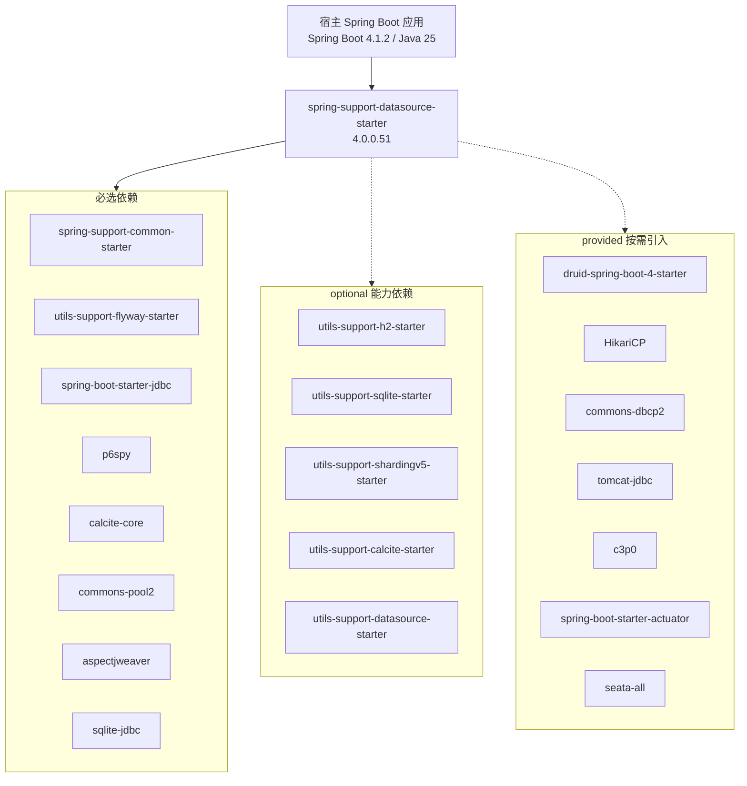
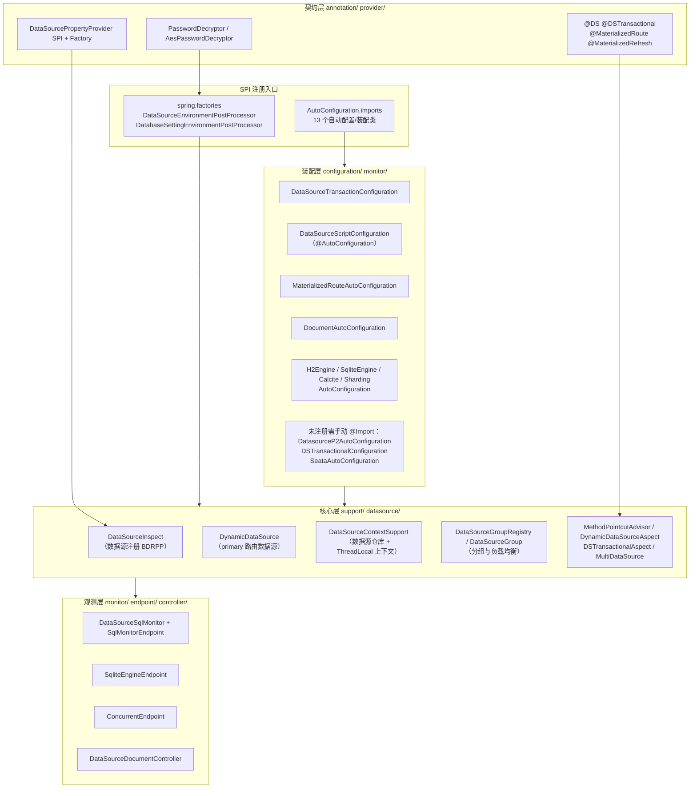
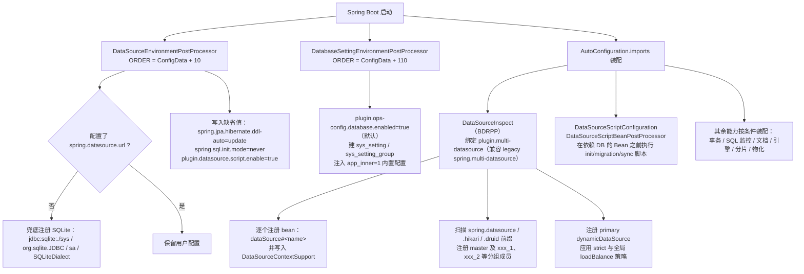
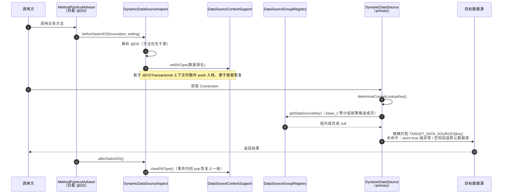
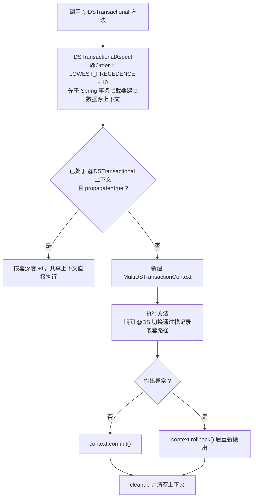

# spring-support-datasource-starter

数据源与数据访问基础设施 starter：动态多数据源路由、`@DS` 注解切换、分组负载均衡、多数据源事务、数据库脚本初始化、纯 JDBC 层 SQL 监控、数据库设计文档在线预览、Calcite 聚合查询、ShardingSphere 分库分表、H2/SQLite 嵌入式引擎、SQL 物化路由等能力，按需装配、开箱即用。

| 项目 | 值 |
| --- | --- |
| 版本 | `4.0.0.51`（继承父工程 `spring-support-parent-starter`） |
| 基线 | Spring Boot `4.1.2`（`spring-boot-starter-parent`）／ Java `25` |
| 仓库 | `spring-support-parent-starter` |

---

## 1. 架构图

### 1.1 模块位置（依赖关系）

本模块是**数据访问层的统一入口**：向上为宿主应用提供 `DataSource` / 事务 / 监控 / 文档等能力；向下通过 optional 依赖挂接 H2、SQLite、Calcite、ShardingSphere 等引擎实现，连接池（HikariCP、Druid、DBCP2、Tomcat JDBC、C3P0）由宿主按需以 `provided` 方式引入。



### 1.2 内部分层



### 1.3 SPI 注册文件（事实清单）

`META-INF/spring/org.springframework.boot.autoconfigure.AutoConfiguration.imports`（13 项）：

```text
com.chua.starter.datasource.configuration.DataSourceTransactionConfiguration
com.chua.starter.datasource.configuration.MaterializedRouteAutoConfiguration
com.chua.starter.datasource.support.MethodPointcutAdvisor
com.chua.starter.datasource.configuration.DataSourceScriptConfiguration
com.chua.starter.datasource.support.DataSourceInspect
com.chua.starter.datasource.configuration.DocumentAutoConfiguration
com.chua.starter.datasource.monitor.SqlMonitorAutoConfiguration
com.chua.starter.datasource.configuration.H2EngineAutoConfiguration
com.chua.starter.datasource.configuration.CalciteAutoConfiguration
com.chua.starter.datasource.configuration.ShardingAutoConfiguration
com.chua.starter.datasource.configuration.SqliteEngineAutoConfiguration
com.chua.starter.datasource.monitor.SqliteEngineEndpointAutoConfiguration
com.chua.starter.datasource.endpoint.ConcurrentEndpoint
```

`META-INF/spring.factories`（仅 2 项，均为 `EnvironmentPostProcessor`）：

```text
org.springframework.boot.env.EnvironmentPostProcessor=\
  com.chua.starter.datasource.configuration.environment.DataSourceEnvironmentPostProcessor,\
  com.chua.starter.datasource.configuration.environment.DatabaseSettingEnvironmentPostProcessor
```

> ⚠️ **装配注意**：本项目在 Spring Boot 4.1.2 下实测记录（见 `DataSourceScriptConfiguration` Javadoc，4.0.0.51 起修复）：自动配置导入要求类带 `@AutoConfiguration`，缺失时整个自动配置被**静默忽略**。当前 imports 中仅 `DataSourceScriptConfiguration` 标注了 `@AutoConfiguration`；其余 12 项未标注，使用对应能力前请先验证 Bean 是否真实装配，必要时在宿主显式 `@Import` 或为类补注解。
>
> 此外以下类**有自动配置语义但不在 imports 中**，默认不会装配，需要宿主手动 `@Import`：
> `DatasourceP2AutoConfiguration`（ENC 解密器 / 健康检查 / 优雅关闭 / 服务信息）、`DSTransactionalConfiguration`（`@DSTransactional` 切面）、`SeataAutoConfiguration`（Seata 数据源代理）、`ENCEnvironmentPostProcessor`（需自行注册到 `spring.factories` 或以其他方式触发）。

---

## 2. 核心流程图

### 2.1 启动装配流程



### 2.2 `@DS` 动态路由时序



### 2.3 `@DSTransactional` 多数据源事务流程



> 说明：`@DSTransactional` **不提供跨数据源 ACID**，其核心价值是保证 `@DS` 切换发生在事务资源绑定之前，并支持嵌套调用的上下文恢复；跨库一致性请使用 Seata `@GlobalTransactional`。

---

## 3. 能力清单

| # | 能力 | 关键类 | 启用条件（默认值） |
| --- | --- | --- | --- |
| 1 | 多数据源注册 | `DataSourceInspect` | `plugin.multi-datasource.dataSource[*]` 或 `spring.datasource.*` 中 url+name 齐全即注册 |
| 2 | 动态路由主数据源（primary） | `DynamicDataSource` | 随 `DataSourceInspect` 总是注册 |
| 3 | `@DS` 注解切换（类/方法/SpEL/请求头/会话） | `MethodPointcutAdvisor`、`DynamicDataSourceAspect` | 方法或类标注 `@DS` 即生效 |
| 4 | 分组负载均衡 | `DataSourceGroupRegistry`、`DataSourceGroup` | 数据源命名 `组名_数字` 自动成组；策略 `round_robin`（默认）/ `random` |
| 5 | 多数据源聚合 | `MultiDataSource` | `@DS("master,slave")` 逗号分隔多个名称 |
| 6 | `@DSTransactional` 多数据源事务 | `DSTransactionalAspect`、`MultiDSTransactionContext` | 需 `@Import(DSTransactionalConfiguration.class)`（未在 imports） |
| 7 | 声明式事务（按方法名前缀） | `DataSourceTransactionConfiguration` | `plugin.transaction.enable=true`（默认 `false`） |
| 8 | 事务管理器 / TransactionTemplate / JdbcTemplate 兜底 | 同上 | `@ConditionalOnMissingBean`，容器缺什么补什么 |
| 9 | 数据库脚本初始化（init/migration/sync） | `DataSourceScriptConfiguration`、`DataSourceScriptBeanPostProcessor` | `plugin.datasource.script.enable=true`（`DataSourceEnvironmentPostProcessor` 缺省置 `true`） |
| 10 | 纯 JDBC 层 SQL 监控（慢 SQL / 统计 / 事件） | `SqlMonitorAutoConfiguration`、`DataSourceSqlMonitor`、`MonitoringDataSource` | `plugin.datasource.monitor.enabled` 未设置时：激活 `dev/test/uat/local` 任一 profile 自动启用，否则关闭 |
| 11 | SQL 监控 Actuator 端点 | `SqlMonitorEndpoint`（`/actuator/sqlmonitor`） | 类路径存在 `Endpoint`；GET 查询 / POST 重置 |
| 12 | 数据库设计文档在线预览 | `DocumentAutoConfiguration`、`DataSourceDocumentController`、`DatabaseGraphService` | Web 环境 + `plugin.datasource.document.enable=true`（默认 `true`） |
| 13 | H2 嵌入式引擎 | `H2EngineAutoConfiguration`、`H2Engine` | `plugin.h2.enable=true`（默认 `false`） |
| 14 | SQLite 嵌入式引擎 | `SqliteEngineAutoConfiguration`、`SqliteEngine` | `plugin.sqlite.enable=true`（默认 `false`） |
| 15 | SQLite 引擎 Actuator 端点 | `SqliteEngineEndpoint`（`/actuator/sqlite`） | `plugin.sqlite.enable=true` 且存在 `Endpoint` |
| 16 | Calcite 跨库联邦查询 | `CalciteAutoConfiguration`、`CalciteDataSourceConversion` | `plugin.datasource.calcite.enabled=true`（默认 `false`） |
| 17 | ShardingSphere 分库分表 | `ShardingAutoConfiguration`、`ShardingV5Conversion` | `plugin.datasource.sharding.enabled=true`（默认 `false`） |
| 18 | SQL 物化路由（内存副本加速） | `MaterializedRouteAutoConfiguration`、`MaterializedRouteAdvisor`、`MaterializedRefreshAdvisor`、`CalciteMaterializedSqlRouter` | `plugin.datasource.materialized.enabled=true`（默认 `false`） |
| 19 | Seata 分布式事务数据源代理 | `SeataAutoConfiguration`、`SeataDataSourcePostProcessor` | Seata 类在类路径 + `seata.enabled=true`；**未在 imports，需手动 `@Import`** |
| 20 | ENC 配置加密解密 | `ENCEnvironmentPostProcessor`、`AesPasswordDecryptor` | `plugin.datasource.enc.enabled=true`（默认 `false`）；**EPP 未注册、解密器 Bean 在未注册的 `DatasourceP2AutoConfiguration` 中** |
| 21 | 多数据源健康检查 | `DataSourceHealthIndicator`（`/actuator/health` 的 `dataSource` 组件） | `plugin.datasource.health.enabled=true`（默认 `true`）；但所在配置类未注册，默认不可用 |
| 22 | 数据源优雅关闭 | `GracefulShutdownListener` | `plugin.datasource.graceful-shutdown.enabled=true`（默认 `true`）；所在配置类未注册，默认不可用 |
| 23 | 并发控制端点（限流/熔断/分布式锁配置） | `ConcurrentEndpoint`（`/actuator/concurrent`） | 6 个依赖类在类路径（3 个 Flow + 3 个 Repository） |
| 24 | SQLite 零配置兜底 | `DataSourceEnvironmentPostProcessor` | 未配置 `spring.datasource.url` 时自动启用 |
| 25 | 系统配置表（`sys_setting`） | `DatabaseSettingEnvironmentPostProcessor` | `plugin.ops-config.database.enabled=true`（默认 `true`） |

---

## 4. Bean 能力矩阵

> “装配入口” 均为源码事实。标注“未注册”的配置类不在 `AutoConfiguration.imports` 中，需宿主显式 `@Import`；imports 中未标注 `@AutoConfiguration` 的类在 Spring Boot 4 下的装配状态请按第 1.3 节提示先行验证。
>
> “可否覆盖” 指业务侧自定义同类型/同名 Bean 时模块的让位行为：✅ = 带 `@ConditionalOnMissingBean`，自定义即生效；⚠️ = 核心链路 Bean，覆盖前请确认理解其职责；❌ = 动态生成或不建议覆盖。

| Bean 名称 | 类型 | 装配入口 | 装配条件（@ConditionalOnXxx） | 可否覆盖 | 典型注入姿势 |
| --- | --- | --- | --- | --- | --- |
| `dynamicDataSource` | `DynamicDataSource`（`@Primary`） | `DataSourceInspect`（imports，⚠️ 未标 `@AutoConfiguration`） | 可解析出数据源类型即注册，无额外开关 | ⚠️ 路由核心，不建议覆盖 | 直接注入 `DataSource`；`JdbcTemplate`/MyBatis/事务管理器自动复用 |
| `dataSource#<name>` | `DataSource` | `DataSourceInspect`（imports，⚠️ 同上） | 条目 `url`+`name` 齐全即注册（`plugin.multi-datasource.enable` 不参与判断） | ✅ 同名自定义 Bean 可替代 | `@Qualifier("dataSource#slave_1") DataSource` |
| `master`、`slave_1` 等 | `DataSource` | `DataSourceInspect#analysisDataSource`（imports，⚠️ 同上） | `spring.datasource*`（含 `.hikari`/`.druid`）存在 `url` 或 `jdbc-url` | ✅ 可自行定义并注册 | `@Qualifier("master") DataSource` 按名注入 |
| `jdbcTransactionManager` | `JdbcTransactionManager` | `DataSourceTransactionConfiguration`（imports，⚠️ 未标） | `@ConditionalOnClass(DataSourceTransactionManager)` + `@ConditionalOnMissingBean(JdbcTransactionManager)` | ✅ 自定义 `PlatformTransactionManager` 后让位 | 注入 `PlatformTransactionManager`，配合 `@Transactional` |
| `transactionTemplate` | `TransactionTemplate` | 同上 | `@ConditionalOnMissingBean(TransactionTemplate)` | ✅ | 注入 `TransactionTemplate` 做编程式事务 |
| `jdbcTemplate` | `JdbcTemplate` | 同上 | `@ConditionalOnMissingBean(JdbcTemplate)` | ✅ | 注入 `JdbcTemplate` |
| `<txManagerName>_advisor` | `DefaultPointcutAdvisor` | 同上（BDRPP 动态注册） | `plugin.transaction.enable=true` | ❌ 动态生成，不建议覆盖 | 无需注入；AOP 按方法名前缀织入事务 |
| `methodPointcutAdvisor` | `MethodPointcutAdvisor` | imports 直接注册（⚠️ 未标） | 无（运行期匹配 `@DS`） | ⚠️ `@DS` 核心，不建议覆盖 | 无需注入；自动拦截 `@DS` 方法 |
| `dataSourceScriptBeanPostProcessor` | `DataSourceScriptBeanPostProcessor` | `DataSourceScriptConfiguration`（imports，✅ `@AutoConfiguration`） | `@ConditionalOnMissingBean` + `plugin.datasource.script.enable=true`（EPP 缺省置 `true`） | ✅ 自定义 BPP 后让位 | 无需注入；在依赖 DB 的 Bean 之前执行脚本 |
| `dataSourceSqlMonitor` | `DataSourceSqlMonitor` | `SqlMonitorAutoConfiguration`（imports，⚠️ 未标） | `@ConditionalOnClass(DataSource)` + `@ConditionalOnMissingBean`；`enabled` 按配置/profile 解析 | ✅ 自定义同名 Bean 让位；可追加 `SqlExecutionListener` | 注入 `DataSourceSqlMonitor`；`@EventListener(SqlExecutionEvent)` |
| `sqlMonitorEndpoint` | `SqlMonitorEndpoint` | 同上 | `@ConditionalOnClass(Endpoint)` + `@ConditionalOnMissingBean` | ✅ | `GET/POST /actuator/sqlmonitor` |
| `dataSourceDocumentService` / `databaseGraphService` / `dataSourceDocumentController` / `dataSourceDocumentHandler` / `documentPathRegistrar` | — | `DocumentAutoConfiguration`（imports，⚠️ 未标） | `@ConditionalOnClass(RequestMappingHandlerMapping, DocumentParser)` + `@ConditionalOnWebApplication` + `plugin.datasource.document.enable=true`（缺省 true） | ⚠️ 无 `@ConditionalOnMissingBean`，重复定义会冲突；需改造时排除该配置类自行组装 | 注入 `DataSourceDocumentService`；或访问 `/plugin/datasource/document` |
| `h2Engine` / `h2Flyway` / `h2CleanupPlugin` | — | `H2EngineAutoConfiguration`（imports，⚠️ 未标） | `@ConditionalOnClass(H2Engine)` + `plugin.h2.enable=true` + 各自 `@ConditionalOnMissingBean` | ✅ | 注入 `H2Engine` 做 Lambda 链式查询/全文检索 |
| `h2DataSource` | `DataSource`（HikariCP） | 同上 | `@ConditionalOnMissingBean(DataSource.class)` + `plugin.h2.enable=true` | ✅ 容器已有 `DataSource` 时让位 | 注入 `DataSource` |
| `sqliteEngine` | `SqliteEngine` | `SqliteEngineAutoConfiguration`（imports，⚠️ 未标） | `@ConditionalOnClass(SqliteEngine)` + `plugin.sqlite.enable=true` + `@ConditionalOnMissingBean` | ✅ | 注入 `SqliteEngine` |
| `sqliteDataSource` | `DataSource`（HikariCP） | 同上 | `@ConditionalOnMissingBean(DataSource.class)` + `plugin.sqlite.enable=true` | ✅ | 注入 `DataSource` |
| `sqliteEngineEndpoint` | `SqliteEngineEndpoint` | `SqliteEngineEndpointAutoConfiguration`（imports，⚠️ 未标） | `plugin.sqlite.enable=true` + `@ConditionalOnClass(Endpoint)` + `@ConditionalOnMissingBean` | ✅ | `GET /actuator/sqlite` |
| `calciteDataSourceConversion` | `DataSourceConversion` | `CalciteAutoConfiguration`（imports，⚠️ 未标） | `@ConditionalOnClass(CalciteDataSourceConversion)` + `plugin.datasource.calcite.enabled=true` + `@ConditionalOnMissingBean(name="calciteDataSourceConversion")` | ✅ 同名 Bean 覆盖 | 自定义联邦转换逻辑时覆盖 |
| `calciteDataSource` | `DataSource`（Calcite 聚合） | 同上 | 同上 + `@ConditionalOnMissingBean(name="calciteDataSource")`；无已注册数据源时返回 null | ✅ | 注入 `DataSource` 执行跨库联邦 SQL |
| `shardingV5Conversion` | `DataSourceConversion` | `ShardingAutoConfiguration`（imports，⚠️ 未标） | `@ConditionalOnClass(ShardingV5Conversion)` + `plugin.datasource.sharding.enabled=true` + `@ConditionalOnMissingBean(name="shardingV5Conversion")` | ✅ 同名 Bean 覆盖 | 自定义分片转换逻辑时覆盖 |
| `shardingDataSource` | `DataSource`（ShardingSphere） | 同上 | 同上 + `@ConditionalOnMissingBean(name="shardingDataSource")`；无已注册数据源时返回 null | ✅ | 注入 `DataSource` |
| `materializedRouteProperties` / `defaultAdvisorAutoProxyCreator` / `materializedRouteAdvisor` / `materializedRefreshAdvisor` / `materializedSqlRouter` | — | `MaterializedRouteAutoConfiguration`（imports，⚠️ 未标） | 自定义 `Condition`：`plugin.datasource.materialized.enabled=true`（兼容 legacy `spring.datasource.materialized.enabled`）+ 各自 `@ConditionalOnMissingBean` | ✅ | `@MaterializedRoute` / `@MaterializedRefresh` 注解；或注入 `MaterializedSqlDataSourceRouter` |
| `concurrentEndpoint` | `ConcurrentEndpoint` | imports 直接注册（⚠️ 未标） | `RateLimiterFlow`/`CircuitBreakerFlow`/`LockFlow` + 3 个 Repository 类在类路径 | ⚠️ 不建议覆盖 | `GET/POST/DELETE /actuator/concurrent` |
| `passwordDecryptor` | `AesPasswordDecryptor` | `DatasourceP2AutoConfiguration`（❌ 未注册，需 `@Import`） | `plugin.datasource.enc.enabled=true` + `@ConditionalOnMissingBean(PasswordDecryptor)` | ✅ 推荐自定义 `PasswordDecryptor` | 注入 `PasswordDecryptor`；解密 `ENC(...)` 密码 |
| `dataSourceHealthIndicator` | `DataSourceHealthIndicator` | 同上（❌ 未注册） | `@ConditionalOnClass(HealthIndicator)` + `plugin.datasource.health.enabled=true`（缺省视为 true） | ✅ | `/actuator/health` 的 `dataSource` 组件 |
| `gracefulShutdownListener` | `GracefulShutdownListener` | 同上（❌ 未注册） | `plugin.datasource.graceful-shutdown.enabled=true`（缺省视为 true） + `@ConditionalOnMissingBean(GracefulShutdownListener)` | ✅ | 无需注入；停机时遍历关闭连接池 |
| `datasourceServiceInfoContributor` | `ServiceInfoContributor` | 同上（❌ 未注册） | 无条件 | ✅ | 服务信息面板的“多数据源”标识 |
| `dsTransactionalAspect` | `DSTransactionalAspect` | `DSTransactionalConfiguration`（❌ 未注册，需 `@Import`） | `@ConditionalOnClass(Aspect)` + `@ConditionalOnMissingBean(DSTransactionalAspect)` | ✅ | `@DSTransactional` 注解 |
| `seataDataSourcePostProcessor` | `SeataDataSourcePostProcessor` | `SeataAutoConfiguration`（❌ 未注册，需 `@Import`） | `@ConditionalOnClass(io.seata RootContext/DataSourceProxy)` + `seata.enabled=true`（缺省视为 true） + `@ConditionalOnMissingBean(name="seataDataSourcePostProcessor")` | ✅ | 无需注入；自动把动态数据源包装为 `DataSourceProxy` |

---

## 5. 完整配置

> 全部配置项均来自源码中的 `@ConfigurationProperties` 类与 `@ConditionalOnProperty` 条件，未列出的键不存在。带 legacy 前缀的配置与新版前缀**合并生效，新版优先**。

### 5.1 多数据源 `plugin.multi-datasource`（legacy：`spring.multi-datasource`）

| 配置路径 | 类型 | 默认值 | 说明 | 生效开关 |
| --- | --- | --- | --- | --- |
| `plugin.multi-datasource.enable` | `Boolean` | `false` | 多数据源属性开关（随属性绑定；当前版本 `DataSourceInspect` 注册时不校验该值） | 非注册开关：条目 `url`+`name` 齐全即注册 |
| `plugin.multi-datasource.force-annotation` | `Boolean` | `true` | `@DS` 指定的数据源不存在时，仍按注解值处理（不入上下文回退） | 随多数据源装配生效 |
| `plugin.multi-datasource.strict` | `Boolean` | `false` | 严格模式：数据源不存在抛 `IllegalStateException`（否则回退默认数据源） | 同上 |
| `plugin.multi-datasource.load-balance` | `String` | `round_robin` | 分组负载均衡策略：`round_robin` / `random` | 同上；对 `组名_数字` 命名的数据源生效 |
| `plugin.multi-datasource.dataSource[*].name` | `String` | — | 数据源名；`组名_数字` 自动归组 | `url`+`name` 齐全即注册（`enable` 不参与判断） |
| `plugin.multi-datasource.dataSource[*].url` | `String` | — | JDBC URL | 同上 |
| `plugin.multi-datasource.dataSource[*].username` | `String` | — | 用户名 | 同上 |
| `plugin.multi-datasource.dataSource[*].password` | `String` | — | 密码（支持 `ENC(...)`，见 5.10） | 同上 |
| `plugin.multi-datasource.dataSource[*].driver-class-name` | `String` | — | 驱动类名 | 同上 |
| `plugin.multi-datasource.hikari.enable` | `Boolean` | `false` | Hikari 专项数据源属性开关（随属性绑定；当前版本注册时不校验该值） | 非注册开关：条目 `url`+`name` 齐全即注册 |
| `plugin.multi-datasource.hikari.dataSource[*]` | `List<对象>` | — | 同 `dataSource[*]` 基础项 + 下方 Hikari 扩展项 | `url`+`name` 齐全即注册 |

**Hikari 连接池扩展项**（`hikari.dataSource[*].*`，legacy：`spring.multi-datasource.hikari`）：

| 配置路径 | 类型 | 默认值 | 说明 | 生效开关 |
| --- | --- | --- | --- | --- |
| `...maximum-pool-size` | `Integer` | `100` | 最大连接数 | 随 hikari 列表生效 |
| `...minimum-idle` | `Integer` | `10` | 最小空闲连接 | 同上 |
| `...idle-timeout` | `Long` | `600000`（10 分钟） | 空闲连接存活时间（毫秒） | 同上 |
| `...max-lifetime` | `Long` | `1800000`（30 分钟） | 连接最大生命周期（毫秒） | 同上 |
| `...leak-detection-threshold` | `Long` | `0` | 连接泄漏检测阈值（毫秒），`0` 关闭 | 同上 |

### 5.2 声明式事务 `plugin.transaction`

| 配置路径 | 类型 | 默认值 | 说明 | 生效开关 |
| --- | --- | --- | --- | --- |
| `plugin.transaction.enable` | `Boolean` | `false` | 是否启用按方法名前缀的声明式事务 | 总开关，需置 `true` |
| `plugin.transaction.timeout` | `Integer` | `10` | 写事务超时（秒） | `enable=true` |
| `plugin.transaction.tx-mapper` | `String` | `""` | 切入点表达式；缺省 `execution(* <主包>..*..*(..))` | 同上 |
| `plugin.transaction.read-only` | `String` | `""` | 只读事务方法名（逗号分隔）；缺省 `get*,query*,find*,list*,count*,exist*,search*,fetch*` | 同上 |
| `plugin.transaction.write-only` | `String` | `""` | 写事务方法名；缺省 `add*,save*,insert*,update*,modify*,delete*,remove*` | 同上 |
| `plugin.transaction.no-tx` | `String` | `""` | 无事务方法名（挂起当前事务）；缺省 `noTx*` | 同上 |

### 5.3 脚本初始化 `plugin.datasource.script`

| 配置路径 | 类型 | 默认值 | 说明 | 生效开关 |
| --- | --- | --- | --- | --- |
| `plugin.datasource.script.enable` | `Boolean` | `true` | 是否执行 init/migration/sync 脚本 | 总开关（`DataSourceEnvironmentPostProcessor` 在未配置时缺省置 `true`） |
| `plugin.datasource.script.script-path` | `String` | `classpath*:db/init/*.sql,classpath*:db/migration/*.sql,classpath*:db/sync/*.sql` | 脚本扫描路径（逗号分隔） | `enable=true` |
| `plugin.datasource.script.scan-mode` | `Enum` | `ONCE` | init 脚本扫描模式 | 同上 |
| `plugin.datasource.script.migration-scan-mode` | `Enum` | `ALWAYS` | migration 脚本扫描模式 | 同上 |
| `plugin.datasource.script.data-scan-mode` | `Enum` | `ONCE` | 数据脚本扫描模式 | 同上 |
| `plugin.datasource.script.continue-on-error` | `Boolean` | `true` | 语句失败是否容错跳过 | 同上 |
| `plugin.datasource.script.ignore-failed-drops` | `Boolean` | `true` | 忽略失败的 DROP 语句 | 同上 |
| `plugin.datasource.script.separator` | `String` | `;` | SQL 语句分隔符 | 同上 |
| `plugin.datasource.script.sql-script-encoding` | `String` | `UTF-8` | 脚本文件编码 | 同上 |
| `plugin.datasource.script.version-table` | `String` | `sys_database_version` | 版本记录表 | 同上 |
| `plugin.datasource.script.baseline-version` | `String` | `1.0.0` | 基线版本号 | 同上 |
| `plugin.datasource.script.baseline-description` | `String` | `Initial baseline` | 基线描述 | 同上 |
| `plugin.datasource.script.script-prefix` | `String` | `V` | 版本脚本前缀 | 同上 |
| `plugin.datasource.script.script-suffix` | `String` | `.sql` | 脚本文件后缀 | 同上 |
| `plugin.datasource.script.version-separator` | `String` | `__` | 版本号与描述分隔符 | 同上 |
| `plugin.datasource.script.validate-checksum` | `Boolean` | `true` | 是否校验脚本校验和 | 同上 |
| `plugin.datasource.script.mixed` | `Boolean` | `false` | 是否混合模式 | 同上 |
| `plugin.datasource.script.timeout` | `Integer` | `0` | 迁移超时（秒），`0` 不限 | 同上 |
| `plugin.datasource.script.verbose` | `Boolean` | `true` | 是否输出详细日志 | 同上 |
| `plugin.datasource.script.release-type` | `String` | `STABLE` | 发布类型 | 同上 |
| `plugin.datasource.script.initdata-parallelism` | `Integer` | `0` | 数据脚本并行度，`0` 串行 | 同上 |
| `plugin.datasource.script.initdata-timeout-minutes` | `Integer` | `5` | 数据脚本超时（分钟） | 同上 |
| `plugin.datasource.script.scope` | `String` | `table` | 版本表管理范围 | 同上 |
| `plugin.datasource.script.exclude-table-prefixes` | `List<String>` | `[sys_]` | 排除的表前缀 | 同上 |

### 5.4 SQL 监控 `plugin.datasource.monitor`

| 配置路径 | 类型 | 默认值 | 说明 | 生效开关 |
| --- | --- | --- | --- | --- |
| `plugin.datasource.monitor.enabled` | `Boolean` | `null` | `null`=按环境自动：激活 `auto-enable-environments` 任一 profile 则启用，否则关闭 | 总开关（显式 `true`/`false` 优先于 profile 推断） |
| `plugin.datasource.monitor.auto-enable-environments` | `String` | `dev,test,uat,local` | 自动启用的 profile 列表 | `enabled` 未显式配置时生效 |
| `plugin.datasource.monitor.slow-sql-threshold-ms` | `Long` | `1000` | 慢 SQL 阈值（毫秒） | 监控启用时 |
| `plugin.datasource.monitor.max-sql-length` | `Integer` | `2000` | SQL 文本截断长度 | 同上 |
| `plugin.datasource.monitor.record-sql` | `Boolean` | `true` | 是否记录 SQL 文本 | 同上 |
| `plugin.datasource.monitor.publish-event` | `Boolean` | `true` | 是否发布 `SqlExecutionEvent` Spring 事件 | 同上 |
| `plugin.datasource.monitor.max-tracked-data-sources` | `Integer` | `1000` | 最多跟踪的数据源数量 | 同上 |
| `plugin.datasource.monitor.overflow-policy` | `String` | `REJECT` | 达到上限策略：`REJECT` / `EVICT_ELDEST` | 同上 |

### 5.5 SQL 物化路由 `plugin.datasource.materialized`（legacy：`spring.datasource.materialized`）

| 配置路径 | 类型 | 默认值 | 说明 | 生效开关 |
| --- | --- | --- | --- | --- |
| `plugin.datasource.materialized.enabled` | `Boolean` | `false` | 是否启用物化路由 | 总开关，需置 `true` |
| `plugin.datasource.materialized.default-threshold` | `Integer` | `1000` | 表行数阈值，超过才走内存副本 | `enabled=true` |
| `plugin.datasource.materialized.refresh-interval-seconds` | `Integer` | `0` | 内存副本自动刷新间隔（秒），`<=0` 关闭 | 同上 |
| `plugin.datasource.materialized.skip-query-in-transaction` | `Boolean` | `true` | 事务内跳过物化路由（保证读己之写） | 同上 |
| `plugin.datasource.materialized.cache-data-source-prefix` | `String` | `materialized#` | 物化副本数据源名前缀 | 同上 |

### 5.6 Calcite 聚合查询 `plugin.datasource.calcite`

| 配置路径 | 类型 | 默认值 | 说明 | 生效开关 |
| --- | --- | --- | --- | --- |
| `plugin.datasource.calcite.enabled` | `Boolean` | `false` | 是否聚合所有已注册数据源为 Calcite 数据源 | 总开关，需置 `true` |
| `plugin.datasource.calcite.max-pool-size` | `Integer` | `10` | 聚合连接池上限 | `enabled=true` |
| `plugin.datasource.calcite.schema-mapping` | `Map<String,String>` | — | 数据源名 → Calcite 模式名 | 同上 |
| `plugin.datasource.calcite.default-schema` | `String` | `null`（字段无初值，未配置即无默认模式） | 默认模式名 | 同上 |

### 5.7 ShardingSphere 分库分表 `plugin.datasource.sharding`

| 配置路径 | 类型 | 默认值 | 说明 | 生效开关 |
| --- | --- | --- | --- | --- |
| `plugin.datasource.sharding.enabled` | `Boolean` | `false` | 是否启用分片数据源 | 总开关，需置 `true` |
| `plugin.datasource.sharding.show-sql` | `Boolean` | `false` | 是否打印改写后的 SQL | `enabled=true` |
| `plugin.datasource.sharding.tables[*].logic-table` | `String` | — | 逻辑表名 | 同上 |
| `plugin.datasource.sharding.tables[*].sharding-column` | `String` | — | 分片列 | 同上 |
| `plugin.datasource.sharding.tables[*].time-unit` | `String` | — | 时间分片单位（YEAR/QUARTER/MONTH/WEEK/DAY/HOUR）；配置后走 `INTERVAL` 算法，否则走 `MOD` | 同上 |
| `plugin.datasource.sharding.tables[*].strategy` | `String` | `TABLE` | 分片策略 | 同上 |
| `plugin.datasource.sharding.databases` | `List<String>` | — | 分库列表；数量 > 1 时启用分库（与分表同分片列对齐） | 同上 |

### 5.8 数据库设计文档 `plugin.datasource.document`

| 配置路径 | 类型 | 默认值 | 说明 | 生效开关 |
| --- | --- | --- | --- | --- |
| `plugin.datasource.document.enable` | `Boolean` | `true` | 是否注册文档预览接口 | 总开关（非 Web 环境自动跳过） |
| `plugin.datasource.document.base-path` | `String` | `/plugin/datasource/document` | 文档接口根路径 | `enable=true` 且 Web 环境 |
| `plugin.datasource.document.title` | `String` | `数据库设计文档` | 文档标题 | 同上 |
| `plugin.datasource.document.version` | `String` | `1.0.0` | 文档版本 | 同上 |
| `plugin.datasource.document.template` | `String` | `DEFAULT` | 模板：`DEFAULT` / `AURORA` / `SWAGGER`（SPI 缺失回退 `DEFAULT`） | 同上 |
| `plugin.datasource.document.include-tables` | `String` | `""` | 表白名单，逗号分隔，`*` 通配 | 同上 |
| `plugin.datasource.document.exclude-tables` | `String` | `flyway_schema_history,sys_database_version` | 表黑名单 | 同上 |
| `plugin.datasource.document.include-schemas` | `String` | `""` | schema 白名单 | 同上 |
| `plugin.datasource.document.cacheable` | `Boolean` | `true` | 是否缓存解析结果 | 同上 |
| `plugin.datasource.document.options` | `Map<String,Object>` | — | 透传 `DocumentParser` 的选项（如 `all: true` 跨 catalog） | 同上 |

### 5.9 H2 / SQLite 引擎

| 配置路径 | 类型 | 默认值 | 说明 | 生效开关 |
| --- | --- | --- | --- | --- |
| `plugin.h2.enable` | `Boolean` | `false` | 是否启用 H2 嵌入式引擎 | 总开关，需置 `true` |
| `plugin.h2.url` | `String` | `jdbc:h2:mem:springh2db;DB_CLOSE_DELAY=-1` | H2 JDBC URL | `plugin.h2.enable=true` |
| `plugin.h2.username` | `String` | `sa` | 用户名 | 同上 |
| `plugin.h2.password` | `String` | `""` | 密码 | 同上 |
| `plugin.h2.script-path` | `String` | `""` | 迁移脚本路径，如 `classpath:db/migration/h2`；配置后自动迁移 | 同上 |
| `plugin.h2.cleanup-after-shutdown` | `Boolean` | `false` | 停机后清理 H2 文件 | 同上 |
| `plugin.h2.cleanup-after-test` | `Boolean` | `false` | 测试后清理 | 同上 |
| `plugin.sqlite.enable` | `Boolean` | `false` | 是否启用 SQLite 嵌入式引擎 | 总开关，需置 `true` |
| `plugin.sqlite.path` | `String` | `./data/app.sqlite` | SQLite 文件路径（目录自动创建） | 同上 |
| `plugin.sqlite.init-sql` | `String` | `""` | 初始化脚本，如 `classpath:db/init/sqlite` | 同上 |
| `plugin.sqlite.max-pool-size` | `Integer` | `5` | 连接池上限 | 同上 |

### 5.10 其余开关与联动配置

| 配置路径 | 类型 | 默认值 | 说明 | 生效开关 |
| --- | --- | --- | --- | --- |
| `plugin.datasource.enc.enabled` | `Boolean` | `false` | 是否启用 `ENC(...)` 配置解密 | 总开关；且 `ENCEnvironmentPostProcessor` 未注册，需宿主注册后生效 |
| `plugin.datasource.enc.secret-key` | `String` | `""` | AES 密钥；缺省用内置默认密钥（仅限本地验证） | `enc.enabled=true` |
| `plugin.datasource.health.enabled` | `Boolean` | `true` | 是否注册数据源健康指示器 | 需先 `@Import(DatasourceP2AutoConfiguration.class)` |
| `plugin.datasource.graceful-shutdown.enabled` | `Boolean` | `true` | 是否注册优雅关闭监听器 | 同上 |
| `plugin.ops-config.database.enabled` | `Boolean` | `true` | 是否建 `sys_setting` / `sys_setting_group` 并注入内置配置 | `DatabaseSettingEnvironmentPostProcessor` 读取（键与第 3 节 #25、2.1 流程图一致） |
| `seata.enabled` | `Boolean` | `true` | Seata 数据源代理开关 | 需先 `@Import(SeataAutoConfiguration.class)` 且 Seata 类在类路径 |
| `seata.enable-auto-data-source-proxy` | `Boolean` | 建议 `false` | 交由本模块自行代理，避免重复包装 | Seata 启用时 |
| `seata.data-source-proxy-mode` | `String` | `AT` | `AT` / `XA` | Seata 启用时 |
| `spring.datasource.url` 等 | `String` | — | 单数据源标准配置；也可用 `spring.datasource.hikari.*`、`spring.datasource.druid.*` 细化连接池 | 存在 `url`（或 `jdbc-url`）即注册；全缺省时 SQLite 兜底 |

---

## 6. 使用方式

### 6.1 引入依赖

```xml
<dependency>
    <groupId>com.chua</groupId>
    <artifactId>spring-support-datasource-starter</artifactId>
    <version>4.0.0.51</version>
</dependency>
<!-- 连接池按需引入（provided）：HikariCP / druid-spring-boot-4-starter / commons-dbcp2 / tomcat-jdbc / c3p0 -->
```

### 6.2 单数据源

不配置任何数据源时，`DataSourceEnvironmentPostProcessor` 兜底注册本地 SQLite（`jdbc:sqlite:./sys`），适合原型与本地开发。生产环境正常配置：

```yaml
spring:
  datasource:
    url: jdbc:mysql://localhost:3306/app
    username: root
    password: root
```

### 6.3 多数据源

方式一：`plugin.multi-datasource.dataSource[*]`（见第 5 节），每个数据源注册为 bean `dataSource#<name>`；方式二：直接展开 `spring.datasource.master.*`、`spring.datasource.slave_1.*` 等前缀，`DataSourceInspect` 会自动扫描注册，`slave_1`/`slave_2` 自动归入 `slave` 组并按 `load-balance` 策略轮询/随机。

### 6.4 `@DS` 数据源切换

```java
@DS("slave")                 // 类级默认
@Service
public class UserService {

    @DS("master")            // 方法级覆盖类级
    public void save(User user) { ... }

    @DS("master,slave")      // 多数据源聚合（MultiDataSource）
    public List<User> queryAll() { ... }

    @DS("#header.xTenantId") // SpEL：支持方法参数、#header、#session、#request
    public User getByTenant(Long id) { ... }
}
```

### 6.5 `@DSTransactional` 多数据源事务

```java
// 宿主需先 @Import(DSTransactionalConfiguration.class)（该配置类未列入 imports）
@DSTransactional
@DS("master")
public void save(User user) {
    userDao.insert(user);                    // master 事务
    logService.add(user.getId());            // 内部可 @DS 切换，方法返回后自动恢复 master
}
```

### 6.6 声明式事务（按方法名前缀）

```yaml
plugin:
  transaction:
    enable: true
    timeout: 30
    read-only: "get*,query*,find*"
    write-only: "save*,update*,delete*"
```

启用后按每个 `DataSourceTransactionManager` 注册 `DefaultPointcutAdvisor`，切入点为 `tx-mapper`（缺省主包全部方法）。

### 6.7 脚本初始化

把 SQL 放入 `classpath:db/init/*.sql`、`db/migration/*.sql`、`db/sync/*.sql`，`DataSourceScriptBeanPostProcessor` 会在依赖数据库的 Bean（EntityManagerFactory、SqlSessionFactory 等）就绪前执行，并记录到版本表 `sys_database_version`。

### 6.8 SQL 监控与端点

dev/test/uat/local 环境自动启用；生产显式开启：

```yaml
plugin:
  datasource:
    monitor:
      enabled: true
      slow-sql-threshold-ms: 500
```

`GET /actuator/sqlmonitor` 查看按数据源分组的执行统计，`POST` 重置。自定义监听只需注册 `SqlExecutionListener` Bean，SQL 事件同时会以 Spring 事件发布（可 `@EventListener` 消费 `SqlExecutionEvent`）。

### 6.9 数据库设计文档

Web 应用默认开启：访问 `GET /plugin/datasource/document`（`apply` 接口强制刷新），支持 `DEFAULT`/`AURORA`/`SWAGGER` 三种模板与表黑白名单；另有关系图谱能力（`DatabaseGraphService`）。

### 6.10 引擎与高级能力

- **H2**：`plugin.h2.enable=true`，自动创建 `H2Engine`、HikariCP 包装的 `DataSource` 与 `Flyway` 迁移器。
- **SQLite**：`plugin.sqlite.enable=true`，自动创建 `SqliteEngine` 与文件数据源；`/actuator/sqlite` 查看状态。
- **Calcite**：`plugin.datasource.calcite.enabled=true` 后将所有已注册数据源聚合为统一 Calcite 数据源，支持跨库联邦查询。
- **ShardingSphere**：`plugin.datasource.sharding.enabled=true` 后按 `tables` 规则创建分片数据源（时间分片 INTERVAL / 普通分片 MOD）。
- **物化路由**：`plugin.datasource.materialized.enabled=true` 后，`@MaterializedRoute` 方法优先查内存副本，未命中回落原库；`@MaterializedRefresh` 手动刷新。
- **Seata**：宿主引入 `seata-spring-boot-starter` 后 `@Import(SeataAutoConfiguration.class)`，模块会将动态数据源包装为 `DataSourceProxy`。

### 6.11 手动装配未注册功能

```java
@SpringBootApplication
@Import({DSTransactionalConfiguration.class,      // @DSTransactional
         DatasourceP2AutoConfiguration.class})    // ENC 解密器 / 健康检查 / 优雅关闭 / 服务信息
public class App { ... }
```

`ENCEnvironmentPostProcessor` 需在宿主 `META-INF/spring.factories` 中注册为 `EnvironmentPostProcessor` 后，配合 `plugin.datasource.enc.enabled=true` 与 `plugin.datasource.enc.secret-key` 使用。

---

## 7. 使用场景

| 场景 | 适用 | 不适用 | 与相邻模块取舍 |
| --- | --- | --- | --- |
| 读写分离、多从库负载均衡 | `spring.datasource.slave_1/slave_2` 命名成组 + `@DS("slave")` + `load-balance: round_robin` | 从库复制强一致读、跨库 JOIN | 比 ShardingSphere 读写分离更轻量；无需额外中间件，纯应用侧路由 |
| 多租户按请求路由 | `@DS("#header.xTenantId")`（SpEL + 请求头） | 需要行级租户过滤而非整库隔离 | 只解决“连哪个库”；行级隔离交给 ORM 拦截器或 account/权限模块 |
| 分库分表 | `plugin.datasource.sharding` + `utils-support-shardingv5-starter` | 单表千万行以内（先做索引/归档） | OLTP 按分片键路由用 ShardingSphere；跨库聚合报表用 Calcite |
| 跨库联邦查询 / 聚合报表 | `plugin.datasource.calcite.enabled=true` 或 `@DS("master,slave")` 聚合 | 高频 OLTP 跨库 JOIN、大结果集导出 | Calcite 内存联邦适合低频报表；不适合替代分片中间件 |
| 本地开发 / 单元测试零外部依赖 | 不配数据源（SQLite 兜底）或 `plugin.h2.enable=true` + `cleanup-after-test` | 生产环境（SQLite 兜底仅限原型） | H2 内存库启动快；需要真实方言验证时用 Testcontainers 起真实库 |
| SQL 审计、慢 SQL 告警 | `plugin.datasource.monitor` + `SqlExecutionListener` / `SqlExecutionEvent` | 全链路 APM（Trace/拓扑） | 纯 JDBC 包装层、数据源无关、零外部依赖；只做 SQL 维度观测 |
| 数据库设计文档自动生成与评审 | `plugin.datasource.document`（Web 环境默认开启） | 无 Web 环境或需要 CI 导出（可用 service 层另行封装） | 面向库结构评审；接口文档交给 springdoc/springdoc 类工具 |
| 多库写入一致性协调 | `@DSTransactional`（同进程上下文与切换时机）+ Seata AT（跨库回滚） | 需要严格跨库 ACID 但未引入 Seata | `@DSTransactional` 不提供 ACID；真正回滚靠 Seata `@GlobalTransactional` |
| 大表查询加速 | `plugin.datasource.materialized` + `@MaterializedRoute` / `@MaterializedRefresh` | 强实时数据、写多读少 | 用内存副本换查询延迟；`refresh-interval-seconds` 与一致性自行权衡 |
| 配置中心化（库内配置） | `DatabaseSettingEnvironmentPostProcessor` 建 `sys_setting` 表 | 需要动态推送/灰度的配置 | 库内静态配置；动态配置中心走 ops-config/注册中心体系 |

---

## 8. 扩展点

| 扩展点 | 接口 / 抽象 | 说明 |
| --- | --- | --- |
| 自定义密码解密器 | `PasswordDecryptor` | 实现 `decrypt`/`supports` 并注册为 Bean，`@ConditionalOnMissingBean(PasswordDecryptor.class)` 会让位于自定义实现；可支持 `ENC(CUSTOM:...)` 算法前缀 |
| 新连接池类型支持 | `DataSourcePropertyProvider<T>` + `DataSourcePropertyProviderFactory` | Java SPI（`ServiceProvider`）加载；内置 Hikari、Druid、Dbcp2、Tomcat、C3p0 实现，按 `getOrder()` 优先级选择，负责属性读写与名称映射 |
| 脚本迁移执行器 | `Flyway` SPI（`utils-support-flyway-starter`） | `ServiceProvider.of(Flyway.class).getNewExtensions(...)` 加载；SPI 实现优先执行，未扫描到脚本或不可用时回退内置 `FlywayLikePopulator` |
| SQL 监听器 | `SqlExecutionListener` | 注册为 Bean 即被 `DataSourceSqlMonitor` 收集，逐条回调 SQL 执行事件 |
| SQL 事件消费 | `SqlExecutionEvent`（Spring 事件） | `publish-event=true` 时发布，`@EventListener` 即可接入自有告警管道 |
| 文档模板 | `DocumentTemplate` SPI | `plugin.datasource.document.template` 选择实现；类路径缺失实现时回退 `DEFAULT` |
| 数据源转换器 | `DataSourceConversion` / `CalciteDataSourceConversion` / `ShardingV5Conversion` | Calcite、Sharding 聚合前可注册同名 Bean 覆盖默认转换行为 |
| 脚本来源 | `DatabaseFileProvider` | 自定义脚本文件定位（配合 `DataSourceScriptBeanPostProcessor`） |
| 负载均衡策略 | `DataSourceGroup.LoadBalanceStrategy` | 内置 `ROUND_ROBIN`、`RANDOM`，经 `plugin.multi-datasource.load-balance` 全局指定 |
| 监控端点扩展 | `SqlMonitorEndpoint` / `SqliteEngineEndpoint` / `ConcurrentEndpoint` | Actuator `@Endpoint` 实现；可参照其模式新增自有端点，或通过 `management.endpoints.web.exposure.include` 控制暴露 |

---

## 9. 常见问题

**Q1：配置了 `ENC(...)` 密码但没有解密？**
`ENCEnvironmentPostProcessor` 未注册到本模块 `spring.factories`，且默认 `plugin.datasource.enc.enabled=false`。需在宿主注册该 EPP、开启 `enabled=true`，并提供 `plugin.datasource.enc.secret-key`（缺省密钥仅用于本地验证）。配套的 `AesPasswordDecryptor` Bean 也在未注册的 `DatasourceP2AutoConfiguration` 中，需一并 `@Import`。

**Q2：`/actuator/health` 里看不到数据源组件？**
`DataSourceHealthIndicator` 位于 `DatasourceP2AutoConfiguration`，该类**不在** `AutoConfiguration.imports` 中，默认不会装配。`@Import(DatasourceP2AutoConfiguration.class)` 后，在 `plugin.datasource.health.enabled=true`（默认）且 actuator 在类路径时生效。

**Q3：`@DSTransactional` 不生效？**
`DSTransactionalConfiguration` 未列入 imports，默认不会注册 `DSTransactionalAspect`。需 `@Import(DSTransactionalConfiguration.class)`，并确保类路径有 AspectJ（本模块已带 `aspectjweaver`）。

**Q4：Seata 的 `DataSourceProxy` 没有包上？**
`SeataAutoConfiguration` 同样未注册。引入 `seata-spring-boot-starter`、设置 `seata.enabled=true` 并 `@Import(SeataAutoConfiguration.class)`；注意设置 `seata.enable-auto-data-source-proxy=false` 以免重复代理。

**Q5：多数据源没有注册？**
检查两点：每个数据源的 `url` 与 `name` 是否齐全（`DataSourceInspect.registerDataSource` 仅校验这两项，缺一会被跳过；`plugin.multi-datasource.enable` 不参与注册判断）；连接池实现是否在类路径（HikariCP/Druid 等为 provided，需自行引入）。

**Q6：Spring Boot 4 下部分能力“配了没反应”？**
本项目实测：Spring Boot 4 的自动配置导入要求类带 `@AutoConfiguration`，缺失时静默忽略（`DataSourceScriptConfiguration` Javadoc 记录了该事故，4.0.0.51 已为该类补注解）。imports 中其余类尚未标注，使用前请验证 Bean 是否存在（如 `applicationContext.containsBean("dynamicDataSource")`），必要时补注解或显式 `@Import`。

**Q7：切换到不存在的数据源会怎样？**
`strict=false`（默认）时回退默认数据源（`master` 优先，否则第一个注册的数据源）；`plugin.multi-datasource.strict=true` 时直接抛 `IllegalStateException`，便于及早发现配置错误。

**Q8：SpEL 路由表达式解析失败？**
`@DS("#...")` 解析异常时会回退默认数据源 `master` 并仅记录 warn 日志。`#header`/`#session` 仅在 Web 请求上下文可用；非 Web 环境请使用方法参数表达式。

**Q9：为什么没配数据库也能启动？**
`DataSourceEnvironmentPostProcessor` 在未配置 `spring.datasource.url` 时兜底注册本地 SQLite（`./sys`），并设置 `ddl-auto=update`、`sql.init.mode=never`，用于零配置启动；生产环境务必显式配置数据源。

**Q10：SQL 监控会影响性能吗？**
监控为纯 JDBC 包装层（`MonitoringDataSource/Connection/Statement`），可通过 `record-sql=false`、`publish-event=false`、`max-sql-length`、`max-tracked-data-sources` + `overflow-policy` 控制内存与开销；仅统计不落库。


