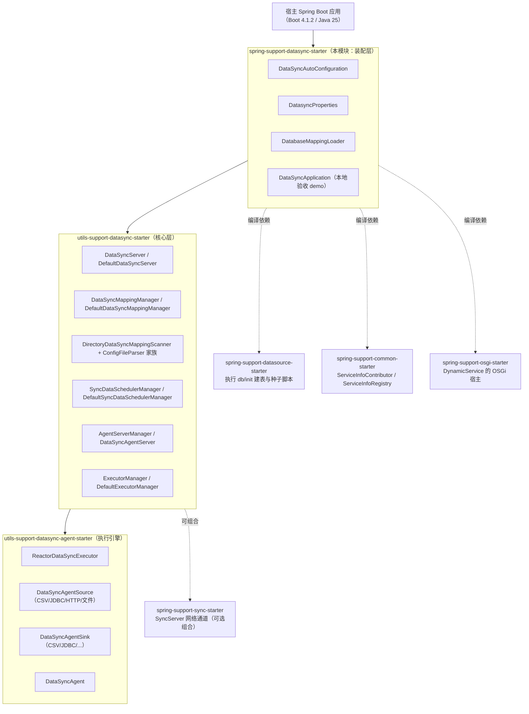
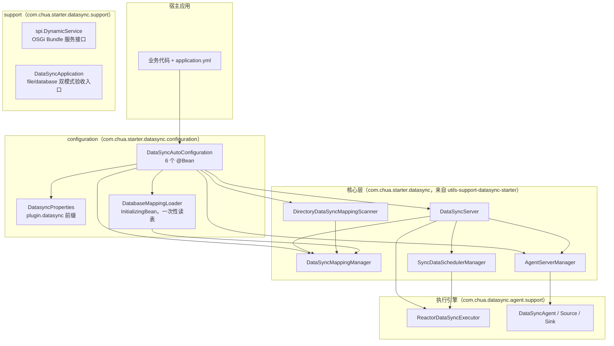
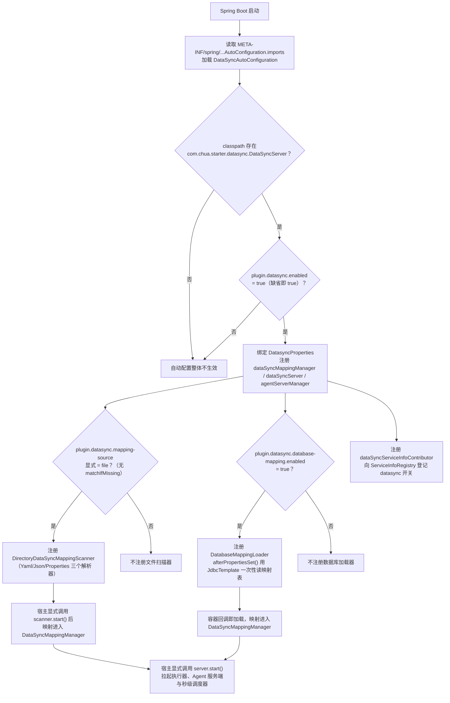
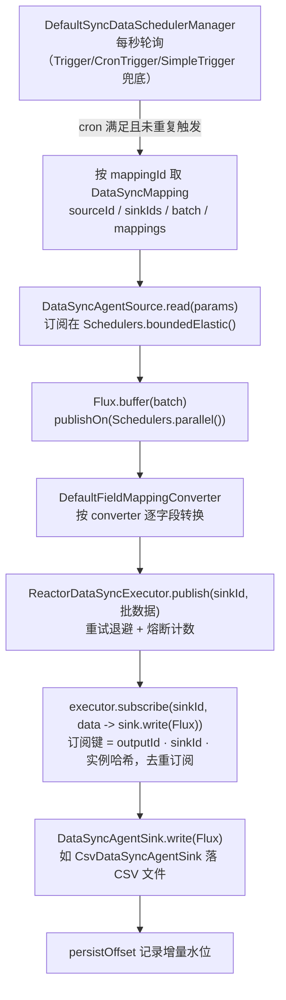

# spring-support-datasync-starter

DataSync 的 Spring Boot 集成层：按 `plugin.datasync.*` 在启动时把映射配置（文件目录或数据库表）装配进 `DataSyncMappingManager`，交给 `DataSyncServer` 按映射的 `cron` 表达式秒级调度执行。

核心接口、扫描器、解析器、调度器与执行引擎都在 `utils-support-datasync-starter`（及其依赖 `utils-support-datasync-agent-starter`）中；本模块只做**自动装配、配置绑定、数据库映射加载与本地验收**。

> 版本基线：模块 `4.0.0.51`（自 `4.0.0.42` 起提供），随仓库基于 **Spring Boot 4.1.2 + Java 25** 构建。

## 1. 架构图

### 1.1 模块在体系中的位置



### 1.2 内部分层



## 2. 核心流程图

### 2.1 启动装配流程



### 2.2 同步执行数据流



## 3. 能力清单

| 能力域 | 关键类 | 入口 |
|---|---|---|
| 自动配置入口 | `com.chua.starter.datasync.configuration.DataSyncAutoConfiguration` | `META-INF/spring/org.springframework.boot.autoconfigure.AutoConfiguration.imports` |
| 配置绑定 | `com.chua.starter.datasync.configuration.DatasyncProperties` | 配置前缀 `plugin.datasync` |
| 映射管理 | `DataSyncMappingManager`、`DefaultDataSyncMappingManager` | Spring Bean（`dataSyncMappingManager`） |
| 映射调度服务端 | `DataSyncServer`、`DefaultDataSyncServer` | Spring Bean（`dataSyncServer`），需宿主调用 `start()` |
| Agent 服务端 | `AgentServerManager`、`DataSyncAgentServer` | Spring Bean（`agentServerManager`，实例名 `default-server`，仅本地模式） |
| 文件模式加载 | `DirectoryDataSyncMappingScanner` + `YamlConfigFileParser` / `JsonConfigFileParser` / `PropertiesConfigFileParser` | `plugin.datasync.mapping-source=file` + 显式 `scanner.start()` |
| 数据库模式加载 | `com.chua.starter.datasync.configuration.DatabaseMappingLoader`（`JdbcTemplate` 一次性读取） | `plugin.datasync.database-mapping.enabled=true`，`InitializingBean` 容器回调自动加载 |
| 建表与种子 | `db/init/V2.0__init_all_datasync.sql`、`db/init/V2.0__initdata_datasync.sql` | 由 `spring-support-datasource-starter` 按 `plugin.datasource.script.*` 执行 |
| 服务信息登记 | `DataSyncAutoConfiguration#dataSyncServiceInfoContributor` | `ServiceInfoContributor` Bean，向 `ServiceInfoRegistry` 注册 `datasync` 开关 |
| OSGi 服务桥（声明） | `com.chua.starter.datasync.support.spi.DynamicService` | OSGi Bundle 侧实现并注册，本模块无 META-INF 注册文件 |
| 本地启动验收入口 | `com.chua.starter.datasync.support.DataSyncApplication` | `--datasync.mode=file\|database`、`--datasync.db=h2\|mysql` |

自动装配条件：classpath 存在 `com.chua.starter.datasync.DataSyncServer`（即引入了 `utils-support-datasync-starter`），且 `plugin.datasync.enabled` 为 `true`（缺省即 `true`）。

## 4. Bean 能力矩阵

自动配置类 `DataSyncAutoConfiguration` 共注册 6 个 Bean。全局前置条件（下表不再重复）：classpath 有 `DataSyncServer` 且 `plugin.datasync.enabled=true`。

| Bean 名（方法名） | 类型 | 装配条件（除全局外） | 可否覆盖 | 典型注入姿势 |
|---|---|---|---|---|
| `dataSyncMappingManager` | `DefaultDataSyncMappingManager` | 无附加条件；`@ConditionalOnMissingBean` | 可，定义同类型 Bean 即顶替 | `@Resource DataSyncMappingManager mappingManager;` |
| `dataSyncServer` | `DefaultDataSyncServer` | 无附加条件；`@ConditionalOnMissingBean`，构造时注入 `AgentServerManager` 与 `DataSyncMappingManager` | 可 | `@Resource DataSyncServer server;`（demo 直接注入 `DefaultDataSyncServer`） |
| `agentServerManager` | `DataSyncAgentServer` | 无附加条件；`@ConditionalOnMissingBean`；以 `new DataSyncAgentServer(null, null, "default-server")` 构造（无 `SyncServer`、无 `DataSyncServer` 回引用） | 可 | `@Resource AgentServerManager agentServerManager;` |
| `directoryDataSyncMappingScanner` | `DirectoryDataSyncMappingScanner` | `@ConditionalOnProperty(prefix="plugin.datasync", name="mapping-source", havingValue="file")`——**无 `matchIfMissing`，必须显式配置该键**；`@ConditionalOnMissingBean` | 可 | `@Resource DirectoryDataSyncMappingScanner scanner;` 注入后**自行调用 `start()`** |
| `databaseMappingLoader` | `DatabaseMappingLoader` | `@ConditionalOnProperty(prefix="plugin.datasync.database-mapping", name="enabled", havingValue="true")`；`@ConditionalOnMissingBean` | 可 | 一般无需注入，容器回调 `afterPropertiesSet()` 自动加载 |
| `dataSyncServiceInfoContributor` | `ServiceInfoContributor`（λ 表达式） | 无附加条件；**未加 `@ConditionalOnMissingBean`** | 可新增多个并存；同名则覆盖 | 无需注入，由 `spring-support-common-starter` 的服务信息收集器统一收集 |

说明：

- 三个核心 Bean（mappingManager / server / agentServerManager）只要全局条件满足就注册。
- 文件扫描器与数据库加载器是**两个独立开关**：`mapping-source=file` 且 `database-mapping.enabled=true` 会同时装配两者，并非二选一。
- 本模块**没有** Web 端点（无 `@RestController`）、没有定时任务自启动：`scanner.start()` 与 `server.start()` 都要宿主显式调用（demo 的 `DataSyncApplication` 就是这么做的）。

## 5. 完整配置

### 5.1 `plugin.datasync`（`DatasyncProperties`，全部字段）

| 路径 | 类型 | 默认值 | 说明 | 生效开关 |
|---|---|---|---|---|
| `plugin.datasync.enabled` | `boolean` | `true` | 模块总开关，同时是自动配置的开关（`matchIfMissing=true`，不配置即启用） | 始终生效 |
| `plugin.datasync.mapping-source` | `String` | `"file"` | 映射来源：`file` \| `database`。注意：它**只决定是否装配文件扫描器**（条件判定要求显式写 `file`），不限制数据库加载器 | 扫描器装配条件 |
| `plugin.datasync.file-mapping.directory-path` | `String` | `./datasync/mappings` | 文件模式扫描目录，递归遍历 | `mapping-source=file` 时由扫描器消费 |
| `plugin.datasync.database-mapping.enabled` | `boolean` | `false` | 是否装配 `DatabaseMappingLoader` | 数据库加载器装配条件 |
| `plugin.datasync.database-mapping.table-prefix` | `String` | `datasync_` | 表名前缀，实际读取 `{prefix}mapping` 与 `{prefix}field_mapping` | `database-mapping.enabled=true` 时消费 |
| `plugin.datasync.database-mapping.cron` | `String` | `0/5 * * * * ?` | 声明字段，**当前实现未消费**（加载器只在启动时一次性读表，不做轮询） | 无 |

本模块**没有** `plugin.datasync.database-mapping.auto-init-table` 之类的建表开关：表结构由 `db/init` 脚本随 `spring-support-datasource-starter` 落地。

### 5.2 映射文件字段（文件模式内容约定，非 Spring 配置）

支持格式：`.yaml` / `.yml`、`.json`、`.properties`；目录递归扫描，`mappingId` 默认取文件名去扩展名。仓库自带示例：`src/main/resources/datasync/mappings/user-sync.yaml`、`order-sync.json`。

```yaml
mappingId: user-sync        # 映射标识，缺省用文件名
inputId: user-input         # 输入标识（映射管理器反查用）
sourceId: user-source       # 数据源实例标识，须已 registerSource
outputId: user-output       # 响应式通道标识（执行器查找键）
sinkId: user-sink           # 输出 Sink 实例标识，须已 registerSink
batch: 10                   # 批量，缺省 100
cronType: fixed             # 定时类型，当前调度只看 cron，此值仅透传
cron: "0/5 * * * * ?"       # Quartz 风格 cron；为空/非法时降级为每分钟一次
params:                     # 透传给 Source.read 的读取参数
  key1: value1
mappings:                   # 字段映射列表
  - sourceField: name       # 源字段
    targetField: user_name  # 目标字段
    converter: toString     # 转换器标识，缺省 toString
```

### 5.3 数据库表结构（数据库模式内容约定）

由 `db/init/V2.0__init_all_datasync.sql` 创建（`V1.0__init_all_datasync.sql` 已并入并删除），种子数据在 `db/init/V2.0__initdata_datasync.sql`（默认模板 `db-user-sync`）：

```sql
CREATE TABLE IF NOT EXISTS datasync_mapping (
    datasync_mapping_id VARCHAR(255) PRIMARY KEY,
    datasync_mapping_input_id VARCHAR(255),
    datasync_mapping_source_id VARCHAR(255),
    datasync_mapping_output_id VARCHAR(255),
    datasync_mapping_sink_id VARCHAR(255),
    datasync_mapping_batch INT DEFAULT 100,
    datasync_mapping_cron_type VARCHAR(255),
    datasync_mapping_cron VARCHAR(255),
    datasync_mapping_params TEXT,
    datasync_mapping_enabled BOOLEAN DEFAULT TRUE,
    datasync_mapping_create_time TIMESTAMP DEFAULT CURRENT_TIMESTAMP,
    datasync_mapping_update_time TIMESTAMP DEFAULT CURRENT_TIMESTAMP
);

CREATE TABLE IF NOT EXISTS datasync_field_mapping (
    datasync_field_mapping_id VARCHAR(255) PRIMARY KEY,
    datasync_field_mapping_mapping_id VARCHAR(255),
    datasync_field_mapping_source_field VARCHAR(255),
    datasync_field_mapping_target_field VARCHAR(255),
    datasync_field_mapping_converter VARCHAR(255),
    datasync_field_mapping_sort INT,
    FOREIGN KEY (datasync_field_mapping_mapping_id) REFERENCES datasync_mapping(datasync_mapping_id)
);
```

加载规则（`DatabaseMappingLoader`）：只读 `datasync_mapping_enabled = TRUE` 的行；字段映射按 `datasync_field_mapping_sort` 升序；`converter` 缺省按 `toString`；`params` 列按 JSON 解析（Jackson）。

### 5.4 相关外部配置

- 建表/种子脚本由 `spring-support-datasource-starter` 的 `plugin.datasource.script.*` 执行，默认扫描 `classpath*:db/init/*.sql,classpath*:db/migration/*.sql,classpath*:db/sync/*.sql`。
- demo 启动类 `DataSyncApplication` 另用 `plugin.ssh.server.*`（2222）与 `plugin.osgi.shell.*`（6666），仅限本地验收，不属本模块配置。

## 6. 使用方式

### 6.1 Maven 坐标

```xml
<dependency>
    <groupId>com.chua</groupId>
    <artifactId>spring-support-datasync-starter</artifactId>
    <version>4.0.0.51</version>
</dependency>
```

要求：Java 25、Spring Boot 4.1.x 宿主（自动装配走 `AutoConfiguration.imports`，无 `spring.factories`）。

### 6.2 最小可运行示例

第 1 步：`application.yml`（注意 `mapping-source` 必须显式写 `file`）：

```yaml
plugin:
  datasync:
    enabled: true
    mapping-source: file
    file-mapping:
      directory-path: ./config/datasync
```

第 2 步：在 `./config/datasync` 放映射文件（格式见 5.2），例如 `user-sync.yaml`。

第 3 步：启动类正常 `@SpringBootApplication` 即可，自动配置会装配各 Bean；宿主需**显式拉起扫描与调度**，并注册映射引用的 Source/Sink：

```java
@Component
public class DataSyncBootstrap {

    private final DataSyncServer server;
    private final DirectoryDataSyncMappingScanner scanner; // mapping-source=file 时才存在

    public DataSyncBootstrap(DataSyncServer server, DirectoryDataSyncMappingScanner scanner) {
        this.server = server;
        this.scanner = scanner;
    }

    @PostConstruct
    public void start() throws Exception {
        scanner.start(); // 全量扫描 + WatchService 热加载（2 秒轮询）
        // 注册映射文件里引用的 sourceId / sinkId 对应实例
        server.registerSource(new DelimitedDataSyncAgentSource(
                "user-source", "user-input", "data/user-source.csv", ","));
        server.registerSink(new CsvDataSyncAgentSink("user-sink", "out/user-sink.csv"));
        server.start(); // 启动执行器、Agent 服务端与秒级调度器
    }

    @PreDestroy
    public void stop() {
        server.stop();
        scanner.stop();
    }
}
```

数据库模式则改为：`mapping-source: database` + `plugin.datasync.database-mapping.enabled: true`，启动期由 `DatabaseMappingLoader` 自动读表（`DataSource` 由宿主提供），无需调用扫描器。

本地验收可直接跑模块自带启动类 `com.chua.starter.datasync.support.DataSyncApplication`：

```text
--datasync.mode=file        # 默认，扫描 src/main/resources/datasync/mappings
--datasync.mode=database    # 走数据库映射，默认嵌入式 H2
--datasync.db=mysql         # 数据库模式下改用真实 MySQL
```

### 6.3 依赖说明

| 依赖 | 作用域 | 说明 |
|---|---|---|
| `utils-support-datasync-starter` | compile | 核心接口：`DataSyncServer`、`DataSyncMappingManager`、扫描器、解析器、调度器 |
| `utils-support-datasync-agent-starter` | 传递 | 执行引擎：`DataSyncAgentSource/Sink/Agent`、`ReactorDataSyncExecutor` |
| `spring-support-datasource-starter` | compile | 执行 `db/init` 下的建表/种子脚本 |
| `spring-boot-starter-web`、`spring-webmvc` | compile | pom 声明的 Web 依赖；本模块自身无任何 HTTP 端点 |
| `spring-support-osgi-starter`、`utils-support-osgi-starter` | compile | OSGi 服务桥（`DynamicService`）宿主；普通 Spring 应用可忽略 |
| `spring-support-ssh-starter` | compile | 仅 pom 声明，本模块源码未引用 |
| `utils-support-datalake-*`（core / mqtt / webhook / cdc / subscribe） | compile | 数据湖链路与被动推送入站适配器探针所需 |
| `utils-support-fory-starter`、`utils-support-protobuf-starter`、`utils-support-serialize-starter` | compile | 序列化能力 |
| `jackson-databind` | compile | 数据库 `params` JSON 解析 |
| `reactor-core`、`jspecify` | compile | 响应式引擎传递依赖修正（jspecify 被父 POM 管理为 provided，这里显式 compile） |
| `mysql-connector-j` | runtime | 运行期驱动；使用其他数据库需宿主自行补充驱动 |
| `spring-boot-configuration-processor`、`lombok` | optional | 编译期注解处理 |

注意：pom 会带入 ssh / osgi / datalake 全家桶，使用方应确认这些传递依赖（及其 AutoConfiguration）是否可接受；不需要时在宿主用 `<exclusions>` 排除或按各模块文档关闭开关。

## 7. 使用场景

### 7.1 适用

- **配置驱动的定时字段映射同步**：一份 YAML/JSON/Properties 或一张库表声明「从哪个 Source 读、按什么字段映射转换、写到哪个 Sink、按什么 cron 跑」。
- **映射需要热更新**：文件模式通过 `WatchService` 监听目录，改文件即热加载（删除文件会同步移除映射）。
- **轻量文件/库表搬运**：CSV→CSV、JDBC→CSV 等（引擎内置 `DelimitedDataSyncAgentSource`、`JdbcDataSyncAgentSource`、`CsvDataSyncAgentSink` 等）。
- **本地单机调度**：秒级轮询 + Reactor 管线（背压、重试退避、熔断、内存安全预估）。

### 7.2 不适用

- **实时流式变更捕获**：CDC 场景应使用数据湖侧能力（`utils-support-datalake-cdc-starter` 等），本模块是 cron 轮询模型。
- **复杂 ETL 编排**：无多级依赖 DAG、无分支聚合；一条映射就是「一源 → 一/多 Sink」的线性字段转换。
- **开箱即用的分布式协调**：调度状态在进程内存中；映射表也只在本进程 `DataSyncMappingManager` 里，多实例部署需自行规划（如按实例拆分映射）。

### 7.3 与相邻模块的取舍

- `utils-support-datasync-starter`：核心接口与实现所在处，本模块只做装配与配置绑定；需要绕过 Spring 直接用 API 时可只依赖它。
- `spring-support-datasource-starter`：数据库模式的建表前提；它执行 `db/init` 脚本，本模块只负责读数。
- `spring-support-osgi-starter` / `utils-support-osgi-starter`：`DynamicService` 的 OSGi 服务宿主；不用 OSGi 可忽略。
- `spring-support-sync-starter`：通用 `SyncServer`/`SyncClient` 通道。`DataSyncAgentServer` 的远程模式依赖一个 `SyncServer`，但**本模块自动装配并不注入它**（传 `null`，即仅本地模式）；要跨节点分发需自行覆盖 `agentServerManager` 并接上 `spring-support-sync-starter` 的 `SyncServer`。
- `spring-support-job-starter`：若需把同步任务纳入统一调度台账，可由任务模块触发 `DataSyncServer`（如 `schedulerManager().trigger(mappingId)`）；本模块自身不依赖任务模块。

## 8. 扩展点

本模块**不提供** `META-INF/extensions` 形式的 SPI 注册文件；扩展通过 Spring Bean 覆盖默认实现与实现核心层接口完成。

**1) 覆盖自动装配的 Bean**（全部 `@ConditionalOnMissingBean`，同名/同类型 Bean 即顶替）：

可替换的装配点：`DataSyncMappingManager`、`DataSyncServer`、`AgentServerManager`、`DirectoryDataSyncMappingScanner`、`DatabaseMappingLoader`。

```java
// 1) 实现：自定义映射管理器（例如先做命名规整再入库）
public class AuditedMappingManager extends DefaultDataSyncMappingManager {
    @Override
    public void addMapping(DataSyncMapping mapping) {
        // 审计后委托父类
        super.addMapping(mapping);
    }
}

// 2) 登记：同名 Bean 即可顶替默认实现
@Bean
public DataSyncMappingManager dataSyncMappingManager() {
    return new AuditedMappingManager();
}
// 3) 生效：文件扫描器与数据库加载器都注入 DataSyncMappingManager，改由自定义实现承载
```

**2) 新增配置文件格式**：实现 `com.chua.starter.datasync.scanner.ConfigFileParser`（`supports(Path)` + `parse(Path)`），再自行构造 `DirectoryDataSyncMappingScanner` 并传入解析器列表——自动配置固定只注册 YAML / JSON / Properties 三种解析器。

**3) 一源多目标**：覆盖 `DataSyncMapping#sinkIds()` 返回多个 sinkId，调度器会为每个 Sink 单独订阅，源只读一次、数据同时投递给全部目标（各 Sink 仍需自行 `registerSink`）。

**4) 自定义触发器**：`DataSyncMapping#trigger()` 返回自定义 `com.chua.common.support.task.scheduler.Trigger` 时优先于 `cron` 字段；数据库模式构造映射时 `trigger` 传 `null`，即走 `cron` 解析。

**5) 服务端级替换**：`DefaultDataSyncServer#setExecutorManager(...)` / `setMappingManager(...)` 可在 `start()` 之前替换执行器管理器或映射管理器（与数据湖整合时使用）。

**6) OSGi 动态服务**：实现 `com.chua.starter.datasync.support.spi.DynamicService`（`getName()` + `execute(String)`）并作为 Bundle 注册到 Felix；Spring 侧可通过 `/test/integration/osgi/services?type=DynamicService` 查询。本模块只声明接口，无 META-INF 注册文件。

**7) 服务信息贡献**：实现 `ServiceInfoContributor` Bean 可向 `ServiceInfoRegistry` 追加本应用的端点/开关信息（本模块自带的 contributor 登记 `datasync` 开关）。

## 9. 常见问题

**Q1：引入依赖后什么都没发生？**
按顺序排查：① classpath 是否有 `utils-support-datasync-starter`（自动配置 `@ConditionalOnClass` 检查 `com.chua.starter.datasync.DataSyncServer`）；② `plugin.datasync.enabled` 是否被设为 `false`；③ 文件模式下 `plugin.datasync.mapping-source` 是否**显式**写了 `file`——条件注解没有 `matchIfMissing`，POJO 里的默认值不参与条件判定，不写就不装配扫描器；④ Bean 是否被宿主同名定义顶替。

**Q2：文件模式下映射没被加载？**
自动配置不会自动调用 `scanner.start()`，必须由宿主显式调用；目录不存在时只记 warn（`目录不存在，跳过扫描`）不抛异常。另外 `server.start()` 也要显式调用，否则调度器不会跑。

**Q3：数据库模式改了表数据为什么不生效？**
`DatabaseMappingLoader` 在 `afterPropertiesSet()` 里一次性读取，`database-mapping.cron` 只是声明字段、当前实现未消费，**不做轮询**；改表后需重启（或自行调用加载逻辑）。

**Q4：`mapping-source=file` 和 `database-mapping.enabled=true` 冲突吗？**
不冲突，它们是两个独立开关，同时开启会同时装配文件扫描器与数据库加载器，两路映射都进 `DataSyncMappingManager`。

**Q5：调度日志一直报「找不到Source / 找不到Sink」？**
调度器按映射的 `sourceId` / `sinkId` 到服务端注册表查找，先 `registerSource` / `registerSink` 再 `server.start()`；方向也要对（Source 为 INPUT、Sink 为 OUTPUT，否则整条映射被阻止执行）。

**Q6：数据库加载失败会阻断启动吗？**
不会。主表读取失败只记录错误日志（`从数据库加载 DataSync 映射失败`），字段映射失败只 warn，需关注日志排查。

**Q7：这个模块会占用端口吗？**
自动装配本身不开任何端口、不注册任何 HTTP 端点。demo 启动类里的 28978（Web）、2222（SSH）、6666（OSGi Shell，admin/admin）仅用于本地验收，不得当作生产配置模板。

**Q8：与 Spring Boot 4 的兼容性？**
本模块随仓库基于 Spring Boot 4.1.2 + Java 25 构建，自动装配只走 `META-INF/spring/org.springframework.boot.autoconfigure.AutoConfiguration.imports`（没有也不需要 `spring.factories`）。低版本 Boot 宿主（Boot 2/3）无法加载 Java 25 字节码，需先升级宿主。

**Q9：有 `auto-init-table` 建表开关吗？**
没有。早期文档中的 `plugin.datasync.database-mapping.auto-init-table` 键不成立；建表只能靠 `db/init` 脚本（随 `spring-support-datasource-starter` 执行）或手工执行 SQL。

**Q10：Agent 远程模式怎么开？**
默认装配的 `agentServerManager` 是 `new DataSyncAgentServer(null, null, "default-server")`：无 `SyncServer`、无 `DataSyncServer` 回引用，属于「仅本地」最小实例（注册携带 Source/Sink 的 Agent 时内部回引用为 null，需自行覆盖该 Bean 并正确接线）。要跨节点推送，需覆盖 `agentServerManager`，传入 `spring-support-sync-starter` 提供的 `SyncServer`，远程 Agent 通过 `register:` / `source:` / `sink:` 主题自动注册与收发。

**Q11：MySQL 之外的数据库能用吗？**
可以，但驱动只内置 `mysql-connector-j`（runtime）；PostgreSQL、Oracle 等需宿主自行引入驱动并提供 `DataSource`。
