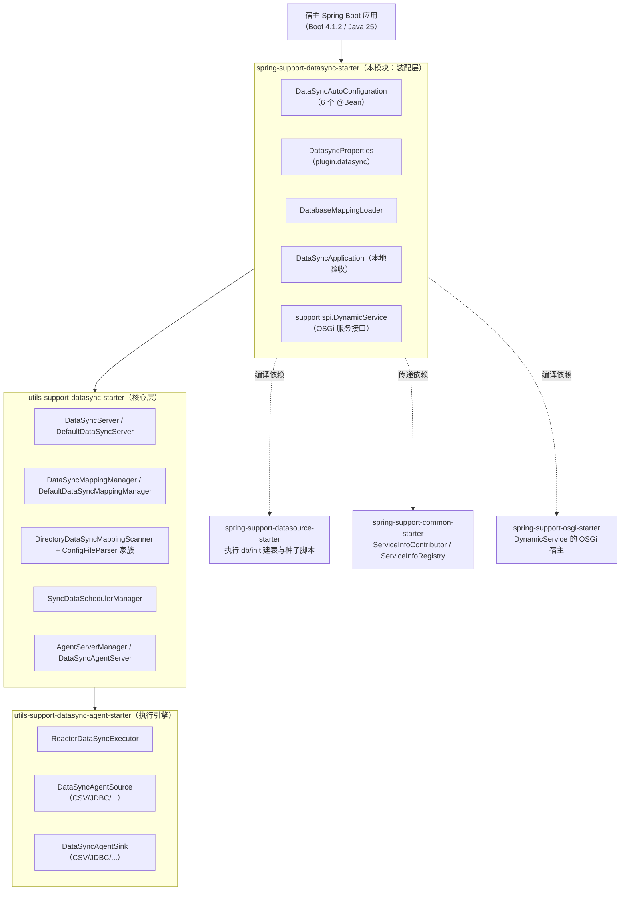
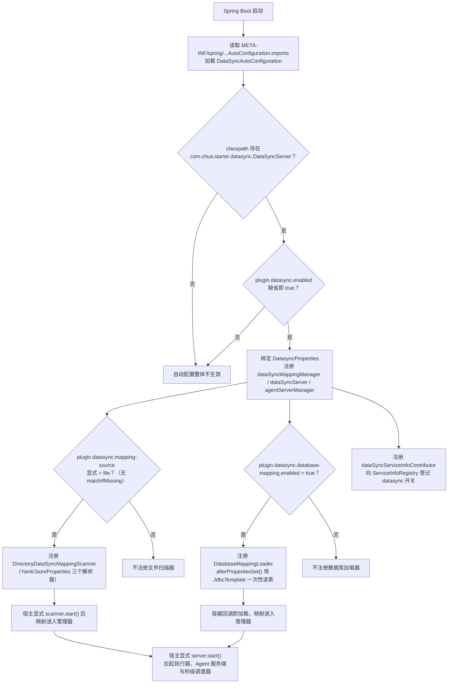

# spring-support-datasync-starter

DataSync 的 Spring Boot 自动装配层：按 `plugin.datasync.*` 在启动时把映射配置（文件目录或数据库表）装配进 `DataSyncMappingManager`，交给 `DataSyncServer` 按映射的 `cron` 表达式秒级调度执行。在 spring-support 体系中，它是 `utils-support-datasync-starter`（核心接口/调度）与 `utils-support-datasync-agent-starter`（Reactor 执行引擎）之上的业务 starter：本模块只做自动装配、配置绑定、数据库映射加载与本地验收，核心能力全部下沉在 utils 层。

> 版本基线：`4.0.0.51`（自 `4.0.0.42` 起提供），随仓库基于 Spring Boot 4.1.2 + Java 25 构建。

## 1. 架构图



内部分层：`configuration` 包（`DataSyncAutoConfiguration` / `DatasyncProperties` / `DatabaseMappingLoader`）负责装配与读表；`support` 包（`DynamicService`、`DataSyncApplication`）提供 OSGi 服务接口与本地验收入口；扫描器、映射管理、调度与执行全部来自 utils 核心层，本模块不重复实现。

## 2. 核心流程图（启动自动装配）



调度触发后的执行链路：`DataSyncAgentSource.read()` → `Flux.buffer(batch)` → 字段映射转换 → `ReactorDataSyncExecutor.publish(sinkId, 批数据)`（重试退避 + 熔断计数）→ `DataSyncAgentSink.write(Flux)` 落地。

## 3. 能力清单

| 能力域 | 关键类 | 入口/触发方式 |
|---|---|---|
| 自动配置入口 | `com.chua.starter.datasync.configuration.DataSyncAutoConfiguration` | `META-INF/spring/org.springframework.boot.autoconfigure.AutoConfiguration.imports` |
| 配置绑定 | `com.chua.starter.datasync.configuration.DatasyncProperties` | 配置前缀 `plugin.datasync` |
| 映射管理 | `DataSyncMappingManager`、`DefaultDataSyncMappingManager` | Spring Bean（`dataSyncMappingManager`） |
| 映射调度服务端 | `DataSyncServer`、`DefaultDataSyncServer` | Spring Bean（`dataSyncServer`），需宿主调用 `start()` |
| Agent 服务端 | `AgentServerManager`、`DataSyncAgentServer` | Spring Bean（`agentServerManager`，实例名 `default-server`，仅本地模式） |
| 文件模式加载 | `DirectoryDataSyncMappingScanner` + `YamlConfigFileParser` / `JsonConfigFileParser` / `PropertiesConfigFileParser` | `plugin.datasync.mapping-source=file` + 宿主显式 `scanner.start()` |
| 数据库模式加载 | `com.chua.starter.datasync.configuration.DatabaseMappingLoader` | `plugin.datasync.database-mapping.enabled=true`，`InitializingBean` 容器回调自动读表 |
| 建表与种子 | `db/init/V2.0__init_all_datasync.sql`、`db/init/V2.0__initdata_datasync.sql` | 由 `spring-support-datasource-starter` 按 `plugin.datasource.script.*` 执行 |
| 服务信息登记 | `DataSyncAutoConfiguration#dataSyncServiceInfoContributor` | 向 `ServiceInfoRegistry` 注册 `datasync` 开关 |
| OSGi 服务桥（声明） | `com.chua.starter.datasync.support.spi.DynamicService` | OSGi Bundle 侧实现并注册，本模块无 META-INF 注册文件 |
| 本地验收入口 | `com.chua.starter.datasync.support.DataSyncApplication` | `--datasync.mode=file\|database`、`--datasync.db=h2\|mysql` |

## 4. Bean 能力矩阵

自动配置类共注册 6 个 Bean。全局前置条件：classpath 存在 `com.chua.starter.datasync.DataSyncServer`（即引入了 `utils-support-datasync-starter`），且 `plugin.datasync.enabled=true`（`matchIfMissing=true`）。

| Bean 名（方法名） | 类型 | 装配条件（除全局外） | 可否覆盖 | 典型用途 |
|---|---|---|---|---|
| `dataSyncMappingManager` | `DataSyncMappingManager`（实例 `DefaultDataSyncMappingManager`） | 无附加；`@ConditionalOnMissingBean` | 可，定义同类型 Bean 即顶替 | 注入 `DataSyncMappingManager` 管理映射 |
| `dataSyncServer` | `DataSyncServer`（实例 `DefaultDataSyncServer`） | 无附加；`@ConditionalOnMissingBean`；构造注入 `AgentServerManager`，随后 `setMappingManager(...)` 注入映射管理器 | 可 | 注入 `DataSyncServer`，显式 `start()` 拉起调度 |
| `agentServerManager` | `AgentServerManager`（实例 `DataSyncAgentServer`） | 无附加；`@ConditionalOnMissingBean`；以 `new DataSyncAgentServer(null, null, "default-server")` 构造（无 `SyncServer`、无回引用） | 可 | Agent 注册/寻址；远程模式需自行覆盖接线 |
| `directoryDataSyncMappingScanner` | `DirectoryDataSyncMappingScanner` | `@ConditionalOnProperty(prefix="plugin.datasync", name="mapping-source", havingValue="file")`——**无 `matchIfMissing`，必须显式配置**；`@ConditionalOnMissingBean` | 可 | 文件模式扫描映射目录，宿主显式 `start()` |
| `databaseMappingLoader` | `DatabaseMappingLoader` | `@ConditionalOnProperty(prefix="plugin.datasync.database-mapping", name="enabled", havingValue="true")`；`@ConditionalOnMissingBean` | 可 | 启动期从 `{prefix}mapping` / `{prefix}field_mapping` 读映射 |
| `dataSyncServiceInfoContributor` | `ServiceInfoContributor`（λ 表达式） | 无附加；**未加 `@ConditionalOnMissingBean`** | 宿主同类型定义不互斥，会与本 Bean 并存（同名则 Bean 定义冲突） | 向 `ServiceInfoRegistry` 登记 `datasync` 开关 |

说明：文件扫描器与数据库加载器是**两个独立开关**，同时开启会同时装配、两路映射都进 `DataSyncMappingManager`。本模块没有 Web 端点（无 `@RestController`）、没有自启动定时任务：`scanner.start()` 与 `server.start()` 都要宿主显式调用。

## 5. 完整配置

`DatasyncProperties`（前缀 `plugin.datasync`，含 `FileMapping`、`DatabaseMapping` 两个嵌套类）全部字段：

| 配置路径 | 类型 | 默认值 | 说明 |
|---|---|---|---|
| `plugin.datasync.enabled` | `boolean` | `true` | 模块总开关，同时是自动配置开关（不配置即启用） |
| `plugin.datasync.mapping-source` | `String` | `file` | 映射来源 `file` / `database`；只决定是否装配文件扫描器（条件判定要求显式写 `file`），不限制数据库加载器 |
| `plugin.datasync.file-mapping.directory-path` | `String` | `./datasync/mappings` | 文件模式扫描目录，递归遍历 |
| `plugin.datasync.database-mapping.enabled` | `boolean` | `false` | 是否装配 `DatabaseMappingLoader` |
| `plugin.datasync.database-mapping.table-prefix` | `String` | `datasync_` | 表名前缀，实际读取 `{prefix}mapping` 与 `{prefix}field_mapping` |
| `plugin.datasync.database-mapping.cron` | `String` | `0/5 * * * * ?` | 声明字段，当前实现未消费（加载器只在启动时一次性读表，不轮询） |

除该配置类外本模块无其他 `@ConfigurationProperties`，也没有 `auto-init-table` 之类建表开关（建表靠 `db/init` 脚本随 `spring-support-datasource-starter` 执行）。映射文件字段与表结构属内容约定：映射示例见 `src/main/resources/datasync/mappings/user-sync.yaml`、`order-sync.json`（支持 `.yaml/.yml`、`.json`、`.properties`，`mappingId` 缺省取文件名）；建表见 `db/init/V2.0__init_all_datasync.sql`（`datasync_mapping` / `datasync_field_mapping` 两表），种子数据在 `db/init/V2.0__initdata_datasync.sql`（默认模板 `db-user-sync`）。

## 6. 使用方式

Maven 坐标：

```xml
<dependency>
    <groupId>com.chua</groupId>
    <artifactId>spring-support-datasync-starter</artifactId>
    <version>4.0.0.51</version>
</dependency>
```

最小启用示例——`application.yml`（注意 `mapping-source` 必须显式写 `file`）：

```yaml
plugin:
  datasync:
    enabled: true
    mapping-source: file
    file-mapping:
      directory-path: ./config/datasync
```

宿主显式拉起扫描与调度，并注册映射引用的 Source/Sink：

```java
@Component
public class DataSyncBootstrap {

    private final DataSyncServer server;
    private final DirectoryDataSyncMappingScanner scanner; // mapping-source=file 时才存在

    public DataSyncBootstrap(DataSyncServer server, DirectoryDataSyncMappingScanner scanner) {
        this.server = server;
        this.scanner = scanner;
    }

    @PostConstruct
    public void start() throws Exception {
        scanner.start(); // 全量扫描 + WatchService 热加载
        server.registerSource(new DelimitedDataSyncAgentSource(
                "user-source", "user-input", "data/user-source.csv", ","));
        server.registerSink(new CsvDataSyncAgentSink("user-sink", "out/user-sink.csv"));
        server.start(); // 启动执行器、Agent 服务端与秒级调度器
    }

    @PreDestroy
    public void stop() {
        server.stop();
        scanner.stop();
    }
}
```

数据库模式改为 `mapping-source: database` + `plugin.datasync.database-mapping.enabled: true`：启动期由 `DatabaseMappingLoader` 自动读表（`DataSource` 由宿主提供），无需调用扫描器。本地验收可直接跑模块自带启动类 `com.chua.starter.datasync.support.DataSyncApplication`（`--datasync.mode=file|database`，`--datasync.db=h2|mysql`；仅本地验收用的默认端口为 28978、SSH 2222、OSGi Shell 6666，其中 28978 会被 `src/main/resources/application.yml` 的 `server.port: 0` 覆盖为随机端口，均非生产配置模板）。

可选依赖与传递依赖说明：

- `spring-boot-configuration-processor`、`lombok` 标记 `optional`：缺了只影响编译期注解处理（配置元数据生成、getter 生成），不传递给使用方，运行期无感知。
- `mysql-connector-j` 为 `runtime`：开箱支持 MySQL；PostgreSQL/Oracle 等需宿主自行补驱动并提供 `DataSource`。
- pom 会传递带入 ssh / osgi / datalake（core/mqtt/webhook/cdc/subscribe）/ fory / protobuf / serialize 等 starter，使用方应确认这些传递依赖及其 AutoConfiguration 是否可接受；不需要时用 `<exclusions>` 排除或按各模块文档关闭开关。
- `reactor-core`、`jspecify` 为响应式引擎的显式 compile 修正（`jspecify` 在父 POM 被管理为 provided，运行期签名解析仍需要它）。

## 7. 使用场景

适用：

- 配置驱动的定时字段映射同步：一份 YAML/JSON/Properties 或一张库表声明「从哪个 Source 读、按什么字段映射转换、写到哪个 Sink、按什么 cron 跑」。
- 映射需要热更新：文件模式通过 `WatchService` 监听目录，改文件即热加载（删除文件会同步移除映射）。
- 轻量文件/库表搬运：CSV→CSV、JDBC→CSV 等（引擎内置 `DelimitedDataSyncAgentSource`、`JdbcDataSyncAgentSource`、`CsvDataSyncAgentSink` 等）。
- 单机秒级调度：Reactor 管线自带背压、重试退避与熔断计数。

不适用/慎用：

- 实时流式变更捕获：CDC 场景应使用数据湖侧能力（`utils-support-datalake-cdc-starter` 等），本模块是 cron 轮询模型。
- 复杂 ETL 编排与分布式协调：无多级 DAG、无分支聚合；调度状态与映射表都在进程内存，多实例部署需自行规划（如按实例拆分映射）。

与相邻模块的取舍：

- `utils-support-datasync-starter`：核心接口与实现所在，本模块只做装配与配置绑定；要绕过 Spring 直接用 API 可只依赖它。
- `spring-support-datasource-starter`：数据库模式的建表前提，它执行 `db/init` 脚本，本模块只负责读数。
- `spring-support-sync-starter`：通用 `SyncServer`/`SyncClient` 通道。本模块装配的 `agentServerManager` 不注入 `SyncServer`（传 `null`，仅本地模式）；跨节点分发需自行覆盖该 Bean 并接上 sync-starter 的 `SyncServer`。
- `spring-support-job-starter`：需要把同步任务纳入统一调度台账时，可由任务模块触发 `DataSyncServer`；本模块自身不依赖任务模块。

## 8. 扩展点

本模块不提供 `META-INF/extensions` 形式的 SPI 注册文件；扩展通过覆盖 Spring Bean 或实现核心层接口完成：

1. **覆盖装配 Bean**：`DataSyncMappingManager`、`DataSyncServer`、`AgentServerManager`、`DirectoryDataSyncMappingScanner`、`DatabaseMappingLoader` 均带 `@ConditionalOnMissingBean`，定义同类型 Bean 即顶替默认实现（`dataSyncServiceInfoContributor` 未加该注解，同名覆盖、异名并存）。
2. **新增映射文件格式**：实现 `com.chua.starter.datasync.scanner.ConfigFileParser`（`supports(Path)` + `parse(Path)`），再自行构造 `DirectoryDataSyncMappingScanner` 传入解析器列表——自动配置固定只注册 YAML / JSON / Properties 三种。
3. **一源多目标**：覆盖 `DataSyncMapping#sinkIds()` 返回多个 sinkId，调度器会为每个 Sink 单独订阅，源只读一次、数据投递给全部目标（各 Sink 仍需 `registerSink`）。
4. **自定义触发器**：`DataSyncMapping#trigger()` 返回自定义 `com.chua.common.support.task.scheduler.Trigger` 时优先于 `cron` 字段；数据库模式构造映射时 `trigger` 传 `null`，走 `cron` 解析。
5. **服务端级替换**：`DefaultDataSyncServer#setExecutorManager(...)` / `setMappingManager(...)` 可在 `start()` 之前替换执行器管理器或映射管理器（与数据湖整合时使用）。
6. **OSGi 动态服务**：实现 `com.chua.starter.datasync.support.spi.DynamicService`（`getName()` + `execute(String)`）并作为 Bundle 注册到 Felix；Spring 侧可通过 `/test/integration/osgi/services?type=DynamicService` 查询。本模块只声明接口，无 META-INF 注册文件。

## 9. 常见问题

**Q1：引入依赖后什么都没发生？**
按序排查：① classpath 是否有 `utils-support-datasync-starter`（自动配置 `@ConditionalOnClass` 检查 `com.chua.starter.datasync.DataSyncServer`）；② `plugin.datasync.enabled` 是否被设为 `false`；③ 文件模式下 `plugin.datasync.mapping-source` 是否**显式**写了 `file`——条件注解没有 `matchIfMissing`，POJO 里的默认值不参与条件判定，不写就不装配扫描器；④ Bean 是否被宿主同类型定义顶替（`@ConditionalOnMissingBean` 按类型判定）。

**Q2：文件模式下映射没被加载 / 调度不跑？**
自动配置不会自动调用 `scanner.start()` 与 `server.start()`，必须由宿主显式调用；目录不存在时扫描器只记 warn（`目录不存在，跳过扫描`）不抛异常。调度器按映射的 `sourceId` / `sinkId` 到服务端注册表查找，先 `registerSource` / `registerSink` 再 `server.start()`，方向也要正确（Source 为 INPUT、Sink 为 OUTPUT，否则整条映射被阻止执行）。

**Q3：数据库模式改了表数据为什么不生效？会阻断启动吗？**
`DatabaseMappingLoader` 在 `afterPropertiesSet()` 里一次性读取，`database-mapping.cron` 只是声明字段、当前实现未消费，**不做轮询**；改表后需重启（或自行触发加载）。加载失败不阻断启动：主表失败只记 error（`从数据库加载 DataSync 映射失败`），字段映射失败只 warn。

**Q4：与 Spring Boot 4 的兼容性？有建表开关吗？**
本模块基于 Spring Boot 4.1.2 + Java 25 构建，自动装配只走 `META-INF/spring/org.springframework.boot.autoconfigure.AutoConfiguration.imports`（没有也不需要 `spring.factories`）；低版本 Boot 宿主（Boot 2/3）无法加载 Java 25 字节码，需先升级宿主。没有 `plugin.datasync.database-mapping.auto-init-table` 之类的建表开关，建表只能靠 `db/init` 脚本（随 `spring-support-datasource-starter` 执行）或手工执行 SQL。
