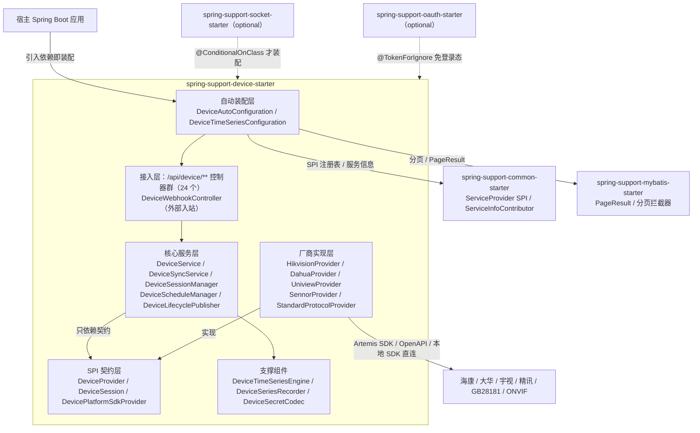
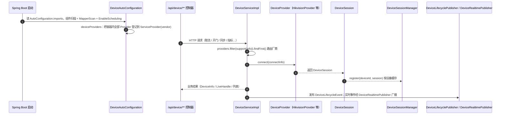

# spring-support-device-starter

设备统一接入 Starter：把海康（云曜 / 云眸 / 综合安防 / 萤石 / ISUP）、大华（云平台 / 乐橙 / ICC）、宇视、精讯、GB28181、ONVIF 收敛为一套 `DeviceProvider` + `DeviceSession` SPI 和 `/api/device/**` 管理端点，覆盖设备台账、通道、视频、云台、门禁、事件、人员考勤、车辆道闸、时序记录与目录同步。在 spring-support 体系中，它是被宿主应用按需引入的「设备域」业务 starter：向下复用 `spring-support-common-starter`（ServiceProvider SPI 注册表、ServiceInfoContributor）与 `spring-support-mybatis-starter`（分页），对外只暴露 SPI 与 REST 接口。

## 1. 架构图



模块内部分层为「自动装配 → 核心服务 → SPI」：`DeviceAutoConfiguration` 扫描 controller / service / scheduler / util / security / realtime / callback / provider 8 个包并 `@MapperScan` Mapper；服务层按 `DeviceConnectInfo` 路由到 `DeviceProvider`，会话由 `DeviceSessionManager` 缓存；厂商差异全部压在 provider 层。

## 2. 核心流程图



## 3. 能力清单

| 能力域 | 关键类 | 入口 / 触发方式 |
|---|---|---|
| 厂商接入 SPI | `DeviceProvider`、`DeviceSession`、`DeviceVendorDescriptor` | 容器中所有 `DeviceProvider` Bean，按 `vendor` 登记 `ServiceProvider` |
| 厂商实现 | `HikvisionProvider`、`DahuaProvider`、`UniviewProvider`、`SennorProvider`、`StandardProtocolProvider` | `getVendor()` + `support(DeviceConnectInfo)` 路由 |
| 平台 SDK 门面 | `DevicePlatformSdks`、`DevicePlatformSdk`、`DevicePlatformSdkProvider` | `DevicePlatformSdks.of(info)`，内置 11 个平台扩展 |
| 能力矩阵 | `DeviceCapabilityMatrix`、`DeviceCapability` | `GET /api/device/capability/matrix`、`capabilitiesOf(vendor, platform)` |
| 设备台账 / 分组 / 拓扑 | `DeviceController`、`DeviceGroupController`、`DeviceTopologyController` | `/api/device`、`/api/device/group`、`/api/device/topology` |
| 通道 / 视频 / 云台 | `ChannelController`、`VideoController`、`PtzController` | `/api/device/channel`、`/api/device/video`、`/api/device/ptz` |
| 门禁 / 人员 / 考勤 | `AccessController`、`PersonController`、`AttendanceController` | `/api/device/access`、`/api/device/person`、`/api/device/attendance` |
| 事件 / 告警 | `EventController`、`DeviceAlarmController` | `/api/device/events`、`/api/device/alarms` |
| 车辆 / 道闸 | `VehicleController`、`BarrierGateController` | `/api/device/vehicle`、`/api/device/barrier` |
| 环境指标 | `DeviceMetricService`、`DeviceMetricController` | `/api/device/metrics/{deviceId}` |
| 时序存储 | `DeviceTimeSeriesEngine`（bean/influxdb/redis/none）、`DeviceSeriesRecorder` | `/api/device/series`，引擎由 `plugin.device.timeseries.engine` 选择 |
| 目录同步 | `DeviceSyncService`、`DeviceSyncController` | `/api/device/sync`，按凭据建连后 `fetchDevices(session)` |
| 凭据管理 | `DeviceProviderCredentialService`、`ProviderCredentialController` | `/api/device/provider-credential` |
| webhook 入站 | `DeviceWebhookController`、`DeviceWebhookDefaults` | `/api/device/webhook/{access-records,alarms,vehicle-passes,attendance-records}` |
| 生命周期回调 | `DeviceLifecycleCallback`、`DeviceLifecyclePublisher` | `/api/device/callbacks`，虚拟线程并发分发 |
| 实时推送 | `DeviceRealtimePublisher`、`SocketDeviceRealtimePublisher` | socket-starter 在场时广播 SSE/WebSocket |
| 定时任务 | `DeviceScheduleManager`、`DeviceTaskStateService` | `/api/device/tasks`，凭据级任务（离线检测 / 轮询 / 同步 / 指标采集） |
| 密钥编解码 | `DeviceSecretCodec`（AES-GCM，`enc:` 前缀） | `device.security.secret-key` |

## 4. Bean 能力矩阵

自动装配入口（`META-INF/spring/org.springframework.boot.autoconfigure.AutoConfiguration.imports`）只有 `DeviceAutoConfiguration` 与 `DeviceTimeSeriesConfiguration`；`DeviceRealtimeConfiguration` 是普通 `@Configuration`，由前者 `@ComponentScan("...support.realtime")` 带入。

| Bean 名 | 类型 | 装配条件 | 可否覆盖 | 典型用途 |
|---|---|---|---|---|
| `deviceProviders` | `List<DeviceProvider>` | 无条件，收集容器全部 `DeviceProvider` 并登记 `ServiceProvider` | 追加式：新增 `@Component` Provider 即被收编 | 业务按 vendor 路由厂商 |
| `devicePlatformSdkProviders` | `List<DevicePlatformSdkProvider>` | 无条件，逐个 `DevicePlatformSdks.register` | 追加式：提供 Bean 即登记新平台 | 扩展平台 SDK 门面 |
| `deviceMybatisPlusInterceptor` | `MybatisPlusInterceptor` | `@ConditionalOnMissingBean(MybatisPlusInterceptor.class)` | 可覆盖（宿主已有则退避） | 分页 SQL 兜底（`PaginationInnerInterceptor`） |
| `deviceServiceInfoContributor` | `ServiceInfoContributor` | 无条件 | 可覆盖 | 登记 `device` 标志与端点清单 |
| `deviceTimeSeriesEngine` | `DeviceTimeSeriesEngine` | `@ConditionalOnMissingBean(DeviceTimeSeriesEngine.class)`；实现由 `plugin.device.timeseries.engine` 决定（默认 `bean`） | 可覆盖（宿主自定义该类型则本装配退避） | 时序读写后端 |
| `deviceSeriesRecorder` | `DeviceSeriesRecorder` | `@ConditionalOnMissingBean` | 可覆盖 | 时序写入编排 |
| `noopDeviceRealtimePublisher` | `DeviceRealtimePublisher` | `@ConditionalOnMissingBean(DeviceRealtimePublisher.class)` | 可覆盖 | 无 socket 时的空实现兜底 |
| `socketDeviceRealtimePublisher` | `DeviceRealtimePublisher`（`@Primary`） | `@ConditionalOnClass(name = "com.chua.socket.support.session.SocketSessionTemplate")` | 不建议覆盖（`@Primary`） | 宿主引入 socket-starter 时广播设备事件 |
| `plugin.device.timeseries-…DeviceTimeSeriesProperties` | `DeviceTimeSeriesProperties` | `@EnableConfigurationProperties` 随 `DeviceTimeSeriesConfiguration` 装配；Bean 名 = 配置前缀 + 全限定类名，不是 `deviceTimeSeriesProperties` | yaml 覆盖 | 读取时序参数 |

其余 Bean 来自组件扫描：5 个厂商 `*Provider`、`DeviceSecretCodec`、`DeviceSessionManager`、`DeviceScheduleManager`、`DeviceLifecyclePublisher`、24 个控制器与各 `*ServiceImpl`（`@ComponentScan`），以及 `@MapperScan("com.chua.starter.device.support.mapper")` 的全部 `Device*Mapper`（业务侧禁止直接注入他模块 Mapper）。无 Bean 的关键组件：`DeviceWebhookDefaults`、`DeviceCapabilityMatrix`、各 `*Apis`（常量 / 静态声明，不进容器）。

## 5. 完整配置

唯一 `@ConfigurationProperties` 类是 `DeviceTimeSeriesProperties`（前缀 `plugin.device.timeseries`，无嵌套类）：

| 配置路径 | 类型 | 默认值 | 说明 |
|---|---|---|---|
| `plugin.device.timeseries.engine` | String | `bean` | 引擎：`bean` / `influxdb` / `redis` / `none`（`off`、`disabled` 等价 `none`）；未知值 WARN 后按 `bean` |
| `plugin.device.timeseries.retention-days` | int | `30` | 历史保留天数，`<=0` 不自动清理 |
| `plugin.device.timeseries.table` | String | `device_series_point` | bean 引擎明细表名（仅字母 / 数字 / 下划线） |
| `plugin.device.timeseries.url` | String | 无（null） | InfluxDB 服务地址 |
| `plugin.device.timeseries.database` | String | `device` | InfluxDB 库名；redis 引擎当前不使用该值（redis 逻辑库由宿主 `spring.data.redis.database` 决定） |
| `plugin.device.timeseries.username` | String | 无（null） | InfluxDB 1.x 用户名 |
| `plugin.device.timeseries.password` | String | 无（null） | InfluxDB 1.x 密码 |
| `plugin.device.timeseries.measurement` | String | `device_series` | InfluxDB measurement |
| `plugin.device.timeseries.key-prefix` | String | `device:series` | Redis 键前缀 |
| `plugin.device.timeseries.max-points-per-series` | int | `100000` | redis 单序列最大点数，超出按时间裁剪 |
| `plugin.device.timeseries.write-batch-size` | int | `200` | 批量写入分片大小 |
| `plugin.device.timeseries.http-timeout-seconds` | int | `10` | 时序 HTTP 超时（秒） |

非 yaml 声明的运行参数：

| key | 类型 | 默认值 | 读取位置 | 说明 |
|---|---|---|---|---|
| `device.security.secret-key` | String | 空 | `DeviceSecretCodec` 构造器 `@Value` | 密钥加密；未配置明文入库并 WARN，配置后新写入带 `enc:` 前缀 |
| `plugin.device.provider.fallback-mock` | boolean | `false` | 各 `*Provider` 构造器 `Environment.getProperty` | 连接失败回退模拟会话，仅限调试 |

凭据级任务间隔（离线检测 / 事件轮询 / 设备同步 / 组织同步 / 指标采集）保存在 `device_provider_credential`，无全局 yaml 开关；webhook 四个入站路径由 `DeviceWebhookDefaults` 以 `@TokenForIgnore` 声明免登录态，无需写宿主 `plugin.oauth.whitelist`。

### 5.1 逐项配置示例（按功能分组）

以下示例均可直接并入宿主 `application.yml`；`plugin.device.timeseries.*` 各项只影响时序记录，不影响设备台账 / 视频 / 门禁等主链路。

**（1）引擎选择与通用参数**

| 配置项 | 含义 | 默认值 |
|---|---|---|
| `engine` | 时序引擎：`bean` / `influxdb` / `redis` / `none`（`off`、`disabled` 等价 `none`；未知值 WARN 后按 `bean`） | `bean` |
| `retention-days` | 历史保留天数，每天 03:30 自动清理过期点；`<=0` 不自动清理 | `30` |
| `write-batch-size` | 批量写入分片大小（预留参数：当前引擎实现按整批写入，未按该值分片） | `200` |
| `http-timeout-seconds` | 时序 HTTP 请求超时（秒），仅 influxdb 引擎使用；`<=1` 按 1 秒生效 | `10` |

```yaml
plugin:
  device:
    timeseries:
      engine: bean              # bean / influxdb / redis / none
      retention-days: 30        # <=0 关闭自动清理
      write-batch-size: 200     # 预留：当前实现按整批写入
      http-timeout-seconds: 10  # 仅 influxdb 引擎生效
```

**（2）bean 引擎（默认，落宿主 MySQL 明细表）**

| 配置项 | 含义 | 默认值 |
|---|---|---|
| `table` | 明细表名，只允许字母 / 数字 / 下划线（防配置注入）；表结构由模块 `db/init` 脚本幂等创建 | `device_series_point` |

```yaml
plugin:
  device:
    timeseries:
      table: device_series_point
```

**（3）InfluxDB 引擎（engine: influxdb）**

| 配置项 | 含义 | 默认值 |
|---|---|---|
| `url` | InfluxDB 1.x 服务地址；未配置时引擎标记为「不可用」并说明原因，不会启动失败 | 无（null，必填） |
| `database` | InfluxDB 库名；留空时引擎侧回落 `device` | `device` |
| `username` | InfluxDB 1.x 用户名；留空则不带 Basic 认证 | 无（null） |
| `password` | InfluxDB 1.x 密码；仅在配置了用户名时参与 Basic 认证 | 无（null） |
| `measurement` | InfluxDB measurement 名；留空时引擎侧回落 `device_series` | `device_series` |

```yaml
plugin:
  device:
    timeseries:
      engine: influxdb
      url: http://influxdb.example.internal:8086
      database: device
      username: your-username
      password: your-password
      measurement: device_series
```

**（4）Redis 引擎（engine: redis）**

| 配置项 | 含义 | 默认值 |
|---|---|---|
| `key-prefix` | Redis 键前缀；留空时引擎侧回落 `device:series` | `device:series` |
| `max-points-per-series` | 单序列最大点数，超出按时间裁剪最旧点；引擎侧下限 1000 | `100000` |

```yaml
plugin:
  device:
    timeseries:
      engine: redis
      key-prefix: device:series
      max-points-per-series: 100000
```

> 注意：`database` 对 redis 引擎当前不生效——redis 逻辑库由宿主 `spring.data.redis.database` 决定，配置纯数字的 `plugin.device.timeseries.database` 只会打印一条提示日志。

**（5）非 `plugin.device.timeseries` 前缀的运行参数**

| 配置项 | 含义 | 默认值 |
|---|---|---|
| `device.security.secret-key` | 设备密码 / 厂商 SK 的 AES-GCM 加密密钥（密文带 `enc:` 前缀）；未配置时明文入库并打 WARN | 空 |
| `plugin.device.provider.fallback-mock` | 厂商连接失败时回退模拟会话（返回公开测试流），仅限本地调试 | `false` |

```yaml
device:
  security:
    secret-key: change-me-to-a-long-random-secret
plugin:
  device:
    provider:
      fallback-mock: false
```

### 5.2 完整 YAML 示例（生产参考）

```yaml
spring:
  datasource:
    url: jdbc:mysql://127.0.0.1:3306/your-database?useUnicode=true&characterEncoding=utf8
    username: your-db-user
    password: your-db-password

plugin:
  device:
    timeseries:
      # 时序后端：bean（默认，宿主 MySQL 明细表）/ influxdb / redis / none
      engine: bean
      # 历史保留天数；每天 03:30 自动清理，<=0 表示不清理
      retention-days: 90
      # bean 引擎明细表名（仅字母 / 数字 / 下划线）
      table: device_series_point
      # ---- 以下按所选引擎按需启用，bean 引擎可全部省略 ----
      # url: http://influxdb.example.internal:8086   # influxdb 引擎必填
      # database: device
      # username: your-username
      # password: your-password
      # measurement: device_series
      # key-prefix: device:series                    # redis 引擎
      # max-points-per-series: 100000                 # redis 引擎
      # http-timeout-seconds: 10                      # influxdb 引擎
    provider:
      # 连接失败回退模拟会话；生产必须保持 false
      fallback-mock: false

device:
  security:
    # 设备密码 / 厂商 SK 的 AES-GCM 加密密钥；不配置则明文入库（生产必须配置）
    secret-key: change-me-to-a-long-random-secret
```

### 5.3 生产注意事项

- **务必配置 `device.security.secret-key`**：不配置时设备密码与厂商 SK 明文落库（启动时有 WARN）；密钥启用后历史明文数据不会自动改写，建议在首批设备录入前定版。
- **`plugin.device.provider.fallback-mock` 生产保持 `false`**：开启后厂商连接失败会静默回退到模拟会话（返回公开测试流），掩盖真实故障，仅用于本地联调。
- **时序容量与清理**：`engine=bean` 时明细表随写入持续增长，按写入量估算磁盘并配置合理的 `retention-days`（清理任务每天 03:30 执行）；写入量很大时考虑切 `influxdb` 或 `redis`，业务接口不变。
- **`retention-days<=0` 表示永不清理**，长期运行需自行评估磁盘水位。
- **可选依赖降级是「降级不失败」**：`engine=redis` 但宿主没有 `spring-data-redis` / `StringRedisTemplate`，或 `engine=influxdb` 但未配 `url` 时，时序引擎标记为「不可用」并在页面如实提示原因，模块其余功能照常运行。
- **时序写入是旁路**：写入失败只记 WARN（带分类 / 设备 / 序列键），不阻断设备入库、告警、考勤等主链路；页面查不到数据时先查 `[Device][Series]` 日志。
- **webhook 免登录态依赖**：`spring-support-oauth-starter` 未引入时 `@TokenForIgnore` 静默失效，四个 webhook 入站路径需宿主自行放行；引入后仍要求 appKey 签名校验通过。
- **凭据与任务节奏**：离线检测 / 事件轮询 / 同步 / 指标采集的开关与间隔都按凭据（`device_provider_credential`）配置，没有全局 yaml 开关；新增凭据后记得触发一次目录同步。

## 6. 使用方式

```xml
<dependency>
    <groupId>com.chua</groupId>
    <artifactId>spring-support-device-starter</artifactId>
    <version>4.0.0.51</version>
</dependency>
```

最小启用示例（宿主只需具备数据源 + MyBatis-Plus，启动类无额外配置）：

```yaml
plugin:
  device:
    timeseries:
      engine: bean          # 可选：bean / influxdb / redis / none
device:
  security:
    secret-key: change-me   # 可选：不配则密钥明文入库
```

```java
@SpringBootApplication
public class DeviceHostApplication {
    public static void main(String[] args) {
        SpringApplication.run(DeviceHostApplication.class, args);
    }
}
```

建表：模块自带 `db/init/V2.8__init_all_device.sql`（幂等建表，已并入原 V2.6 全量建表与原 V2.7 的列名规范化、审计列补齐）与 `V2.6__initdata_all_device.sql`（种子数据），二者由 `spring-support-datasource-starter` 的 FlywayLike 脚本机制执行；未引入该机制时需手工执行。随后通过 `/api/device/provider-credential` 录入平台凭据并触发一次同步。

可选依赖（缺了会怎样）：

| 依赖 | scope | 缺失影响 |
|---|---|---|
| `spring-boot-starter-data-redis` | optional | `engine=redis` 不可用，引擎降级为「不可用」并说明原因，模块照常启动 |
| `spring-support-socket-starter` | optional | 实时推送退化为 `noopDeviceRealtimePublisher`（只打 debug 日志），事件仍落库 |
| `spring-support-oauth-starter` | optional | `@TokenForIgnore` 注解静默失效，webhook 路径需宿主自行放行 |
| `lombok` | provided | 仅编译期需要，运行时无关 |

必需依赖：`spring-boot-starter-web`、`mybatis-plus-spring-boot4-starter`、`spring-support-mybatis-starter`、`spring-support-common-starter`、`spring-support-swagger-starter`、`com.hikvision.ga:artemis-http-client:1.1.3`、`poi-ooxml:5.5.1`、`jna` / `jna-platform:5.19.1`（后三者为海康 / 大华 SDK 直连与 Excel 导出的硬依赖）。

## 7. 使用场景

适用：

- 一个 Spring Boot 服务要**统一接入多安防厂商**，且不想让业务代码感知各家鉴权与报文差异；
- 需要设备台账 + 通道 + 视频 + 云台 + 门禁 + 事件 + 人员考勤 + 车辆道闸一体化落地，并接受「能力矩阵」动态显隐口径；
- 需要传感器 / 门禁 / 车闸时序记录，且希望存储后端（MySQL / InfluxDB / Redis）可切换而接口不变；
- 需要厂商事件 webhook 入站（appKey 签名校验）与设备域生命周期回调。

不适用 / 慎用：

- 只接一家厂商且不换：直接用该厂商官方 SDK 更轻，本模块价值在统一契约与能力治理；
- 毫秒级实时控制（云台 / 开闸）：HTTP 云平台链路延迟不可控，应走局域网 SDK 直连（`authType=SDK`）。

与相邻模块的取舍：`spring-support-common-starter` 提供 SPI 注册表与服务信息（必依赖）；`spring-support-mybatis-starter` 提供分页（必依赖，宿主已有插件则模块退避）；`spring-support-socket-starter` 决定实时推送是否广播（可选）；`spring-support-oauth-starter` 决定 webhook 免登录态是否生效（可选）；本模块不依赖缓存模块，会话缓存用内存 `ConcurrentHashMap`。

## 8. 扩展点

本模块的扩展全部经 Spring Bean 装配，不使用 `META-INF/services` 文件：

| 扩展点 | 类型 | 用途 | 注册方式 |
|---|---|---|---|
| `DeviceProvider` | 接口 | 新增厂商 / 平台 | `@Component` 进入 `provider` 包扫描，自动登记 `ServiceProvider` |
| `DeviceSession` | 接口 | 实现厂商能力，建议继承 `AbstractOpenApiSession` 只覆写真实支持的方法 | 由 `Provider#connect` 返回，不进容器 |
| `DevicePlatformSdkProvider` | 接口 | 新增平台 SDK 门面（键约定 `vendor.platform`） | 提供 Bean，`devicePlatformSdkProviders` 自动登记 |
| `DeviceRealtimePublisher` | 函数式接口 | 自定义事件推送通道 | 定义同类型 Bean，noop 兜底退避 |
| `DeviceTimeSeriesEngine` | 接口 | 自定义时序后端 | 定义同类型 Bean，时序装配整体退避 |
| `DeviceSeriesRecorder` | 类 | 自定义时序写入编排 | 定义同类型 Bean 覆盖默认实现 |
| `DeviceLifecycleCallback` | 接口 | 订阅设备域生命周期事件 | `@Component` 实现即可，`DeviceLifecyclePublisher` 并发分发 |
| `MybatisPlusInterceptor` | 类 | 宿主未配分页插件时的兜底 | 宿主自定义同名类型即退避 |

新厂商三步：① 实现 `<Vendor>Provider`（`getVendor()` 返回唯一标识，`support()` 按 `platformType` 判断）与会话类；② 官方接口路径登记到 `provider/sdk/<vendor>/<Vendor>Apis.java`，能力位在 `DeviceCapabilityMatrix` 用 `builder(platform, title).yes(...).build()` 如实声明；③ 重启后 `GET /api/device/capability/matrix` 即可查到新条目，前端凭据表单按 `descriptor()` 渲染。

## 9. 常见问题

- **装配不生效**：本模块经 `AutoConfiguration.imports` 装配，宿主启动类需 `@SpringBootApplication`（或手动 `@ComponentScan` 扫到 `com.chua.starter.device`）；新 Provider 必须放在 `com.chua.starter.device.provider` 包下并标 `@Component`，否则不进扫描范围。启动日志会打印 `[Device] 注册 Provider: vendor=...`。
- **开关与降级**：`plugin.device.timeseries.engine` 选时序后端；`engine=redis` 而宿主没有 `spring-data-redis` 时，模块用反射加载引擎工厂，缺类降级为「不可用引擎」而不是启动失败；分页 `total=0` 通常是宿主覆盖了 `MybatisPlusInterceptor` 却没放 `PaginationInnerInterceptor`。
- **Spring Boot 4 兼容**：本模块随父 POM 跑在 Boot 4 线（ORM 用 `mybatis-plus-spring-boot4-starter`，代码基于 `jakarta.*`）；自动装配只走 Boot 2.7+ 的 `AutoConfiguration.imports`，本模块无 `spring.factories`。宿主不要再引 Boot 2/3 线的 `mybatis-plus-boot-starter`，避免自动装配冲突。
- **能力口径**：`provider/sdk` 下各 `*Apis.java` 只登记官方接口目录，能力是否可用以 `DeviceCapabilityMatrix` 与会话实现为准；仅登记接口不会让能力位从 `todo` 变 `yes`，未标 `yes` 的能力不得对外宣称「已支持」。
