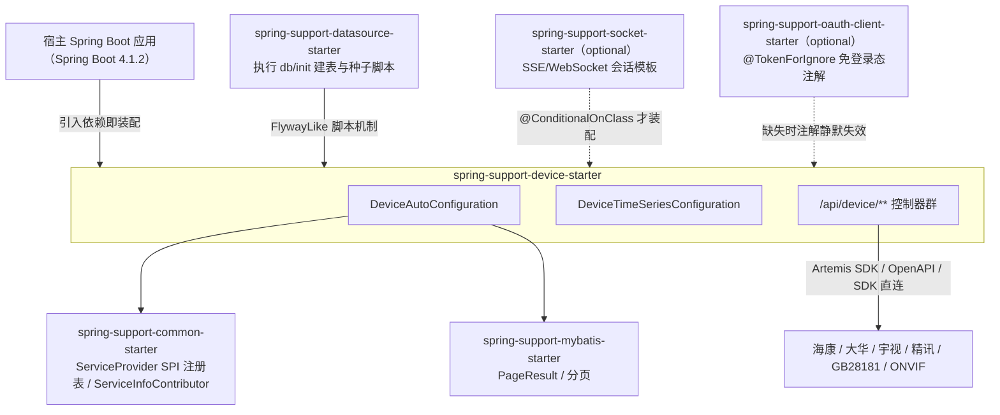
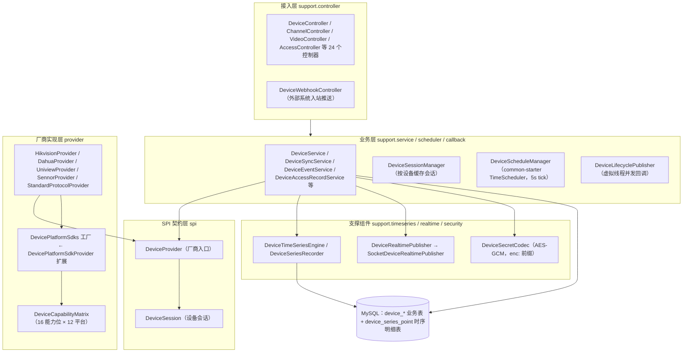
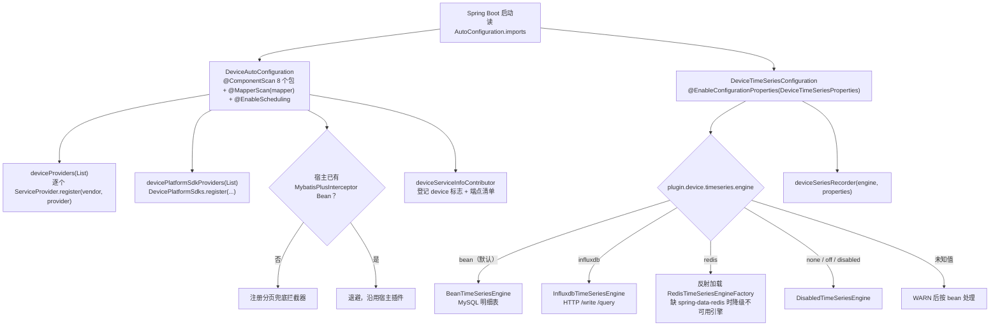
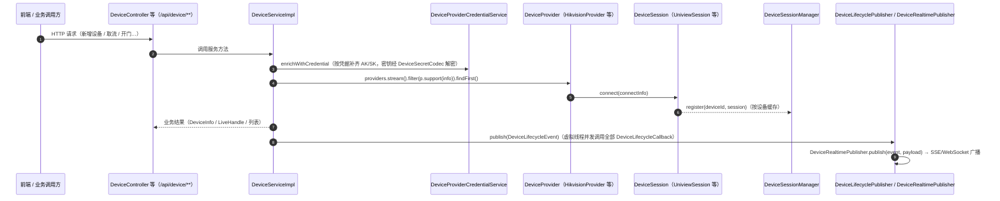
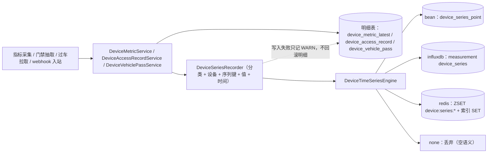

# spring-support-device-starter

设备接入 Starter：把海康（云曜 / 云眸 / 综合安防 / 萤石 / ISUP）、大华（云平台 / 乐橙 / ICC）、宇视、
精讯畅通、GB28181、ONVIF 收敛成一套 `DeviceProvider` + `DeviceSession` SPI；业务侧只依赖 SPI，
不直接碰各家的鉴权头、报文结构与能力差异。

- 包名：`com.chua.starter.device`
- 版本：`4.0.0.51`（随父 POM `spring-support-parent-starter:4.0.0.51`）
- 运行基座：Spring Boot **4.1.2**（父 POM 于 2026-11-19 升级），自动装配走
  `META-INF/spring/org.springframework.boot.autoconfigure.AutoConfiguration.imports`（本模块无 `spring.factories`）
- 口径：官方接口登记在 `provider/sdk/<vendor>/*Apis.java`，支持度登记在
  `provider/sdk/DeviceCapabilityMatrix`。只有 `YES`（真机验证）与 `IMPLEMENTED_UNVERIFIED`
  （已实现未验证）会派生平台能力位；`TODO` / `NO` 一律隐藏，原因写在能力格子的 `note` 里。

---

## 1. 架构图

### 1.1 模块在体系中的位置



### 1.2 模块内部分层



---

## 2. 核心流程图

### 2.1 自动装配流程



### 2.2 设备接入与请求处理流程



### 2.3 时序数据流（旁路存储）



---

## 3. 能力清单

| 能力域 | 关键类 | 入口 |
|---|---|---|
| 厂商接入 SPI | `DeviceProvider`、`DeviceSession`、`DeviceVendorDescriptor` | 容器中所有 `DeviceProvider` Bean |
| 厂商实现 | `HikvisionProvider`、`DahuaProvider`、`UniviewProvider`、`SennorProvider`、`StandardProtocolProvider` | `vendor` + `platformType` |
| 平台 SDK 门面 | `DevicePlatformSdks`、`DevicePlatformSdk`、`DevicePlatformSdkProvider` | `ServiceProvider<DevicePlatformSdkProvider>` |
| 接口目录 | `HikvisionArtemisApis`、`HikvisionCloudYaoApis`、`HikvisionCloudEyeApis`、`EzvizApis`、`HikvisionIsupApis`、`DahuaCloudApis`、`LeChangeApis`、`DahuaIccApis`、`UniviewApis`、`SennorApis`、`Gb28181Apis` | 只登记核实过的官方路径 |
| 能力矩阵 | `DeviceCapabilityMatrix`（16 能力位 × 12 平台）、`DeviceCapability` | `GET /api/device/capability/matrix`、`capabilitiesOf(vendor, platform)` |
| 设备台账 | `DeviceService`、`DeviceInfo`、`DeviceSessionManager`（按设备缓存会话） | `/api/device/**` |
| 通道 / 视频 / 云台 | `ChannelController`、`VideoController`、`PtzController` | `/api/device/channel`、`/api/device/video`、`/api/device/ptz` |
| 门禁 | `AccessController`（`/unlock`、`/grant`、`/records`）、`DeviceAccessRecordService` | `/api/device/access` |
| 事件 / 告警 | `EventController`、`DeviceAlarmController` | `/api/device/events`、`/api/device/alarms` |
| 人员 / 考勤 | `PersonController`、`AttendanceController` | `/api/device/person`、`/api/device/attendance` |
| 车辆 / 道闸 | `VehicleController`、`BarrierGateController` | `/api/device/vehicle`、`/api/device/barrier` |
| 环境指标 | `DeviceMetricService`、`DeviceMetricLatest`、`metricCollect_<credentialId>` | `/api/device/metrics/{deviceId}`、设备详情「指标」页 |
| 时序存储 | `DeviceTimeSeriesEngine`（bean/influxdb/redis/none）、`DeviceSeriesRecorder`、`DeviceSeriesCategory` | `/api/device/series`、传感器记录页、门禁/车闸记录页 |
| 分组 / 拓扑 | `DeviceGroupController`、`DeviceTopologyController` | `/api/device/group`、`/api/device/topology` |
| 目录同步 | `DeviceSyncService#syncDevicesByCredential`、`#syncDevices`、`#pushDevice`、`#removeRemote` | `/api/device/sync` |
| 凭据管理 | `DeviceProviderCredentialService`、`ProviderCredentialController` | `/api/device/provider-credential` |
| webhook 入站 | `DeviceWebhookService#verify`、`DeviceWebhookDefaults` | `/api/device/webhook/{access-records,alarms,vehicle-passes,attendance-records}` |
| 生命周期回调 | `DeviceLifecycleCallback`、`DeviceLifecyclePublisher` | `/api/device/callbacks` |
| 实时推送 | `DeviceRealtimePublisher`、`SocketDeviceRealtimePublisher` | 宿主引入 socket-starter 时装配 |
| 定时任务 | `DeviceScheduleManager`、`DeviceTaskStateService` | `/api/device/tasks` |
| 密钥编解码 | `DeviceSecretCodec`（`enc:` 前缀，AES-GCM） | `device.security.secret-key` |
| 服务信息 | `ServiceInfoContributor`（`device` 标志 + 设备/通道/视频/门禁等 endpoint） | 启动横幅 |

### 3.1 DeviceProvider（厂商入口）

| 方法 | 说明 |
|---|---|
| `getVendor()` | 厂商标识，如 `hikvision`、`dahua`、`uniview`、`standard`、`sennor` |
| `support(DeviceConnectInfo)` | 是否接管该连接信息 |
| `connect(DeviceConnectInfo)` | 建立会话，返回 `DeviceSession` |
| `descriptor()` | 厂商描述（名称、接入方式、平台、能力位、默认离线阈值、文档、说明） |
| `fetchDevices()` / `fetchDevices(session)` | 设备同步（平台级；带 session 版本按凭据隔离） |
| `fetchOrganizations()` / `fetchPersons(session)` | 组织、人员同步（平台有则实现，默认空列表） |
| `upsertRemote` / `removeRemote` | 设备写操作（默认 `false`；由 `DeviceSyncService` 按设备凭据路由） |
| `upsertOrganization` / `removeOrganization` | 组织写操作（默认不支持） |
| `upsertPerson` / `removePerson` | 人员写操作（默认不支持） |
| `remoteUnlock(doorSerial)` | 平台级远程开门（不需要先建设备会话） |

### 3.2 DeviceSession（设备会话）

| 分组 | 方法 |
|---|---|
| 基础 | `getDeviceId()`、`isOnline()`、`testConnection()`、`close()` |
| 通道 | `listChannels()` |
| 直播 | `getLiveUrl(channel, protocol)`、`getLiveUrl(channel, protocol, streamType)`、`startLive(...)`、`stopLive(streamId)`、`preview(channel)` |
| 录像 | `queryRecords(channel, range)`、`getPlaybackUrl(channel, range)`、`playback(channel, range)` |
| 云台 | `ptzControl(cmd, speed)`、`setPreset`、`callPreset`、`deletePreset`、`listPresets` |
| 抓图 | `capture(channel)` |
| 事件 | `subscribeEvent`、`unsubscribeEvent`、`pollEvents(range)` |
| 门禁 | `listDoors()`、`remoteUnlock(doorId)`、`grantDoorAccess(personId, doorId)`、`queryAccessRecords(range)` |
| 车辆 / 道闸 | `listVehicles()`、`upsertVehicle`、`deleteVehicle`、`listBarriers()`、`openBarrier`、`queryVehiclePasses(range[, afterId])` |
| 环境指标 | `readMetrics()`（气象站 / 温湿度等节点实时值） |

约定：

- 直播以 **URL 取流**为主（HLS / FLV / RTSP）；`preview` / `playback` 这类字节流接口只在厂商 SDK
  能直接出流时实现。HTTP 平台不覆写时沿用基类行为，**不代表已实现**。
- 平台没有的能力必须抛 `UnsupportedOperationException` 并写明原因，不返回空列表 / 空字符串冒充成功。
- 会话由 `DeviceSessionManager` 缓存，业务侧无需手工持有。

### 3.3 平台覆盖（能力矩阵）

状态口径：

| 状态 | 含义 |
|---|---|
| `yes` | 已接通并有真实调用验证 |
| `unverified` | 已按官方文档或既有网关契约实现，缺环境 / 凭据，未做真机验证 |
| `todo` | 官方接口 / 协议已核实，代码未实现 |
| `no` | 平台公开接口 / 协议不能完整支持该能力（无接口、仅推送、仅相邻 / 部分接口或业务模型不存在；不等于接口目录零路径） |

当前统计（12 个平台 × 16 个能力位 = 192）：

| 平台 | platformType | yes | unverified | todo | no |
|---|---|---:|---:|---:|---:|
| 海康云曜 | `cloud-yao` | 1 | 10 | 0 | 5 |
| 海康云眸 | `cloud-eye` | 1 | 12 | 0 | 3 |
| 海康综合安防 | `secure-platform` | 1 | 13 | 0 | 2 |
| 海康萤石 | `ezviz` | 6 | 7 | 0 | 3 |
| 海康 ISUP | `isup` | 1 | 4 | 0 | 11 |
| 大华云平台 | `dahua-cloud` | 0 | 14 | 0 | 2 |
| 大华乐橙 | `lechange` | 1 | 8 | 0 | 7 |
| 大华 ICC | `dahua-icc` | 1 | 12 | 0 | 3 |
| 宇视云开放平台 | `uniview` | 0 | 8 | 0 | 8 |
| GB28181 | `gb28181` | 1 | 4 | 1 | 10 |
| ONVIF | `onvif` | 0 | 5 | 4 | 7 |
| 精讯云 | `sennor-cloud` | 0 | 2 | 0 | 14 |
| **合计** | | **13** | **99** | **5** | **75** |

已标 `yes` 的能力位（共 13 格）：

| 平台 | 能力 |
|---|---|
| 海康云曜 | DEVICE |
| 海康云眸 | DEVICE |
| 海康综合安防 | DEVICE |
| 海康萤石 | DEVICE、CHANNEL、PERSON、PERSON_WRITE、EVENT、ACCESS |
| 海康 ISUP | DEVICE |
| 大华乐橙 | DEVICE |
| 大华 ICC | DEVICE |
| GB28181 | DEVICE |

> `yes` 只覆盖上表能力位，其余按 `unverified` / `todo` / `no` 计，不能外推。
> 当前 `todo` 为 5：GB28181 `EVENT`，ONVIF `ACCESS` / `ACCESS_WRITE` / `EVENT` / `RECORD`；
> 均为官方接口 / 协议已核实、会话层未实现。ONVIF 门禁与录像目前只到 Profile 级。
> `no` 中仍可能保留 1~2 个仅部分 / 相邻接口，原因写在能力矩阵的 `note` 里。

---

## 4. Bean 能力矩阵

自动装配入口（`META-INF/spring/org.springframework.boot.autoconfigure.AutoConfiguration.imports`）只有两个类：
`DeviceAutoConfiguration`、`DeviceTimeSeriesConfiguration`。`DeviceRealtimeConfiguration` 是普通
`@Configuration`，由 `DeviceAutoConfiguration` 的 `@ComponentScan("...support.realtime")` 带入。

| Bean 名 | 类型 | 装配条件 | 可否覆盖 | 典型注入姿势 |
|---|---|---|---|---|
| `deviceProviders` | `List<DeviceProvider>` | 无条件（收集容器中全部 `DeviceProvider`） | 追加式：新增 `@Component` Provider 即被收编；不建议覆盖列表本身 | 构造器注入 `List<DeviceProvider>`，或经 `ServiceProvider.of(DeviceProvider.class)` 按 vendor 取用 |
| `devicePlatformSdkProviders` | `List<DevicePlatformSdkProvider>` | 无条件（收集容器中全部扩展） | 追加式：外部模块提供 Bean 即自动登记 | 一般不直接注入；经 `DevicePlatformSdks.of(info)` 静态门面取 SDK |
| `deviceMybatisPlusInterceptor` | `MybatisPlusInterceptor` | `@ConditionalOnMissingBean(MybatisPlusInterceptor.class)`，宿主已有则退避 | 可覆盖（宿主同名类型优先） | 宿主通常无需注入；分页 SQL 依赖它兜底 |
| `deviceServiceInfoContributor` | `ServiceInfoContributor` | 无条件 | 可覆盖 | 由服务信息体系收集，业务侧无需注入 |
| `deviceTimeSeriesEngine` | `DeviceTimeSeriesEngine` | `@ConditionalOnMissingBean(DeviceTimeSeriesEngine.class)`；实现由 `engine` 配置决定 | 可覆盖：宿主自定义该类型 Bean 后本装配整体退避 | 构造器注入 `DeviceTimeSeriesEngine`（或只依赖上层 `DeviceSeriesRecorder`） |
| `deviceSeriesRecorder` | `DeviceSeriesRecorder` | `@ConditionalOnMissingBean` | 可覆盖 | 构造器注入 `DeviceSeriesRecorder` 写时序点 |
| `noopDeviceRealtimePublisher` | `DeviceRealtimePublisher` | `@ConditionalOnMissingBean(DeviceRealtimePublisher.class)`，兜底空实现 | 可覆盖：宿主自定义 `DeviceRealtimePublisher` 后退避 | 构造器注入 `DeviceRealtimePublisher` 发布事件 |
| `socketDeviceRealtimePublisher` | `DeviceRealtimePublisher`（`@Primary`） | `@ConditionalOnClass(name = "com.chua.socket.support.session.SocketSessionTemplate")`，即宿主引入 socket-starter | 不建议覆盖；该 Bean 标记 `@Primary`，注入时优先命中 | 注入 `DeviceRealtimePublisher` 即透明使用 |
| `deviceTimeSeriesProperties` | `DeviceTimeSeriesProperties` | `@EnableConfigurationProperties` 随 `DeviceTimeSeriesConfiguration` 装配 | 配置项覆盖（yaml） | 需要读取时序参数时注入 |
| `deviceSecretCodec` | `DeviceSecretCodec` | `@Component`（`support.security` 包扫描）；密钥来自 `device.security.secret-key` | 可覆盖（同类型 Bean） | 构造器注入，调 `encrypt` / `decrypt` / `isMasked` |
| `deviceSessionManager` | `DeviceSessionManager` | `@Component` | 可覆盖 | 构造器注入；按 deviceId 取/关注会话 |
| `deviceScheduleManager` | `DeviceScheduleManager` | `@Component` + 类上 `@EnableScheduling` 驱动 | 不建议覆盖（时间轮任务注册中心） | 一般不注入；经 `/api/device/tasks` 管理任务 |
| `deviceLifecyclePublisher` | `DeviceLifecyclePublisher` | `@Component` | 可覆盖 | 构造器注入，发布 `DeviceLifecycleEvent` |
| `hikvisionProvider` / `dahuaProvider` / `univiewProvider` / `sennorProvider` / `standardProtocolProvider` | 各 `*Provider` | `@Component`（`provider` 包扫描） | 追加式：同 vendor 新实现会一并进入列表 | 注入 `List<DeviceProvider>` 后按 `support(info)` 路由 |
| 各 `*Controller` / `*ServiceImpl` | REST 控制器 / 服务实现 | `@ComponentScan("...controller/service/...")` | 可覆盖（同类型 Bean） | 业务间经 Service 接口注入 |
| 各 `Device*Mapper` | MyBatis-Plus Mapper | `@MapperScan("com.chua.starter.device.support.mapper")` | 可覆盖（MyBatis 机制） | 业务侧**禁止**直接注入他模块 Mapper；本模块内 Service 注入使用 |

无 Bean 的关键组件：`DeviceWebhookDefaults`（常量类，四个 webhook 入站路径清单）、
`DeviceCapabilityMatrix`（静态声明 + `capabilitiesOf` 查询）、各 `*Apis`（接口目录常量），均不进容器。

---

## 5. 完整配置

### 5.1 `@ConfigurationProperties`：`plugin.device.timeseries.*`（`DeviceTimeSeriesProperties`）

```yaml
plugin:
  device:
    timeseries:
      engine: bean                     # bean（默认）/ influxdb / redis / none（off、disabled 等价 none）
      retention-days: 30               # 保留天数，每天 03:30 清理；<=0 表示不清理
      table: device_series_point       # bean 引擎明细表（只允许字母/数字/下划线）
      url: http://172.16.0.40:8086     # influxdb 服务地址
      database: device                 # influxdb 库名 / redis 逻辑库下标
      username: admin                  # influxdb 1.x（可空）
      password: secret                 # influxdb 1.x（可空）
      measurement: device_series       # influxdb measurement
      key-prefix: device:series        # redis 键前缀
      max-points-per-series: 100000    # redis 单序列最大点数
      write-batch-size: 200            # 批量写入分片大小
      http-timeout-seconds: 10         # 时序 HTTP 请求超时（秒）
```

| 路径 | 类型 | 默认值 | 说明 | 生效开关 |
|---|---|---|---|---|
| `plugin.device.timeseries.engine` | String | `bean` | 引擎选择；未知值打 WARN 后按 `bean` 处理 | 总是生效 |
| `plugin.device.timeseries.retention-days` | int | `30` | 历史保留天数；`<=0` 不自动清理 | 清理任务（每天 03:30 cron）读取；`none` 引擎无意义 |
| `plugin.device.timeseries.table` | String | `device_series_point` | bean 引擎明细表名（只允许字母/数字/下划线） | 仅 `engine=bean` |
| `plugin.device.timeseries.url` | String | 无（null） | InfluxDB 服务地址，如 `http://127.0.0.1:8086` | 仅 `engine=influxdb` |
| `plugin.device.timeseries.database` | String | `device` | InfluxDB 库名；redis 引擎用作逻辑库下标（非数字忽略；真实库仍以 `spring.data.redis.database` 为准） | `influxdb` / `redis` |
| `plugin.device.timeseries.username` | String | 无（null） | InfluxDB 1.x 用户名 | 仅 `engine=influxdb` |
| `plugin.device.timeseries.password` | String | 无（null） | InfluxDB 1.x 密码 | 仅 `engine=influxdb` |
| `plugin.device.timeseries.measurement` | String | `device_series` | InfluxDB measurement 名 | 仅 `engine=influxdb` |
| `plugin.device.timeseries.key-prefix` | String | `device:series` | Redis 键前缀 | 仅 `engine=redis` |
| `plugin.device.timeseries.max-points-per-series` | int | `100000` | 单条序列最大点数，超出按时间裁剪最旧 | 仅 `engine=redis` |
| `plugin.device.timeseries.write-batch-size` | int | `200` | 批量写入分片大小 | 写入路径通用 |
| `plugin.device.timeseries.http-timeout-seconds` | int | `10` | 时序 HTTP 请求超时（秒） | `influxdb`（HTTP 引擎） |

### 5.2 `@Value` / Environment 读取的运行参数

| key | 类型 | 默认值 | 读取位置 | 说明 |
|---|---|---|---|---|
| `device.security.secret-key` | String | 空 | `DeviceSecretCodec` 构造器 `@Value` | 设备密码 / 厂商 AppSecret 落库前的 AES-GCM 密钥。未配置时保持明文并打 WARN；配置后新写入值带 `enc:` 前缀，历史明文仍可读（下次写入转密文）。已产生 `enc:` 数据后再移除该配置，解密会抛 `IllegalStateException` |
| `plugin.device.provider.fallback-mock` | boolean | `false` | 各 `*Provider` 构造器 `Environment.getProperty` | 仅调试用：连接失败时回退到返回公开 HLS 测试流的模拟会话；生产环境必须保持 `false` |

### 5.3 不落在 yaml 的运行参数

- **凭据级任务间隔**（离线检测 / 事件轮询 / 设备同步 / 组织同步 / 指标采集）随凭据保存在
  `device_provider_credential` 能力配置中，任务名为 `offlineDetect_<credentialId>`、`eventPoll_<credentialId>`、
  `deviceSync_<credentialId>`、`orgSync_<credentialId>`、`metricCollect_<credentialId>`，状态行在
  `device_task_state`，可通过 `/api/device/tasks` 查看与改间隔；默认关闭。
- **webhook 入站免登录态**由 `DeviceWebhookDefaults` 以 `@TokenForIgnore` 声明（依赖
  `spring-support-oauth-client-starter`，optional），四个路径
  `/api/device/webhook/{access-records,alarms,vehicle-passes,attendance-records}` **不需要写宿主
  `plugin.oauth.whitelist`**；签名 / 有效期 / 主题授权仍由 `DeviceWebhookService#verify` 校验，
  appKey 管理接口 `/api/device/webhook/appkeys` 仍需登录态。

---

## 6. 使用方式

### 6.1 Maven 坐标

```xml
<dependency>
    <groupId>com.chua</groupId>
    <artifactId>spring-support-device-starter</artifactId>
    <version>4.0.0.51</version>
</dependency>
```

### 6.2 依赖说明（与 pom.xml 一致）

| 依赖 | 作用 | 说明 |
|---|---|---|
| `spring-boot-starter-web` | 控制器 / Jackson | 必需 |
| `com.baomidou:mybatis-plus-spring-boot4-starter` | ORM（Spring Boot 4 适配） | 必需 |
| `spring-support-mybatis-starter` | `PageResult`、分页 | 必需 |
| `spring-support-common-starter` | `ServiceProvider` SPI 注册表、`ServiceInfoContributor` | 必需 |
| `spring-support-swagger-starter` | OpenAPI 注解（`DeviceGroupController` 等） | 必需 |
| `com.hikvision.ga:artemis-http-client:1.1.3` | 综合安防 Artemis 签名（`x-ca-*`） | 必需；官方唯一安防类 SDK |
| `org.apache.poi:poi-ooxml:5.5.1` | Excel 导出 | 必需 |
| `jna` / `jna-platform:5.19.1` | 海康 / 大华本地 SDK 直连 | 必需 |
| `spring-boot-starter-data-redis` | Redis 时序引擎编译期类型 | `optional`；宿主引入后才可启用 `engine=redis` |
| `spring-support-socket-starter` | 设备事件实时推送（SSE/WebSocket） | `optional`；按 `@ConditionalOnClass` 装配 |
| `spring-support-oauth-client-starter` | `@TokenForIgnore`（webhook 入站免登录态） | `optional`；注解缺失时静默失效 |
| `lombok` | 编译期代码生成 | `provided` |

### 6.3 最小可运行示例

**第一步**：宿主引入依赖（见上），宿主需已具备数据源与 MyBatis-Plus。启动类无需任何额外配置：

```java
@SpringBootApplication
public class DeviceHostApplication {
    public static void main(String[] args) {
        SpringApplication.run(DeviceHostApplication.class, args);
    }
}
```

**第二步**：建表。模块自带 `src/main/resources/db/init/V2.6__init_all_device.sql`（建表基线，
全 `CREATE TABLE IF NOT EXISTS` 幂等）与 `V2.6__initdata_all_device.sql`（种子数据），
由 `spring-support-datasource-starter` 的 FlywayLike 脚本机制执行；未使用该机制时需手工执行。

**第三步**：录入平台凭据（`/api/device/provider-credential`，字段含 `vendor`、`platformType`、
`appKey`、`appSecret`、`deviceSerial`、`extra`），或为 SDK 直连设备填 IP / 端口 / 账号密码，
然后触发一次设备同步，再按需打开实时推送与定时任务。

**业务代码只依赖 SPI**（与 `DeviceServiceImpl` 内部同款路由写法）：

```java
@Component
public class DeviceFacadeDemo {

    private final List<DeviceProvider> providers; // 模块已注册 5 个内置实现

    public DeviceFacadeDemo(List<DeviceProvider> providers) {
        this.providers = providers;
    }

    public void demo(String appId, String secretKey, String deviceSerial) {
        // 平台接入：vendor + platformType + appKey/appSecret + 设备序列号；extra 放平台私有参数
        DeviceConnectInfo info = new DeviceConnectInfo(
                "uniview", "PLATFORM", null, 443, null, null,
                "uniview", appId, secretKey, deviceSerial,
                Map.of("channelNo", 0));

        DeviceProvider provider = providers.stream()
                .filter(p -> p.support(info))
                .findFirst()
                .orElseThrow(() -> new IllegalStateException("不支持的设备厂商"));

        DeviceSession session = provider.connect(info);
        try {
            if (!session.testConnection()) {
                throw new IllegalStateException("宇视连接失败");
            }
            session.listChannels().forEach(ch ->
                    System.out.println(ch.channelId() + " " + ch.name()));
            String live = session.getLiveUrl(0, "hls", "sub");
        } finally {
            session.close();
        }
    }
}
```

调用前先按能力矩阵判入口，避免「点了才报不支持」：

```java
Set<DeviceCapability> caps =
        DeviceCapabilityMatrix.capabilitiesOf("uniview", "uniview");
if (!caps.contains(DeviceCapability.DEVICE_WRITE)) {
    // 能力矩阵未给出该位，前端隐藏「新增设备」
}
```

运行期 API 是**步骤式**的：`DeviceConnectInfo`、`DeviceChannel`、`LiveHandle` 等均为 `record`，
本模块没有 fluent 的运行期 Builder；唯一的链式 API 是能力矩阵的声明式
`DeviceCapabilityMatrix.builder(platform, title).yes(...).build()`。

> 例子中的宇视鉴权：`POST https://ezcloud.uniview.com/openapi/user/app/token/get`
> （`appId` + `secretKey` → `accessToken` + `expireTime`），后续请求头
> `Authorization: <accessToken>`；token 在会话内按 `expireTime` 缓存。

---

## 7. 使用场景

### 7.1 适用

- 需要在一个 Spring Boot 服务里**统一接入多安防厂商**（海康系 5 平台、大华系 3 平台、宇视、
  精讯、GB28181、ONVIF），又不想让业务代码感知各家鉴权与报文差异。
- 需要**设备台账 + 通道 + 视频 + 云台 + 门禁 + 事件 + 人员考勤 + 车辆道闸**的一体化落地，
  且接受「能力矩阵」口径：前端按矩阵动态显隐入口。
- 需要传感器 / 门禁 / 车闸**时序记录**，且希望存储后端（MySQL / InfluxDB / Redis）可切换而页面接口不变。
- 需要厂商事件**入站 webhook**（免登录态 + appKey 签名校验）与设备域**生命周期回调**（虚拟线程并发分发）。

### 7.2 不适用

- 只接一家厂商、且永远不换：直接用该厂商官方 SDK 更轻；本模块的价值在统一契约与能力治理。
- 需要视频流媒体服务本身（转码、录像存储、级联）：本模块只做「取流地址 / 会话控制」，
  流媒体分发需自建或接流媒体服务器。
- 强实时低延迟控制场景（毫秒级云台/开闸）：HTTP 平台链路（云平台 → 设备）延迟不可控，
  应走局域网 SDK 直连（`authType=SDK`）。

### 7.3 与相邻模块的取舍

| 相邻模块 | 关系 | 取舍 |
|---|---|---|
| `spring-support-common-starter` | 必需上游：`ServiceProvider` 注册表、`ServiceInfoContributor`、`@TokenForIgnore` 语义 | 复用底层 SPI，不在本模块重造注册表 |
| `spring-support-mybatis-starter` | 必需上游：分页与 `PageResult` | 分页插件由宿主提供；宿主没有时本模块注册兜底 |
| `spring-support-datasource-starter` | 建表脚本执行方 | 引入它则脚本自动执行；不引入需手工执行 `db/init` 脚本 |
| `spring-support-socket-starter` | optional：实时推送出口 | 不引入则事件只落库不打前端，模块仍可独立运行 |
| `spring-support-oauth-client-starter` | optional：webhook 免登录态注解 | 不引入则四个 webhook 路径需自行在宿主鉴权白名单放行 |
| `spring-support-cache-starter` | 无直接依赖 | 设备缓存用内存 `ConcurrentHashMap`（`DeviceSessionManager`），不强制引缓存模块 |

---

## 8. 扩展点

本模块暴露的 SPI 与可自定义方法（全部经 Spring Bean 装配，不使用 `META-INF/services` 文件）：

| 扩展点 | 类型 | 用途 | 装配方式 |
|---|---|---|---|
| `DeviceProvider` | 接口（厂商入口） | 新增厂商 / 平台 | `@Component` 进入 `provider` 包扫描，自动登记 `ServiceProvider` |
| `DeviceSession` | 接口（设备会话） | 实现厂商能力；建议继承 `provider/platform/AbstractOpenApiSession`，只覆写真实支持的方法 | 由 `Provider#connect` 返回，不进容器 |
| `DevicePlatformSdkProvider` | 接口（平台 SDK 工厂） | 外部模块扩展新平台门面，不改本模块代码 | 提供 Bean，`DeviceAutoConfiguration#devicePlatformSdkProviders` 自动 `DevicePlatformSdks.register(...)` |
| `DeviceRealtimePublisher` | 函数式接口 | 自定义事件推送通道（如自有 WebSocket 网关） | 定义同类型 Bean，`noop` 兜底自动退避 |
| `DeviceTimeSeriesEngine` | 接口 | 自定义时序后端（如 TDengine） | 定义同类型 Bean，`DeviceTimeSeriesConfiguration` 整体退避 |
| `DeviceSeriesRecorder` | 类 | 自定义时序写入编排 | 定义同类型 Bean 覆盖默认实现 |
| `DeviceLifecycleCallback` | 接口 | 订阅设备域生命周期事件（增删改成败） | `@Component` 实现即可，`DeviceLifecyclePublisher` 虚拟线程并发回调 |
| `MybatisPlusInterceptor` | 类 | 宿主未配分页插件时的兜底 | 宿主自定义同名类型即退避 |
| `ServiceInfoContributor` | 接口 | 服务信息登记（本模块已内置 `device` 标志与端点清单） | 宿主可追加自己的 contributor |

### 8.1 新增厂商示例（实现 → 登记 → 生效）

**① 实现**：新建 `provider/<vendor>/<Vendor>Provider`（`getVendor()` 返回厂商标识，
`support()` 按 `platformType` 判断），会话继承 `provider/platform/AbstractOpenApiSession`
并覆写 `doRequest`（鉴权头 + 错误码）与真实支持的 SPI 方法，不支持的方法显式抛异常：

```java
@Component
public class AcmeProvider implements DeviceProvider {

    @Override
    public String getVendor() {
        return "acme";
    }

    @Override
    public boolean support(DeviceConnectInfo info) {
        return "acme".equals(info.vendor()) && "acme-cloud".equals(info.platformType());
    }

    @Override
    public DeviceSession connect(DeviceConnectInfo info) {
        return new AcmeSession(info);
    }

    @Override
    public DeviceVendorDescriptor descriptor() {
        return new DeviceVendorDescriptor(
                "acme", "Acme 安防",
                List.of(), List.of(),
                DeviceCapabilityMatrix.capabilitiesOf("acme", "acme-cloud"),
                60, null, "Acme 云开放平台");
    }
}
```

**② 登记**：

- 厂商 Provider 标注 `@Component` 即可：`DeviceAutoConfiguration` 会 `@ComponentScan` 到
  `com.chua.starter.device.provider`，并把容器中所有 `DeviceProvider` 按 `getVendor()` 注册进
  `ServiceProvider<DeviceProvider>`。**本模块不使用 `META-INF/services` 文件**。
- 官方接口路径登记到 `provider/sdk/acme/AcmeApis.java`（`PlatformApiSpec.global(...)`），只写核实过的路径。
- 在 `DeviceCapabilityMatrix` 增加 `builder("acme.acme-cloud", "...")` 条目，按能力位如实标注
  `yes` / `unverified` / `todo` / `no`。

**③ 生效**：重启后 `GET /api/device/capability/matrix/acme.acme-cloud` 能查到矩阵条目，
前端「厂商接入」下拉与凭据表单按 `descriptor()` 渲染；同步入口
`DeviceSyncService#syncDevicesByCredential` 会用该 Provider 的 `fetchDevices(session)`。

---

## 9. 常见问题

### 9.1 装配不生效

- **自动装配没启动**：本模块通过 `AutoConfiguration.imports` 装配，宿主启动类必须带
  `@SpringBootApplication`（或显式启用自动装配）。手动 `@ComponentScan` 扫到
  `com.chua.starter.device` 也可以，但会绕过自动配置语义，二选一即可。
- **找不到 Mapper / 分页 total 为 0**：Mapper 由模块自带的 `@MapperScan` 注册；XML 分页依赖
  `PaginationInnerInterceptor`，宿主没配分页插件时模块会兜底注册（`@ConditionalOnMissingBean`）。
  若宿主自定义了 `MybatisPlusInterceptor`，请确保其中含分页拦截器。
- **Provider 没被识别**：新厂商 Provider 必须放在 `com.chua.starter.device.provider` 包下并标
  `@Component`；放包外不进扫描范围。启动日志会逐个打印 `[Device] 注册 Provider: vendor=...`。
- **Redis 时序引擎不可用**：`engine=redis` 需要宿主 classpath 有 `spring-data-redis`
  （本模块该依赖是 `optional`）。缺失时模块照常启动，引擎降级为「不可用」，
  `GET /api/device/series/engine` 返回 `available=false` 与原因，页面据此提示而不是显示空列表。
- **实时推送没消息**：确认宿主引入了 `spring-support-socket-starter`。未引入时
  `DeviceRealtimePublisher` 是空实现（只打 debug 日志），事件仍会落库。

### 9.2 端口与开关

- **本模块不开独立端口**：所有 HTTP 端点挂在宿主 Web 端口下，前缀 `/api/device/**`。
- **常用开关**：`plugin.device.timeseries.engine`（时序后端）、
  `plugin.device.timeseries.retention-days`（`<=0` 关闭清理）、
  `plugin.device.provider.fallback-mock`（连接失败回退模拟会话，仅限调试）、
  `device.security.secret-key`（密钥加密开关，未配即明文）。
- **定时任务开关**：离线检测 / 事件轮询 / 设备同步 / 组织同步 / 指标采集都是**凭据级**开关，
  在凭据高级配置里开启，状态可在 `/api/device/tasks` 调整间隔；没有全局 yaml 开关。
- **webhook 白名单**：四个入站路径由模块内 `@TokenForIgnore` 声明免登录态，不要重复写宿主
  `plugin.oauth.whitelist`；appKey 管理接口不在免登录清单内。

### 9.3 与 Spring Boot 4 兼容性

- 仓库父 POM 已升级到 **Spring Boot 4.1.2**（2026-11-19），本模块随父 POM 构建与验证。
- ORM 用 `mybatis-plus-spring-boot4-starter`（Boot 4 适配线），不要在宿主再引 Boot 2/3 线的
  `mybatis-plus-boot-starter`，避免自动装配冲突。
- 自动装配文件是 Boot 2.7+ 的 `META-INF/spring/...AutoConfiguration.imports`；Boot 3 起已移除
  `spring.factories` 自动装配通道，本模块不再提供该文件。
- 代码基于 `jakarta.*` 命名空间（如 `jakarta.annotation.PostConstruct`），与 Boot 4 一致；
  旧的 `javax.*` 宿主无法直接复用本模块。

### 9.4 能力与数据口径

- **能力位不能外推**：`yes` 仅 13 格（见 3.3），其余全部按 `unverified` / `todo` / `no` 处理；
  未标 `yes` 的能力不得对外描述为「已支持」。
- **「登记接口」不等于「实现能力」**：`*Apis.java` 只描述官方接口目录，能力是否可用以
  `DeviceCapabilityMatrix` 的格子和会话实现为准；仅在接口目录登记不会让任何能力位从 `todo` 变成 `yes`。
- **密钥加密是可选的**：未配置 `device.security.secret-key` 时密码与厂商 SK 明文入库；
  已产生 `enc:` 数据后再移除该配置会导致解密直接抛 `IllegalStateException`。
- **时序是旁路**：明细表（`device_access_record`、`device_vehicle_pass`、`device_metric_latest`）仍在写，
  时序存储服务历史/趋势与跨后端切换；时序写入失败只记 WARN，不回滚业务入库。
- **时序引擎验证范围**：`bean` 引擎已在本机 MySQL 跑通写入 / 查询 / 计数 / 时间窗 / 保留期清理；
  `influxdb` 与 `redis` 按官方协议实现，尚未对真实服务做端到端验证。
- **平台名称**：大华侧文档常写作「大华云睿 / 大华云平台」，本仓库标识统一为 `dahua-cloud`；
  海康侧写作「云曜」（`cloud-yao`）。
