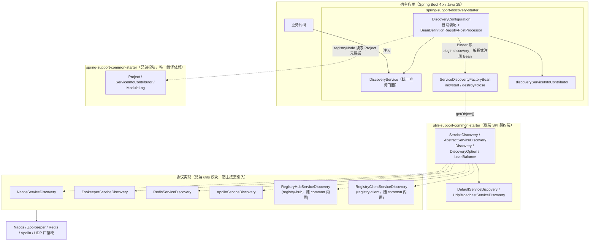
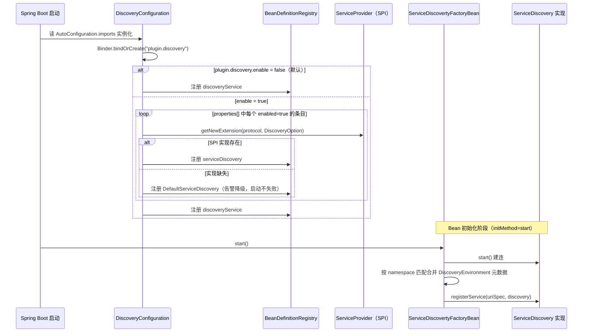

# spring-support-discovery-starter

把 `ServiceDiscovery` SPI 的多协议实现装配成 Spring Bean：按 `plugin.discovery` 配置自动创建发现客户端、注册本机服务节点、订阅变更，并对外暴露统一查询门面 `DiscoveryService`。支持三种运行模式：`client`（默认，连接外部注册中心）、`server`（独立注册中心进程）、`embbed`（内嵌注册中心，注册中心与应用同进程）。本模块是 `spring-support-parent-starter`（4.0.0.51）体系中的「服务发现」starter，基于 Spring Boot 4.x / Java 25 构建；自身不含任何注册中心客户端，协议能力全部来自 classpath 上的 utils 实现。

## 1. 架构图



- **上游**：`spring-support-common-starter`（pom 中唯一编译依赖），提供 `Project`、`ServiceInfoContributor`、`ModuleLog`，并传递引入 `utils-support-common-starter`（SPI 契约、`DefaultServiceDiscovery`、`UdpBroadcastServiceDiscovery` 所在，天然在 classpath 上）与 `utils-support-spring-starter`（`SpringBeanUtils` 所在）。
- **协议实现**：`utils-support-nacos-starter` / `utils-support-zookeeper-starter` / `utils-support-redis-starter` / `utils-support-apollo-starter` 均为宿主**可选**依赖，各自通过 `META-INF/extensions` 登记 SPI 实现。
- **被依赖**：`spring-support-monitor-starter` 以 `optional` 方式依赖本模块，为「服务管理 → service-discovery 插件」提供 `/ms/monitor/discovery` 查询（`ServerDiscoveryController`，`@ConditionalOnClass DiscoveryService`；缺失时降级为 `DiscoveryFallbackController`）。本模块不依赖 rpc / web / 缓存等上层 starter，也不感知任何具体注册中心。

## 2. 核心流程图：自动装配与启动



生命周期要点（源码事实）：

- `close()` **先反注册再断连**，避免滚动重启期间实例残留到注册中心 TTL 剔除；
- `DiscoveryEnvironment` 元数据合并在 `start()` 里做，而不是 `BeanDefinitionRegistryPostProcessor` 阶段——否则 `getBeansOfType` 会强制提前实例化业务 Bean，依赖未就绪时会拖垮启动；
- 查询路径：`getDiscovery(uriSpec)` 固定走 primary 实现的接口默认实现（`weight`）；`getDiscovery(protocol, uriSpec)` 经 `resolveServiceDiscovery`（精确 `serviceDiscovery#protocol` → `#protocol` 结尾 → `serviceDiscovery#protocol#` 前缀 → 回退默认）并携带 `defaultBalance`。
- `type=server|embbed` 时改走 `registryHub` 分支：只装配 `serviceDiscovery#registry-hub` 一个 Bean；`embbed` 模式把 `server.node[]` 作为种子服务在 `start()` 阶段注册进 hub，`server` 模式通常不配种子。

## 3. 能力清单

| 能力域 | 关键类 | 入口/触发方式 |
|---|---|---|
| 配置绑定 | `DiscoveryListProperties` / `DiscoveryProperties` / `DiscoveryNodeProperties` | `plugin.discovery` 前缀（`@ConfigurationProperties` + `Binder` 双读） |
| 装配编排 | `DiscoveryConfiguration`（`EnvironmentAware` + `BeanDefinitionRegistryPostProcessor`） | `META-INF/spring/org.springframework.boot.autoconfigure.AutoConfiguration.imports` |
| 客户端生命周期 | `DiscoveryConfiguration.ServiceDiscovertyFactoryBean`（`initMethod=start`、`destroyMethod=close`） | 按协议编程式注册，包装 SPI 实现与节点列表 |
| 统一查询门面 | `DiscoveryService`（Bean 名 `discoveryService#embedd`） | 注入即用：`getDiscovery` / `getDiscoveryAll` / `setDefaultBalance` |
| 协议实现路由 | 各 `serviceDiscovery#<protocol>` Bean | `DiscoveryService#resolveServiceDiscovery(protocol)` |
| 环境元数据合并 | `DiscoveryEnvironment`（宿主实现，`getName()` 等于节点 `namespace` 时合并 `getProperties()`） | 宿主声明 Bean，`start()` 阶段合并 |
| 负载均衡策略 | `defaultBalance`（默认 `weight`，可用 `-Dchua.discovery.balance` 覆盖）；`weight` / `random` / `round`（`polling`） | `DiscoveryService#setDefaultBalance` |
| 服务信息登记 | `discoveryServiceInfoContributor`（登记标志 `discovery`） | 启动横幅 / 服务信息面板 |
| 关闭时降级 | `DefaultServiceDiscovery`（本地缓存空实现，无网络行为） | `enable=false` 或所有配置不可用时 |
| 运行模式分派 | `DiscoveryConfiguration#isServerMode / registryHub / registryClient` | `plugin.discovery.type`：`client`（默认）/ `server` / `embbed` |
| 注册中心服务端 | `RegistryHubServiceDiscovery`（`registry-hub`，随 common 内置） | `type=server/embbed`：维护服务表、接收 `registry-client` 注册/注销/快照请求、广播变更 |
| 注册中心客户端 | `RegistryClientServiceDiscovery`（`registry-client`，随 common 内置） | `properties[n].protocol=registry-client`：注册/注销/更新同步 hub，快照 + 事件保持服务表一致 |

## 4. Bean 能力矩阵

本模块**没有使用任何 `@ConditionalOnXxx` 注解**：`DiscoveryConfiguration` 通过 `Binder.get(environment).bindOrCreate("plugin.discovery", ...)` 手工读取开关后，在 `postProcessBeanDefinitionRegistry` 阶段编程式注册 Bean，下表「装配条件」均为运行期代码分支而非条件注解。`DiscoveryConfiguration` 本身也是自动配置 Bean（`AutoConfiguration.imports` 登记，无 `@AutoConfiguration` 注解），依赖 `@EnableConfigurationProperties(DiscoveryListProperties.class)` 完成配置 Bean 注册。

| Bean 名 | 类型 | 装配条件（含默认值） | 可否覆盖 | 典型用途 |
|---|---|---|---|---|
| `discoveryService#embedd` | `DiscoveryService` | 始终注册；`enable=false`（默认）时用 `new DefaultServiceDiscovery()` 构造（`AUTOWIRE_BY_TYPE`），`enable=true` 时构造注入 primary + 全部实现 Map（`AUTOWIRE_CONSTRUCTOR`） | 不建议同名覆盖（固定名注册，冲突需开 `spring.main.allow-bean-definition-overriding`） | 业务直接 `@Autowired DiscoveryService` |
| `serviceDiscovery#<protocol>` | `ServiceDiscovery`（`ServiceDiscovertyFactoryBean` 产出） | `enable=true` 且该 `properties[n]` 条目 `enabled=true`（默认 `true`）；SPI 缺失时该名字下注册 `DefaultServiceDiscovery` 降级；首个成功条目 `primary=true` | 可以：宿主已有同名 Bean 时本模块自动改名 `serviceDiscovery#<protocol>#0` 避让，精确名匹配优先命中宿主 Bean | `@Autowired ServiceDiscovery`（单协议命中 primary）或 `@Qualifier("serviceDiscovery#nacos")` |
| `serviceDiscovery#<protocol>#0、#1…` | `ServiceDiscovery` | 同一协议配置多条时按 `#0`、`#1` 递增命名 | 同上 | 仅按精确 Bean 名 + `@Qualifier` 注入 |
| `serviceDiscovery#default` | `DefaultServiceDiscovery` | `enable=true` 但没有任何 `enabled=true` 的条目（`properties` 为空或全部 `enabled=false`）时注册，`primary=true`；SPI 缺失的条目不算此类——它已在自己的名字下降级注册 | 可同名覆盖，一般无意义 | 排查降级状态 |
| `serviceDiscovery#registry-hub` | `ServiceDiscovery`（`ServiceDiscovertyFactoryBean` 产出） | `enable=true` 且 `type=server` 或 `embbed`；SPI 缺失时该名字下降级注册 `DefaultServiceDiscovery`；`primary=true` | 可以（同名避让规则同上） | `server`：独立注册中心进程；`embbed`：内嵌注册中心，应用直接注册/查询 |
| `discoveryServiceInfoContributor` | `ServiceInfoContributor` | 无条件 `@Bean`，向 `ServiceInfoRegistry` 登记 `registerFlag("discovery", "服务发现", true, "服务发现模块")` | 可以（普通 `@Bean` 覆盖规则） | 由服务信息面板自动收集，不建议注入 |
| （宿主实现）`DiscoveryEnvironment` | `DiscoveryEnvironment` | 本模块**不注册**该接口 Bean；`start()` 经 `SpringBeanUtils.getBeanList` 收集宿主实现 | —— | 宿主 `@Component`/`@Bean` 实现 `getName()` + `getProperties()` |

## 5. 完整配置

配置类 `DiscoveryListProperties`，前缀 `plugin.discovery`，`ignoreInvalidFields = true`；列表元素 `DiscoveryProperties`，节点元素 `DiscoveryNodeProperties`；服务端配置内嵌类 `DiscoveryListProperties.Server`（仅 `type=server/embbed` 生效）。以下字段全部来自源码。

| 配置路径 | 类型 | 默认值 | 说明 |
|---|---|---|---|
| `plugin.discovery.enable` | `boolean` | `false` | 总开关；`false` 时只注册 `discoveryService#embedd`（内含 `DefaultServiceDiscovery`），不连注册中心 |
| `plugin.discovery.type` | `String` | `client` | 运行模式：`client`（按 `properties` 连外部注册中心）/ `server`（独立注册中心）/ `embbed`（内嵌注册中心） |
| `plugin.discovery.server.protocol` | `String` | `http` | 注册中心传输协议（`SyncServer` SPI：`http` / `websocket` / `tcp` / `udp`） |
| `plugin.discovery.server.host` | `String` | `server` 模式 `0.0.0.0`、`embbed` 模式 `127.0.0.1` | 注册中心监听地址 |
| `plugin.discovery.server.port` | `int` | `9600` | 注册中心监听端口 |
| `plugin.discovery.server.node` | `List<DiscoveryNodeProperties>` | `[]` | `embbed` 模式本机种子服务节点（字段同 `properties[n].node`），在 hub `start()` 时注册 |
| `plugin.discovery.properties` | `List<DiscoveryProperties>` | `[]` | 多发现中心配置列表（`enable=true` 时生效） |
| `plugin.discovery.properties[n].enabled` | `boolean` | `true` | 单条是否启用；`false` 跳过创建 |
| `plugin.discovery.properties[n].protocol` | `String` | 无（`null`） | SPI 协议名：`nacos` / `zookeeper` / `redis` / `apollo` / `udp-broadcast` 或自定义 |
| `plugin.discovery.properties[n].address` | `String` | 无（`null`） | 注册中心地址 → `DiscoveryOption#setAddress` |
| `plugin.discovery.properties[n].username` | `String` | 无（`null`） | 账号 → `DiscoveryOption#setUser` |
| `plugin.discovery.properties[n].password` | `String` | 无（`null`） | 密码 → `DiscoveryOption#setPassword` |
| `plugin.discovery.properties[n].connection-timeout-millis` | `int` | `10000` | 连接超时（毫秒） |
| `plugin.discovery.properties[n].session-timeout-millis` | `int` | `10000` | 会话超时（毫秒） |
| `plugin.discovery.properties[n].node` | `List<DiscoveryNodeProperties>` | `[]` | 要注册的本机服务节点列表 |
| `plugin.discovery.properties[n].node[m].server-id` | `String` | 无（`null`，运行时用 `Project.calcApplicationUuid()` 兜底） | 实例 ID，成为 `Discovery#id`，是反注册键 |
| `plugin.discovery.properties[n].node[m].namespace` | `String` | 无（`null`） | 服务命名空间（注册/查询的 `uriSpec`），也是匹配 `DiscoveryEnvironment#getName()` 的键 |
| `plugin.discovery.properties[n].node[m].protocol` | `String` | `http` | 节点通信协议，写入 `Discovery#protocol` |

JVM 参数（非 Spring 配置项）：`-Dchua.discovery.balance=<strategy>`，默认 `weight`，读取点为 `DiscoveryService` 字段初始化 `System.getProperty("chua.discovery.balance", "weight")`；只作用于 `getDiscovery(protocol, uriSpec)`，不带协议的 `getDiscovery(uriSpec)` 走接口默认实现固定 `weight`；未知策略由 `AbstractServiceDiscovery` 回退为列表第一个节点。

> 源码说明：`DiscoveryOption` 中还存在 `root`（默认 `discovery`）/ `database` / `deferToInterface` / `extra` 字段，但 `DiscoveryConfiguration#registryBean` 只绑定 address / username / password / 两个超时，其余字段不从 `plugin.discovery` 配置读取；`ignoreInvalidFields = true`，非法字段名不会导致启动失败。

### 5.1 逐项配置示例（按功能分组）

按功能分组列出每个配置项的含义、默认值与 YAML 写法。默认值均与源码字段初始化一致，运行时回落行为在「默认值」列注明。

**① 总开关与运行模式**（`DiscoveryListProperties` 顶层字段）

| 配置项 | 含义 | 默认值 |
|---|---|---|
| `enable` | 服务发现总开关；`false` 时仅装配内含 `DefaultServiceDiscovery` 的 `discoveryService#embedd`，不连注册中心 | `false` |
| `type` | 运行模式：`client`（连外部注册中心）/ `server`（独立注册中心）/ `embbed`（内嵌注册中心），大小写不敏感 | `client` |

```yaml
plugin:
  discovery:
    enable: true      # 默认 false
    type: client      # 默认 client，可选 server / embbed
```

**② 注册中心服务端**（`server`，仅 `type=server/embbed` 时生效）

| 配置项 | 含义 | 默认值 |
|---|---|---|
| `server.protocol` | 注册中心传输协议（`SyncServer` SPI：`http`/`websocket`/`tcp`/`udp`） | `http` |
| `server.host` | 监听地址；字段留空时运行时回落：`embbed` → `127.0.0.1`，`server` → `0.0.0.0` | 空（运行时回落） |
| `server.port` | 监听端口；配置 `<=0` 时按 `9600` 处理 | `9600` |
| `server.node` | `embbed` 模式本机种子服务节点（字段同 `node[m]`），hub `start()` 时注册 | 空列表 |

```yaml
plugin:
  discovery:
    type: embbed
    server:
      protocol: http
      host: 127.0.0.1
      port: 9600
      node:
        - server-id: demo-app
          namespace: /demo-service
          protocol: http
```

**③ 发现客户端列表**（`properties[n]`，`type=client` 时逐条装配）

| 配置项 | 含义 | 默认值 |
|---|---|---|
| `properties[n].enabled` | 单条是否启用，`false` 跳过该条 | `true` |
| `properties[n].protocol` | SPI 协议名：`nacos`/`zookeeper`/`redis`/`apollo`/`udp-broadcast`/`registry-client`/自定义 | 无（不配则该条降级为本地空实现） |
| `properties[n].address` | 注册中心地址 → `DiscoveryOption#setAddress` | 无 |
| `properties[n].username` | 账号 → `DiscoveryOption#setUser` | 无 |
| `properties[n].password` | 密码 → `DiscoveryOption#setPassword` | 无 |
| `properties[n].connection-timeout-millis` | 连接超时（毫秒） | `10000` |
| `properties[n].session-timeout-millis` | 会话超时（毫秒） | `10000` |
| `properties[n].node` | 要注册的本机服务节点列表 | 空列表 |

```yaml
plugin:
  discovery:
    properties:
      - enabled: true
        protocol: nacos
        address: http://localhost:8848
        username: your-username
        password: your-password
        connection-timeout-millis: 10000
        session-timeout-millis: 10000
```

**④ 服务节点**（`properties[n].node[m]`，`server.node[m]` 同构）

| 配置项 | 含义 | 默认值 |
|---|---|---|
| `node[m].server-id` | 实例 ID，成为 `Discovery#id`，是反注册键；留空运行时回落 `Project.calcApplicationUuid()` | 无（运行时回落） |
| `node[m].namespace` | 服务命名空间（注册/查询的 `uriSpec`），也是匹配 `DiscoveryEnvironment#getName()` 的键 | 无 |
| `node[m].protocol` | 节点对外通信协议，写入 `Discovery#protocol` | `http` |

```yaml
plugin:
  discovery:
    properties:
      - node:
          - server-id: demo-app
            namespace: /demo-service
            protocol: http
```

**⑤ 负载均衡策略**（JVM 参数，非 Spring 配置项）

| 配置项 | 含义 | 默认值 |
|---|---|---|
| `-Dchua.discovery.balance` | `getDiscovery(protocol, uriSpec)` 的默认负载策略：`weight` / `random` / `round`（`polling`）；未知策略回落列表第一个节点 | `weight` |

```text
java -Dchua.discovery.balance=random -jar app.jar
```

### 5.2 完整 YAML 使用示例

client 模式全量配置（多注册中心并存，字段全覆盖）：

```yaml
spring:
  application:
    name: demo-service

plugin:
  discovery:
    enable: true                          # 总开关，默认 false
    type: client                          # 运行模式，默认 client
    server:                               # 仅 type=server/embbed 生效，client 模式可省略
      protocol: http
      host: 0.0.0.0
      port: 9600
      node: []
    properties:
      # 主注册中心：Nacos
      - enabled: true
        protocol: nacos
        address: http://localhost:8848
        username: your-username
        password: your-password
        connection-timeout-millis: 10000
        session-timeout-millis: 10000
        node:
          - server-id: ${spring.application.name}   # 留空则回落 Project.calcApplicationUuid()
            namespace: /demo-service
            protocol: http
      # 备注册中心：registry-client 随 common 内置，无需额外依赖
      - enabled: true
        protocol: registry-client
        address: http://10.0.0.10:9600
        node:
          - server-id: ${spring.application.name}
            namespace: /demo-service
            protocol: http
```

零外部依赖的 embbed 模式完整示例见「6.4 三种运行模式」。

### 5.3 生产注意事项

- **先确认实现存在**：`protocol` 对应的 SPI 不在 classpath 时只告警并降级为 `DefaultServiceDiscovery`，启动不失败但注册/查询全为空操作；上线前核对依赖与启动日志（`[Discovery] 服务状态` / `[Discovery] 注册服务:`）。
- **凭据管理**：`username`/`password` 不要明文提交到仓库或配置中心明文空间，用环境变量、启动参数或配置中心加密注入（本文示例一律 `your-username`/`your-password` 占位）。
- **优雅停机**：`close()` 先反注册再断连；避免 `kill -9`，否则实例会残留到注册中心 TTL/空闲回收，滚动重启期间上游仍可能把流量打到已停进程。
- **server-id 唯一性**：同一服务的多实例应保证 `server-id` 可辨（留空虽会回落 `Project.calcApplicationUuid()`，仍建议显式配置，便于按实例反注册与排查）。
- **超时配置**：`connection-timeout-millis`/`session-timeout-millis` 默认 10 秒；跨机房或注册中心压力大时按链路实测调整，避免启动期建连抖动被误判失败。
- **embbed 暴露面**：内嵌注册中心默认监听 `127.0.0.1`，仅本进程可用；改 `0.0.0.0` 供远程接入时务必配合网络隔离与鉴权，不要暴露到不可信网络。
- **registry-client 自愈窗口**：hub 重启清表、增量事件丢失、上行失败都会在一个对账周期（默认 30 秒）内自动收敛；对一致性敏感的调用方应容忍该窗口或自行订阅变更。
- **Bean 命名冲突**：本模块按固定名注册 Bean（`discoveryService#embedd` 等），不要依赖 `spring.main.allow-bean-definition-overriding=true` 硬覆盖；多协议并存按类型注入需 `@Qualifier` 消歧。

## 6. 使用方式

### 6.1 Maven 坐标

```xml
<dependency>
    <groupId>com.chua</groupId>
    <artifactId>spring-support-discovery-starter</artifactId>
    <version>4.0.0.51</version>
</dependency>
```

### 6.2 依赖说明

| 依赖 | 作用 | 是否必需 |
|---|---|---|
| `spring-support-common-starter` | `Project`、`ServiceInfoContributor`、`ModuleLog`，并传递 `utils-support-common-starter`（SPI 契约）与 `utils-support-spring-starter`（`SpringBeanUtils`） | 必需（pom 唯一声明） |
| `utils-support-nacos-starter` | `protocol: nacos` → `NacosServiceDiscovery` | 按需 |
| `utils-support-zookeeper-starter` | `protocol: zookeeper` → `ZookeeperServiceDiscovery` | 按需 |
| `utils-support-redis-starter` | `protocol: redis` → `RedisServiceDiscovery` | 按需 |
| `utils-support-apollo-starter` | `protocol: apollo` → `ApolloServiceDiscovery` | 按需 |
| （无需额外依赖） | `protocol: udp-broadcast` → `UdpBroadcastServiceDiscovery`，随 common 传递，`@Spi("udp-broadcast")` 登记 | 自动可用 |
| （无需额外依赖） | `protocol: registry-hub` / `registry-client` → `RegistryHubServiceDiscovery` / `RegistryClientServiceDiscovery`，随 common 传递 | 自动可用 |

本模块 pom **不引入任何注册中心客户端**。未引入对应实现时 `ServiceProvider.getNewExtension(protocol, option)` 返回 `null`，日志输出「[Discovery] 未发现可用的服务实现」并注册 `DefaultServiceDiscovery`——启动不失败，但注册/查询都是本地空操作。

### 6.3 最小启用示例

```yaml
plugin:
  discovery:
    enable: true
    properties:
      - protocol: nacos            # 需引入 utils-support-nacos-starter
        address: http://localhost:8848
        username: nacos
        password: nacos
        node:
          - server-id: ${spring.application.name}
            namespace: /demo-service
            protocol: http
```

启动即完成注册（发生在 `serviceDiscovery#nacos` Bean 的 `initMethod=start` 阶段），业务侧注入门面查询：

```java
@Service
@RequiredArgsConstructor
public class DemoService {

    private final DiscoveryService discoveryService;

    /** 单实例：按 primary 实现查询，固定 weight；全部实例用 getDiscoveryAll(uriSpec) */
    public Discovery getOne(String uriSpec) {
        return discoveryService.getDiscovery(uriSpec);
    }

    /** 多注册中心并存时按协议查询，使用 defaultBalance（默认 weight，可被 -Dchua.discovery.balance 覆盖） */
    public Discovery getFromNacos(String uriSpec) {
        return discoveryService.getDiscovery("nacos", uriSpec);
    }
}
```

切换默认负载均衡策略：`discoveryService.setDefaultBalance("random")`（可用值 `weight` / `random` / `round` / `polling`）。也可直接注入 `ServiceDiscovery` Bean 链式操作：`registerService(path, discovery).updateService(path, discovery)`（接口方法返回 `this`）。

### 6.4 三种运行模式（client / server / embbed）

`plugin.discovery.type` 决定本进程在服务发现体系中的角色：

| 模式 | 角色 | 装配结果 |
|---|---|---|
| `client`（默认） | 发现客户端 | 按 `properties[]` 装配各协议客户端（nacos / zookeeper / redis / apollo / udp-broadcast / registry-client…） |
| `server` | 独立注册中心 | 只装配 `serviceDiscovery#registry-hub`，维护服务表并接受远程 `registry-client` 接入，通常不配种子节点 |
| `embbed` | 内嵌注册中心 | 装配 `serviceDiscovery#registry-hub` 并作为本应用的 `ServiceDiscovery`；注册中心与应用同进程，`server.node[]` 作为本机种子服务在启动时注册 |

**embbed：内嵌注册中心（零外部依赖）**

```yaml
plugin:
  discovery:
    enable: true
    type: embbed                 # 内嵌注册中心：本进程既是注册中心又是服务提供方
    server:
      protocol: http             # SyncServer SPI：http / websocket / tcp / udp
      host: 127.0.0.1            # 默认回环地址（仅本进程使用；要供远程接入改 0.0.0.0）
      port: 9600
      node:                      # 本机种子服务，启动即注册进内嵌注册中心
        - server-id: ${spring.application.name}
          namespace: /demo-service
          protocol: http
```

同进程业务直接注入 `DiscoveryService` / `ServiceDiscovery` 注册与查询；其他进程以 `registry-client` 接入该注册中心：

```yaml
plugin:
  discovery:
    enable: true
    properties:
      - protocol: registry-client    # 随 common 内置，无需额外依赖
        address: http://10.0.0.10:9600   # 指向 embbed/server 模式的注册中心
        node:
          - server-id: ${spring.application.name}
            namespace: /demo-service
            protocol: http
```

**server：独立注册中心进程**

```yaml
plugin:
  discovery:
    enable: true
    type: server                # 独立注册中心：只维护服务表，不注册本机业务节点
    server:
      protocol: http
      host: 0.0.0.0             # 默认监听所有网卡，供远程 registry-client 接入
      port: 9600
```

说明：

- `server` / `embbed` 模式下注册中心传输走 utils 层 `SyncServer` SPI，`server.protocol` 对应其协议名；
- `registry-client` 启动时向 hub 请求一次全量快照，之后靠 hub 的增量事件保持服务表一致；hub 暂不可达不阻断启动（拉取线程持续重连，快照稍后补齐）；
- **周期对账（自愈）**：`registry-client` 默认每 30 秒（`DiscoveryOption.reconcileIntervalMillis`，最小 5 秒）向 hub 重取一次全量快照，并重申本实例名下的全部注册。注册中心重启（服务表清零）、增量事件丢失、上行发送失败等故障都会在一个对账周期内自动恢复；hub 对内容未变化的重复注册做幂等抑制，不会产生冗余广播；
- **快照保护**：客户端应用全量快照时，本实例名下的注册（`owned`）不会被快照冲掉，避免「注册上行晚于/丢失于快照」造成本地视图丢自己；
- **更新语义**：客户端 `updateService` 走 `OP_UPDATE`，hub 端 upsert 后向其他客户端广播 `update` 事件（注册则广播 `add`、注销广播 `remove`）；
- 客户端优雅关闭时先向 hub 注销本实例名下的服务再断连；异常掉线由 hub 的空闲回收兜底（回收后客户端重连，靠对账重申注册恢复）；`close()` 后可重新 `start()` 复用同一实例。

## 7. 使用场景

**适用**：

- 服务实例需注册到注册中心（Nacos / ZooKeeper / Redis / Apollo / UDP 广播），并按名字做服务发现与负载均衡选取；
- 多注册中心并存，希望用统一门面 `DiscoveryService` 屏蔽协议差异（`getDiscovery("nacos", path)` vs `getDiscovery("zookeeper", path)`）；
- 需要随注册上报应用元数据（`Project` 信息 + `DiscoveryEnvironment` 扩展属性）；
- 监控侧查询实例列表：`spring-support-monitor-starter` 的 `/ms/monitor/discovery` 直接消费本模块的 `DiscoveryService`；
- 单体应用或小集群不想外置注册中心：`type=embbed` 内嵌注册中心，本进程完成注册与查询，其他进程以 `registry-client` 接入（`type=server` 则独立部署注册中心）。

**不适用/慎用**：

- 只需要配置中心（命名空间配置下发）——用 `spring-support-configcenter-starter`，本模块只管「服务实例的注册与发现」；
- 强依赖注册中心健康检查/摘除策略——本模块不做统一探活，健康检查语义由具体 `ServiceDiscovery` 实现决定；
- 进程不允许外部连接且不需实例互通——保持默认 `enable=false` 即可，模块退化为本地空实现。

**与相邻模块的取舍**：monitor 的「服务管理 → service-discovery 插件」基于 utils 框架的 `ServiceDiscoveryServerFilter`（参数 `discoveryName` / `discovery.name`），面向网络服务端过滤器场景；本模块面向 Spring 宿主的注册与查询，monitor 的 `/ms/monitor/discovery` 优先读已挂载插件，否则回落到本模块 `DiscoveryService`。与 web / rpc starter 无耦合：注册的 `Discovery` 只是地址与元数据模型，消费方自行决定调用方式（HTTP、TCP 等）。

## 8. 扩展点

本模块自身不提供可继承的抽象类，扩展点全部位于 `utils-support-common-starter` 的 SPI 契约层，由本模块装配生效。

**`ServiceDiscovery` SPI（新增协议实现）**：实现 `com.chua.common.support.network.discovery.ServiceDiscovery`（通常继承 `AbstractServiceDiscovery`），会被 `ServiceProvider#getNewExtension(protocol, DiscoveryOption)` 创建，因此**必须提供接收 `DiscoveryOption` 的构造方法**。登记方式是**在自己 jar 下新建** `META-INF/extensions/com.chua.common.support.network.discovery.ServiceDiscovery`，内容是 `myproto=实现类全限定名`（与 nacos / zookeeper / redis / apollo 模块的登记文件同格式）。`@Spi("myproto")` 只负责给实现类起名，仍须该登记文件才会被扫描到：注解式同包扫描仅覆盖 SPI 接口自身的包（`com.chua.common.support.network.discovery`，内置 `udp-broadcast` 走的就是这条路），宿主自己的包不在扫描范围。放入 classpath 并登记后配置 `protocol: myproto`，即生成 Bean `serviceDiscovery#myproto`。

```java
@Spi("myproto")
public class MyServiceDiscovery extends AbstractServiceDiscovery {

    /** SPI 框架通过该构造方法创建实现 */
    public MyServiceDiscovery(DiscoveryOption option) { super(option); }

    @Override public void start() { /* 建连 */ }

    @Override public Set<Discovery> getServiceAll(String path) { /* 查询实例列表 */ }
}
```

**`AbstractServiceDiscovery` 钩子**：可重写 `start()`（建连）、`get(path)`（服务列表来源，默认读本地缓存）、`doUnregister` / `doUpdate`（写后端钩子）、`needsPathPrefixIsolation()`（集群路径前缀隔离）等；基类已提供本地缓存、按 `serverId` 幂等去重、路径向上回溯匹配等通用能力。订阅能力由接口默认方法约定：`isSupportSubscribe()` 默认 `false`，`subscribe(...)` 默认抛 `UnsupportedOperationException`。

**`DiscoveryEnvironment`（宿主元数据扩展）**：宿主实现该接口并声明为 Bean，`getName()` 与节点 `namespace` 完全相等时，`getProperties()` 会在 `start()` 阶段合并进该节点的注册元数据，适合补充版本号、灰度标记、机房信息等。

**`LoadBalance` SPI（自定义负载均衡）**：实现 `com.chua.common.support.lang.balance.LoadBalance` 并以 `@Spi("自定义策略名")` 登记，即可经 `-Dchua.discovery.balance=自定义策略名` 或 `discoveryService.setDefaultBalance(...)` 使用。内置策略：`weight`（`WeightLoadBalance`）、`random`（`RandomRoundLoadBalance`）、`round`/`polling`（`RoundLoadBalance`）。

**`ServiceDiscoveryListener`（变更订阅）**：`serviceDiscovery.subscribe(uriSpec, listener)` 可注册变更回调；本模块内置订阅仅打日志（`[Discovery] 服务变更`），不维护本地缓存、不通知业务方，需要变更驱动时自行订阅，并确认所选实现 `isSupportSubscribe()` 为 `true`。

**内置 `registry-hub` / `registry-client`（注册中心模式）**：两者都随 `utils-support-common-starter` 内置并登记在 common 的 `META-INF/extensions` 中。`registry-hub` 基于 `SyncServer` 承载服务表并处理客户端上下行；`registry-client` 基于 `SyncClient` 与 hub 保持最终一致。`type=server/embbed` 时自动装配 `registry-hub`；客户端模式想接入自建注册中心时，把某条 `properties[n].protocol` 配成 `registry-client` 即可。

## 9. 常见问题

**Q1：引入依赖后服务没注册 / 查询返回空？**
`plugin.discovery.enable` 默认 `false`，此时发现相关的 Bean 只有内含 `DefaultServiceDiscovery` 的 `discoveryService#embedd`（另有服务信息用的 `discoveryServiceInfoContributor`），注册与查询都是空操作。先检查总开关，再检查 `properties[n].enabled` 与 `protocol` 拼写。

**Q2：日志出现「[Discovery] 未发现可用的服务实现」？**
`protocol` 对应的 SPI 实现不在 classpath：nacos / zookeeper / redis / apollo 需引入各自 `utils-support-*-starter`，或协议名写错。此时本模块降级注册 `DefaultServiceDiscovery`，启动不失败，但功能为空。

**Q3：装配出的 Bean 与宿主同名 Bean 冲突 / 多协议注入报 `NoUniqueBeanDefinitionException`？**
本模块按固定名注册（`discoveryService#embedd`、`serviceDiscovery#<protocol>`、`discoveryServiceInfoContributor`），宿主同名 Bean 会产生 Bean 定义冲突（唯一例外：`serviceDiscovery#<protocol>` 遇宿主同名会改用 `#0` 后缀避让，且精确名匹配优先命中宿主 Bean）。不要依赖 `spring.main.allow-bean-definition-overriding=true` 硬覆盖。多协议并存时按类型注入必须消歧：用 `@Qualifier("serviceDiscovery#nacos")` 指定 Bean 名，或改注入 `DiscoveryService` 按协议查询；单协议时可直接按类型注入（命中 primary）。

**Q4：Spring Boot 4 下装配不生效，怎么排查？**
本模块通过 `META-INF/spring/org.springframework.boot.autoconfigure.AutoConfiguration.imports` 注册 `DiscoveryConfiguration`（没有也不需要 `spring.factories`），配置绑定用 `@ConfigurationProperties` + `Binder`，均为 Boot 4 标准用法。排查顺序：确认 imports 文件在 classpath → 确认 `plugin.discovery.enable=true` → 启动日志找 `[Discovery] 服务状态` 与 `[Discovery] 注册服务:` 行 → 确认对应协议实现 jar 已在依赖里。

**Q5：`type=embbed` 与 `type=server` 的区别？**
两者都用 `registry-hub` 承载注册中心，区别在部署形态：`embbed` 把注册中心嵌在业务应用进程内（默认监听 `127.0.0.1`，本机种子服务直接注册，零外部依赖）；`server` 是独立注册中心进程（默认监听 `0.0.0.0`，只维护服务表，通常不注册业务节点）。

**Q6：`registry-client` 连不上注册中心会怎样？**
启动不失败：客户端本地注册照常先生效，快照请求失败仅告警，传输层拉取线程按固定间隔重连，注册中心恢复后自动补齐快照与增量事件。恢复之后客户端还会按对账周期（默认 30 秒）重取快照并重申本实例注册——即使注册中心中途重启导致服务表清零、或个别事件在传输中丢失，视图也会在一个对账周期内自动收敛，无需人工干预。
