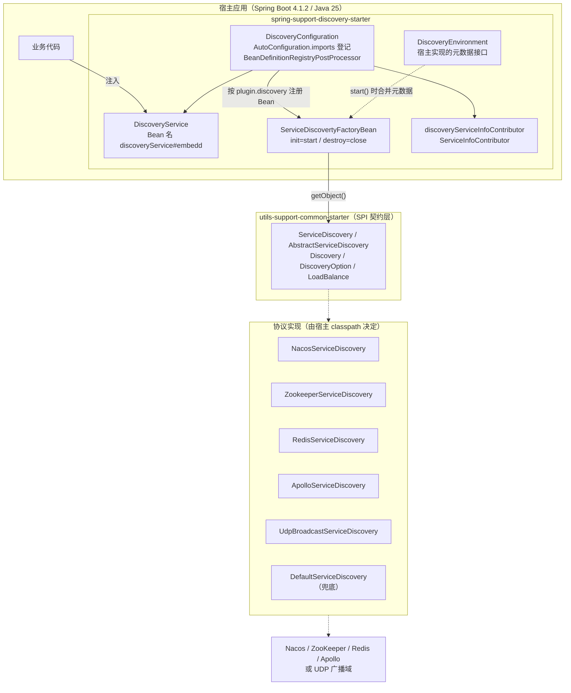
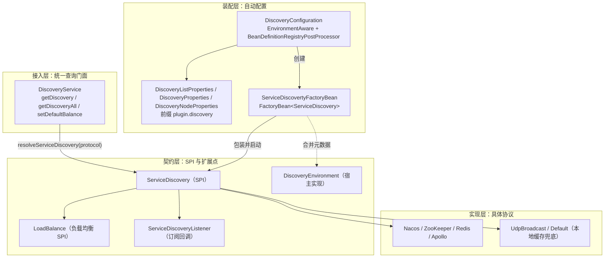
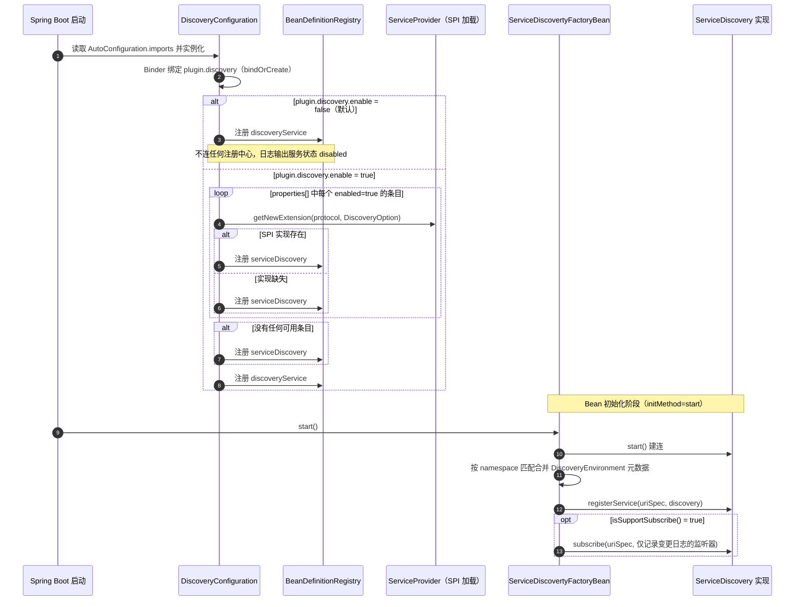
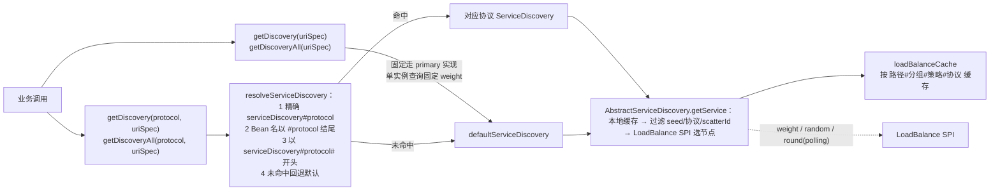

# spring-support-discovery-starter

把 `ServiceDiscovery` SPI 的多协议实现装配成 Spring Bean：按配置自动创建发现客户端、注册本机服务节点、订阅变更，并对外暴露统一查询门面 `DiscoveryService`。本模块是 `spring-support-parent-starter`（4.0.0.51）体系中的「服务发现」starter，基于 Spring Boot 4.1.2 / Java 25 构建。

## 1. 架构图

### 1.1 模块在体系中的位置



- **上游**：`spring-support-common-starter`（pom 中唯一编译依赖），提供 `Project`、`ServiceInfoContributor`、`ServiceInfoRegistry`、`SpringBeanUtils`、`ModuleLog`，并传递引入 `utils-support-common-starter`（SPI 契约与兜底实现所在）。
- **协议实现**：`utils-support-nacos-starter` / `utils-support-zookeeper-starter` / `utils-support-redis-starter` / `utils-support-apollo-starter` 均为宿主可选依赖；`udp-broadcast` 与 `DefaultServiceDiscovery` 内置于 `utils-support-common-starter`，天然在 classpath 上。
- **被依赖**：`spring-support-monitor-starter`（`optional` 依赖，为「服务管理 → service-discovery 插件」提供 `/ms/monitor/discovery` 查询；缺失时该接口降级为「未启用发现服务」）。旧文档提到的 `spring-support-report-client-starter` 依赖已在其 pom 中删除，现无此关系。
- **无反向依赖**：本模块不依赖 rpc / web / 缓存等上层 starter；父 pom `dependencyManagement` 托管的是由独立工程 `spring-support-api-starter` 构建产出的 `spring-api-support-*` 制品（如 `spring-api-support-monitor-starter`，不在本 reactor 模块树中），本模块均未依赖。

### 1.2 模块内部分层



## 2. 核心流程图

### 2.1 装配与启动流程



### 2.2 查询数据流



生命周期要点（源码事实）：

- `start()` 依次执行 `serviceDiscovery.start()` → 逐节点合并 `DiscoveryEnvironment` 元数据 → `registerService(namespace, discovery)` → 支持订阅时 `subscribe(...)`；
- `close()` **先反注册再断连**，避免滚动重启期间实例残留到 TTL 剔除；
- 环境元数据合并在 `start()` 里做，而不是 `BeanDefinitionRegistryPostProcessor` 阶段——否则 `getBeansOfType` 会强制提前实例化业务 Bean，依赖未就绪时会拖垮启动。

## 3. 能力清单

| 能力域 | 关键类 | 入口 |
|---|---|---|
| 配置绑定 | `DiscoveryListProperties` / `DiscoveryProperties` / `DiscoveryNodeProperties` | `plugin.discovery` 前缀（`@ConfigurationProperties` + `Binder` 双读） |
| 装配编排 | `DiscoveryConfiguration`（`EnvironmentAware` + `BeanDefinitionRegistryPostProcessor`） | `META-INF/spring/org.springframework.boot.autoconfigure.AutoConfiguration.imports` |
| 客户端生命周期 | `DiscoveryConfiguration.ServiceDiscovertyFactoryBean`（`initMethod=start`、`destroyMethod=close`） | 由装配编排按协议创建，包装 SPI 实现与节点列表 |
| 统一查询门面 | `DiscoveryService`（Bean 名 `discoveryService#embedd`） | 注入即可用；`getDiscovery` / `getDiscoveryAll` / `setDefaultBalance` |
| 协议实现路由 | 各 `serviceDiscovery#<protocol>` Bean | `DiscoveryService` 内部 `resolveServiceDiscovery(protocol)` |
| 环境元数据合并 | `DiscoveryEnvironment`（宿主实现接口，`getName()` 等于节点 `namespace` 时合并 `getProperties()`） | 宿主声明 Bean，`start()` 阶段合并 |
| 负载均衡策略 | `defaultBalance`（默认 `weight`），可用 `-Dchua.discovery.balance` 覆盖；策略来自 `LoadBalance` SPI：`weight` / `random` / `round`（`polling`） | `DiscoveryService#setDefaultBalance` |
| 协议扩展点 | `com.chua.common.support.network.discovery.ServiceDiscovery`（SPI） | `META-INF/extensions/...ServiceDiscovery` 或 `@Spi` 注解 |
| 服务信息登记 | `discoveryServiceInfoContributor`（`ServiceInfoContributor`，登记标志 `discovery`） | 启动横幅 / 服务信息面板 |
| 开关关闭时的降级 | `DefaultServiceDiscovery`（本地缓存空实现，无网络行为） | `plugin.discovery.enable=false` 或所有配置不可用时 |

## 4. Bean 能力矩阵

本模块**没有使用任何 `@ConditionalOnXxx` 注解**：`DiscoveryConfiguration` 通过 `Binder.get(environment).bindOrCreate("plugin.discovery", ...)` 手工读取开关后，在 `postProcessBeanDefinitionRegistry` 阶段编程式注册 Bean。因此下表「装配条件」均为运行期代码分支，而非条件注解。

| Bean 名 | 类型 | 装配条件 | 可否覆盖 | 典型注入姿势 |
|---|---|---|---|---|
| `discoveryService#embedd` | `DiscoveryService` | **始终注册**。`enable=false` 时用 `new DefaultServiceDiscovery()` 构造（`AUTOWIRE_BY_TYPE`）；`enable=true` 时构造注入（primary `ServiceDiscovery` + 全部实现 `Map<String,ServiceDiscovery>`） | 不建议同名覆盖：本模块按固定名注册 Bean 定义，宿主同名 Bean 会引发定义冲突（除非开启 `spring.main.allow-bean-definition-overriding`）。需要自定义门面时，用自己的 Bean 名并注入本模块能力 | 类型唯一，直接 `@Autowired DiscoveryService discoveryService;` |
| `serviceDiscovery#<protocol>` | `ServiceDiscovery`（实际是 `ServiceDiscovertyFactoryBean` 产出的 SPI 实现） | `enable=true` 且对应 `properties[]` 条目 `enabled=true`。SPI 缺失时该名字下注册的是 `DefaultServiceDiscovery`（降级不失败）。首个成功创建的条目 `primary=true` | 可以：宿主预先声明同名 `ServiceDiscovery` Bean 时，本模块自动改名为 `serviceDiscovery#<protocol>#0` 避让；`resolveServiceDiscovery` 精确名匹配会优先命中宿主 Bean | 单协议时 `@Autowired ServiceDiscovery`（命中 primary）；多协议时 `@Autowired @Qualifier("serviceDiscovery#nacos") ServiceDiscovery` |
| `serviceDiscovery#<protocol>#0`、`#1`… | `ServiceDiscovery` | 同一协议配置多条时按 `#0`、`#1` 递增命名 | 同上 | 只能按精确 Bean 名 + `@Qualifier` 注入 |
| `serviceDiscovery#default` | `DefaultServiceDiscovery` | `enable=true` 但所有条目都未产出实现（列表为空或全部 `enabled=false`）时注册，`primary=true` | 可同名覆盖，但一般无意义 | 仅排查降级状态时用 `@Qualifier("serviceDiscovery#default")` |
| `discoveryServiceInfoContributor` | `ServiceInfoContributor` | 无条件（`@Bean` 方法），向 `ServiceInfoRegistry` 登记 `registerFlag("discovery", "服务发现", true, "服务发现模块")` | 可以（普通 `@Bean` 覆盖规则） | 不建议注入；由服务信息面板自动收集 |
| （宿主实现）`DiscoveryEnvironment` | `DiscoveryEnvironment` | 本模块**不注册**该接口的 Bean；`ServiceDiscovertyFactoryBean#start()` 通过 `SpringBeanUtils.getBeanList` 收集宿主实现并合并元数据 | —— | 宿主 `@Component` / `@Bean` 实现 `getName()` + `getProperties()` |

> 注：`DiscoveryConfiguration` 类本身也是自动配置 Bean（`AutoConfiguration.imports` 登记），无 `@AutoConfiguration` 注解，依赖 `@EnableConfigurationProperties(DiscoveryListProperties.class)` 完成配置 Bean 注册。

## 5. 完整配置

配置类 `DiscoveryListProperties`，前缀 `plugin.discovery`，`ignoreInvalidFields = true`；列表元素 `DiscoveryProperties`，节点元素 `DiscoveryNodeProperties`。以下字段全部来自源码，无虚构项。

| 配置路径 | 类型 | 默认值 | 说明 | 生效开关 |
|---|---|---|---|---|
| `plugin.discovery.enable` | `boolean` | `false` | 总开关。`false` 时只注册 `discoveryService#embedd`（内含 `DefaultServiceDiscovery`），不连任何注册中心 | ——（自身即总开关） |
| `plugin.discovery.properties` | `List<DiscoveryProperties>` | `[]` | 多发现中心配置列表 | `enable=true` |
| `plugin.discovery.properties[n].enabled` | `boolean` | `true` | 单条配置是否启用；`false` 的条目跳过创建 | `enable=true` |
| `plugin.discovery.properties[n].protocol` | `String` | 无（`null`） | 协议名，对应 `ServiceDiscovery` SPI 名：`nacos` / `zookeeper` / `redis` / `apollo` / `udp-broadcast`，或自定义 SPI 名 | `enable=true` 且该条 `enabled=true` |
| `plugin.discovery.properties[n].address` | `String` | 无（`null`） | 注册中心地址，装入 `DiscoveryOption#setAddress` | 同上 |
| `plugin.discovery.properties[n].username` | `String` | 无（`null`） | 账号，装入 `DiscoveryOption#setUser` | 同上 |
| `plugin.discovery.properties[n].password` | `String` | 无（`null`） | 密码，装入 `DiscoveryOption#setPassword` | 同上 |
| `plugin.discovery.properties[n].connection-timeout-millis` | `int` | `10000` | 连接超时（毫秒），装入 `DiscoveryOption` | 同上 |
| `plugin.discovery.properties[n].session-timeout-millis` | `int` | `10000` | 会话超时（毫秒），装入 `DiscoveryOption` | 同上 |
| `plugin.discovery.properties[n].node` | `List<DiscoveryNodeProperties>` | `[]` | 要注册的本机服务节点列表 | 同上 |
| `plugin.discovery.properties[n].node[m].server-id` | `String` | 无（`null`，运行时用 `Project.calcApplicationUuid()` 兜底） | 实例 ID，成为 `Discovery#id`，是反注册键 | 同上 |
| `plugin.discovery.properties[n].node[m].namespace` | `String` | 无（`null`） | 服务命名空间，即注册/查询用的 `uriSpec`；也是匹配 `DiscoveryEnvironment#getName()` 的键 | 同上 |
| `plugin.discovery.properties[n].node[m].protocol` | `String` | `http` | 节点通信协议，写入 `Discovery#protocol` | 同上 |

JVM 参数（非 Spring 配置项）：

| 参数 | 默认值 | 说明 |
|---|---|---|
| `-Dchua.discovery.balance=<strategy>` | `weight` | 默认负载均衡策略，读取点为 `DiscoveryService` 字段初始化 `System.getProperty("chua.discovery.balance", "weight")`。可取值来自 `LoadBalance` SPI：`weight`、`random`、`round` / `polling`；未知策略由 `AbstractServiceDiscovery` 回退为列表第一个节点。注意：只作用于 `getDiscovery(protocol, uriSpec)`；不带协议的 `getDiscovery(uriSpec)` 走接口默认实现，固定 `weight` |

源码说明：`DiscoveryOption` 中还存在 `root` / `database` / `deferToInterface` / `extra` 字段，但 `DiscoveryConfiguration#registryBean` **只绑定** address / username / password / 两个超时，其余字段不从 `plugin.discovery` 配置读取；绑定阶段 `ignoreInvalidFields = true`，非法字段名不会导致启动失败。

## 6. 使用方式

### 6.1 Maven 坐标

```xml
<dependency>
    <groupId>com.chua</groupId>
    <artifactId>spring-support-discovery-starter</artifactId>
    <version>4.0.0.51</version>
</dependency>
```

版本由 `spring-support-parent-starter` 的 `dependencyManagement` 统一托管（`${project.version}`），子模块可省略 `<version>`。

### 6.2 依赖说明

| 依赖 | 作用 | 是否必需 |
|---|---|---|
| `spring-support-common-starter` | `Project`、`ServiceInfoContributor`、`SpringBeanUtils`、`ModuleLog`，并传递 `utils-support-common-starter`（SPI 契约、`DefaultServiceDiscovery`、`UdpBroadcastServiceDiscovery`） | 必需（pom 中唯一声明的依赖） |
| `utils-support-nacos-starter` | `protocol: nacos` → `NacosServiceDiscovery` | 按需 |
| `utils-support-zookeeper-starter` | `protocol: zookeeper` → `ZookeeperServiceDiscovery` | 按需 |
| `utils-support-redis-starter` | `protocol: redis` → `RedisServiceDiscovery` | 按需 |
| `utils-support-apollo-starter` | `protocol: apollo` → `ApolloServiceDiscovery` | 按需 |
| （无需额外依赖） | `protocol: udp-broadcast` → `UdpBroadcastServiceDiscovery`，随 `utils-support-common-starter` 传递，经 `@Spi("udp-broadcast")` 登记 | 自动可用 |

本模块 pom **不引入任何注册中心客户端**。未引入对应实现时，`ServiceProvider.getNewExtension(protocol, option)` 返回 `null`，日志输出「[Discovery] 未发现可用的服务实现」并注册 `DefaultServiceDiscovery`——启动不失败，但注册/查询都是本地空操作。

### 6.3 最小可运行示例

**第一步**：引入本模块与所用注册中心的 utils 实现（以 Nacos 为例：`utils-support-nacos-starter`）。

**第二步**：打开开关并声明发现中心与节点：

```yaml
plugin:
  discovery:
    enable: true
    properties:
      - protocol: nacos
        address: http://localhost:8848
        username: nacos
        password: nacos
        connection-timeout-millis: 10000
        session-timeout-millis: 10000
        node:
          - server-id: ${spring.application.name}
            namespace: /demo-service
            protocol: http
```

**第三步**：启动应用。注册在 `serviceDiscovery#nacos` Bean 初始化（`initMethod=start`）阶段完成，无需写任何注册代码；业务侧注入 `DiscoveryService` 查询即可：

```java
@Service
@RequiredArgsConstructor
public class DemoService {

    private final DiscoveryService discoveryService;

    /** 单个实例：按默认协议（primary 实现）查询，负载均衡固定 weight */
    public Discovery getOne(String uriSpec) {
        return discoveryService.getDiscovery(uriSpec);
    }

    /** 全部实例 */
    public Set<Discovery> getAll(String uriSpec) {
        return discoveryService.getDiscoveryAll(uriSpec);
    }

    /** 多注册中心并存时按协议查询：单实例使用 defaultBalance（默认 weight，可被 -Dchua.discovery.balance 覆盖） */
    public Discovery getFromNacos(String uriSpec) {
        return discoveryService.getDiscovery("nacos", uriSpec);
    }
}
```

**切换默认负载均衡策略**（仅影响带 protocol 的查询）：

```java
discoveryService.setDefaultBalance("random");   // 可用值：weight / random / round(polling)
```

**直接操作 SPI（可选）**：容器里的 `ServiceDiscovery` Bean 也可注入。`registerService` / `unregisterService` / `updateService` 返回 `this`，支持链式调用：

```java
@Autowired
private ServiceDiscovery primaryServiceDiscovery;   // 命中 primary 实现

primaryServiceDiscovery
        .registerService("/demo-service", discovery)
        .updateService("/demo-service", discovery);
```

**手工构造实例**（`Discovery` 带 `@Builder`，用于配置驱动之外的补充注册）：

```java
Discovery discovery = Discovery.builder()
        .id("demo-node-1")              // 反注册键，实例生命周期内稳定
        .uriSpec("/demo-service")       // 命名空间
        .host("127.0.0.1")
        .port(8080)
        .protocol("http")
        .weight(1.0d)
        .build();

serviceDiscovery.registerService(discovery.getUriSpec(), discovery);
```

`Discovery` 主要字段（`com.chua.common.support.network.discovery.Discovery`）：

```text
id         实例唯一标识（配置的 serverId 或应用 UUID），反注册用它
serverId   md5(host + port) 地址指纹，端口变化即变化，不要拿它当反注册键
scatterId  业务分组，仅同组节点参与同一负载均衡池
uriSpec    命名空间
host/port  本机地址与端口（来自 Project）
protocol   节点协议，默认 http
metadata   Project 元数据 + DiscoveryEnvironment 合并的属性（另含 serverId 键）
weight     负载均衡权重
timeout    请求超时（毫秒）
env        运行环境，默认 prod
```

## 7. 使用场景

**适用**：

- 服务实例需要注册到注册中心（Nacos / ZooKeeper / Redis / Apollo / UDP 广播），并按名字做服务发现与负载均衡选取；
- 多注册中心并存，希望用统一门面 `DiscoveryService` 屏蔽协议差异（`getDiscovery("nacos", path)` vs `getDiscovery("zookeeper", path)`）；
- 需要随注册上报应用元数据（`Project` 信息 + `DiscoveryEnvironment` 扩展属性）；
- 监控侧需要查询实例列表：`spring-support-monitor-starter` 的 `/ms/monitor/discovery` 直接消费本模块的 `DiscoveryService`。

**不适用**：

- 只需要配置中心（命名空间配置下发）——用 `spring-support-configcenter-starter`，本模块只管「服务实例的注册与发现」；
- 强依赖注册中心的健康检查 / 摘除策略——本模块不做统一探活，健康检查语义由具体 `ServiceDiscovery` 实现决定；
- 进程不允许任何外部连接且不需要实例互通——`enable=false` 保持默认即可，模块退化为本地空实现。

**与相邻模块的取舍**：

- **vs monitor 的 service-discovery 插件**：`spring-support-monitor-starter` 的「服务管理 → service-discovery 插件」基于 utils 框架的 `ServiceDiscoveryServerFilter`（参数 `discoveryName` / `discovery.name`），面向网络服务端过滤器场景；本模块面向 Spring 宿主的注册与查询。monitor 的 `/ms/monitor/discovery` 是查询端点：优先读已挂载插件的 `ServiceDiscoveryServerFilter`，否则回落到本模块的 `DiscoveryService`。
- **vs 直接使用 nacos-client 等**：本模块提供统一 SPI 门面、Bean 生命周期管理（`start` 注册 / `close` 先反注册再断连）、元数据合并、负载均衡缓存；代价是多一层抽象，注册中心特有能力（如 Nacos 集群、元数据监听细粒度控制）需经 SPI 实现或直接操作 `ServiceDiscovery` Bean。
- **与 web / rpc starter 无耦合**：注册的 `Discovery` 只是地址与元数据模型，消费方自行决定如何调用（HTTP、TCP 等）。

## 8. 扩展点

本模块自身代码不提供可继承的抽象类，扩展点全部位于 `utils-support-common-starter` 的 SPI 契约层，由本模块装配生效：

### 8.1 `ServiceDiscovery` SPI（新增协议实现）

扩展点接口：`com.chua.common.support.network.discovery.ServiceDiscovery`。实现会被 `ServiceProvider#getNewExtension(protocol, DiscoveryOption)` 创建，因此**必须提供接收 `DiscoveryOption` 的构造方法**。

```java
@Spi("myproto")   // 方式一：注解登记；方式二：META-INF/extensions 登记文件
public class MyServiceDiscovery extends AbstractServiceDiscovery {

    public MyServiceDiscovery(DiscoveryOption option) {
        super(option);
    }

    @Override
    public void start() { /* 建连 */ }

    @Override
    public Set<Discovery> getServiceAll(String path) { /* 查询列表 */ }
}
```

登记方式二选一：

1. `@Spi("myproto")` 注解（SPI 框架扫描注解）；
2. 在自己的 jar 下新建 `META-INF/extensions/com.chua.common.support.network.discovery.ServiceDiscovery`，内容为 `名称=实现类全限定名`（与 nacos 模块的登记文件同格式）：

```text
myproto=com.example.discovery.MyServiceDiscovery
```

生效：把该 jar 放进宿主 classpath，配置里写 `protocol: myproto`；`DiscoveryConfiguration` 启动时按该协议创建 Bean，Bean 名为 `serviceDiscovery#myproto`。

### 8.2 `AbstractServiceDiscovery` 钩子

继承 `AbstractServiceDiscovery` 时可重写：`start()`（建连）、`get(path)`（服务列表来源，默认读本地缓存）、`doUnregister` / `doUpdate`（写后端钩子）、`isSupportSubscribe()` / `subscribe(...)`（订阅能力）、`needsPathPrefixIsolation()`（集群路径前缀隔离）。基类已提供本地缓存、按 `serverId` 幂等去重、负载均衡器按「路径#分组#策略#协议」缓存、路径向上回溯匹配等通用能力。

### 8.3 `DiscoveryEnvironment`（宿主元数据扩展）

宿主实现该接口并声明为 Bean，`getName()` 返回值与节点 `namespace` 完全相等时，其 `getProperties()` 会在 `start()` 阶段合并进该节点注册元数据。适合补充版本号、灰度标记、机房信息等。

### 8.4 `LoadBalance` SPI（自定义负载均衡策略）

实现 `com.chua.common.support.lang.balance.LoadBalance` 并以 `@Spi("自定义策略名")` 登记，即可通过 `-Dchua.discovery.balance=自定义策略名` 或 `discoveryService.setDefaultBalance("自定义策略名")` 使用。内置策略：`weight`（`WeightLoadBalance`）、`random`（`RandomRoundLoadBalance`）、`round` / `polling`（`RoundLoadBalance`）。

### 8.5 `ServiceDiscoveryListener`（变更订阅）

`serviceDiscovery.subscribe(uriSpec, listener)` 可注册变更回调。本模块内置订阅仅打日志（`[Discovery] 服务变更`），不维护本地缓存、不通知业务方；需要变更驱动时自行订阅。

## 9. 常见问题

**Q1：引入了依赖，但服务没有注册 / 查询返回空？**
`plugin.discovery.enable` 默认 `false`。未开启时容器里只有 `discoveryService#embedd`（内含 `DefaultServiceDiscovery` 本地空实现），注册与查询都是空操作。先检查开关，再检查 `properties[n].enabled` 与 `protocol` 拼写。

**Q2：日志出现「[Discovery] 未发现可用的服务实现」？**
`protocol` 对应的 SPI 实现不在 classpath：nacos / zookeeper / redis / apollo 需要引入各自的 `utils-support-*-starter`；或协议名写错。此时本模块降级注册 `DefaultServiceDiscovery`，启动不失败，但功能为空。

**Q3：装配出的 Bean 和我的同名 Bean 冲突？**
本模块在 `BeanDefinitionRegistryPostProcessor` 阶段按固定名注册（`discoveryService#embedd`、`serviceDiscovery#<protocol>`、`discoveryServiceInfoContributor`）。宿主若声明同名 Bean 会产生 Bean 定义冲突；唯一例外是 `serviceDiscovery#<protocol>`：宿主同名 Bean 会让本模块改用 `#0` 后缀避让，且 `resolveServiceDiscovery` 精确名匹配优先命中宿主 Bean。不要依赖 `spring.main.allow-bean-definition-overriding=true` 来强行覆盖。

**Q4：多协议并存时注入 `ServiceDiscovery` 报 `NoUniqueBeanDefinitionException`？**
容器里有多个 `ServiceDiscovery` Bean 时，按类型注入必须消歧：用 `@Qualifier("serviceDiscovery#nacos")` 指定 Bean 名，或改注入 `DiscoveryService` 按协议查询。只有一个协议时可直接按类型注入（命中 primary）。

**Q5：改了端口后，注册中心里残留旧实例？**
`Discovery#serverId` 是 `md5(host + port)`，端口一变它就变，用它反注册会留下孤儿注册。反注册请用 `Discovery#id`（配置的 `server-id` 或应用 UUID）或传整个 `Discovery` 对象。本模块正常 `close()` 会先反注册再断连；进程被强杀（kill -9）时无法反注册，只能依赖注册中心 TTL/心跳剔除。

**Q6：`-Dchua.discovery.balance` 或 `setDefaultBalance` 没生效？**
`defaultBalance` 只作用于 `getDiscovery(protocol, uriSpec)`；不带协议的 `getDiscovery(uriSpec)` 走 `ServiceDiscovery#getService(path)` 接口默认实现，固定 `weight`。另外策略名必须是 `LoadBalance` SPI 已登记的名字，未知策略会回退为实例列表第一个，不会报错。

**Q7：`DiscoveryEnvironment` 的元数据没有合并进注册信息？**
合并条件是 `getName()` 与节点 `namespace`（即 `uriSpec`）**完全相等**（`null` 名不匹配）；且合并在 `ServiceDiscovertyFactoryBean#start()` 阶段执行，合并失败只告警不中断。检查命名是否一致、Bean 是否被容器管理。

**Q8：与 Spring Boot 4 的兼容性？**
本仓库以 `spring-boot-starter-parent` **4.1.2**（2026-11-19 升级）为父 POM，Java 25 编译。本模块通过 `META-INF/spring/org.springframework.boot.autoconfigure.AutoConfiguration.imports` 注册自动配置（**没有** `spring.factories`，Spring Boot 3 起也不再需要）；配置绑定使用 `@ConfigurationProperties` + `Binder`，均为 Boot 4 标准用法。monitor 集成侧用 `@ConditionalOnClass` + `ObjectProvider` 做了缺失降级，Boot 4 下可正常工作。

**Q9：订阅了服务变更但收不到通知？**
内置的 `ServiceDiscoveryListener` 只在 `isSupportSubscribe()` 为 `true` 的实现上注册，且仅记录 `[Discovery] 服务变更` 日志，不维护本地实例缓存、不回调业务代码。需要变更驱动的业务请自行调用 `serviceDiscovery.subscribe(uriSpec, 自己的 listener)`，并注意所选协议实现是否支持订阅（不支持时 `subscribe` 抛 `UnsupportedOperationException`）。

---

本项目采用 Apache License 2.0 许可证。
