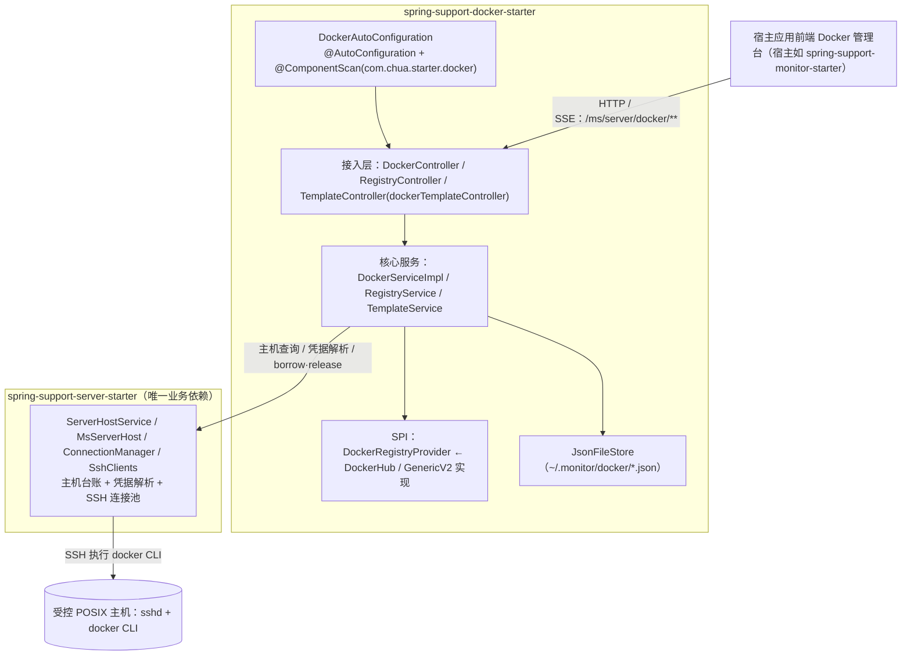
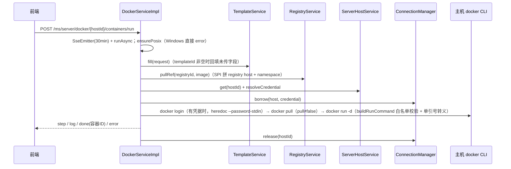

# spring-support-docker-starter

Docker 独立管理模块：容器、镜像、网络、卷、镜像库与容器模板的完整管理台后端。全部能力经 SSH 在受控 POSIX 主机上执行 `docker` CLI，不要求暴露 Docker TCP 端口（2375/2376）；镜像库走 `DockerRegistryProvider` SPI，长耗时操作统一以 SSE 实时回显。在 spring-support 体系中，它是 `spring-support-server-starter` 之上的运维能力模块：只消费 server 的主机台账与 SSH 连接设施，不反向依赖 monitor，可被任意宿主（如 `spring-support-monitor-starter`）按需引入。

## 1. 架构图



依赖方向：本模块 → `spring-support-server-starter`（外加 web / jackson / swagger-annotations / lombok），不依赖 monitor，避免循环依赖（`DockerAutoConfiguration` 类注释口径）；项目发布类型扩展 `DockerProjectTypeProvider` 经 `META-INF/extensions` 由发布侧 `ProjectTypeProviderRegistry` 消费，不走 HTTP 链路。

## 2. 核心流程图

创建并启动容器（SSE）——最能串联本模块各组件的请求流程：



其余 SSE 流程（卸载容器/镜像、拉取镜像、日志流、交互终端）复用同一「borrow → 执行 → step/log/done/error → release」骨架；日志流与终端额外发 `session` 事件，终端数据走 `output`、结束发 `closed`。

## 3. 能力清单

入口前缀 `ServerConstants.API_PREFIX = "/ms/server"`（源码常量）。

### 3.1 容器 / 镜像 / 网络 / 卷（`DockerController` → `DockerServiceImpl`，hostId 维度）

| 能力域 | 关键类 / 方法 | 入口（REST） |
|---|---|---|
| 能力探测 | `DockerServiceImpl#capability` | `GET /ms/server/docker/{hostId}/capability` |
| 容器列表 / 详情 | `#containers` / `#containerDetail` | `GET .../containers?all=`、`GET .../containers/{id}` |
| 生命周期（start/stop/restart/pause/unpause/kill） | `#containerAction` | `POST .../containers/{id}/{action}` |
| 删除容器（同步 / SSE） | `#removeContainer` / `#removeContainerStream` | `DELETE .../containers/{id}?force=`、`POST .../containers/{id}/remove-stream` |
| 创建并启动容器（SSE） | `#runContainer` | `POST .../containers/run` |
| 容器日志（一次性 / SSE 流） | `#containerLogs` / `#streamContainerLogs` | `GET .../containers/{id}/logs?tail=`、`GET .../containers/{id}/logs/stream?tail=` |
| 交互终端（PTY）+ 输入 + 关闭 | `#execContainer` / `#execInput` / `#execClose` | `POST .../containers/{id}/exec`、`.../exec/input`、`.../exec/close` |
| 镜像：列表 / 拉取（SSE）/ 删除（同步 / SSE） | `#images` / `#pullImage` / `#removeImage` / `#removeImageStream` | `GET .../images`、`POST .../images/pull?image=&registryId=`、`DELETE .../images/{imageId}?force=`、`POST .../images/{imageId}/remove-stream` |
| 网络 / 卷：列表·创建·删除 | `#networks` / `#createNetwork` / `#removeNetwork` / `#volumes` / `#createVolume` / `#removeVolume` | `GET\|POST .../networks`、`DELETE .../networks/{id}`、`GET\|POST .../volumes`、`DELETE .../volumes/{name}` |
| 清理悬空资源 | `#prune`（`docker system prune -af --volumes`） | `POST .../prune` |

### 3.2 镜像库与模板（全局维度，`RegistryController` / `TemplateController`）

| 能力域 | 关键类 / 方法 | 入口（REST） |
|---|---|---|
| 镜像库列表 / 保存 / 删除 | `RegistryService#list` / `#save` / `#delete` | `GET\|POST /ms/server/docker/registries`、`DELETE .../registries/{id}` |
| 连通性测试 / 库类型 / 标签 | `#test` / `#types` / `#tags` | `POST .../registries/{id}/test`、`GET .../registries/types`、`GET .../registries/{id}/tags?image=` |
| 在线检索镜像（跨库并发） | `#search` | `GET /ms/server/docker/images/search?keyword=&registryId=&limit=` |
| 模板列表 / 保存 / 删除 | `TemplateService#list` / `#save` / `#delete` | `GET\|POST /ms/server/docker/templates`、`DELETE .../templates/{id}` |

### 3.3 非 REST 能力

| 能力域 | 关键类 | 触发方式 |
|---|---|---|
| 自动配置 | `com.chua.starter.docker.config.DockerAutoConfiguration` | `META-INF/spring/org.springframework.boot.autoconfigure.AutoConfiguration.imports` |
| 镜像库 SPI | `DockerRegistryProvider`（内置 `dockerhub` / `generic-v2` 实现） | Spring Bean 集合，`RegistryService` 构造器按 `type()` 建索引 |
| 项目发布类型扩展 | `DockerProjectTypeProvider`（`@Spi(value = "docker", order = 100)`） | `META-INF/extensions/com.chua.starter.server.support.spi.ProjectTypeProvider` |
| JSON 持久化 / HTTP 工具 | `JsonFileStore`（包级私有）/ `RegistryHttp`（`spi.impl` 包私有） | 服务内部使用；`RegistryHttp` 共享 `HttpClient`（连接超时 5s、读取超时 8s）+ Basic Auth |

SSE 事件名契约（`DockerService` 注释即契约）：`step`（阶段说明）、`log`（输出增量）、`done`（成功）、`error`（失败原因）。

## 4. Bean 能力矩阵

装配总说明：`DockerAutoConfiguration` 上没有任何 `@ConditionalOnXxx`，只做 `@ComponentScan(basePackages = "com.chua.starter.docker")`；下表 Bean 全部为**无条件装配**——jar 在 classpath 且自动装配未被排除即注册。全模块没有任何 `@ConditionalOnMissingBean`，因此「覆盖」只能靠 `spring.main.allow-bean-definition-overriding=true` 下的同名 Bean 覆盖（默认重名即启动失败）。

| Bean 名 | 类型 | 装配条件 | 可否覆盖 | 典型用途 |
|---|---|---|---|---|
| `dockerController` / `registryController` | `DockerController` / `RegistryController`（`@RestController`） | 无条件（组件扫描） | 需开 `allow-bean-definition-overriding`；默认重名失败 | 一般不注入，经 HTTP 调用 |
| `dockerTemplateController` | `com.chua.starter.docker.controller.TemplateController`（`@RestController("dockerTemplateController")`） | 无条件（组件扫描）；显式 bean 名规避与模板模块同名 `TemplateController` 冲突 | 同上 | 一般不注入 |
| `dockerServiceImpl` | `DockerServiceImpl`（`@Service`，实现 `DockerService`） | 无条件（组件扫描） | 同上；另注册同类型不同名 Bean 会导致按类型注入歧义，需 `@Primary` | 宿主注入 `DockerService` 接口复用能力 |
| `registryService` | `RegistryService`（`@Service`） | 无条件（组件扫描）；构造器注入 `List<DockerRegistryProvider>` | 同上 | 镜像库 CRUD / 检索 / `pullRef` / `config(id)` |
| `templateService` | `TemplateService`（`@Service`） | 无条件（组件扫描） | 同上 | 模板 CRUD 与 `fill` 回填 |
| `dockerHubRegistryProvider` / `genericV2RegistryProvider` | `DockerHubRegistryProvider`（`type()="dockerhub"`）/ `GenericV2RegistryProvider`（`type()="generic-v2"`），均 `@Component` | 无条件（组件扫描） | 新增优先：同 `type()` 的 Bean 后到者覆盖索引（`LinkedHashMap#put`） | 由 `RegistryService` 收集，不推荐直接注入 |

非 Bean 关键组件：`DockerProjectTypeProvider`（`META-INF/extensions` 注册，不进 Spring 容器）、`JsonFileStore`（服务构造时 `new`，包级私有 final 类）、`RegistryHttp`（`spi.impl` 包私有静态工具）。

## 5. 完整配置

**本模块没有 `@ConfigurationProperties`、没有 `@Value`，不存在任何 `application.yml` 配置键**（全模块源码逐文件核验）。是否启用 = 宿主是否引入本依赖，无 `docker.enabled` 之类开关。

模块固定使用两个本机持久化文件（路径在构造时以 `System.getProperty("user.home")` 写死，不可配置）：

| 固定路径 | 内容 | 写入保证（`JsonFileStore`） |
|---|---|---|
| `~/.monitor/docker/registries.json` | 镜像库配置（含明文密码） | UTF-8 无 BOM；临时文件 + `ATOMIC_MOVE` 原子替换；`ReentrantLock` 串行化读改写 |
| `~/.monitor/docker/templates.json` | 容器模板 | 同上 |

以下行为参数为代码内常量 / 请求级默认值，同样不可经配置修改：

| 参数 | 值 / 规则 | 代码位置 |
|---|---|---|
| SSE 超时 / 输出截断 | 30 分钟（`SSE_TIMEOUT_MILLIS`）/ 64KB（`OUTPUT_TRUNCATE`） | `DockerServiceImpl` |
| 命令超时常量 | `EXEC_TIMEOUT_SECONDS = 30` 仅在类中声明，当前未传入任何 `exec` 调用，实际不生效（远程命令没有本模块级超时，取决于 SSH 会话默认行为） | `DockerServiceImpl` |
| action / 重启策略白名单 | `start`/`stop`/`restart`/`pause`/`unpause`/`kill`；`no`/`always`/`unless-stopped`/`on-failure` | `DockerServiceImpl#containerAction` / `#buildRunCommand` |
| 字段格式白名单 | 镜像名 `[A-Za-z0-9][A-Za-z0-9._/:@-]*`、端口 `\d{1,5}:\d{1,5}(/(tcp\|udp))?`、环境变量 `KEY=VALUE`、卷映射 `src:dst`、名称 `[A-Za-z0-9][A-Za-z0-9_.-]*` | `DockerServiceImpl#buildRunCommand` 等 |
| 列表 / 日志 / 终端默认值 | 容器列表 `all` 缺省 `true`；日志 `tail` 一次性缺省 200、流缺省 100；终端默认命令 `/bin/sh` | `DockerServiceImpl` |
| 检索与目录上限 | 检索 `limit` 缺省 25、上限 100（`DEFAULT_LIMIT`/`MAX_LIMIT`），关键词 <2 字符返回空；`CATALOG_MAX=500`（`limit*CATALOG_FACTOR(10)` 封顶）；`TAG_LIMIT=100` | `RegistryService#search` / `GenericV2RegistryProvider` / `DockerHubRegistryProvider` |
| 内置库 / Hub 常量 / login 标记 | 内置库 id 固定 `dockerhub`（`BUILTIN_ID`）、`builtin=true`、不可删除、可改地址/凭据；密码「不修改」回传 `******`（`PASSWORD_MASK`）或空串；Hub API `https://hub.docker.com`（`HUB_API`，检索不受镜像加速地址影响）；heredoc 标记 `CHUA_DOCKER_LOGIN_EOF`（密码经标准输入） | `RegistryService` / `DockerHubRegistryProvider` / `DockerServiceImpl#LOGIN_EOF` |

## 6. 使用方式

### 6.1 Maven 坐标

```xml
<dependency>
    <groupId>com.chua</groupId>
    <artifactId>spring-support-docker-starter</artifactId>
    <version>4.0.0.51</version>
</dependency>
```

依赖会传递带入 `spring-support-server-starter`（主机台账 + SSH 连接池）、`spring-boot-starter-web`、`jackson-databind`、`swagger-annotations`；`lombok` 为 `optional`，仅编译本模块时需要。pom 设置 `spring-boot.repackage.skip=true`：只产出标准库 jar，**不能 `java -jar` 直接启动**，必须由宿主应用依赖后运行。

### 6.2 最小启用示例

无需任何 yml 配置（见第 5 节），引入依赖即整体装配：

```java
@SpringBootApplication
public class App {
    public static void main(String[] args) { SpringApplication.run(App.class, args); }  // 无需扫描 com.chua.starter.docker
}

@RestController @RequiredArgsConstructor
class DemoController {
    private final DockerService dockerService;  // 注入接口，实现为 DockerServiceImpl
    @GetMapping("/demo/capability")
    public ReturnResult<Map<String, Object>> capability() { return dockerService.capability(1L); }
}
```

创建容器（SSE）：

```java
DockerCreateRequest request = new DockerCreateRequest();  // @Data POJO，setter 赋值，无 Builder
request.setImage("nginx:alpine");
request.setPorts(List.of("8080:80"));
request.setVolumes(List.of("/data/nginx:/usr/share/nginx/html"));
request.setRestartPolicy("unless-stopped");
request.setPull(true);
request.setRegistryId("dockerhub");   // 可空；非空时先按库凭据 docker login
request.setTemplateId(null);          // 可空；非空时先按模板回填未传字段
SseEmitter emitter = dockerService.runContainer(1L, request);
```

前置条件：① 宿主已接入 server 模块主机台账（存在 `MsServerHost` 记录且 `ServerHostService#resolveCredential` 能解析 SSH 凭据，否则报「主机不存在」或凭据解析失败）；② 目标主机为 POSIX（Linux/macOS），所有入口先 `ensurePosix(hostId)`，Windows 主机抛 `UnsupportedOperationException`；③ 主机无需暴露 Docker TCP 端口，全部经 SSH 执行 `docker` CLI。

### 6.3 可选依赖说明

| 依赖 | 是否必需 | 缺失影响 |
|---|---|---|
| `spring-support-server-starter` | 必需（传递带入） | 无法编译/启动：主机台账、凭据解析、连接池、`ServerConstants`、`ProjectTypeProvider` 扩展点均来自它 |
| `spring-boot-starter-web` | 必需（传递带入） | 无 `@RestController` / `SseEmitter`，模块无法工作 |
| `jackson-databind` | 必需（传递带入） | `docker --format '{{json .}}'` 输出与本地 JSON 持久化无法解析 |
| `swagger-annotations` / `lombok` | 必需（传递带入）/ 编译期 `optional` | 前者仅 `@Tag`/`@Operation`/`@Schema` 注解、无运行时逻辑；后者仅编译本模块源码时需要，宿主运行期不需要 |

宿主无需引入 docker-java 等 Docker 客户端库——本模块只经 SSH 调用主机上的 `docker` 命令。

## 7. 使用场景

**适用：**

- 需要集中式 Docker 管理台，统一管理多台受控 POSIX 主机的容器/镜像/网络/卷，且不想暴露 Docker TCP 端口或安装额外 Agent（复用已有 SSH 通道）；长耗时操作（拉镜像、建容器、卸载、看日志、进终端）需要 SSE 实时进度回显。
- 「在线选镜像 → 选 tag → 一键安装」流程，且镜像来源不止 Docker Hub（私有 Harbor / Nexus / registry:2 走 `generic-v2`）。
- 项目发布需要「按 Dockerfile 构建镜像并运行容器」的项目类型（`DockerProjectTypeProvider`）。

**不适用 / 慎用：**

- Windows 宿主机容器管理（`ensurePosix` 直接拒绝，无 Windows 容器/命名管道实现）；Kubernetes / 编排场景（只面向单机 `docker` CLI，与主机工作台的 K8s 能力解耦）。
- 高安全 / 多实例场景需注意：镜像库密码明文落 `~/.monitor/docker/registries.json`；`exec` 会话在内存 `ConcurrentHashMap`，多实例必须会话粘滞；命令仅白名单字段，不接受任意 shell 透传（有意限制）。

**与相邻模块的取舍：**

| 相邻模块 | 关系 | 取舍 |
|---|---|---|
| `spring-support-server-starter` | 唯一业务依赖：主机台账、凭据解析、SSH 连接池 | 主机/凭据维护在 server 侧；本模块只消费其 Service 契约，不直连其持久层 |
| `spring-support-control-starter` | 在 monitor 中并列引入、互相无依赖 | 远程控制（WebRTC 信令）选 control；容器管理选本模块；协议与页面独立，可同时使用 |
| `spring-support-monitor-starter` | 聚合宿主，自动装配本模块全部接口 | 要全家桶就依赖 monitor；只要 Docker 能力则直接依赖本模块，避免带入多余 Controller/任务（R5「依赖即带入」） |
| Docker SDK（docker-java 等） | 本模块未采用 | 需要编程式 Docker API 细粒度控制时自行引入 SDK；本模块定位是「SSH + CLI」的低侵入管理台 |

## 8. 扩展点

### 8.1 镜像库 SPI：`DockerRegistryProvider`（Spring Bean）

实现 `com.chua.starter.docker.spi.DockerRegistryProvider` 并声明为 Spring Bean（如 `@Component`）即可新增镜像库类型，无需改动服务与控制器。`RegistryService` 构造器注入 `List<DockerRegistryProvider>` 并按 `type()` 建 `LinkedHashMap` 索引，`GET .../registries/types` 立即列出新增类型；**它不是 JDK SPI，不要在 `META-INF/services` 登记**；查找不到实现时 `RegistryService#providerFor` 抛 `IllegalStateException`（「没有可用的镜像库实现」），不做静默降级。

| 方法 | 作用 | 约定 |
|---|---|---|
| `String type()` | 库类型标识，持久化在 `RegistryConfig.type` | 必须唯一；重复时后注册者覆盖索引 |
| `String displayName()` | 前端「镜像库类型」下拉展示名 | — |
| `List<Map<String,Object>> search(RegistryConfig, String keyword, int limit)` | 在线检索 | 统一结构：`name`/`description`/`stars`/`official`/`pullRef` |
| `List<String> tags(RegistryConfig, String image)` | 镜像标签列表 | 查询失败返回空列表 |
| `String pullRef(RegistryConfig, String image)` | 拼出可直接 `docker pull\|run` 的完整引用 | 后端统一用 `pullRef` 拉取，前端不拼 host/命名空间 |
| `boolean test(RegistryConfig)` | 连通性 / 凭据测试 | — |

SPI 入参 `RegistryConfig` 字段：`id`/`name`/`type`/`url`/`username`/`password`（仅服务端内部可见，接口只回 `hasPassword`）/`namespace`/`enabled`（null 视为启用，见 `enabledOrDefault()`）/`builtin`/`createdAt`/`updatedAt`。

### 8.2 项目发布类型：`ProjectTypeProvider`（`META-INF/extensions`）

接口 `com.chua.starter.server.support.spi.ProjectTypeProvider` 来自 server 模块，本模块自带实现 `DockerProjectTypeProvider`：

- 注册：`@Spi(value = "docker", order = 100)` + 扩展点文件 `META-INF/extensions/com.chua.starter.server.support.spi.ProjectTypeProvider`，内容一行：`com.chua.starter.docker.provider.project.DockerProjectTypeProvider`
- 语义：主入口 = 容器名；`scripts(windows, mainEntry)` 走 `ProjectScripts.windowsDocker/linuxDocker`（先 `docker build`，成功后才重建容器，构建失败不影响旧容器）；单文件产物直接投放到构建上下文根目录，压缩包先解压；`pidFile()` 为 `app.pid`；POSIX 前台命令 `docker start -a '<容器名>'`
- 自定义新类型：在自己 jar 里放同名扩展点文件并追加实现类全限定名即可，发布侧 `ProjectTypeProviderRegistry` 首次解析时按 `type()` 建索引；不需要改本模块

### 8.3 可注入契约（非 SPI）

`DockerService`、`RegistryService`、`TemplateService` 是普通 Spring Bean，宿主可直接注入组合复用；它们不是扩展点——替换实现的约束见第 4 节「可否覆盖」。

## 9. 常见问题

**Q1：引入依赖后接口 404 / Bean 不生效？**
确认三点：① 依赖确实在宿主 classpath；② 宿主未排除自动装配——本模块靠 `META-INF/spring/org.springframework.boot.autoconfigure.AutoConfiguration.imports` 注册 `DockerAutoConfiguration`（Boot 4 下没有、也不会读 `spring.factories` 的自动装配登记）；③ 宿主**不需要**把 `com.chua.starter.docker` 加进自己的 `@ComponentScan`，自动配置类已代为扫描。若宿主自造容器或禁用自动装配，需自行 `@Import(DockerAutoConfiguration.class)`。

**Q2：启动报 `ConflictingBeanDefinitionException: templateController`？**
本模块 `TemplateController` 已显式命名为 `dockerTemplateController`（源码注释：避免与模板模块 `/api/template` 的同名 `TemplateController` 冲突——两个 starter 被同一应用引入时默认 bean 名都是 `templateController`，组件扫描会抛 `ConflictingBeanDefinitionException`）。若再遇其它同名冲突（如自定义了同名 Bean），要么改名，要么开启 `spring.main.allow-bean-definition-overriding=true`；注意覆盖本模块 Bean 后 SSE/SSH 行为由你的实现负责。

**Q3：需要开放 Docker 2375/2376 端口吗？有没有 `docker.enabled` 开关？与 Spring Boot 4.x 兼容吗？**
端口与开关都不需要：所有命令经 SSH（默认 22）在目标主机执行 `docker` CLI；模块没有 `docker.enabled` 之类开关，引入依赖即装配（见第 5 节）；接口路径固定在 `/ms/server/docker` 下，网关放行按此前缀配置。兼容性方面：模块随父工程基于 Spring Boot 4.1.2 / Java 25 构建（`maven-compiler-plugin` source/target 25），自动装配用 Boot 3/4 标准的 `AutoConfiguration.imports`，Web/SSE 走 jakarta 命名空间，无 javax 遗留。

**Q4：主机没装 Docker 会怎样？多实例部署交互终端（exec）有什么注意点？**
主机未装 Docker 时 `GET .../capability` 不报错，返回 `{"installed": false, "version": null, "compose": false, "runtime": "docker"}`（Windows 主机同样）；列表/操作类接口报「主机未安装或未启动 Docker」错误（`dockerFail` 按 `command not found` / `cannot connect to the docker daemon` 等关键字区分「未安装」与「执行失败」）。`execContainer` 的会话状态在 `DockerServiceImpl#execSessions`（内存 `ConcurrentHashMap`），进程重启即丢；多实例部署时 `POST .../exec/input`、`.../exec/close` 必须路由到建立会话的同一实例（会话粘滞），否则报「会话不存在或已关闭」。
